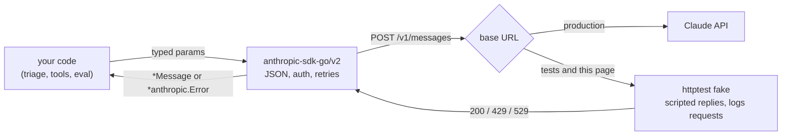

# Building with LLMs in Go

The examples on this page ran on 2026-11-27 on WSL2 (Ubuntu 24.04, kernel 5.15) with Go 1.27.4 and the official SDK `github.com/anthropics/anthropic-sdk-go/v2` v2.15.0. No real model was called. Every "model" answer below comes from a local `httptest` fake, so you can run all of it at no cost and with no API key.

## Why care?

Many teams now need a model _inside_ a service, not only in the editor. Typical requests:

- "Read the support emails and tag each one as cancel, refund or status."
- "Let the chatbot look up an order, but only through our API."
- "It worked in the demo. In production it fails one call in fifty with `529`."
- "Finance asks what this feature costs per month."

Calling a model is one HTTP request. Building a _feature_ on top of it is normal engineering: typed requests, parsing, retries, timeouts, tests, and a budget. On [Coding agents](coding-agents.md) you wrote the tool-use loop with raw `net/http`, to see the exact wire format. On this page you use the official Go SDK for the same API, and you point it at a fake server, so you can see exactly what it sends, how it retries, and how to test the parts that are not deterministic.

The running example is a triage step for the [orders service](../go/services.md): a customer writes an email, and the model says what they want and which order it is about.

## The idea: test the client against a scripted fake

The real API costs money, takes seconds per call, has rate limits, and does not give the same answer twice. That makes it a poor dependency for tests and for learning. A local fake server that speaks the same JSON has none of these problems. It is free, fast and deterministic. You decide each answer: for example `429` on the first call, `529` on the second and `200` on the third. Then you observe what the client does. The SDK cannot tell the difference, because it only knows a base URL.



The page rests on three ideas:

1. **The model is a remote function that returns text.** Everything useful (JSON, tool calls) is text with a contract. You parse it and check it like any other untrusted input.
2. **The SDK is an HTTP client.** It builds JSON, sets headers, retries some errors, and parses the reply. All of this is visible on the wire.
3. **You can't unit-test a model, but you can measure it.** An eval is a table of inputs and expected answers, with a score. It is a test suite whose result is a number, not pass or fail.

## Under the hood

### Setup: the SDK and a fake

First, find the latest version. The module path has a `/v2` suffix since the v2 major release (see [Modules](../go/modules.md) for why):

```console
$ go list -m -versions github.com/anthropics/anthropic-sdk-go/v2 | tr ' ' '\n' | tail -5
v2.11.0
v2.12.0
v2.13.0
v2.14.0
v2.15.0
$ go get github.com/anthropics/anthropic-sdk-go/v2@v2.15.0
```

The fake is a normal `http.Handler`. It logs each attempt, can print the request body, and answers with the next reply from its script:

```go
// reply is one scripted HTTP answer from the fake API.
type reply struct {
	status int
	header map[string]string
	body   string
}

// fake is a scripted stand-in for the Messages API. It answers each
// request with the next reply in its script and logs what it received.
type fake struct {
	mu       sync.Mutex
	script   []reply
	attempts int
	last     time.Time
	showBody bool
	quiet    bool             // no per-attempt log lines
	bodies   []map[string]any // every request body, for tests and evals
}

func newFake(showBody bool, script ...reply) (*fake, *httptest.Server) {
	f := &fake{script: script, showBody: showBody}
	return f, httptest.NewServer(f)
}

func (f *fake) ServeHTTP(w http.ResponseWriter, r *http.Request) {
	f.mu.Lock()
	defer f.mu.Unlock()

	raw, _ := io.ReadAll(r.Body)
	var body map[string]any
	_ = json.Unmarshal(raw, &body)
	f.bodies = append(f.bodies, body)

	f.attempts++
	gap := ""
	if !f.last.IsZero() {
		gap = fmt.Sprintf("  (+%dms)", time.Since(f.last).Milliseconds())
	}
	f.last = time.Now()
	if !f.quiet {
		fmt.Printf("fake: attempt %d %s %s retry-count=%s%s\n",
			f.attempts, r.Method, r.URL.Path, r.Header.Get("X-Stainless-Retry-Count"), gap)
	}

	if f.showBody {
		for _, h := range []string{"Authorization", "Anthropic-Version", "Content-Type", "User-Agent"} {
			v := r.Header.Get(h)
			if h == "Authorization" && len(v) > 17 {
				v = v[:17] + "..." // never log a whole key
			}
			fmt.Printf("fake:   %s: %s\n", h, v)
		}
		var pretty bytes.Buffer
		_ = json.Indent(&pretty, raw, "fake:   ", "  ")
		fmt.Printf("fake:   body: %s\n", pretty.String())
	}

	if len(f.script) == 0 {
		http.Error(w, `{"type":"error","error":{"type":"api_error","message":"script empty"}}`, 500)
		return
	}
	next := f.script[0]
	f.script = f.script[1:]
	for k, v := range next.header {
		w.Header().Set(k, v)
	}
	w.Header().Set("Content-Type", "application/json")
	w.Header().Set("Request-Id", fmt.Sprintf("req_fake_%02d", f.attempts))
	w.WriteHeader(next.status)
	_, _ = io.WriteString(w, next.body)
}
```

Two small helpers build replies in the real response shape. `ok` wraps content blocks in a `message` object with a scripted `usage`; `text` is a reply with one text block; `apiError` builds `{"type":"error","error":{...}}`. They are in the full listing you build in [Try it](#try-it).

The client points at the fake. Three options matter:

```go
const model = "claude-opus-5-5"

// newClient points the official SDK at the fake. The dummy key is never
// checked; WithoutEnvironmentDefaults stops the SDK from reading a real key
// or ANTHROPIC_BASE_URL from your shell.
func newClient(baseURL string, opts ...option.RequestOption) anthropic.Client {
	base := []option.RequestOption{
		option.WithoutEnvironmentDefaults(),
		option.WithBaseURL(baseURL),
		option.WithAPIKey("sk-ant-test-not-a-real-key"),
	}
	return anthropic.NewClient(append(base, opts...)...)
}
```

`anthropic.NewClient()` with no options reads credentials from the environment (`ANTHROPIC_API_KEY`, `ANTHROPIC_AUTH_TOKEN`, a CLI login profile) and `ANTHROPIC_BASE_URL`. That is right in production and wrong in a test: a test must never find your real key and call the real API by accident. `option.WithoutEnvironmentDefaults()` turns all of that off.

### One request on the wire

Here is the smallest useful call: a system prompt, one user message, and a cap on output tokens.

```go
resp, err := client.Messages.New(ctx, anthropic.MessageNewParams{
	Model:     model,
	MaxTokens: 1024,
	System: []anthropic.TextBlockParam{{
		Text: "You answer questions about orders. Be brief.",
	}},
	Messages: []anthropic.MessageParam{
		anthropic.NewUserMessage(anthropic.NewTextBlock("Where is order o-1042?")),
	},
})
if err != nil {
	return err
}
fmt.Printf("id=%s stop_reason=%s\n", resp.ID, resp.StopReason)
for _, block := range resp.Content {
	if t, ok := block.AsAny().(anthropic.TextBlock); ok {
		fmt.Printf("text=%q\n", t.Text)
	}
}
fmt.Printf("usage: input=%d output=%d\n", resp.Usage.InputTokens, resp.Usage.OutputTokens)
```

The fake prints what arrived, then the program prints what the SDK parsed:

```console
$ go run . hello
fake: attempt 1 POST /v1/messages retry-count=0
fake:   Authorization: Bearer sk-ant-tes...
fake:   Anthropic-Version: 2026-10-21
fake:   Content-Type: application/json
fake:   User-Agent: Anthropic/Go 2.15.0
fake:   body: {
fake:     "max_tokens": 1024,
fake:     "messages": [
fake:       {
fake:         "content": [
fake:           {
fake:             "text": "Where is order o-1042?",
fake:             "type": "text"
fake:           }
fake:         ],
fake:         "role": "user"
fake:       }
fake:     ],
fake:     "model": "claude-opus-5-5",
fake:     "system": [
fake:       {
fake:         "text": "You answer questions about orders. Be brief.",
fake:         "type": "text"
fake:       }
fake:     ]
fake:   }
id=msg_fake_01 stop_reason=end_turn
text="Order o-1042 is shipped."
usage: input=31 output=9
```

Read it line by line:

- **`POST /v1/messages`**: one endpoint for everything on this page. Structured output and tools are fields on this request, not other APIs.
- **`Authorization: Bearer ...`**: this SDK version sends the key as a bearer token. The fake cuts it after a few characters. Do the same in your own logs: a full key in a log file is a leaked key (see [Security](../security/index.md)).
- **`Anthropic-Version: 2026-10-21`**: the API version, pinned by the SDK release. A new API version is how breaking changes ship, so an SDK upgrade can change behaviour. Read the changelog.
- **No `temperature`**: the 2026-10-21 API version removed `temperature`, `top_p` and `top_k`, and `MessageNewParams` in v2 has no such fields (`go doc` shows none). The sampling knobs from [How LLMs work](how-llms-work.md) still exist inside the model; you just don't set them here. You steer with the prompt, with `effort`, and with output formats.
- **`content` is a list of blocks**, even for one string. The response is the same: `resp.Content` is a slice, and you switch on the block type with `AsAny()`.
- **`stop_reason`** says _why_ the model stopped: `end_turn` (done), `max_tokens` (cut off), `tool_use` (wants a tool), `refusal` (declined). Check it before you trust the content.
- **`usage`** is what you pay for. Log it on every call.

!!! note "The SDK is a thin layer"

    Compare this with the raw loop on [Coding agents](coding-agents.md). The JSON is the same. The SDK gives you typed params (a typo in a field name is a compile error, not a silent `400`), auth and version headers, a default timeout, retries, and typed errors. It does not give you a different API.

### Structured output: JSON you can unmarshal

For triage you want data, not prose. `output_config.format` takes a JSON schema, and the API constrains the answer to match it:

```go
// Triage is what we want back for every customer email.
type Triage struct {
	Intent  string `json:"intent"`
	OrderID string `json:"order_id"`
	Summary string `json:"summary"`
}

var intents = []string{"cancel", "refund", "status", "other"}

// triageSchema is the JSON schema the API constrains the answer to.
var triageSchema = map[string]any{
	"type": "object",
	"properties": map[string]any{
		"intent":   map[string]any{"type": "string", "enum": intents},
		"order_id": map[string]any{"type": "string", "description": "like o-1042, or empty"},
		"summary":  map[string]any{"type": "string"},
	},
	"required":             []string{"intent", "order_id", "summary"},
	"additionalProperties": false,
}

// triage asks the model to classify one email and parses the JSON answer.
func triage(ctx context.Context, client anthropic.Client, email string) (Triage, *anthropic.Message, error) {
	resp, err := client.Messages.New(ctx, anthropic.MessageNewParams{
		Model:     model,
		MaxTokens: 1024,
		System: []anthropic.TextBlockParam{{
			Text: "Classify the customer email for the orders team.",
		}},
		OutputConfig: anthropic.OutputConfigParam{
			Effort: anthropic.OutputConfigEffortLow,
			Format: anthropic.JSONOutputFormatParam{Schema: triageSchema},
		},
		Messages: []anthropic.MessageParam{
			anthropic.NewUserMessage(anthropic.NewTextBlock(email)),
		},
	})
	if err != nil {
		return Triage{}, nil, err
	}
	if resp.StopReason != anthropic.StopReasonEndTurn {
		return Triage{}, resp, fmt.Errorf("stop_reason %s: output may not match the schema", resp.StopReason)
	}
	var t Triage
	for _, block := range resp.Content {
		if tb, ok := block.AsAny().(anthropic.TextBlock); ok {
			if err := json.Unmarshal([]byte(tb.Text), &t); err != nil {
				return Triage{}, resp, fmt.Errorf("parse model JSON: %w", err)
			}
		}
	}
	if !slices.Contains(intents, t.Intent) {
		return t, resp, errors.New("intent not in enum: " + t.Intent)
	}
	return t, resp, nil
}
```

Three details:

- **`additionalProperties: false` and `required`** on every object. Structured output requires them. The schema language is a subset: `enum` works, but `minimum`, `maxLength` and recursive schemas do not.
- **`Effort: low`**: classification is easy work. Effort trades thinking depth against tokens and time. `claude-opus-5-5` always thinks, and its default effort is `medium`, so set it on purpose.
- **Check anyway.** The schema guarantee holds for a normal `end_turn`. A `max_tokens` cut or a `refusal` can still give you broken or missing JSON. So the code checks `stop_reason`, `json.Unmarshal`s, and checks the enum again. Treat model output like a request body from the internet: validate, then use.

The request the SDK sent, and the parsed result:

```console
$ go run . structured
fake: attempt 1 POST /v1/messages retry-count=0
fake:   Authorization: Bearer sk-ant-tes...
fake:   Anthropic-Version: 2026-10-21
fake:   Content-Type: application/json
fake:   User-Agent: Anthropic/Go 2.15.0
fake:   body: {
fake:     "max_tokens": 1024,
fake:     "messages": [
fake:       {
fake:         "content": [
fake:           {
fake:             "text": "Hi, I ordered the same book twice by mistake. Please cancel o-1042. Thanks, Ana",
fake:             "type": "text"
fake:           }
fake:         ],
fake:         "role": "user"
fake:       }
fake:     ],
fake:     "model": "claude-opus-5-5",
fake:     "output_config": {
fake:       "effort": "low",
fake:       "format": {
fake:         "schema": {
fake:           "additionalProperties": false,
fake:           "properties": {
fake:             "intent": {
fake:               "enum": [
fake:                 "cancel",
fake:                 "refund",
fake:                 "status",
fake:                 "other"
fake:               ],
fake:               "type": "string"
fake:             },
fake:             "order_id": {
fake:               "description": "like o-1042, or empty",
fake:               "type": "string"
fake:             },
fake:             "summary": {
fake:               "type": "string"
fake:             }
fake:           },
fake:           "required": [
fake:             "intent",
fake:             "order_id",
fake:             "summary"
fake:           ],
fake:           "type": "object"
fake:         },
fake:         "type": "json_schema"
fake:       }
fake:     },
fake:     "system": [
fake:       {
fake:         "text": "Classify the customer email for the orders team.",
fake:         "type": "text"
fake:       }
fake:     ]
fake:   }
parsed: {Intent:cancel OrderID:o-1042 Summary:Customer wants to cancel, ordered twice by mistake.}
```

You never wrote `"type": "json_schema"`. `JSONOutputFormatParam.Type` is a constant field that marshals its default when you leave it empty. Many SDK fields work like this: `go doc github.com/anthropics/anthropic-sdk-go/v2.JSONOutputFormatParam` tells you which ones.

<!-- TODO(real-output): run `go run . structured` against the real API (unset WithBaseURL, real key) and show the real triage JSON and usage for this email. -->

### Tool use: the round trip with SDK types

Structured output gives you data _from_ the model. Tools let the model ask _your_ code for data. The loop is the one from [Coding agents](coding-agents.md): send tools, get `stop_reason: tool_use`, run the tool, send a `tool_result`, repeat. With the SDK it looks like this:

```go
var getOrderTool = anthropic.ToolParam{
	Name:        "get_order",
	Description: anthropic.String("Look up one order by ID. Returns status and total."),
	Strict:      anthropic.Bool(true),
	InputSchema: anthropic.ToolInputSchemaParam{
		Properties: map[string]any{
			"order_id": map[string]any{"type": "string"},
		},
		Required:    []string{"order_id"},
		ExtraFields: map[string]any{"additionalProperties": false},
	},
}

func tools(ctx context.Context) error {
	// ... fake scripted with a tool_use reply, then a text reply ...
	params := anthropic.MessageNewParams{
		Model:     model,
		MaxTokens: 1024,
		Tools:     []anthropic.ToolUnionParam{{OfTool: &getOrderTool}},
		Messages: []anthropic.MessageParam{
			anthropic.NewUserMessage(anthropic.NewTextBlock("Has o-1042 shipped, and what did it cost?")),
		},
	}
	for turn := 1; turn <= 5; turn++ { // a hard cap: never loop forever
		if turn == 2 {
			f.showBody = true // show the second request: history + tool_result
		}
		resp, err := client.Messages.New(ctx, params)
		if err != nil {
			return err
		}
		fmt.Printf("turn %d: stop_reason=%s\n", turn, resp.StopReason)
		params.Messages = append(params.Messages, resp.ToParam())

		var results []anthropic.ContentBlockParamUnion
		for _, block := range resp.Content {
			switch b := block.AsAny().(type) {
			case anthropic.TextBlock:
				fmt.Printf("turn %d: text=%q\n", turn, b.Text)
			case anthropic.ToolUseBlock:
				out, isErr := getOrder(b.Input)
				fmt.Printf("turn %d: run %s(%s) -> %s\n", turn, b.Name, b.Input, out)
				results = append(results, anthropic.NewToolResultBlock(b.ID, out, isErr))
			}
		}
		if resp.StopReason != anthropic.StopReasonToolUse {
			return nil
		}
		params.Messages = append(params.Messages, anthropic.NewUserMessage(results...))
	}
	return fmt.Errorf("no answer after 5 turns")
}
```

`getOrder` unmarshals `b.Input` (a `json.RawMessage`) into a struct, looks the ID up in a map, and returns JSON, or an error string with `isErr = true`. Errors go _back to the model_ as a `tool_result` with `is_error`; they don't crash the loop. The model can then say "I couldn't find that order" instead of you returning a 500.

The second request matters most. It carries the whole conversation, because the API keeps no state between calls:

```console
$ go run . tools
fake: attempt 1 POST /v1/messages retry-count=0
turn 1: stop_reason=tool_use
turn 1: text="Let me look that up."
turn 1: run get_order({"order_id": "o-1042"}) -> {"id":"o-1042","status":"shipped","total_cents":2500}
fake: attempt 2 POST /v1/messages retry-count=0  (+0ms)
fake:   Authorization: Bearer sk-ant-tes...
fake:   Anthropic-Version: 2026-10-21
fake:   Content-Type: application/json
fake:   User-Agent: Anthropic/Go 2.15.0
fake:   body: {
fake:     "max_tokens": 1024,
fake:     "messages": [
fake:       {
fake:         "content": [
fake:           {
fake:             "text": "Has o-1042 shipped, and what did it cost?",
fake:             "type": "text"
fake:           }
fake:         ],
fake:         "role": "user"
fake:       },
fake:       {
fake:         "content": [
fake:           {
fake:             "text": "Let me look that up.",
fake:             "type": "text"
fake:           },
fake:           {
fake:             "id": "toolu_fake_01",
fake:             "input": {
fake:               "order_id": "o-1042"
fake:             },
fake:             "name": "get_order",
fake:             "type": "tool_use"
fake:           }
fake:         ],
fake:         "role": "assistant"
fake:       },
fake:       {
fake:         "content": [
fake:           {
fake:             "tool_use_id": "toolu_fake_01",
fake:             "is_error": false,
fake:             "content": [
fake:               {
fake:                 "text": "{\"id\":\"o-1042\",\"status\":\"shipped\",\"total_cents\":2500}",
fake:                 "type": "text"
fake:               }
fake:             ],
fake:             "type": "tool_result"
fake:           }
fake:         ],
fake:         "role": "user"
fake:       }
fake:     ],
fake:     "model": "claude-opus-5-5",
fake:     "tools": [
fake:       {
fake:         "input_schema": {
fake:           "properties": {
fake:             "order_id": {
fake:               "type": "string"
fake:             }
fake:           },
fake:           "required": [
fake:             "order_id"
fake:           ],
fake:           "type": "object",
fake:           "additionalProperties": false
fake:         },
fake:         "name": "get_order",
fake:         "description": "Look up one order by ID. Returns status and total.",
fake:         "strict": true
fake:       }
fake:     ]
fake:   }
turn 2: stop_reason=end_turn
turn 2: text="Order o-1042 has shipped. The total was 25.00."
```

What to notice:

- **`resp.ToParam()`** turned the assistant reply (text _and_ `tool_use` block) into history in one call. If you append only the text, the next request has a `tool_result` that points at a `tool_use_id` the API has never seen, and it fails with a `400`.
- **`tool_use_id` links result to call.** With parallel tool calls, one reply has several `tool_use` blocks. Send _all_ results in _one_ user message.
- **`strict: true`** makes the API check the tool input against your schema. You still check it in `getOrder`: the tool is your code, running with your service's permissions, and the model chose its input. Think of every tool as a public endpoint (see [Security](../security/index.md)).
- **The loop has a cap.** A model that keeps calling tools would otherwise run, and bill, forever.
- **Tokens grow every turn.** Turn 2 sends turn 1 again. Long tool loops get more expensive per turn; that is where [prompt caching](#cost-what-you-pay-for) pays off.

The SDK also has a beta tool runner (`client.Beta.Messages.NewToolRunner` in package `toolrunner`) that runs this loop for you. Write the loop by hand once, like here, so you know what the runner does.

### Retries: what the SDK does on 429 and 529

Two errors are common with a model API, even in normal operation:

| Status | `error.type`       | Means                                                   | Your code should                   |
| ------ | ------------------ | ------------------------------------------------------- | ---------------------------------- |
| `429`  | `rate_limit_error` | You sent too much (requests or tokens per minute)       | Wait, then retry. Lower your rate. |
| `529`  | `overloaded_error` | The API is busy for everyone. Not your fault, not a 503 | Wait, then retry.                  |

The SDK retries both. Here are three scripted scenarios against the fake. The program counts attempts and the fake prints the gap between them:

```go
scenarios := []struct {
	name   string
	script []reply
}{
	{"429 with retry-after, then 529, then 200", []reply{
		apiError(429, "rate_limit_error", "Number of requests has exceeded your rate limit.",
			map[string]string{"retry-after": "1"}),
		apiError(529, "overloaded_error", "Overloaded", nil),
		text("pong", 8, 2),
	}},
	{"529 three times (default MaxRetries=2)", []reply{
		apiError(529, "overloaded_error", "Overloaded", nil),
		apiError(529, "overloaded_error", "Overloaded", nil),
		apiError(529, "overloaded_error", "Overloaded", nil),
	}},
	{"429 with x-should-retry: false", []reply{
		apiError(429, "rate_limit_error", "You have reached your spend limit.",
			map[string]string{"x-should-retry": "false"}),
	}},
}
```

```console
$ go run . retry
== 429 with retry-after, then 529, then 200
fake: attempt 1 POST /v1/messages retry-count=0
fake: attempt 2 POST /v1/messages retry-count=1  (+1001ms)
fake: attempt 3 POST /v1/messages retry-count=2  (+900ms)
result: success
attempts=3 elapsed=1.9s

== 529 three times (default MaxRetries=2)
fake: attempt 1 POST /v1/messages retry-count=0
fake: attempt 2 POST /v1/messages retry-count=1  (+474ms)
fake: attempt 3 POST /v1/messages retry-count=2  (+959ms)
result: status=529 type=overloaded_error request_id=req_fake_03
attempts=3 elapsed=1.44s

== 429 with x-should-retry: false
fake: attempt 1 POST /v1/messages retry-count=0
result: status=429 type=rate_limit_error request_id=req_fake_01
attempts=1 elapsed=0s
```

Each number has a cause in the SDK source, `internal/requestconfig/requestconfig.go` (find the module under `go env GOMODCACHE`):

- **Default: 2 retries, so 3 attempts.** `option.WithMaxRetries(n)` changes it. Each retry sets the `X-Stainless-Retry-Count` header, which is how the fake can print `retry-count=1`.
- **Retried statuses:** `408`, `409`, `429` and every `5xx` (so `529` too), plus connection errors. A `400` or `401` is never retried: sending the same bad request again gives the same answer.
- **`retry-after` wins.** The server said `retry-after: 1`, and the gap was 1001 ms. The SDK also reads `retry-after-ms` first, and an HTTP date.
- **Without a header: exponential backoff with jitter.** The delay is 0.5 s × 2^retry, capped at 8 s, minus up to 25% random jitter. You see 474 ms (0.5 s minus jitter), then 959 ms (1 s minus jitter). The jitter stops a thousand clients that failed at the same moment from retrying at the same moment (see [Retries and idempotency](../distributed-systems/retries-and-idempotency.md)).
- **`x-should-retry` overrides the status.** With `false`, a `429` is final. A `429` for a monthly spend cap is a case where retrying cannot help.
- **Is a retry safe?** `Messages.New` creates nothing on the server, so the SDK retries it freely. Calls that _create_ resources (batches, agents, vaults and others) are marked "conservative" in the SDK: they retry only on `429` or when the connection never opened, so a retry can't create the thing twice.

After the last retry you get an error. Unwrap it with `errors.As`:

```go
var apiErr *anthropic.Error
switch {
case err == nil:
	fmt.Println("result: success")
case errors.As(err, &apiErr):
	fmt.Printf("result: status=%d type=%s request_id=%s\n",
		apiErr.StatusCode, apiErr.Type(), apiErr.RequestID)
default:
	fmt.Println("result: transport error:", err)
}
```

`*anthropic.Error` is one type for every non-2xx status. Branch on `StatusCode` or `Type()`. Log `RequestID`: it is what support asks for. Anything else (DNS failure, connection refused, your context deadline) is a plain Go error.

!!! warning "Retries multiply time"

    The SDK's default timeout is 10 minutes per attempt (the request carries `X-Stainless-Timeout: 600`). Timeouts are retried. So one `Messages.New` call can, in the worst case, block for 30 minutes. In a service, always pass a `ctx` with a deadline that fits your own SLO ([Context](../go/context.md)), and set `option.WithRequestTimeout` for one attempt.

### Evals: tests for answers that are not exact

You can test `triage`'s _plumbing_ with a normal Go test: the fake records every request body, so you check that the schema is sent and the reply is parsed.

```go
func TestTriageSendsSchemaAndParses(t *testing.T) {
	f, srv := newFake(false, text(`{"intent":"status","order_id":"o-7","summary":"where"}`, 10, 5))
	f.quiet = true
	defer srv.Close()

	got, _, err := triage(context.Background(), newClient(srv.URL), "Where is o-7?")
	if err != nil {
		t.Fatal(err)
	}
	if got.Intent != "status" || got.OrderID != "o-7" {
		t.Errorf("got %+v", got)
	}

	body := f.bodies[0]
	format := body["output_config"].(map[string]any)["format"].(map[string]any)
	if format["type"] != "json_schema" {
		t.Errorf("format type = %v, want json_schema", format["type"])
	}
	if body["model"] != model {
		t.Errorf("model = %v", body["model"])
	}
}
```

```console
$ go test -v ./...
=== RUN   TestTriageSendsSchemaAndParses
--- PASS: TestTriageSendsSchemaAndParses (0.02s)
PASS
ok  	tutor/llmgo	0.030s
```

That test can't tell you whether the _model_ is good at triage. For that you need an **eval**: a set of labelled cases, run through the real code path, with a score. It looks like a [table-driven test](../go/testing.md), with one difference: you don't expect 100%. You track the number over time, and you block a change (new prompt, new model, lower effort) if it drops.

```go
// evalCase is one labelled example: the input and the answer we expect.
type evalCase struct {
	name, email        string
	wantIntent, wantID string
	scripted           string // what the fake "model" answers
	stop               string // stop_reason; empty means end_turn
}

var cases = []evalCase{
	{"cancel-plain", "Please cancel o-1042, ordered twice.", "cancel", "o-1042",
		`{"intent":"cancel","order_id":"o-1042","summary":"duplicate order"}`, ""},
	{"status", "Where is my parcel? Order o-2001.", "status", "o-2001",
		`{"intent":"status","order_id":"o-2001","summary":"asks for delivery status"}`, ""},
	{"refund-not-cancel", "o-3300 arrived broken, I want my money back.", "refund", "o-3300",
		`{"intent":"cancel","order_id":"o-3300","summary":"item broken"}`, ""},
	{"no-order-id", "Do you ship to Norway?", "other", "",
		`{"intent":"other","order_id":"","summary":"shipping question"}`, ""},
	{"id-in-signature", "Cancel my last order pls. -- Ref o-5150", "cancel", "o-5150",
		`{"intent":"cancel","order_id":"","summary":"cancel last order"}`, ""},
	{"truncated", "Refund o-6000 please", "refund", "o-6000",
		`{"intent":"refund","order_id":"o-60`, "max_tokens"},
}
```

Here the "model" is scripted, so you know the right score in advance: three answers are good, and three are wrong in the ways real models are wrong. One confuses refund with cancel. One misses an ID hidden in a signature. One is cut off by `max_tokens`. The harness sends each email through `triage` (the same function production uses), compares the fields, and adds up the `usage`:

```console
$ go run . eval
case               intent  order_id result
cancel-plain       ok      ok       PASS
status             ok      ok       PASS
refund-not-cancel  x       ok       FAIL got cancel/"o-3300"
no-order-id        ok      ok       PASS
id-in-signature    ok      x        FAIL got cancel/""
truncated          x       x        ERROR stop_reason max_tokens: output may not match the schema

score: 3/6 passed (50%), 6 requests
tokens: input=767 output=158, slowest call 2ms (local fake)
cost if claude-opus-5-5:  $0.006228 per run, $1038.00 per 1M emails
cost if claude-sonnet-5-5: $0.003114 per run, $519.00 per 1M emails
cost if claude-haiku-5-5: $0.000156 per run, $25.95 per 1M emails
```

How to grow this into a real eval:

- **Cases come from production.** Take real (anonymised) emails, especially the ones that went wrong. Six cases prove the harness works; fifty is a start for a real decision.
- **Score per field.** "Intent right, ID wrong" is a different bug from "intent wrong". It tells you whether to fix the prompt, the schema description, or the post-processing.
- **Run it several times.** A real model can answer the same email differently on two runs. Report the pass rate over repeated runs, not the result of a single run.
- **Exact match where you can, a judge where you must.** Intent and order ID are exact. A free-text `summary` is not; for that you can ask a second model to grade it against a rubric (an "LLM judge"), and then you must check the judge on a sample, too.
- **The eval costs money.** Every real run is billed. Run it on a schedule or before a prompt or model change, not on every commit.

<!-- TODO(real-output): run the six eval cases against the real API with claude-opus-5-5 at effort low and at medium, five runs each, and show the score table, real token counts and wall-clock time. -->

### Cost: what you pay for

You pay per token: input tokens (everything you send, including the system prompt, tool definitions and the whole history) and output tokens (everything the model writes). Prices on the Claude API, in US dollars per million tokens, as listed on 2026-11-03 (check the official pricing page before you quote them to anyone):

| Model               | Input | Output | Notes                                    |
| ------------------- | ----- | ------ | ---------------------------------------- |
| `claude-opus-5-5`   | 4.00  | 20.00  | Cache reads 0.20; fast mode 8.00 / 40.00 |
| `claude-sonnet-5-5` | 2.00  | 10.00  | Cache reads 0.10                         |
| `claude-haiku-5-5`  | 0.10  | 0.50   | Prompts above 100K tokens: 0.50 / 2.50   |

A worked example: one triage call with a 2,000-token prompt and a 300-token answer costs, on `claude-opus-5-5`, 2,000 × $4/1M + 300 × $20/1M = $0.008 + $0.006 = **$0.014**. A million emails a month is $14,000. On `claude-haiku-5-5` the same call is $0.0002 + $0.00015 = $0.00035, so $350 a month. Whether the cheaper model is _good enough_ is exactly what the eval answers. Choose with the score, not with the price list.

The levers, cheapest first:

1. **Prompt caching.** Mark the stable start of the request (system prompt, tool definitions) with `cache_control`. Later requests that start with the same bytes read it from cache: on `claude-opus-5-5` that is $0.20 instead of $4.00 per million tokens. Writing the cache costs 1.25× the normal input price (5-minute lifetime) or 2× (1 hour). Any byte change in the prefix, like a timestamp in the system prompt, breaks it. Check `usage.cache_read_input_tokens` to see if it works.
2. **Batches.** Work nobody waits for (nightly re-triage, eval runs) can go through the Message Batches API at 50% off every token.
3. **Effort.** Lower effort means less thinking and fewer output tokens. `claude-opus-5-5` thinks on every request, and that thinking is billed even though, by default, you don't see its text.
4. **Shorter context.** Tool loops resend everything. Trim old tool results, keep tool outputs small (return the 3 fields the model needs, not the whole order).
5. **A smaller model**, if the eval says it holds the score.

Measure cost **per finished task**, not per request: a cheap model that needs three tries is not cheap.

### Latency: where the time goes

A model call is slow compared to everything else in your service: usually seconds, sometimes minutes. The parts:

- **Time to first token** grows with input length and thinking. Prompt caching also helps here: cached input is processed faster.
- **Output time** grows with output length. 300 tokens of JSON finish much sooner than 3,000 tokens of prose. Ask for short answers; use `max_tokens` as a safety cap, not as a length control (a cut answer is a failed answer, see the `truncated` case).
- **Retries** add backoff on top, as you saw: 1.9 s for two retries, before any model time.
- **Effort** adds thinking time. `low` for simple classification; higher for hard reasoning.

The `slowest call 2ms` in the eval output is the SDK plus loopback to the fake, nothing more: it shows that the client side costs almost nothing. Real latency you only learn from real calls.

<!-- TODO(real-output): time 20 real triage calls (effort low vs medium, claude-opus-5-5 vs claude-haiku-5-5) and show p50/p95 wall-clock and time to first token with NewStreaming. -->

For user-facing features, stream (`client.Messages.NewStreaming`), so people see text while it is written. For long answers or a high `max_tokens`, streaming also avoids HTTP timeouts. For back-office work, don't stream: put the call behind a queue, give it a deadline, and let a worker do it. Log the model, the token counts, the duration and the request ID for every call ([Structured logging](../observability/structured-logging.md)); that log line is your cost report and your latency dashboard.

## Try it

Build the module from this page in a scratch directory, never inside a real project:

```sh
mkdir -p ~/src/llmgo && cd ~/src/llmgo
go mod init tutor/llmgo
go get github.com/anthropics/anthropic-sdk-go/v2@v2.15.0
```

Create these files from the listings above: `fake.go` (the fake, plus the helpers below), `main.go` (`newClient`, `hello`, and a `main` that picks a demo by name), `triage.go`, `tools.go`, `retry.go`, `eval.go` and `triage_test.go`. The reply helpers:

```go
// ok wraps content blocks in a Messages API response with scripted usage.
func ok(stop, content string, in, out int) reply {
	return reply{status: 200, body: fmt.Sprintf(`{
  "id": "msg_fake_01",
  "type": "message",
  "role": "assistant",
  "model": "claude-opus-5-5",
  "content": %s,
  "stop_reason": %q,
  "stop_sequence": null,
  "usage": {"input_tokens": %d, "output_tokens": %d,
            "cache_creation_input_tokens": 0, "cache_read_input_tokens": 0}
}`, content, stop, in, out)}
}

// text is a reply with one text block.
func text(s string, in, out int) reply {
	b, _ := json.Marshal(s)
	return ok("end_turn", fmt.Sprintf(`[{"type": "text", "text": %s}]`, b), in, out)
}

// apiError is an error reply in the API's error shape.
func apiError(status int, typ, msg string, header map[string]string) reply {
	return reply{status: status, header: header, body: fmt.Sprintf(
		`{"type":"error","error":{"type":%q,"message":%q}}`, typ, msg)}
}
```

Then run `go vet ./...`, `go test ./...`, and each demo: `go run . hello`, `structured`, `tools`, `retry`, `eval`. Experiments:

1. Change `retry-after` to `"3"` and watch the gap. Then call `ask` with `newClient(srv.URL, option.WithMaxRetries(0))` and count attempts.
2. Script a `400` with `invalid_request_error` and confirm it is not retried.
3. In `tools`, append only the text of turn 1 instead of `resp.ToParam()`. What does the second request body now lack?
4. Make `getOrder` fail for `o-9999` and script a model that asks for it. Check that `is_error: true` arrives in the next request.
5. Add a seventh eval case that you expect a model to get wrong. Write the expected answer _first_.

## Traps

- **A real key in tests.** `anthropic.NewClient()` reads `ANTHROPIC_API_KEY` from the environment. A test without `option.WithoutEnvironmentDefaults()` and a fake base URL can call the real API from CI, and that call is billed. Fakes in tests; real calls only in a separate, opt-in eval job.
- **Trusting JSON because you asked for JSON.** Check `stop_reason`, unmarshal, then validate values (enums, ID formats, ranges the schema can't express). A cut-off answer is not valid JSON.
- **Appending only the text.** Tool use needs the full assistant content in history (`resp.ToParam()`), and all tool results in one user message.
- **Unbounded loops.** Cap tool-loop turns, and set a context deadline. A model that keeps asking for tools keeps costing money.
- **Stacking retries.** Your HTTP middleware retries, your job queue retries, and the SDK retries 2 more times. Three layers of 3 attempts is 27 requests per user action during an outage. Retry in one place ([Retries and idempotency](../distributed-systems/retries-and-idempotency.md)).
- **Logging prompts and keys.** Customer emails in prompts are personal data. Log token counts and request IDs, not full prompts, unless your data rules allow it. Never log the `Authorization` header.
- **Breaking the prompt cache by accident.** A timestamp, a random ID or a map with random key order early in the prompt makes every request a cache miss. Put changing data at the end.
- **Copying parameters from old examples.** Model APIs change fast. `temperature`, `budget_tokens` and forced `tool_choice` appear in many old blog posts and are rejected by current models or API versions. Trust `go doc` for the SDK version in your `go.mod`.
- **Choosing a model by price alone.** Run the eval. Then choose.

## Check yourself

??? question "1. Your test passes on your laptop but fails in CI with `401 authentication_error` from `api.anthropic.com`. What happened, and what is the fix?"

    The test built the client with `anthropic.NewClient()` and no base URL. On your laptop it found a
    real key in the environment and silently called the real API (and billed you). CI has no key, so
    it fails. Build test clients with `option.WithoutEnvironmentDefaults()`,
    `option.WithBaseURL(fake.URL)` and a dummy key, so tests never reach the real API.

??? question "2. The fake answers `529` twice and then `200`, with no `retry-after`. About how long does `Messages.New` take, and how many attempts does the fake see?"

    Three attempts (the default is 2 retries). The waits are about 0.5 s and then 1 s, each minus up to
    25% jitter, so roughly 1.1 to 1.5 s in total, plus the time of the calls themselves. With
    `retry-after: 1` on each error, it would be about 2 s.

??? question "3. Structured output guarantees JSON that matches the schema. Why does `triage` still check `stop_reason` and the enum?"

    The guarantee is for a normal finish. If the answer hits `max_tokens` it is cut mid-JSON (the
    `truncated` eval case), and a `refusal` may not match the schema at all. The schema also can't
    express every business rule. Model output is untrusted input: check it before using it.

??? question "4. The second request in the tool loop is bigger than the first. Why, and what does that mean for cost?"

    The API keeps no conversation state. Each request carries the whole history: the question, the
    assistant's `tool_use` block, and the `tool_result`. You pay input tokens for all of it again on
    every turn, so long loops get more expensive per turn. Prompt caching and small tool results keep
    this down.

??? question "5. Your eval scores 92% on `claude-opus-5-5` and 88% on `claude-haiku-5-5`, which costs a fraction. How do you decide?"

    First check that the gap is real: run each several times on enough cases, since one run of a few
    cases is noise. Then look at _which_ cases fail: are the 4% the dangerous ones (refunds marked as
    status) or harmless ones? Then compare cost per finished task, including retries and human
    review of failures. The decision is a product decision, and the eval gives it numbers.

??? question "6. Why does the SDK retry `Messages.New` on a `500`, but a call that creates a resource only on `429` or when no connection was made?"

    Sending a message creates nothing on the server, so sending it again is safe. A create call that
    failed with a `500` may have succeeded before the error, and a retry could create the resource
    twice. A `429` was rejected before any work, and a connection that never opened sent nothing, so
    those are safe to retry.

## Recap

- One endpoint, `POST /v1/messages`. The Go SDK (`github.com/anthropics/anthropic-sdk-go/v2`, v2.15.0 here) gives you typed params, auth and version headers, a 10-minute default timeout, retries and typed errors. It is the same JSON as the raw loop on [Coding agents](coding-agents.md).
- Point the SDK at an `httptest` fake with `option.WithBaseURL`, a dummy key and `option.WithoutEnvironmentDefaults()`. Log the request body in the fake to see exactly what you send.
- **Structured output** (`OutputConfig.Format` with a JSON schema) gives you JSON to unmarshal. Still check `stop_reason` and validate the values.
- **Tool use** is a loop: append `resp.ToParam()`, run the tools, send all `tool_result`s in one user message, stop when `stop_reason` is not `tool_use`, and cap the turns.
- The SDK retries `408`, `409`, `429`, `5xx` (including `529`) and connection errors, 2 times by default. It honours `retry-after` and `x-should-retry`, and otherwise backs off 0.5 s × 2^n with jitter, capped at 8 s. Use `errors.As` into `*anthropic.Error`, and log `RequestID`.
- An **eval** is a labelled table run through the production code path, scored per field, repeated, and tracked over time. It is how you choose prompts, effort and models.
- **Cost** is input plus output tokens at the model's price. Caching, batches, effort and short context are the levers. **Latency** is measured in seconds: stream answers to users, queue background work, and always set a deadline.

## You finished the site

That was the last page of the last chapter. You started with how a computer runs a program and ended with a Go service that calls a language model, tests it with a fake, and measures it with an eval. Some principles appeared in every chapter: read what really goes over the wire, make failure cheap to try, measure before you decide, and keep changes small enough to review.

Tools, versions, prices and APIs change, in AI faster than anywhere else. The working method stays the same: check the version, read the source or `go doc`, run it yourself, and trust the output you saw over the output you expected.

The [start page](../index.md) lists every chapter. Return to any of them, in any order, when you need it.
