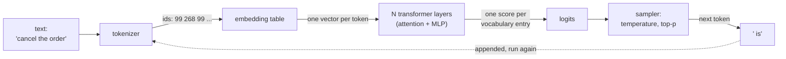
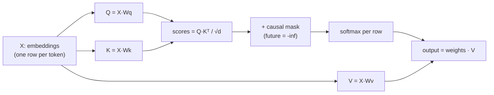
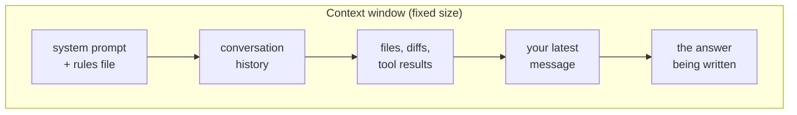

# How LLMs work

## Why care?

Coding assistants show five behaviours that surprise many developers:

- It writes `strings.Reverse(s)` with total confidence. There is no `strings.Reverse` in Go.
- It counts the letters in a word wrong, or adds two long numbers wrong, but writes a correct sorting algorithm.
- You ask the same question twice and get two different answers.
- In a long session it "forgets" a rule you gave it at the start.
- You paste a 3,000-line file, and the bill (or the wait) is suddenly much bigger.

None of this is random bad luck. Each one follows from how a large language model (LLM) works:

1. Text is cut into **tokens**, not letters or words.
2. Each token becomes a **vector** of numbers (an **embedding**).
3. **Attention** lets every token look back at the tokens before it, inside a fixed **context window**.
4. The model outputs a score for every possible next token, and a **sampler** picks one, with some randomness.
5. Repeat, one token at a time.

On this page you build a small version of each step in Go, run it, and read the numbers. These programs are not a real model: training one takes thousands of GPUs. But the mechanisms are the same, and they explain each of the five behaviours above. The next pages ([prompting](prompting-for-code.md), agents, review) build on them.

!!! info "Date and versions"

    Written and run on 2026-11-27 with Go 1.27.4 (linux/amd64) on WSL2 Ubuntu 24.04. All
    programs are toys that use only the standard library. They need no API key and no
    network. Numbers about real models (vocabulary size, context length) change fast;
    treat them as "order of magnitude", and check your provider's documentation.

## The idea: next-token prediction in a loop

An LLM is a next-token predictor. It is the same idea as the word suggestions on a phone keyboard, at a much larger scale:

- It is trained on a very large amount of text: web pages, books and source code.
- It does not look up facts in a database. During training it learned **statistical patterns**: which token is likely to follow a given context.
- To choose the next token, it uses **everything** in its context window, not only the last word.
- It produces **one token at a time**. Each new token is appended to the input, and the model runs again.

Two consequences follow directly. First, the model answers from learned patterns, not from a source it can check; it does not read documentation unless a tool puts that documentation into its context. Second, it has no separate signal for "I am unsure": a wrong answer is written with the same fluency as a right one.



The dotted arrow is the important one. The model is a pure function: **context in, scores for the next token out**. Everything that looks like memory, planning or conversation is that function called in a loop, with its own output fed back in.

## Under the hood: tokens

### Why not letters, why not words?

A model needs a fixed list of input symbols: the **vocabulary**. Two simple choices both fail:

- **Letters (or bytes):** a tiny vocabulary (256 byte values), but text becomes very long. `cancel the order` is 16 steps. Attention cost grows with the square of the length (more on that below), so long inputs get expensive fast.
- **Whole words:** short inputs, but the vocabulary is endless. `reordered`, `uuid.NewV7`, `ErrNotFound`, typos, every language... A word that is not in the list cannot be read at all.

The answer in between is **subword tokens**: common pieces like `"the"`, `" order"` or `"ing"` get their own token, and rare things are spelled out from smaller pieces, down to single bytes. Nothing is ever "unknown", because every byte is a token too.

### Byte-pair encoding (BPE) in 120 lines of Go

Most LLM tokenizers use a variant of **byte-pair encoding**. Training is a simple greedy loop:

1. Start with one token per byte (IDs 0 to 255).
2. Count every pair of neighbouring tokens in the training text.
3. Take the most frequent pair, give it a new ID, and replace it everywhere.
4. Repeat until the vocabulary is big enough.

To **encode** new text later, apply the learned merges in the same order. Here is a complete toy tokenizer. Like GPT-2's, it first splits text into "words", and a space stays glued to the word **after** it, so `" order"` and `"order"` are different words.

```go
// Command bpe trains a tiny byte-pair-encoding tokenizer on a small
// corpus, prints every merge it learns, and then encodes new text.
package main

import (
	"fmt"
	"regexp"
	"strings"
)

const corpus = `the order is paid. the orders are shipped. cancel the order.
the cancelled order is not paid. list all orders. reorder the order.
an order has items. the paid orders are shipped first. cancel orders
that are not paid. the shipped order is final.`

// pre splits text into words. A space stays glued to the word after it,
// like GPT-2 does, so " order" and "order" are different words.
var pre = regexp.MustCompile(` ?[A-Za-z]+| ?[0-9]+| ?[^\sA-Za-z0-9]+|\s+`)

type pair struct{ a, b int }

type tokenizer struct {
	vocab  map[int]string // token ID -> bytes it stands for
	merges []pair         // in the order they were learned (= rank)
}

func train(text string, numMerges int) *tokenizer {
	t := &tokenizer{vocab: map[int]string{}}
	for b := range 256 { // start: one token per byte
		t.vocab[b] = string([]byte{byte(b)})
	}
	// Count each distinct word once, with its frequency.
	freq := map[string]int{}
	var order []string
	for _, w := range pre.FindAllString(text, -1) {
		if freq[w] == 0 {
			order = append(order, w)
		}
		freq[w]++
	}
	words := make([][]int, len(order))
	for i, w := range order {
		for _, b := range []byte(w) {
			words[i] = append(words[i], int(b))
		}
	}
	for step := range numMerges {
		counts := map[pair]int{}
		for i, w := range words {
			for j := 0; j+1 < len(w); j++ {
				counts[pair{w[j], w[j+1]}] += freq[order[i]]
			}
		}
		best, bestN := pair{}, 0
		for p, n := range counts { // most frequent; ties: lowest IDs
			if n > bestN || (n == bestN && (p.a < best.a || (p.a == best.a && p.b < best.b))) {
				best, bestN = p, n
			}
		}
		id := 256 + step
		t.vocab[id] = t.vocab[best.a] + t.vocab[best.b]
		t.merges = append(t.merges, best)
		fmt.Printf("merge %2d: %-8q + %-8q -> %-10q id %d  (seen %d times)\n",
			step+1, t.vocab[best.a], t.vocab[best.b], t.vocab[id], id, bestN)
		for i := range words {
			words[i] = replace(words[i], best, id)
		}
	}
	return t
}

func replace(w []int, p pair, id int) []int {
	out := w[:0:0]
	for j := 0; j < len(w); j++ {
		if j+1 < len(w) && w[j] == p.a && w[j+1] == p.b {
			out = append(out, id)
			j++
			continue
		}
		out = append(out, w[j])
	}
	return out
}

// encode applies the merges in the order they were learned.
func (t *tokenizer) encode(text string) []int {
	var ids []int
	for _, w := range pre.FindAllString(text, -1) {
		var toks []int
		for _, b := range []byte(w) {
			toks = append(toks, int(b))
		}
		for rank, p := range t.merges {
			toks = replace(toks, p, 256+rank)
		}
		ids = append(ids, toks...)
	}
	return ids
}

func (t *tokenizer) show(text string) {
	ids := t.encode(text)
	parts := make([]string, len(ids))
	for i, id := range ids {
		parts[i] = fmt.Sprintf("%q", t.vocab[id])
	}
	fmt.Printf("%-28q %2d bytes -> %2d tokens %v\n  %s\n", text, len(text), len(ids), ids, strings.Join(parts, " "))
}

func main() {
	t := train(corpus, 20)
	fmt.Println()
	for _, s := range []string{
		"cancel the order",
		"the orders are paid",
		"Cancel the Order",
		"reordered",
		"refund 12345",
		"if err != nil {",
		"Größe",
	} {
		t.show(s)
	}
}
```

Training first. Every line is one merge, in the order the loop picked them:

```console
$ go run ./bpe
merge  1: "d"      + "e"      -> "de"       id 256  (seen 11 times)
merge  2: "o"      + "r"      -> "or"       id 257  (seen 11 times)
merge  3: "de"     + "r"      -> "der"      id 258  (seen 11 times)
merge  4: "or"     + "der"    -> "order"    id 259  (seen 11 times)
merge  5: " "      + "order"  -> " order"   id 260  (seen 10 times)
merge  6: "t"      + "h"      -> "th"       id 261  (seen 8 times)
merge  7: "th"     + "e"      -> "the"      id 262  (seen 7 times)
merge  8: " "      + "the"    -> " the"     id 263  (seen 5 times)
merge  9: " "      + "a"      -> " a"       id 264  (seen 4 times)
merge 10: " "      + "i"      -> " i"       id 265  (seen 4 times)
merge 11: " "      + "p"      -> " p"       id 266  (seen 4 times)
merge 12: "a"      + "i"      -> "ai"       id 267  (seen 4 times)
merge 13: "a"      + "n"      -> "an"       id 268  (seen 4 times)
merge 14: "e"      + "d"      -> "ed"       id 269  (seen 4 times)
merge 15: "r"      + "e"      -> "re"       id 270  (seen 4 times)
merge 16: " order" + "s"      -> " orders"  id 271  (seen 4 times)
merge 17: " p"     + "ai"     -> " pai"     id 272  (seen 4 times)
merge 18: " pai"   + "d"      -> " paid"    id 273  (seen 4 times)
merge 19: " "      + "c"      -> " c"       id 274  (seen 3 times)
merge 20: " "      + "s"      -> " s"       id 275  (seen 3 times)
```

After four merges the tokenizer has a token for `order`, the most frequent word in the corpus. It has no concept of a word; frequency alone produced it. Encoding new text with these merges:

```console
"cancel the order"           16 bytes ->  7 tokens [99 268 99 101 108 263 260]
  "c" "an" "c" "e" "l" " the" " order"
"the orders are paid"        19 bytes ->  5 tokens [262 271 264 270 273]
  "the" " orders" " a" "re" " paid"
"Cancel the Order"           16 bytes -> 10 tokens [67 268 99 101 108 263 32 79 114 258]
  "C" "an" "c" "e" "l" " the" " " "O" "r" "der"
"reordered"                   9 bytes ->  3 tokens [270 259 269]
  "re" "order" "ed"
"refund 12345"               12 bytes -> 11 tokens [270 102 117 110 100 32 49 50 51 52 53]
  "re" "f" "u" "n" "d" " " "1" "2" "3" "4" "5"
"if err != nil {"            15 bytes -> 15 tokens [105 102 32 101 114 114 32 33 61 32 110 105 108 32 123]
  "i" "f" " " "e" "r" "r" " " "!" "=" " " "n" "i" "l" " " "{"
"Größe"                       7 bytes ->  7 tokens [71 114 195 182 195 159 101]
  "G" "r" "\xc3" "\xb6" "\xc3" "\x9f" "e"
```

Each line shows a property that real tokenizers share:

- **The model sees IDs, not letters.** `" orders"` is token 271. The fact that it has 7 letters, or contains an `r` twice, is not visible in the number. That is why "how many r's are in this word" is hard for a model, while writing a sort function (a very common pattern) is easy.
- **Case and spaces make different tokens.** `" order"` (260), `"order"` (259) and `"Order"` (3 tokens: `"O" "r" "der"`) are unrelated IDs. The model has to _learn_ that they mean the same thing. Real tokenizers have separate tokens for `"Order"`, `" Order"`, `"ORDER"` and more.
- **Unseen words are not a problem, they are just expensive.** `reordered` never appeared in the corpus, but it splits into known pieces: `re` + `order` + `ed`.
- **Numbers are cut in odd places.** Here every digit is its own token. Real tokenizers usually group 1 to 3 digits, and where they cut depends on the number. A model does arithmetic on chunks like `"123"` `"45"`, which is a strange way to add. Use a tool (or code) for maths.
- **Text the tokenizer was not trained on costs more.** Go code (`if err != nil {`) and the German `Größe` got no merges at all: one token per byte. `ö` and `ß` are two bytes each in UTF-8 (see [Encodings](../fundamentals/encodings.md)), so they cost two tokens. Real tokenizers are trained on a lot of code and many languages, but English prose is still usually the cheapest text per character.

!!! note "What a real tokenizer looks like"

    Same algorithm, bigger numbers. Real vocabularies have on the order of 100,000 to
    200,000 tokens, learned from a huge mixed corpus. As a rough rule of thumb, one token
    is about 3 to 4 characters of English text; code and other languages vary. Each
    model family has its own tokenizer, so the same text gives a different number of tokens
    with different models. Providers offer a token-counting API; use it instead of guessing
    when cost or limits matter.

### Tokens are the unit of cost and limits

Because the model works on tokens, everything you pay for or run out of is measured in tokens:

| Thing                | Measured in                                             |
| -------------------- | ------------------------------------------------------- |
| Context window       | Tokens of input plus output that fit in one call        |
| Price                | Per million input tokens, and (more) per million output |
| Speed                | Output tokens per second, plus time to the first token  |
| "Max output" setting | Tokens the model may generate before it is cut off      |
| Rate limits          | Tokens (and requests) per minute                        |

The reference project of this site, `examples/orders`, is small. Still:

```console
$ find examples/orders -name '*.go' | wc -l
21
$ find examples/orders -name '*.go' -exec cat {} + | wc -lc
   2577   76289
```

76 KB of Go is, very roughly, 20,000 to 25,000 tokens. That fits in a modern context window easily. A real enterprise service with 200,000 lines does not, and even when it fits, sending all of it on every call is slow and expensive. Choosing **what** goes into the context is the main skill of the [next page](prompting-for-code.md).

## Under the hood: embeddings

### A token ID is just a row number

The ID `260` says nothing about meaning. Its only job is to pick **row 260** of a big table, the **embedding table**. Each row is a vector: a list of a few thousand floating-point numbers. During training these numbers are adjusted, again and again, until tokens that are used in similar ways end up with similar vectors.

How do you measure "similar" for vectors? The standard way is **cosine similarity**: the cosine of the angle between two vectors.

```text
cos(a, b) = (a · b) / (|a| × |b|)

 1.0  same direction  (same meaning, as far as the model is concerned)
 0.0  at right angles (nothing in common)
-1.0  opposite
```

It ignores the length of the vectors and only looks at their direction. A long sentence and a short one about the same thing point the same way.

### Word counts do not capture meaning

Here is a program that compares four sentences in two ways. First with **bag-of-words** vectors: one number per vocabulary word, counting how often it appears. Then with hand-made "meaning" vectors of 4 numbers, `[stop, buy, deliver, filler]`, summed over the words in a sentence. A real model learns its numbers during training; these are picked by hand to show the idea.

```go
// Command embed compares sentences with two kinds of vectors: counted
// words (bag of words) and hand-made "meaning" vectors.
package main

import (
	"fmt"
	"math"
	"slices"
	"strings"
)

var sentences = []string{
	"cancel the order",
	"the order is cancelled",
	"abort my purchase",
	"the order is shipped",
}

// Hand-made 4-number meanings: [stop, buy, deliver, filler].
// A real model learns thousands of numbers per token; nobody picks them.
var meaning = map[string][]float64{
	"cancel":    {0.9, 0.3, 0.0, 0.0},
	"cancelled": {0.9, 0.3, 0.1, 0.0},
	"abort":     {0.8, 0.1, 0.0, 0.0},
	"order":     {0.0, 0.9, 0.2, 0.0},
	"purchase":  {0.0, 0.9, 0.1, 0.0},
	"shipped":   {0.0, 0.2, 0.9, 0.0},
	"the":       {0.0, 0.0, 0.0, 0.3},
	"is":        {0.0, 0.0, 0.0, 0.3},
	"my":        {0.0, 0.0, 0.0, 0.3},
}

func cosine(a, b []float64) float64 {
	var dot, na, nb float64
	for i := range a {
		dot += a[i] * b[i]
		na += a[i] * a[i]
		nb += b[i] * b[i]
	}
	return dot / (math.Sqrt(na) * math.Sqrt(nb))
}

func bagOfWords(s string, vocab []string) []float64 {
	v := make([]float64, len(vocab))
	for _, w := range strings.Fields(s) {
		v[slices.Index(vocab, w)]++
	}
	return v
}

func dense(s string) []float64 {
	v := make([]float64, 4)
	for _, w := range strings.Fields(s) {
		for i, x := range meaning[w] {
			v[i] += x
		}
	}
	return v
}

func table(title string, vec func(string) []float64) {
	fmt.Println(title)
	for _, s := range sentences {
		fmt.Printf("  %-24s %v\n", s, vec(s))
	}
	fmt.Println("  cosine similarity:")
	for i := range sentences {
		for j := i + 1; j < len(sentences); j++ {
			fmt.Printf("    %-24s ~ %-24s %.2f\n", sentences[i], sentences[j], cosine(vec(sentences[i]), vec(sentences[j])))
		}
	}
}

func main() {
	var vocab []string
	for _, s := range sentences {
		for _, w := range strings.Fields(s) {
			if !slices.Contains(vocab, w) {
				vocab = append(vocab, w)
			}
		}
	}
	fmt.Println("vocabulary:", vocab)
	table("bag of words (one count per vocabulary word):", func(s string) []float64 { return bagOfWords(s, vocab) })
	fmt.Println()
	table("meaning vectors [stop buy deliver filler], summed per sentence:", func(s string) []float64 {
		v := dense(s)
		for i := range v {
			v[i] = math.Round(v[i]*10) / 10
		}
		return v
	})
}
```

```console
$ go run ./embed
vocabulary: [cancel the order is cancelled abort my purchase shipped]
bag of words (one count per vocabulary word):
  cancel the order         [1 1 1 0 0 0 0 0 0]
  the order is cancelled   [0 1 1 1 1 0 0 0 0]
  abort my purchase        [0 0 0 0 0 1 1 1 0]
  the order is shipped     [0 1 1 1 0 0 0 0 1]
  cosine similarity:
    cancel the order         ~ the order is cancelled   0.58
    cancel the order         ~ abort my purchase        0.00
    cancel the order         ~ the order is shipped     0.58
    the order is cancelled   ~ abort my purchase        0.00
    the order is cancelled   ~ the order is shipped     0.75
    abort my purchase        ~ the order is shipped     0.00

meaning vectors [stop buy deliver filler], summed per sentence:
  cancel the order         [0.9 1.2 0.2 0.3]
  the order is cancelled   [0.9 1.2 0.3 0.6]
  abort my purchase        [0.8 1 0.1 0.3]
  the order is shipped     [0 1.1 1.1 0.6]
  cosine similarity:
    cancel the order         ~ the order is cancelled   0.98
    cancel the order         ~ abort my purchase        1.00
    cancel the order         ~ the order is shipped     0.67
    the order is cancelled   ~ abort my purchase        0.98
    the order is cancelled   ~ the order is shipped     0.73
    abort my purchase        ~ the order is shipped     0.63
```

Bag of words gives the wrong answer. "Cancel the order" and "abort my purchase" mean the same thing and score **0.00**: they share no word. "The order is cancelled" and "the order is shipped" mean nearly opposite things and score **0.75**: they share three words. A plain `grep` or keyword search has the same weakness.

The meaning vectors get it right. The two cancel sentences are close to 1.0, and "shipped" is clearly further away. This is the purpose of embeddings: **similar meaning, similar direction**, even with no shared words.

Two things to take away for the rest of the chapter:

- Inside the model, every token is such a vector, with thousands of dimensions instead of 4, and nobody knows what each dimension "means". The meaning is spread over all of them.
- The same trick is used **outside** the model for search. An **embedding model** turns a whole document or code snippet into one vector. You store the vectors, embed the question, and return the documents with the highest cosine similarity. That is the "retrieval" in retrieval-augmented generation (RAG), and it is how many coding tools find "relevant files" for your prompt. It finds things that _sound_ related, which is not always what is _needed_.

## Under the hood: attention

### The problem attention solves

An embedding for `" order"` is the same vector in every sentence. But "cancel the paid order" and "order a new laptop" use the word very differently. The model needs to **mix in context**: each token's vector should be updated with information from the tokens around it.

**Attention** does that. For each token, it asks: "Which earlier tokens matter for me, and how much?" Then it takes a weighted average of their information.

Each token produces three vectors, by multiplying its embedding with three learned weight matrices. The names come from information retrieval:

- **Query (Q):** "what am I looking for?"
- **Key (K):** "what do I contain?" (used for matching)
- **Value (V):** "what do I pass on if I am selected?" (the content)

A query is compared with every key (a dot product: bigger means a better match). The scores are turned into percentages with **softmax**. Then the token takes that percentage of each value.

```text
Attention(Q, K, V) = softmax( Q·Kᵀ / √d  + mask ) · V
```

- `Q·Kᵀ` is a table of scores: one row per token asking, one column per token being asked.
- `/ √d` (d is the vector length) keeps the numbers from growing with the vector size. Without it, softmax would push almost all the weight onto one token.
- The **causal mask** sets "future" columns to minus infinity, so a token can never look at tokens after it. A model that generates left to right must not peek at the answer.
- `softmax` turns each row into positive weights that add up to 1.



### Attention in Go, with every matrix printed

Four tokens, vectors of 3 numbers, weight matrices picked by hand. A real model learns `Wq`, `Wk` and `Wv`, uses vectors with thousands of numbers, and does this many times in parallel ("heads") in each of dozens of layers. The arithmetic is exactly this.

```go
// Command attention computes one head of causal self-attention,
// softmax(Q·Kᵀ/√d + mask)·V, for four tokens and prints every step.
package main

import (
	"fmt"
	"math"
	"strings"
)

type matrix [][]float64

func mul(a, b matrix) matrix {
	out := make(matrix, len(a))
	for i := range a {
		out[i] = make([]float64, len(b[0]))
		for j := range b[0] {
			for k := range b {
				out[i][j] += a[i][k] * b[k][j]
			}
		}
	}
	return out
}

func transpose(a matrix) matrix {
	out := make(matrix, len(a[0]))
	for j := range out {
		out[j] = make([]float64, len(a))
		for i := range a {
			out[j][i] = a[i][j]
		}
	}
	return out
}

func softmax(row []float64) []float64 {
	maxv := math.Inf(-1)
	for _, x := range row {
		maxv = max(maxv, x)
	}
	var sum float64
	out := make([]float64, len(row))
	for i, x := range row {
		out[i] = math.Exp(x - maxv) // minus max: same result, no overflow
		sum += out[i]
	}
	for i := range out {
		out[i] /= sum
	}
	return out
}

var tokens = []string{"cancel", "the", "paid", "order"}

func show(name string, m matrix, cols []string) {
	fmt.Println(name)
	if cols != nil {
		fmt.Printf("  %-8s", "")
		for _, c := range cols {
			fmt.Printf("%8s", c)
		}
		fmt.Println()
	}
	for i, row := range m {
		fmt.Printf("  %-8s", tokens[i])
		for _, x := range row {
			if math.IsInf(x, -1) {
				fmt.Printf("%8s", "-inf")
				continue
			}
			fmt.Printf("%8.2f", x)
		}
		fmt.Println()
	}
}

func main() {
	// X: one 3-number embedding per token (rows).
	x := matrix{
		{1.0, 0.0, 1.0}, // cancel
		{0.0, 0.1, 0.0}, // the
		{0.0, 1.0, 1.0}, // paid
		{1.0, 1.0, 0.0}, // order
	}
	// Learned weights. Here: picked by hand.
	wq := matrix{{1, 0, 0}, {0, 1, 0}, {0, 0, 1}}
	wk := matrix{{0, 0, 1}, {0, 1, 0}, {1, 0, 0}}
	wv := matrix{{1, 0, 0}, {0, 1, 0}, {0, 0, 1}}

	q, k, v := mul(x, wq), mul(x, wk), mul(x, wv)
	d := float64(len(q[0]))

	scores := mul(q, transpose(k))
	for i := range scores {
		for j := range scores[i] {
			scores[i][j] /= math.Sqrt(d)
			if j > i { // causal mask: a token may not look at later tokens
				scores[i][j] = math.Inf(-1)
			}
		}
	}
	weights := make(matrix, len(scores))
	for i := range scores {
		weights[i] = softmax(scores[i])
	}
	out := mul(weights, v)

	show("Q = X·Wq", q, nil)
	show("K = X·Wk", k, nil)
	show("scores = Q·Kᵀ/√3, masked (row = query, column = key)", scores, tokens)
	show("weights = softmax(scores), each row sums to 1", weights, tokens)
	show("output = weights·V (V = X here)", out, nil)
	fmt.Println(strings.Repeat("-", 40))
	fmt.Printf("%q mixes in: ", "order")
	for j, w := range weights[3] {
		fmt.Printf("%s %.0f%%  ", tokens[j], w*100)
	}
	fmt.Println()
}
```

```console
$ go run ./attention
Q = X·Wq
  cancel      1.00    0.00    1.00
  the         0.00    0.10    0.00
  paid        0.00    1.00    1.00
  order       1.00    1.00    0.00
K = X·Wk
  cancel      1.00    0.00    1.00
  the         0.00    0.10    0.00
  paid        1.00    1.00    0.00
  order       0.00    1.00    1.00
scores = Q·Kᵀ/√3, masked (row = query, column = key)
            cancel     the    paid   order
  cancel      1.15    -inf    -inf    -inf
  the         0.00    0.01    -inf    -inf
  paid        0.58    0.06    0.58    -inf
  order       0.58    0.06    1.15    0.58
weights = softmax(scores), each row sums to 1
            cancel     the    paid   order
  cancel      1.00    0.00    0.00    0.00
  the         0.50    0.50    0.00    0.00
  paid        0.39    0.23    0.39    0.00
  order       0.23    0.14    0.41    0.23
output = weights·V (V = X here)
  cancel      1.00    0.00    1.00
  the         0.50    0.05    0.50
  paid        0.39    0.41    0.77
  order       0.46    0.65    0.64
----------------------------------------
"order" mixes in: cancel 23%  the 14%  paid 41%  order 23%
```

How to read the output:

1. **The upper-right triangle is `-inf`.** That is the causal mask. `cancel`, the first token, can only see itself, so its weight row is `1.00 0 0 0`.
2. **The row for `order` is the interesting one.** Its query `[1 1 0]` matches the key of `paid` `[1 1 0]` best (score 1.15), so after softmax `paid` gets 41% of the weight. The filler word `the` gets only 14%.
3. **The output row for `order` is a blend.** `[0.46 0.65 0.64]` is no longer the plain `order` vector `[1 1 0]`. It now carries some "paid" and some "cancel" in it. After many layers of this, the vector for the last token holds a summary of the whole relevant context, and the model reads the next-token scores from it.

### What this means in practice

**Attention compares every token with every earlier token.** For `n` tokens, that is about `n²/2` scores, per head, per layer:

| Tokens in context | Scores per head per layer |
| ----------------- | ------------------------- |
| 4                 | 10                        |
| 1,000             | about 500,000             |
| 100,000           | about 5,000,000,000       |

This is the root of three facts you feel every day:

- **Long prompts are slow and expensive.** Real implementations use clever tricks (caching the keys and values of earlier tokens, the **KV cache**; memory-efficient kernels), but the cost still grows with length. Providers price input tokens, and many offer cheaper **prompt caching** when the start of the prompt repeats.
- **Attention is a budget, not a guarantee.** Weights in a row add up to 1. With 100,000 tokens in front of it, a rule you wrote at token 200 competes with everything else for that weight. Research and daily experience show models use the start and the end of a long context better than the middle. A rule repeated close to the question beats a rule buried in a long file.
- **The model has no memory outside the context.** Nothing in the attention formula reads from anywhere else. If it is not in the tokens, the model does not know it (except what it learned in training, which is frozen at its training cut-off date).

## Under the hood: the context window

The **context window** is the maximum number of tokens the model can attend to in one call: your system prompt, the conversation so far, any files or tool results, **and** the output it is writing. In 2026, frontier models offer context windows of a few hundred thousand tokens, some up to about a million. Smaller and local models often have much less.



What happens when it is full depends on the tool, not the model:

- An API call that is too long is simply **rejected** with an error.
- Chat apps and coding agents usually **drop or summarise** old parts of the conversation (often called "compaction"). The summary is shorter, and details are lost. Your rule from the first message may survive as one vague line, or not at all.

Each call to the model is **stateless**. A "conversation" is the client sending the whole history again every time. That is why a long session gets slower and more expensive with each turn, and why a fresh session with a good summary often works better than a very long one.

## Under the hood: sampling

### Logits, softmax and the sampler

After the last layer, the model outputs one number per vocabulary entry: a **logit**. A higher logit means "more likely next". Softmax turns logits into probabilities. Then the **sampler**, a small piece of ordinary code outside the neural network, picks one token. Two settings control it:

- **Temperature** divides the logits before softmax. Below 1, differences grow: the top token wins more often. Above 1, differences shrink: unlikely tokens get picked more. Temperature 0 means "always take the top token" (greedy).
- **Top-p** (nucleus sampling) sorts tokens by probability, keeps the smallest set whose probabilities add up to at least `p`, and throws the rest away. It cuts off the long tail of nonsense.

Here is a fixed logits vector for the next token after `func (s *Service) Cancel(ctx context.Context, id uuid.UUID)`, sampled 10,000 times for each setting. The random generator has a fixed seed, so the counts are the same on every run.

```go
// Command sample turns one fixed logits vector into probabilities with
// different temperatures and top-p values, then samples it 10,000 times.
package main

import (
	"cmp"
	"fmt"
	"math"
	"math/rand/v2"
	"slices"
)

// The model's raw scores (logits) for the next token after
// "func (s *Service) Cancel(ctx context.Context, id uuid.UUID)".
var (
	tokens = []string{" error", " (Order,", " bool", " {", " int"}
	logits = []float64{3.0, 2.5, 1.0, 0.5, -1.0}
)

func softmax(l []float64, temp float64) []float64 {
	p := make([]float64, len(l))
	maxv := slices.Max(l)
	var sum float64
	for i, x := range l {
		p[i] = math.Exp((x - maxv) / temp)
		sum += p[i]
	}
	for i := range p {
		p[i] /= sum
	}
	return p
}

// topP keeps the most likely tokens until their probabilities add up to
// at least p, sets the rest to 0, and renormalises.
func topP(probs []float64, p float64) []float64 {
	idx := make([]int, len(probs))
	for i := range idx {
		idx[i] = i
	}
	slices.SortFunc(idx, func(a, b int) int { return cmp.Compare(probs[b], probs[a]) })
	out := make([]float64, len(probs))
	var cum float64
	for _, i := range idx {
		out[i] = probs[i]
		cum += probs[i]
		if cum >= p {
			break
		}
	}
	for i := range out {
		out[i] /= cum
	}
	return out
}

func draw(r *rand.Rand, probs []float64) int {
	x := r.Float64()
	for i, p := range probs {
		if x < p {
			return i
		}
		x -= p
	}
	return len(probs) - 1
}

func run(label string, probs []float64) {
	r := rand.New(rand.NewPCG(42, 42)) // fixed seed: same counts every run
	counts := make([]int, len(probs))
	for range 10_000 {
		counts[draw(r, probs)]++
	}
	fmt.Println(label)
	for i, t := range tokens {
		fmt.Printf("  %-10q p=%.3f  drawn %5d\n", t, probs[i], counts[i])
	}
}

func main() {
	fmt.Println("logits:", logits)
	for _, t := range []float64{0.2, 0.7, 1.0, 1.5} {
		run(fmt.Sprintf("temperature %.1f", t), softmax(logits, t))
	}
	run("temperature 1.0, top-p 0.9", topP(softmax(logits, 1.0), 0.9))
}
```

```console
$ go run ./sample
logits: [3 2.5 1 0.5 -1]
temperature 0.2
  " error"   p=0.924  drawn  9215
  " (Order," p=0.076  drawn   785
  " bool"    p=0.000  drawn     0
  " {"       p=0.000  drawn     0
  " int"     p=0.000  drawn     0
temperature 0.7
  " error"   p=0.634  drawn  6357
  " (Order," p=0.310  drawn  3060
  " bool"    p=0.036  drawn   343
  " {"       p=0.018  drawn   211
  " int"     p=0.002  drawn    29
temperature 1.0
  " error"   p=0.543  drawn  5402
  " (Order," p=0.329  drawn  3297
  " bool"    p=0.073  drawn   733
  " {"       p=0.045  drawn   444
  " int"     p=0.010  drawn   124
temperature 1.5
  " error"   p=0.447  drawn  4492
  " (Order," p=0.320  drawn  3159
  " bool"    p=0.118  drawn  1164
  " {"       p=0.084  drawn   835
  " int"     p=0.031  drawn   350
temperature 1.0, top-p 0.9
  " error"   p=0.574  drawn  5726
  " (Order," p=0.348  drawn  3474
  " bool"    p=0.078  drawn   800
  " {"       p=0.000  drawn     0
  " int"     p=0.000  drawn     0
```

What the counts tell you:

- **At temperature 1.0, the "wrong" answer is common.** `" (Order,"` (return the cancelled order too) is a fine design. But `" int"` was picked 124 times out of 10,000. Over a 300-token answer, many such small dice rolls happen. One unlucky roll early on, and every token after it builds on that choice. That is why "regenerate" gives a different function.
- **Low temperature is not "more correct".** At 0.2, `" error"` wins 92% of the time. That is only good if the top token is the right one. Temperature changes how **consistent** the model is, not how much it **knows**.
- **Top-p 0.9 removed the tail.** `" {"` and `" int"` can never be drawn, and the remaining three were scaled up so they still add up to 1 (`0.543 / 0.946 = 0.574`).

!!! warning "Temperature 0 is not a determinism guarantee"

    Even with greedy decoding, hosted models can give different outputs for the same input.
    Requests are batched with other users' requests on GPUs, floating-point sums depend on
    the order of operations, and providers update models behind the same name. Do not
    build tests that expect byte-identical model output. Test the **properties** of the
    output instead (it parses, it compiles, the tests pass). The last page of this chapter
    shows how.

## Under the hood: why models hallucinate

A **hallucination** is fluent, confident output that is false: an API that does not exist, a flag that was never added, a citation to a paper nobody wrote. You now have every piece needed to see why it happens.

### A model trained only on true data still produces false output

Here is the smallest possible demonstration. Train two tiny next-token models on a list of **real** Go standard library calls. Every call in the training data exists. Then ask both to complete `strings.`.

```go
// Command bigram trains two tiny next-token models on real Go calls and
// asks both to complete "strings.".
package main

import (
	"cmp"
	"fmt"
	"slices"
	"strings"
)

// Every call here exists in the standard library.
const corpus = `
slices.Reverse slices.Reverse slices.Reverse slices.Sort slices.Sort
slices.Contains slices.Contains slices.Index slices.Max
strings.Contains strings.Split strings.TrimSpace strings.ToUpper
bytes.Contains bytes.Split bytes.TrimSpace
maps.Keys maps.Values`

type model map[string]map[string]int // context -> next token -> count

func train(n int) model {
	m := model{}
	for _, call := range strings.Fields(corpus) {
		pkg, fn, _ := strings.Cut(call, ".")
		toks := []string{pkg, ".", fn}
		ctx := strings.Join(toks[3-n:2], " ") // last n-1 tokens before fn
		if m[ctx] == nil {
			m[ctx] = map[string]int{}
		}
		m[ctx][fn]++
	}
	return m
}

func complete(m model, ctx string) {
	next := m[ctx]
	total := 0
	for _, c := range next {
		total += c
	}
	type cand struct {
		fn string
		n  int
	}
	var cs []cand
	for fn, n := range next {
		cs = append(cs, cand{fn, n})
	}
	slices.SortFunc(cs, func(a, b cand) int { return cmp.Or(cmp.Compare(b.n, a.n), cmp.Compare(a.fn, b.fn)) })
	for _, c := range cs[:min(4, len(cs))] {
		fmt.Printf("    strings.%-10s p=%.2f\n", c.fn, float64(c.n)/float64(total))
	}
}

func main() {
	fmt.Println(`bigram (sees only "."):`)
	complete(train(2), ".")
	fmt.Println(`trigram (sees "strings ."):`)
	complete(train(3), "strings .")
}
```

```console
$ go run ./bigram
bigram (sees only "."):
    strings.Contains   p=0.22
    strings.Reverse    p=0.17
    strings.Sort       p=0.11
    strings.Split      p=0.11
trigram (sees "strings ."):
    strings.Contains   p=0.25
    strings.Split      p=0.25
    strings.ToUpper    p=0.25
    strings.TrimSpace  p=0.25
```

Ask the Go toolchain whether the bigram's second and third ideas exist:

```console
$ go doc strings.Reverse
doc: no symbol Reverse in package strings
$ go doc strings.Sort
doc: no symbol Sort in package strings
$ go doc slices.Reverse
package slices // import "slices"

func Reverse[S ~[]E, E any](s S)
```

The bigram model only sees the token `.`. After a dot, `Reverse` is common (because of `slices.Reverse`), so it suggests `strings.Reverse` with 17% probability. The text is perfectly plausible. It is also false. The trigram model, which sees one more token of context, gets it right.

Real LLMs are far more capable than a bigram model, but the mechanism is the same at a much finer level:

1. **The model learns what is likely, not what is true.** There is no "this API exists" bit anywhere. `strings.Reverse` _looks like_ the thousands of Go calls it has seen. Many people have even written their own `Reverse` helpers, so the pattern is common.
2. **The sampler must always pick something.** Softmax gives every token a probability above zero. There is no built-in "I don't know" token; saying "I don't know" is itself a pattern the model must have learned to produce in the right situations.
3. **Training data is old and uneven.** An API added after the training cut-off is unknown. A rarely used package has few examples, so the model fills gaps with patterns from popular packages. Go 1.27 features and your company's internal libraries are exactly this kind of gap.
4. **One wrong token shapes the rest.** Once `strings.Reverse(` is written, the most likely continuation is a correct-looking call to it. The model does not go back and check.
5. **Fluency is not a confidence signal.** The model writes a false answer in the same calm tone as a true one, because tone is also just a pattern.

### What reduces hallucinations

You cannot switch them off, but you can make them rare and, more importantly, **cheap to catch**:

- **Put the truth in the context.** Paste the real signatures (`go doc` output), the real error message, the real file. The trigram above only got it right because it had more context. A real model with the actual API in front of it copies it instead of guessing. This is most of the [next page](prompting-for-code.md).
- **Let it check its work with tools.** A coding agent that runs `go build` and `go test` sees the `undefined: strings.Reverse` error and fixes it. That is the subject of [Coding agents](coding-agents.md).
- **Verify before you trust.** Compilers, type checkers, tests, linters and code review catch a hallucinated API in seconds. [Reviewing AI-written code](reviewing-ai-code.md) collects the patterns.
- **Ask for sources you can check**, such as a link to the package doc, and then check it.

## Try it

Put all five programs in one module, and run them. Then change them to answer the questions below.

```sh
mkdir -p ~/src/llm-toy && cd ~/src/llm-toy
go mod init example.com/llm-toy
mkdir bpe embed attention sample bigram
# save each program above as <dir>/main.go
go vet ./... && go run ./bpe
```

1. **Tokenizer.** Add `" if err != nil {\n\treturn err\n}"` ten times to the corpus and train again. How many merges until `" err"` and `" nil"` are single tokens? How many tokens does `if err != nil {` cost now? This is why a code-trained tokenizer is cheaper for code.
2. **Embeddings.** Add `"refund the payment"` to the sentences, with meaning vectors for `refund` and `payment`. Is it closer to the cancel sentences or the shipped one? Does that match what you think it means?
3. **Attention.** Remove the causal mask (delete the `if j > i` block). Now `cancel` attends to `order` too. Which models work this way? (Hint: models that read a whole text to classify or embed it, not models that write.)
4. **Sampling.** Set the temperature to 5.0. What happens to `" int"`? Then add a `topK` function that keeps only the `k` most likely tokens, and compare `k = 2` with `p = 0.9`.
5. **Hallucination.** Add `strings.Sort` nowhere, but add ten more `slices.Sort` lines. What happens to the bigram's guess for `strings.`? What happens to the trigram's?

## Traps

- **Thinking the model "knows" or "looked it up".** It predicts likely text. Unless a tool fetched the docs into the context, an API it writes is a guess from patterns.
- **Trusting a confident tone.** Tone carries no information about truth. Check names, flags and versions against `go doc`, `--help` or the source.
- **Counting characters, guessing tokens.** Costs and limits are in tokens, and token counts differ per model. Use the provider's token counter for anything that matters.
- **Huge context "just in case".** More context costs more, is slower, and dilutes attention. A focused context with the right three files often beats the whole repository.
- **Expecting a long session to remember the first message.** Old turns get compacted or dropped. Put lasting rules in a project rules file, which tools load on every call.
- **Testing for exact output.** Even at temperature 0, output can change. Test properties: valid JSON, compiles, passes tests.
- **Using an LLM for exact arithmetic or counting.** Tokenisation hides digits and letters. Let it write code that does the maths, and run that code.

## Check yourself

??? question "1. Why does a model find it hard to count the letters in `strawberry`, but easy to write a binary search?"

    The model does not see letters. It sees token IDs, and a word like `strawberry` may be
    one to three tokens whose IDs say nothing about the letters inside. Counting needs
    information the input does not show directly. Binary search is a very common pattern
    in its training data, made of common tokens, so predicting it is easy.

??? question "2. The toy tokenizer gives `order` with a leading space one ID (260), but `Order` three tokens. What does that mean for a real model?"

    Different spellings, cases and leading spaces are different tokens with unrelated IDs.
    The model has to learn from data that they mean the same thing. It usually does for
    common words, but rare identifiers, unusual casing and non-English text are split into
    more, less meaningful pieces. They cost more tokens and are understood less reliably.

??? question "3. In the attention output, `order` gave 41% of its weight to `paid`. What would happen to that weight if 10,000 other tokens came before `cancel`?"

    Each row of weights sums to 1, so the 41% would be shared with many more candidates.
    Unless `paid` still matches much better than everything else, its share drops. In
    practice, important instructions far back in a long context get less attention. Keep
    the context focused, and repeat key rules near the request.

??? question "4. You set temperature to 0 and run the same prompt twice against a hosted model. The answers differ. Is the provider broken?"

    No. Greedy decoding removes the sampler's randomness, but floating-point results on
    GPUs can depend on batching and the order of operations, and a model name can point to
    an updated model. Treat model output as non-deterministic. Test properties, not exact
    text.

??? question "5. A model writes `slices.Filter(orders, isPaid)`. Explain in terms of this page why that can happen, and how you find out in seconds."

    `slices` has many functions with names like this (`Index`, `IndexFunc`, `Delete`,
    `DeleteFunc`), and other languages have `filter`. The pattern "slices. + common verb"
    is very likely, so the model writes it, whether it exists or not. In Go 1.27 it does
    not: `go doc slices.Filter` prints `doc: no symbol Filter in package slices`, and `go
    build` fails with a compile error.

??? question "6. Why does a long chat session get slower and more expensive with every message?"

    The model is stateless. Every turn, the client sends the whole conversation again as
    input tokens, and the model attends over all of them. Input grows with each turn, and
    so do price and time to first token. Prompt caching helps with the repeated start;
    starting a fresh session with a short summary helps more.

## Recap

- An LLM is a function: **tokens in, one score per possible next token out**, called in a loop.
- **Tokens** are subword pieces learned by BPE. The model sees IDs, not letters. Case, spaces, digits and non-English text all change the token count. Cost, speed and limits are measured in tokens.
- **Embeddings** turn each token into a vector. Similar meaning, similar direction, measured with **cosine similarity**. The same idea powers semantic search and RAG.
- **Attention**, `softmax(Q·Kᵀ/√d + mask)·V`, lets each token blend in information from earlier tokens. Cost grows with the square of the context length, and weights are a shared budget.
- The **context window** is all the model can see. There is no other memory. Long sessions get compacted.
- **Sampling** with temperature and top-p picks the next token. Low temperature means consistent, not correct. Output is never guaranteed to be identical.
- **Hallucinations** come from predicting likely text, not true text. Put the truth in the context, let tools check, and verify.

Next: [Prompting for code](prompting-for-code.md)
