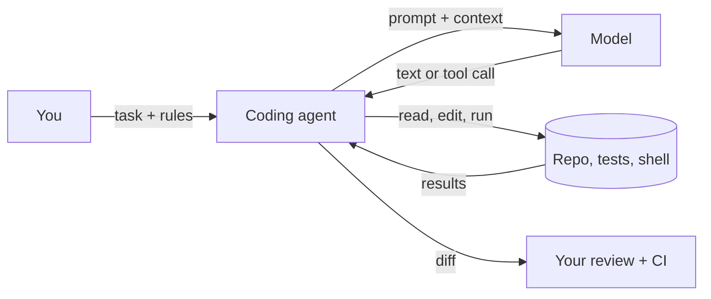

# AI-assisted engineering

How large language models work, and how to use them, and coding agents, without lowering the bar.

## Why go deeper?

AI tools write a lot of code now. That brings new kinds of problems:

- The generated code compiles, passes the tests it wrote itself, and is wrong.
- A function calls a library API that does not exist.
- An agent "fixes" a failing test by changing the test.
- The same prompt gives a great answer on Monday and a poor one on Tuesday.
- A pull request is 2,000 lines long, and nobody really reviewed it.

These tools are powerful, and they are not magic. When you know how a model produces text, and what context it really sees, you can predict where it will be strong and where it will fail. This chapter treats AI as one more tool in the [toolbox](../toolbox/index.md): learn how it works, then use it well.

## The big picture

1. **A model predicts the next token** from everything in its context window. It has no other memory.
2. **An agent is a loop:** the model asks for a tool, the program runs it, the result goes back into the context.
3. **Verification stays your job.** Tests, linters, types and review are what turn plausible code into correct code.

## Reading order

!!! note "Planned chapter"

    This section is a roadmap. The pages below are written in later sessions and linked here when they land.

| #   | Page                      | You will learn                                                                           |
| --- | ------------------------- | ---------------------------------------------------------------------------------------- |
| 1   | How LLMs work             | Tokens, embeddings, attention, context windows, sampling, why models hallucinate         |
| 2   | Prompting for code        | Context over cleverness, specs and examples, project rules files, asking for tests first |
| 3   | Coding agents             | The tool-use loop, permissions and sandboxes, worktrees, MCP, when to let an agent run   |
| 4   | Reviewing AI-written code | Common failure patterns, test integrity, small diffs, security and licence checks        |
| 5   | Building with LLMs in Go  | Calling a model API, structured output, tool use, evaluations, cost and latency          |

## How each page works

The same shape as the [Fundamentals](../fundamentals/index.md): **Why care?**, **The idea**, **Under the hood**, **Try it**, **Traps** and **Check yourself**. This field changes fast, so each page states the date and tool versions its examples were run with.
