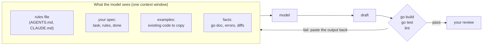

# Prompting for code

## Why care?

Compare two requests for the same feature on the same repository:

- **Request A:** "Add a cancel endpoint to ordersd." The model must guess the storage interface, the error conventions, the status codes and the rules for which orders may be cancelled. Typical results: a dependency the project does not use, an error format that differs from the other endpoints, an unhandled edge case, and no tests.
- **Request B:** the real `Repository` interface, an existing handler named as the pattern to follow, the business rules (which statuses may be cancelled, which HTTP status for a conflict), and an instruction to write a failing test first. The model no longer has to guess, and the result can be checked against the rules.

The model is the same in both cases. The difference is **what the model can see**. On [How LLMs work](how-llms-work.md) you saw that a model predicts likely text from its context, and has nothing else. So "prompting" for code is mostly **context engineering**: give the model the facts, the rules and the examples it needs, and a way to check itself.

On this page you will:

- learn what goes into the context, and what is worth the tokens,
- write a spec with examples and acceptance criteria for a real feature on `examples/orders`,
- write a project rules file (`AGENTS.md` / `CLAUDE.md`),
- run the **tests-first** loop on real code: a failing test, a plausible but wrong draft, a passing implementation.

!!! info "Date and versions"

    Written on 2026-11-27. Commands run with Go 1.27.4 (linux/amd64) and git on WSL2
    Ubuntu 24.04, on a scratch copy of `examples/orders`. No model was called to produce
    the outputs on this page: the code changes were written by hand to show what the
    checks look like. Prompts are shown as text; what a given model answers to them changes
    from version to version.

## The idea: a prompt is a complete task description

A model knows Go well, but it has never seen your repository, your team's conventions or your business rules. It rarely asks questions unless you allow it to; by default it fills every gap with the most likely pattern from its training data. A useful prompt therefore contains the same four things you would give a new colleague:

- **The task**, with a clear definition of done: not "add cancel", but "these four rules hold, and this test passes".
- **The relevant code**, not the whole repository: the interface to implement, and one existing example of the same kind of code.
- **The project conventions**: how errors are handled, which libraries are allowed, how to run the checks.
- **A way to check the result**: the test command and the linter.



The loop at the bottom matters as much as the box at the top. A good prompt gives a good **first** draft. A good check makes the **second** and **third** drafts converge on correct code.

## Under the hood: what the model actually receives

When you type into a chat window or a coding agent, the model does not get only your sentence. The tool builds one long input, roughly in this order:

1. **System prompt** from the tool vendor: how to behave, which tools exist, safety rules. You usually cannot see or change it.
2. **Project rules file(s)** such as `CLAUDE.md` or `AGENTS.md`, if the tool supports them. Loaded on every request.
3. **Conversation so far**: your earlier messages and its earlier answers, maybe summarised.
4. **Tool results**: files it read, command output, search results.
5. **Your latest message.**

Everything in that list is tokens, and everything competes for the model's attention. Three consequences:

- **Unstated rules do not exist.** If your team never uses `panic` in handlers, but it is not written down anywhere in the context, the model follows the most common pattern from its training data instead.
- **Stale context misleads.** An old file version you pasted 30 messages ago is still there. If the code changed since, the model may follow the old one.
- **Noise costs twice.** It costs tokens (money, latency) and it dilutes attention. A 2,000-line log where 3 lines matter is a worse prompt than the 3 lines.

## Under the hood: context over cleverness

### Role play is not a substitute for facts

You will see advice like "Start with: You are a world-class senior Go engineer". It does very little for code. Modern models already write like senior engineers **when the context makes that the likely continuation**. What makes code good for _your_ repository is information the model cannot guess:

| Cleverness (little effect)              | Context (large effect)                                               |
| --------------------------------------- | -------------------------------------------------------------------- |
| "You are a senior Go expert."           | The real `Repository` interface and `Service` type.                  |
| "Think carefully and write clean code." | "Follow the shape of `createOrder` in `internal/httpapi/orders.go`." |
| "Don't make mistakes."                  | "Run `go test ./internal/order/` and paste the result."              |
| "Use best practices."                   | "Errors wrap sentinels; HTTP maps them in `writeError`."             |
| "Be concise."                           | "Change only `internal/order` and `internal/storage/memory`."        |

Thinking and planning instructions are not useless, they help on hard design questions. But they are cheap words, and they never replace facts.

### Get the facts from tools, not from memory

The fastest way to stop a model from inventing your API is to show it the API. Go makes that easy: `go doc` prints the exported surface of a package, with doc comments, and nothing else.

```console
$ go doc ./internal/order Repository
package order // import "github.com/acme/orders/internal/order"

type Repository interface {
	Get(ctx context.Context, id uuid.UUID) (Order, error)
	Create(ctx context.Context, o Order) error
	List(ctx context.Context) ([]Order, error)
}
    Repository stores orders. It is defined here, where it is used, so the
    domain decides what it needs and storage packages adapt to it.

    Get returns ErrNotFound when no order has the given ID. List returns orders
    sorted by creation time, oldest first.

$ go doc ./internal/order Service
package order // import "github.com/acme/orders/internal/order"

type Service struct {
	// Has unexported fields.
}
    Service applies the domain rules on top of a Repository. It is safe for
    concurrent use if the Repository is.

func NewService(repo Repository) *Service
func (s *Service) Create(ctx context.Context, n NewOrder) (Order, error)
func (s *Service) Get(ctx context.Context, id uuid.UUID) (Order, error)
func (s *Service) List(ctx context.Context) ([]Order, error)
```

That is the contract, in a form the model reads easily. Compare sizes:

```console
$ go doc -all ./internal/order | wc -c
3080
$ cat internal/order/*.go | wc -c
11402
```

The whole public API of the domain package is about a quarter of its source (tests included). For a big package the difference is much larger. Other cheap, high-value context:

| You want the model to know... | Give it                                                  |
| ----------------------------- | -------------------------------------------------------- |
| An API's exact signature      | `go doc <pkg> <Symbol>`, or `go doc -src` for the body   |
| What routes exist             | `grep -n HandleFunc internal/httpapi/httpapi.go`         |
| Why the build fails           | The **full** compiler output, not "it doesn't compile"   |
| Why a test fails              | `go test -run TestName -v ./pkg/` output, verbatim       |
| What you changed so far       | `git diff` (or `git diff --stat` first, to see the size) |
| Which versions are in use     | `go.mod`, and `go version`                               |
| A third-party library's API   | Its `go doc` output **for the version in your `go.mod`** |

The last row matters most for hallucinations. A model's training data mixes many versions of a library. `go doc` in your module shows the version you actually use. Coding agents can run these commands themselves (see [Coding agents](coding-agents.md)); in a plain chat, you paste them.

## Under the hood: specs and examples

### Write down "done"

A spec for a model is the same as a good ticket for a person, just more explicit. For the cancel feature on `examples/orders`:

```markdown
## Task: cancel an order (domain layer only)

Add `func (s *Service) Cancel(ctx context.Context, id uuid.UUID) (Order, error)`
to `internal/order`.

Rules:

1. A `pending` or `paid` order becomes `cancelled` and is stored.
2. Cancelling an order that is already `cancelled` is a no-op: no error.
3. A `shipped` order cannot be cancelled: return an error wrapping a new
   sentinel `ErrConflict`. The stored order does not change.
4. An unknown ID returns an error wrapping `ErrNotFound`.

Design:

- Storing needs a new `Update(ctx, Order) error` on `Repository`. It returns
  `ErrNotFound` for an unknown ID. Implement it in `internal/storage/memory`.
- Wrap errors like `Get` does: `fmt.Errorf("cancel order %s: %w", id, err)`.

Out of scope (later tasks): the HTTP endpoint, `orderctl`, persistence.

Done when: `go test ./...` and `go vet ./...` pass, and no existing test changed.
```

Look at what this spec decides **before** any code exists:

- The **edge cases** (cancel twice, shipped, unknown). These are exactly where a model guesses, and where a reviewer would not notice a wrong guess.
- The **design choice** that is yours to make: a new `ErrConflict` (which will become HTTP 409), not reusing `ErrInvalid` (HTTP 400). Leave it open and the model picks one, silently.
- The **scope**: one layer, two packages. Small diffs are reviewable diffs (more on that in [Reviewing AI-written code](reviewing-ai-code.md)).
- A **checkable definition of done**.

### Use existing code as examples

Models reproduce patterns that are in their context very reliably. That is "few-shot prompting": give one or two examples of the shape you want. In a codebase, the examples already exist. Point at them:

- "Write the handler like `getOrder` in `internal/httpapi/orders.go`: parse the ID with `uuid.Parse`, call the service, use `a.writeError` for errors."
- "Write the test as a table test like `TestNewOrderValidate`, and use the `fakeRepo` and `newTestService` helpers from `service_test.go`."

One real example communicates naming, error handling, logging style and test style at once, more precisely than a page of rules. It also stops the model from "improving" things you did not ask about.

If the pattern you want does not exist yet, write the first instance by hand, then ask for the next ones "in the same style". That is often the fastest path for a new kind of code.

### Ask for a plan, and invite questions

For anything bigger than one function, ask for a short plan before the code: "List the files you will change and why. Do not write code yet." A plan is cheap to read, and a wrong plan is cheap to fix. A wrong 300-line diff is not.

Also give explicit permission to stop: "If something in the spec is unclear or seems wrong, ask before you write code." Without it, the most likely continuation of a request is an answer, not a question.

## Under the hood: project rules files

### One file, loaded every time

Repeating the project rules in every prompt is tedious, and you will forget one. Most coding tools read a **rules file** from the repository and put it into the context of every request:

- `AGENTS.md` is a plain Markdown convention that many tools read (OpenAI Codex, GitHub Copilot's coding agent, Cursor and others).
- `CLAUDE.md` is what Claude Code reads. It can pull in another file with an `@path` import line, so a one-line `CLAUDE.md` containing `@AGENTS.md` (or a symlink) keeps a single source of truth.
- Tools also read files in sub-directories (for example `internal/httpapi/AGENTS.md`) when they work there, and a personal file in your home directory for your own preferences across all projects.

Check your tool's documentation for the exact names and loading rules; they change.

### What goes in, what stays out

A rules file is **paid for in tokens on every call**, and it competes for attention like everything else. Keep it short and specific. Write the things a new colleague would get wrong in their first week, and nothing they would get right anyway.

Here is a rules file that fits `examples/orders`:

```markdown
# AGENTS.md: orders service

Go 1.27, standard library only. Do not add dependencies without asking.

## Commands

- `make pr` runs everything CI runs (gofmt check, vet, golangci-lint, race tests).
  Run it before you say a task is done, and show its output.
- One package: `go test -race ./internal/order/`.

## Layout

- `internal/order`: domain types, rules, `Service`. No HTTP, JSON or SQL here.
- `internal/httpapi`: JSON over HTTP. Maps errors to statuses in `writeError`.
- `internal/storage/memory`: in-memory `order.Repository`.
- `cmd/ordersd`, `cmd/orderctl`: wiring only, no business rules.

## Rules

- Money is `int64` cents. Never `float64`.
- Errors wrap the sentinels in `internal/order` (`ErrNotFound`, `ErrInvalid`, ...)
  with `%w`. Handlers check them with `errors.Is`, never by string.
- New interface methods: update every implementation and the test fakes.
- Tests are table tests with hand-written fakes. No mocking libraries.
- Never change an existing test to make it pass. If a test looks wrong, stop and ask.
- Keep changes small: one concern per change. List touched files at the end.
```

What makes these lines good:

- **Commands are exact.** The model can run `make pr`, not "the tests".
- **Every rule is checkable or concrete.** "`int64` cents" beats "be careful with money".
- **The rules target known failure modes**: new dependencies, changed tests, giant diffs (all covered in [Reviewing AI-written code](reviewing-ai-code.md)).
- **No style guide copy.** `gofmt` and the linter already enforce formatting. Don't spend tokens on what a tool checks.

What to leave out: long architecture essays (link to them instead, and let the agent open them when needed), secrets and internal URLs (rules files get committed and copied around), and vague wishes ("write clean code"). Review the file when the model keeps making the same mistake: that mistake is a missing line.

## Under the hood: asking for tests first

### Why tests first works well with models

Tests are the most precise spec you can write: they are code, they are unambiguous, and they run. Asking for a failing test **first** splits one vague task into two checkable ones:

1. **Write the test.** You review it alone. It is short and reads like the spec. Wrong rules show up here, before any implementation exists to defend them.
2. **Make it pass, without changing it.** Now the model has a hard target and a fast feedback loop.

This is the test-driven development (TDD) cycle. Its usual names are **red** (the test fails) and **green** (the test passes); see [Testing](../go/testing.md) for Go test basics.

It also protects against a serious failure mode: a model that writes code and then writes tests that confirm whatever the code does, bugs included. If the test came first and you approved it, it cannot be adjusted to match the code.

```mermaid
sequenceDiagram
    participant You
    participant M as Model / agent
    participant Go as go test
    You->>M: spec + "write the failing test only"
    M->>You: cancel_test.go
    You->>You: review test against the spec
    You->>Go: run it
    Go-->>You: red (does not compile / fails)
    You->>M: "make it pass; do not edit the test"
    M->>Go: draft, run tests
    Go-->>M: one case fails
    M->>Go: fix, run tests
    Go-->>M: green
    M->>You: diff + test output
```

### Step 1: the test, as the spec

The spec above becomes this table test. It reuses the existing `fakeRepo` and `newTestService` helpers from `service_test.go`, and adds the `Update` method the fake will need:

```go
package order

import (
	"context"
	"errors"
	"testing"
	"uuid"
)

func (f *fakeRepo) Update(_ context.Context, o Order) error {
	if _, ok := f.orders[o.ID]; !ok {
		return ErrNotFound
	}
	f.orders[o.ID] = o
	return nil
}

func TestServiceCancel(t *testing.T) {
	id := uuid.MustParse("019ac0de-0000-7000-8000-000000000001")
	tests := []struct {
		name       string
		start      Status // status of the stored order; "" means no order
		wantStatus Status
		wantErr    error
	}{
		{name: "pending is cancelled", start: StatusPending, wantStatus: StatusCancelled},
		{name: "paid is cancelled", start: StatusPaid, wantStatus: StatusCancelled},
		{name: "cancel twice is a no-op", start: StatusCancelled, wantStatus: StatusCancelled},
		{name: "shipped cannot be cancelled", start: StatusShipped, wantStatus: StatusShipped, wantErr: ErrConflict},
		{name: "unknown order", wantErr: ErrNotFound},
	}
	for _, tt := range tests {
		t.Run(tt.name, func(t *testing.T) {
			repo := newFakeRepo()
			if tt.start != "" {
				repo.orders[id] = Order{ID: id, CustomerID: "c-1", Status: tt.start}
			}
			svc := newTestService(repo)

			_, err := svc.Cancel(t.Context(), id)
			if !errors.Is(err, tt.wantErr) {
				t.Fatalf("Cancel() error = %v, want %v", err, tt.wantErr)
			}
			if tt.start == "" {
				return
			}
			if got := repo.orders[id].Status; got != tt.wantStatus {
				t.Errorf("stored status = %q, want %q", got, tt.wantStatus)
			}
		})
	}
}
```

Check the test against the spec, rule by rule. Each rule is one row. Rule 3 checks both the error **and** that the stored status stays `shipped`. `errors.Is(err, nil)` is true only for a `nil` error, so the rows without `wantErr` also prove "no error". This review takes two minutes, and it is the most valuable review of the whole feature.

Now run it. It must fail, and it must fail **for the right reason**:

```console
$ go test ./internal/order/
# github.com/acme/orders/internal/order [github.com/acme/orders/internal/order.test]
internal/order/cancel_test.go:29:99: undefined: ErrConflict
internal/order/cancel_test.go:40:18: svc.Cancel undefined (type *Service has no field or method Cancel)
FAIL	github.com/acme/orders/internal/order [build failed]
FAIL
```

The build fails because the feature does not exist yet. That is the expected failure. Commit the test on its own, so its history is clear later:

```sh
git add internal/order/cancel_test.go
git commit -m "test(order): spec for Service.Cancel"
```

### Step 2: a plausible first draft

Here is a draft of the kind you get from a short prompt like "add Cancel to Service". It compiles, it reads well, and it handles the errors:

```go
// Cancel marks the order as cancelled.
func (s *Service) Cancel(ctx context.Context, id uuid.UUID) (Order, error) {
	o, err := s.repo.Get(ctx, id)
	if err != nil {
		return Order{}, fmt.Errorf("cancel order %s: %w", id, err)
	}
	o.Status = StatusCancelled
	if err := s.repo.Update(ctx, o); err != nil {
		return Order{}, fmt.Errorf("cancel order %s: %w", id, err)
	}
	return o, nil
}
```

In a code review of this function alone, most people would approve it. The test does not:

```console
$ go test ./internal/order/
--- FAIL: TestServiceCancel (0.00s)
    --- FAIL: TestServiceCancel/shipped_cannot_be_cancelled (0.00s)
        cancel_test.go:42: Cancel() error = <nil>, want order state conflict
FAIL
FAIL	github.com/acme/orders/internal/order	0.003s
FAIL
```

The draft cancels a shipped order, which would trigger a refund for goods that are already on their way to the customer. The bug is not in the code that is there, it is in the rule that is **missing**. This is a common shape of a model bug: plausible code that silently drops a requirement it was never shown, or did not weigh.

The test output is also the best next prompt. Paste it back verbatim: it names the case, the expected error and the actual result.

The whole module tells you something too. The interface got a new method, and the compiler lists every type that no longer fits:

```console
$ go build ./...
# github.com/acme/orders/internal/storage/memory
internal/storage/memory/memory.go:31:26: cannot use (*Store)(nil) (value of type *Store) as order.Repository value in variable declaration: *Store does not implement order.Repository (missing method Update)
```

That `var _ order.Repository = (*Store)(nil)` line in `memory.go` exists exactly for this. A type-checked contract is context the model gets for free, every time it runs the build.

### Step 3: green, with the test unchanged

The fix adds the two missing rules:

```diff
--- a/internal/order/service.go
+++ b/internal/order/service.go
@@ -73,12 +73,20 @@
 	return orders, nil
 }

-// Cancel marks the order as cancelled.
+// Cancel marks a pending or paid order as cancelled. Cancelling a
+// cancelled order is a no-op. A shipped order returns an error wrapping
+// ErrConflict; an unknown ID, one wrapping ErrNotFound.
 func (s *Service) Cancel(ctx context.Context, id uuid.UUID) (Order, error) {
 	o, err := s.repo.Get(ctx, id)
 	if err != nil {
 		return Order{}, fmt.Errorf("cancel order %s: %w", id, err)
 	}
+	switch o.Status {
+	case StatusCancelled:
+		return o, nil
+	case StatusShipped:
+		return Order{}, fmt.Errorf("cancel order %s: %w: already shipped", id, ErrConflict)
+	}
 	o.Status = StatusCancelled
 	if err := s.repo.Update(ctx, o); err != nil {
 		return Order{}, fmt.Errorf("cancel order %s: %w", id, err)
```

Plus `ErrConflict` in `order.go`, and `Update` on the memory store, written like its `Create` method (lock, check, store a clone). Now:

```console
$ go vet ./... && go test ./internal/order/ -run Cancel -v
=== RUN   TestServiceCancel
=== RUN   TestServiceCancel/pending_is_cancelled
=== RUN   TestServiceCancel/paid_is_cancelled
=== RUN   TestServiceCancel/cancel_twice_is_a_no-op
=== RUN   TestServiceCancel/shipped_cannot_be_cancelled
=== RUN   TestServiceCancel/unknown_order
--- PASS: TestServiceCancel (0.00s)
    --- PASS: TestServiceCancel/pending_is_cancelled (0.00s)
    --- PASS: TestServiceCancel/paid_is_cancelled (0.00s)
    --- PASS: TestServiceCancel/cancel_twice_is_a_no-op (0.00s)
    --- PASS: TestServiceCancel/shipped_cannot_be_cancelled (0.00s)
    --- PASS: TestServiceCancel/unknown_order (0.00s)
PASS
ok  	github.com/acme/orders/internal/order	0.003s
$ go test ./...
ok  	github.com/acme/orders/cmd/orderctl	0.132s
ok  	github.com/acme/orders/cmd/ordersd	0.124s
ok  	github.com/acme/orders/internal/buildinfo	(cached)
ok  	github.com/acme/orders/internal/client	0.062s
ok  	github.com/acme/orders/internal/config	(cached)
ok  	github.com/acme/orders/internal/httpapi	0.014s
ok  	github.com/acme/orders/internal/order	0.006s
ok  	github.com/acme/orders/internal/storage/memory	0.008s
```

Two last checks before you accept the change. They take seconds, and they catch the two most common ways an AI change "passes":

```console
$ git log --oneline --stat main~2..main
e3a4677 feat(order): add Service.Cancel
 internal/order/order.go           |  3 +++
 internal/order/service.go         | 22 ++++++++++++++++++++++
 internal/storage/memory/memory.go | 14 ++++++++++++++
 3 files changed, 39 insertions(+)
ef8de2a test(order): spec for Service.Cancel
 internal/order/cancel_test.go | 52 +++++++++++++++++++++++++++++++++++++++++++
 1 file changed, 52 insertions(+)
$ git diff --stat ef8de2a main -- '*_test.go'
$
```

- **The scope matches the spec**: three files, 39 lines, exactly the packages the spec named. No new dependency, no unrelated refactoring.
- **No test changed after the test commit**: the second command prints nothing. If it printed a line, you would read that diff first.

One thing is still missing: `memory.Update` has no test of its own. The spec did not ask for one. Your review would, and the next prompt can: "Add a table test for `Store.Update` in the style of `memory_test.go`: existing ID, unknown ID, cancelled context."

### Split big tasks into prompt-sized steps

The full "cancel endpoint" feature is four small tasks, each with its own test and its own commit:

| Step | Scope                     | Test first                                                          |
| ---- | ------------------------- | ------------------------------------------------------------------- |
| 1    | `internal/order` + memory | `TestServiceCancel` (above)                                         |
| 2    | `internal/httpapi`        | `POST /v1/orders/{id}/cancel`: 200, 404, 409 problem JSON, bad UUID |
| 3    | `internal/client`         | client method against an `httptest` server                          |
| 4    | `cmd/orderctl`            | `orderctl cancel <id>` output and exit codes                        |

Each step fits in one context, gets one focused review, and leaves the build green. If step 3 goes wrong, you throw away step 3, not the whole feature.

## Try it

Do step 2 yourself, with any assistant you have. Write the prompt first, on paper, and only then send it.

1. Collect the context with commands, not from memory:

   ```sh
   cd examples/orders
   go doc ./internal/order Service
   sed -n '/func (a \*api) getOrder/,/^}/p' internal/httpapi/orders.go
   sed -n '/func (a \*api) writeError/,/^}/p' internal/httpapi/respond.go
   grep -n 'HandleFunc' internal/httpapi/httpapi.go
   ```

2. Write a spec in the format above: route, the four outcomes (200 with the order JSON, 404, 409 for a shipped order, 400 for a bad UUID), "follow `getOrder`", "map `ErrConflict` to 409 in `writeError`", out of scope, done when.
3. Ask for **the test only**, in the style of `internal/httpapi/httpapi_test.go`. Review it against your spec. Run it and confirm it fails for the right reason.
4. Ask for the implementation, with "do not change the test". Paste any failure back verbatim.
5. Finish with `make pr`, `git diff --stat`, and `git diff --stat <test-commit> HEAD -- '*_test.go'`.
6. Now repeat the task in a fresh session with only "add a cancel endpoint to ordersd". Compare the two diffs. Which one would you rather review?

## Traps

- **The one-line prompt for a multi-file feature.** The model fills every gap with the most common pattern from its training data, not with your team's rules. Write the spec.
- **"Make the tests pass."** Without "do not change the tests", deleting or weakening a test is a valid solution. Say it in the prompt **and** in the rules file, and check with `git diff -- '*_test.go'`.
- **Describing an error instead of pasting it.** "The build fails on the store" loses the file, line and the exact message. Paste the full output.
- **Stale context.** After you edit a file by hand, the model may still work from the old version in its context. Say "I changed X, re-read it", or start a fresh session.
- **A rules file that grows forever.** Every line costs tokens on every call and competes for attention. Delete rules the linter already enforces, and rules nobody needs any more.
- **Secrets in the prompt.** Anything you paste goes to the provider. Never paste tokens, passwords or customer data. Check your company's policy on which code may be sent where (see [Security](../security/index.md)).
- **Accepting the first green run.** Green means "the tests you have pass". Review scope, test changes and missing tests every time.

## Check yourself

??? question "1. Why does \"You are a senior Go engineer\" help much less than pasting the `Repository` interface?"

    The model already writes like an experienced Go developer when the context suggests
    it. What it cannot guess is your code: the exact method names, types and error
    conventions. A role sentence adds no facts. The interface adds the facts the model
    would otherwise invent, and invented API names are the most common kind of error.

??? question "2. The spec says \"cancelling a cancelled order is a no-op\". Why write that down, when it seems obvious?"

    It is not obvious. Returning `ErrConflict` would also be a sensible design, and so
    would returning a new "already cancelled" error. A model picks one of them, silently,
    and a reviewer reading the code will probably not notice that a decision was made.
    Edge cases are where your intent and the "most likely" code differ most.

??? question "3. A draft passes code review by eye but fails one row of the table test. What does that tell you about where model bugs usually hide?"

    In what is missing, not in what is written. The draft's lines were all correct; it
    just did not apply a rule (shipped orders) that it did not know or did not weigh. Tests
    written from the spec check the rules, including the ones the code forgot. Reading the
    code alone mostly checks the lines that are there.

??? question "4. Why commit the failing test on its own, before the implementation?"

    It records the spec you approved. Later you can check, with one `git diff` against
    that commit, that no test was changed to make the implementation pass. It also makes
    review easier: the reviewer reads the test commit as "what should happen" and the
    second commit as "how".

??? question "5. Your rules file has 400 lines, including the team's full style guide. Results got worse, not better. Why might that be?"

    The whole file is in the context on every call. It costs tokens, and it competes for
    attention with the task itself, so the important rules get a smaller share. Most of a
    style guide is enforced by `gofmt` and the linter anyway. Keep the rules file short:
    exact commands, the layout, and the rules that tools cannot check.

??? question "6. Which context would you give a model to fix `undefined: slices.Filter`?"

    The full compiler error, the Go version from `go.mod`, and the real API, for example
    the output of `go doc slices` (which lists `DeleteFunc`, `IndexFunc` and so on, but no
    `Filter`). With the real list in front of it, the model picks an existing function or
    writes a small loop instead of guessing again.

## Recap

- Prompting for code is **context engineering**: the model only knows what is in its context window.
- **Context beats cleverness.** Real signatures (`go doc`), real errors, real diffs, and one existing example do more than any role instruction or special phrasing.
- A good **spec** names the rules, the edge cases, the design choices you made, the scope, and a checkable "done".
- **Examples** from your own codebase are the most precise style guide.
- A short **rules file** (`AGENTS.md`, `CLAUDE.md`) carries the project rules into every request. Exact commands, concrete rules, nothing a tool already checks.
- **Tests first**: review the test as the spec, see it fail for the right reason, then let the model make it pass without changing it.
- Finish every change with the same checks: build, tests, `git diff --stat` for scope, and no changed tests.

Next: [Coding agents](coding-agents.md)
