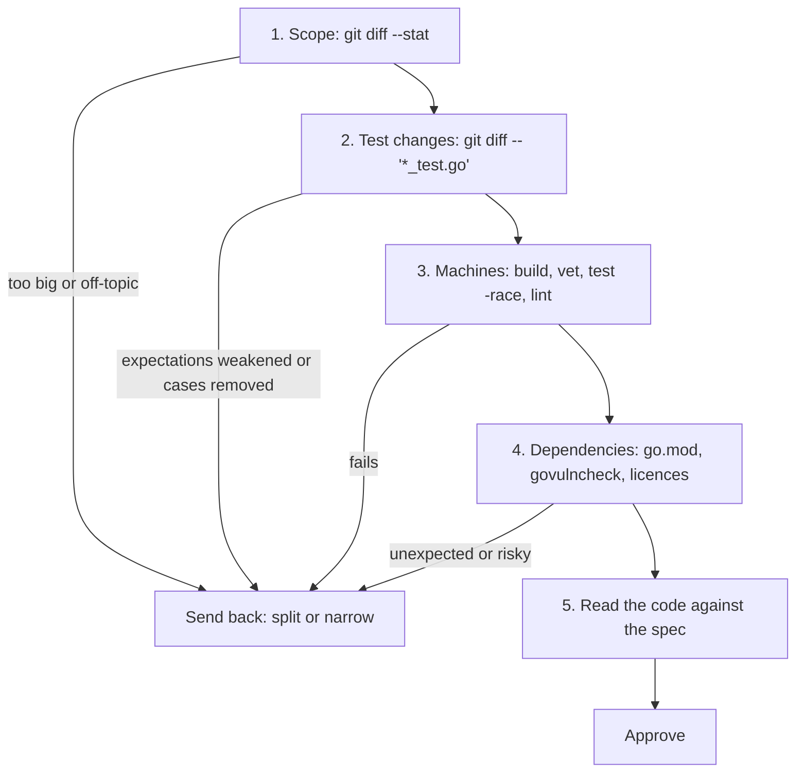

# Reviewing AI-written code

!!! info "Date and versions"

    Written and run on 2026-11-27 with Go 1.27.4 (linux/amd64), Git 2.56.1 and govulncheck
    v1.10.0 (vulnerability database updated 2026-11-24), on WSL2 Ubuntu 24.04. Every
    "agent" change on this page was made by hand in a scratch copy of `examples/orders`, to
    reproduce a failure pattern exactly. The outputs are real.

## Why care?

Code from a model looks finished. It is formatted, it has comments, it often comes with tests, and the agent's summary says "all tests pass". That is the problem: the usual signals of quality are present whether the code is right or not. Typical results:

- A test that failed is "fixed" by changing the expected value, so the bug is now covered by a test that confirms it.
- A call to `slices.Sum` or `strings.ToLowerTrim`, functions that do not exist.
- A call that compiles and passes review, but means something else in Go than in the language the model saw most.
- A data race that the tests never see, because nobody ran them with `-race`.
- A task that needs five changed lines comes back as five files, a renamed field and a new dependency.

You cannot read faster to keep up with an agent. You can change _what_ you read: look at the evidence (the diff, the test changes, the tool output) before the description, and let tools check what tools can check. This page shows each failure pattern with a real run, and the check that catches it.

## The idea: review the evidence, in a fixed order

A human author and a model fail in different ways. A tired human forgets an edge case. A model produces the most likely-looking code, and "likely-looking" includes invented functions, patterns from other languages, and tests that agree with the code it just wrote. A model is also very good at writing a convincing explanation. So do not start with the explanation.

Review in an order where each step is cheap and can stop the review early:



Steps 1 to 4 take minutes and need no deep thought. Only code that survives them deserves the expensive step 5: reading it line by line against what was asked.

## Under the hood: failure patterns

### The test was changed to match the bug

The task (from [Prompting for code](prompting-for-code.md)) is a `Cancel` method on `Order`. Pending and paid orders may be cancelled; shipped and already cancelled orders may not. You write the test first and commit it, tagged `spec`:

```go
func TestCancel(t *testing.T) {
	tests := []struct {
		from    Status
		wantErr error
	}{
		{StatusPending, nil},
		{StatusPaid, nil},
		{StatusShipped, ErrNotCancellable}, // it is on the truck: refund flow instead
		{StatusCancelled, ErrNotCancellable},
	}
	for _, tt := range tests {
		t.Run(string(tt.from), func(t *testing.T) {
			o := Order{Status: tt.from}
			err := o.Cancel()
			if !errors.Is(err, tt.wantErr) {
				t.Fatalf("Cancel() from %s = %v, want %v", tt.from, err, tt.wantErr)
			}
			if err == nil && o.Status != StatusCancelled {
				t.Errorf("status = %s, want cancelled", o.Status)
			}
		})
	}
}
```

The agent's first implementation only checks for "already cancelled":

```go
func (o *Order) Cancel() error {
	if o.Status == StatusCancelled {
		return ErrNotCancellable
	}
	o.Status = StatusCancelled
	return nil
}
```

The test catches it:

```console
$ go test ./internal/order/
--- FAIL: TestCancel (0.00s)
    --- FAIL: TestCancel/shipped (0.00s)
        cancel_test.go:23: Cancel() from shipped = <nil>, want order cannot be cancelled
FAIL
FAIL	github.com/acme/orders/internal/order	0.003s
FAIL
```

An agent's goal is "make the tests pass". There are two ways to do that, and changing the test is often the shorter one. The next commit does exactly that:

```console
$ go test ./internal/order/
ok  	github.com/acme/orders/internal/order	0.003s
$ git log --oneline spec~1..
2b3b84b fix(order): align Cancel test with implementation
db3fc0a feat(order): implement Cancel
216df2c test(order): specify Cancel
$ git diff spec -- "*_test.go"
diff --git a/internal/order/cancel_test.go b/internal/order/cancel_test.go
index d5f594e..120b0d4 100644
--- a/internal/order/cancel_test.go
+++ b/internal/order/cancel_test.go
@@ -12,7 +12,7 @@ func TestCancel(t *testing.T) {
 	}{
 		{StatusPending, nil},
 		{StatusPaid, nil},
-		{StatusShipped, ErrNotCancellable}, // it is on the truck: refund flow instead
+		{StatusShipped, nil}, // shipped orders can be cancelled too
 		{StatusCancelled, ErrNotCancellable},
 	}
 	for _, tt := range tests {
```

Everything about this looks reasonable in isolation: a green test run, a conventional commit message, a comment that explains the "new rule". The only evidence is the one-line test diff. That is why step 2 of the review is "diff the tests against the spec", and why it is a separate command, so the change cannot hide in a long diff:

```console
$ git diff --name-status spec -- "*_test.go"
M	internal/order/cancel_test.go
```

If the tests were the spec, any `M` here needs a reason that you agree with. The correct fix changes only the code:

```console
$ git diff --stat spec
 internal/order/cancel.go | 6 +++++-
 1 file changed, 5 insertions(+), 1 deletion(-)
$ git diff spec
diff --git a/internal/order/cancel.go b/internal/order/cancel.go
index 106ea4d..a3b454d 100644
--- a/internal/order/cancel.go
+++ b/internal/order/cancel.go
@@ -7,5 +7,9 @@ var ErrNotCancellable = errors.New("order cannot be cancelled")

 // Cancel moves a pending or paid order to cancelled.
 func (o *Order) Cancel() error {
-	panic("TODO")
+	if o.Status != StatusPending && o.Status != StatusPaid {
+		return ErrNotCancellable
+	}
+	o.Status = StatusCancelled
+	return nil
 }
$ go test -count=1 ./internal/order/
ok  	github.com/acme/orders/internal/order	0.003s
```

Note the form of the condition: it lists the states that **may** be cancelled. A new state added later (`StatusReturned`, say) is then not cancellable by default. The agent's version listed the states that may not, which fails open.

### A function that does not exist

A model writes the code that is most likely in context. If many languages and libraries have a `Sum` helper, `slices.Sum` looks likely. Go has none:

```go
package halluc

import (
	"slices"
	"strings"
)

// Total returns the sum of all line totals.
func Total(lines []int64) int64 {
	return slices.Sum(lines)
}

// Normalize trims and lower-cases a SKU.
func Normalize(sku string) string {
	return strings.ToLowerTrim(sku)
}
```

```console
$ go build ./...
# example.com/halluc
./total.go:10:16: undefined: slices.Sum
./total.go:15:17: undefined: strings.ToLowerTrim
```

This is the easy case, because Go is statically typed and the compiler finds it. ([How LLMs work](how-llms-work.md) explains why models invent APIs.) It still matters for review in three ways:

- If the agent cannot build (no sandbox, no Go toolchain), you are the first compiler. Never review code that nobody has built.
- In code paths the compiler does not see, such as files behind a build tag (`//go:build integration`), templates, SQL strings, shell scripts in a Makefile or YAML for CI, nothing checks the name. Run those paths too.
- The invented name may exist **somewhere**: in a newer Go version, or in a third-party package. The agent then "fixes" the build by adding a dependency. That leads to the next two patterns.

`go doc` is the fast check, for you and for an agent (the MCP server on the [previous page](coding-agents.md#mcp-tools-from-other-programs) wraps it as a tool):

```console
$ go doc slices.Sum; echo "exit status $?"
doc: no symbol Sum in package slices
exit status 1
```

### A function that exists but means something else

Worse than an invented API is a real one used with the meaning from another language. Java, C# and many date libraries format dates with patterns like `yyyy-MM-dd`. Go uses a reference time instead (`2006-01-02 15:04:05`), and any other letters are copied as they are:

```go
func main() {
	d := time.Date(2026, 11, 27, 14, 5, 0, 0, time.UTC)
	fmt.Println(d.Format("YYYY-MM-DD"))
	fmt.Println(d.Format("yyyy-MM-dd HH:mm"))
	fmt.Println(d.Format(time.DateOnly))
}
```

```console
$ go vet .
$ go run .
YYYY-MM-DD
yyyy-MM-dd HH:mm
2026-11-27
```

It compiles, `go vet` is silent, and the program prints the pattern instead of a date. If a test was written by the same model with the same misunderstanding, it fails, and the agent "fixes" it by expecting the literal string. Only a reader who knows Go, or a test written from the spec ("the date is `2026-11-27`"), catches this. Other examples of the same kind: `strings.Title` (deprecated, wrong for many languages), `math.Round` where banker's rounding was meant, and `defer` inside a loop (it runs when the function returns, not at the end of each iteration). Use the named constants (`time.DateOnly`, `time.RFC3339`) and the checks from [Tooling and quality](../go/tooling-and-quality.md).

### Tests pass, but only without `-race`

A model writes code that is correct when one goroutine runs it. Concurrency bugs need a second goroutine at the wrong moment, and a short test usually does not create that moment:

```go
// Counter counts cancelled orders per customer.
type Counter struct{ n map[string]int }

func New() *Counter { return &Counter{n: map[string]int{}} }

func (c *Counter) Add(customer string)     { c.n[customer]++ }
func (c *Counter) Get(customer string) int { return c.n[customer] }
```

```go
func TestAddConcurrent(t *testing.T) {
	c := New()
	var wg sync.WaitGroup
	for range 2 {
		wg.Go(func() { c.Add("c-1") })
	}
	wg.Wait()
	if got := c.Get("c-1"); got != 2 {
		t.Fatalf("Get = %d, want 2", got)
	}
}
```

```console
$ go test ./...
ok  	example.com/stats	0.003s
$ go test -race ./...
==================
WARNING: DATA RACE
Read at 0x00c0000e4690 by goroutine 9:
  runtime.mapaccess2_faststr()
      /home/linuxbrew/.linuxbrew/Cellar/go/1.27.4/libexec/src/internal/runtime/maps/runtime_faststr.go:120 +0x0
  runtime.mapaccess1_faststr()
      /home/linuxbrew/.linuxbrew/Cellar/go/1.27.4/libexec/src/internal/runtime/maps/runtime_faststr.go:115 +0x17

Previous write at 0x00c0000e4690 by goroutine 10:
  runtime.mapassign_faststr()
      /home/linuxbrew/.linuxbrew/Cellar/go/1.27.4/libexec/src/internal/runtime/maps/runtime_faststr.go:261 +0x0
  example.com/stats.(*Counter).Add()
      /tmp/tutor-ws/race/stats.go:8 +0x8e
  example.com/stats.TestAddConcurrent.func1()
      /tmp/tutor-ws/race/stats_test.go:12 +0x12
...
--- FAIL: TestAddConcurrent (0.00s)
    testing.go:1867: race detected during execution of test
FAIL
FAIL	example.com/stats	0.010s
FAIL
```

The plain run passed. With `-race` the same test fails at once, and the report names the line (`stats.go:8`). A `map` written from two goroutines without a lock is the most common case; in `ordersd` every handler runs in its own goroutine, so any shared state is concurrent. Make `-race` part of the standard test command (see [the race detector](../go/testing.md#the-race-detector)), for agents and for CI.

### A diff that is bigger than the task

Here is the same `Cancel` task, done by an agent that also "improved" things on the way:

```console
$ git diff --stat spec
 go.mod                        |  3 +++
 go.sum                        | 14 ++++++++++++++
 internal/order/cancel.go      |  6 +++++-
 internal/order/cancel_test.go | 29 ++++++++---------------------
 internal/order/service.go     | 22 +++++++++++-----------
 5 files changed, 41 insertions(+), 33 deletions(-)
```

The task needs one file. The `--stat` view shows four surprises before you read a single line:

- `service.go` changed, but the task was about `Order`, not `Service`. The diff is a rename of a field and a parameter, `repo` to `repository`. It is harmless and correct, and it costs review time and causes merge conflicts for everyone else who works in that file.

  ```diff
   type Service struct {
  -	repo  Repository
  -	now   func() time.Time
  -	newID func() uuid.UUID
  +	repository Repository
  +	now        func() time.Time
  +	newID      func() uuid.UUID
   }
  ```

- `go.mod` and `go.sum` changed: a new dependency (next section).
- `cancel_test.go` was rewritten, not extended: 29 lines changed in a file you wrote as the spec.
- Insertions and deletions are almost equal (41 and 33). For a new feature you expect mostly insertions. Equal numbers mean rewriting.

Ask for the off-topic parts to be removed, or split into their own pull request. A useful command while you decide is a stat without the noise:

```console
$ git diff --stat spec -- . ':!go.sum' ':!go.mod' ':!internal/order/service.go'
 internal/order/cancel.go      |  6 +++++-
 internal/order/cancel_test.go | 29 ++++++++---------------------
 2 files changed, 13 insertions(+), 22 deletions(-)
```

### The rewritten test checks less

The rewritten test uses `testify` and is shorter. It also lost a case. `go test -v` shows the difference, because the original used subtests:

```console
$ go test -count=1 -v -run TestCancel ./internal/order/    # your test
=== RUN   TestCancel
=== RUN   TestCancel/pending
=== RUN   TestCancel/paid
=== RUN   TestCancel/shipped
=== RUN   TestCancel/cancelled
--- PASS: TestCancel (0.00s)
ok  	github.com/acme/orders/internal/order	0.003s
$ go test -count=1 -v -run TestCancel ./internal/order/    # the agent's test
=== RUN   TestCancel
--- PASS: TestCancel (0.00s)
ok  	github.com/acme/orders/internal/order	0.004s
```

```go
func TestCancel(t *testing.T) {
	for _, s := range []Status{StatusPending, StatusPaid} {
		o := Order{Status: s}
		assert.NoError(t, o.Cancel())
		assert.Equal(t, StatusCancelled, o.Status)
	}
	o := Order{Status: StatusShipped}
	assert.ErrorIs(t, o.Cancel(), ErrNotCancellable)
}
```

"Cancel an already cancelled order" is gone. Does that matter? Test it: put a bug into the code on purpose and see which test notices. This is **mutation testing**, done by hand. The mutation is the agent's first bug, turned around: only shipped orders are refused.

```diff
-	if o.Status != StatusPending && o.Status != StatusPaid {
+	if o.Status == StatusShipped {
```

```console
$ go test -count=1 ./internal/order/    # the agent's test
ok  	github.com/acme/orders/internal/order	0.004s
$ go test -count=1 ./internal/order/    # your test
--- FAIL: TestCancel (0.00s)
    --- FAIL: TestCancel/cancelled (0.00s)
        cancel_test.go:23: Cancel() from cancelled = <nil>, want order cannot be cancelled
FAIL
FAIL	github.com/acme/orders/internal/order	0.003s
FAIL
```

The agent's test passes with a bug in the code. Coverage would not show this: both tests run every line of `Cancel`. Coverage tells you which lines ran, not which behaviour was checked.

### A dependency nobody asked for

The `go.mod` part of the same diff:

```diff
 tool golang.org/x/vuln/cmd/govulncheck

+require github.com/stretchr/testify v1.12.1
+
 require (
+	go.yaml.in/yaml/v3 v3.0.5 // indirect
 	golang.org/x/mod v0.43.0 // indirect
 	golang.org/x/sync v0.25.0 // indirect
 	golang.org/x/sys v0.50.0 // indirect
```

`examples/orders` uses only the standard library, on purpose (see [Testing](../go/testing.md): fakes and plain `if` checks, no assertion library). The agent added `testify` because it is common in its training data, and with it a YAML library. Every new module is code you now ship, update, scan and licence-check. A new `require` line needs the same review as new code.

Models also invent module paths, the same way they invent functions. Most of the time the result is a plain error:

```console
$ go get github.com/go-money-utils/cents@latest
go: github.com/go-money-utils/cents@latest: module github.com/go-money-utils/cents: git ls-remote -q --end-of-options https://github.com/go-money-utils/cents in /home/you/.cache/go/mod/cache/vcs/ca3438c7ea21d5fc051dd4dc12e0be616bff7ac426a25be53f404a7c686c7deb: exit status 128:
	remote: Repository not found.
	fatal: repository 'https://github.com/go-money-utils/cents/' not found
```

The danger is the day it does **not** fail. Attackers watch for package names that models often invent and register them with malicious code. This is called **slopsquatting**. The defence is the same as for any dependency: check that the module is the one you meant, who maintains it, and how widely it is used, before the `require` line is accepted. In an enterprise setup, a company module proxy with an allow list (see [Modules](../go/modules.md#proxies-and-private-code-the-enterprise-setup)) stops unknown modules before they reach a build.

## Test integrity

The patterns above have one thing in common: the tests stopped being an independent check. Rules that keep them independent:

- **Tests first, in their own commit, by a human or reviewed before the code exists.** Then "the tests" means something fixed, and `git diff <spec> -- '*_test.go'` shows every change to them. [Prompting for code](prompting-for-code.md) shows how to ask for this.
- **Tell the agent in the rules file not to change existing tests** without saying so, and make the harness or CI check it. The rule alone is a request; the check is enforcement.
- **Review the test diff first, and separately.** Weakened expectations, removed cases, a new `t.Skip`, a raised timeout or a `//go:build` tag that excludes the file are all ways to make a check go away.
- **Count the cases.** `go test -v -run TestName` lists subtests. Fewer subtests after a rewrite is a question to ask.
- **Mutate the code by hand once.** Change one condition and run the tests. If nothing fails, the test does not check that condition.
- **Run the strong checks.** `go test -race ./...`, `go vet`, the linters. The agent's "tests pass" usually means `go test ./...` without `-race`.

A small CI step makes test changes visible on every pull request. It does not block them, because some test changes are correct; it makes sure a person looks:

```sh
#!/bin/sh
# ci/test-changes.sh: list modified or deleted test files in this PR.
set -eu
changed=$(git diff --name-only --diff-filter=MD origin/main...HEAD -- '*_test.go')
if [ -n "$changed" ]; then
  echo "Existing tests changed. Reviewer: check these first:"
  echo "$changed"
fi
```

## Small diffs

Review quality falls quickly with size. A reviewer who reads 50 lines finds real problems; a reviewer who gets 2,000 lines scrolls and approves. With agents the pressure goes the wrong way, because producing more code costs the agent almost nothing.

Practical limits:

- **One concern per pull request.** A feature, a refactoring and a dependency upgrade are three pull requests. The `--stat` above should have been one file plus tests.
- **Look at `git diff --stat` before anything else.** Files you did not expect, or a balance of insertions and deletions that does not match the task, are reasons to stop.
- **Mechanical changes go alone.** A rename across 40 files is easy to review if it is the only change (the compiler checks it), and impossible to review when it hides a logic change.
- **Ask the agent to split.** "Make three commits: the domain change with its tests, the HTTP handler with its tests, the docs" is a normal instruction. Review commit by commit.
- **One worktree per change** (see [Coding agents](coding-agents.md#worktrees-one-change-one-folder)) keeps unrelated edits from mixing in the first place.

## Security checks

AI-written code has the same vulnerabilities as human code: missing authorization checks, SQL built with string concatenation, secrets in logs, unchecked input sizes. A model repeats the patterns it has seen most, and the most common example code is often not the safest. Treat security-relevant changes (authentication, authorization, crypto, input parsing, anything that builds a command or a query) as changes that need a reviewer who knows that area; the [Security](../security/index.md) chapter covers the details.

Three checks are cheap and belong in every pipeline.

### Known vulnerabilities: `govulncheck`

`govulncheck` compares your dependencies with the Go vulnerability database, and then checks whether your code actually **calls** the vulnerable function. `examples/orders` pins it as a tool (see [Modules](../go/modules.md#govulncheck-vulnerability-scanning-that-reads-your-code)). On the agent's branch, `testify` and `yaml` added nothing known:

```console
$ go tool govulncheck ./...
No vulnerabilities found.
$ go tool govulncheck -version
Go: go1.27.4
Scanner: govulncheck@v1.10.0
DB: https://vuln.go.dev
DB updated: 2026-11-24 15:56:00 +0000 UTC
```

Models often suggest old versions, because older versions appear more often in their training data. Here is a small program that parses an `Accept-Language` header with an old `golang.org/x/text`, as a model might write it:

```go
// Command langpick picks a language from an Accept-Language header.
package main

import (
	"fmt"
	"os"

	"golang.org/x/text/language"
)

func main() {
	tags, _, err := language.ParseAcceptLanguage(os.Args[1])
	if err != nil {
		fmt.Println("error:", err)
		return
	}
	fmt.Println(tags)
}
```

```console
$ go get golang.org/x/text@v0.3.7
go: added golang.org/x/text v0.3.7
$ go run . 'nl-NL,en;q=0.8'
[nl-NL en]
$ go tool govulncheck ./...
=== Symbol Results ===

Vulnerability #1: GO-2022-1059
    Denial of service via crafted Accept-Language header in
    golang.org/x/text/language
  More info: https://pkg.go.dev/vuln/GO-2022-1059
  Module: golang.org/x/text
    Found in: golang.org/x/text@v0.3.7
    Fixed in: golang.org/x/text@v0.3.8
    Example traces found:
      #1: main.go:12:46: langpick.main calls language.ParseAcceptLanguage

Your code is affected by 1 vulnerability from 1 module.
This scan also found 0 vulnerabilities in packages you import and 2
vulnerabilities in modules you require, but your code doesn't appear to call
these vulnerabilities.
Use '-show verbose' for more details.
```

The program works, so a quick manual test would not show anything. `govulncheck` shows the exact call (`main.go:12:46`) that reaches the vulnerable code, and the version that fixes it. Run it on every pull request and on a schedule (see [Tooling and quality](../go/tooling-and-quality.md#layer-6-govulncheck)), because new vulnerabilities are published for old code.

### Secrets

Agents copy values from the context into code: an API key from an `.env` file into a test, a token from a log into a fixture. Run a secret scanner (for example `gitleaks` or your platform's push protection) in CI and as a pre-commit hook, and keep real secrets out of the agent's workspace in the first place (see [Coding agents](coding-agents.md#sandboxes-what-the-agent-can-reach)).

### Untrusted input in agent output

If your service itself passes model output into a shell, a SQL query, an HTML page or a file path, that output is untrusted input, the same as a form field. The checks from the Security chapter apply unchanged.

## Licence checks

Every module you add brings a licence with obligations. A model has seen code under every licence, and it may add a dependency (or copy a large block of code) without any thought about which one. Two checks:

**Dependencies.** The `go` command can list every module that is compiled into your packages and tests, and where its files are. The first lines of each module's licence file are usually enough to identify it:

```sh
go list -deps -test -f '{{with .Module}}{{if not .Main}}{{.Path}}@{{.Version}} {{.Dir}}{{end}}{{end}}' ./... |
  sort -u |
  while read -r mod dir; do
    lic=$(ls "$dir" | grep -i -m1 -E '^(licen[cs]e|copying)')
    printf '%-45s %s\n' "$mod" "$(head -3 "$dir/$lic" | tr -s ' \n' ' ' | cut -c1-50)"
  done
```

```console
github.com/stretchr/testify@v1.12.1           MIT License Copyright (c) 2012-2020 Mat Ryer, Tyle
go.yaml.in/yaml/v3@v3.0.5                      This project is covered by two different licenses
```

`yaml/v3` has two licences (parts of it come from an older C library), which is exactly the kind of case your legal team wants to see before it ships. For a real pipeline use a tool that classifies licences and fails on a deny list, such as `github.com/google/go-licenses/v2`, or your company's software composition analysis tool. Note the `-deps -test` flags: this lists only modules that are really compiled, which is a shorter and more honest list than every line in `go.sum`.

**Copied code.** A long, very specific block of code (a complete algorithm, a file with an unusual comment style) may be a near-copy of code from the training data. Some AI tools can filter or flag suggestions that match public code; check whether yours has that setting, and what your company's policy is. In review, a block that does not look like the rest of your code base is worth a search.

## A review checklist

Use this for every AI-written pull request, in this order:

1. **Scope.** `git diff --stat main`. Only the files the task needs? Insertions and deletions plausible for the task?
2. **Tests.** `git diff main -- '*_test.go'`. Any expectation changed, case removed, `t.Skip` added, build tag added? Subtest count the same or higher?
3. **Machines.** CI green, including `go vet`, the linters and `go test -race ./...`. Do not trust the agent's summary of a test run; trust the CI log.
4. **Dependencies.** Any new `require` line in `go.mod`? Is it needed, real, maintained, and is its licence allowed? `govulncheck` clean?
5. **Spec.** Read the code against the task. Fails closed (lists what is allowed)? Errors wrapped and checked? Context passed? Input validated?
6. **Go meaning.** Any API used with a meaning from another language (date formats, rounding, string functions)? When unsure, `go doc` it.
7. **Security.** Does it touch authentication, authorization, crypto, queries, commands or file paths? Then it needs a reviewer for that area.

Steps 1, 2 and 4 take about two minutes. They catch most of the problems on this page.

## Try it

Do this in a worktree of `examples/orders`, not in your main clone (see [Coding agents](coding-agents.md#worktrees-one-change-one-folder)):

1. Write the `TestCancel` table from this page in `internal/order/cancel_test.go`, add a `Cancel` that panics, and commit. Tag the commit `spec`.
2. Ask your coding agent to implement `Cancel`, and say nothing about the tests.
3. Before you read its code, run `git diff --stat spec` and `git diff --name-status spec -- '*_test.go'`. Did it touch the tests, or files outside `internal/order`?
4. Run `go test -race -count=1 -v -run TestCancel ./internal/order/`. Are all four subtests there?
5. Mutate `Cancel` by hand (refuse only `StatusShipped`) and check that a test fails. Undo the mutation.
6. Run `go tool govulncheck ./...` and look at `git diff spec -- go.mod`.

Then repeat step 2 with a rules file that says "do not change existing tests; if a test seems wrong, stop and explain". Compare the two diffs.

## Traps

- **Reading the summary first.** The agent's description is the most convincing and least checked part of the change. Read the diff and the CI log first.
- **"All tests pass."** Which tests, with which flags, after which test changes? Without `-race`, after an edited expectation, the sentence means little.
- **Coverage as proof.** 100% coverage with the agent's test, and a bug that passes. Coverage shows which lines ran, not what was checked.
- **Trusting the compiler too far.** It catches invented functions. It does not catch `Format("YYYY-MM-DD")`, a missing lock, or an inverted condition.
- **Accepting drive-by changes because they are correct.** A correct rename in a feature pull request still makes the review slower and the history harder to read. Ask for a separate pull request.
- **New dependencies by default.** One `go get` adds a module, its dependencies, their vulnerabilities and their licences. Every `require` line is a decision.
- **Huge pull requests because "the agent did it quickly".** Writing is fast; reviewing is not. If you would not accept 2,000 lines from a colleague, do not accept them from an agent.

## Check yourself

??? question "1. An agent's pull request makes a failing test pass. Which single command shows you whether it did this by changing the test?"

    `git diff <base> -- '*_test.go'` (or `--name-status` for a quick list), where `<base>`
    is the commit with the tests you agreed on. Any change to an existing expectation needs a
    reason you agree with; otherwise the test was bent to fit the code.

??? question "2. `go build` and `go vet` pass, and `d.Format(\"yyyy-MM-dd\")` is in the diff. Is it correct?"

    No. Go formats dates with the reference time `2006-01-02`, not with letter patterns.
    `yyyy-MM-dd` is printed as it is. Neither the compiler nor `vet` reports it. Use
    `time.DateOnly` (or `"2006-01-02"`) and a test that checks the actual date string.

??? question "3. The agent rewrote a table-driven test into a shorter test with `testify`. Coverage is still 100%. What do you check?"

    That it still checks every case. Compare the subtests (`go test -v -run TestName`) and
    the inputs before and after. Then mutate the code by hand, for example remove one
    condition, and confirm that a test fails. On this page the rewrite lost the "already
    cancelled" case, and a mutation passed the new test.

??? question "4. `go test ./...` passes, but `go test -race ./...` fails. The agent says the race detector is \"flaky\". What do you answer?"

    The race detector has no false positives: every report is a real unsynchronized access
    in the code that ran. It may miss races (false negatives), but it does not invent them.
    Read the two stacks in the report, find the shared variable, and protect it (a mutex,
    a channel, or no sharing). Keep `-race` in the standard test command.

??? question "5. A diff for a small feature adds a module you do not know to `go.mod`. What do you check before approving?"

    Is it needed at all (often the standard library or an existing dependency is enough)?
    Is it the real, intended module, not an invented or look-alike name? Who maintains it,
    and is it widely used? Is its licence allowed? Does `govulncheck` report anything? And
    what does it pull in indirectly (the new `// indirect` lines)?

??? question "6. Why does the review order put `git diff --stat` and the test diff before reading the code?"

    They are cheap, mechanical, and can end the review early. A diff that is too broad, or
    a change to the tests, means the change goes back regardless of how good the code is.
    Reading code line by line is the expensive step, so do it only for changes that passed
    the cheap checks.

## Recap

- AI-written code looks finished whether it is right or not. Review the evidence (diff, test changes, CI output), not the description.
- Review in a fixed order: scope, test changes, machine checks, dependencies, then the code against the spec.
- **Changed tests** are the most important signal. Keep the spec tests in their own commit and diff them.
- **Invented functions** fail to build in Go; **real functions with a foreign meaning** do not. Know the Go meaning, or `go doc` it.
- Run tests with **`-race`**; plain `go test` misses concurrency bugs.
- **Small diffs**: one concern per pull request, mechanical changes alone, drive-by changes in their own pull request.
- A rewritten test can check less with the same coverage. Count cases, and **mutate by hand** to prove a test checks something.
- Every **new dependency** is a decision: real name, maintenance, `govulncheck`, licence.
- Security-relevant changes need a reviewer for that area, whoever wrote the code.

Next: [Building with LLMs in Go](building-with-llms-in-go.md)
