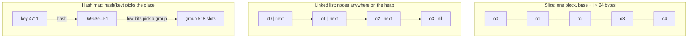
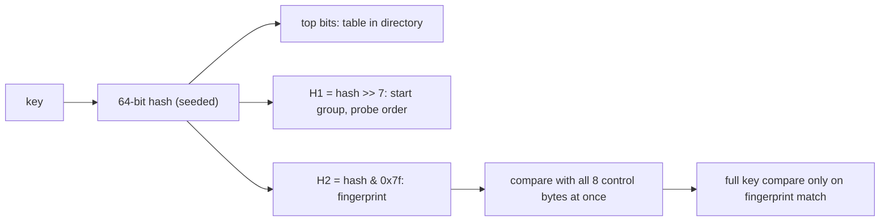
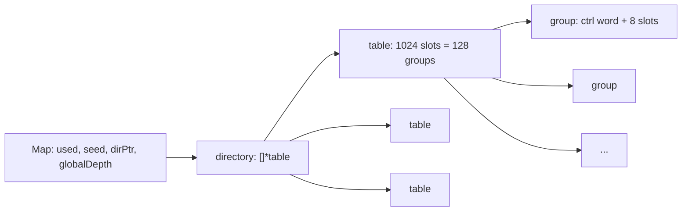

# Arrays, slices and hashing

## Why care?

Four common statements about Go code. Each one is only half true:

- "Use a linked list, inserts are O(1)." True, and the loop over it can be **50 times** slower than over a slice.
- "Maps are O(1)." True, and for 8 keys a plain slice scan is twice as fast.
- "My test passed, then failed in CI. It printed the map in a different order." This is not a bug in Go. It is intended.
- "We deleted half the cache entries, but memory did not go down." This is also intended.

Almost every Go program is built from two structures: the **slice** (an array in one block of memory) and the **map** (a hash table). This page shows how each one is laid out in memory, why that layout decides its speed, and what Go's map does inside since Go 1.24 replaced it with a Swiss table.

## The idea: position by index, position by hash

**An array stores elements of the same size side by side in one block of memory.** To find element 4711 you do not search: its address is `start + 4711 × element size`. Reading elements 1 to 100 means reading one continuous range of memory.

**A linked list stores each element in its own node.** Each node holds an order and a pointer to the next node. To reach the 4711th order you follow 4711 pointers, and each node can be anywhere in memory.

**A hash map computes the position from the key.** A **hash function** turns the key into a number (the **hash**), and the hash picks a place in the table. To find the key again, the same computation gives the same place, so there is no search. Sometimes two keys get the same place (a **collision**), so each place has room for a few entries. When the table gets too full, the map moves everything into a bigger table.



## Under the hood: contiguous memory

### Arrays and slices

A Go array `[1000]Order` is 1000 orders next to each other, nothing else. A slice is a small header that **points into** such an array:

```go
type slice struct { // see $GOROOT/src/runtime/slice.go
	array unsafe.Pointer
	len   int
	cap   int
}
```

`s[i]` is one multiplication and one memory read: `array + i × sizeof(Order)`. That is O(1), with a tiny constant. Reading `s[0], s[1], s[2], ...` in order is the fastest way to read memory: each 64-byte cache line brings several orders at once, and the hardware prefetcher loads the next lines before you ask (see [Memory](../fundamentals/memory.md#caches-why-the-same-work-can-be-2-slower)).

The price: inserting or deleting in the middle shifts everything after it. `slices.Insert` documents it plainly: "This function is O(len(s) + len(v))." Growth is amortized O(1), as you saw in [Big-O in practice](big-o.md#amortized-cost-why-append-is-o1).

### Linked lists: `container/list`

Go has a doubly linked list in the standard library. Each element is a separate heap object. From `$GOROOT/src/container/list/list.go`:

```go
type Element struct {
	// Next and previous pointers in the doubly-linked list of elements.
	// To simplify the implementation, internally a list l is implemented
	// as a ring, such that &l.root is both the next element of the last
	// list element (l.Back()) and the previous element of the first list
	// element (l.Front()).
	next, prev *Element

	// The list to which this element belongs.
	list *List

	// The value stored with this element.
	Value any
}
```

Here is the cost of one `Order` (24 bytes) in a list:

- `next`, `prev`, `list`: three pointers, 24 bytes.
- `Value any`: an interface, 16 bytes (type pointer plus data pointer). A 24-byte struct does not fit in the data pointer, so Go **boxes** it: a second heap allocation of 24 bytes.
- So 40 bytes of `Element` (rounded up to the 48-byte size class), plus 24 bytes for the boxed order. **72 bytes and 2 allocations** for 24 bytes of data. And every read needs a type assertion, `e.Value.(Order)`.

What you get for that: insert and remove **at an element you already hold** is O(1). No shifting. That is the one thing a list does better, and it matters for structures like an LRU cache, where a map points straight at list elements.

## Try it in Go: slice vs list

Three benchmarks on 1,000,000 orders: sum the amounts, build the collection, and insert in the middle.

```go
package hashing

import (
	"container/list"
	"math/rand/v2"
	"slices"
	"testing"
)

type Order struct {
	ID          int64
	AmountCents int64
	CreatedAt   int64
}

const n = 1_000_000

func BenchmarkSumAmounts(b *testing.B) {
	s := make([]Order, n)
	l := list.New()
	for i := range n {
		o := Order{ID: int64(i), AmountCents: int64(i % 5000)}
		s[i] = o
		l.PushBack(o)
	}
	b.Run("slice", func(b *testing.B) {
		for b.Loop() {
			var sum int64
			for i := range s {
				sum += s[i].AmountCents
			}
			_ = sum
		}
	})
	sumList := func(b *testing.B, l *list.List) {
		for b.Loop() {
			var sum int64
			for e := l.Front(); e != nil; e = e.Next() {
				sum += e.Value.(Order).AmountCents
			}
			_ = sum
		}
	}
	b.Run("list", func(b *testing.B) { sumList(b, l) })

	// Same nodes, same memory, but linked in a random order:
	// what a list looks like after months of inserts and deletes.
	elems := make([]*list.Element, 0, n)
	for e := l.Front(); e != nil; e = e.Next() {
		elems = append(elems, e)
	}
	rand.New(rand.NewPCG(1, 2)).Shuffle(n, func(i, j int) { elems[i], elems[j] = elems[j], elems[i] })
	for _, e := range elems {
		l.MoveToBack(e)
	}
	b.Run("list-scattered", func(b *testing.B) { sumList(b, l) })
}

func BenchmarkBuild(b *testing.B) {
	b.Run("slice", func(b *testing.B) {
		for b.Loop() {
			s := make([]Order, 0, n)
			for i := range n {
				s = append(s, Order{ID: int64(i)})
			}
		}
	})
	b.Run("list", func(b *testing.B) {
		for b.Loop() {
			l := list.New()
			for i := range n {
				l.PushBack(Order{ID: int64(i)})
			}
		}
	})
}

// Insert in the middle: the list's best case (we already hold the element).
func BenchmarkInsertMiddle(b *testing.B) {
	const m = 10_000
	b.Run("slice", func(b *testing.B) {
		s := make([]Order, m)
		for b.Loop() {
			s = slices.Insert(s, m/2, Order{ID: -1}) // shifts 5,000 orders right
			s = slices.Delete(s, m/2, m/2+1)         // and back again
		}
	})
	b.Run("list", func(b *testing.B) {
		l := list.New()
		var mid *list.Element
		for i := range m {
			e := l.PushBack(Order{ID: int64(i)})
			if i == m/2 {
				mid = e
			}
		}
		for b.Loop() {
			e := l.InsertBefore(Order{ID: -1}, mid)
			l.Remove(e)
		}
	})
}
```

```console
$ go test -run='^$' -bench='Sum|Build|Insert' -benchmem -count=3
BenchmarkSumAmounts/slice-16                610     1981624 ns/op          0 B/op         0 allocs/op
BenchmarkSumAmounts/list-16                 356     3366162 ns/op          0 B/op         0 allocs/op
BenchmarkSumAmounts/list-scattered-16        12    98777792 ns/op          0 B/op         0 allocs/op
BenchmarkBuild/slice-16                     217     5484670 ns/op   24002578 B/op         1 allocs/op
BenchmarkBuild/list-16                       13    99204198 ns/op   72000060 B/op   2000001 allocs/op
BenchmarkInsertMiddle/slice-16           378150        3194 ns/op          0 B/op         0 allocs/op
BenchmarkInsertMiddle/list-16          18804567       57.58 ns/op         48 B/op         1 allocs/op
```

(First of three runs per line; the others were within a few percent.)

- **Sum, fresh list: 1.7× slower.** The nodes were allocated one after another, so they happen to sit close together in memory. The list is slower only because of the extra pointer chase and the type assertion.
- **Sum, scattered list: 50× slower.** Same nodes, same memory, only the links point in random order. Now every `e.Next()` is a cache miss. This is what a long-lived list (or tree, or any pointer structure) looks like in a real service.
- **Build: 18× slower, 3× the memory, 2 million allocations**, exactly 2 per element as counted above. All of them are work for the garbage collector, again and again, for as long as the list lives.
- **Insert in the middle: the list wins by 55×.** Shifting 5,000 orders (120 KB) twice costs 3.2 µs. Relinking two pointers costs 58 ns (and one 48-byte allocation for the new `Element`).

So the list only wins when you already hold a pointer to the place of change and you change much more than you read. Even then, check whether a slice with "swap with last and truncate" (`s[i] = s[len(s)-1]; s = s[:len(s)-1]`, O(1) if order does not matter) solves your problem first.

## Under the hood: hashing

### Hash functions

A hash function turns a key of any size into a fixed-size number, here 64 bits. A good one for a hash table:

1. **Is deterministic**: the same key always gives the same hash (within one map).
2. **Spreads the keys**: similar keys (`order-1000`, `order-1001`) give completely different hashes, so every bit of the result changes with every bit of the input.
3. **Is fast**: it runs on every lookup.
4. **Is seeded**: it mixes in a random secret, so an outsider cannot choose keys that collide on purpose.

It does **not** need to be cryptographic (like SHA-256), which would be much slower. Go hashes map keys with AES hardware instructions when the CPU has them: `$GOROOT/src/internal/runtime/maps/memhash_aes.go` calls `memHashAES` when `UseAeshash` is true, with a fallback in software. And every map gets its own random seed when it is created (`m.seed = uintptr(rand())` in `NewMap`, `$GOROOT/src/internal/runtime/maps/map.go`).

For your own hashing (a Bloom filter, sharding, a cache key) use `hash/maphash`. It is the same family of fast, seeded hash: `maphash.Comparable(seed, v)` hashes any comparable value, `maphash.String(seed, s)` a string. Do not use `crc32` or a hand-written `id % n` for a hash table.

### Collisions and load factor

The table has a limited number of places. With 2^16 slots, the hash picks a slot with `hash & (2^16 - 1)`, the low 16 bits. Two keys that land in the same slot **collide**. Collisions are normal, not an error. A table handles them in one of two ways:

- **Chaining**: each slot holds a small list of entries. Go's old map (before 1.24) did this with "buckets" of 8 entries plus overflow buckets.
- **Open addressing**: there is only one array. If the slot is taken, **probe** the next slot (or another one, by a rule) until you find a free one. A lookup follows the same path. Go's Swiss table is open addressing.

The **load factor** is "used slots / total slots". The fuller the table, the longer the probe paths, the slower every lookup. Every hash table grows (allocates a bigger table and moves every entry, called **rehashing**) before it gets too full. Growing doubles the size, so like `append`, inserts stay amortized O(1).

You can see both effects with a small test table: open addressing, linear probing (try the next slot), 65,536 slots. It counts how many slots a successful lookup has to inspect, for two hash functions:

```go
// Command probe fills a toy open-addressing table (linear probing,
// one slot at a time) and reports the average number of slots a
// lookup must inspect, for two hash functions and several load factors.
package main

import (
	"fmt"
	"hash/maphash"
)

const size = 1 << 16 // 65,536 slots

type table struct {
	slots []int64 // 0 means empty; order IDs start at 1
	hash  func(int64) uint64
}

func (t *table) insert(id int64) {
	i := t.hash(id) & (size - 1)
	for t.slots[i] != 0 {
		i = (i + 1) & (size - 1)
	}
	t.slots[i] = id
}

// probes returns how many slots a successful lookup of id inspects.
func (t *table) probes(id int64) int {
	i := t.hash(id) & (size - 1)
	for n := 1; ; n++ {
		if t.slots[i] == id {
			return n
		}
		i = (i + 1) & (size - 1)
	}
}

func main() {
	seed := maphash.MakeSeed()
	good := func(id int64) uint64 { return maphash.Comparable(seed, id) }
	// "Fast" hash: just use the ID. Our IDs step by 1024.
	bad := func(id int64) uint64 { return uint64(id) }

	fmt.Printf("%-6s %12s %12s\n", "load", "maphash", "identity")
	for _, load := range []float64{0.50, 0.75, 0.875, 0.95} {
		n := int(load * size)
		var avg [2]float64
		for k, h := range []func(int64) uint64{good, bad} {
			t := &table{slots: make([]int64, size), hash: h}
			for i := 1; i <= n; i++ {
				t.insert(int64(i) * 1024)
			}
			total := 0
			for i := 1; i <= n; i++ {
				total += t.probes(int64(i) * 1024)
			}
			avg[k] = float64(total) / float64(n)
		}
		fmt.Printf("%-6.3f %12.2f %12.2f\n", load, avg[0], avg[1])
	}
}
```

```console
$ go run ./probe
load        maphash     identity
0.500          1.50       256.50
0.750          2.58       384.50
0.875          4.78       448.50
0.950         11.35       486.90
```

Two lessons:

- **Load factor**: with a good hash, half full means 1.5 looks per lookup. At 95% full it is 11. (Theory for linear probing says about `(1 + 1/(1-load)) / 2`: 1.5 at 50%, 10.5 at 95%.) That is why tables grow long before they are full.
- **Bad hash**: IDs that step by 1024 all have the same low 10 bits. Using the ID as its own hash, they land on only 64 different start slots, and lookups need **hundreds** of probes even when the table is half empty. Real data has patterns like this all the time: IDs from a sharded sequence, timestamps in whole seconds, prices in whole euros. A good hash function removes the pattern. With an attacker choosing keys, this is a denial-of-service attack; the random seed stops it.

## Under the hood: Go's Swiss-table map

Since Go 1.24 the built-in `map` is a **Swiss table**, a design from Google's Abseil C++ library, with changes for Go. The code is in `$GOROOT/src/internal/runtime/maps/`. The top of `map.go` explains it well; here is the terminology from that comment:

```go
// Terminology:
// - Slot: A storage location of a single key/element pair.
// - Group: A group of abi.MapGroupSlots (8) slots, plus a control word.
// - Control word: An 8-byte word which denotes whether each slot is empty,
//   deleted, or used. If a slot is used, its control byte also contains the
//   lower 7 bits of the hash (H2).
// - H1: Upper 57 bits of a hash.
// - H2: Lower 7 bits of a hash.
// - Table: A complete "Swiss Table" hash table. A table consists of one or
//   more groups for storage plus metadata to handle operation and determining
//   when to grow.
// - Map: The top-level Map type consists of zero or more tables for storage.
//   The upper bits of the hash select which table a key belongs to.
// - Directory: Array of the tables used by the map.
```

The sections below explain it from the bottom up.

### Groups and control bytes

A **group** is 8 slots plus one 8-byte **control word**: one control byte per slot. By default the slots are stored interleaved, key, value, key, value (a `GOEXPERIMENT=mapsplitgroup` build stores all keys, then all values). The control byte says what is in the slot (from `group.go`):

```go
// Each slot in the hash table has a control byte which can have one of three
// states: empty, deleted, and full. They have the following bit patterns:
//
//	  empty: 1 0 0 0 0 0 0 0
//	deleted: 1 1 1 1 1 1 1 0
//	   full: 0 h h h h h h h  // h represents the H2 hash bits
```

The 64-bit hash is split in two:

- **H1**, the upper 57 bits, chooses **where** to look: which group to start probing at.
- **H2**, the lower 7 bits, is stored **in the control byte** of a full slot. It is a short fingerprint of the key.



### Lookup: 8 slots in one instruction

Here is the core of a lookup, from `getWithKey` in `$GOROOT/src/internal/runtime/maps/table.go` (the long comment at its top left out):

```go
	seq := makeProbeSeq(h1(hash), t.groups.lengthMask)
	h2Hash := h2(hash)
	for ; ; seq = seq.next() {
		g := t.groups.group(typ, seq.offset)

		match := g.ctrls().matchH2(h2Hash)

		for match != 0 {
			i := match.first()

			slotKey := g.key(typ, i)
			if typ.IndirectKey() {
				slotKey = *((*unsafe.Pointer)(slotKey))
			}
			if typ.Key.Equal(key, slotKey) {
				slotElem := g.elem(typ, i)
				if typ.IndirectElem() {
					slotElem = *((*unsafe.Pointer)(slotElem))
				}
				return slotKey, slotElem, true
			}
			match = match.removeFirst()
		}

		match = g.ctrls().matchEmpty()
		if match != 0 {
			// Finding an empty slot means we've reached the end of
			// the probe sequence.
			return nil, nil, false
		}
	}
```

Step by step:

1. **`matchH2`** compares H2 against all 8 control bytes **at the same time**. The portable version does it with bit tricks on one `uint64`; on amd64 it is a compiler intrinsic using SIMD instructions. The result is a bitset of candidate slots.
2. For each candidate, compare the **full key**. Because H2 has 7 bits, a random slot matches by accident only 1 time in 128. The comment above `getWithKey` estimates fewer than 1/8 false comparisons per lookup. So the expensive key compare (for example, of a long string) almost always succeeds the first time.
3. If the group has an **empty** slot, the key cannot be further along: stop, not found.
4. Otherwise, go to the next group in the **probe sequence**. It is quadratic (`offset + 1`, `+ 2`, `+ 3`, ...), and the comment on `probeSeq` explains that it visits every group exactly once because the group count is a power of two.

So one lookup usually reads one control word, compares one key, and is done. That is the "1" in O(1), and it is why the map stayed flat at about 8 ns in [the Big-O benchmarks](big-o.md#on-vs-olog-n-vs-o1-looking-up-an-order).

### Deletes and tombstones

Open addressing has a subtle problem. If you delete a key in a full group by marking its slot **empty**, a later lookup for some other key that probed **past** this group would now stop too early. So the slot becomes **deleted** (a tombstone): "nothing here, but keep searching". If the group still has an empty slot anyway, nobody can have probed past it, and the slot is simply marked empty. Tombstones count towards the load factor and are only cleaned up when the table grows.

### Load factor 7/8, tables and the directory

From `group.go`:

```go
	// Maximum load factor prior to growing.
	//
	// 7/8 is the same load factor used by Abseil, but Abseil defaults to
	// 16 slots per group, so they get two empty slots vs our one empty
	// slot. We may want to reevaluate if this is best for us.
	maxAvgGroupLoad = 7
```

A table grows when used slots plus tombstones reach 7/8 of its capacity. That is much fuller than the 50-75% a linear-probing table can afford (look at the toy above at 87.5%). The 8-wide group compare is what makes it affordable.

Growing a big hash table in one go is a latency spike: every entry must be moved, because the probe positions depend on the table size. Go limits that cost with two levels:

- A **table** holds at most `maxTableCapacity = 1024` slots (`table.go`). Up to that size, growing replaces the table with one twice as big.
- Beyond that, growing **splits** the table into two tables of 1024 slots. The **directory** is an array of table pointers, indexed by the **top bits** of the hash ("extendible hashing"). So the most work one insert can trigger is moving 1024 slots, not the whole map.

`rehash` in `table.go` is short:

```go
	newCapacity := 2 * t.capacity
	if newCapacity <= maxTableCapacity {
		t.grow(typ, m, newCapacity)
		return
	}

	t.split(typ, m)
```

The directory can have more entries than there are tables: when one table splits and its neighbours do not, several directory entries point to the same table. The diagram is in the `map.go` comment:

```text
	directory (globalDepth=2)
	+----+
	| 00 | --\
	+----+    +--> table (localDepth=1)
	| 01 | --/
	+----+
	| 10 | ------> table (localDepth=2)
	+----+
	| 11 | ------> table (localDepth=2)
	+----+
```



One more optimization: the **small map**. A map that never held more than 8 entries has no directory and no table at all; `dirPtr` points straight at a single group. And `make(map[K]V, hint)` with `hint <= 8` allocates nothing until the first insert.

### Iteration order is random by design

The spec says map iteration order is unspecified. The implementation makes it random so that code cannot depend on it: each `range` starts at a random slot and a random directory entry (`it.entryOffset = rand()` and `it.dirOffset = rand()` in `table.go`).

```go
// Command iterorder ranges over the same small map three times.
package main

import (
	"fmt"
	"maps"
	"slices"
)

func main() {
	stock := map[string]int{"MUG": 12, "PIN": 40, "CAP": 7, "TEE": 3, "BAG": 9}
	for range 3 {
		for sku := range stock {
			fmt.Print(sku, " ")
		}
		fmt.Println()
	}
	fmt.Println("sorted:", slices.Sorted(maps.Keys(stock)))
}
```

```console
$ go run ./iterorder
PIN CAP TEE BAG MUG
TEE BAG MUG PIN CAP
CAP TEE BAG MUG PIN
sorted: [BAG CAP MUG PIN TEE]
$ go run ./iterorder
BAG MUG PIN CAP TEE
MUG PIN CAP TEE BAG
PIN CAP TEE BAG MUG
sorted: [BAG CAP MUG PIN TEE]
```

Different every time, even inside one run. (With 5 keys, it is one group, so you see rotations of the same slot order.) When output order matters (JSON, logs, test expectations, a hash over the content), sort the keys: `slices.Sorted(maps.Keys(m))`. `encoding/json` already sorts map keys when it writes an object.

## Try it in Go: maps in practice

### Small n: a slice beats a map

Which is faster for looking up an order status by key: a map, or scanning a slice of pairs? With string keys like `paid-001`, `shipped-002`:

```go
type statusCount struct {
	status string
	count  int
}

var statuses = []string{"pending", "paid", "shipped", "cancelled", "refunded", "on_hold",
	"backordered", "returned", "disputed", "archived", "draft", "failed",
	"expired", "partial", "packed", "picked"}

func key(i int) string { return fmt.Sprintf("%s-%03d", statuses[i%len(statuses)], i) }

func BenchmarkSmallLookup(b *testing.B) {
	for _, n := range []int{4, 8, 16, 32, 64, 256} {
		s := make([]statusCount, n)
		m := make(map[string]int, n)
		for i := range n {
			s[i] = statusCount{key(i), i}
			m[key(i)] = i
		}
		// Look up every key in turn, so we measure the average position.
		keys := make([]string, n)
		for i := range keys {
			keys[i] = key(i)
		}
		b.Run(fmt.Sprintf("slice/n=%d", n), func(b *testing.B) {
			i := 0
			for b.Loop() {
				k := keys[i%n]
				for j := range s {
					if s[j].status == k {
						break
					}
				}
				i++
			}
		})
		b.Run(fmt.Sprintf("map/n=%d", n), func(b *testing.B) {
			i := 0
			for b.Loop() {
				_ = m[keys[i%n]]
				i++
			}
		})
	}
}
```

```console
$ go test -run='^$' -bench=SmallLookup -count=3
BenchmarkSmallLookup/slice/n=4-16      231805898     5.234 ns/op
BenchmarkSmallLookup/map/n=4-16         95564569    12.13 ns/op
BenchmarkSmallLookup/slice/n=8-16      172230555     7.095 ns/op
BenchmarkSmallLookup/map/n=8-16         96850634    12.58 ns/op
BenchmarkSmallLookup/slice/n=16-16     100000000    10.94 ns/op
BenchmarkSmallLookup/map/n=16-16        78985801    16.99 ns/op
BenchmarkSmallLookup/slice/n=32-16      58737165    21.37 ns/op
BenchmarkSmallLookup/map/n=32-16        90568197    13.61 ns/op
BenchmarkSmallLookup/slice/n=64-16      29936679    39.98 ns/op
BenchmarkSmallLookup/map/n=64-16        94968549    13.19 ns/op
BenchmarkSmallLookup/slice/n=256-16      7089354   157.3 ns/op
BenchmarkSmallLookup/map/n=256-16       88253814    14.23 ns/op
```

(First of three runs; `-benchmem` columns dropped, all were `0 B/op 0 allocs/op`. The n=16 runs were noisy: the slice took 10.9 to 15.1 ns, the map 14.0 to 17.0 ns.)

The map is flat at 12-17 ns: it must hash the whole string every time. The slice grows linearly, and the crossover on this machine is between 16 and 32 keys. Below that, the slice wins, because comparing two short strings that differ early is a few instructions, and the whole slice fits in a cache line or two.

Should you replace your maps with slices? Usually not. The map is never slow, its cost does not depend on n, and code that uses a map says "lookup by key" clearly. But for a fixed, small set of keys (HTTP methods, a handful of statuses, config flags), a slice or a `switch` is fine and often faster.

### Preallocate with a size hint

Like slices, maps grow by rehashing. If you know how many entries are coming, say so:

```go
func BenchmarkMapFill(b *testing.B) {
	const n = 100_000
	b.Run("no-hint", func(b *testing.B) {
		for b.Loop() {
			m := make(map[int64]Order)
			for i := range int64(n) {
				m[i] = Order{ID: i}
			}
		}
	})
	b.Run("hint", func(b *testing.B) {
		for b.Loop() {
			m := make(map[int64]Order, n)
			for i := range int64(n) {
				m[i] = Order{ID: i}
			}
		}
	})
}
```

```console
$ go test -run='^$' -bench=MapFill -benchmem -count=3
BenchmarkMapFill/no-hint-16    81   13939152 ns/op   10492211 B/op   530 allocs/op
BenchmarkMapFill/no-hint-16    99   11732768 ns/op   10492173 B/op   530 allocs/op
BenchmarkMapFill/no-hint-16   100   11764567 ns/op   10492176 B/op   530 allocs/op
BenchmarkMapFill/hint-16      217    5464236 ns/op    5248154 B/op   257 allocs/op
BenchmarkMapFill/hint-16      181    6402774 ns/op    5248162 B/op   257 allocs/op
BenchmarkMapFill/hint-16      216    5501208 ns/op    5248150 B/op   257 allocs/op
```

Twice as fast, half the memory. With the hint, `NewMap` computes the capacity up front (`hint × 8 / 7` slots, so the 7/8 load factor is not hit), splits it into tables of 1024 slots, and rounds the directory up to a power of two: 128 tables. 257 allocations is the directory plus two per table (the table struct and its group array). Without the hint, the map grows table by table, rehashing every entry several times along the way.

## Traps

- **Depending on map order.** Tests that compare printed maps, code that takes "the first" key, hashes over `range m`. All break randomly. Sort the keys.
- **Concurrent map writes.** A map is not safe for concurrent use. The runtime detects some races and stops the whole program with `fatal error: concurrent map writes` (or `concurrent map read and map write`). This is not a panic; `recover` cannot catch it. Use a `sync.Mutex` (like `examples/orders`'s `memory.Store`), or `sync.Map` for the special cases its docs describe.
- **Maps do not shrink.** Deleting entries frees the slots but keeps the tables. A cache that once held 10 million entries keeps that memory after you delete 9.9 million. `clear(m)` also keeps the capacity. To shrink, copy the live entries into a new map and drop the old one.
- **Holding pointers into a slice across `append`.** `p := &s[3]`, then `s = append(s, x)` may move the array. `p` now points into the old copy; writes through it are lost.
- **Big structs in maps.** `m[id] = order` copies the struct in, `o := m[id]` copies it out, and you cannot write `m[id].Status = "paid"` (compile error). For big values that change often, store a pointer, or an index into a slice.
- **Linked lists for "fast inserts".** Only if you already hold the element. Otherwise you walk the list to find the place (O(n), with a cache miss per step), and the slice would have been faster.
- **Weak hash for your own table.** `id % shards` or `crc32` on patterned keys clumps. Use `hash/maphash` with a seed, and remember the seed is random per process: do not store those hashes or send them to another service. For stable hashes across machines (consistent hashing, see [Probabilistic structures](probabilistic-structures.md)), use a fixed, documented hash such as FNV or xxhash.
- **NaN keys.** `NaN != NaN`, so `m[math.NaN()] = 1` adds a new entry every time, and you can never look it up. Avoid float keys.

## Check yourself

??? question "1. Why is summing a scattered `container/list` 50× slower than a slice, when both are O(n)?"

    The slice is one contiguous block: each cache line brings several orders and the
    prefetcher loads ahead. The scattered list jumps to a random heap address on every
    `Next()`, so almost every step is a cache miss to RAM (around 100 ns). On top of that
    each element is boxed in an `any`, which adds a second pointer to follow and a type
    assertion.

??? question "2. In Go's map, what are H1 and H2, and why store H2 in the control byte?"

    H1 is the upper 57 bits of the hash. It picks the starting group and so the probe
    sequence. H2 is the lower 7 bits, stored in the control byte of each full slot. Lookup
    compares H2 against all 8 control bytes of a group at once, and only does the full key
    compare on a match. A wrong match happens about 1 time in 128, so expensive key
    comparisons are rare.

??? question "3. Why can't a delete just mark the slot empty?"

    A lookup stops when it reaches a group with an empty slot. If a group was full when
    some later key was inserted, that key was placed further along the probe sequence.
    Marking a slot in that group empty would make lookups for the later key stop too early
    and miss it. So the slot becomes a tombstone (deleted) unless the group already had an
    empty slot.

??? question "4. Why does Go split big maps into tables of at most 1024 slots?"

    Growing a hash table moves every entry, because positions depend on the table size.
    With one huge table, one insert could trigger moving millions of entries: a latency
    spike. With a directory of small tables, a grow only rehashes one table (at most 1024
    slots). The top bits of the hash select the table (extendible hashing).

??? question "5. A test prints `map[string]int` contents with `for k, v := range m` and compares with a golden file. It fails one run in ten. Why, and what is the fix?"

    Map iteration order is randomized on purpose: each `range` starts at a random slot and
    table. With few keys that sometimes happens to match the golden order, sometimes not.
    Sort the keys first: `for _, k := range slices.Sorted(maps.Keys(m))`.

??? question "6. You look up one of 10 fixed tax categories per order line. Map or slice?"

    Either is fine. At around 10 keys, a linear scan of a slice is about as fast as or
    faster than a map lookup on this machine (crossover between 16 and 32 keys), and needs
    no hashing. A `switch` is fine too. Choose what reads best; it will not be the
    bottleneck. Use a map once the set is large or comes from data.

## Recap

- A **slice** is a header (pointer, len, cap) over one contiguous array. Index is O(1); sequential reads use the CPU cache well; middle inserts shift.
- A **linked list** (`container/list`) costs 72 bytes and 2 allocations per 24-byte order, and a cache miss per step once it is scattered. It wins only for inserts and deletes at an element you already hold.
- A **hash function** must be deterministic, spread keys, be fast and be seeded. Go uses AES-based hashing with a random seed per map; use `hash/maphash` for your own.
- **Load factor** decides probe length. Tables grow (rehash) before they get full, keeping inserts amortized O(1).
- Go's **Swiss-table map**: groups of 8 slots with a control word; H1 picks the group, H2 is a 7-bit fingerprint matched against 8 slots at once; tombstones for deletes; 7/8 max load; tables of at most 1024 slots under a directory, so growth is incremental.
- Map iteration order is **random by design**. Sort the keys when order matters.
- Small maps (≤ 8 entries) are a single group. For tiny fixed key sets, a slice scan is as fast or faster.
- Pass a size hint to `make` when you know the count. Maps never shrink.

Next: [Trees](trees.md), for when you need the keys **in order**, not just fast lookups.
