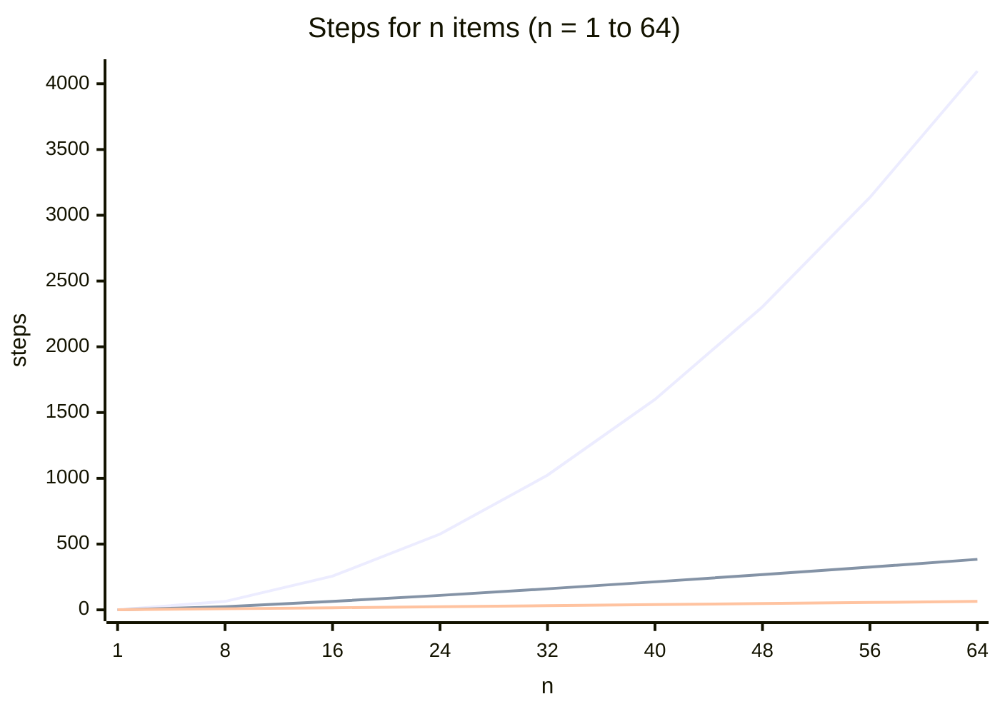
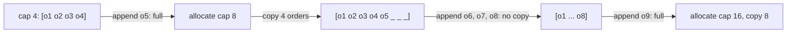

# Big-O in practice

## Why care?

Three typical reports from a team:

- "The nightly report took 4 minutes last year. Now it takes 3 hours. The code did not change."
- "I replaced the map with a slice and the handler got **faster**. Is Big-O wrong?"
- "The profile says `runtime.growslice` is 20% of CPU. We never call that."

All three are about **how cost grows** when the input grows. Big-O is the tool for that question. It gives you a short way to say: "with 10 times more orders, this part gets 10 times slower, and that part gets 100 times slower."

But Big-O hides constants, and constants are real: cache misses, allocations, hashing. So this page does both. First you learn to count work. Then you measure it with `go test -bench`, and see where the count predicts the time and where the hardware changes the result.

## The idea: count steps as the input grows

Take a list of orders and five questions about it. Each question needs a different number of steps.

- "What is the first order in the list?" One step, whatever the length of the list. That is **O(1)**, constant.
- "Is order 4711 in the list?" The list is not sorted, so you check every order. Twice as many orders, twice as many checks. That is **O(n)**, linear.
- "Is order 4711 in the list?", but the list is **sorted by ID**. Look at the middle, discard the half that cannot hold the ID, and repeat. 1,000 orders need about 10 looks; 1,000,000 need about 20. That is **O(log n)**, logarithmic.
- "Sort the list by date." Good methods split the list, sort the halves and merge them: about `n × log n` steps. That is **O(n log n)**.
- "Find two orders with the same ID." Compare every order with every other: `n × n / 2` comparisons. That is **O(n²)**, quadratic. 10 times more orders, 100 times more work.

The letter `n` is the size of the input. **O(...)** says how the work grows with `n`, ignoring fixed costs and constant factors. "O(n)" means "roughly proportional to n, for big n".



`log n` and `1` are not even drawn: at n = 64 they are 6 and 1, flat on the x-axis. At scale, the shape of the curve matters more than anything else.

### The five you meet every week

| Big-O      | Name         | 1,000 items | 1,000,000 items   | Typical Go code                                   |
| ---------- | ------------ | ----------- | ----------------- | ------------------------------------------------- |
| O(1)       | constant     | 1           | 1                 | `m[id]`, `s[i]`, `len(s)`, `append` (amortized)   |
| O(log n)   | logarithmic  | ~10         | ~20               | `slices.BinarySearch`, B-tree index lookup        |
| O(n)       | linear       | 1,000       | 1,000,000         | `for range s`, `slices.Contains`, `strings.Index` |
| O(n log n) | linearithmic | ~10,000     | ~20,000,000       | `slices.Sort`, `slices.SortFunc`                  |
| O(n²)      | quadratic    | 1,000,000   | 1,000,000,000,000 | a loop inside a loop over the same data           |

Look at the last line. At one nanosecond per step, a million squared is **17 minutes**. A nightly report that slows down like the one at the top of the page usually contains a hidden O(n²).

## Under the hood: counting work

### Rule 1: count the loops, not the lines

The work of a function is the work of its loops. Sequential loops **add**, nested loops **multiply**:

```go
// O(n): one pass.
func total(orders []Order) int64 {
	var sum int64
	for _, o := range orders {
		sum += o.AmountCents
	}
	return sum
}

// O(n) + O(n) = O(n): two passes is still linear.
func average(orders []Order) int64 {
	return total(orders) / int64(len(orders))
}

// O(n × m): for every order, scan every refund.
func refunded(orders []Order, refunds []Refund) []Order {
	var out []Order
	for _, o := range orders {
		for _, r := range refunds {
			if r.OrderID == o.ID {
				out = append(out, o)
				break
			}
		}
	}
	return out
}
```

`refunded` looks cheap. With 1,000 orders and 50 refunds it is instant. With 2 million orders and 200,000 refunds it is 400 billion comparisons. The fix is a different structure: put the refund IDs in a `map` first (O(m)), then one pass over the orders (O(n)). O(n × m) becomes O(n + m).

### Rule 2: the hidden loop

The most expensive loops are often the ones you cannot see in your own code. Each of these is O(n) **per call**:

- `slices.Contains(s, x)`, `slices.Index(s, x)`
- `strings.Contains(s, sub)`, `bytes.Equal(a, b)`
- `slices.Insert(s, i, v)` and `slices.Delete(s, i, j)` (they shift everything after `i`)
- `s = append([]T{x}, s...)` (prepend copies the whole slice)
- `copy`, `slices.Clone`, `maps.Clone`
- a SQL query without an index (a full table scan, see [Indexes](../databases/indexes.md))

Put any of them in a loop and you have O(n²) without writing a nested loop.

### Rule 3: halving gives `log n`

Whenever each step throws away a constant **fraction** of the remaining work, you get `log n`. Binary search halves. A B-tree with 300 keys per page divides by 300, so a billion rows need only 4 levels. `log₂(1,000,000) ≈ 20`. That is why sorted data is valuable: it turns O(n) searches into O(log n).

### Rule 4: drop the constants, but remember they exist

O(2n) is O(n). O(n + 1000) is O(n). For big `n`, only the fastest-growing part matters. This is what makes Big-O useful: you can reason about a design on a whiteboard.

But in real code, `n` is often small, and then the constant **is** the cost. A map lookup is O(1), but that "1" includes hashing the key, finding the group, and comparing. A linear scan over 8 items is O(n), but each step is one compare on data already in the CPU cache. You will see that the scan wins for small `n` (in [Arrays and hashing](arrays-and-hashing.md#small-n-a-slice-beats-a-map)).

### Best, worst, average

One algorithm can have several costs:

- **Worst case**: the input that hurts most. Linear search for an ID that is not there: n steps.
- **Average case**: random input. Linear search for an ID that is there: n/2 steps on average. Still O(n).
- **Best case**: rarely useful. "If the first item matches, it's O(1)" tells you nothing.

For services, care about the worst case. Sooner or later someone sends the input that triggers it, by accident or on purpose. A textbook quicksort is O(n²) on already-sorted data (see [Sorting and searching](sorting-and-searching.md)). A hash map is O(n) per lookup if all keys collide. Go defends against both, as you will see.

### Space counts too

Big-O also describes memory. `hasDupMap` below uses O(n) extra memory for its map; `hasDupNested` uses O(1). Allocations are not free in Go: every byte the program allocates on the heap is work for the garbage collector later (see [Memory](../fundamentals/memory.md)). That is why `go test -benchmem` reports bytes and allocations next to time.

## Amortized cost: why `append` is O(1)

`append` sometimes has to copy the whole slice. Copying is O(n). So how can `append` be O(1)?

A slice is a pointer, a length and a capacity. When `len == cap`, `append` allocates a **bigger** array, copies the old elements over, and adds the new one. If the new array were only one element bigger, every append would copy: 1 + 2 + 3 + ... + n = O(n²) in total. Instead Go grows by a **factor**. Watch it happen with a small program that prints every time the capacity changes:

```go
// Command growth prints every time append moves a slice of orders.
package main

import "fmt"

type Order struct {
	ID          int64
	AmountCents int64
	CreatedAt   int64
}

func main() {
	var s []Order
	last := -1
	for i := range 100_000 {
		s = append(s, Order{ID: int64(i)})
		if cap(s) != last {
			fmt.Printf("len=%-5d cap=%-5d", len(s), cap(s))
			if last > 0 {
				fmt.Printf(" x%.2f", float64(cap(s))/float64(last))
			}
			fmt.Println()
			last = cap(s)
		}
	}
}
```

```console
$ go run ./growth
len=1     cap=1
len=2     cap=2     x2.00
len=3     cap=4     x2.00
len=5     cap=8     x2.00
len=9     cap=16    x2.00
len=17    cap=32    x2.00
len=33    cap=64    x2.00
len=65    cap=128   x2.00
len=129   cap=256   x2.00
len=257   cap=512   x2.00
len=513   cap=853   x1.67
len=854   cap=1365  x1.60
len=1366  cap=2048  x1.50
len=2049  cap=3072  x1.50
len=3073  cap=4096  x1.33
...
len=62123 cap=78165 x1.26
len=78166 cap=97962 x1.25
len=97963 cap=122880 x1.25
```

Doubling up to 256, then slowly down to 1.25×. 100,000 appends caused only **29** moves. The rule is in `$GOROOT/src/runtime/slice.go`:

```go
// nextslicecap computes the next appropriate slice length.
func nextslicecap(newLen, oldCap int) int {
	newcap := oldCap
	doublecap := newcap + newcap
	if newLen > doublecap {
		return newLen
	}

	const threshold = 256
	if oldCap < threshold {
		return doublecap
	}
	for {
		// Transition from growing 2x for small slices
		// to growing 1.25x for large slices. This formula
		// gives a smooth-ish transition between the two.
		newcap += (newcap + 3*threshold) >> 2

		// We need to check `newcap >= newLen` and whether `newcap` overflowed.
		// newLen is guaranteed to be larger than zero, hence
		// when newcap overflows then `uint(newcap) > uint(newLen)`.
		// This allows to check for both with the same comparison.
		if uint(newcap) >= uint(newLen) {
			break
		}
	}

	// Set newcap to the requested cap when
	// the newcap calculation overflowed.
	if newcap <= 0 {
		return newLen
	}
	return newcap
}
```

So why `cap=853` and not 512 + (512 + 768) / 4 = 832? `growslice` (same file) calls `nextslicecap`, then rounds the byte size **up** to the next allocator size class with `roundupsize`. 832 orders × 24 bytes = 19,968 bytes. The next size class in `$GOROOT/src/internal/runtime/gc/sizeclasses.go` is 20,480 bytes, and 20,480 / 24 = 853. The allocator would give you those bytes anyway, so `append` uses them.

Now the **amortized** argument. With growth factor `g`, the copies form a geometric series: to reach `n` elements you copied about `n/g + n/g² + ...` elements, which is less than `n × 1/(g-1)`. For doubling that is at most `n` copies in total, so **on average** each append costs O(1), even though a single one costs O(n). "Amortized" means exactly that: the expensive operations are rare enough that the average over many operations stays constant.



Amortized O(1) is still not free. Each move is an allocation, a copy, and garbage for the GC. This is the `runtime.growslice` in the profile from the top of the page. When you know the size, say so.

## Try it in Go: measure, don't guess

You know benchmarks from [Performance](../go/performance.md#step-1-a-benchmark): a `BenchmarkXxx(b *testing.B)` function in a `_test.go` file, `for b.Loop()` around the code to measure, `go test -bench`. Setup above the loop is not timed, and the compiler may not delete the loop body. Here we use benchmarks to check Big-O claims. Two habits make that work:

- **Vary `n`**. One size tells you a speed. Three sizes, each 10 or 100 times bigger, tell you the **growth**. Use `b.Run` with the size in the name.
- **Look at `-benchmem`**. Time per op and allocations per op often tell different stories.

All numbers below are from one laptop (AMD Ryzen 7 5800H, 16 threads, Go 1.27, WSL2). Your numbers will be different, and they vary from run to run. Run with `-count` and look at the spread; the [benchstat](../go/performance.md#comparing-properly-benchstat) tool does this properly.

### O(n) vs O(log n) vs O(1): looking up an order

Three ways to answer "does order ID X exist?": scan a slice, binary search a sorted slice, look in a map.

```go
package bigo

import (
	"fmt"
	"slices"
	"testing"
)

// ids returns n sorted order IDs: 0, 2, 4, ...
func ids(n int) []int64 {
	s := make([]int64, n)
	for i := range s {
		s[i] = int64(i * 2)
	}
	return s
}

func linear(s []int64, id int64) bool {
	for _, v := range s {
		if v == id {
			return true
		}
	}
	return false
}

var sizes = []int{100, 10_000, 1_000_000}

func BenchmarkLookup(b *testing.B) {
	for _, n := range sizes {
		s := ids(n)
		m := make(map[int64]bool, n)
		for _, v := range s {
			m[v] = true
		}
		target := s[n*3/4] // somewhere near the end
		b.Run(fmt.Sprintf("linear/n=%d", n), func(b *testing.B) {
			for b.Loop() {
				linear(s, target)
			}
		})
		b.Run(fmt.Sprintf("binary/n=%d", n), func(b *testing.B) {
			for b.Loop() {
				slices.BinarySearch(s, target)
			}
		})
		b.Run(fmt.Sprintf("map/n=%d", n), func(b *testing.B) {
			for b.Loop() {
				_ = m[target]
			}
		})
	}
}
```

```console
$ go test -run='^$' -bench=Lookup -benchmem -count=3
goos: linux
goarch: amd64
pkg: example.com/bigo
cpu: AMD Ryzen 7 5800H with Radeon Graphics
BenchmarkLookup/linear/n=100-16             58914693        20.41 ns/op     0 B/op   0 allocs/op
BenchmarkLookup/binary/n=100-16            208588764         5.535 ns/op    0 B/op   0 allocs/op
BenchmarkLookup/map/n=100-16               153257368         7.780 ns/op    0 B/op   0 allocs/op
BenchmarkLookup/linear/n=10000-16             604272      2082 ns/op        0 B/op   0 allocs/op
BenchmarkLookup/binary/n=10000-16          123772406         9.724 ns/op    0 B/op   0 allocs/op
BenchmarkLookup/map/n=10000-16             141354314         8.396 ns/op    0 B/op   0 allocs/op
BenchmarkLookup/linear/n=1000000-16             6363    190626 ns/op        0 B/op   0 allocs/op
BenchmarkLookup/binary/n=1000000-16         90537351        13.24 ns/op     0 B/op   0 allocs/op
BenchmarkLookup/map/n=1000000-16           146468060         8.188 ns/op    0 B/op   0 allocs/op
```

(One of the three runs shown, columns aligned. The other two were within a few percent.)

Read it as growth, not as speed:

| n         | linear     | binary   | map    |
| --------- | ---------- | -------- | ------ |
| 100       | 20 ns      | 5.5 ns   | 7.8 ns |
| 10,000    | 2,082 ns   | 9.7 ns   | 8.4 ns |
| 1,000,000 | 190,626 ns | 13.2 ns  | 8.2 ns |
| growth    | ×100, ×92  | +4, +3.5 | flat   |

- **Linear**: 100 times more data, about 100 times slower. Textbook O(n).
- **Binary**: 10,000 times more data, only 2.4 times slower. Each ×100 in `n` adds about 6.6 halvings. Textbook O(log n).
- **Map**: flat. Textbook O(1).
- At **n=100**, binary search beats the map. Both are tiny, and hashing has a cost that 7 compares do not.

### Random keys and the CPU cache

That benchmark has a flaw: it looks up the **same** ID every time, so every memory location it touches stays in the CPU cache. Real lookups use different keys. Here is the same 1,000,000-element test with a different random ID on each call:

```go
// BenchmarkLookupCold looks up a different random ID each time.
func BenchmarkLookupCold(b *testing.B) {
	const n = 1_000_000
	s := ids(n)
	m := make(map[int64]bool, n)
	for _, v := range s {
		m[v] = true
	}
	r := rand.New(rand.NewPCG(1, 2))
	targets := make([]int64, 1<<16)
	for i := range targets {
		targets[i] = s[r.IntN(n)]
	}
	b.Run("binary", func(b *testing.B) {
		i := 0
		for b.Loop() {
			slices.BinarySearch(s, targets[i&(len(targets)-1)])
			i++
		}
	})
	b.Run("map", func(b *testing.B) {
		i := 0
		for b.Loop() {
			_ = m[targets[i&(len(targets)-1)]]
			i++
		}
	})
}
```

```console
$ go test -run='^$' -bench=LookupCold -benchmem -count=3
BenchmarkLookupCold/binary-16    8737310    139.5 ns/op   0 B/op   0 allocs/op
BenchmarkLookupCold/binary-16    8417600    140.0 ns/op   0 B/op   0 allocs/op
BenchmarkLookupCold/binary-16    8664415    140.4 ns/op   0 B/op   0 allocs/op
BenchmarkLookupCold/map-16      41133459     30.12 ns/op   0 B/op   0 allocs/op
BenchmarkLookupCold/map-16      46290932     29.97 ns/op   0 B/op   0 allocs/op
BenchmarkLookupCold/map-16      39419682     38.56 ns/op   0 B/op   0 allocs/op
```

Same algorithms, same Big-O, but binary search is now **10 times** slower than before (13 → 140 ns), and the map 4 times (8 → 30 ns). Binary search makes 20 jumps across 8 MB of memory; the first few always hit cache, the last ones are mostly cache misses at roughly 80-100 ns each (see the cache table in [Memory](../fundamentals/memory.md#caches-why-the-same-work-can-be-2-slower)). The map needs one or two memory reads per lookup, so it misses less. Also note the third map run: 38 ns instead of 30. That is noise from the machine, and the reason to always use `-count`.

### Same Big-O, different speed: access order

Both loops below are O(n). They read the same 16 million numbers and add them up. One reads them in order, one in a random order:

```go
package bigo

import (
	"math/rand/v2"
	"slices"
	"testing"
)

const nAccess = 1 << 24 // 16 Mi int64 = 128 MiB, far bigger than L3

func BenchmarkSum(b *testing.B) {
	data := make([]int64, nAccess)
	seq := make([]int32, nAccess)
	for i := range seq {
		seq[i] = int32(i)
	}
	rnd := slices.Clone(seq)
	rand.New(rand.NewPCG(1, 2)).Shuffle(len(rnd), func(i, j int) { rnd[i], rnd[j] = rnd[j], rnd[i] })

	for _, c := range []struct {
		name  string
		order []int32
	}{{"sequential", seq}, {"random", rnd}} {
		b.Run(c.name, func(b *testing.B) {
			for b.Loop() {
				var sum int64
				for _, i := range c.order {
					sum += data[i]
				}
				_ = sum
			}
		})
	}
}
```

```console
$ go test -run='^$' -bench=Sum -benchmem -count=3
BenchmarkSum/sequential-16    37    32008538 ns/op   0 B/op   0 allocs/op
BenchmarkSum/sequential-16    36    31771536 ns/op   0 B/op   0 allocs/op
BenchmarkSum/sequential-16    38    31679682 ns/op   0 B/op   0 allocs/op
BenchmarkSum/random-16         9   111769661 ns/op   0 B/op   0 allocs/op
BenchmarkSum/random-16        10   127580759 ns/op   0 B/op   0 allocs/op
BenchmarkSum/random-16         7   155204932 ns/op   0 B/op   0 allocs/op
```

**3.5 to 4.9 times slower**, with exactly the same number of additions (and noisy: random access also depends on whatever else uses the memory bus at the same time). In order, every 64-byte cache line brings 8 useful numbers, and the CPU's prefetcher sees the pattern and loads the next lines early. In random order, almost every read is a cache miss. Big-O counts steps; the hardware decides what a step costs. This is the main reason the next page prefers slices over linked lists.

### O(n²) vs O(n): the crossover

Now the classic: "does this batch contain a duplicate order ID?" Compare every pair (O(n²), no memory), or remember what you have seen in a map (O(n), allocates):

```go
// hasDupNested compares every pair: O(n^2), no allocations.
func hasDupNested(s []int64) bool {
	for i := range s {
		for j := i + 1; j < len(s); j++ {
			if s[i] == s[j] {
				return true
			}
		}
	}
	return false
}

// hasDupMap remembers what it has seen: O(n), but allocates.
func hasDupMap(s []int64) bool {
	seen := make(map[int64]struct{}, len(s))
	for _, v := range s {
		if _, ok := seen[v]; ok {
			return true
		}
		seen[v] = struct{}{}
	}
	return false
}

func BenchmarkHasDup(b *testing.B) {
	for _, n := range []int{10, 100, 1_000, 10_000} {
		s := ids(n) // no duplicates: worst case for both
		b.Run(fmt.Sprintf("nested/n=%d", n), func(b *testing.B) {
			for b.Loop() {
				hasDupNested(s)
			}
		})
		b.Run(fmt.Sprintf("map/n=%d", n), func(b *testing.B) {
			for b.Loop() {
				hasDupMap(s)
			}
		})
	}
}
```

```console
$ go test -run='^$' -bench=HasDup -benchmem -count=3
BenchmarkHasDup/nested/n=10-16      62103459       18.28 ns/op        0 B/op    0 allocs/op
BenchmarkHasDup/map/n=10-16          2881720      413.4 ns/op       328 B/op    3 allocs/op
BenchmarkHasDup/nested/n=100-16       573057     2084 ns/op           0 B/op    0 allocs/op
BenchmarkHasDup/map/n=100-16          387644     3100 ns/op        2344 B/op    3 allocs/op
BenchmarkHasDup/nested/n=1000-16        8900   138635 ns/op           0 B/op    0 allocs/op
BenchmarkHasDup/map/n=1000-16          34792    35202 ns/op       36944 B/op    5 allocs/op
BenchmarkHasDup/nested/n=10000-16         93 13106797 ns/op           0 B/op    0 allocs/op
BenchmarkHasDup/map/n=10000-16          3406   353014 ns/op      295555 B/op   33 allocs/op
```

(First of three runs for each line.)

- **Nested**: ×10 in `n` gives ×114, ×67, ×95. Roughly ×100: O(n²).
- **Map**: ×10 in `n` gives ×7.5, ×11, ×10. Roughly ×10: O(n).
- Below about **100** items, the O(n²) algorithm wins. At 10 items it is **22 times** faster, because it touches 80 bytes of memory and allocates nothing, while the map allocates 328 bytes in 3 allocations.
- At 10,000 items, the map wins by **37 times**. At 1,000,000 the nested loop would take minutes.

The lesson is not "Big-O is wrong". It is: **Big-O tells you who wins for big n. The benchmark tells you where big starts.** If your input is guaranteed small (the items of one order are capped at 100 in `examples/orders`), the simple loop is fine. If it is a batch from a customer, assume it will one day be huge.

### Preallocate when you know the size

Back to `append`. Building a slice of 100,000 orders, once growing from nil and once with `make([]Order, 0, n)`:

```go
func BenchmarkAppend(b *testing.B) {
	b.Run("grow", func(b *testing.B) {
		for b.Loop() {
			var s []Order
			for i := range nOrders {
				s = append(s, Order{ID: int64(i)})
			}
		}
	})
	b.Run("prealloc", func(b *testing.B) {
		for b.Loop() {
			s := make([]Order, 0, nOrders)
			for i := range nOrders {
				s = append(s, Order{ID: int64(i)})
			}
		}
	})
}
```

```console
$ go test -run='^$' -bench=Append -benchmem -count=3
BenchmarkAppend/grow-16        235   5210126 ns/op   14078109 B/op   30 allocs/op
BenchmarkAppend/grow-16        218   5426066 ns/op   14078084 B/op   30 allocs/op
BenchmarkAppend/grow-16        297   3868018 ns/op   14078004 B/op   29 allocs/op
BenchmarkAppend/prealloc-16   1153    953927 ns/op    2400267 B/op    1 allocs/op
BenchmarkAppend/prealloc-16   1426    966404 ns/op    2400270 B/op    1 allocs/op
BenchmarkAppend/prealloc-16   1032    989523 ns/op    2400271 B/op    1 allocs/op
```

Both are O(n). But "grow" allocates **5.9 times** the bytes (all the old arrays it threw away), makes 29-30 allocations (the 29 moves you saw above), and is 4-5 times slower. Also see how much the "grow" runs vary (3.9 to 5.4 ms): more allocation means more GC work, and GC timing is noisy.

## Traps

- **Hidden O(n) in a loop.** `slices.Contains`, `strings.Contains`, `slices.Insert`, prepending with `append`, an unindexed SQL query. One per request is fine. One per item is O(n²).
- **Testing with tiny data.** Your unit test has 5 orders; production has 5 million. Benchmark at two or three sizes, 10× apart, before you trust a design.
- **Trusting Big-O for small n.** Below a few dozen items, constants (hashing, allocation, cache misses) decide. Measure.
- **Benchmarking a hot cache.** Looking up the same key in a loop measures the cache, not the structure. Vary the inputs, like `BenchmarkLookupCold`.
- **Forgetting allocations.** O(1) amortized `append` and O(1) map inserts still allocate. Pass a capacity to `make` when you know the size.
- **Worst case in a service.** An attacker or an unlucky customer picks your worst case. A sort that is O(n²) on sorted data, or a hash map with a predictable hash, is a denial-of-service bug. Go's `slices.Sort` and `map` both protect against this; your own code may not.
- **Reading one benchmark run.** Numbers vary by several percent between runs, more when the GC is involved. Use `-count=6` or more and compare with `benchstat`.

## Check yourself

??? question "1. A function loops over all orders, and for each order calls `slices.Contains(blockedCustomers, o.CustomerID)`. What is its Big-O, and how do you fix it?"

    O(n × m): n orders, and `slices.Contains` scans all m blocked customers for each
    one. Build a `map[string]struct{}` of blocked customers once (O(m)), then each check
    is O(1): O(n + m) in total.

??? question "2. Benchmark results: n=1,000 takes 2 ms, n=10,000 takes 200 ms. What growth does that suggest?"

    ×10 in input, ×100 in time: quadratic, O(n²). At n=100,000 expect about 20 seconds.
    Look for a nested loop or a hidden O(n) call inside a loop.

??? question "3. How can `append` copy the whole slice and still be O(1)?"

    It only copies when the capacity is full, and then it grows the capacity by a factor
    (2× for small slices, down to about 1.25× for large ones). The copies form a geometric
    series, so their total is proportional to n. Spread over n appends, that is O(1) each:
    amortized O(1). Single appends can still be slow.

??? question "4. Why did `make([]Order, 0, n)` allocate 2.4 MB while growing from nil allocated 14 MB for the same 100,000 orders?"

    Growing from nil allocates a new, bigger array 29 times and throws the old ones away.
    The final array is bigger than needed too (cap 122,880 for 100,000). All those dead
    arrays count in `B/op`. With the capacity known up front, there is exactly one
    allocation of 100,000 × 24 bytes.

??? question "5. Binary search on 1,000,000 IDs took 13 ns in one benchmark and 140 ns in another. Same code. Why?"

    The first benchmark searched for the same ID every time, so all 20 memory locations it
    touched stayed in the CPU cache. The second used random IDs, so most of the deeper
    steps were cache misses to RAM. Big-O counts steps; cache misses decide what a step
    costs.

??? question "6. For 10 items, the O(n²) duplicate check was 22× faster than the O(n) map version. Should you always use it?"

    Only if n is guaranteed to stay small (for example, capped by validation). The map
    version costs allocations and hashing, which dominate at small n, but it scales. At
    10,000 items it was 37× faster than the nested loop. If n comes from user input, pick
    the algorithm that survives the worst case.

## Recap

- Big-O describes how work (or memory) **grows** with input size `n`, ignoring constants.
- Sequential loops add, nested loops multiply. Watch for hidden O(n) calls inside loops.
- O(1) < O(log n) < O(n) < O(n log n) < O(n²). Halving gives `log n`; sorted data enables it.
- `append` is **amortized** O(1): Go grows capacity 2× up to 256 elements, then towards 1.25×, rounded up to allocator size classes (`nextslicecap` and `roundupsize` in `$GOROOT/src/runtime/slice.go`).
- Constants are real: cache misses, allocations and hashing. The same O(n) loop is about 4× slower in random order.
- Benchmark at several sizes with `b.Run`, use `-benchmem` and `-count`, vary the inputs, and expect noise.
- Big-O tells you who wins for big n. The benchmark tells you where big starts.

Next: [Arrays, slices and hashing](arrays-and-hashing.md), where contiguous memory beats linked lists, and you open up Go's Swiss-table `map`.
