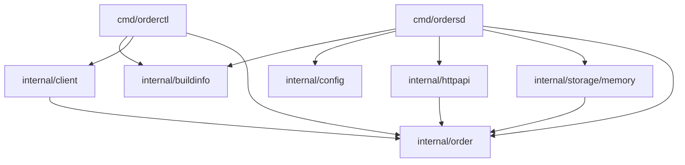
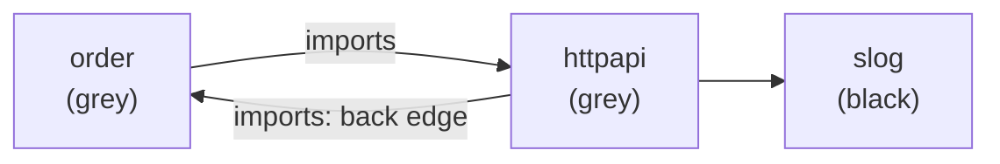
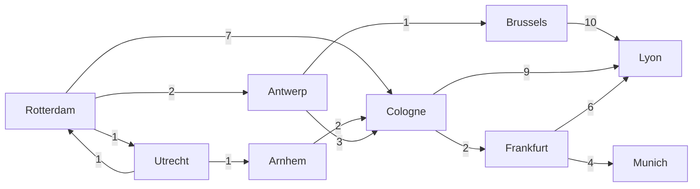

# Graphs

## Why care?

Four common situations, all of them about graphs:

- `go build` says `import cycle not allowed`, and you do not see the cycle.
- "Rebase my branch onto `main`. Which commits will move?"
- You delete a Kubernetes Deployment, and 30 pods disappear with it.
- "Ship this order from the Rotterdam warehouse to Lyon, as fast as possible."

A **graph** is a set of things and the links between them. Your Go packages and their imports, your Git commits and their parents, your Kubernetes objects and their owners: all graphs. The same five algorithms answer almost every question about them. On this page you write those five in about 150 lines of Go, and then you find them inside `go`, `git` and `kubectl`.

## The idea: nodes and edges

A road map is a simple example of a graph. The terms:

- Each thing (a town) is a **node** (also called a vertex).
- Each link (a road) is an **edge**.
- A one-way link is a **directed** edge. An import is one-way: `httpapi` imports `order`, never the other way round.
- A link with a cost on it, such as a travel time, is a **weighted** edge.
- If you can follow edges and come back to where you started, the graph has a **cycle**.
- A directed graph with no cycles is a **DAG** (directed acyclic graph). Git history, package imports and build steps are all DAGs. This is deliberate: tools **forbid** cycles there, because a cycle would mean "A must come before B, and B before A".

Here is a real one, the import graph of the packages in `examples/orders` (only our own packages, not the standard library):



An arrow means "imports". `internal/order` has many arrows coming in and none going out: it is the domain core, and it depends on nothing of ours. That is the shape you want (see [Project layout](../go/project-layout.md)).

The questions you ask a graph come in a few kinds:

| Question                                         | Algorithm               | Cost         |
| ------------------------------------------------ | ----------------------- | ------------ |
| What can I reach from here? In how few steps?    | Breadth-first search    | O(V + E)     |
| Is there a cycle? Where?                         | Depth-first search      | O(V + E)     |
| In what order can I do things, deps first?       | Topological sort (Kahn) | O(V + E)     |
| What is the cheapest route, with weights?        | Dijkstra                | O(E log V)   |
| What is the newest common ancestor of two nodes? | Walk both, meet         | O(V + E) max |

V is the number of nodes (vertices), E the number of edges. "O(V + E)" means: you look at every node once and every edge once. You cannot do better if you must look at the whole graph.

## Under the hood: storing a graph

There are two classic ways to keep a graph in memory.

**Adjacency matrix**: a V × V table of booleans (or weights). `m[a][b]` is true if there is an edge from `a` to `b`.

**Adjacency list**: for each node, a list of its neighbours. In Go: `map[string][]string`, or `[][]int` when nodes are numbered.

|                           | Adjacency matrix             | Adjacency list                    |
| ------------------------- | ---------------------------- | --------------------------------- |
| Memory                    | V² cells, always             | V + E entries                     |
| "Is there an edge a → b?" | O(1): one lookup             | O(degree of a): scan a's list     |
| "All neighbours of a"     | O(V): scan a whole row       | O(degree of a)                    |
| Good for                  | Small or dense graphs        | Big, sparse graphs (almost all)   |
| Real-world example        | Distance tables, small games | Imports, commits, social networks |

Real graphs are **sparse**: a package imports maybe 10 others out of thousands, a commit has 1 or 2 parents out of a million. A matrix for 5,000 nodes is 25 million cells, almost all `false`. Walk both with the same breadth-first search (code below), on a random graph with 5,000 nodes and 4 edges per node:

```go
const n, degree = 5_000, 4 // 5,000 nodes, 4 edges each: a sparse graph

func bfsList(adj [][]int) int {
	seen := make([]bool, len(adj))
	queue := []int{0}
	seen[0] = true
	for len(queue) > 0 {
		v := queue[0]
		queue = queue[1:]
		for _, w := range adj[v] { // only the real neighbours
			if !seen[w] {
				seen[w] = true
				queue = append(queue, w)
			}
		}
	}
	return len(seen)
}

func bfsMatrix(m [][]bool) int {
	seen := make([]bool, len(m))
	queue := []int{0}
	seen[0] = true
	for len(queue) > 0 {
		v := queue[0]
		queue = queue[1:]
		for w, edge := range m[v] { // every possible neighbour
			if edge && !seen[w] {
				seen[w] = true
				queue = append(queue, w)
			}
		}
	}
	return len(seen)
}
```

```console
$ go test -run '^$' -bench BFS -benchmem -count 3 .
goos: linux
goarch: amd64
pkg: example.com/graphs
cpu: AMD Ryzen 7 5800H with Radeon Graphics
BenchmarkBFSList-16      	   13152	     91053 ns/op	  131337 B/op	      21 allocs/op
BenchmarkBFSList-16      	   13210	     90714 ns/op	  131337 B/op	      21 allocs/op
BenchmarkBFSList-16      	   13179	     91019 ns/op	  131337 B/op	      21 allocs/op
BenchmarkBFSMatrix-16    	      88	  14505903 ns/op	  134279 B/op	      20 allocs/op
BenchmarkBFSMatrix-16    	      88	  14081682 ns/op	  134279 B/op	      20 allocs/op
BenchmarkBFSMatrix-16    	      91	  14699315 ns/op	  134279 B/op	      20 allocs/op
PASS
ok  	example.com/graphs	7.483s
```

91 µs against 14.5 ms: the list is about **160 times faster**. Same algorithm, same answer. The matrix version looks at 5,000 cells for every node (25 million checks), the list version at 4 (20,000 checks). That is the difference between O(V²) and O(V + E), and the benchmark shows it. (Your numbers will differ; the ratio will not change much.)

For the rest of the page, an adjacency list with string names is enough:

```go
// Package graphs has small, readable graph algorithms on an adjacency list.
package graphs

import (
	"maps"
	"slices"
)

// Graph is an adjacency list: node -> the nodes it points to.
// Every node is a key, even when it has no outgoing edges.
type Graph map[string][]string

// AddEdge adds from -> to and makes sure both nodes exist.
func (g Graph) AddEdge(from, to string) {
	g[from] = append(g[from], to)
	if _, ok := g[to]; !ok {
		g[to] = nil
	}
}

// Nodes returns all nodes in sorted order, so output is stable.
func (g Graph) Nodes() []string { return slices.Sorted(maps.Keys(g)) }
```

`Nodes` sorts on purpose. Go randomises map iteration order (see [Arrays, slices and hashing](arrays-and-hashing.md)), and a graph algorithm that walks a map directly gives a different (still correct) answer on every run. That makes tests and diffs painful.

## Under the hood: breadth-first search

**BFS** (breadth-first search) explores in rings: first everything one step away, then everything two steps away, and so on. The tool is a **queue** (first in, first out).

```go
// BFS returns the number of hops from start to every reachable node.
func (g Graph) BFS(start string) map[string]int {
	dist := map[string]int{start: 0}
	queue := []string{start}
	for len(queue) > 0 {
		n := queue[0]
		queue = queue[1:]
		for _, next := range g[n] {
			if _, seen := dist[next]; !seen {
				dist[next] = dist[n] + 1
				queue = append(queue, next)
			}
		}
	}
	return dist
}
```

Two things to notice:

1. **Mark a node when you put it in the queue, not when you take it out.** Here `dist[next]` is set at once. If you wait, the same node can be queued many times, and on a dense graph the queue grows very large.
2. Because BFS goes ring by ring, the first time it reaches a node is by the **fewest edges**. So BFS is the shortest-path algorithm when every edge costs the same. "How many hops from this service to the database?" "What is the shortest chain of imports from `main` to `unsafe`?" BFS.

`queue = queue[1:]` is fine for a short-lived search: the slice's backing array is freed when the search ends. For a queue that lives for hours, use a ring buffer (see [Heaps and queues](heaps-and-queues.md)).

## Under the hood: depth-first search and cycles

**DFS** (depth-first search) goes as deep as it can along one path, then backs up and tries the next branch. The tool is a **stack**: either an explicit one or, as here, the call stack (recursion).

DFS is the natural way to find a **cycle**. Give each node one of three colours:

- **white**: not visited yet,
- **grey**: on the path we are walking right now,
- **black**: finished. We visited everything below it, and found no cycle there.

If DFS ever follows an edge to a **grey** node, it has found a cycle: that node is earlier on the current path. That edge is called a **back edge**.



```go
// FindCycle returns one cycle as a path (first node repeated at the end),
// or nil if the graph has none. It is a DFS with three colours.
func (g Graph) FindCycle() []string {
	const (
		white = iota // not visited yet
		grey         // on the current DFS path
		black        // done: all descendants visited, no cycle through here
	)
	colour := map[string]int{}
	var path []string
	var visit func(n string) []string
	visit = func(n string) []string {
		colour[n] = grey
		path = append(path, n)
		for _, next := range g[n] {
			switch colour[next] {
			case grey: // back edge: next is on the path, so we went in a circle
				i := slices.Index(path, next)
				return append(slices.Clone(path[i:]), next)
			case white:
				if c := visit(next); c != nil {
					return c
				}
			}
		}
		path = path[:len(path)-1]
		colour[n] = black
		return nil
	}
	for _, n := range g.Nodes() {
		if colour[n] == white {
			if c := visit(n); c != nil {
				return c
			}
		}
	}
	return nil
}
```

Why three colours and not just "seen"? With only "seen", a **diamond** looks like a cycle. `cmd/ordersd` reaches `internal/order` directly and also through `internal/httpapi`. When DFS meets `order` the second time, it is black (finished), not grey. Two paths to the same node are not a cycle.

One more DFS fact you will meet: the order in which nodes turn **black** (the "post-order") is a valid build order, dependencies first. A node only turns black after everything below it did.

## Under the hood: topological sort

A **topological order** lists the nodes so that every node comes after all the nodes it depends on. It exists only for a DAG. It is what every build tool, task runner and migration tool needs: "in what order can I do this, so that nothing runs before its inputs are ready?"

**Kahn's algorithm** (1962) is the one to remember, because it is easy to make parallel:

1. Count, for each node, how many dependencies it still waits for.
2. Every node that waits for nothing is **ready**. Put it in a queue.
3. Take a ready node, output it, and tell every node that depends on it: "one less to wait for". Any node that reaches zero becomes ready.
4. When the queue is empty: if you placed every node, done. If not, the rest are stuck **in or behind a cycle**.

```go
// TopoSort returns the nodes so that every node comes after all the nodes
// it points to (dependencies first). This is Kahn's algorithm. ok is false
// when a cycle stops the sort; order then holds the nodes it could place.
func (g Graph) TopoSort() (order []string, ok bool) {
	waiting := map[string]int{}     // node -> dependencies not yet placed
	usedBy := map[string][]string{} // reverse edges: dependency -> users
	for _, n := range g.Nodes() {
		waiting[n] = len(g[n])
		for _, dep := range g[n] {
			usedBy[dep] = append(usedBy[dep], n)
		}
	}
	var ready []string
	for _, n := range g.Nodes() {
		if waiting[n] == 0 {
			ready = append(ready, n)
		}
	}
	for len(ready) > 0 {
		n := ready[0]
		ready = ready[1:]
		order = append(order, n)
		for _, user := range usedBy[n] {
			waiting[user]--
			if waiting[user] == 0 {
				ready = append(ready, user)
			}
		}
	}
	return order, len(order) == len(g)
}
```

The `ready` queue is the parallel part. Everything in it at the same moment can run at the same time: it waits for nothing. A build system gives the ready queue to a pool of workers. Each finished job may make more jobs ready. That is how `make -j`, Bazel and `go build` keep all your cores busy.

## Try it in Go: the build order of `examples/orders`

`go list` prints each package with its imports. A small `main` turns those lines into a `Graph`, keeps only our own packages, and runs all three algorithms:

```go
// Command pkgorder reads "pkg: import import ..." lines (from go list) and
// prints the build order, the depth of each package and any import cycle.
package main

import (
	"bufio"
	"fmt"
	"os"
	"strings"

	"example.com/graphs"
)

func main() {
	const prefix = "github.com/acme/orders/"
	lines := map[string][]string{}
	sc := bufio.NewScanner(os.Stdin)
	for sc.Scan() {
		pkg, imports, _ := strings.Cut(sc.Text(), ":")
		lines[strings.TrimPrefix(pkg, prefix)] = strings.Fields(imports)
	}

	g := graphs.Graph{}
	for pkg, imports := range lines {
		g[pkg] = g[pkg] // make sure every package is a node
		for _, imp := range imports {
			if short, ok := strings.CutPrefix(imp, prefix); ok {
				g.AddEdge(pkg, short) // keep only our own packages
			}
		}
	}

	if c := g.FindCycle(); c != nil {
		fmt.Println("cycle:", strings.Join(c, " -> "))
	}
	order, ok := g.TopoSort()
	fmt.Printf("build order (complete: %v):\n", ok)
	for i, n := range order {
		fmt.Printf("  %d. %s\n", i+1, n)
	}
	fmt.Println("hops from cmd/ordersd:")
	dist := g.BFS("cmd/ordersd")
	for _, n := range g.Nodes() {
		if d, ok := dist[n]; ok {
			fmt.Printf("  %d %s\n", d, n)
		}
	}
}
```

Run it in `examples/orders`:

```console
$ go list -f '{{.ImportPath}}: {{join .Imports " "}}' ./...
github.com/acme/orders/cmd/orderctl: cmp context encoding/json/jsontext encoding/json/v2 errors flag fmt github.com/acme/orders/internal/buildinfo github.com/acme/orders/internal/client github.com/acme/orders/internal/order io net/http os os/signal strconv strings syscall text/tabwriter time uuid
github.com/acme/orders/cmd/ordersd: context errors flag fmt github.com/acme/orders/internal/buildinfo github.com/acme/orders/internal/config github.com/acme/orders/internal/httpapi github.com/acme/orders/internal/order github.com/acme/orders/internal/storage/memory io log/slog net net/http os os/signal sync/atomic syscall time
github.com/acme/orders/internal/buildinfo: fmt runtime/debug
github.com/acme/orders/internal/client: bytes context encoding/json/v2 fmt github.com/acme/orders/internal/order io net/http net/url time uuid
github.com/acme/orders/internal/config: errors flag fmt io log/slog net strings time
github.com/acme/orders/internal/httpapi: context encoding/json/v2 errors fmt github.com/acme/orders/internal/order io log/slog mime net/http runtime/debug strings time uuid
github.com/acme/orders/internal/order: context errors fmt slices time uuid
github.com/acme/orders/internal/storage/memory: cmp context fmt github.com/acme/orders/internal/order maps slices sync uuid
$ go list -f '{{.ImportPath}}: {{join .Imports " "}}' ./... | pkgorder
build order (complete: true):
  1. internal/buildinfo
  2. internal/config
  3. internal/order
  4. internal/client
  5. internal/httpapi
  6. internal/storage/memory
  7. cmd/orderctl
  8. cmd/ordersd
hops from cmd/ordersd:
  0 cmd/ordersd
  1 internal/buildinfo
  1 internal/config
  1 internal/httpapi
  1 internal/order
  1 internal/storage/memory
```

Read the build order: `buildinfo`, `config` and `order` wait for nothing, so they were ready first, and they could compile at the same time. `client`, `httpapi` and `memory` become ready the moment `order` is done. The two commands come last. BFS says `cmd/ordersd` reaches five packages, all in one hop. `internal/client` is not in the list: `ordersd` never imports it. So the same output also shows which packages a command does not use.

The `go` command has its own walk built in. `go help list` says: "It visits them in a depth-first post-order traversal, so that a package is listed only after all its dependencies." That is the DFS post-order from above:

```console
$ go list -deps ./cmd/ordersd | grep acme
github.com/acme/orders/internal/buildinfo
github.com/acme/orders/internal/config
github.com/acme/orders/internal/order
github.com/acme/orders/internal/httpapi
github.com/acme/orders/internal/storage/memory
github.com/acme/orders/cmd/ordersd
$ go list -deps ./cmd/ordersd | wc -l
211
```

A different order from Kahn's, and also correct: a DAG usually has many valid topological orders. (211 is with the standard library: `ordersd` pulls in 205 packages you did not write.)

### Adding an import cycle

In a **copy** of `examples/orders`, make the domain import the HTTP layer. This is a common mistake: someone wants to reuse an HTTP helper in the domain.

```go
// internal/order/service.go, in a scratch copy
import (
	// ...
	"github.com/acme/orders/internal/httpapi"
)

var _ = httpapi.NewHandler
```

```console
$ go build ./...
package github.com/acme/orders/cmd/orderctl
	imports github.com/acme/orders/internal/client from main.go
	imports github.com/acme/orders/internal/order from client.go
	imports github.com/acme/orders/internal/httpapi from service.go
	imports github.com/acme/orders/internal/order from httpapi.go: import cycle not allowed
$ go list -e -f '{{.ImportPath}}: {{join .Imports " "}}' ./... | pkgorder
cycle: internal/order -> internal/httpapi -> internal/order
build order (complete: false):
  1. internal/buildinfo
  2. internal/config
hops from cmd/ordersd:
  0 cmd/ordersd
  1 internal/buildinfo
  1 internal/config
  1 internal/httpapi
  1 internal/order
  1 internal/storage/memory
```

Both tools found it. The `go` error is a DFS path, printed from the start of the walk (`orderctl`) down to the back edge. Our `FindCycle` prints only the circle. And Kahn's algorithm got stuck after two packages: `order` waits for `httpapi`, `httpapi` waits for `order`, and so does everything that needs either of them. **Kahn never sees the cycle itself, only the nodes that never become ready.** Use Kahn to sort, DFS to explain.

Why does Go forbid import cycles when other languages allow them? Because then packages compile in a topological order, each one once, in parallel, and package initialisation (`init`, package variables) has one clear order. The fix for a cycle is always the same: move the shared piece down into a package both can import, or define an interface where it is used (see [Methods and interfaces](../go/methods-and-interfaces.md)).

## Try it in Go: Dijkstra with `container/heap`

BFS finds the fewest **hops**. When edges have different costs, the fewest hops is often not the cheapest route. Here is a small road network between depots, with travel times in hours. The direct road from Rotterdam to Cologne is one hop, but it takes 7 hours.



**Dijkstra's algorithm** (1956) is BFS with a **priority queue** instead of a plain queue. Always continue from the closest unfinished node. The first time you take a node out of the priority queue, you have its fastest time: every other way to it starts from a node that is at least as far away, and roads cannot have negative times.

The priority queue is a min-heap (see [Heaps and queues](heaps-and-queues.md)). `container/heap` needs five methods:

```go
// Command route finds the fastest way to ship an order between depots,
// with Dijkstra's algorithm and a container/heap priority queue.
package main

import (
	"container/heap"
	"fmt"
	"slices"
	"strings"
)

// Edge is a one-way road with a travel time in hours.
type Edge struct {
	To    string
	Hours int
}

// item is one entry in the priority queue: "we can reach node in hours".
type item struct {
	node  string
	hours int
}

// pq is a min-heap of items, ordered by hours.
type pq []item

func (q pq) Len() int           { return len(q) }
func (q pq) Less(i, j int) bool { return q[i].hours < q[j].hours }
func (q pq) Swap(i, j int)      { q[i], q[j] = q[j], q[i] }
func (q *pq) Push(x any)        { *q = append(*q, x.(item)) }
func (q *pq) Pop() any {
	old := *q
	it := old[len(old)-1]
	*q = old[:len(old)-1]
	return it
}

// Dijkstra returns the fastest time from start to every node, and the
// previous node on each fastest path. Weights must not be negative.
func Dijkstra(g map[string][]Edge, start string) (hours map[string]int, prev map[string]string) {
	hours = map[string]int{start: 0}
	prev = map[string]string{}
	done := map[string]bool{}
	q := &pq{{start, 0}}
	pops := 0
	for q.Len() > 0 {
		cur := heap.Pop(q).(item)
		pops++
		if done[cur.node] {
			continue // a stale entry: we already found a faster way here
		}
		done[cur.node] = true
		for _, e := range g[cur.node] {
			h := cur.hours + e.Hours
			if old, ok := hours[e.To]; !ok || h < old {
				hours[e.To] = h
				prev[e.To] = cur.node
				heap.Push(q, item{e.To, h}) // no decrease-key: push a new entry
			}
		}
	}
	fmt.Println("heap pops:", pops, "nodes:", len(done))
	return hours, prev
}

func path(prev map[string]string, to string) string {
	p := []string{to}
	for p[len(p)-1] != "" {
		p = append(p, prev[p[len(p)-1]])
	}
	p = p[:len(p)-1]
	slices.Reverse(p)
	return strings.Join(p, " -> ")
}

func main() {
	g := map[string][]Edge{
		"Rotterdam": {{"Antwerp", 2}, {"Utrecht", 1}, {"Cologne", 7}},
		"Utrecht":   {{"Arnhem", 1}, {"Rotterdam", 1}},
		"Arnhem":    {{"Cologne", 2}},
		"Antwerp":   {{"Brussels", 1}, {"Cologne", 3}},
		"Brussels":  {{"Lyon", 10}},
		"Cologne":   {{"Frankfurt", 2}, {"Lyon", 9}},
		"Frankfurt": {{"Munich", 4}, {"Lyon", 6}},
	}
	hours, prev := Dijkstra(g, "Rotterdam")
	for _, city := range []string{"Cologne", "Frankfurt", "Lyon", "Munich"} {
		fmt.Printf("%-9s %2dh  %s\n", city, hours[city], path(prev, city))
	}
}
```

```console
$ go run ./cmd/route
heap pops: 12 nodes: 9
Cologne    4h  Rotterdam -> Utrecht -> Arnhem -> Cologne
Frankfurt  6h  Rotterdam -> Utrecht -> Arnhem -> Cologne -> Frankfurt
Lyon      12h  Rotterdam -> Utrecht -> Arnhem -> Cologne -> Frankfurt -> Lyon
Munich    10h  Rotterdam -> Utrecht -> Arnhem -> Cologne -> Frankfurt -> Munich
```

Cologne in 4 hours over three roads, not 7 hours over one. Lyon in 12 hours over five roads, while the more direct routes (through Brussels, or Cologne's direct road) take 13.

Look at `heap pops: 12 nodes: 9`. Twelve entries came out of the heap for nine towns. The textbook version has a **decrease-key** operation: "Cologne is now 4, not 7; move it up in the heap". `container/heap` can do that with `heap.Fix`, but only if you track every item's index in the heap. The simpler method, used above, is **lazy deletion**: push a new entry with the better time, and skip the old one when it comes out (`if done[...] { continue }`). The heap gets a bit bigger (at most one entry per edge), the code gets much simpler. Most real implementations do this.

!!! warning "No negative weights"

    Dijkstra assumes that a finished node can never get cheaper. A negative edge (a refund,
    a "discount" hop) breaks that, and Dijkstra returns wrong answers without any error.
    For negative weights you need Bellman-Ford (O(V × E)), and with a negative **cycle**
    there is no shortest path at all.

Where you meet Dijkstra in real systems: link-state routing (OSPF and IS-IS compute shortest paths over the network map, see [Networking](../networking/index.md)), maps and logistics, and "cheapest chain of currency conversions" (with a log trick, and Bellman-Ford if negative logs appear).

## Real graphs in your tools

### Git: a DAG of commits

You know from [Objects](../git/objects.md) that a commit stores the hashes of its **parent** commits. So every commit is a node, and every parent link is an edge from child to parent. A merge commit has two parents. Because a commit's hash includes its parents' hashes, you cannot make a cycle: you would need to know a commit's hash before creating it. **Git history is a DAG by construction.**

A scratch repository with one feature branch, merged:

```console
$ git log --graph --oneline --all
* 8f43961 add orderctl
*   3ce5ee3 Merge branch 'feature/top-orders'
|\
| * 4771a50 test top-k query
| * fb83d26 add top-k query
* | 49e0598 add HTTP API
|/
* 1101422 add memory store
* 536dfdb add Order type
$ git log --format='%h  parents: %p  %s'
8f43961  parents: 3ce5ee3  add orderctl
3ce5ee3  parents: 49e0598 4771a50  Merge branch 'feature/top-orders'
4771a50  parents: fb83d26  test top-k query
49e0598  parents: 1101422  add HTTP API
fb83d26  parents: 1101422  add top-k query
1101422  parents: 536dfdb  add memory store
536dfdb  parents:   add Order type
```

The second command **is** the adjacency list: each node, then its outgoing edges. `git log --graph` just draws it. (`git rev-list --parents HEAD` prints the same with full hashes; it is the plumbing version.)

Every history command is a graph algorithm on this list:

| Command                                 | Graph question                                                                 |
| --------------------------------------- | ------------------------------------------------------------------------------ |
| `git log`, `git rev-list HEAD`          | Everything reachable from `HEAD` (a graph walk, newest first)                  |
| `git log A..B`                          | Reachable from B, minus reachable from A                                       |
| `git merge-base A B`                    | The best **common ancestor** of A and B (the starting point of a 3-way merge)  |
| `git log --topo-order`                  | A topological order: no parent before all its children                         |
| `git branch --contains X`               | Which branch tips can reach X                                                  |
| `git gc` (removing unreachable objects) | Mark everything reachable from refs; the rest is garbage (mark-and-sweep, DFS) |

Try them:

```console
$ git rev-list --count HEAD
7
$ git merge-base 49e0598 4771a50
11014220f014d40c021fe753aec916cde32b1466
$ git log --oneline main..feature/top-orders
$ git log --oneline feature/top-orders..main
8f43961 add orderctl
3ce5ee3 Merge branch 'feature/top-orders'
49e0598 add HTTP API
$ git branch --contains fb83d26
  feature/top-orders
* main
```

- `main..feature/top-orders` is **empty**: everything on the feature branch is reachable from `main` since the merge. That is how Git knows a branch is "fully merged" and lets `git branch -d` delete it.
- The other way round, three commits are on `main` only. A rebase of `feature/top-orders` onto something would move nothing, because the set "mine but not theirs" is empty. Before a rebase, `git log --oneline upstream..HEAD` shows exactly which commits will be rewritten (see [Merging](../git/merging.md)).
- `merge-base` of the two branch tips is `1101422`, the fork point. Git found it by walking back from both commits until the walks met.

Now the two orders. `--topo-order` keeps each branch together; `--date-order` sorts by commit time but still never shows a parent before its child:

```console
$ git rev-list --topo-order --oneline HEAD
8f43961 add orderctl
3ce5ee3 Merge branch 'feature/top-orders'
4771a50 test top-k query
fb83d26 add top-k query
49e0598 add HTTP API
1101422 add memory store
536dfdb add Order type
$ git log --date-order --oneline
8f43961 add orderctl
3ce5ee3 Merge branch 'feature/top-orders'
4771a50 test top-k query
49e0598 add HTTP API
fb83d26 add top-k query
1101422 add memory store
536dfdb add Order type
```

Both are valid topological orders of the same DAG (newest first, so "children before parents"). `--graph` uses topological order, because you cannot draw lines between branches that jump around.

On a repository with a million commits these walks get expensive: Git has to open and parse every commit object. That is why Git keeps the **commit-graph** file with a **generation number** per commit: if A's generation number is smaller than B's, A cannot reach B, so a walk can stop early. It is a precomputed topological level. See [Storage](../git/storage.md) for the details; and on the [next-but-one page](probabilistic-structures.md) you will see the Bloom filters that live in the same file.

### Go modules: a graph with cycles

The package graph above must be a DAG. The **module** graph does not have to be. `go mod graph` prints it as an edge list, one `from to` pair per line. In `examples/orders` (read only, nothing changes):

```console
$ go mod graph | wc -l
35
$ go mod graph | head -8
github.com/acme/orders go@1.27
github.com/acme/orders golang.org/x/mod@v0.43.0
github.com/acme/orders golang.org/x/sync@v0.25.0
github.com/acme/orders golang.org/x/sys@v0.50.0
github.com/acme/orders golang.org/x/telemetry@v0.0.0-20261116191925-e77a43154acb
github.com/acme/orders golang.org/x/tools@v0.53.0
github.com/acme/orders golang.org/x/vuln@v1.10.0
go@1.27 toolchain@go1.27
$ go mod graph | grep ' golang.org/x/tools@'
github.com/acme/orders golang.org/x/tools@v0.53.0
golang.org/x/mod@v0.43.0 golang.org/x/tools@v0.52.0
golang.org/x/vuln@v1.10.0 golang.org/x/tools@v0.53.0
$ go mod graph | grep '^golang.org/x/tools@v0.53.0 golang.org/x/mod'
golang.org/x/tools@v0.53.0 golang.org/x/mod@v0.43.0
```

Two things in four commands:

1. **A cycle.** `x/mod` requires `x/tools`, and `x/tools` requires `x/mod`. That is allowed for modules: a module is a unit of versioning, not of compilation. The **packages** inside them still form a DAG.
2. **Three edges into `x/tools`, with two versions.** `x/mod` asks for at least v0.52.0, the others for at least v0.53.0. Go's **minimal version selection** walks the graph from the main module and keeps, per module path, the **highest** of the minimum versions it saw. One walk, no solver:

```console
$ go list -m all | grep x/tools
golang.org/x/tools v0.53.0
golang.org/x/tools/go/expect v0.1.1-deprecated
golang.org/x/tools/go/packages/packagestest v0.1.1-deprecated
```

The full story, with pruning and `// indirect`, is in [Modules](../go/modules.md). `go mod why -m <module>` answers "is there a path from my module to this one?", which is the BFS question again.

### Kubernetes: owner references and the garbage collector

In [Reconciliation](../kubernetes/reconciliation.md) you saw `metadata.ownerReferences`: a Pod points to its ReplicaSet, the ReplicaSet points to its Deployment. Each owner reference is an edge from dependent to owner. All objects in a cluster with all their owner references form a graph, and the **garbage collector** controller keeps a copy of that graph in memory, built from watches on the API server.

When you delete an owner, the garbage collector walks the edges the other way, from owner to dependents:

| `--cascade`  | Graph walk                                                                                       |
| ------------ | ------------------------------------------------------------------------------------------------ |
| `background` | Delete the owner now; then find nodes whose owners are all gone, and delete them, level by level |
| `foreground` | Delete the dependents first (with `blockOwnerDeletion`), the owner last: a **post-order** walk   |
| `orphan`     | Remove the edges, keep the nodes                                                                 |

`foreground` is the DFS post-order from above: a node may only finish (be deleted) after everything below it is gone. And an object can have more than one owner. The garbage collector deletes it only when **all** its owners are gone: that is the "waiting for dependencies" counter of Kahn's algorithm, run backwards.

Cycles in owner references are possible (nothing in the API stops you), and they are a bug: with `foreground` deletion, each object waits for the other, forever. This is the general lesson of this page: **any tool that waits for "everything before me" needs a DAG, and needs to detect when it is not one.**

## Traps

- **Recursion depth.** A recursive DFS on a long chain (a history with millions of commits) is one stack frame per node. Go grows goroutine stacks, so it does not crash early like C or Java, but past the 1 GB limit (on 64-bit) the program dies with `runtime: goroutine stack exceeds 1000000000-byte limit` and `fatal error: stack overflow`. It also uses a lot of memory long before that. For deep graphs use an explicit stack (a slice).
- **Forgetting "visited".** BFS or DFS without a visited set loops forever on a cycle, and does exponential work on a DAG full of diamonds (every path is walked separately). Git histories with many merges are exactly that.
- **Marking too late in BFS.** Mark when you enqueue, not when you dequeue, or the same node enters the queue many times.
- **Map order.** Go randomises map iteration. A topological sort that walks a map gives a different valid order each run. Sort the nodes (as `Nodes()` does) if anyone will diff the output.
- **Dijkstra with negative weights.** It returns an answer, and the answer is wrong. No error, no panic.
- **"Fewest hops" is not "cheapest".** BFS ignores weights. If edges have different costs (latency, money, hours), you need Dijkstra.
- **Matrix for a sparse graph.** V² memory and V² time. 100,000 nodes is 10 billion cells. Use adjacency lists unless the graph is small or nearly complete.
- **Cycle "detection" with two colours.** With only "seen", a diamond (two paths to the same node) looks like a cycle. You need grey (on the current path) and black (finished).

## Check yourself

??? question "1. `go build` reports `import cycle not allowed`. Kahn's algorithm on the same graph places 2 of 8 packages. Why not 6?"

    Kahn only places nodes whose dependencies are all placed. The two packages in the
    cycle wait for each other, so neither becomes ready. Every package that imports one of
    them (directly or through others) waits too. So "not placed" means "in a cycle **or
    behind one**". To name the cycle itself, run a DFS and look for the back edge.

??? question "2. You want the shortest chain of imports from `cmd/ordersd` to `net/http`. BFS or DFS? And for the fastest network route between data centres?"

    BFS for the import chain: every edge costs the same (one import), and BFS reaches
    each node first by the fewest edges. DFS finds **a** path, not the shortest. For the
    network route, edges have different latencies, so use Dijkstra (latencies are never
    negative).

??? question "3. Why can Git history never contain a cycle, even on purpose?"

    A commit's hash is computed from its content, which includes the hashes of its
    parents. To make commit A a parent of its own ancestor B, you would need A's hash while
    creating B, before A exists. You would have to find a hash collision on purpose.

??? question "4. `git log main..feature` prints nothing. What does that tell you, in graph words?"

    Every commit reachable from `feature` is also reachable from `main`. In other words,
    `feature`'s tip is an ancestor of `main` (or the same commit): the branch is fully
    merged. `git branch -d feature` will accept it.

??? question "5. Your Dijkstra pushes a new heap entry every time it finds a better route, instead of updating the old one. Is the answer still right? What does it cost?"

    Yes. The better entry has a smaller time, so it comes out of the heap first and the
    node is marked done. The old entry comes out later and is skipped. The heap can hold up
    to one entry per edge instead of one per node, so it is a bit bigger: O(E log E)
    instead of O(E log V). Since E ≤ V², log E ≤ 2 log V, so it is the same Big-O.

??? question "6. An object has two owner references, to ReplicaSet A and ReplicaSet B. You delete A. What happens to the object, and which algorithm from this page does that look like?"

    Nothing yet. The garbage collector removes the dangling reference to A, but the object
    still has a live owner, B. Only when the last owner is gone is it deleted. That is
    Kahn's "waiting" counter: a node becomes "ready" (here: deletable) only when its count
    of remaining owners reaches zero.

## Recap

- A graph is **nodes and edges**: directed or not, weighted or not. A directed graph without cycles is a **DAG**.
- Store graphs as **adjacency lists**. A matrix costs V² memory and time; on a sparse graph BFS was 160 times slower.
- **BFS** (a queue) finds what is reachable and the fewest hops. Mark nodes when you enqueue them.
- **DFS** (a stack, or recursion) finds **cycles** with three colours. Its post-order is a valid build order.
- **Kahn's topological sort** gives dependencies first, makes parallel work obvious, and stops at cycles.
- **Dijkstra** is BFS with a min-heap (`container/heap`), for non-negative weights. Lazy deletion keeps it simple.
- Git history is a DAG of commits; `log A..B`, `merge-base` and `--topo-order` are graph walks. Go's package graph is a DAG; its module graph may have cycles, and MVS is one walk over it. Kubernetes garbage collection walks owner references.

Next: [Sorting and searching](sorting-and-searching.md), where `slices.Sort` turns out to be three algorithms in one, and binary search turns a sorted slice into a fast index.
