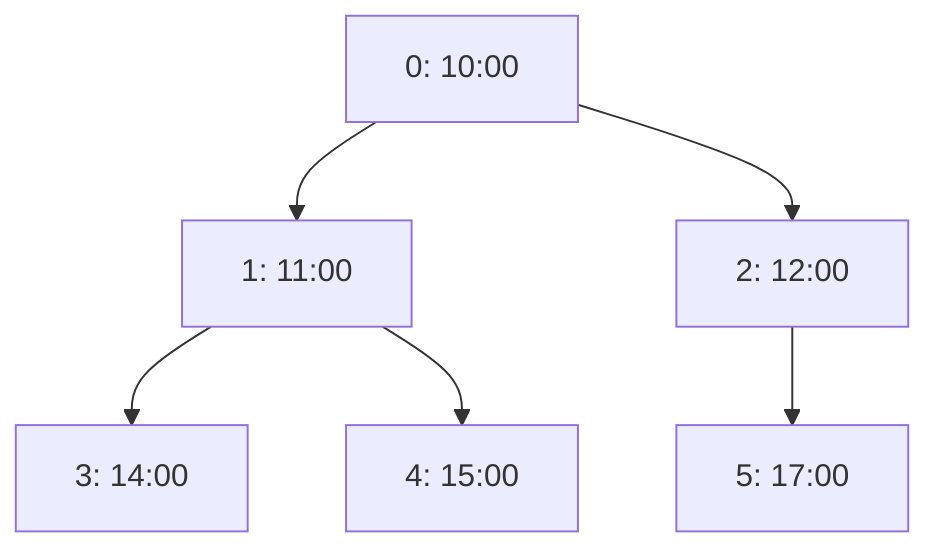
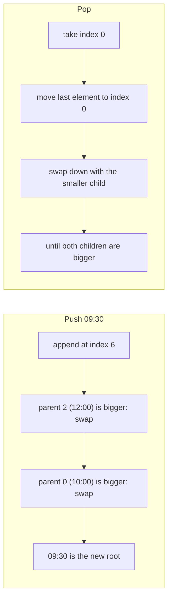
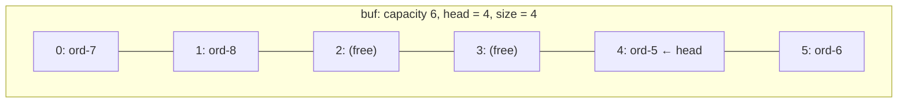

# Heaps and queues

## Why care?

Four typical tickets about which item comes next:

- "The dashboard shows the 10 biggest orders of the day. Each refresh sorts a million orders, takes 120 ms and allocates 16 MB."
- "Our in-memory job queue uses `q = q[1:]`. Memory keeps growing, though the queue is never longer than 1,000 items."
- "Every request starts a `time.AfterFunc` timeout. At 1 million open requests, does each new timer get slower?"
- "We start one goroutine per order. Where do 1,000 runnable goroutines wait when there are only 4 cores?"

All four are about **ordering work without sorting everything**. A **heap** always knows the smallest (or biggest) item and nothing more, which is exactly what "top 10", "next deadline" and "most urgent job" need. A **queue** hands things out in arrival order. Both are inside the Go runtime: every `time.Timer` sits in a heap, and every runnable goroutine sits in a queue. This page shows both, in `container/heap` and in the runtime source.

## The idea: only the smallest item is kept in place

Many tasks need only one answer, quickly: **which item is the most urgent right now?** They do not need arrival order, and they do not need a fully sorted list. A new item is compared with a few others and moves to roughly the right place. When the most urgent item is removed, the next most urgent one moves up.

A **heap** does this. It is a tree with one rule: **every parent is smaller than (or equal to) its children**. There is no other rule. Siblings are in no particular order. The smallest item is always at the top:



(Shipping deadlines of six orders. The number before the colon is the position in an array, explained next.)

Compared with sorting:

| Operation            | Sorted slice  | Heap     |
| -------------------- | ------------- | -------- |
| Look at the smallest | O(1)          | O(1)     |
| Remove the smallest  | O(1) from end | O(log n) |
| Insert               | O(n) (shift)  | O(log n) |
| Build from n items   | O(n log n)    | **O(n)** |
| Everything in order  | yes           | no       |

A heap does **less** work than sorting, because it promises less.

## Under the hood: a heap is just a slice

A heap is a **complete** binary tree: every level is full except maybe the last, which fills from the left. That shape needs no pointers at all. Put the nodes in a slice, level by level, and the links are arithmetic:

- the children of index `i` are at `2*i+1` and `2*i+2`
- the parent of index `i` is at `(i-1)/2`

The tree above is the slice `[10:00 11:00 12:00 14:00 15:00 17:00]`. No node allocations, no pointer chasing: the cache lesson from [Trees](trees.md) applies directly.

Two moves keep the rule true:

- **Push** (sift up): append at the end, then swap with the parent while you are smaller than it. At most one swap per level: O(log n).
- **Pop** (sift down): the answer is at index 0. Move the **last** element to index 0, then swap it with its **smaller** child while it is bigger than that child. Again O(log n).



### `container/heap`, line by line

Go's `container/heap` is these two moves and nothing else. You provide the slice; the package provides the algorithm. From `$GOROOT/src/container/heap/heap.go`:

```go
type Interface interface {
	sort.Interface
	Push(x any) // add x as element Len()
	Pop() any   // remove and return element Len() - 1.
}
```

`sort.Interface` gives it `Len`, `Less` and `Swap`. Your `Push` and `Pop` only **append to** and **cut from the end** of the slice. The heap logic lives in the package functions:

```go
// Push pushes the element x onto the heap.
// The complexity is O(log n) where n = h.Len().
func Push(h Interface, x any) {
	h.Push(x)
	up(h, h.Len()-1)
}

// Pop removes and returns the minimum element (according to Less) from the heap.
// The complexity is O(log n) where n = h.Len().
// Pop is equivalent to [Remove](h, 0).
func Pop(h Interface) any {
	n := h.Len() - 1
	h.Swap(0, n)
	down(h, 0, n)
	return h.Pop()
}

func up(h Interface, j int) {
	for {
		i := (j - 1) / 2 // parent
		if i == j || !h.Less(j, i) {
			break
		}
		h.Swap(i, j)
		j = i
	}
}

func down(h Interface, i0, n int) bool {
	i := i0
	for {
		j1 := 2*i + 1
		if j1 >= n || j1 < 0 { // j1 < 0 after int overflow
			break
		}
		j := j1 // left child
		if j2 := j1 + 1; j2 < n && h.Less(j2, j1) {
			j = j2 // = 2*i + 2  // right child
		}
		if !h.Less(j, i) {
			break
		}
		h.Swap(i, j)
		i = j
	}
	return i > i0
}
```

Read `Pop` closely: it swaps the root with the **last** element, sifts the new root down over the first `n` elements only, and **then** calls your `Pop`, which cuts the old root off the end. That is why your `Pop` is so simple.

`Init` builds a heap from an unsorted slice in **O(n)**, not O(n log n):

```go
func Init(h Interface) {
	// heapify
	n := h.Len()
	for i := n/2 - 1; i >= 0; i-- {
		down(h, i, n)
	}
}
```

It skips the second half (those are leaves, already valid heaps of one) and sifts down from the bottom up. Most nodes are near the bottom and move only a step or two, so the total is linear.

!!! warning "Call `heap.Push`, not `h.Push`"

    `h.Push(x)` only appends: the heap rule is now broken, and later `Pop`s return wrong answers
    with no error. Always call the package functions `heap.Push(h, x)` and `heap.Pop(h)`. The same
    goes for changing an element's priority in place: call `heap.Fix(h, i)` afterwards.

## Try it in Go: the 10 biggest orders

The dashboard wants the top 10 of a million orders by amount. The direct way sorts everything:

```go
// TopKSort sorts a copy of all orders. O(n log n) time, O(n) memory.
func TopKSort(orders []Order, k int) []Order {
	all := slices.Clone(orders)
	slices.SortFunc(all, func(a, b Order) int { return cmp.Compare(b.AmountCents, a.AmountCents) })
	return all[:k]
}
```

The heap way keeps only the best 10 seen so far, in a **min**-heap. The root is the **smallest of the top 10**: the one to remove when a bigger order arrives. A min-heap for the biggest items may look backwards, but it is the correct choice:

```go
// Order is the part of an order this page needs.
type Order struct {
	ID          int64
	AmountCents int64
}

// byAmount is a min-heap of orders: the smallest amount is at index 0.
type byAmount []Order

func (h byAmount) Len() int           { return len(h) }
func (h byAmount) Less(i, j int) bool { return h[i].AmountCents < h[j].AmountCents }
func (h byAmount) Swap(i, j int)      { h[i], h[j] = h[j], h[i] }
func (h *byAmount) Push(x any)        { *h = append(*h, x.(Order)) }
func (h *byAmount) Pop() any {
	old := *h
	o := old[len(old)-1]
	*h = old[:len(old)-1]
	return o
}

// TopKHeap keeps the k biggest orders seen so far in a min-heap. The root
// is the smallest of the top k: the one to throw out when a bigger order
// arrives. O(n log k) time, O(k) memory.
func TopKHeap(orders []Order, k int) []Order {
	h := make(byAmount, 0, k)
	for _, o := range orders {
		if len(h) < k {
			heap.Push(&h, o)
		} else if o.AmountCents > h[0].AmountCents {
			h[0] = o        // replace the smallest of the top k...
			heap.Fix(&h, 0) // ...and let it sink to its place
		}
	}
	slices.SortFunc(h, func(a, b Order) int { return cmp.Compare(b.AmountCents, a.AmountCents) })
	return h
}
```

A test checks that both return the same 10 orders. Then the benchmark, on 1,000,000 orders with random amounts:

```console
$ go test -run '^$' -bench . -benchmem -count 3
goos: linux
goarch: amd64
pkg: example.com/heaps
cpu: AMD Ryzen 7 5800H with Radeon Graphics
BenchmarkTopK/sort-all-16         	       9	 118965661 ns/op	16007168 B/op	       1 allocs/op
BenchmarkTopK/sort-all-16         	       9	 118433122 ns/op	16007180 B/op	       1 allocs/op
BenchmarkTopK/sort-all-16         	       9	 117728586 ns/op	16007182 B/op	       1 allocs/op
BenchmarkTopK/heap-of-10-16       	    1221	    942315 ns/op	     344 B/op	      12 allocs/op
BenchmarkTopK/heap-of-10-16       	    1323	    932754 ns/op	     344 B/op	      12 allocs/op
BenchmarkTopK/heap-of-10-16       	    1368	    937162 ns/op	     344 B/op	      12 allocs/op
...
```

(One `-bench .` run of the module covered this and the `DHeap` and `Queue` benchmarks below; `...` marks where the other results are left out.)

- **119 ms vs 0.94 ms: 126 times faster.** Sorting does about n × log2(n) ≈ 20 million comparisons. The heap does one comparison per order (`o.AmountCents > h[0].AmountCents`) and almost always stops there: a random order rarely beats the current top 10. Only the few that do pay log2(10) ≈ 3 more steps.
- **16 MB vs 344 bytes.** The sort needs its own copy of all orders (1 million × 16 bytes). The heap holds 10.
- **12 allocations** in the heap version: the slice, and one per `heap.Push`, because `Push(x any)` boxes each `Order` into an interface. A small price here. In a hot loop, keep the heap code but write it for your concrete type, as the runtime does below.
- **It streams.** `TopKHeap` looks at each order once and keeps O(k) memory, so it works on a channel or a database cursor with a billion rows. Sorting cannot.

For a whole sorted result, sort. For "the first k of n" with k much smaller than n, use a heap.

### Changing priorities: `heap.Fix`

Orders wait to be shipped, by deadline. While one waits, the customer escalates it. To find the item in the heap, each item remembers its **index**, and `Swap` keeps that index up to date. This is the pattern from `container/heap`'s own priority queue example:

```go
type item struct {
	orderID  string
	deadline time.Time
	index    int // position in the heap, kept up to date by Swap
}

type queue []*item

func (q queue) Len() int           { return len(q) }
func (q queue) Less(i, j int) bool { return q[i].deadline.Before(q[j].deadline) }
func (q queue) Swap(i, j int) {
	q[i], q[j] = q[j], q[i]
	q[i].index = i
	q[j].index = j
}
func (q *queue) Push(x any) {
	it := x.(*item)
	it.index = len(*q)
	*q = append(*q, it)
}
func (q *queue) Pop() any {
	old := *q
	it := old[len(old)-1]
	old[len(old)-1] = nil // don't keep a pointer to it alive
	it.index = -1
	*q = old[:len(old)-1]
	return it
}

func main() {
	start := time.Date(2026, 11, 27, 9, 0, 0, 0, time.UTC)
	var q queue
	byID := map[string]*item{}
	for i, h := range []int{5, 2, 8, 1, 6, 3} {
		it := &item{orderID: fmt.Sprintf("ord-%d", i+1), deadline: start.Add(time.Duration(h) * time.Hour)}
		heap.Push(&q, it)
		byID[it.orderID] = it
	}
	fmt.Print("heap array:")
	for _, it := range q {
		fmt.Printf(" %s(%s)", it.orderID, it.deadline.Format("15:04"))
	}
	fmt.Println()

	// A customer escalates ord-3: ship it by 09:30.
	esc := byID["ord-3"]
	esc.deadline = start.Add(30 * time.Minute)
	heap.Fix(&q, esc.index)

	for q.Len() > 0 {
		it := heap.Pop(&q).(*item)
		fmt.Printf("ship %s by %s\n", it.orderID, it.deadline.Format("15:04"))
	}
}
```

```console
$ go run ./cmd/pq
heap array: ord-4(10:00) ord-2(11:00) ord-6(12:00) ord-1(14:00) ord-5(15:00) ord-3(17:00)
ship ord-3 by 09:30
ship ord-4 by 10:00
ship ord-2 by 11:00
ship ord-6 by 12:00
ship ord-1 by 14:00
ship ord-5 by 15:00
```

- The **heap array** is the tree from the start of this page. Here it happens to come out sorted, but that is chance: the heap only promises that every parent is earlier than its children. Push the same deadlines in another order and the array changes.
- `ord-3` was the **last** element, a leaf. After its deadline changed to 09:30, `heap.Fix` sifted it up to the root in two swaps. No search: the `index` field said where it was.
- `old[len(old)-1] = nil` in `Pop`: the backing array still has a slot pointing to the item. Clearing it lets the garbage collector free popped items.

## Under the hood: the Go runtime's timer heap

Every `time.Sleep`, `time.After`, `time.AfterFunc`, `context.WithTimeout` and network deadline is a **timer**, and every timer waits in a heap. Not one global heap: **one per P**, the scheduler's processor ([G-M-P](../fundamentals/processes-and-threads.md#how-go-runs-goroutines-the-g-m-p-model)), so goroutines on different cores do not compete for one lock. From `$GOROOT/src/runtime/time.go`:

```go
// A timers is a per-P set of timers.
type timers struct {
	// mu protects timers; timers are per-P, but the scheduler can
	// access the timers of another P, so we have to lock.
	mu mutex

	// heap is the set of timers, ordered by heap[i].when.
	// Must hold lock to access.
	heap []timerWhen

	// len is an atomic copy of len(heap).
	len atomic.Uint32

	// zombies is the number of timers in the heap
	// that are marked for removal.
	zombies atomic.Int32
	// ...
}

type timerWhen struct {
	timer *timer
	when  int64
}
```

The `when` is copied **next to** the pointer, so comparing two entries reads the slice only, never the timer structs. A little further down is a less common choice:

```go
const timerHeapN = 4
```

The timer heap is **4-ary**: every node has four children, the parent of `i` is `(i-1)/4`. Here is its sift-down; compare it with `container/heap`'s `down`:

```go
func (ts *timers) siftDown(i int) {
	heap := ts.heap
	n := len(heap)
	if i >= n {
		badTimer()
	}
	if i*timerHeapN+1 >= n {
		return
	}
	tw := heap[i]
	if tw.when <= 0 {
		badTimer()
	}
	for {
		leftChild := i*timerHeapN + 1
		if leftChild >= n {
			break
		}
		w := tw
		c := -1
		for j, tw := range heap[leftChild:min(leftChild+timerHeapN, n)] {
			if tw.less(w) {
				w = tw
				c = leftChild + j
			}
		}
		if c < 0 {
			break
		}
		heap[i] = heap[c]
		i = c
	}
	if heap[i].timer != tw.timer {
		heap[i] = tw
	}
}
```

Three differences from the textbook heap:

- **Four children per node.** The tree is half as tall: log4(n) = log2(n) / 2 levels. Sift-up, used for every new timer, does half the steps. Sift-down looks at four children per level instead of two, but they sit next to each other in memory: four 16-byte `timerWhen` entries are 64 bytes, about one cache line on x86 (one or two, depending on alignment).
- **No swaps.** It holds the moving element in `tw`, shifts the winners up (`heap[i] = heap[c]`), and writes `tw` once at the end. Half the memory writes.
- **No interface.** It works directly on `[]timerWhen`, so there are no `Less`/`Swap` method calls and no boxing.

Does 4-ary really win? Try it with a small d-ary heap of `int64` in the scratch module, using the same no-swap moves:

```go
// DHeap is a min-heap of int64 with D children per node. D = 2 is the
// classic binary heap; the Go runtime's timer heap uses D = 4.
type DHeap struct {
	D int
	a []int64
}

func (h *DHeap) Push(x int64) {
	h.a = append(h.a, x)
	i := len(h.a) - 1
	for i > 0 {
		p := (i - 1) / h.D
		if h.a[p] <= x {
			break
		}
		h.a[i] = h.a[p] // move the parent down, keep x in hand
		i = p
	}
	h.a[i] = x
}
```

(`Pop` is the same idea as the runtime's `siftDown`.) Push 1,000,000 random numbers, then pop them all:

```console
$ go test -run '^$' -bench . -benchmem -count 3
...
BenchmarkDHeap/d=2-16             	       6	 179794246 ns/op	       0 B/op	       0 allocs/op
BenchmarkDHeap/d=2-16             	       6	 183014494 ns/op	       0 B/op	       0 allocs/op
BenchmarkDHeap/d=2-16             	       6	 184652637 ns/op	       0 B/op	       0 allocs/op
BenchmarkDHeap/d=4-16             	       6	 188769664 ns/op	       0 B/op	       0 allocs/op
BenchmarkDHeap/d=4-16             	       6	 179898551 ns/op	       0 B/op	       0 allocs/op
BenchmarkDHeap/d=4-16             	       6	 173589721 ns/op	       0 B/op	       0 allocs/op
BenchmarkDHeap/d=8-16             	       6	 175967552 ns/op	       0 B/op	       0 allocs/op
BenchmarkDHeap/d=8-16             	       6	 177369164 ns/op	       0 B/op	       0 allocs/op
BenchmarkDHeap/d=8-16             	       6	 172135825 ns/op	       0 B/op	       0 allocs/op
...
```

(The same run as the top-k benchmark.) All three are within the noise of each other: about 180 ms for 2 million operations, 90 ns each. For this workload, the arity (the number of children per node) does not matter much; random pops are dominated by cache misses at the bottom of an 8 MB heap. The timer heap's workload is different: many more pushes than full pops (timers are mostly added and stopped), and push is where a shorter tree helps most. The lesson: the runtime authors chose 4 for their workload, and your workload needs its own benchmark.

### Stopped timers stay in the heap

On `t.Stop()`, the timer may be in **another** P's heap, and removing from the middle of a heap needs that P's lock. So the runtime does not remove it:

```go
// stop stops the timer t. It may be on some other P, so we can't
// actually remove it from the timers heap. We can only mark it as stopped.
// It will be removed in due course by the P whose heap it is on.
```

The timer becomes a **zombie** (the runtime's term for a dead entry): still in the heap, marked as dead, counted in `ts.zombies`. The owning P removes zombies when they reach the top of the heap (`cleanHead`), or sweeps the whole heap (`adjust`) when there are many. Stop is O(1); the cleanup is batched.

A timer whose **channel** nobody waits on is not in a heap at all. `needsAdd` decides:

```go
	need := t.state&timerHeaped == 0 && t.when > 0 && (!t.isChan || t.blocked > 0)
```

`!t.isChan || t.blocked > 0`: a function timer (`AfterFunc`) always goes in the heap; a channel timer (`NewTimer`, `After`) only while some goroutine is **blocked** receiving from its channel. A forgotten `time.After(time.Hour)` in a `select` that returned early no longer sits in a heap for an hour.

### Measure it: one timer among a million

The third ticket: start and stop one `AfterFunc` while 0, 10,000 or 1,000,000 other timers wait:

```go
// BenchmarkTimer starts and stops one timer while `pending` other timers
// wait in the runtime's timer heaps (think: one timeout per open request).
func BenchmarkTimer(b *testing.B) {
	for _, pending := range []int{0, 10_000, 1_000_000} {
		b.Run(fmt.Sprintf("pending=%d", pending), func(b *testing.B) {
			ts := make([]*time.Timer, pending)
			for i := range ts {
				ts[i] = time.AfterFunc(time.Hour+time.Duration(i), func() {})
			}
			for b.Loop() {
				t := time.AfterFunc(30*time.Minute, func() {})
				t.Stop()
			}
			for _, t := range ts {
				t.Stop()
			}
		})
	}
}
```

```console
$ go test -run '^$' -bench Timer -benchmem -count 3
goos: linux
goarch: amd64
pkg: example.com/heaps
cpu: AMD Ryzen 7 5800H with Radeon Graphics
BenchmarkTimer/pending=0-16         	 6846081	       174.7 ns/op	     112 B/op	       1 allocs/op
BenchmarkTimer/pending=0-16         	 6820892	       175.3 ns/op	     112 B/op	       1 allocs/op
BenchmarkTimer/pending=0-16         	 6742891	       180.4 ns/op	     112 B/op	       1 allocs/op
BenchmarkTimer/pending=10000-16     	 5434623	       218.6 ns/op	     112 B/op	       1 allocs/op
BenchmarkTimer/pending=10000-16     	 5554665	       213.2 ns/op	     112 B/op	       1 allocs/op
BenchmarkTimer/pending=10000-16     	 5815351	       206.8 ns/op	     112 B/op	       1 allocs/op
BenchmarkTimer/pending=1000000-16   	 5168832	       208.5 ns/op	     112 B/op	       1 allocs/op
BenchmarkTimer/pending=1000000-16   	 6600568	       168.3 ns/op	     112 B/op	       1 allocs/op
BenchmarkTimer/pending=1000000-16   	 5666906	       205.1 ns/op	     112 B/op	       1 allocs/op
PASS
ok  	example.com/heaps	11.673s
```

About 170-220 ns whatever the heap size. The new timer (30 minutes) is earlier than all the pending ones (1 hour), so it sifts all the way to the root: log4(1,000,000) ≈ 10 levels at most, each a cheap comparison of two `int64`s in the same slice. `Stop` just marks it. The 112 bytes are the `time.Timer` itself. A million timeouts are fine, because the cost grows only with the logarithm of the heap size.

## Queues: first in, first out

A heap serves the most **urgent**. A **queue** (FIFO) serves the **oldest**: jobs in arrival order, log lines to ship, requests waiting for a worker. Four ways to build one in Go, benchmarked with 1,000 orders waiting, each operation adding one at the tail and taking one from the head:

```go
b.Run("slice", func(b *testing.B) {
	q := make([]Order, size)
	for b.Loop() {
		q = append(q, o)
		_ = q[0]
		q = q[1:]
	}
})
```

(The `ring`, `chan` and `container-list` cases do the same with a ring buffer, a buffered channel and a `container/list`.)

```console
$ go test -run '^$' -bench . -benchmem -count 3
...
BenchmarkQueue/slice-16           	82073010	        14.28 ns/op	      45 B/op	       0 allocs/op
BenchmarkQueue/slice-16           	78095098	        14.24 ns/op	      45 B/op	       0 allocs/op
BenchmarkQueue/slice-16           	84101294	        14.30 ns/op	      45 B/op	       0 allocs/op
BenchmarkQueue/ring-16            	93431536	        12.81 ns/op	       0 B/op	       0 allocs/op
BenchmarkQueue/ring-16            	93804992	        12.56 ns/op	       0 B/op	       0 allocs/op
BenchmarkQueue/ring-16            	96833691	        12.45 ns/op	       0 B/op	       0 allocs/op
BenchmarkQueue/chan-16            	30600325	        40.28 ns/op	       0 B/op	       0 allocs/op
BenchmarkQueue/chan-16            	30017140	        40.29 ns/op	       0 B/op	       0 allocs/op
BenchmarkQueue/chan-16            	30297244	        40.64 ns/op	       0 B/op	       0 allocs/op
BenchmarkQueue/container-list-16  	15169984	        78.05 ns/op	      64 B/op	       2 allocs/op
BenchmarkQueue/container-list-16  	15610882	        77.16 ns/op	      64 B/op	       2 allocs/op
BenchmarkQueue/container-list-16  	15512120	        77.25 ns/op	      64 B/op	       2 allocs/op
PASS
ok  	example.com/heaps	30.926s
```

### The slice queue keeps reallocating

`q = q[1:]` looks free, and it is fast. But **45 B/op** with **0 allocs/op** is a warning sign: on average every operation allocates 45 bytes, in rare big chunks. The reason: `q[1:]` moves the start of the slice forward in the **same** backing array; the slots before it can never be used again. `append` keeps writing at the end. When it reaches the capacity, it allocates a new, bigger array and copies the 1,000 live items. The queue "walks" through memory, reallocating again and again, though it never holds more than 1,001 items. (Growth is on [Big-O in practice](big-o.md).)

It is worse with pointers: the dead slots before `q[0]` still point to old jobs until the next reallocation, so the GC cannot free them. This explains the second ticket. Fine for a short-lived local; wrong for a long-running queue.

### A ring buffer: a fixed array that wraps around

A **ring buffer** (circular buffer) is a fixed array with a head index and a size. Push writes after the last item, wrapping around to index 0 at the end; Pop reads at the head and moves it forward:



The oldest item is `ord-5` at index 4. The next push goes to `(4 + 4) % 6 = 2`.

```go
// Ring is a fixed-size FIFO queue on a slice: head and tail chase each
// other around the array, and nothing is ever moved or allocated.
type Ring[T any] struct {
	buf        []T
	head, size int
}

func NewRing[T any](capacity int) *Ring[T] { return &Ring[T]{buf: make([]T, capacity)} }

// Push adds v at the tail. It reports false if the queue is full.
func (r *Ring[T]) Push(v T) bool {
	if r.size == len(r.buf) {
		return false
	}
	r.buf[(r.head+r.size)%len(r.buf)] = v
	r.size++
	return true
}

// Pop removes the value at the head.
func (r *Ring[T]) Pop() (T, bool) {
	var zero T
	if r.size == 0 {
		return zero, false
	}
	v := r.buf[r.head]
	r.buf[r.head] = zero // let the GC free what v points to
	r.head = (r.head + 1) % len(r.buf)
	r.size--
	return v, true
}
```

12.5 ns, 0 bytes: the fastest, and its memory is fixed forever. A full ring makes you **decide** what happens: refuse (back-pressure), drop the oldest, or block. Having to make that decision is useful: the queue cannot grow without limit.

### A buffered channel is a ring buffer with a lock

`make(chan Order, 1000)` is exactly that: a ring buffer (`buf`, `sendx`, `recvx`, as on [Concurrency](../go/concurrency.md#under-the-hood-what-a-channel-is)), plus a lock and queues of waiting goroutines. Here is the send path in `$GOROOT/src/runtime/chan.go`, with the wrap-around clearly visible:

```go
	if c.qcount < c.dataqsiz {
		// Space is available in the channel buffer. Enqueue the element to send.
		qp := chanbuf(c, c.sendx)
		if raceenabled {
			racenotify(c, c.sendx, nil)
		}
		typedmemmove(c.elemtype, qp, ep)
		c.sendx++
		if c.sendx == c.dataqsiz {
			c.sendx = 0
		}
		c.qcount++
		unlock(&c.lock)
		return true
	}
```

40 ns instead of 12.5: you pay for the lock even with one goroutine. For a queue **between goroutines**, the channel is the right tool: it blocks when full or empty, which gives back-pressure without extra code. For a queue inside one goroutine, a plain ring buffer is three times cheaper.

### `container/list` and `container/ring`

- **`container/list`** is a doubly linked list: 78 ns and **2 allocations** per push-and-pop (a list element, and the boxed `any` value). It is the slowest here. Use it only when you need to remove items from the **middle** in O(1), like the classic LRU cache.
- **`container/ring`** is _not_ a ring buffer. It is a **circular linked list**: `ring.New(n)` makes n linked elements, each holding an `any`. It is useful for "keep the last n things", where overwriting the oldest is the point:

```go
// Command recent keeps the last 3 orders seen in a container/ring.
package main

import (
	"container/ring"
	"fmt"
)

func main() {
	r := ring.New(3) // 3 linked elements in a circle, Value nil
	for id := 101; id <= 105; id++ {
		r.Value = id // overwrite the oldest slot
		r = r.Next()
		fmt.Printf("after order %d:", id)
		r.Do(func(v any) {
			if v != nil {
				fmt.Printf(" %d", v)
			}
		})
		fmt.Println()
	}
}
```

```console
$ go run ./cmd/recent
after order 101: 101
after order 102: 101 102
after order 103: 101 102 103
after order 104: 102 103 104
after order 105: 103 104 105
```

`r` always points at the oldest slot, the next one to overwrite, so `r.Do` walks from oldest to newest. With a generic type, the slice-based `Ring[T]` above does the same job without boxing.

## Under the hood: the scheduler's run queues

The fourth ticket: 1,000 runnable goroutines, 4 cores. They wait in **queues**, and the scheduler is built from the structures on this page. Each P has its own run queue, a fixed **ring buffer of 256 goroutines**. From `$GOROOT/src/runtime/runtime2.go`, inside `type p struct`:

```go
	// Queue of runnable goroutines. Accessed without lock.
	runqhead uint32
	runqtail uint32
	runq     [256]guintptr
	// runnext, if non-nil, is a runnable G that was ready'd by
	// the current G and should be run next instead of what's in
	// runq if there's time remaining in the running G's time
	// slice. It will inherit the time left in the current time
	// slice. If a set of goroutines is locked in a
	// communicate-and-wait pattern, this schedules that set as a
	// unit and eliminates the (potentially large) scheduling
	// latency that otherwise arises from adding the ready'd
	// goroutines to the end of the run queue.
	//
	// Note that while other P's may atomically CAS this to zero,
	// only the owner P can CAS it to a valid G.
	runnext guintptr
```

- **`runq`** is a ring buffer, like `Ring[T]`, but with ever-growing `head` and `tail` counters and `% 256` on every access. "Accessed without lock": only the owning P adds, others may only **steal** with atomic operations.
- **`runnext`** is a single priority slot. When goroutine A sends on a channel and wakes B, B goes into `runnext` and runs next, with A's leftover time slice. A producer and a consumer then take turns without waiting behind 255 others.

`runqput` in `$GOROOT/src/runtime/proc.go` shows what happens when the ring is full:

```go
retry:
	h := atomic.LoadAcq(&pp.runqhead) // load-acquire, synchronize with consumers
	t := pp.runqtail
	if t-h < uint32(len(pp.runq)) {
		pp.runq[t%uint32(len(pp.runq))].set(gp)
		atomic.StoreRel(&pp.runqtail, t+1) // store-release, makes the item available for consumption
		return
	}
	if runqputslow(pp, gp, h, t) {
		return
	}
	// the queue is not full, now the put above must succeed
	goto retry
```

`runqputslow` moves **half** of the local queue (128 goroutines) plus the new one to the **global run queue**, a linked list behind a lock. So no local queue ever holds more than 256, and an idle P can find work in the global queue. Idle Ps also **steal** half of another P's local queue. And so that two goroutines that keep waking each other cannot keep a P forever, the scheduler looks at the global queue first every 61st time:

```go
	// Check the global runnable queue once in a while to ensure fairness.
	// Otherwise two goroutines can completely occupy the local runqueue
	// by constantly respawning each other.
	if pp.schedtick%61 == 0 && !sched.runq.empty() {
```

To see this, run a program that starts 1,000 CPU-bound goroutines ("price" each order) from `main`:

```go
// Command busy starts 1,000 CPU-bound goroutines, one per order to
// "price", so the scheduler's run queues fill up.
package main

import (
	"fmt"
	"sync"
	"time"
)

func price(id int) int {
	x := id
	for i := range 20_000_000 {
		x = x*31 + i
	}
	return x
}

func main() {
	start := time.Now()
	var wg sync.WaitGroup
	for id := range 1000 {
		wg.Go(func() { price(id) })
	}
	wg.Wait()
	fmt.Printf("priced 1000 orders in %v\n", time.Since(start).Round(time.Millisecond))
}
```

`GODEBUG=schedtrace=200` makes the runtime print the scheduler state every 200 ms:

```console
$ go build -o bin/busy ./cmd/busy
$ GOMAXPROCS=4 GODEBUG=schedtrace=200 ./bin/busy
SCHED 0ms: gomaxprocs=4 idleprocs=1 threads=5 spinningthreads=1 needspinning=0 idlethreads=0 runqueue=0 [ 1 0 0 0 ] schedticks=[ 0 0 0 0 ]
SCHED 207ms: gomaxprocs=4 idleprocs=0 threads=5 spinningthreads=0 needspinning=1 idlethreads=0 runqueue=645 [ 106 10 14 76 ] schedticks=[ 38 39 37 40 ]
SCHED 409ms: gomaxprocs=4 idleprocs=0 threads=5 spinningthreads=0 needspinning=1 idlethreads=0 runqueue=385 [ 72 105 106 36 ] schedticks=[ 73 73 74 81 ]
SCHED 611ms: gomaxprocs=4 idleprocs=0 threads=5 spinningthreads=0 needspinning=1 idlethreads=0 runqueue=288 [ 33 65 65 94 ] schedticks=[ 112 113 115 120 ]
SCHED 813ms: gomaxprocs=4 idleprocs=0 threads=5 spinningthreads=0 needspinning=1 idlethreads=0 runqueue=284 [ 10 34 28 62 ] schedticks=[ 136 145 153 153 ]
SCHED 1015ms: gomaxprocs=4 idleprocs=0 threads=5 spinningthreads=0 needspinning=1 idlethreads=0 runqueue=116 [ 49 36 48 29 ] schedticks=[ 169 183 188 187 ]
SCHED 1217ms: gomaxprocs=4 idleprocs=0 threads=5 spinningthreads=0 needspinning=1 idlethreads=0 runqueue=85 [ 17 4 8 19 ] schedticks=[ 202 216 228 226 ]
priced 1000 orders in 1.418s
```

- `runqueue=645` is the **global** queue; `[ 106 10 14 76 ]` are the four **local** rings. `main` ran on one P and created goroutines faster than they finished. Its ring filled at 256, spilled half to the global queue, filled again, spilled again: that is how 645 ended up in the global queue.
- No local number is ever above 256. The rings are fixed size; the overflow goes global.
- The other Ps took work from the global queue and by stealing: after 400 ms all four rings are busy and the counts even out. `schedticks` grow at the same rate on every P: fair sharing.
- The total drains as goroutines finish, and none starves: the 61-tick rule keeps pulling from the global queue even while local queues are full.

The page on [Concurrency](../go/concurrency.md) covers how to use goroutines well; this section showed the queues they wait in.

## Traps

- **Calling `h.Push` or `h.Pop` directly** instead of `heap.Push(h, x)` and `heap.Pop(h)`. The heap rule breaks silently.
- **Changing a priority without `heap.Fix`.** Same silent breakage. Keep an `index` in each item, updated in `Swap`, so you can call `heap.Fix(h, it.index)`.
- **Max-heap by accident.** `container/heap` is a **min**-heap on your `Less`. For "biggest first", flip `Less`. For top-k biggest, you want a **min**-heap of size k, which feels backwards.
- **Sorting for top-k.** O(n log n) time and O(n) memory, to use 10 items. A heap of k is O(n log k) and O(k), and it streams.
- **Expecting a heap to be sorted.** Only index 0 is guaranteed. Iterating the slice gives heap order, not sorted order.
- **`q = q[1:]` as a long-lived queue.** It reallocates forever and keeps popped pointers alive. Use a ring buffer or a channel.
- **Forgetting to clear popped slots.** In `Pop`, set the old slot to the zero value, or the GC cannot free what it points to.
- **`container/list` as a default queue.** Two allocations per item and pointer chasing. It is for O(1) removal from the middle, not FIFO.
- **`container/ring` as a bounded queue.** It is a circular linked list of `any`, with no head, tail or "full". Use a slice-based ring buffer.

## Check yourself

??? question "1. In a heap stored in a slice, where are the children and the parent of index 5? And in the runtime's 4-ary timer heap?"

    Binary: children at 2×5+1 = 11 and 12, parent at (5-1)/2 = 2. Four-ary: children at 4×5+1 = 21
    to 24, parent at (5-1)/4 = 1.

??? question "2. You need the 100 most expensive orders from a stream of 50 million. Which kind of heap, what size, and what does it cost?"

    A **min**-heap of size 100, ordered by amount. Its root is the cheapest of the current top 100;
    a new order replaces the root only if it is more expensive, followed by `heap.Fix(h, 0)`. Time
    O(n log 100), memory for 100 orders, one pass over the stream.

??? question "3. `heap.Init` is O(n), but pushing n items one by one is O(n log n). Why the difference?"

    `Init` sifts **down** from the middle of the slice to the start. Half the nodes are leaves and
    don't move; a quarter move at most one level; only the root can move log n levels. The sum is
    linear. Pushing one by one sifts each new item **up** from the bottom, where most nodes are,
    so many items can travel the full height.

??? question "4. Your service has 2 million open requests, each with a `context.WithTimeout`. Is starting the next timer 2 million times slower than the first?"

    No. Timers live in per-P 4-ary heaps; adding one is a sift-up of at most log4(n) levels,
    about 10 for a million. The benchmark showed 170-220 ns with 0 or 1,000,000 other timers.
    Stopping is O(1): the timer is marked as a zombie and cleaned up later.

??? question "5. A worker reads jobs with `job := q[0]; q = q[1:]`, and the producer appends. The queue stays below 1,000 jobs, but RSS grows. Why, and what do you use instead?"

    `q[1:]` never reuses the front of the backing array, so `append` keeps reallocating and the
    queue walks through memory; the old slots still point to finished jobs until the next copy.
    Use a ring buffer (fixed array, head and size), or a buffered channel if producer and worker
    are different goroutines.

??? question "6. `schedtrace` shows `runqueue=645 [ 106 10 14 76 ]`. Where are the 645 goroutines, and why is no number in brackets above 256?"

    In the **global** run queue, a locked linked list. The numbers in brackets are the per-P local
    run queues, fixed rings of 256 slots. When a local ring is full, `runqputslow` moves half of
    it to the global queue, so a local queue can never exceed 256.

## Recap

- A **heap** keeps one rule: every parent ≤ its children. The minimum is at index 0. Push and pop are O(log n); building from a slice is O(n). It is **not** sorted.
- A heap is a **slice**: children of `i` at `2i+1` and `2i+2`, parent at `(i-1)/2`. No pointers, cache-friendly.
- **`container/heap`** gives the algorithm; you give `Len`, `Less`, `Swap`, `Push`, `Pop`. Always call `heap.Push`/`heap.Pop`/`heap.Fix`. Keep an `index` in items whose priority changes.
- **Top-k**: a min-heap of size k. 126× faster and 16 MB lighter than sorting a million orders, and it works on a stream.
- The **runtime timer heap** is per-P, **4-ary**, works on `[]timerWhen` with no interface, and shifts instead of swapping. `Stop` leaves a zombie that is cleaned later. Channel timers are only in a heap while someone waits on them. A million timers barely change the cost of one more.
- **Queues**: a **ring buffer** is the fastest and has fixed memory. A **buffered channel** is a ring buffer with a lock, right between goroutines. `q = q[1:]` reallocates forever. `container/list` is for removal from the middle; `container/ring` is a circular linked list, good for "last n".
- The **scheduler** keeps a 256-slot ring per P, a `runnext` priority slot, and a global queue for overflow. It steals between Ps and checks the global queue every 61 ticks for fairness. `GODEBUG=schedtrace=200` shows the queue lengths.

Next: when items are connected, not just ordered. [Graphs](graphs.md).
