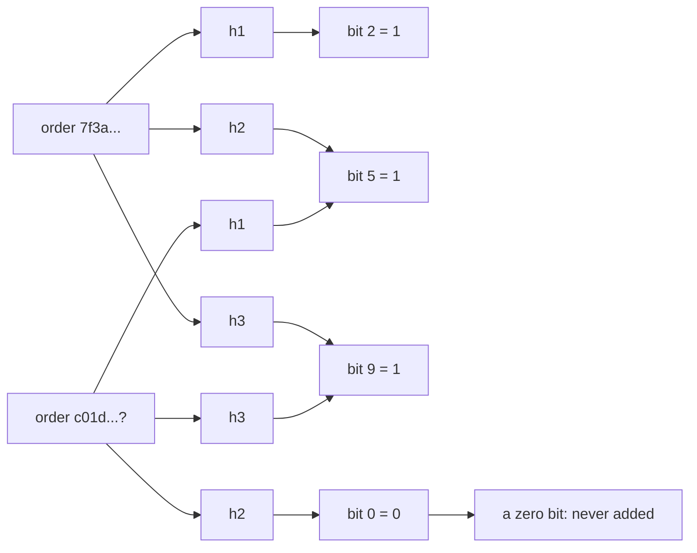
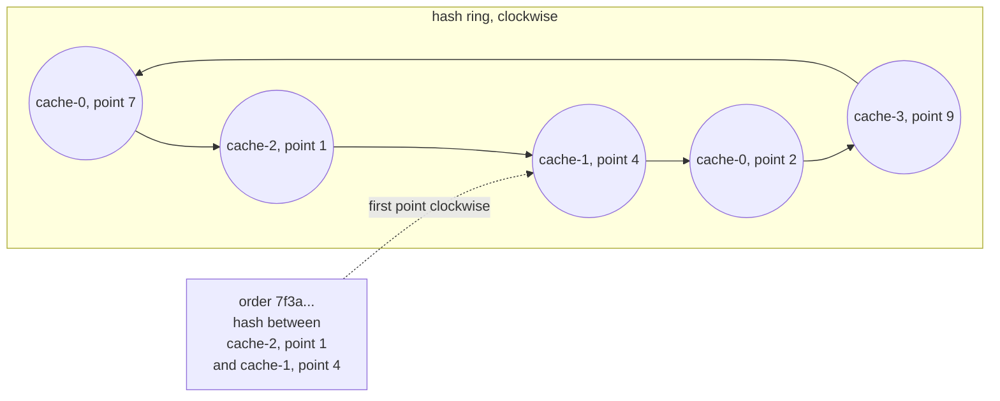

# Probabilistic structures

## Why care?

Four problems that seem to need a lot of memory, or a lot of disk reads:

- "Most order lookups are for IDs that don't exist (typos, bots, old links), and every one of them goes to the database."
- "How many **distinct** customers ordered today? The `map` for that uses 2 GB per day, per region."
- "Which 10 SKUs are ordered most, in a stream of 10 million events, on a box with 64 MB?"
- "We added a fifth cache node, and the hit rate fell from 95% to 20% for an hour."

All four have the same kind of answer: **give up a little certainty, and save almost all the memory**. A Bloom filter answers "have I seen this?" with "no" or "probably". HyperLogLog counts distinct things in 16 KiB, whatever the count. A count-min sketch counts how often, and is never too low. Consistent hashing moves only the keys that must move. None of them is exact, and each one tells you **exactly how inexact** it is.

## The idea: a bit array set by several hashes

Take an array of a million bits, all 0. The goal is to remember which order IDs were added, without storing the IDs.

- To add an ID, compute 7 different hashes of it. Each hash gives a bit position. Set those 7 bits to **1**. (A bit that is already 1 stays 1.)
- To ask "was order X added?", compute X's 7 bit positions. If **any** of them is 0, the answer is a certain **no**: if X had been added, that bit would be 1.
- If all 7 are 1, the answer is **probably yes**. X may have been added. Or other IDs may have set those 7 bits, one by one, by chance.

This is a **Bloom filter** (Burton Bloom, 1970). "No" is always right. "Yes" is sometimes wrong. You control how often it is wrong by choosing the size of the bit array.



The other structures on this page use the same approach for different questions:

| Structure          | Answers                         | Error                                | Memory                  |
| ------------------ | ------------------------------- | ------------------------------------ | ----------------------- |
| Bloom filter       | "Have I seen x?"                | False "yes", never false "no"        | ~10 bits per item at 1% |
| HyperLogLog        | "How many **distinct** items?"  | About ±1% with 16 KiB                | Fixed, not per item     |
| Count-min sketch   | "How often did I see x?"        | Too high by a little, never too low  | Fixed, not per item     |
| Consistent hashing | "Which node owns key x?" (ring) | Load spread is uneven without vnodes | A few points per node   |

## Under the hood: Bloom filters

### The math, in plain words

A filter has **m** bits and uses **k** hash functions. You add **n** items. Each bit is still 0 with probability about e^(−kn/m). A false positive needs all k bits of a new item to be 1:

```text
false-positive rate  p ≈ (1 − e^(−kn/m))^k
best k               k = (m/n) · ln 2
bits you need        m = −n · ln p / (ln 2)²   ≈ 9.6 bits per item for p = 1%
```

Two rules of thumb fall out of that:

- **About 10 bits per item gives 1%.** Every extra 4.8 bits per item divides the false-positive rate by 10.
- **The size of the items does not matter.** A UUID is 128 bits, a URL may be 800 bits; both cost 9.6 bits in a 1% filter. The filter never stores the item.

### Double hashing: two hashes make k

Computing 7 or 10 independent hashes per item is slow. Kirsch and Mitzenmacher showed (2006) that two hashes are enough: position i is `h1 + i·h2 (mod m)`, and the false-positive rate stays the same. Go has the right tool in the standard library: `hash/maphash`, whose package doc says it is meant for "hash tables, Bloom filters, and other data structures". `maphash.Comparable` hashes any comparable value, such as a `uuid.UUID`, without turning it into bytes first.

### Try it in Go: a Bloom filter of order IDs

```go
// Package prob has small probabilistic data structures for learning.
package prob

import (
	"hash/maphash"
	"math"
)

// Bloom is a Bloom filter for comparable values. MayContain never says
// "no" for a value that was added; it says "yes" by mistake at about the
// false-positive rate chosen in NewBloom.
type Bloom[T comparable] struct {
	bits   []uint64 // m bits, packed 64 per word
	m      uint64   // number of bits
	k      int      // number of hash functions
	s1, s2 maphash.Seed
}

// NewBloom sizes a filter for n values at false-positive rate p.
func NewBloom[T comparable](n int, p float64) *Bloom[T] {
	m := math.Ceil(-float64(n) * math.Log(p) / (math.Ln2 * math.Ln2))
	k := max(1, int(math.Round(m/float64(n)*math.Ln2)))
	return &Bloom[T]{
		bits: make([]uint64, (uint64(m)+63)/64),
		m:    uint64(m),
		k:    k,
		s1:   maphash.MakeSeed(),
		s2:   maphash.MakeSeed(),
	}
}

// positions returns the k bit positions for v, with double hashing:
// position i is h1 + i*h2 (mod m). Two real hashes give k "fake" ones.
func (b *Bloom[T]) positions(v T, yield func(uint64) bool) {
	h1 := maphash.Comparable(b.s1, v)
	h2 := maphash.Comparable(b.s2, v) | 1 // odd, so it never gets stuck
	for i := range uint64(b.k) {
		if !yield((h1 + i*h2) % b.m) {
			return
		}
	}
}

// Add sets the k bits of v.
func (b *Bloom[T]) Add(v T) {
	b.positions(v, func(p uint64) bool {
		b.bits[p/64] |= 1 << (p % 64)
		return true
	})
}

// MayContain reports false only if v was surely never added.
func (b *Bloom[T]) MayContain(v T) bool {
	found := true
	b.positions(v, func(p uint64) bool {
		found = b.bits[p/64]&(1<<(p%64)) != 0
		return found // stop at the first zero bit
	})
	return found
}

// Bits and K report the size the filter chose.
func (b *Bloom[T]) Bits() uint64 { return b.m }
func (b *Bloom[T]) K() int       { return b.k }
```

The bits live in a `[]uint64`: bit `p` is bit `p % 64` of word `p / 64` (see [Bits and bytes](../fundamentals/bits-and-bytes.md)). `positions` takes a `yield` callback, like the body of an `iter.Seq`, so `MayContain` can stop at the first zero bit.

Now measure it. Add a million order IDs (`uuid.New()`, like `ordersd` makes), check that every one is found, then ask about a million IDs that were **never** added and count the "yes" answers:

```go
// Command bloom measures a Bloom filter of order IDs against the formula,
// and against a map that stores every ID.
package main

import (
	"fmt"
	"math"
	"runtime"
	"uuid"

	"example.com/prob"
)

func heap() uint64 {
	runtime.GC()
	var ms runtime.MemStats
	runtime.ReadMemStats(&ms)
	return ms.HeapAlloc
}

func main() {
	const n = 1_000_000
	ids := make([]uuid.UUID, n)
	for i := range ids {
		ids[i] = uuid.New()
	}

	for _, p := range []float64{0.10, 0.01, 0.001} {
		f := prob.NewBloom[uuid.UUID](n, p)
		for _, id := range ids {
			f.Add(id)
		}
		for _, id := range ids {
			if !f.MayContain(id) {
				panic("false negative: impossible")
			}
		}
		fp := 0
		for range n { // n IDs that were never added
			if f.MayContain(uuid.New()) {
				fp++
			}
		}
		m, k := float64(f.Bits()), float64(f.K())
		formula := math.Pow(1-math.Exp(-k*n/m), k)
		fmt.Printf("target %5.1f%%  bits/ID %4.1f  k %2d  size %5.0f KiB  measured %6.3f%%  formula %6.3f%%\n",
			p*100, m/n, f.K(), m/8/1024, float64(fp)/n*100, formula*100)
	}

	before := heap()
	set := make(map[uuid.UUID]struct{}, n)
	for _, id := range ids {
		set[id] = struct{}{}
	}
	fmt.Printf("map[uuid.UUID]struct{} with %d IDs: %.0f KiB\n", len(set), float64(heap()-before)/1024)
	runtime.KeepAlive(set)
}
```

```console
$ ./bloom
target  10.0%  bits/ID  4.8  k  3  size   585 KiB  measured 10.024%  formula 10.071%
target   1.0%  bits/ID  9.6  k  7  size  1170 KiB  measured  1.005%  formula  1.004%
target   0.1%  bits/ID 14.4  k 10  size  1755 KiB  measured  0.097%  formula  0.100%
map[uuid.UUID]struct{} with 1000000 IDs: 21316 KiB
```

This output shows the main properties of the structure:

- The **measured** rate matches the **formula** to two digits. The math is not a rough guide; it is what happens.
- **No false negatives**: the program did not panic, so not one of three million checks failed. There cannot be one: bits only ever go from 0 to 1.
- At 1%, the filter is **1.1 MiB**. The exact set of the same IDs, in a `map`, is **21 MiB**: 18 times more. And the map grows with the size of the key; the filter does not.
- Going from 1% to 0.1% costs only 50% more memory. Higher accuracy costs little memory.
- A second run gave 1.007% at the 1% target: `maphash.MakeSeed` picks a new random hash function each time.

Is it fast? A lookup for an ID that is not there usually stops at the first or second zero bit:

```console
$ go test -run '^$' -bench . -benchmem -count 3 .
goos: linux
goarch: amd64
pkg: example.com/prob
cpu: AMD Ryzen 7 5800H with Radeon Graphics
BenchmarkBloomMayContain-16    	23008526	        51.63 ns/op	       0 B/op	       0 allocs/op
BenchmarkBloomMayContain-16    	23594746	        51.98 ns/op	       0 B/op	       0 allocs/op
BenchmarkBloomMayContain-16    	22459854	        53.28 ns/op	       0 B/op	       0 allocs/op
BenchmarkMapLookup-16          	20305262	        63.98 ns/op	       0 B/op	       0 allocs/op
BenchmarkMapLookup-16          	19325814	        80.20 ns/op	       0 B/op	       0 allocs/op
BenchmarkMapLookup-16          	17385865	        73.23 ns/op	       0 B/op	       0 allocs/op
PASS
ok  	example.com/prob	14.976s
```

Both look up one million random IDs that are not in the set. The Bloom filter is a bit faster than the Go map, not because hashing is cheaper (it hashes twice), but because 1.1 MiB fits in the CPU caches much better than 21 MiB (see [Memory](../fundamentals/memory.md)). Your numbers will differ. The point is not "Bloom beats map"; the point is that the filter is cheap enough to put **in front of** anything slow.

### What a Bloom filter cannot do

- **No delete.** Turning a bit off might also "remove" other items that share it, and then the filter gives false negatives. If you need delete, use a **counting** Bloom filter (small counters instead of bits, about 4 times the memory) or a **cuckoo filter**.
- **No resize.** The size is fixed when you create it. Add twice the planned items and the 1% filter becomes about 15%. Size it for the peak, or rebuild it.
- **No listing.** You cannot get the items back out. It is a membership test, nothing more.
- **Seeds are part of the data.** A filter built with one `maphash.Seed` means nothing with another seed. More on this below.

### Where you already use one

- **LSM-tree databases** (RocksDB, Cassandra, ScyllaDB, Pebble in CockroachDB) keep one Bloom filter per file on disk. A read for a key that is not in a file skips that file without reading it. See [Storage engines](../databases/storage.md).
- **Git** keeps a Bloom filter of **changed paths** per commit in the commit-graph file. `git log -- <path>` asks each commit's filter "did you change this path?", and only opens commits that say "maybe".

You can see the Git filter at work. A scratch repo with 300 commits, each changing one of three files:

```console
$ git rev-list --count HEAD
300
$ git commit-graph write --reachable --changed-paths
$ GIT_TRACE2_EVENT=$PWD/../t2.json git log --oneline -- internal/order/order.go | wc -l
100
$ grep -o '"category":"bloom"[^}]*}[^}]*}' ../t2.json
"category":"bloom","key":"statistics","value":{"filter_not_present":0,"maybe":100,"definitely_not":200,"false_positive":0}}
```

200 commits were skipped because their filter said "definitely not". 100 said "maybe", and Git checked each one by comparing trees: all 100 really changed the file, so `false_positive` is 0. On a big repository this is the difference between 30 seconds and one second for `git log -- path` (see [Storage](../git/storage.md)).

## Under the hood: HyperLogLog

### The idea: rare hash patterns estimate the count

A run of 10 heads in a row from a fair coin happens about once in 1,024 tries, so the longest run seen tells you roughly how many tries there were.

Hash each item to 64 random-looking bits and look at how many **leading zeros** it has. A hash with 10 leading zeros turns up about once per 1,024 **distinct** items. The same item always gives the same hash, so duplicates change nothing. This is the core idea: **remember only the longest run of zeros you have seen, and you have a guess of how many distinct items there were.** One number, a few bits.

One guess is very noisy (one unusual hash can spoil it). **HyperLogLog** (Flajolet and others, 2007) fixes that:

1. Use the first p bits of the hash to pick one of m = 2^p **registers**.
2. In that register, keep the longest run of zeros (plus one) seen in the **rest** of the hash.
3. Combine all m registers with a **harmonic mean**, which reduces the effect of the few outliers.
4. When many registers are still 0 (few items), count the empty registers instead ("linear counting").

The standard error is **1.04 / √m**. With p = 14, that is 16,384 registers of one byte, 16 KiB, and about 0.81% error. For 1,000 customers or a billion.

```go
package prob

import (
	"hash/maphash"
	"math"
	"math/bits"
)

// HLL is a HyperLogLog counter of distinct values with 2^p registers.
type HLL[T comparable] struct {
	p    uint8
	reg  []uint8 // reg[j] = longest run of leading zeros seen in bucket j, plus one
	seed maphash.Seed
}

// NewHLL makes a counter with 2^p registers (one byte each).
// Use the same seed for counters you want to merge.
func NewHLL[T comparable](p uint8, seed maphash.Seed) *HLL[T] {
	return &HLL[T]{p: p, reg: make([]uint8, 1<<p), seed: seed}
}

// Add records v. Adding the same value twice changes nothing.
func (h *HLL[T]) Add(v T) {
	x := maphash.Comparable(h.seed, v)
	j := x >> (64 - h.p)        // the first p bits pick a register
	rest := x<<h.p | 1<<(h.p-1) // the other bits; the guard bit caps the run
	rank := uint8(bits.LeadingZeros64(rest)) + 1
	h.reg[j] = max(h.reg[j], rank)
}

// Merge adds everything other has seen: the max of each register.
func (h *HLL[T]) Merge(other *HLL[T]) {
	for j, r := range other.reg {
		h.reg[j] = max(h.reg[j], r)
	}
}

// Count estimates the number of distinct values added.
func (h *HLL[T]) Count() uint64 {
	m := float64(len(h.reg))
	sum, zeros := 0.0, 0
	for _, r := range h.reg {
		sum += math.Ldexp(1, -int(r)) // 2^-r
		if r == 0 {
			zeros++
		}
	}
	alpha := 0.7213 / (1 + 1.079/m)
	est := alpha * m * m / sum // harmonic mean of 2^r, times m
	if est <= 2.5*m && zeros > 0 {
		est = m * math.Log(m/float64(zeros)) // few values: count empty registers
	}
	return uint64(est + 0.5)
}
```

`bits.LeadingZeros64` compiles to one or two CPU instructions. `alpha` is a correction constant from the paper. The full algorithm has more corrections for very large counts; for 64-bit hashes you do not need them.

### Try it in Go: distinct customers

Every customer orders three times, so the stream has three times as many events as distinct customers. Then two days of customers that overlap, merged:

```go
// Command hll counts distinct customers in a stream of order events.
package main

import (
	"fmt"
	"hash/maphash"
	"math"

	"example.com/prob"
)

func main() {
	const p = 14 // 16,384 registers = 16 KiB
	seed := maphash.MakeSeed()
	fmt.Printf("registers %d, size %d KiB, expected error about %.2f%%\n",
		1<<p, (1<<p)/1024, 104/math.Sqrt(1<<p))

	for _, distinct := range []int{1_000, 10_000, 100_000, 1_000_000, 10_000_000} {
		h := prob.NewHLL[string](p, seed)
		for i := range distinct * 3 { // every customer orders three times
			h.Add(fmt.Sprintf("customer-%d", i%distinct))
		}
		got := h.Count()
		fmt.Printf("distinct %10d  estimate %10d  error %+6.2f%%\n",
			distinct, got, (float64(got)/float64(distinct)-1)*100)
	}

	// Two days, overlapping customers: merge the sketches for the union.
	mon, tue := prob.NewHLL[string](p, seed), prob.NewHLL[string](p, seed)
	for i := range 600_000 {
		mon.Add(fmt.Sprintf("customer-%d", i)) // 0 .. 599,999
	}
	for i := 400_000; i < 1_000_000; i++ {
		tue.Add(fmt.Sprintf("customer-%d", i)) // 400,000 .. 999,999
	}
	fmt.Println("monday", mon.Count(), "tuesday", tue.Count())
	mon.Merge(tue)
	fmt.Println("monday or tuesday", mon.Count(), "(exact 1000000)")
}
```

```console
$ ./hll
registers 16384, size 16 KiB, expected error about 0.81%
distinct       1000  estimate       1004  error  +0.40%
distinct      10000  estimate      10118  error  +1.18%
distinct     100000  estimate     100096  error  +0.10%
distinct    1000000  estimate    1003043  error  +0.30%
distinct   10000000  estimate   10152556  error  +1.53%
monday 606032 tuesday 596935
monday or tuesday 1003043 (exact 1000000)
$ ./hll
registers 16384, size 16 KiB, expected error about 0.81%
distinct       1000  estimate        991  error  -0.90%
distinct      10000  estimate       9960  error  -0.40%
distinct     100000  estimate     100473  error  +0.47%
distinct    1000000  estimate    1002762  error  +0.28%
distinct   10000000  estimate   10036031  error  +0.36%
monday 607077 tuesday 600970
monday or tuesday 1002762 (exact 1000000)
```

- **The same 16 KiB** counts a thousand and ten million. Compare the 21 MiB `map` of a million UUIDs above.
- The errors vary around ±1%, as expected. "0.81%" is a standard deviation, so about one run in three is further off than that, and +1.53% (two standard deviations) happens.
- **Merge is exact.** Monday ∪ Tuesday gives the same answer (1,003,043 in the first run) as counting the million customers directly. You can count per hour on each server, ship the 16 KiB sketches, and merge them into per-day and per-region counts. You cannot do that with averages, and you cannot do it with exact counts without the full sets.
- **Merge needs the same seed** (the same hash function). Two sketches with different seeds put the same customer in different registers.

Redis has HyperLogLog built in (`PFADD`, `PFCOUNT`, `PFMERGE`), and many analytics databases have an `approx_count_distinct`. They work as described here.

## Under the hood: count-min sketch

A Bloom filter answers "seen it?". A **count-min sketch** (Cormode and Muthukrishnan, 2005) answers "how often?". Replace each bit by a counter, and keep **d** rows of **w** counters, each row with its own hash function:

- **Add(x)**: in every row, add 1 to the counter at `hash_row(x) mod w`.
- **Estimate(x)**: read x's counter in every row and return the **smallest**.

Every counter that x touched holds x's true count, **plus** the counts of other items that happen to share it. So every row is too high or exactly right, never too low, and the smallest is the least wrong. The guarantee: with w = ⌈e/ε⌉ and d = ⌈ln(1/δ)⌉, the estimate is at most **ε·N too high** (N = total events) with probability at least 1 − δ.

```go
package prob

import "hash/maphash"

// CountMin is a count-min sketch: depth rows of width counters.
// Estimates are never too low, and too high by at most a little.
type CountMin[T comparable] struct {
	width uint64
	rows  [][]uint32
	seeds []maphash.Seed
}

// NewCountMin makes a sketch with depth rows of width counters each.
func NewCountMin[T comparable](width, depth int) *CountMin[T] {
	c := &CountMin[T]{width: uint64(width)}
	for range depth {
		c.rows = append(c.rows, make([]uint32, width))
		c.seeds = append(c.seeds, maphash.MakeSeed()) // one hash per row
	}
	return c
}

// Add counts one more v: one counter goes up in every row.
func (c *CountMin[T]) Add(v T) {
	for i, row := range c.rows {
		row[maphash.Comparable(c.seeds[i], v)%c.width]++
	}
}

// Estimate returns the smallest of v's counters: the one with the
// least noise from other values that share it.
func (c *CountMin[T]) Estimate(v T) uint32 {
	est := ^uint32(0)
	for i, row := range c.rows {
		est = min(est, row[maphash.Comparable(c.seeds[i], v)%c.width])
	}
	return est
}
```

### Try it in Go: popular SKUs

Real order data is skewed: a few products sell a lot, most sell almost never. `math/rand/v2` has a Zipf generator for exactly that shape. Ten million order lines over a million possible SKUs, counted in a 32 KiB sketch and, for comparison, in an exact map:

```go
// Command cms counts how often each SKU is ordered, with a count-min sketch,
// and compares it with exact counts in a map.
package main

import (
	"fmt"
	"math"
	"math/rand/v2"

	"example.com/prob"
)

func main() {
	const events, skus = 10_000_000, 1_000_000
	r := rand.New(rand.NewPCG(1, 2))
	zipf := rand.NewZipf(r, 1.1, 1, skus-1) // a few SKUs are very popular

	cms := prob.NewCountMin[uint64](2048, 4) // 4 x 2048 x 4 bytes = 32 KiB
	exact := map[uint64]uint32{}
	for range events {
		sku := zipf.Uint64()
		cms.Add(sku)
		exact[sku]++
	}
	fmt.Printf("events %d, distinct SKUs %d\n", events, len(exact))
	fmt.Println("sku        exact   estimate  over")
	for _, sku := range []uint64{0, 1, 2, 10, 100, 1_000, 100_000} {
		e, got := exact[sku], cms.Estimate(sku)
		fmt.Printf("%-7d %8d %10d %5d\n", sku, e, got, got-e)
	}

	width := 2048.0
	bound := uint32(math.E / width * events) // the e/width * N guarantee
	var worst uint32
	var sum uint64
	above := 0
	for sku, n := range exact {
		over := cms.Estimate(sku) - n
		worst, sum = max(worst, over), sum+uint64(over)
		if over > bound {
			above++
		}
	}
	fmt.Printf("over-count: average %.0f, worst %d, bound %d, above bound %d of %d (%.2f%%)\n",
		float64(sum)/float64(len(exact)), worst, bound, above, len(exact), float64(above)/float64(len(exact))*100)
}
```

```console
$ ./cms
events 10000000, distinct SKUs 561499
sku        exact   estimate  over
0        1241131    1242115   984
1         578047     579012   965
2         370613     372503  1890
10         88508      91117  2609
100         7808       9120  1312
1000         618       2267  1649
100000         5        824   819
over-count: average 1291, worst 18551, bound 13272, above bound 1 of 561499 (0.00%)
$ for i in 1 2 3; do ./cms | tail -1; done
over-count: average 1287, worst 15366, bound 13272, above bound 1 of 561499 (0.00%)
over-count: average 1289, worst 22730, bound 13272, above bound 1 of 561499 (0.00%)
over-count: average 1286, worst 12243, bound 13272, above bound 0 of 561499 (0.00%)
```

- The `over` column is never negative. The estimate is never too low, as the guarantee says.
- For the **popular** SKUs the error is tiny: 1,242,115 instead of 1,241,131 is 0.08% off. That is what a count-min sketch is for: finding **heavy hitters** (top products, top IPs, noisy tenants).
- For **rare** SKUs it is useless: SKU 100,000 sold 5 times, the sketch says 824. The noise is the same absolute size for everyone, about N/w spread over the rows, so it hides small counts.
- The bound (ε·N = 13,272) holds for all but one SKU out of 561,499, which is far better than the promised 1 − δ = 98.2%. The bound is a worst case; real data usually does better.
- The exact map needed one entry per distinct SKU. The sketch is 32 KiB whether there are 500 thousand SKUs or 500 million.

To get a "top 10 SKUs" list from a stream, combine the sketch with a small **min-heap** of the 10 best candidates (see [Heaps and queues](heaps-and-queues.md)): after each `Add`, check the estimate against the smallest in the heap. A common refinement, **conservative update**, only increments the counters that are equal to the current minimum, which cuts the over-count a lot.

## Under the hood: consistent hashing

### The problem: `hash mod N`

You have 4 cache nodes and many order IDs. The direct way to pick a node: `hash(id) % 4`. Now add a fifth node: `hash(id) % 5`. How many IDs end up on a **different** node?

A key stays only if `h % 4 == h % 5`. That is true when `h % 20` is 0, 1, 2 or 3: 4 cases out of 20. So **80% of keys move**, and the measurement below agrees exactly. For a cache, that means 80% misses and a sudden flood of requests to the database behind it (see [Caching](../distributed-systems/caching.md)). That explains the "hit rate fell to 20%" message at the top of the page.

### The ring

**Consistent hashing** (Karger and others, 1997) puts nodes and keys on the same circle of hash values, 0 to 2^64 − 1:

- Each node is placed at `hash(node name)`.
- A key belongs to the **first node clockwise** from `hash(key)`.
- Add a node, and it takes over only the keys between its position and the previous node. Every other key stays where it was. Remove a node, and only its keys move, to its neighbour.



With one point per node, the arcs between nodes have random lengths, so one node may own half the ring. The fix is **virtual nodes**: place every node at many points (`cache-0#0`, `cache-0#1`, ...). Many small arcs average out. Finding the owner is a **binary search** in the sorted list of points (see [Sorting and searching](sorting-and-searching.md)).

```go
package prob

import (
	"cmp"
	"crypto/sha256"
	"encoding/binary"
	"fmt"
	"slices"
)

// StableHash must give the same number on every machine and every run,
// because all clients must agree on the ring. maphash would not.
func StableHash(s string) uint64 {
	sum := sha256.Sum256([]byte(s))
	return binary.BigEndian.Uint64(sum[:8])
}

type point struct {
	hash uint64
	node string
}

// Ring is a consistent-hash ring with virtual nodes.
type Ring struct {
	vnodes int
	points []point // sorted by hash
}

// NewRing makes an empty ring that places each node at vnodes points.
func NewRing(vnodes int) *Ring { return &Ring{vnodes: vnodes} }

// Add puts node on the ring at vnodes positions.
func (r *Ring) Add(node string) {
	for i := range r.vnodes {
		r.points = append(r.points, point{StableHash(fmt.Sprintf("%s#%d", node, i)), node})
	}
	slices.SortFunc(r.points, func(a, b point) int { return cmp.Compare(a.hash, b.hash) })
}

// Node returns the owner of key: the first point clockwise from its hash.
func (r *Ring) Node(key string) string {
	h := StableHash(key)
	i, _ := slices.BinarySearchFunc(r.points, h, func(p point, h uint64) int { return cmp.Compare(p.hash, h) })
	if i == len(r.points) {
		i = 0 // past the last point: wrap around to the first
	}
	return r.points[i].node
}
```

SHA-256 is slower than needed (production rings use fast non-cryptographic hashes such as xxHash or MurmurHash), but it is in the standard library and it gives the same answer everywhere, forever.

### Try it in Go: adding a fifth cache node

A million order IDs, 4 nodes, then add `cache-4`. Count how many keys move, and check that every key that moves goes to the **new** node:

```go
// Command ring spreads order IDs over cache nodes and counts how many move
// when a node is added: hash mod N versus a consistent-hash ring.
package main

import (
	"fmt"
	"slices"
	"uuid"

	"example.com/prob"
)

func main() {
	const keys = 1_000_000
	ids := make([]string, keys)
	for i := range ids {
		ids[i] = uuid.New().String()
	}
	nodes := []string{"cache-0", "cache-1", "cache-2", "cache-3"}

	// hash mod N: node = hash % 4, then % 5.
	moved := 0
	for _, id := range ids {
		h := prob.StableHash(id)
		if h%4 != h%5 {
			moved++
		}
	}
	fmt.Printf("mod N       4 -> 5 nodes: %5.1f%% of keys moved\n", float64(moved)/keys*100)

	for _, v := range []int{1, 10, 100, 1000} {
		r := prob.NewRing(v)
		for _, n := range nodes {
			r.Add(n)
		}
		before := make([]string, keys)
		count := map[string]int{}
		for i, id := range ids {
			before[i] = r.Node(id)
			count[before[i]]++
		}
		shares := []float64{}
		for _, n := range nodes {
			shares = append(shares, float64(count[n])/keys*100)
		}

		r.Add("cache-4")
		moved, wrong := 0, 0
		for i, id := range ids {
			if after := r.Node(id); after != before[i] {
				moved++
				if after != "cache-4" {
					wrong++ // moved between two old nodes: never happens
				}
			}
		}
		fmt.Printf("vnodes %4d 4 -> 5 nodes: %5.1f%% of keys moved (%d not to cache-4), shares before: min %4.1f%% max %4.1f%%\n",
			v, float64(moved)/keys*100, wrong, slices.Min(shares), slices.Max(shares))
	}
}
```

```console
$ ./ring
mod N       4 -> 5 nodes:  80.0% of keys moved
vnodes    1 4 -> 5 nodes:   3.7% of keys moved (0 not to cache-4), shares before: min 10.2% max 57.8%
vnodes   10 4 -> 5 nodes:  23.6% of keys moved (0 not to cache-4), shares before: min 14.5% max 39.3%
vnodes  100 4 -> 5 nodes:  18.8% of keys moved (0 not to cache-4), shares before: min 22.9% max 27.7%
vnodes 1000 4 -> 5 nodes:  19.9% of keys moved (0 not to cache-4), shares before: min 24.3% max 25.9%
```

The ideal is 20%: the new node should take one fifth of the keys, and nothing else should move.

- **mod N** moves 80%, as computed.
- **One point per node**: only 3.7% moved. That sounds good, but it is bad: `cache-4` landed on a tiny arc and does almost no work. Worse, before the change one node held **57.8%** of all keys and another 10.2%. Your "4-node cluster" is really one hot node.
- **100 to 1,000 virtual nodes**: close to 20% moved, and each node holds close to 25%. The cost is a bigger sorted list (4,000 points is nothing) and a binary search of about 12 steps.
- `0 not to cache-4` in every line: on a ring, a key never moves between two **old** nodes. That is the property that keeps the other caches warm (full of useful entries).

Where you meet it: memcached and Redis client libraries (the "ketama" ring), Envoy's `RING_HASH` and `MAGLEV` load-balancing policies, Cassandra and DynamoDB partitioning (`num_tokens` is the virtual-node count), and sharding schemes in general (see [Load balancers](../networking/load-balancers.md) and [Replication and sharding](../databases/replication.md)). Two newer alternatives are worth knowing by name: **rendezvous hashing** (for each key, pick the node with the highest `hash(key, node)`; no ring, O(N) per lookup) and **jump consistent hash** (no memory at all, but nodes can only be added or removed at the end).

### Random seeds and shared hashes

Everything on this page before the ring used `hash/maphash`. The ring did not, on purpose:

```go
// Command seed prints the maphash of one order ID.
package main

import (
	"fmt"
	"hash/maphash"
)

func main() {
	fmt.Printf("%016x\n", maphash.String(maphash.MakeSeed(), "order-42"))
}
```

```console
$ ./seed
30f203ec5d54c808
$ ./seed
e05dd6c8883fabf1
```

Same input, different hash in every process. This is intended: an attacker cannot guess your hash function, so they cannot send you a million keys that all land in the same bucket (hash flooding). But it means:

- **In-memory, one process** (a Bloom filter in front of a database call, a sketch for a metrics window): `maphash` is perfect.
- **Shared between processes or saved to disk** (a ring every client must agree on, a Bloom filter shipped with an SSTable, HLL sketches merged across servers): you need a hash that is the **same everywhere**. Use a fixed, documented hash function, and write its name into the file format.

## Traps

- **Treating "maybe" as "yes".** A Bloom filter's "yes" must be checked against the real data. Only its "no" can be trusted alone. If a false "yes" means "show this user someone else's order", you have a security bug.
- **Overfilling a Bloom filter.** It does not fail, it silently gets worse. Twice the planned items turns 1% into about 15%. Track the item count and rebuild.
- **Deleting from a plain Bloom filter.** Clearing bits creates false negatives, the one error a Bloom filter promises never to make. Use a counting Bloom filter or a cuckoo filter.
- **Merging sketches with different seeds or sizes.** HyperLogLog and count-min merges only work with the same hash functions and the same dimensions. The result of a wrong merge looks plausible and is wrong.
- **Count-min on rare items.** The over-count is about the same for every item. For items with small counts the error is bigger than the count. Use it for heavy hitters.
- **HyperLogLog error is a standard deviation.** "0.81%" means about a third of runs are further off. If a dashboard shows two HLL counts that differ by 1%, that might be noise.
- **`hash mod N` for anything that scales.** Adding one node moves almost every key. Use a ring with virtual nodes, rendezvous hashing, or a fixed number of small shards mapped onto nodes.
- **Too few virtual nodes.** One point per node gives one hot node. Use at least 100.
- **A random-seeded hash across processes.** `maphash.MakeSeed` is different in every process. Rings, files on disk and sketches that travel need a stable hash.

## Check yourself

??? question "1. A Bloom filter of 1 million order IDs at 1% is 1.1 MiB. What happens to its size if the IDs were 1 KB strings instead of UUIDs? And to the `map`?"

    The filter stays 1.1 MiB: it stores about 9.6 bits per item, never the item itself. The
    map grows with the key size, from 21 MiB to well over 1 GB, because it must keep every
    key to compare against.

??? question "2. `ordersd` puts a Bloom filter of all existing order IDs in front of the database. The filter says \"yes\" for an ID. Can the handler return the order without a database query? And when it says \"no\"?"

    On "yes", no: about 1% of "yes" answers are for IDs that do not exist, so the handler
    must still query the database (and may get "not found"). On "no", yes: the handler can
    return 404 at once, because a Bloom filter never says "no" for an added item. The
    filter saves the queries for missing IDs, which was the goal. (New orders must be added
    to the filter before the create call returns, or you get false "no" answers.)

??? question "3. You keep one HyperLogLog per server per hour for distinct customers. How do you get distinct customers per day for the whole fleet, and why can't you just add the counts?"

    Merge all the sketches (register-wise max) and call `Count` once. Adding counts would
    count a customer who ordered on two servers, or in two hours, twice. A merged sketch is
    exactly the sketch of the union, so duplicates across servers and hours disappear. It
    works only if all sketches use the same hash function (seed) and the same p.

??? question "4. A count-min sketch says SKU A was ordered 1,242,115 times and SKU B 824 times. How much do you trust each number?"

    A: a lot. The error is never negative and is typically around N/w (here about a
    thousand), which is under 0.1% of 1.2 million. B: not at all. The true count could be
    anything from 0 to 824; the noise alone is about that size. Count-min is for heavy
    hitters.

??? question "5. Why do `hash mod 4` to `hash mod 5` move 80% of keys, and how many should move ideally?"

    A key stays only if `h % 4 == h % 5`, which happens for 4 of the 20 values of `h % 20`:
    20% stay, 80% move. Ideally only the keys the new node must own move: one fifth, 20%.
    A consistent-hash ring with enough virtual nodes gets close to that (19.9% with 1,000
    vnodes in the run above), and never moves a key between two old nodes.

??? question "6. Your ring works in tests, but in production two `ordersd` replicas send the same order ID to different cache nodes. What is the likely bug?"

    The ring uses a hash with a per-process random seed, such as `maphash` with
    `MakeSeed`. In one process (a test) everything agrees. Two processes have two different
    hash functions, so they place nodes and keys at different points. Use a stable hash,
    the same in every process and every version.

## Recap

- Probabilistic structures trade a small, **known** error for a huge saving in memory. Measured: a 1% Bloom filter of a million order IDs is 1.1 MiB; the exact `map` is 21 MiB.
- **Bloom filter**: k bits per item in an m-bit array. "No" is certain, "yes" is probable. About 10 bits per item for 1%. No delete, no resize. Used in LSM trees and Git's changed-path filters.
- **HyperLogLog**: the longest run of leading zeros, in 2^p registers, combined with a harmonic mean. 16 KiB for ±0.81%, for any count. Merging is a register-wise max.
- **Count-min sketch**: d rows of w counters, take the minimum. Never too low; too high by about N/w. Good for heavy hitters, bad for rare items.
- **Consistent hashing**: nodes and keys on one ring; a key belongs to the next node clockwise. Adding a node moves about 1/N of keys instead of almost all. Use 100+ virtual nodes, and a **stable** hash.
- `hash/maphash` is the right hash inside one process. Its random seed makes it the wrong hash for anything shared or stored.

## You finished Algorithms

You now know the structures inside your everyday tools: how cost grows with input ([Big-O](big-o.md)), how Go's `map` and slices really work, the trees inside databases and HTTP routers, the heaps inside timers and schedulers, the graphs inside Git, Go modules and Kubernetes, the sort inside `slices.Sort`, and the approximations on this page. When something is slow, you can now ask the right question: which structure is this, and is it the wrong one for this access pattern?

Next chapter: [AI engineering](../ai-engineering/index.md), where a model turns text into tokens and embeddings: numbers and vectors, with the same trade-off between exact and fast that you met on this page.
