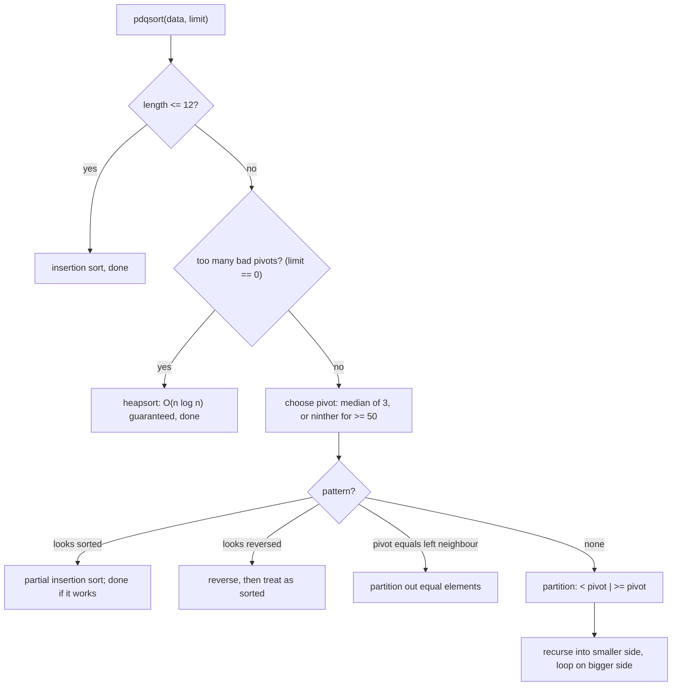
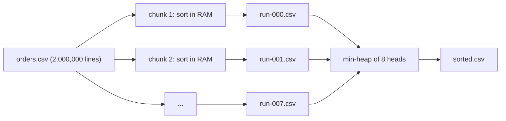

# Sorting and searching

## Why care?

Sorting is the most common algorithm you never write. It's behind:

- `ORDER BY created_at` on every list endpoint.
- "Top 10 orders by amount" on the dashboard.
- Merging two sorted streams of events, deduplicating IDs, finding "all orders between Monday and Friday".
- Every database index, every log-structured store, every `sort | uniq -c` in a shell pipeline.

You will (almost) never implement a sort in Go. `slices.Sort` is better than what you'd write. But you still choose: stable or not, structs or keys, sort or map, sort in memory or on disk. And you need to know why sorting first makes searching so cheap. This page opens `slices.Sort`, measures the choices, and ends with sorting a file that does not fit in memory.

## The idea: sorting a pile of paper orders

You have a pile of 1,000 paper orders and must sort them by date.

- **Small piles** (a dozen): pick each one up and slide it into place among the ones you already sorted. That's **insertion sort**. O(n²) in theory, but nothing beats it for a handful of items.
- **Big piles**: pick one order as the **pivot** (say, 15 March). Make two piles: earlier, and later. Do the same with each pile. That's **quicksort**. On average, each split halves the problem: O(n log n).
- **Bad luck**: if your pivot is always the earliest order (the pile was already sorted, and you always take the top one), each "split" removes only one order. Quicksort becomes O(n²). A good sort notices this and **changes strategy**.
- **Keeping ties in order**: two orders on the same day stay in the order they came in. That's a **stable** sort, and it costs extra.
- **The pile doesn't fit on your desk**: sort it one desk-full at a time, put the sorted stacks aside, then **merge** them by always taking the earliest top order from any stack. That's **external merge sort**.

And once the pile is sorted, finding "the orders from 15 March" doesn't need a full pass anymore: open in the middle, go left or right, repeat. That's **binary search**: O(log n).



## Under the hood: `slices.Sort` is pdqsort

Go's `slices.Sort` (and since Go 1.19, `sort.Sort` and `sort.Slice`) uses **pdqsort**, "pattern-defeating quicksort" by Orson Peters. It's a quicksort that falls back to insertion sort for small pieces and to heapsort when quicksort goes wrong, and that detects common patterns (sorted, reversed, many equal values) to finish them in linear time.

The entry point is in `$GOROOT/src/slices/sort.go`:

```go
func Sort[S ~[]E, E cmp.Ordered](x S) {
	n := len(x)
	pdqsortOrdered(x, 0, n, bits.Len(uint(n)))
}
```

`bits.Len(uint(n))` is about `log₂ n`: for a million elements, 20. That is the **limit**: how many badly unbalanced partitions pdqsort accepts before it gives up on quicksort.

The main loop is in `$GOROOT/src/slices/zsortordered.go`. That file is generated (`// Code generated by gen_sort_variants.go; DO NOT EDIT.`) from one template, which also produces `zsortanyfunc.go` for `SortFunc`, and the `sort` package's own copies. Here is the whole loop:

```go
// pdqsortOrdered sorts data[a:b].
// The algorithm based on pattern-defeating quicksort(pdqsort), but without the optimizations from BlockQuicksort.
// pdqsort paper: https://arxiv.org/pdf/2106.05123.pdf
// C++ implementation: https://github.com/orlp/pdqsort
// Rust implementation: https://docs.rs/pdqsort/latest/pdqsort/
// limit is the number of allowed bad (very unbalanced) pivots before falling back to heapsort.
func pdqsortOrdered[E cmp.Ordered](data []E, a, b, limit int) {
	const maxInsertion = 12

	var (
		wasBalanced    = true // whether the last partitioning was reasonably balanced
		wasPartitioned = true // whether the slice was already partitioned
	)

	for {
		length := b - a

		if length <= maxInsertion {
			insertionSortOrdered(data, a, b)
			return
		}

		// Fall back to heapsort if too many bad choices were made.
		if limit == 0 {
			heapSortOrdered(data, a, b)
			return
		}

		// If the last partitioning was imbalanced, we need to breaking patterns.
		if !wasBalanced {
			breakPatternsOrdered(data, a, b)
			limit--
		}

		pivot, hint := choosePivotOrdered(data, a, b)
		if hint == decreasingHint {
			reverseRangeOrdered(data, a, b)
			// The chosen pivot was pivot-a elements after the start of the array.
			// After reversing it is pivot-a elements before the end of the array.
			// The idea came from Rust's implementation.
			pivot = (b - 1) - (pivot - a)
			hint = increasingHint
		}

		// The slice is likely already sorted.
		if wasBalanced && wasPartitioned && hint == increasingHint {
			if partialInsertionSortOrdered(data, a, b) {
				return
			}
		}

		// Probably the slice contains many duplicate elements, partition the slice into
		// elements equal to and elements greater than the pivot.
		if a > 0 && !cmp.Less(data[a-1], data[pivot]) {
			mid := partitionEqualOrdered(data, a, b, pivot)
			a = mid
			continue
		}

		mid, alreadyPartitioned := partitionOrdered(data, a, b, pivot)
		wasPartitioned = alreadyPartitioned

		leftLen, rightLen := mid-a, b-mid
		balanceThreshold := length / 8
		if leftLen < rightLen {
			wasBalanced = leftLen >= balanceThreshold
			pdqsortOrdered(data, a, mid, limit)
			a = mid + 1
		} else {
			wasBalanced = rightLen >= balanceThreshold
			pdqsortOrdered(data, mid+1, b, limit)
			b = mid
		}
	}
}
```

Six ideas, one per block:

1. **Insertion sort cutoff: 12.** Pieces of 12 or fewer elements are finished with insertion sort. For tiny inputs it does fewer moves and has no recursion overhead; this is the "constants win for small n" lesson from [Big-O in practice](big-o.md#on2-vs-on-the-crossover).
2. **Heapsort fallback.** Every unbalanced split (one side smaller than 1/8 of the piece) costs one unit of `limit`. When it reaches 0, the piece is finished with **heapsort**, which is O(n log n) in the worst case. So `slices.Sort` is **never** O(n²), whatever input an attacker sends. (Heaps are explained in [Heaps and queues](heaps-and-queues.md).)
3. **Breaking patterns.** After a bad split, `breakPatternsOrdered` swaps three elements near the middle with pseudo-random positions, so a nasty pattern can't produce bad pivots again and again.
4. **Pivot choice.** `choosePivotOrdered` takes the median of three elements (at 1/4, 1/2 and 3/4), or for 50 or more elements the "Tukey ninther": the median of three medians of three. While it does this, it counts swaps. Zero swaps means "these samples were already in order": `increasingHint`. The maximum number of swaps means "all reversed": `decreasingHint`, and pdqsort reverses the whole piece in O(n) first.
5. **Already sorted?** If the samples look sorted and the last split was clean, `partialInsertionSortOrdered` tries to finish with insertion sort, but gives up after fixing 5 out-of-order pairs. On sorted input it walks the slice once and returns: **O(n)**.
6. **Many duplicates.** If the pivot equals the element just left of this piece (which is known to be ≤ everything in it), then the piece has a lot of elements equal to the pivot. `partitionEqualOrdered` moves them all out of the way in one pass and never looks at them again.

And a small detail at the end: it recurses into the **smaller** side and loops on the bigger one. That keeps the stack depth at O(log n) even in bad cases.

### `Sort`, `SortFunc`, `sort.Slice`

| Function                        | Compares with                    | Stable | Notes                                                    |
| ------------------------------- | -------------------------------- | ------ | -------------------------------------------------------- |
| `slices.Sort(s)`                | `cmp.Less` on `cmp.Ordered` type | no     | ints, floats, strings. Fastest: compare is inlined.      |
| `slices.SortFunc(s, cmp)`       | `cmp(a, b) int`                  | no     | Any type. Use `cmp.Compare` and `cmp.Or` to build `cmp`. |
| `slices.SortStableFunc(s, cmp)` | `cmp(a, b) int`                  | yes    | Insertion sort on blocks of 20, then in-place merges.    |
| `sort.Slice(s, less)`           | `less(i, j int) bool`            | no     | Older API, uses reflection to swap. Same pdqsort.        |
| `sort.Ints(s)`, `sort.Strings`  |                                  | no     | Since Go 1.22, they simply call `slices.Sort`.           |

The `cmp` function returns negative, zero or positive, like `strings.Compare`. To sort orders by time, with ID as a tiebreaker (exactly what `examples/orders`'s `memory.Store.List` does):

```go
slices.SortFunc(all, func(a, b order.Order) int {
	return cmp.Or(a.CreatedAt.Compare(b.CreatedAt), a.ID.Compare(b.ID))
})
```

`cmp.Or` returns its first non-zero argument: "by time, and if equal, by ID". The tiebreaker makes the order **total**, so the result is the same every time, even with an unstable sort.

### Stability

A **stable** sort keeps equal elements in their original order. Why care? Because people sort in steps. The UI shows orders sorted by time; the user clicks "sort by status". They expect the orders **within** each status to still be sorted by time. With an unstable sort, they get a random order inside each group.

`slices.SortStableFunc` does this, without extra memory. From `$GOROOT/src/slices/zsortordered.go` (the `Func` variant is the same):

```go
func stableOrdered[E cmp.Ordered](data []E, n int) {
	blockSize := 20 // must be > 0
	a, b := 0, blockSize
	for b <= n {
		insertionSortOrdered(data, a, b)
		a = b
		b += blockSize
	}
	insertionSortOrdered(data, a, n)

	for blockSize < n {
		a, b = 0, 2*blockSize
		for b <= n {
			symMergeOrdered(data, a, a+blockSize, b)
			a = b
			b += 2 * blockSize
		}
		if m := a + blockSize; m < n {
			symMergeOrdered(data, a, m, n)
		}
		blockSize *= 2
	}
}
```

Insertion sort is stable. Sort blocks of 20 with it, then merge neighbouring blocks, doubling the block size each round, with `symMerge` (an in-place stable merge). In-place merging needs more moves than merging into a buffer. The `sort.Stable` docs give the cost: O(n log n) comparisons, but O(n log n log n) swaps. You'll see the price below.

If you don't need stability, or your comparison is a total order (a unique tiebreaker like the ID), use the unstable `SortFunc`.

## Under the hood: binary search

On sorted data, binary search keeps two indexes, `i` and `j`, with an invariant: everything before `i` is too small, everything from `j` on is big enough. Each step halves the range between them. From `$GOROOT/src/slices/sort.go`:

```go
func BinarySearch[S ~[]E, E cmp.Ordered](x S, target E) (int, bool) {
	// Inlining is faster than calling BinarySearchFunc with a lambda.
	n := len(x)
	// Define x[-1] < target and x[n] >= target.
	// Invariant: x[i-1] < target, x[j] >= target.
	i, j := 0, n
	for i < j {
		h := int(uint(i+j) >> 1) // avoid overflow when computing h
		// i ≤ h < j
		if cmp.Less(x[h], target) {
			i = h + 1 // preserves x[i-1] < target
		} else {
			j = h // preserves x[j] >= target
		}
	}
	// i == j, x[i-1] < target, and x[j] (= x[i]) >= target  =>  answer is i.
	return i, i < n && (x[i] == target || (isNaN(x[i]) && isNaN(target)))
}
```

Three details worth stealing:

- It returns the **position** where `target` is or **would be inserted**, plus a `found` bool. So the same call answers "is it there?", "where do I insert it to keep the slice sorted?" and "where does the range start?".
- With duplicates, it returns the **first** one. That's because of the `>=` in the invariant.
- `uint(i+j) >> 1` instead of `(i+j)/2`: if `i+j` overflows `int`, the `uint` conversion still gives the right middle. This exact bug sat in Java's `Arrays.binarySearch` for about nine years.

The older `sort.Search(n, f int) int` in `$GOROOT/src/sort/search.go` is the same loop with the same invariant, but more general: instead of comparing elements, it calls `f(h)`, and finds the smallest index `i` for which `f(i)` is true, given that `f` is false, then true, across the range.

"Find the first X for which a condition flips" is useful far beyond slices: the first version with a bug (`git bisect` is exactly this), the smallest batch size that hits a timeout, the first log offset after a timestamp.

## Try it in Go: measuring the choices

All benchmarks sort 1,000,000 elements on one laptop (AMD Ryzen 7 5800H, Go 1.27). Every iteration first copies the unsorted input into a buffer, so we never sort already-sorted output by accident. Results vary between runs: each benchmark ran three times (`-count=3`), and one typical run per line is shown unless the spread matters.

### Input shape: pdqsort's pattern detection

`amounts(shape)` (not shown) builds a million `int64` amounts: `random` (0 to 999,999), `sorted` (0, 1, 2, ...), `reversed`, `equal` (all 4200), and `nearly` (sorted, then 10 random swaps).

```go
func BenchmarkSortShapes(b *testing.B) {
	for _, shape := range []string{"random", "sorted", "reversed", "equal", "nearly"} {
		src := amounts(shape)
		buf := make([]int64, n)
		b.Run(shape, func(b *testing.B) {
			for b.Loop() {
				copy(buf, src)
				slices.Sort(buf)
			}
		})
	}
}
```

```console
$ go test -run='^$' -bench=SortShapes -benchmem -count=3
goos: linux
goarch: amd64
pkg: example.com/sorting
cpu: AMD Ryzen 7 5800H with Radeon Graphics
BenchmarkSortShapes/random-16       15   69300009 ns/op   0 B/op   0 allocs/op
BenchmarkSortShapes/sorted-16     1344     954805 ns/op   0 B/op   0 allocs/op
BenchmarkSortShapes/reversed-16    752    1758935 ns/op   0 B/op   0 allocs/op
BenchmarkSortShapes/equal-16      1222     999753 ns/op   0 B/op   0 allocs/op
BenchmarkSortShapes/nearly-16      129    9151230 ns/op   0 B/op   0 allocs/op
```

- **Random**: 69 ms. That's the O(n log n) baseline: about 20 million comparisons.
- **Sorted, reversed, all equal**: about 1-1.8 ms, **40-70 times faster**. That includes the `copy`. pdqsort sees the pattern and does a few linear passes. (Reversed: one reverse, then one check.)
- **Nearly sorted** (10 swaps in a million): 9 ms. Not linear (too many out-of-place elements for `partialInsertionSort`'s limit of 5), but still 7 times faster than random, because most partitions are already partitioned.
- **0 allocations** in all cases: pdqsort sorts in place.

Real data is often like this: orders arrive roughly in time order, a list is "sorted except for today's changes". You get that speed-up for free.

### Why pattern defeating matters

The textbook quicksort takes the first element as the pivot:

```go
// naiveQuicksort uses the first element as pivot: the textbook version.
func naiveQuicksort(s []int64) {
	if len(s) < 2 {
		return
	}
	p := s[0]
	i := 1
	for j := 1; j < len(s); j++ {
		if s[j] < p {
			s[i], s[j] = s[j], s[i]
			i++
		}
	}
	s[0], s[i-1] = s[i-1], s[0]
	naiveQuicksort(s[:i-1])
	naiveQuicksort(s[i:])
}
```

Compared with `slices.Sort` on 20,000 elements (not a million: you'll see why):

```console
$ go test -run='^$' -bench=NaiveVsPdq -benchmem -count=3
BenchmarkNaiveVsPdq/naive/random-16              1420     834412 ns/op   0 B/op   0 allocs/op
BenchmarkNaiveVsPdq/slices.Sort/random-16        1268     928139 ns/op   0 B/op   0 allocs/op
BenchmarkNaiveVsPdq/naive/sorted-16                21   51997820 ns/op   0 B/op   0 allocs/op
BenchmarkNaiveVsPdq/slices.Sort/sorted-16       83576      13522 ns/op   0 B/op   0 allocs/op
```

On random input, the naive version is even a bit **faster** (0.83 vs 0.93 ms): it does less work per step. On sorted input, every pivot is the smallest element, every split removes one element, and the naive sort does 200 million comparisons: **52 ms, 3,800 times slower** than `slices.Sort`. At a million sorted elements it would take minutes and probably overflow the stack. That's the O(n²) worst case, triggered by the most common input there is.

### Structs, pointers or keys?

Sorting 1,000,000 orders by amount. The `Order` struct is 40 bytes (`ID`, `CustomerID string`, `AmountCents`, `CreatedAt`). Three ways:

```go
func BenchmarkSortWhat(b *testing.B) {
	src := orders()
	b.Run("structs", func(b *testing.B) {
		buf := make([]Order, n)
		for b.Loop() {
			copy(buf, src)
			slices.SortFunc(buf, func(a, b Order) int { return cmp.Compare(a.AmountCents, b.AmountCents) })
		}
	})
	b.Run("pointers", func(b *testing.B) {
		ptrs := make([]*Order, n)
		buf := make([]*Order, n)
		for i := range src {
			ptrs[i] = &src[i]
		}
		for b.Loop() {
			copy(buf, ptrs)
			slices.SortFunc(buf, func(a, b *Order) int { return cmp.Compare(a.AmountCents, b.AmountCents) })
		}
	})
	type key struct {
		amount int64
		idx    int32
	}
	b.Run("keys", func(b *testing.B) {
		keys := make([]key, n)
		for b.Loop() {
			for i := range src {
				keys[i] = key{src[i].AmountCents, int32(i)}
			}
			slices.SortFunc(keys, func(a, b key) int { return cmp.Compare(a.amount, b.amount) })
		}
	})
}
```

```console
$ go test -run='^$' -bench=SortWhat -benchmem -count=3
BenchmarkSortWhat/structs-16      6   195495578 ns/op   0 B/op   0 allocs/op
BenchmarkSortWhat/pointers-16     5   211160212 ns/op   3 B/op   0 allocs/op
BenchmarkSortWhat/keys-16        10   104919805 ns/op   0 B/op   0 allocs/op
```

(One typical run of each; the first `structs` run reported 2 allocations, a one-off.)

- **Structs**: every swap moves 40 bytes, and every call to the `cmp` function copies two 40-byte structs.
- **Pointers**: swaps move only 8 bytes, but every compare follows two pointers to random places in memory: cache misses. Slower than structs here.
- **Keys**: build a small slice of `{amount, index}` (16 bytes, packed tight), sort that, and use the indexes to find the orders. **Twice as fast**, even counting the time to build the keys.

Rule: for big structs, sort small keys. That's also what databases do: an index is a sorted list of (key, row pointer) pairs.

### Stable sort costs

```console
$ go test -run='^$' -bench=SortOrders -benchmem -count=3
BenchmarkSortOrders/slices.SortFunc-16              6    198792487 ns/op     0 B/op   0 allocs/op
BenchmarkSortOrders/slices.SortStableFunc-16        2    799706046 ns/op     0 B/op   0 allocs/op
BenchmarkSortOrders/sort.Slice-16                   6    183797929 ns/op   120 B/op   3 allocs/op
BenchmarkSortOrders/sort.SliceStable-16             1   1582358150 ns/op   120 B/op   3 allocs/op
```

The benchmark is the "structs" case above with four sort functions (`sort.Slice` with `less: buf[i].AmountCents < buf[j].AmountCents`). Amounts are random in `0..99,999`, so a million orders have many ties: stability matters here.

- **Stable is 4 times slower** (0.8 s vs 0.2 s) with `slices`, and 8 times with `sort.SliceStable`. That's the in-place `symMerge` at work.
- `sort.Slice` is a little **faster** than `slices.SortFunc` here (184 vs 199 ms). Its `less` gets indexes, so it never copies the 40-byte structs into a function call; it swaps through reflection instead (`reflectlite.Swapper`, the 3 allocations). With small elements, `slices.SortFunc` usually wins. Don't trust a rule of thumb; measure your own type.

If you need stability and speed: make the order total with a tiebreaker (`cmp.Or(byStatus, byTime, byID)`) and use the unstable sort.

### Sort or map? Counting distinct customers

"How many distinct customers ordered today?" Two ways: put every customer ID in a map, or sort the IDs and remove adjacent duplicates with `slices.Compact`:

```go
func distinctMap(ids []int64) int {
	seen := make(map[int64]struct{})
	for _, id := range ids {
		seen[id] = struct{}{}
	}
	return len(seen)
}

func distinctSort(ids []int64) int {
	slices.Sort(ids)
	return len(slices.Compact(ids))
}
```

One million order lines, with 1,000, 100,000 or 1,000,000 different customers:

```console
$ go test -run='^$' -bench=Distinct -benchmem -count=3
BenchmarkDistinct/map/customers=1000-16          129    9222424 ns/op      74264 B/op     20 allocs/op
BenchmarkDistinct/sort/customers=1000-16          33   32747164 ns/op          0 B/op      0 allocs/op
BenchmarkDistinct/map/customers=100000-16         51   23479286 ns/op    4729456 B/op    530 allocs/op
BenchmarkDistinct/sort/customers=100000-16        19   59998635 ns/op          0 B/op      0 allocs/op
BenchmarkDistinct/map/customers=1000000-16        12   92738613 ns/op   37833522 B/op   4117 allocs/op
BenchmarkDistinct/sort/customers=1000000-16       16   69112247 ns/op          0 B/op      0 allocs/op
```

- **Few distinct values**: the map wins by 3.5 times. It stays small (74 KB), fits in cache, and each insert is a cheap update.
- **Many distinct values**: the map grows to 38 MB, rehashes again and again, and every insert is a cache miss. Sorting, in place with 0 allocations, wins.
- Sorting has a bonus: the result is **sorted**, ready for a merge, a binary search, or a deterministic output. And note how sorting got **faster** with more duplicates (33 ms vs 69 ms): that's `partitionEqual` at work.

Big-O says the map is O(n) and the sort O(n log n). The machine says: it depends on the data. Same lesson as in [Big-O in practice](big-o.md).

### Range queries with binary search

"All orders created between two timestamps." On a slice sorted by `CreatedAt`, two binary searches find the start and end, and the answer is a sub-slice: no copying.

```go
// between returns the orders with from <= CreatedAt < to.
// byTime must be sorted by CreatedAt.
func between(byTime []Order, from, to int64) []Order {
	cmpTime := func(o Order, t int64) int { return cmp.Compare(o.CreatedAt, t) }
	lo, _ := slices.BinarySearchFunc(byTime, from, cmpTime)
	hi, _ := slices.BinarySearchFunc(byTime, to, cmpTime)
	return byTime[lo:hi]
}

// betweenSearch is the same with sort.Search.
func betweenSearch(byTime []Order, from, to int64) []Order {
	lo := sort.Search(len(byTime), func(i int) bool { return byTime[i].CreatedAt >= from })
	hi := sort.Search(len(byTime), func(i int) bool { return byTime[i].CreatedAt >= to })
	return byTime[lo:hi]
}
```

`BinarySearchFunc` returns the first position where the element is `>=` the target, so `[lo, hi)` is exactly the half-open range. A test checks both against a full scan on 1,000,000 orders (the range holds 978 of them). Then the benchmark:

```console
$ go test -run='^$' -bench=Between -benchmem -count=3
BenchmarkBetween/scan-16                         594    2057215 ns/op   0 B/op   0 allocs/op
BenchmarkBetween/scan-16                         686    1653399 ns/op   0 B/op   0 allocs/op
BenchmarkBetween/scan-16                         694    1800644 ns/op   0 B/op   0 allocs/op
BenchmarkBetween/slices.BinarySearchFunc-16 10277220      114.8 ns/op   0 B/op   0 allocs/op
BenchmarkBetween/slices.BinarySearchFunc-16 11258828      106.9 ns/op   0 B/op   0 allocs/op
BenchmarkBetween/slices.BinarySearchFunc-16 11057971      107.3 ns/op   0 B/op   0 allocs/op
BenchmarkBetween/sort.Search-16             51327418      23.52 ns/op   0 B/op   0 allocs/op
BenchmarkBetween/sort.Search-16             50281399      23.81 ns/op   0 B/op   0 allocs/op
BenchmarkBetween/sort.Search-16             52681528      25.81 ns/op   0 B/op   0 allocs/op
```

Binary search is about **17,000 times** (`BinarySearchFunc`) to **80,000 times** (`sort.Search`) faster than the scan. That's 40 steps instead of a million.

But why is `sort.Search` **4.5 times faster** than `slices.BinarySearchFunc` for the same job? Ask the compiler which calls it inlined:

```console
$ go test -c -o /dev/null -gcflags=-m . 2>&1 | grep -E 'range_test.go:(1[0-9]|2[0-9])'
./range_test.go:13:13: can inline between.func1
./range_test.go:21:33: can inline betweenSearch.func1
./range_test.go:22:33: can inline betweenSearch.func2
./range_test.go:26:6: can inline betweenScan
./range_test.go:13:60: inlining call to cmp.Compare[go.shape.int64]
./range_test.go:13:60: inlining call to cmp.isNaN[go.shape.int64]
./range_test.go:13:60: inlining call to cmp.isNaN[go.shape.int64]
./range_test.go:21:19: inlining call to sort.Search
./range_test.go:22:19: inlining call to sort.Search
./range_test.go:21:19: inlining call to betweenSearch.func1
./range_test.go:22:19: inlining call to betweenSearch.func2
...
```

`sort.Search` is small and was inlined into `betweenSearch`, and then the closure was inlined into the loop: the result is a plain loop with no function calls. `slices.BinarySearchFunc` was **not** inlined, so each of the 20 steps is an indirect call to `cmpTime`, which receives a **copy** of a 40-byte `Order`. The same algorithm, the same O(log n), and a 4.5× difference from inlining. Nothing in Big-O predicts this; a benchmark finds it in a minute. (For a `cmp.Ordered` slice, `slices.BinarySearch` has no callback and is the fast choice.)

### Sort once, search many?

When should you sort plus binary search, and when build a map?

| You need                                 | Use                                                 |
| ---------------------------------------- | --------------------------------------------------- |
| Exact lookups by key, data changes often | `map`                                               |
| Ranges ("between", "after", "top N")     | sorted slice + binary search, or a tree/B-tree      |
| Data built once, read many times         | sorted slice: compact, cache friendly, no hash cost |
| Ordered output (pages, reports, JSON)    | sorted slice                                        |
| Many inserts **and** ordered reads       | a balanced tree or B-tree, see [Trees](trees.md)    |

Inserting into a sorted slice is O(n) (shift). That's fine for a few hundred items or for batch rebuilds, not for a million inserts one by one.

## External merge sort: data bigger than RAM

`slices.Sort` needs the whole slice in memory. A 200 GB export of orders does not fit. The answer is 60 years old and still in every database: **external merge sort**.

1. **Phase 1, make runs**: read as many records as fit in memory (a "chunk"), sort them in memory, write them to a temporary file. Repeat until the input is done. You now have `k` sorted files ("runs").
2. **Phase 2, k-way merge**: open all runs. Keep the **current head** of each run in a min-heap. Repeatedly take the smallest head, write it out, and replace it with the next line from the same run. The heap makes each step O(log k).



Total work: O(n log n) comparisons, but only **two** sequential passes over the data on disk (read + write in each phase). Disks, and even SSDs, love sequential I/O. With very many runs, merge in several rounds (merge 100 runs at a time into bigger runs, then merge those).

Here is a complete version for an orders CSV (`id,amount_cents,created_at`), sorting by `created_at`, with `container/heap` for the merge:

```go
// Command extsort sorts a CSV of orders (id,amount_cents,created_at)
// by created_at, holding at most -chunk lines in memory at a time.
package main

import (
	"bufio"
	"cmp"
	"container/heap"
	"flag"
	"fmt"
	"log"
	"os"
	"path/filepath"
	"slices"
	"strconv"
	"strings"
	"time"
)

type line struct {
	key  int64  // created_at, parsed once
	text string // the whole CSV line
}

func parse(text string) line {
	k, err := strconv.ParseInt(text[strings.LastIndexByte(text, ',')+1:], 10, 64)
	if err != nil {
		log.Fatalf("bad line %q: %v", text, err)
	}
	return line{k, text}
}

// Phase 1: read chunk lines, sort them in memory, write a sorted "run".
func makeRuns(in, dir string, chunk int) ([]string, error) {
	f, err := os.Open(in)
	if err != nil {
		return nil, err
	}
	defer f.Close()
	var runs []string
	buf := make([]line, 0, chunk)
	flush := func() error {
		slices.SortFunc(buf, func(a, b line) int { return cmp.Compare(a.key, b.key) })
		name := filepath.Join(dir, fmt.Sprintf("run-%03d.csv", len(runs)))
		out, err := os.Create(name)
		if err != nil {
			return err
		}
		w := bufio.NewWriter(out)
		for _, l := range buf {
			w.WriteString(l.text)
			w.WriteByte('\n')
		}
		if err := w.Flush(); err != nil {
			return err
		}
		runs = append(runs, name)
		buf = buf[:0]
		return out.Close()
	}
	sc := bufio.NewScanner(f)
	for sc.Scan() {
		buf = append(buf, parse(sc.Text()))
		if len(buf) == chunk {
			if err := flush(); err != nil {
				return nil, err
			}
		}
	}
	if len(buf) > 0 {
		if err := flush(); err != nil {
			return nil, err
		}
	}
	return runs, sc.Err()
}

// Phase 2: k-way merge. The heap holds the current head line of each run.
type head struct {
	line
	sc *bufio.Scanner
}
type heads []head

func (h heads) Len() int           { return len(h) }
func (h heads) Less(i, j int) bool { return h[i].key < h[j].key }
func (h heads) Swap(i, j int)      { h[i], h[j] = h[j], h[i] }
func (h *heads) Push(x any)        { *h = append(*h, x.(head)) }
func (h *heads) Pop() any {
	old := *h
	x := old[len(old)-1]
	*h = old[:len(old)-1]
	return x
}

func merge(runs []string, outName string) error {
	out, err := os.Create(outName)
	if err != nil {
		return err
	}
	w := bufio.NewWriter(out)
	h := &heads{}
	for _, r := range runs {
		f, err := os.Open(r)
		if err != nil {
			return err
		}
		defer f.Close()
		sc := bufio.NewScanner(f)
		if sc.Scan() {
			*h = append(*h, head{parse(sc.Text()), sc})
		}
	}
	heap.Init(h)
	for h.Len() > 0 {
		top := &(*h)[0]
		w.WriteString(top.text)
		w.WriteByte('\n')
		if top.sc.Scan() {
			top.line = parse(top.sc.Text())
			heap.Fix(h, 0) // O(log k): one sift down
		} else {
			heap.Pop(h)
		}
	}
	if err := w.Flush(); err != nil {
		return err
	}
	return out.Close()
}

func main() {
	chunk := flag.Int("chunk", 250_000, "max lines in memory")
	flag.Parse()
	in, outName := flag.Arg(0), flag.Arg(1)
	dir, err := os.MkdirTemp(filepath.Dir(outName), "runs-")
	if err != nil {
		log.Fatal(err)
	}
	defer os.RemoveAll(dir)

	start := time.Now()
	runs, err := makeRuns(in, dir, *chunk)
	if err != nil {
		log.Fatal(err)
	}
	fmt.Printf("phase 1: %d sorted runs of up to %d lines in %v\n", len(runs), *chunk, time.Since(start).Round(time.Millisecond))

	start = time.Now()
	if err := merge(runs, outName); err != nil {
		log.Fatal(err)
	}
	fmt.Printf("phase 2: merged %d runs in %v\n", len(runs), time.Since(start).Round(time.Millisecond))
}
```

The merge does not pop and push for every line. It replaces the top's line in place and calls `heap.Fix(h, 0)`: one sift down instead of two heap operations. (The deferred `f.Close()` calls in a loop are fine here, with a handful of runs; with thousands, close each run when it is exhausted.)

Generate 2 million random orders (a small `gen` program, 64 MB of CSV) and sort them with 250,000 lines in memory at a time:

```console
$ ./gen.bin 2000000 > orders.csv
$ head -3 orders.csv
1,51283,1721747038573224263
2,36177,1713885110235526643
3,43367,1712497310007882650
$ ./extsort.bin -chunk 250000 orders.csv sorted.csv
phase 1: 8 sorted runs of up to 250000 lines in 620ms
phase 2: merged 8 runs in 387ms
$ head -3 sorted.csv
420558,47064,1700000012334253096
186502,65540,1700000046122062548
1350548,25203,1700000085053561964
$ LC_ALL=C sort -t, -k3,3n -c sorted.csv && echo sorted-ok
sorted-ok
$ ./extsort.bin -chunk 50000 orders.csv s2.csv
phase 1: 40 sorted runs of up to 50000 lines in 545ms
phase 2: merged 40 runs in 468ms
```

`sort -c` checks that a file is sorted and prints nothing if it is. With a 5× smaller memory budget, 40 runs instead of 8, the merge is only about 20% slower: the heap went from 3 to about 5 levels (log₂ 8 vs log₂ 40).

### You already have one: GNU `sort` and Postgres

GNU `sort` is an external merge sort. `-S` sets its memory buffer, `-T` the directory for its runs:

```console
$ time LC_ALL=C sort -t, -k3,3n -S 8M -T tmp orders.csv -o gnu.csv

real	0m2.331s
user	0m1.919s
sys	0m0.356s
$ time LC_ALL=C sort -t, -k3,3n orders.csv -o gnu2.csv

real	0m1.096s
user	0m3.311s
sys	0m0.348s
```

With 8 MB it spills to disk and takes 2.3 s. With its default buffer the whole file fits, and it sorts in memory with several threads (`user` time is three times `real`).

PostgreSQL does the same for `ORDER BY` when the rows don't fit in `work_mem`. In a throwaway `postgres:18` container (`docker run -d --rm --name tutor-sort-pg -e POSTGRES_PASSWORD=tutor postgres:18`), fed to `psql -q` on standard input:

```sql
CREATE TABLE orders AS
  SELECT g AS id, (random()*100000)::bigint AS amount_cents,
         now() - random() * interval '365 days' AS created_at
  FROM generate_series(1, 1000000) g;
ANALYZE orders;
SET max_parallel_workers_per_gather = 0;
SET work_mem = '4MB';
EXPLAIN (ANALYZE, COSTS OFF, TIMING OFF) SELECT * FROM orders ORDER BY created_at;
SET work_mem = '256MB';
EXPLAIN (ANALYZE, COSTS OFF, TIMING OFF) SELECT * FROM orders ORDER BY created_at;
SET work_mem = '4MB';
EXPLAIN (ANALYZE, COSTS OFF, TIMING OFF) SELECT * FROM orders ORDER BY amount_cents DESC LIMIT 10;
```

```text
                            QUERY PLAN
-------------------------------------------------------------------
 Sort (actual rows=1000000.00 loops=1)
   Sort Key: created_at
   Sort Method: external merge  Disk: 33296kB
   Buffers: shared hit=2304 read=4096, temp read=8322 written=8337
   ->  Seq Scan on orders (actual rows=1000000.00 loops=1)
 Execution Time: 377.925 ms
(10 rows)

                        QUERY PLAN
-----------------------------------------------------------
 Sort (actual rows=1000000.00 loops=1)
   Sort Key: created_at
   Sort Method: quicksort  Memory: 63639kB
   ->  Seq Scan on orders (actual rows=1000000.00 loops=1)
 Execution Time: 298.601 ms
(8 rows)

                           QUERY PLAN
-----------------------------------------------------------------
 Limit (actual rows=10.00 loops=1)
   ->  Sort (actual rows=10.00 loops=1)
         Sort Key: amount_cents DESC
         Sort Method: top-N heapsort  Memory: 26kB
         ->  Seq Scan on orders (actual rows=1000000.00 loops=1)
 Execution Time: 76.914 ms
(12 rows)
```

(`Buffers` and planning lines removed, except the one with `temp` I/O.) Three sort methods, chosen by the planner:

- `external merge  Disk: 33296kB`: runs written to temporary files (`temp written=8337` pages), then merged. Exactly the algorithm above.
- `quicksort  Memory: 63639kB`: everything fits in `work_mem`, so it sorts in memory.
- `top-N heapsort  Memory: 26kB`: for `LIMIT 10` it never sorts the million rows. It keeps a heap of the best 10 seen so far: O(n log 10). That's the "top 10 orders by amount" trick, and you'll build it yourself in [Heaps and queues](heaps-and-queues.md). See [Query planning](../databases/query-planning.md) for reading plans like these.

## Traps

- **Comparators that lie.** `cmp` must be consistent: if `a < b` and `b < c` then `a < c`, and `cmp(a, b)` must be the opposite of `cmp(b, a)`. A comparator that returns random results, or uses `<=` logic, or compares floats with NaN, gives a garbage order (pdqsort will not crash or loop, but the output is not sorted).
- **Subtraction as compare.** `return int(a.AmountCents - b.AmountCents)` overflows for big values and flips the sign. Use `cmp.Compare`.
- **Expecting stability from `SortFunc`.** Equal elements may come out in any order, and the order can change between Go versions. Use `SortStableFunc`, or a tiebreaker that makes every key unique.
- **Binary search on unsorted data.** No error, no panic: just wrong answers. Sort with the **same** comparison you search with. A test with `slices.IsSortedFunc` is cheap insurance.
- **Sorting inside a loop.** Sorting the whole slice after every insert is O(n² log n). Insert at the position `BinarySearch` gives you (`slices.Insert`), or collect and sort once.
- **Sorting big structs.** Every swap and every `cmp` call copies them. Sort small keys with an index, as in the benchmark above.
- **Sorting to find the top 10.** O(n log n) for a full sort to keep 10 elements. A heap of size 10 does it in O(n log 10), like Postgres's top-N heapsort.
- **"It fits in memory today."** A batch job that sorts the whole export in RAM works until the export grows. Stream through an external sort (or let the database sort with an index).

## Check yourself

??? question "1. Why is `slices.Sort` 70× faster on an already sorted million-element slice than on a random one?"

    pdqsort's pivot selection counts swaps while taking medians. Zero swaps gives
    `increasingHint`, and `partialInsertionSortOrdered` then walks the slice once, finds
    no out-of-order pairs, and returns. That's O(n) instead of O(n log n). Reversed input
    is reversed first (O(n)) and then handled the same way.

??? question "2. What stops `slices.Sort` from being O(n²) on a malicious input?"

    The `limit` (about log₂ n). Every badly unbalanced partition decrements it, and when
    it reaches zero the remaining piece is finished with heapsort, which is O(n log n) in
    the worst case. Pattern breaking after a bad split also makes repeated bad pivots
    unlikely.

??? question "3. A UI sorts orders by time, then the user sorts by status. Within each status the orders are no longer by time. Why, and what are two fixes?"

    `SortFunc` is not stable: equal statuses can be reordered. Fix 1: use
    `slices.SortStableFunc` for the second sort. Fix 2 (faster): sort once with a total
    order, `cmp.Or(cmp.Compare(a.Status, b.Status), a.CreatedAt.Compare(b.CreatedAt), a.ID.Compare(b.ID))`.

??? question "4. `slices.BinarySearch(ids, 42)` returns `(17, false)`. What does 17 mean?"

    42 is not in the slice, and 17 is where it would go to keep the slice sorted: every
    element before index 17 is less than 42, and `ids[17]` (if it exists) is greater.
    `slices.Insert(ids, 17, 42)` keeps it sorted.

??? question "5. You must sort a 50 GB file of orders on a machine with 4 GB of RAM. Describe the algorithm and its I/O."

    External merge sort. Phase 1: read about 2-3 GB at a time, sort in memory, write each
    as a sorted run: about 20-25 runs. Phase 2: open all runs, keep each run's current
    head in a min-heap, repeatedly write the smallest and refill from its run. Each phase
    reads and writes the data once, sequentially: about 100 GB read and 100 GB written in
    total. `sort -S 3G -T /bigdisk` does exactly this.

??? question "6. Counting distinct customers, the map was faster for 1,000 customers and the sort was faster for 1,000,000. Why does the winner change?"

    With few distinct keys the map stays tiny and cache-resident, and each of the million
    inserts is a cheap hit. With a million distinct keys the map grows to 38 MB, rehashes
    several times, allocates thousands of times and misses the cache on almost every
    insert. Sorting in place allocates nothing and its memory access is mostly
    sequential, so the O(n log n) algorithm beats the O(n) one.

## Recap

- `slices.Sort`, `slices.SortFunc` and `sort.Slice` all use **pdqsort**: quicksort with insertion sort for pieces of 12 or fewer, median-of-3 or ninther pivots, pattern detection (sorted, reversed, duplicates) and a **heapsort fallback** after about log₂ n bad pivots. Never O(n²), and O(n) on sorted input.
- **Stable** sorting (`SortStableFunc`) is insertion sort on blocks of 20 plus in-place `symMerge`: about 4× slower here. Prefer a total order with a tiebreaker (`cmp.Or`) when you can.
- For big structs, sort small `(key, index)` pairs. Pointers are not faster: they add cache misses.
- **Binary search** (`slices.BinarySearch`, `BinarySearchFunc`, `sort.Search`) returns the insert position; two of them give a range. Check what the compiler inlines when it matters.
- Sort vs map depends on the data: few distinct keys favour a map, many favour sorting in place.
- Data bigger than RAM: **external merge sort**, sorted runs plus a k-way heap merge. GNU `sort` and PostgreSQL's `external merge` do it for you.

Next: [Probabilistic structures](probabilistic-structures.md), for when even a sorted list or a map uses too much memory, and "probably" is a good enough answer.
