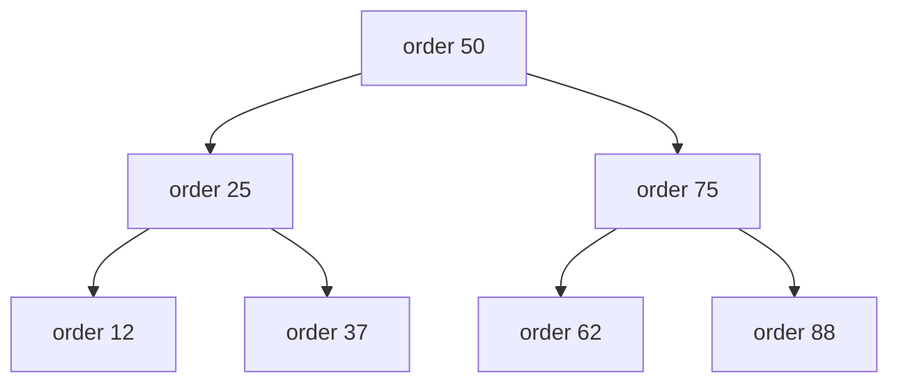
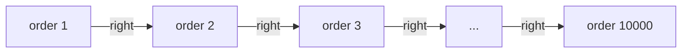
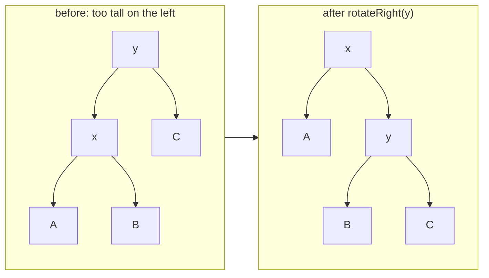
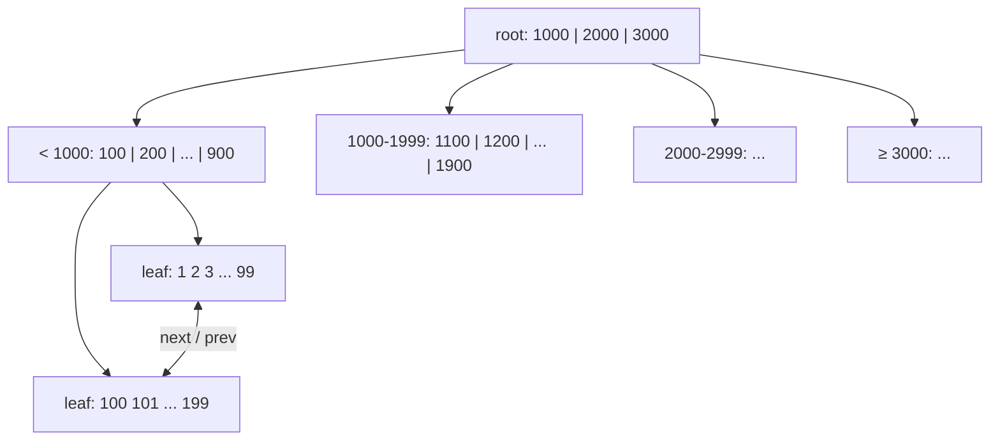
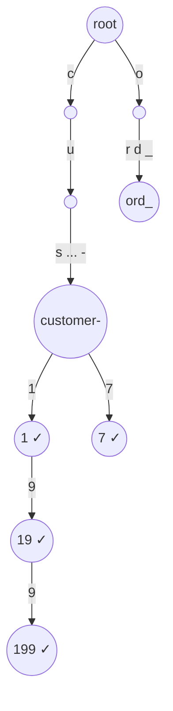
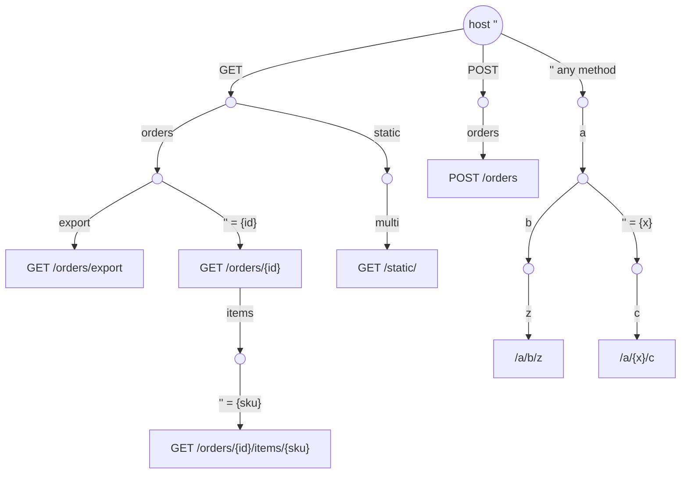

# Trees

## Why care?

Four typical tickets from teams that store data in memory:

- "The in-memory order index was fast in the demo. In production, lookups take 8 µs and get slower every day."
- "We sort 50,000 orders on every page view, just to show the 20 between two dates."
- "Autocomplete for customer IDs scans the whole list for every keystroke."
- "We added the 400th route to our HTTP service. Is the router now 400 times slower?"

Every one of these is about **trees**. A tree keeps data **sorted** in a shape where a lookup touches only a few nodes, not all of them. You already use several every day: the B-tree behind every database index ([Indexes](../databases/indexes.md)), the radix trees inside HTTP routers, and the decision tree inside Go's own `http.ServeMux`. This page shows how they work, why the plain textbook tree breaks on real data, and how to see the difference with a benchmark.

## The idea: discard half at each step

To find a number between 1 and 1,000, compare it with 500. If it is bigger, compare it with 750; if smaller, with 250; and so on. Each comparison discards **half** of the remaining range, so at most 10 comparisons are needed (2^10 = 1,024).

A **binary search tree** (BST) stores keys so that a lookup follows exactly these comparisons. Every node holds one key. Everything smaller lives in its **left** subtree, everything bigger in its **right** subtree. To find a key, start at the top (the **root**) and go left or right at every node:



Looking for order 62: bigger than 50, go right; smaller than 75, go left; found. Three steps for seven orders. The number of steps is the **height** of the tree. If the tree is **balanced** (both sides of every node have about the same height), the height is about log2(n): 20 steps for a million orders.

That condition matters. The shape of a plain BST depends on the **order you insert** the keys, and real data often arrives in the worst possible order.

## Under the hood: a binary search tree in Go

Here is the whole BST, keyed by order number, with the amount in cents as the value:

```go
// Package trees has a plain binary search tree and an AVL tree, keyed by
// order number.
package trees

// node is one order in a binary search tree.
type node struct {
	key         int64 // order number
	amount      int64 // cents
	left, right *node
	height      int // used only by the AVL tree
}

// BST is a binary search tree with no balancing at all.
type BST struct{ root *node }

func (t *BST) Insert(key, amount int64) {
	p := &t.root
	for *p != nil {
		switch {
		case key < (*p).key:
			p = &(*p).left
		case key > (*p).key:
			p = &(*p).right
		default:
			(*p).amount = amount
			return
		}
	}
	*p = &node{key: key, amount: amount}
}

func (t *BST) Get(key int64) (int64, bool) { return get(t.root, key) }
func (t *BST) Height() int                 { return height(t.root) }

func get(n *node, key int64) (int64, bool) {
	for n != nil {
		switch {
		case key < n.key:
			n = n.left
		case key > n.key:
			n = n.right
		default:
			return n.amount, true
		}
	}
	return 0, false
}
```

`Insert` walks down exactly like `Get`, and attaches the new node where the walk reaches a nil child. `p` is a pointer to the pointer it will change (the root, or some node's `left` or `right`), so there is no special case for an empty tree. (`height` walks the tree with an explicit stack and returns the longest path; it is in the scratch module and not shown here.)

### Why balance matters: orders arrive sorted

The orders service in `examples/orders` creates IDs with `uuid.NewV7`. A UUIDv7 starts with a timestamp, so **every new ID is bigger than the one before**. Auto-increment database IDs, timestamps and sequence numbers behave the same way. Insert sorted keys into a plain BST and every new node goes to the right of the last one. The "tree" is a linked list:



Measure it. This program inserts the same 10,000 order numbers twice, once shuffled and once in arrival order, into the plain BST and into an AVL tree (a balanced tree, explained in the next section):

```go
// Command heights inserts the same order numbers into a plain BST and an
// AVL tree, once in random order and once in arrival (sorted) order, and
// prints how tall each tree gets.
func main() {
	const n = 10_000
	sorted := make([]int64, n)
	for i := range sorted {
		sorted[i] = int64(i + 1) // order 1, 2, 3, ... as they arrive
	}
	random := append([]int64(nil), sorted...)
	rand.New(rand.NewPCG(1, 2)).Shuffle(n, func(i, j int) { random[i], random[j] = random[j], random[i] })

	fmt.Printf("n = %d, log2(n) = %.1f\n", n, math.Log2(n))
	for _, in := range []struct {
		name string
		keys []int64
	}{{"random", random}, {"sorted", sorted}} {
		var b trees.BST
		var a trees.AVL
		for _, k := range in.keys {
			b.Insert(k, k*100)
			a.Insert(k, k*100)
		}
		fmt.Printf("%-6s input: BST height %5d, AVL height %2d\n", in.name, b.Height(), a.Height())
	}
}
```

```console
$ go run ./cmd/heights
n = 10000, log2(n) = 13.3
random input: BST height    34, AVL height 16
sorted input: BST height 10000, AVL height 14
```

- **Random input** gives a BST of height 34: not perfect (the best possible is 14), but fine. On random data a plain BST is about 2-3 times taller than ideal.
- **Sorted input** gives height **10,000**. Every node has only a right child. A lookup of the newest order walks all 10,000 nodes.
- The **AVL tree** stays at 14 to 16 levels **whatever** the input order.

Now the cost. The benchmark looks up all 10,000 orders, in random order, once per iteration:

```go
// BenchmarkGet looks up every order once per iteration (10,000 lookups).
func BenchmarkGet(b *testing.B) {
	sorted, random := keys()
	// ... build BST/random, BST/sorted and AVL/sorted from the keys ...
	for _, c := range cases {
		b.Run(c.name, func(b *testing.B) {
			for b.Loop() {
				for _, k := range random {
					c.tr.Get(k)
				}
			}
		})
	}
	// ... the same loop for slices.BinarySearch(sorted, k) and a map[int64]int64 ...
}
```

(`keys()` returns the sorted and the shuffled order numbers; `tree` is an interface with `Insert` and `Get`. This was the only benchmark in the module when this ran; later sections add more, so use `-bench '^BenchmarkGet$'` to run just this one.)

```console
$ go test -run '^$' -bench . -benchmem -count 3
goos: linux
goarch: amd64
pkg: example.com/trees
cpu: AMD Ryzen 7 5800H with Radeon Graphics
BenchmarkGet/BST/random-16         	    1635	    743723 ns/op	       0 B/op	       0 allocs/op
BenchmarkGet/BST/random-16         	    1600	    746331 ns/op	       0 B/op	       0 allocs/op
BenchmarkGet/BST/random-16         	    1617	    763977 ns/op	       0 B/op	       0 allocs/op
BenchmarkGet/BST/sorted-16         	      14	  80642100 ns/op	       0 B/op	       0 allocs/op
BenchmarkGet/BST/sorted-16         	      14	  78137731 ns/op	       0 B/op	       0 allocs/op
BenchmarkGet/BST/sorted-16         	      14	  80726778 ns/op	       0 B/op	       0 allocs/op
BenchmarkGet/AVL/sorted-16         	    1656	    732885 ns/op	       0 B/op	       0 allocs/op
BenchmarkGet/AVL/sorted-16         	    1645	    734222 ns/op	       0 B/op	       0 allocs/op
BenchmarkGet/AVL/sorted-16         	    1658	    744176 ns/op	       0 B/op	       0 allocs/op
BenchmarkGet/slice/BinarySearch-16 	    2059	    590038 ns/op	       0 B/op	       0 allocs/op
BenchmarkGet/slice/BinarySearch-16 	    2083	    589006 ns/op	       0 B/op	       0 allocs/op
BenchmarkGet/slice/BinarySearch-16 	    1929	    581792 ns/op	       0 B/op	       0 allocs/op
BenchmarkGet/map-16                	   10000	    109817 ns/op	       0 B/op	       0 allocs/op
BenchmarkGet/map-16                	   10000	    109805 ns/op	       0 B/op	       0 allocs/op
BenchmarkGet/map-16                	   10000	    108671 ns/op	       0 B/op	       0 allocs/op
PASS
ok  	example.com/trees	17.600s
```

Divide by 10,000 to get the cost of one lookup:

| Structure                   | Per lookup | Shape                         |
| --------------------------- | ---------- | ----------------------------- |
| BST, sorted input           | ~8,000 ns  | a list: O(n)                  |
| BST, random input           | ~75 ns     | height 34                     |
| AVL, sorted input           | ~73 ns     | height 14: O(log n)           |
| Sorted slice, binary search | ~59 ns     | the same halving, no pointers |
| `map`                       | ~11 ns     | hash, no order at all         |

The degenerate tree is **over 100 times slower** than the balanced one, on the same data, with the same code for `Get`. Only the insert order differs. And it gets worse every day: with n orders, each lookup costs n steps, so the total work for n lookups grows as n². This explains the first ticket. (Numbers vary from run to run; on your machine they will differ. Run with `-count` and look at the spread, as on [Big-O in practice](big-o.md).)

!!! note "If you don't need order, use a map"

    A tree earns its place only when you need **order**: ranges ("orders between 09:00 and 10:00"),
    "next bigger key", sorted iteration, smallest or largest. For "look up order by ID" alone, a
    `map` is about 7 times faster here. See [Arrays, slices and hashing](arrays-and-hashing.md).

## Balanced trees: AVL and red-black

A **balanced** tree fixes its own shape while you insert. It keeps a rule, and when an insert breaks the rule, it **rotates** a few nodes to restore it.

**AVL trees** (1962, named after Adelson-Velsky and Landis) use the strictest rule: for **every** node, the heights of its two subtrees differ by at most one. A rotation lifts one child up and pushes its parent down on the other side, while keeping the left-smaller, right-bigger order:



`A < x < B < y < C` holds in both pictures. The only change: `x` moved up a level, `y` moved down, and the subtree `B` changed parent. Three pointer writes. Here is the AVL insert, which rebalances on the way back up from the recursion:

```go
// AVL is a binary search tree that rebalances itself on every insert:
// for every node, the heights of its two subtrees differ by at most 1.
type AVL struct{ root *node }

func (t *AVL) Insert(key, amount int64) { t.root = insert(t.root, key, amount) }
func (t *AVL) Get(key int64) (int64, bool) { return get(t.root, key) }

func h(n *node) int {
	if n == nil {
		return 0
	}
	return n.height
}

func fix(n *node) { n.height = 1 + max(h(n.left), h(n.right)) }

func rotateRight(y *node) *node {
	x := y.left
	y.left, x.right = x.right, y
	fix(y)
	fix(x)
	return x
}

func rotateLeft(x *node) *node {
	y := x.right
	x.right, y.left = y.left, x
	fix(x)
	fix(y)
	return y
}

func insert(n *node, key, amount int64) *node {
	if n == nil {
		return &node{key: key, amount: amount, height: 1}
	}
	switch {
	case key < n.key:
		n.left = insert(n.left, key, amount)
	case key > n.key:
		n.right = insert(n.right, key, amount)
	default:
		n.amount = amount
		return n
	}
	fix(n)
	switch balance := h(n.left) - h(n.right); {
	case balance > 1: // left side too tall
		if key > n.left.key { // left-right case
			n.left = rotateLeft(n.left)
		}
		return rotateRight(n)
	case balance < -1: // right side too tall
		if key < n.right.key { // right-left case
			n.right = rotateRight(n.right)
		}
		return rotateLeft(n)
	}
	return n
}
```

`Get` is the same function as for the plain BST. Balancing costs a little on every **write** and makes every **read** O(log n), whatever order the data came in.

**Red-black trees** use a looser rule: every node is coloured red or black, a red node never has a red child, and every path from a node down to its leaves passes the same number of black nodes. The result: the longest path is at most twice the shortest. Lookups are a little deeper than in an AVL tree, but inserts and deletes need fewer rotations (at most two per insert, three per delete). That trade-off is why red-black trees are the common choice in general-purpose libraries: Java's `TreeMap`, C++'s `std::map`, and many places in the Linux kernel (the CPU scheduler's run queue, memory areas of a process, timers).

### What Go gives you

Go's standard library has **no sorted map** and no balanced tree. In practice you pick one of three:

| You need                                  | Use                                                                                            |
| ----------------------------------------- | ---------------------------------------------------------------------------------------------- |
| Sorted data, built once, read often       | A sorted slice + `slices.BinarySearch` (see [Sorting and searching](sorting-and-searching.md)) |
| Sorted data with many inserts and deletes | A B-tree package such as `github.com/google/btree`                                             |
| Sorted data that must survive a restart   | A database: its B-tree index does this for you                                                 |

Why does the table not say "an AVL tree"? Because of the hardware. Run the same lookups on **one million** orders, which no longer fit in the CPU caches:

```console
$ go test -run '^$' -bench GetLarge -benchmem -count 3
goos: linux
goarch: amd64
pkg: example.com/trees
cpu: AMD Ryzen 7 5800H with Radeon Graphics
BenchmarkGetLarge/AVL-16         	     332	   3386430 ns/op	       0 B/op	       0 allocs/op
BenchmarkGetLarge/AVL-16         	     451	   2712233 ns/op	       0 B/op	       0 allocs/op
BenchmarkGetLarge/AVL-16         	     421	   2748843 ns/op	       0 B/op	       0 allocs/op
BenchmarkGetLarge/slice/BinarySearch-16         	     890	   1336416 ns/op	       0 B/op	       0 allocs/op
BenchmarkGetLarge/slice/BinarySearch-16         	     896	   1334845 ns/op	       0 B/op	       0 allocs/op
BenchmarkGetLarge/slice/BinarySearch-16         	     910	   1323586 ns/op	       0 B/op	       0 allocs/op
BenchmarkGetLarge/map-16                        	    6562	    180113 ns/op	       0 B/op	       0 allocs/op
BenchmarkGetLarge/map-16                        	    6255	    181866 ns/op	       0 B/op	       0 allocs/op
BenchmarkGetLarge/map-16                        	    6793	    182118 ns/op	       0 B/op	       0 allocs/op
PASS
ok  	example.com/trees	11.702s
```

(10,000 random lookups per iteration, the AVL tree built from shuffled input.) Per lookup: AVL about **275 ns**, binary search about **133 ns**, map about **18 ns**. All three did the expected number of steps: 20-ish for the tree and the slice, 1-ish for the map. The difference is **where the steps land in memory**:

- Each AVL node is a separate 40-byte allocation (48 bytes in Go's allocator). A million of them take about 48 MB, three times this CPU's 16 MiB L3 cache. Almost every step down the tree is a **cache miss**: the CPU waits for RAM, around 80-100 ns, before it knows where to go next. This is called **pointer chasing**.
- The sorted slice is 8 MB of `int64`, packed together. It fits in L3, and the first few steps of every search land on the same few hot cache lines.

Same O(log n), twice the speed. The lesson from [Memory: caches](../fundamentals/memory.md#caches-why-the-same-work-can-be-2-slower), applied to trees: **fewer, bigger nodes beat many small ones**. Taken further, this idea leads to the B-tree.

## B-trees: wide nodes for slow memory

A binary tree asks one question per node: left or right? A **B-tree** node holds **many** keys, sorted, and has one child between every two keys. One node answers "which of these 300 ranges?" in one go.



The number of children per node is the **fan-out**. It decides how many levels you need:

```go
// Command fanout prints how many levels a tree needs to hold n keys, for
// different numbers of children per node.
package main

import "fmt"

func levels(n, fanout int) int {
	l, reach := 1, fanout
	for reach < n {
		reach *= fanout
		l++
	}
	return l
}

func main() {
	fmt.Printf("%14s %8s %8s %8s\n", "keys", "2-way", "16-way", "300-way")
	for _, n := range []int{10_000, 1_000_000, 100_000_000, 10_000_000_000} {
		fmt.Printf("%14d %8d %8d %8d\n", n, levels(n, 2), levels(n, 16), levels(n, 300))
	}
}
```

```console
$ go run ./cmd/fanout
          keys    2-way   16-way  300-way
         10000       14        4        2
       1000000       20        5        3
     100000000       27        7        4
   10000000000       34        9        5
```

Ten billion keys in **five** levels. This is the main reason database indexes use B-trees:

- **A node is a disk page.** PostgreSQL uses 8 kB pages. On [Indexes](../databases/indexes.md#under-the-hood-a-real-b-tree) you looked inside a real one: a leaf holds 262 UUID keys, an internal page about 205 children, and a million orders need **three levels**. Reading one page from disk or SSD costs the same whether you use one byte of it or all of it, so you want each page to do as much work as possible.
- **The top levels stay in memory.** The root and the internal pages are few and used by every lookup, so they live in the buffer cache. A lookup usually costs one real read: the leaf.
- **Leaves are linked** to their neighbours. Most databases use the **B+tree** variant: all keys live in the leaves, and internal nodes only guide the search. A range query ("orders from 09:00 to 10:00") finds the first leaf, then walks right along the chain. No going back up the tree. This is why an index serves `ORDER BY` and `BETWEEN` for free.
- **Inserts split nodes instead of rotating them.** When a leaf is full, it splits into two half-full leaves and pushes one separator key up to its parent. If the parent is full, it splits too. The tree grows **at the root**, so every leaf is always at the same depth: a B-tree is balanced by construction.

The same idea works in RAM, where the "page" is the 64-byte cache line. A B-tree node with 16 to 64 keys in a small array uses every cache line it loads. That is why in-memory sorted indexes, for example the key index in etcd, use a B-tree (`google/btree`) instead of a red-black tree.

!!! note "LSM trees"

    Write-heavy stores (RocksDB, Cassandra) use **LSM trees** instead: sorted runs in RAM, flushed to
    immutable sorted files, merged in the background. The trade-off (fast writes, more work for reads)
    is on [How data is stored](../databases/storage.md#b-trees-and-lsm-trees).

## Tries and radix trees: trees of prefixes

So far every node compared **whole keys**. A **trie** (from re**trie**val, usually pronounced "try") does something else: each level looks at **one more character** of the key. Keys with the same prefix share the same path:



(✓ marks a node where a key ends.) Two things make tries useful:

- **Lookup cost depends on the key length, not on the number of keys.** Finding `customer-1999` takes 13 steps whether there are 10 or 10 million keys.
- **Prefix questions are natural.** "All customers starting with `customer-19`" means: walk 11 steps down, then everything below that node is the answer. No scan over keys that do not match. This solves the autocomplete ticket.

A minimal trie, with a map of children per node:

```go
// Trie stores strings one byte per level. Keys that share a prefix share
// the nodes for that prefix.
type Trie struct{ root trieNode }

type trieNode struct {
	children map[byte]*trieNode
	end      bool // a key ends here
}

func (t *Trie) Insert(key string) {
	n := &t.root
	for i := 0; i < len(key); i++ {
		if n.children == nil {
			n.children = map[byte]*trieNode{}
		}
		c := n.children[key[i]]
		if c == nil {
			c = &trieNode{}
			n.children[key[i]] = c
		}
		n = c
	}
	n.end = true
}

// CountPrefix returns how many keys start with prefix. It walks len(prefix)
// nodes down, then counts the subtree below: the cost does not depend on
// how many keys do NOT match.
func (t *Trie) CountPrefix(prefix string) int {
	n := &t.root
	for i := 0; i < len(prefix) && n != nil; i++ {
		n = n.children[prefix[i]]
	}
	return count(n)
}
```

The weak spot is memory: **one node per character**. Fill one trie with 20,000 customer IDs (`customer-0` to `customer-19999`) and another with 20,000 random order IDs (`ord_` plus 16 hex digits), and count the nodes. The scratch module also counts how many nodes a **radix tree** would need. A radix tree (also called a Patricia trie or compressed trie) merges every chain of single-child nodes into one node with a longer label: `c → u → s → ... → -` becomes one edge labelled `customer-`.

```console
$ go run ./cmd/trie
customer IDs, e.g. "customer-0"
  20000 keys, 268890 key bytes: trie 20010 nodes, radix tree 20002 nodes
order IDs, e.g. "ord_4abadd45430934b8"
  20000 keys, 400000 key bytes: trie 261389 nodes, radix tree 26682 nodes
customer IDs with prefix "customer-1999"    11
customer IDs with prefix "customer-19"    1111
customer IDs with prefix "cust"          20000
customer IDs with prefix "order-"            0
```

- **Customer IDs share a lot.** 268,890 bytes of keys need only 20,010 nodes: `customer-` is stored once, and the numbers branch densely (`1`, `19`, `199`, `1999` are all keys). Compression saves almost nothing here, because there are hardly any chains.
- **Random IDs share little.** After the first three or four hex digits, every key is alone on its own chain of a dozen nodes: 261,389 nodes, each with its own map. The radix tree needs **10 times fewer** nodes (26,682): one per key, plus one per branch point.
- `customer-19` has 1,111 matches: `customer-19` itself, 10 with one more digit, 100 with two, 1,000 with three.

Where you meet them:

- **HTTP routers.** Popular third-party Go routers (`httprouter`, `chi`, `echo`) use radix trees on the URL path, byte by byte.
- **IP routing.** "Which route covers 10.1.2.3?" is a **longest-prefix match** on the address bits: a binary trie over 32 (or 128) bits. Linux uses a compressed trie for its IPv4 routing table.
- **The Linux page cache** finds cached file pages by offset in an **XArray**, a radix tree over the bits of the page number.
- **Ethereum** stores its state in a Merkle Patricia trie.

## Under the hood: how `net/http` routes a request

Since Go 1.22, `http.ServeMux` understands methods and wildcards: `GET /orders/{id}`. With hundreds of patterns, it must find the most specific one quickly. It uses a **decision tree**, in `$GOROOT/src/net/http/routing_tree.go`. The file starts by saying so:

```go
// This file implements a decision tree for fast matching of requests to
// patterns.
//
// The root of the tree branches on the host of the request.
// The next level branches on the method.
// The remaining levels branch on consecutive segments of the path.
//
// The "more specific wins" precedence rule can result in backtracking.
// For example, given the patterns
//     /a/b/z
//     /a/{x}/c
// we will first try to match the path "/a/b/c" with /a/b/z, and
// when that fails we will try against /a/{x}/c.
```

So it is a trie, but each level looks at a **whole path segment** (`orders`, `42`), not one byte. The node:

```go
// A routingNode is a node in the decision tree.
// The same struct is used for leaf and interior nodes.
type routingNode struct {
	// A leaf node holds a single pattern and the Handler it was registered
	// with.
	pattern *pattern
	handler Handler

	// An interior node maps parts of the incoming request to child nodes.
	// special children keys:
	//     "/"	trailing slash (resulting from {$})
	//	   ""   single wildcard
	children   mapping[string, *routingNode]
	multiChild *routingNode // child with multi wildcard
	emptyChild *routingNode // optimization: child with key ""
}
```

Three kinds of children:

- `children`: one per **literal** segment (`orders`, `export`).
- `emptyChild`: the child for a **single wildcard** like `{id}`. Every wildcard looks the same to the tree, so they share the key `""`.
- `multiChild`: the child for a **rest-of-path** wildcard like `{path...}`, or a trailing slash as in `/static/`.

Registering a pattern walks host, method, then the segments:

```go
func (root *routingNode) addPattern(p *pattern, h Handler) {
	// First level of tree is host.
	n := root.addChild(p.host)
	// Second level of tree is method.
	n = n.addChild(p.method)
	// Remaining levels are path.
	n.addSegments(p.segments, p, h)
}
```

Next, the core of matching. Read the three steps: **literal first, then single wildcard, then multi wildcard**. That order _is_ the "most specific wins" rule:

```go
func (n *routingNode) matchPath(path string, matches []string) (*routingNode, []string) {
	if n == nil {
		return nil, nil
	}
	// If path is empty, then we are done.
	// If n is a leaf node, we found a match; return it.
	// If n is an interior node (which means it has a nil pattern),
	// then we failed to match.
	if path == "" {
		if n.pattern == nil {
			return nil, nil
		}
		return n, matches
	}
	// Get the first segment of path.
	seg, rest := firstSegment(path)
	// First try matching against patterns that have a literal for this position.
	// ...
	if n, m := n.findChild(seg).matchPath(rest, matches); n != nil {
		return n, m
	}
	// If matching a literal fails, try again with patterns that have a single
	// wildcard (represented by an empty string in the child mapping).
	// ...
	if seg != "/" {
		if n, m := n.emptyChild.matchPath(rest, append(matches, seg)); n != nil {
			return n, m
		}
	}
	// Lastly, match the pattern (there can be at most one) that has a multi
	// wildcard in this position to the rest of the path.
	if c := n.multiChild; c != nil {
		// Don't record a match for a nameless wildcard (which arises from a
		// trailing slash in the pattern).
		if c.pattern.lastSegment().s != "" {
			matches = append(matches, pathUnescape(path[1:])) // remove initial slash
		}
		return c, matches
	}
	return nil, nil
}
```

(`// ...` marks comment lines left out.) It is a depth-first search: try the literal child, and if that whole subtree fails, come back (**backtrack**) and try the wildcard child. The `matches` slice collects the wildcard values on the way down; `r.PathValue("id")` reads its answer from there.

One more detail, from `$GOROOT/src/net/http/mapping.go`. The `children` field is not a plain map:

```go
// A mapping is a collection of key-value pairs where the keys are unique.
// A zero mapping is empty and ready to use.
// A mapping tries to pick a representation that makes [mapping.find] most efficient.
type mapping[K comparable, V any] struct {
	s []entry[K, V] // for few pairs
	m map[K]V       // for many pairs
}

// maxSlice is the maximum number of pairs for which a slice is used.
// It is a variable for benchmarking.
var maxSlice int = 8
```

Most nodes have only a few children. Up to 8, a linear scan of a small slice beats hashing the key. Above 8, it switches to a map. The same "small n" lesson as on [Arrays, slices and hashing](arrays-and-hashing.md).

## Try it in Go: watch `ServeMux` pick a route

Register the orders API, plus the two patterns from the source comment, and send requests:

```go
// Command routes registers order API patterns on an http.ServeMux and
// shows which pattern wins for each request.
package main

import (
	"fmt"
	"net/http"
	"net/http/httptest"
)

func main() {
	mux := http.NewServeMux()
	for _, p := range []string{
		"GET /orders/{id}",
		"GET /orders/export",
		"POST /orders",
		"GET /orders/{id}/items/{sku}",
		"GET /static/",
		"/a/b/z",
		"/a/{x}/c",
	} {
		mux.HandleFunc(p, func(w http.ResponseWriter, r *http.Request) {
			w.Header().Set("X-Pattern", r.Pattern)
			fmt.Fprintf(w, "id=%q sku=%q x=%q",
				r.PathValue("id"), r.PathValue("sku"), r.PathValue("x"))
		})
	}
	for _, req := range []string{
		"GET /orders/42",
		"GET /orders/export",
		"HEAD /orders/42",
		"DELETE /orders/42",
		"GET /orders/42/items/SKU-7",
		"GET /static/css/site.css",
		"GET /a/b/c",
		"GET /nothing",
	} {
		var method, path string
		fmt.Sscan(req, &method, &path)
		rec := httptest.NewRecorder()
		mux.ServeHTTP(rec, httptest.NewRequest(method, path, nil))
		fmt.Printf("%-27s %d %-30q %s\n", req, rec.Code,
			rec.Header().Get("X-Pattern"), trim(rec.Body.String()))
		if a := rec.Header().Get("Allow"); a != "" {
			fmt.Printf("%-31s Allow: %s\n", "", a)
		}
	}
}

// trim drops one trailing newline (the 404 body ends with one).
```

```console
$ go run ./cmd/routes
GET /orders/42              200 "GET /orders/{id}"             id="42" sku="" x=""
GET /orders/export          200 "GET /orders/export"           id="" sku="" x=""
HEAD /orders/42             200 "GET /orders/{id}"             id="42" sku="" x=""
DELETE /orders/42           405 ""                             Method Not Allowed
                                Allow: GET, HEAD
GET /orders/42/items/SKU-7  200 "GET /orders/{id}/items/{sku}" id="42" sku="SKU-7" x=""
GET /static/css/site.css    200 "GET /static/"                 id="" sku="" x=""
GET /a/b/c                  200 "/a/{x}/c"                     id="" sku="" x="b"
GET /nothing                404 ""                             404 page not found
```

The tree those patterns build (host level left out: no pattern has a host, so everything hangs under the `""` host):



Follow each line of output through it:

- `/orders/export` and `/orders/42` both start at `GET → orders`. `export` is a literal child, so it wins for `export`; `42` has no literal child and falls to `{id}`.
- **HEAD** has no subtree of its own. `matchMethodAndPath` tries `HEAD`, then `GET` ("GET matches HEAD too"), then the no-method subtree.
- **DELETE** matches no path in any method. The mux then asks `matchingMethods` which methods _would_ match, and answers 405 with an `Allow` header instead of 404.
- `GET /orders/{id}` and `GET /orders/{id}/items/{sku}` share the `{id}` node: it is a leaf (it has a pattern) **and** an interior node (it has children). That is why one struct does both jobs.
- `GET /a/b/c` shows the backtracking. Under `GET` there is no `a`, so the search moves to the any-method subtree. There `a → b` is a literal match, but `b` has only the child `z`, not `c`: dead end. Back up to `a`, try its wildcard child `{x}` with `x="b"`, then `c`: match.

### Is the router slower with 100,000 routes?

The cost of a match depends on the **number of segments in the path** and the backtracking, not on how many patterns are registered. Measure it with 10, 1,000 and 100,000 tenant routes:

```go
// BenchmarkMux finds the handler for one request in a ServeMux with
// 10, 1,000 and 100,000 registered patterns.
func BenchmarkMux(b *testing.B) {
	h := http.HandlerFunc(func(http.ResponseWriter, *http.Request) {})
	for _, routes := range []int{10, 1_000, 100_000} {
		mux := http.NewServeMux()
		for i := range routes {
			mux.Handle(fmt.Sprintf("GET /tenant%d/orders/{id}", i), h)
		}
		req := httptest.NewRequest("GET", "/tenant7/orders/42", nil)
		b.Run(fmt.Sprintf("routes=%d", routes), func(b *testing.B) {
			for b.Loop() {
				if _, p := mux.Handler(req); p == "" {
					b.Fatal("no match")
				}
			}
		})
	}
}
```

```console
$ go test -run '^$' -bench Mux -benchmem -count 3
goos: linux
goarch: amd64
pkg: example.com/trees
cpu: AMD Ryzen 7 5800H with Radeon Graphics
BenchmarkMux/routes=10-16         	 6716083	       178.7 ns/op	      16 B/op	       1 allocs/op
BenchmarkMux/routes=10-16         	 6605491	       180.3 ns/op	      16 B/op	       1 allocs/op
BenchmarkMux/routes=10-16         	 6472021	       182.0 ns/op	      16 B/op	       1 allocs/op
BenchmarkMux/routes=1000-16       	 6611211	       192.1 ns/op	      16 B/op	       1 allocs/op
BenchmarkMux/routes=1000-16       	 5456940	       191.2 ns/op	      16 B/op	       1 allocs/op
BenchmarkMux/routes=1000-16       	 6022038	       187.8 ns/op	      16 B/op	       1 allocs/op
BenchmarkMux/routes=100000-16     	 6706305	       187.5 ns/op	      16 B/op	       1 allocs/op
BenchmarkMux/routes=100000-16     	 6698302	       181.8 ns/op	      16 B/op	       1 allocs/op
BenchmarkMux/routes=100000-16     	 6678439	       181.0 ns/op	      16 B/op	       1 allocs/op
PASS
ok  	example.com/trees	11.012s
```

About 180-190 ns, flat, from 10 to 100,000 routes. With 10 routes, the `GET` node's children live in the small slice; at 1,000 and 100,000 they are in a map. Either way it is one lookup per segment. The one allocation is the `matches` slice for `{id}`. The answer to the fourth ticket: no, the 400th route costs nothing at request time.

### Conflicts are caught when you register

"Most specific wins" needs one pattern to be more specific than the other. When neither is, `ServeMux` refuses at registration time, with a panic that explains itself:

```go
mux.HandleFunc("GET /orders/{id}", h)
mux.HandleFunc("GET /{resource}/latest", h)
```

```console
$ go run -trimpath ./cmd/conflict
panic: pattern "GET /{resource}/latest" (registered at example.com/trees/cmd/conflict/main.go:10) conflicts with pattern "GET /orders/{id}" (registered at example.com/trees/cmd/conflict/main.go:9):
	GET /{resource}/latest and GET /orders/{id} both match some paths, like "/orders/latest".
	But neither is more specific than the other.
	GET /{resource}/latest matches "/resource/latest", but GET /orders/{id} doesn't.
	GET /orders/{id} matches "/orders/id", but GET /{resource}/latest doesn't.
```

This is useful: an ambiguous route table fails at startup, in your tests, not as a wrong handler in production. Register all routes in a function your tests call.

## Traps

- **A plain BST on real keys.** IDs, timestamps and sequence numbers arrive sorted. An unbalanced tree turns into a linked list and lookups become O(n). Never ship an unbalanced tree.
- **A tree where a map would do.** If you never need order, ranges or "next key", a `map` is several times faster and simpler.
- **Re-sorting on every request.** Sorting 50,000 orders to show 20 is O(n log n) per page view. Keep the data sorted (a B-tree, or a database index) and read a range. Or, for "the top 20", use a heap (next page).
- **Counting steps, not cache misses.** Two O(log n) structures can differ by 2× or more. Many small heap-allocated nodes mean pointer chasing. Prefer packed arrays and wide nodes; measure with a benchmark at **realistic size**, bigger than the caches.
- **A trie with a map per node, for random keys.** Memory use grows very large (261,389 nodes for 20,000 IDs above). Use a radix tree, or a sorted slice with `strings.HasPrefix` and binary search for the start of the range.
- **Writing your own balanced tree.** Deletion in a red-black tree is well known to be hard to get right. Use a tested package, or a sorted slice if writes are rare.
- **Ambiguous HTTP patterns.** Two patterns where neither is more specific make `ServeMux` panic. Register routes in tests, so the panic happens in CI.

## Check yourself

??? question "1. You insert 1,000,000 orders into a plain BST, in the order their UUIDv7 IDs were created. How tall is the tree, and how many nodes does finding the newest order visit?"

    UUIDv7 IDs grow with time, so the input is sorted. Every node gets only a right child: the
    height is 1,000,000, and finding the newest order visits all 1,000,000 nodes. A balanced tree
    would need about 20.

??? question "2. An AVL tree and a sorted slice both find an order in about 20 steps among a million. Why was the slice twice as fast in the benchmark?"

    The slice's keys are packed together in 8 MB that fits in the L3 cache, and neighbouring steps
    share cache lines. The AVL tree has a million separate 48-byte nodes (about 48 MB): nearly every
    step is a cache miss and a wait for RAM before the next address is known.

??? question "3. A PostgreSQL index on 1 million orders has 3 levels. Roughly how many levels for 300 million, and why so few?"

    About 4. Each level multiplies the reach by the fan-out, a few hundred keys per 8 kB page, so
    300 times more keys needs about one extra level. This is why B-trees use wide, page-sized nodes.

??? question "4. With the patterns `GET /orders/{id}` and `GET /orders/export`, which handler serves `GET /orders/export`? What if you add `GET /{kind}/export`?"

    `GET /orders/export`: at the `orders` node, `matchPath` tries the literal child `export` before
    the wildcard child. Adding `GET /{kind}/export` makes `ServeMux` panic at registration: it
    conflicts with `GET /orders/{id}` (both match `/orders/export`, and neither is more specific).

??? question "5. Why does `ServeMux` keep a node's children in a slice for up to 8 entries, and a map above that?"

    For a handful of short keys, comparing strings in a small, contiguous slice is faster than
    hashing the key and probing a map. Above 8 the linear scan gets more expensive than one hash
    lookup, so `mapping.add` moves the pairs into a map.

??? question "6. You need autocomplete over 2 million product SKUs. Which structure, and what is the cost of a query?"

    A radix tree (or a sorted slice: binary search for the first SKU with that prefix, then read
    forward while the prefix matches). Walking down costs the length of the prefix, not the number
    of SKUs; then you pay only for the matches you return. Cap the results, for example the first 10.

## Recap

- A **binary search tree** keeps keys sorted: smaller left, bigger right. Lookups cost the **height**.
- Insert order decides a plain BST's shape. **Sorted input** (IDs, timestamps) makes it a list: height n, 100× slower in the benchmark.
- **Balanced trees** fix their shape on every insert with rotations. **AVL**: strict, shallower. **Red-black**: looser, fewer rotations, the common library choice. Go's standard library has neither.
- Big-O hides **cache misses**: at a million keys, a sorted slice beat the AVL tree 2×, and a map beat both 15×. Use a tree only when you need order.
- **B-trees** have hundreds of keys per node, a node per disk page (or cache line). Ten billion keys fit in five levels. Leaves are linked for range scans. They grow at the root and are always balanced.
- **Tries** branch on one character per level: lookup cost is the key length, and prefix queries are natural. **Radix trees** merge single-child chains and save memory.
- **`http.ServeMux`** is a segment trie: host, method, then path segments. Literal before `{wildcard}` before `{rest...}` is the "most specific wins" rule; matching can backtrack. Cost does not grow with the number of routes. Ambiguous patterns panic when registered.

Next: the structure that always knows the smallest item. [Heaps and queues](heaps-and-queues.md).
