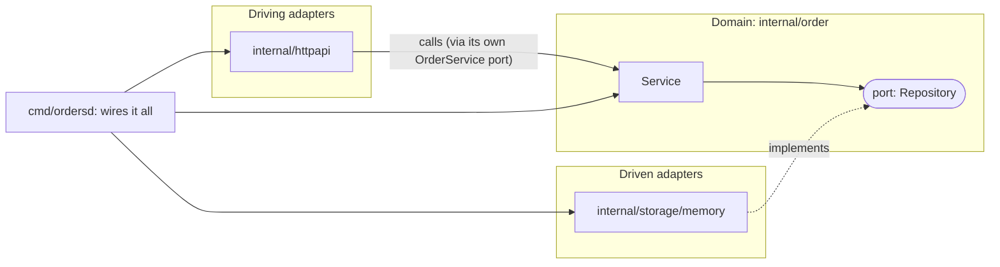

# Boundaries and modules

## Why care?

These problems are common in systems whose boundaries are unclear:

- A system has twelve microservices, and most features need coordinated changes and releases in six of them.
- The team cannot replace the in-memory store with PostgreSQL, because HTTP handlers call the store directly in forty places.
- A package called `common` is imported by every other package, so any change to it affects the whole code base.
- The architecture diagram says the domain does not depend on HTTP, but the imports in the code say it does.

A **boundary** is a rule about which code may depend on which other code. Code crosses a boundary only in one allowed direction, through a small, defined interface. Clear boundaries let you change one part of the system without reading or changing the others. Without them, every change can affect the whole system.

This page answers three questions, using the real `orders` service:

1. How many processes should the system have: one process, one process split into modules, or many services?
2. Inside one Go module, how are the boundaries arranged? This page uses the hexagonal style, also called **ports and adapters**.
3. How do you enforce a boundary so that it stays in place? With `internal/`, an import test, and a linter.

The [Go chapter](../go/project-layout.md) already explained the package layout and why `order` defines its own `Repository` interface. This page measures that design, names its parts, and enforces it.

## The idea

**Hexagonal architecture** (Alistair Cockburn's name for it is "ports and adapters") puts the **domain**, the code that holds the business rules, in the centre. Everything that talks to the outside world, such as HTTP, databases and message brokers, sits around it. Three terms:

- A **port** is an interface that describes what one side needs from the other, in the domain's own terms. In Go, a port is an ordinary interface type.
- An **adapter** is a package that connects a port to a concrete technology. It translates between the outside format (JSON, SQL rows, protobuf messages) and the domain types.
- The **composition root** is the one place, usually `main`, that creates the concrete adapters and connects them to the domain.

The central rule is: **all source code dependencies point inwards.** The domain imports no adapter. Adapters import the domain.

Adapters come in two kinds:

- **Driving** (primary) adapters call the domain: HTTP handlers, gRPC servers, CLI commands, message consumers.
- **Driven** (secondary) adapters are called by the domain, through a port: database stores, message publishers, payment clients.



Solid arrows are calls; the dotted arrow means "implements". The `import` statements follow the same direction: `httpapi` imports `order`, and `memory` imports `order`. `order` imports neither of them. Because of this, you can replace either adapter without changing the domain.

## Under the hood

### Monolith, modular monolith, microservices

The first decision is how many processes the system has. Three common shapes:

| Shape                 | Deploy unit   | Boundary enforced by            | Call between parts   | Good when                                                   |
| --------------------- | ------------- | ------------------------------- | -------------------- | ----------------------------------------------------------- |
| Unstructured monolith | 1 binary      | Nothing but team discipline     | Function call        | Short-lived prototypes with one developer                   |
| Modular monolith      | 1 binary      | Packages, `internal/`, tests    | Function call        | One or a few teams. Most business systems. **The default.** |
| Microservices         | Many binaries | The network and an API contract | RPC over the network | Many teams that must deploy on their own, different scaling |

A function call takes nanoseconds and never fails halfway. A network call takes milliseconds, can time out, and can succeed on the server while the client sees an error. Each microservice boundary replaces the first kind of call with the second kind. The system then needs the techniques from the [Distributed systems](../distributed-systems/index.md) chapter: [retries and idempotency](../distributed-systems/retries-and-idempotency.md), [failure models](../distributed-systems/failure-models.md), and often [outbox and sagas](../distributed-systems/outbox-and-sagas.md) because one database transaction no longer covers the change.

The useful question is therefore not "monolith or microservices", but: **where are the boundaries, and which of them justify the cost of a network call?** A **modular monolith** is one deployable process whose code is divided into modules with enforced boundaries. It has the same boundaries a set of microservices would have, but keeps them in one process. When a module later needs its own release cycle or its own scaling, you can extract it along a boundary that already exists. Extracting code along a boundary that does not exist yet is a rewrite.

!!! tip "The usual reasons to split a process"

    - **Team autonomy**: a team must release without waiting for another team (see Conway's law in
      [Thinking in trade-offs](trade-offs.md)).
    - **Different scaling or resources**: one part needs 40 replicas and GPUs, the rest needs two small pods.
    - **Different failure domain**: a crash in report generation must not take down checkout.
    - **Different security zone**: card data in a small, audited service (see [Security](../security/index.md)).

    "The code base is hard to work with" is not on the list. A network does not create boundaries; it only
    makes existing coupling more expensive.

### The real package graph of `orders`

The compiler knows the real dependencies, and `go list` prints them. The `-f` flag takes a Go template. This prints every package with its direct imports:

```console
$ cd examples/orders
$ go list -f '{{.ImportPath}} {{.Imports}}' ./...
github.com/acme/orders/cmd/orderctl [cmp context encoding/json/jsontext encoding/json/v2 errors flag fmt github.com/acme/orders/internal/buildinfo github.com/acme/orders/internal/client github.com/acme/orders/internal/order io net/http os os/signal strconv strings syscall text/tabwriter time uuid]
github.com/acme/orders/cmd/ordersd [context errors flag fmt github.com/acme/orders/internal/buildinfo github.com/acme/orders/internal/config github.com/acme/orders/internal/httpapi github.com/acme/orders/internal/order github.com/acme/orders/internal/storage/memory io log/slog net net/http os os/signal sync/atomic syscall time]
github.com/acme/orders/internal/buildinfo [fmt runtime/debug]
github.com/acme/orders/internal/client [bytes context encoding/json/v2 fmt github.com/acme/orders/internal/order io net/http net/url time uuid]
github.com/acme/orders/internal/config [errors flag fmt io log/slog net strings time]
github.com/acme/orders/internal/httpapi [context encoding/json/v2 errors fmt github.com/acme/orders/internal/order io log/slog mime net/http runtime/debug strings time uuid]
github.com/acme/orders/internal/order [context errors fmt slices time uuid]
github.com/acme/orders/internal/storage/memory [cmp context fmt github.com/acme/orders/internal/order maps slices sync uuid]
```

Most of these imports are from the standard library. To see the structure, keep only the imports between packages of the module, one per line:

```console
$ go list -f '{{$p := .ImportPath}}{{range .Imports}}{{$p}} -> {{.}}{{"\n"}}{{end}}' ./... \
    | grep ' -> github.com/acme' | sed 's|github.com/acme/orders/||g'
cmd/orderctl -> internal/buildinfo
cmd/orderctl -> internal/client
cmd/orderctl -> internal/order
cmd/ordersd -> internal/buildinfo
cmd/ordersd -> internal/config
cmd/ordersd -> internal/httpapi
cmd/ordersd -> internal/order
cmd/ordersd -> internal/storage/memory
internal/client -> internal/order
internal/httpapi -> internal/order
internal/storage/memory -> internal/order
```

What this graph shows:

- **`internal/order` appears only on the right side.** It imports nothing from the module. Its imports are `context errors fmt slices time uuid`: no `net/http`, no `encoding/json`, no `database/sql`. The domain has no transport or storage code.
- **`httpapi` and `memory` never import each other.** The driving adapter and the driven adapter only meet in `order`.
- **Only `cmd/ordersd` knows everything.** It is the composition root: the one place that creates the store, the service and the handler and connects them.
- **`internal/client` imports `order`.** The client reuses the domain types (`order.Order`, `order.NewOrder`) in its API. This is acceptable inside one module, but becomes a problem if the client is ever published for other teams; see [Traps](#traps).

`go list -deps` prints the transitive closure: every package that a package needs, directly or indirectly, including the standard library. The `.Standard` field filters out standard library packages:

```console
$ go list -deps ./internal/order | wc -l
101
$ go list -deps ./internal/httpapi | wc -l
205
$ go list -deps ./cmd/ordersd | wc -l
211
$ go list -deps -f '{{if not .Standard}}{{.ImportPath}}{{end}}' ./internal/order
github.com/acme/orders/internal/order
$ go list -deps -f '{{if not .Standard}}{{.ImportPath}}{{end}}' ./cmd/ordersd
github.com/acme/orders/internal/buildinfo
github.com/acme/orders/internal/config
github.com/acme/orders/internal/order
github.com/acme/orders/internal/httpapi
github.com/acme/orders/internal/storage/memory
github.com/acme/orders/cmd/ordersd
```

The domain needs 101 packages, all from the standard library (most of them come with `fmt` and `time`). The HTTP adapter needs twice as many, because `net/http` brings TLS, HTTP/2 and DNS. The `-deps` output is in dependency order: every package comes after the packages it needs. So `order` comes before `httpapi` and `memory`, and `ordersd` is last.

!!! note "Why the numbers matter"

    A small dependency closure means fast tests, fast builds, and fewer packages affected by a change. `go test ./internal/order`
    compiles 101 packages, not 211. When a change adds a dependency to the domain, this number shows its cost.
    Measure fan-in and fan-out the same way in [Thinking in trade-offs](trade-offs.md).

### Ports in Go: interfaces at the consumer

In Go, a port is an **interface defined by the package that needs it**. `orders` has two:

| Port           | Defined in         | Method set              | Implemented by                            | Kind              |
| -------------- | ------------------ | ----------------------- | ----------------------------------------- | ----------------- |
| `Repository`   | `internal/order`   | `Get`, `Create`, `List` | `*memory.Store` (later: a Postgres store) | Driven (outbound) |
| `OrderService` | `internal/httpapi` | `Create`, `Get`, `List` | `*order.Service` (in tests: any fake)     | Driving (inbound) |

The second one differs from many textbook diagrams, which place the inbound port inside the domain (an "application service interface"). Go does not need that. `httpapi` declares what it needs from the domain, and `*order.Service` satisfies it implicitly. The domain does not have to know it is being used through an interface. (See [Methods and interfaces](../go/methods-and-interfaces.md) for implicit satisfaction.)

The `memory` package contains a line that every adapter should have:

```go
// Compile-time proof that Store satisfies the interface.
var _ order.Repository = (*Store)(nil)
```

If someone changes the port but not the adapter, the build fails in the adapter package, where the problem is, and not later in `main`.

`httpapi` also has a second boundary inside it: **wire types**, the structs that define the JSON format. `createOrderRequest` and `orderResponse` carry the JSON tags. `order.Order` has none. Changing a field name in the domain cannot change the JSON contract by accident, and the domain never learns about JSON. Translation between the two is the adapter's only job.

### How strict should the hexagon be?

The strict version of the rule says the domain may import nothing except its own ports. In practice, teams allow the standard library and decide other imports case by case:

| Import in the domain                      | OK?     | Why                                                                                  |
| ----------------------------------------- | ------- | ------------------------------------------------------------------------------------ |
| `time`, `errors`, `fmt`, `slices`, `uuid` | Yes     | Values and helpers, no I/O                                                           |
| `context`                                 | Yes     | Ports do I/O, so their methods take a `ctx`                                          |
| `log/slog`                                | Maybe   | Prefer returning errors; log in the adapter. Inject a logger if you must             |
| `net/http`, `encoding/json`               | No      | Transport and wire format belong to the driving adapter                              |
| `database/sql`, a driver                  | No      | Storage belongs to the driven adapter                                                |
| Another domain module                     | Careful | Only through that module's published API (see [Domain modeling](domain-modeling.md)) |

The goal is not purity. The goal is that `go test ./internal/order` runs in milliseconds, needs no database or container, and tests the business rules directly.

### Enforcing the boundaries

A boundary that exists only in a diagram is usually broken under time pressure. Go offers three ways to enforce one, from the simplest to the most flexible.

#### Tool 1: `internal/` (the compiler)

The rule is explained in [Project layout](../go/project-layout.md): a package under `.../x/internal/...` can only be imported by code under `.../x/`. Here is the real compiler error. A scratch module `github.com/acme/billing` tries to reuse the orders domain. It points at a local copy of `orders` with a `replace` directive:

```console
$ cd ~/tutor/arch/billing
$ cat go.mod
module github.com/acme/billing

go 1.27

require github.com/acme/orders v0.0.0

replace github.com/acme/orders => ../orders
$ cat main.go
// Command billing wants to reuse the orders domain.
package main

import (
	"fmt"

	"github.com/acme/orders/internal/order"
)

func main() {
	fmt.Println(order.StatusPaid)
}
$ go build ./...
package github.com/acme/billing
	main.go:7:2: use of internal package github.com/acme/orders/internal/order not allowed
```

The billing team must either talk to `orders` over its API, or ask the orders team to publish a package outside `internal/`. Both options require a discussion between the teams. The compiler turns an accidental dependency into an explicit decision.

`internal/` also works at deeper levels, which creates a private area inside a module. A pricing helper under `internal/order/internal/pricing` can be imported only by code under `internal/order/`. A handler that imports it fails to build:

```console
$ cd ~/tutor/arch/orders
$ cat internal/httpapi/discount.go
package httpapi

import "github.com/acme/orders/internal/order/internal/pricing"

var _ = pricing.Discount
$ go build ./...
package github.com/acme/orders/internal/httpapi
	internal/httpapi/discount.go:3:8: use of internal package github.com/acme/orders/internal/order/internal/pricing not allowed
```

The limit of `internal/`: it controls only **who may import a package, based on its path**. It cannot express "`httpapi` must not import `storage`", because both are under the same `internal/` folder. Rules between sibling packages need one of the next two tools.

#### Tool 2: an import-rule test in plain Go

You can write the import rules as an ordinary Go test. The standard library package `go/build` reads the `import` declarations of the files in a directory without compiling them. The test walks the module, collects the imports of each package, and checks them against a table of rules.

The file goes into its own package, `internal/archtest`, which contains only this test:

```go
// Package archtest checks the import rules of the module. It has no code,
// only this test: the rules are part of the build, not of a wiki page.
package archtest

import (
	"errors"
	"go/build"
	"io/fs"
	"maps"
	"path"
	"path/filepath"
	"slices"
	"strings"
	"testing"
)

const module = "github.com/acme/orders"

// rule says: packages matching from must not import anything matching
// one of the deny prefixes.
type rule struct {
	from string   // package path prefix, relative to the module
	deny []string // import path prefixes; "./x" means module + "/x"
	why  string
}

var rules = []rule{
	{
		from: "internal/order",
		deny: []string{"./", "net/http", "encoding/json", "database/sql"},
		why:  "the domain knows no transport, no storage and no other package of ours",
	},
	{
		from: "internal/storage",
		deny: []string{"./internal/httpapi", "./internal/client"},
		why:  "adapters on the driven side never call the driving side",
	},
	{
		from: "internal/httpapi",
		deny: []string{"./internal/storage"},
		why:  "handlers talk to the service, not to the database",
	},
	{
		from: "internal",
		deny: []string{"./cmd"},
		why:  "only main wires things together",
	},
}

func TestImportRules(t *testing.T) {
	root := filepath.Join("..", "..") // this file lives in internal/archtest
	pkgs := loadPackages(t, root)
	if len(pkgs) == 0 {
		t.Fatal("found no packages; is root correct?")
	}
	t.Logf("checked %d packages against %d rules", len(pkgs), len(rules))
	for _, rel := range slices.Sorted(maps.Keys(pkgs)) {
		for _, r := range rules {
			if rel != r.from && !strings.HasPrefix(rel, r.from+"/") {
				continue
			}
			for _, imp := range pkgs[rel] {
				for _, d := range r.deny {
					if matches(imp, d) {
						t.Errorf("%s imports %s: %s", rel, imp, r.why)
					}
				}
			}
		}
	}
}

// matches reports whether import path imp is covered by prefix d.
func matches(imp, d string) bool {
	if rest, ok := strings.CutPrefix(d, "./"); ok {
		d = path.Join(module, rest)
		if rest == "" {
			d = module
		}
	}
	return imp == d || strings.HasPrefix(imp, d+"/")
}

// loadPackages returns every package below root (module-relative path) with
// the imports of its non-test files. go/build reads only the import blocks,
// so this is fast and needs no go command.
func loadPackages(t *testing.T, root string) map[string][]string {
	t.Helper()
	pkgs := map[string][]string{}
	err := filepath.WalkDir(root, func(dir string, d fs.DirEntry, err error) error {
		if err != nil || !d.IsDir() {
			return err
		}
		if name := d.Name(); dir != root && (strings.HasPrefix(name, ".") || name == "testdata") {
			return filepath.SkipDir
		}
		p, err := build.ImportDir(dir, 0)
		if _, ok := errors.AsType[*build.NoGoError](err); ok {
			return nil
		}
		if err != nil {
			return err
		}
		rel, err := filepath.Rel(root, dir)
		if err != nil {
			return err
		}
		pkgs[filepath.ToSlash(rel)] = p.Imports
		return nil
	})
	if err != nil {
		t.Fatal(err)
	}
	return pkgs
}
```

Design choices in this test:

- **Deny lists, not allow lists.** A rule names what is forbidden and **why**. The `why` ends up in the failure message, so the developer who breaks a rule also sees the reason for it.
- **`p.Imports` only.** Test files sometimes cross boundaries on purpose: `httpapi_test.go` uses `memory.New()` to test handlers against a real store. To check test files as well, use `p.TestImports` with a second table.
- **Sorted output.** Go randomises map iteration order. Sorting the keys gives the same output on every run.
- **The empty check.** With a wrong `root`, the test would find no packages and always pass. The check makes that mistake visible.

The test passes on the current code:

```console
$ go test -v ./internal/archtest
=== RUN   TestImportRules
    imports_test.go:56: checked 9 packages against 4 rules
--- PASS: TestImportRules (0.00s)
PASS
ok  	github.com/acme/orders/internal/archtest	0.004s
```

Now add two changes that often appear under time pressure. A handler reads directly from the store, and the domain gets a `MarshalJSON` method:

```go
// internal/httpapi/shortcut.go
package httpapi

import "github.com/acme/orders/internal/storage/memory"

// cache is a "quick fix": read straight from the store.
var cache = memory.New()
```

```go
// internal/order/json.go
package order

import "encoding/json"

// MarshalJSON lets handlers write an Order directly.
func (o Order) MarshalJSON() ([]byte, error) {
	type plain Order
	return json.Marshal(plain(o))
}
```

Both changes compile and pass all existing tests. The import test reports both:

```console
$ go build ./... && echo build ok
build ok
$ go test ./internal/archtest
--- FAIL: TestImportRules (0.00s)
    imports_test.go:56: checked 9 packages against 4 rules
    imports_test.go:65: internal/httpapi imports github.com/acme/orders/internal/storage/memory: handlers talk to the service, not to the database
    imports_test.go:65: internal/order imports encoding/json: the domain knows no transport, no storage and no other package of ours
FAIL
FAIL	github.com/acme/orders/internal/archtest	0.004s
FAIL
```

The test needs no extra dependency or tool, and it runs in CI as part of `go test ./...` (see [Testing](../go/testing.md)).

#### Tool 3: depguard in golangci-lint

If your team already runs [golangci-lint](../go/tooling-and-quality.md), the `depguard` linter can enforce the same rules through configuration. Below is a configuration for golangci-lint v2 (checked with 2.15.0). It is a separate file here so it can run on its own; in a real project, the `depguard` block belongs in `.golangci.yml`.

```yaml
version: "2"

linters:
  default: none
  enable:
    - depguard
  settings:
    depguard:
      rules:
        domain:
          list-mode: strict # deny everything that is not allowed
          files:
            - "**/internal/order/**.go"
            - "!$test"
          allow:
            - $gostd
          deny:
            - pkg: net/http
              desc: the domain knows no transport; map errors in internal/httpapi
            - pkg: encoding/json
              desc: JSON belongs to the wire types in internal/httpapi
            - pkg: database/sql
              desc: storage adapters implement order.Repository
        http-adapter:
          list-mode: lax # allow everything that is not denied
          files:
            - "**/internal/httpapi/**.go"
            - "!$test"
          deny:
            - pkg: github.com/acme/orders/internal/storage
              desc: handlers call the order service, not the store
```

The configuration keys:

- `rules` is a map. The key (`domain`, `http-adapter`) shows up in the error message.
- `files` are globs matched against the **absolute** file path. `$test` means test files, `!` negates.
- `list-mode: strict` denies everything not in `allow`; `lax` allows everything not in `deny`.
- `$gostd` means "the whole standard library".
- In golangci-lint, `deny` is a **list** of `pkg`/`desc` pairs. (Standalone depguard uses a map. golangci-lint cannot, because its config parser splits keys at dots, and package paths contain dots.)

Validate the file, then run it with the same two changes in place. `config verify` prints nothing when the file is valid:

```console
$ golangci-lint config verify -c .golangci.depguard.yml
$ golangci-lint run -c .golangci.depguard.yml ./...
internal/httpapi/shortcut.go:3:8: import 'github.com/acme/orders/internal/storage/memory' is not allowed from list 'http-adapter': handlers call the order service, not the store (depguard)
import "github.com/acme/orders/internal/storage/memory"
       ^
internal/order/json.go:3:8: import 'encoding/json' is not allowed from list 'domain': JSON belongs to the wire types in internal/httpapi (depguard)
import "encoding/json"
       ^
2 issues:
* depguard: 2
```

`strict` mode also reports imports that no `deny` entry anticipated. Here a file `internal/order/bi.go` imports `internal/buildinfo`. That package is in no `deny` list, but it is not in `allow` either:

```console
$ golangci-lint run -c .golangci.depguard.yml ./...
internal/order/bi.go:3:8: import 'github.com/acme/orders/internal/buildinfo' is not allowed from list 'domain' (depguard)
import "github.com/acme/orders/internal/buildinfo"
       ^
1 issues:
* depguard: 1
```

!!! warning "A file glob that matches too little"

    The glob `**/internal/order/**/*.go` looks correct but is **wrong**. Depguard compiles globs with `/` as the
    separator, so `**/*.go` needs at least one more directory. `internal/order/order.go` does not match,
    and the run says `0 issues.` with `encoding/json` imported in the domain. Use `**/internal/order/**.go`.
    Before you rely on a rule, break it once on purpose and confirm that the linter reports it.

Comparison of the three tools:

|                     | `internal/`             | Import test (`go/build`)     | depguard                       |
| ------------------- | ----------------------- | ---------------------------- | ------------------------------ |
| Rule type           | Who may import, by path | Any rule you can write in Go | Allow/deny lists per file glob |
| Needs               | Nothing                 | `go test`                    | golangci-lint                  |
| Can be bypassed by  | Moving code             | Editing the test             | Editing the config, `//nolint` |
| Error message       | Fixed                   | Yours (with the "why")       | `desc` field                   |
| Rules on test files | Same rule               | `TestImports`, if you want   | `$test` globs                  |

Use `internal/` in every application. Add an import test or depguard for the boundaries between packages inside the module. Both are files in the repository, so a change to a boundary goes through code review and becomes a visible decision. Write that decision down in a [decision record](decision-records.md).

## Try it

Work in a scratch copy, not in `examples/`:

```sh
mkdir -p ~/tutor/arch && cp -r examples/orders ~/tutor/arch/orders
cd ~/tutor/arch/orders
```

1. **Draw the graph.** Run the `go list ... | grep ' -> github.com/acme'` command from above. Draw the packages and their imports. Mark the domain, the driving adapters, the driven adapters and the composition root.
2. **Test the `internal/` rule.** Create the `billing` module next to the copy, as shown above, and run `go build ./...`. Then make the nested `internal/order/internal/pricing` package and import it from `httpapi`.
3. **Add the import test.** Create `internal/archtest/imports_test.go` from above and run `go test -v ./internal/archtest`. Add `shortcut.go` to `httpapi` and confirm that the test fails. Then delete the file.
4. **Write a rule of your own.** "Only `cmd/` may import `internal/config`." Add it to the table, check that it passes, then break it once.
5. **Try depguard.** Save the YAML as `.golangci.depguard.yml` and run `golangci-lint run -c .golangci.depguard.yml ./...` (the repo pins golangci-lint 2.15.0 with [mise](../toolbox/mise.md)). Then change the glob to `**/internal/order/**/*.go`, add `json.go` to `order`, and confirm that the run reports `0 issues.` even though the rule is broken.
6. **Plan a second driven adapter.** Without writing it: which packages would a `internal/storage/postgres` import? Which file changes so `ordersd` uses it? (Answer: `order` and `database/sql` plus a driver; one line in `cmd/ordersd/main.go`.) See [Go and SQL](../databases/go-and-sql.md) for the store itself.

## Traps

- **Microservices as a fix for unclear code.** A network does not create boundaries; it makes existing coupling more expensive. Find the modules first, in one process, and extract services later along boundaries that have proven stable.
- **The distributed monolith.** Services that must deploy together, share one database schema, or call each other in long synchronous chains. The system pays the cost of network calls but gains no independence.
- **Layers instead of modules.** `controllers/`, `services/`, `repositories/` at the top level means every feature touches every folder. Group by domain concept, then by port and adapter inside it ([Project layout](../go/project-layout.md)).
- **The port next to the adapter.** `type Repository interface` in `storage/memory` makes the domain import storage to get the interface. The dependency points the wrong way. Define ports in the consuming package.
- **Large ports.** A `Repository` with 25 methods "for later" forces every adapter and every fake to implement 25 methods. Add a method to a port when a use case needs it, not before.
- **Domain types as the public client API.** `internal/client` returns `order.Order`. Inside one module this is acceptable. If the client is ever published for other teams, every domain change becomes a breaking change for them. Give a public client its own types (see [Evolving APIs](evolving-apis.md)).
- **A rule that can never fail.** A wrong glob, a wrong root folder, or a rule for a path that was later renamed. Break every rule once on purpose to confirm it works.
- **`common`, `util`, `shared`.** A package named for being shared collects unrelated code and is imported by everything. Name packages after what they provide.

## Check yourself

??? question "1. What is the difference between a modular monolith and microservices, in one sentence each?"

    A modular monolith is one deployable process whose code is split into modules with enforced
    boundaries and function calls between them. Microservices put each module in its own process, so
    the boundary is a network API, and each part can be deployed and scaled on its own, at the price of
    network failures and no shared transactions.

??? question "2. In `orders`, name one port, one driving adapter, one driven adapter and the composition root."

    Port: `order.Repository` (or `httpapi.OrderService`). Driving adapter: `internal/httpapi`.
    Driven adapter: `internal/storage/memory`. Composition root: `cmd/ordersd`, the only package that
    imports all of them and connects them.

??? question "3. Why can't `internal/` alone stop `httpapi` from importing `storage/memory`?"

    `internal/` only checks that the importer lives under the parent of the `internal` folder. Both
    `internal/httpapi` and `internal/storage/memory` are under `github.com/acme/orders/`, so the
    import is allowed. Rules between siblings need an import test or a linter like depguard.

??? question "4. `go list -deps ./internal/order` prints 101 lines, all standard library except `order` itself. Why is that a good sign, and what would you check if it grew to 300?"

    It means the domain does no I/O of its own and its tests compile and run fast with no
    infrastructure. If it grew, run `go list -f '{{.ImportPath}} {{.Imports}}' ./internal/order` and
    look for a transport, storage or SDK import that slipped in, then move that code to an adapter
    behind a port.

??? question "5. Your depguard rule for the domain says `0 issues`, but you know `order` imports `encoding/json`. What do you check first?"

    The `files` glob. With `/` as the separator, `**/internal/order/**/*.go` does not match files
    directly in `internal/order/`. Use `**/internal/order/**.go`, then break the rule on purpose and
    watch it fail.

??? question "6. A colleague wants to move `orders` to microservices: `order-api`, `order-domain`, `order-storage`. What do you say?"

    Those are layers, not business capabilities. Every request would cross two network hops, and
    every change would touch all three services. If anything is split out, it should be a capability
    with its own data and team (for example billing or shipping), along a boundary that already works
    inside the monolith.

## Recap

- Choose **where** the boundaries are first. Then choose how many processes. A **modular monolith** is the default; split out a service only for team autonomy, scaling, failure isolation or security.
- **Hexagonal** = domain in the middle, **ports** (interfaces the domain or adapter needs), **adapters** outside. All imports point inwards. Interfaces defined by the consuming package make this straightforward in Go.
- **Measure** the graph: `go list -f '{{.ImportPath}} {{.Imports}}'` for edges, `go list -deps` for the closure. In `orders`, `internal/order` imports nothing from the module.
- **Enforce** it: `internal/` for "who may import", an import test with `go/build` or a `depguard` config for rules between siblings. Break each rule once on purpose.
- Adapters translate: wire types with JSON tags stay in `httpapi`, the domain has none.

Next: [Domain modeling](domain-modeling.md), which looks inside the hexagon: what an `Order` is, which rules belong to it, and how to find the boundaries between business areas.
