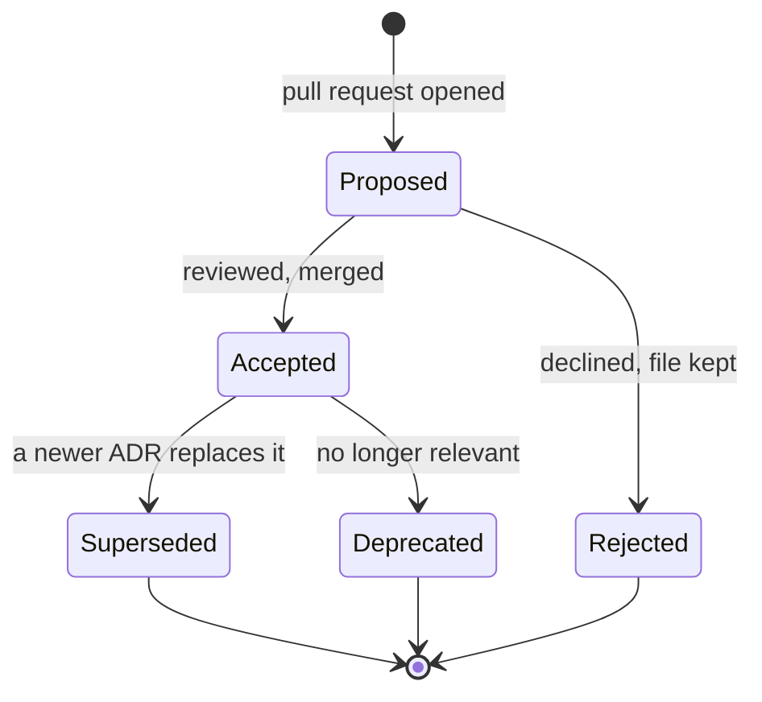

# Decision records

## Why care?

Four questions that come up in most teams that maintain a system for more than a year:

- "Why do we run two message brokers? Can we remove one?" Nobody knows the reason, so nobody removes it.
- "Why is this service written in Go and the others in Java?" The person who decided left two years ago.
- "We tried GraphQL before. Why did we stop?" Three people remember three different reasons.
- "Why does `mise.toml` say `go = "1.27.4"` and not `latest`?" Someone changes it back to `latest`, and the versions on laptops and in CI drift apart again.

The last one is about this repository. The answer exists, but it is hidden in one commit message:

```console
$ git log --oneline -G'^go = ' -- mise.toml
c4ce6ae chore(mise): pin tool versions and lock them
a339c24 chore: initialize repository with zensical site, mise tasks and CI
```

You find it only if you already know that the answer is in git, which file to ask about, and which `git log` flag to use. A new team member will not find it. And even a good commit message says what was done. It does not say which other options were considered, or why they were rejected.

An **architecture decision record (ADR)** solves this. It is one short Markdown file per important decision, kept in the repository, next to the code it explains. This page shows the two common formats, the life of a decision, how ADRs relate to RFCs and design docs, and then writes a real ADR for that `mise` decision.

## The idea: an append-only log of decisions

An ADR records one decision at the moment it is made: the situation (context), the choice (decision), and what follows from it (consequences). The set of ADRs is an **append-only log**: you add records, but you do not rewrite old ones. When a decision changes, a new record replaces the old one and points to it. This works like court rulings: a later ruling can overrule an earlier one, but the earlier ruling, with its reasoning, stays readable.

The rules:

- **One decision per record.** Short, with a number and a title.
- **The reasoning is the main content.** The context, the options, and why the chosen option was chosen. The code already shows _what_ was decided.
- **Records are immutable** (not changed after acceptance). When a decision changes, you write a new ADR that **supersedes** (replaces) the old one, and you change only the old one's status line.
- **They live in the repo.** Reviewed in pull requests, versioned with the code, found with `grep`.



Keep rejected ADRs too. They answer the question "did we consider this before, and why did we decide against it?".

## Under the hood: what goes into a record

### Which decisions deserve an ADR?

Not every choice. An ADR for "use `slices.Sort`" adds no value. A good test is the one from [Thinking in trade-offs](trade-offs.md): **how expensive is it to reverse?** Write an ADR when a decision is

- **hard to reverse**: a database, a message broker, a public API style, a programming language, the module boundaries;
- **cross-cutting**: it affects many teams or services, like a logging format, an auth scheme, or how tools are installed;
- **surprising**: a newcomer would reasonably ask "why?" and change it, like `go = "1.27.4"` instead of `latest`;
- **the result of a real discussion**: if several people discussed it at length, write down the result so the discussion does not have to be repeated.

### Nygard's format: five headings

Michael Nygard proposed ADRs in a 2011 blog post. His format is still the most used, because it is tiny:

```markdown
# 2. Pin tools with mise and lock them

Date: 2026-11-26

## Status

Accepted

## Context

The forces at play: technical, political, social, project-specific.
Neutral language. Facts, not the decision yet.

## Decision

"We will ..." Full sentences, active voice.

## Consequences

What becomes easier, what becomes harder. Good and bad. Everything that
follows from the decision, including the costs.
```

The **Consequences** section is the one people most often skip, and the one that matters most a year later. If a decision lists no downsides, either the downsides were not analysed, or they were left out.

### MADR: recording the options

**MADR** (Markdown Architectural Decision Records) is a richer template. Its main addition is the list of **options you considered**, with pros and cons for each. Nygard's format does not ask for them, so they are often left out. The sections, in short:

| Section                       | What it answers                                                              |
| ----------------------------- | ---------------------------------------------------------------------------- |
| Front matter                  | `status`, `date`, `decision-makers`, `consulted`, `informed`                 |
| Context and problem statement | What is the problem, in two or three sentences, maybe as a question?         |
| Decision drivers              | Which forces and quality attributes decide it?                               |
| Considered options            | The list, including "do nothing"                                             |
| Decision outcome              | Chosen option, and **why**, linked to the drivers                            |
| Consequences                  | Good, because ... / Bad, because ...                                         |
| Confirmation                  | How do we check that the decision is followed (a test, a CI check, a review) |
| Pros and cons of the options  | Per option: good, neutral, bad                                               |

Only the first five are required. Use the rest when the decision is contested.

### The one-sentence version: Y-statements

Sometimes a full record is too much, for example inside a design doc that makes ten small decisions. A **Y-statement** packs one decision into one sentence:

> In the context of _a shared repository with CI_, facing _"latest" meaning different versions on different machines_, we decided for _exact versions plus a committed lock file_ and against _version ranges and a tools image_, to achieve _the same tools everywhere_, accepting _an extra step for every upgrade_.

If you cannot fill in the "accepting" part, you have not yet identified the cost.

### Where ADRs live, and how they are reviewed

The usual layout is one folder, numbered files, never renumbered:

```text
docs/adr/
├── 0001-record-architecture-decisions.md
├── 0002-pin-tools-with-mise-and-lock-them.md
└── 0003-...
```

- **Open the ADR as a pull request**, with status `Proposed`. The discussion happens in the pull request. Merging it means `Accepted`. If the team declines it, merge it anyway with status `Rejected`, so the record exists.
- **Put the ADR in the same PR as the change**, when the change is small. Reviewers see the code and the reason together.
- **Link both ways.** The ADR links to the code or config; a comment in the config links to the ADR. This repository's `mise.toml` already has half of that: `# install only what mise.lock records; run mise lock after changing a version`.
- **ADR 0001 is usually "record architecture decisions".** It records the decision to use ADRs at all: the format, the folder, and when an ADR is required.

### RFCs and design docs: before the decision

An ADR records a verdict. A big decision needs a discussion first, and that is what an **RFC** (request for comments) or **design doc** is for. Kubernetes calls them KEPs, Go has proposals in its issue tracker, Rust has RFCs, and most large companies have a design doc template.

|          | ADR                       | RFC / design doc                         |
| -------- | ------------------------- | ---------------------------------------- |
| Length   | 1 page                    | 3 to 15 pages                            |
| Written  | when the decision is made | before, to get to a decision             |
| Audience | future readers            | today's reviewers                        |
| Changes  | never (only status)       | many times during review                 |
| Contains | one decision              | a design, many decisions, open questions |

They work well together: the design doc does the thinking, and when it is approved, its key decisions become short ADRs that link back to it. The design doc can then go stale without harm, because the ADRs carry the "why".

**Design docs that people actually read** share a few habits:

- **A summary that fits on one screen** at the top: problem, proposal, cost, and what you need from the reader ("approve by Friday", "security, please check section 5").
- **Goals and non-goals.** Non-goals stop half of the review comments ("why doesn't it also do X?" "X is a non-goal").
- **Alternatives considered**, each with the reason it lost. Reviewers will propose them anyway; answer in advance.
- **A few diagrams, as text.** A [Mermaid](https://mermaid.js.org/) diagram in the Markdown file can be reviewed in a diff; an image cannot.
- **Cross-cutting concerns as a checklist:** security (start with a [threat model](../security/threat-modeling.md)), observability, migration and rollback, cost, who is on call.
- **A named decider and a deadline.** Without them, the review does not end.

## Worked example: an ADR for this repository

This section writes the ADR this repository should have had. First, collect the evidence from the repository history.

**The commit that made the decision:**

```console
$ git show --stat c4ce6ae
commit c4ce6aeef1d64cd0c541477040d9fe1cae5612dc
Author: You <you@example.com>
Date:   Thu Nov 26 15:40:36 2026 +0100

    chore(mise): pin tool versions and lock them

    "latest" resolved to the newest installed version, so the laptop ran Go 1.26.5 while CI and go.mod (go 1.27) used 1.27.4. Pin exact versions, commit mise.lock and the uv lock for pipx:zensical, and set locked = true so installs only use locked artifacts.

    Signed-off-by: You <you@example.com>

 .mise/locks/pipx-zensical/0.1.3/pyproject.toml |   5 +
 .mise/locks/pipx-zensical/0.1.3/uv.lock        | 411 +++++++++++++++++++++++++
 docs/toolbox/mise.md                           |  31 +-
 mise.lock                                      | 309 +++++++++++++++++++
 mise.toml                                      |  14 +-
 5 files changed, 755 insertions(+), 15 deletions(-)
```

**What changed in `mise.toml`:**

```console
$ git show c4ce6ae -- mise.toml
...
 [tools]
-python = "3.13"
-"pipx:zensical" = "latest"
-go = "latest"
-golangci-lint = "latest"
-actionlint = "latest"
-bun = "latest"
+python = "3.13.18"
+"pipx:zensical" = "0.1.3"
+go = "1.27.4"
+golangci-lint = "2.15.0"
+actionlint = "1.7.12"
+bun = "1.4.5"

 [settings]
 pipx.uvx = true
+# install only what mise.lock records; run `mise lock` after changing a version
+locked = true
```

**Every commit that touched the tool setup:**

```console
$ git log --oneline -- mise.toml mise.lock .mise
c4ce6ae chore(mise): pin tool versions and lock them
722dc73 feat(examples): add orders reference project
0c83fcd chore(tooling): run prettier and markdownlint with bun
a339c24 chore: initialize repository with zensical site, mise tasks and CI
```

**What the lock file holds:**

```console
$ grep -A3 '^\[\[tools.go\]\]' mise.lock
[[tools.go]]
version = "1.27.4"
backend = "core:go"
specifiers = ["1.27.4"]
$ grep -A2 'tools.go."platforms.linux-x64"\]' mise.lock
[tools.go."platforms.linux-x64"]
checksum = "sha256:7226736c2339719cda28fbf3a54d71aa63bcefe376e98cef00034268dab24840"
url = "https://dl.google.com/go/go1.27.4.linux-amd64.tar.gz"
$ grep -c provenance mise.lock
33
```

Six tools, and for each downloaded one a checksum and URL for 11 platforms (Linux, macOS and Windows variants). The 33 `provenance` lines are the 11 platforms of `actionlint`, `golangci-lint` and `python`: for those, the lock also records that the release has GitHub artifact attestations, a signed statement of where the file was built. The Python package `zensical` is locked separately, in `.mise/locks/pipx-zensical/0.1.3/uv.lock`, with all 13 packages. [mise](../toolbox/mise.md#what-latest-means) shows the original bug (two Go versions in one folder) and the fresh locked install; [Reproducible builds](../delivery/reproducible-builds.md) explains why the lock matters for the bytes you ship.

The commit message is good. It has the problem and the fix. What it does not have: the options that lost, the cost, and how we check that the decision holds. That is the ADR's job. Here it is, in MADR format:

```markdown
---
status: accepted
date: 2026-11-26
decision-makers: repository maintainer
---

# 2. Pin tools with mise and lock them

## Context and problem statement

`mise.toml` installs the tools for this repository: Go, golangci-lint,
actionlint, bun, Python and zensical. Every entry said `latest` (Python
said `3.13`). For mise, "latest" means the newest version **already
installed** on this machine; on a fresh CI runner it means the newest
**released** version. On 2026-11-26 the laptop ran Go 1.26.5 while CI and
`go.mod` (`go 1.27`) used Go 1.27.4, from the same file.

How do we make every machine run the same tool versions?

## Decision drivers

- Laptop and CI must run the same versions (dev/prod parity for tools).
- A download must be the file we expect: same version, same bytes.
- `mise run check` stays the single entry point, locally and in CI.
- Upgrades must stay cheap enough that we still do them.

## Considered options

1. Keep `latest`, and run `mise upgrade` more often.
2. Pin a minor version, such as `go = "1.27"`.
3. Pin exact versions, such as `go = "1.27.4"`.
4. Pin exact versions, commit `mise.lock`, and set `locked = true`.
5. A prebuilt "tools" container image for CI and a dev container locally.

## Decision outcome

Chosen option: 4, exact versions plus a committed lock file with
`locked = true`, because it is the only option that fixes both the
version (drivers 1 and 3) and the bytes (driver 2) without a second
build artifact to maintain.

### Consequences

- Good, because the laptop and CI run the same six tools; `mise ls
--current` shows the pinned version for each.
- Good, because each download is checked against a sha256 checksum, and
  for three tools the lock also records GitHub attestation provenance.
- Good, because the lock records URLs for 11 platforms per tool, so
  macOS, Windows and arm64 machines get the same versions.
- Bad, because every upgrade is a pull request that changes `mise.toml`
  and `mise.lock` (run `mise lock`); forgetting `mise lock` fails the
  next install.
- Bad, because nothing upgrades by itself. We need a bot (Renovate) or a
  calendar reminder, or we drift behind security releases.

### Confirmation

- CI (`jdx/mise-action`) installs with `locked = true`, so a version that
  is not in `mise.lock` fails the build.
- CI and laptops run the same entry point, `mise run check`.

## Pros and cons of the options

### 1. Keep `latest`

- Good, because there is nothing to maintain.
- Bad, because it is the bug: "latest" differs per machine and per day.

### 2. Pin a minor version (`1.27`)

- Good, because patch releases (security fixes) arrive automatically.
- Bad, because `1.27` still resolves to the newest installed `1.27.x`
  locally and the newest released one in CI: same bug, smaller.

### 3. Pin exact versions

- Good, because the version is the same everywhere.
- Bad, because a version is only a name: a re-uploaded release or a
  compromised mirror gives other bytes under the same name.

### 4. Exact versions, lock file, `locked = true`

- Good, because version and bytes are fixed on every machine.
- Bad, because every upgrade needs `mise lock` and a second changed file.

### 5. Tools image and dev container

- Good, because CI needs no downloads per run.
- Bad, because the image is a second artifact to build, scan and update,
  and developers who don't use dev containers are back to option 1.
- Neutral, because it can still be built **from** `mise.lock` later.
  That would be a new ADR, not a change to this one.

## More information

- Commit `c4ce6ae` (`chore(mise): pin tool versions and lock them`).
- [mise](../toolbox/mise.md), [Reproducible builds](../delivery/reproducible-builds.md).
```

The ADR adds three things that the commit message does not have: option 2, which _looks_ safe but has the same problem; the "Bad" consequences, including the one with a long-term cost (nothing upgrades by itself); and a **Confirmation** section that points to an automated check instead of to people's discipline. Note also what the ADR does **not** contain: no step-by-step how-to. That belongs in [mise](../toolbox/mise.md), and the ADR links to it.

## Try it: a decision log with a lifecycle

Create a scratch repository (`~/tutor/adr`) and go through the lifecycle: propose, accept, supersede. Then write a small Go tool that lists the state of all decisions.

**Step 1: four decisions in git.** Create `docs/adr/` with these files (shortened here; the full texts follow the Nygard format above), one commit each:

- `0001-record-architecture-decisions.md`, status `Accepted`.
- `0002-pin-tools-with-mise-and-lock-them.md`, status `Accepted`.
- `0003-run-ci-in-a-prebuilt-tools-image.md`, status `Proposed` (an invented future decision, based on option 5 above). Then a second commit that changes only its status to `Accepted`.
- `0004-cache-mise-installs-in-ci.md`, an invented decision a few months later that reverses ADR 3:

```markdown
# 4. Cache mise installs in CI

Date: 2027-03-02

## Status

Accepted

Supersedes [3. Run CI in a prebuilt tools image](0003-run-ci-in-a-prebuilt-tools-image.md)

## Context

The tools image from ADR 3 works, but every tool upgrade now needs two pull requests (lock file, then image), and the image had three high CVEs in its base layer last quarter. CI cache hits for `~/.local/share/mise` are above 95 %.

## Decision

Delete the tools image. Cache the mise data directory in CI, keyed on the hash of `mise.lock`.

## Consequences

One pull request per upgrade again. A cache miss costs about one minute. We still never download a tool that is not in `mise.lock`.
```

In the same commit, ADR 3 changes exactly one line. That is all that superseding requires:

```console
$ git show HEAD -- docs/adr/0003-run-ci-in-a-prebuilt-tools-image.md
...
@@ -4,7 +4,7 @@ Date: 2026-12-10

 ## Status

-Accepted
+Superseded by [4. Cache mise installs in CI](0004-cache-mise-installs-in-ci.md)

 ## Context
```

The history of one decision is now three commits, and `git log` shows it:

```console
$ git log --oneline -- docs/adr/0003-run-ci-in-a-prebuilt-tools-image.md
8472db7 docs(adr): cache mise installs in CI, supersede ADR 3
144a463 docs(adr): accept the prebuilt tools image
b1c3d97 docs(adr): propose a prebuilt tools image for CI
```

**Step 2: a generated index.** A hand-written list of ADRs goes out of date quickly. Generate it instead:

```go
// Command adrindex prints one line per ADR: number, title and status.
// Usage: adrindex [dir]   (default docs/adr)
package main

import (
	"bufio"
	"cmp"
	"fmt"
	"os"
	"path/filepath"
	"regexp"
	"strings"
	"text/tabwriter"
)

// mdLink matches [text](target), so "Superseded by [4. ...](0004-...md)"
// prints as "Superseded by 4. ...".
var mdLink = regexp.MustCompile(`\[([^\]]*)\]\([^)]*\)`)

func main() {
	dir := "docs/adr"
	if len(os.Args) > 1 {
		dir = os.Args[1]
	}
	files, err := filepath.Glob(filepath.Join(dir, "[0-9][0-9][0-9][0-9]-*.md"))
	if err != nil {
		fmt.Fprintln(os.Stderr, "adrindex:", err)
		os.Exit(1)
	}
	w := tabwriter.NewWriter(os.Stdout, 0, 0, 2, ' ', 0)
	fmt.Fprintln(w, "ADR\tTITLE\tSTATUS")
	for _, f := range files { // Glob returns sorted names
		title, status, err := parse(f)
		if err != nil {
			fmt.Fprintln(os.Stderr, "adrindex:", err)
			os.Exit(1)
		}
		status = mdLink.ReplaceAllString(cmp.Or(status, "MISSING"), "$1")
		fmt.Fprintf(w, "%s\t%s\t%s\n", filepath.Base(f)[:4], title, status)
	}
	w.Flush()
}

// parse returns the "# " heading and the first line after "## Status".
func parse(path string) (title, status string, err error) {
	f, err := os.Open(path)
	if err != nil {
		return "", "", err
	}
	defer f.Close()
	inStatus := false
	sc := bufio.NewScanner(f)
	for sc.Scan() {
		line := strings.TrimSpace(sc.Text())
		switch {
		case title == "" && strings.HasPrefix(line, "# "):
			title = strings.TrimPrefix(line, "# ")
		case line == "## Status":
			inStatus = true
		case inStatus && line != "":
			return title, line, nil
		}
	}
	return title, "", sc.Err()
}
```

```console
$ go run ./cmd/adrindex
ADR   TITLE                                 STATUS
0001  1. Record architecture decisions      Accepted
0002  2. Pin tools with mise and lock them  Accepted
0003  3. Run CI in a prebuilt tools image   Superseded by 4. Cache mise installs in CI
0004  4. Cache mise installs in CI          Accepted
```

**Step 3: a broken record.** Add an ADR without a status section, the most common mistake:

```console
$ printf '# 5. Use Kafka\n\n## Context\n\nWe need a broker.\n' > docs/adr/0005-use-kafka.md
$ go run ./cmd/adrindex | tail -2
0004  4. Cache mise installs in CI          Accepted
0005  5. Use Kafka                          MISSING
```

Make `MISSING` return a non-zero exit code and run the tool in CI next to the linters. Then no ADR without a status can be merged. This is the same idea as the **Confirmation** section: a machine checks the rule, not a reviewer's memory.

## Traps

- **Writing ADRs after the fact, for everything.** Forty records like "we use Go" that nobody reads. Write them for decisions that are hard to reverse or surprising, at the time you make them.
- **Editing an accepted ADR.** Then the record says something nobody decided. Change only the status, and write a new ADR.
- **No options, no downsides.** "We chose Kafka because it is the best" is an announcement, not a record. List at least two real options and at least one "Bad, because".
- **The ADR as a how-to.** Install steps and config details go stale. Keep the "why" in the ADR and link to the docs for the "how".
- **ADRs in a wiki, code in git.** They drift apart, and the wiki page has no review. Keep them in the repo, reviewed in the same PR.
- **A design doc that is never approved.** Without a decider and a deadline, the review does not end. Name both on the first page.
- **Deleting rejected ADRs.** They answer "didn't we try this?". Keep them, status `Rejected`.
- **Renumbering.** Links and commit messages refer to "ADR 3". Numbers are forever, even for rejected ones.

## Check yourself

??? question "1. Your team wants to switch from REST to gRPC for internal calls. ADR 7 says \"use JSON over HTTP for all service APIs\". What do you do with ADR 7?"

    Nothing, except its status line. Write ADR 12, "Use gRPC for internal service calls", with its own context
    (why the situation changed), options and consequences, and "Supersedes ADR 7". Then change ADR 7's status
    to "Superseded by ADR 12". If only internal calls change, ADR 7 may stay partly valid: say so in ADR 12
    ("ADR 7 still applies to public APIs") instead of superseding it fully.

??? question "2. Which of these deserve an ADR: (a) use PostgreSQL, (b) name the package `order` not `orders`, (c) all services log JSON to stdout, (d) use `errors.Join` in `config.Validate`?"

    (a) and (c). PostgreSQL is hard to reverse. The log format is cross-cutting: every team and the log pipeline
    depend on it. (b) and (d) are local code choices, cheap to change, and belong in code review and the
    [Go conventions](../go/conventions.md), not in a decision log.

??? question "3. Why is option 2 (\"pin `1.27`\") in the mise ADR, even though nobody chose it?"

    Because it is the option a reader is most likely to propose ("just pin the minor version, then you get
    security patches"). It looks safe, but mise resolves `1.27` to the newest **installed** `1.27.x` locally and
    the newest **released** one in CI: the same bug, smaller. Writing it down saves the next person from
    repeating the experiment.

??? question "4. An RFC and an ADR: which one changes during review, and which one is for the reader in two years?"

    The RFC (or design doc) changes many times during review; it is for today's reviewers and may go stale
    after approval. The ADR is short, written when the decision is made, and never edited afterwards except its
    status; it is for the reader in two years. Big decisions often have both: the RFC does the thinking, the ADR
    records the verdict and links to the RFC.

??? question "5. The mise ADR says \"Confirmation: CI installs with `locked = true`\". Why is that better than \"Confirmation: reviewers check that versions are pinned\"?"

    A machine check runs on every pull request and never gets tired. A reviewer forgets, or is new and doesn't
    know the rule. With `locked = true`, a `mise.toml` version that is not in `mise.lock` fails the install, so
    the decision enforces itself. Prefer confirmations that fail a build.

## Recap

- An **ADR** is one short Markdown file per important decision: context, decision, consequences. It lives in the repo and is reviewed in a pull request.
- Write one when a decision is **hard to reverse, cross-cutting, surprising, or argued about**. Not for every code choice.
- **Nygard's format** has five parts; **MADR** adds decision drivers, considered options with pros and cons, and a **Confirmation**. A **Y-statement** fits one decision into one sentence.
- Records are **immutable**. Change your mind with a **new** ADR that supersedes the old one; the old one changes only its status line. Keep rejected ADRs.
- **RFCs and design docs** are for the discussion before a decision; ADRs record the verdict. Good design docs have a one-screen summary, non-goals, alternatives, a decider and a deadline.
- The worked example turned commit `c4ce6ae` into an ADR that adds what a commit message can't hold: the options that lost, the costs, and a machine check that confirms the decision.

Next: a set of rules from 2011 that still shapes how services run on Kubernetes. [The twelve-factor app, today](twelve-factor-app.md).
