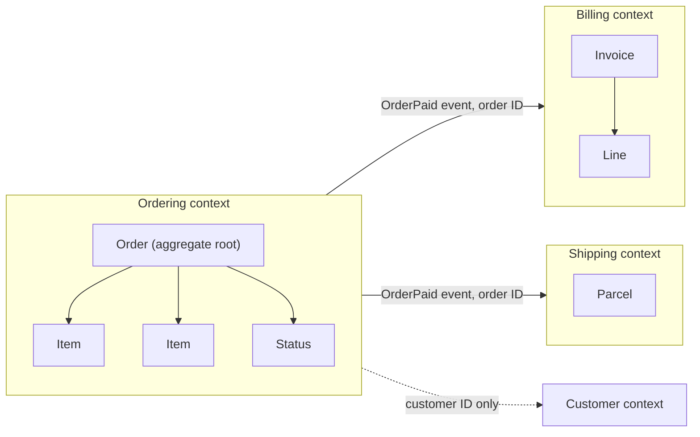

# Domain modeling

## Why care?

These defects are common, and no linter or type checker detects them:

- Support cancels an order that has already shipped. The customer receives both the refund and the parcel.
- Sales says "customer", billing says "account", and the code says `User`. A report counts the same company three times.
- An HTTP handler sets `order.Status` directly. The rule "an unpaid order cannot ship" now exists in four places, and one copy is wrong.
- The `Order` struct has 60 fields, because shipping, billing, invoicing and marketing each added the fields they needed.

All four are **modeling** problems: the code does not express clearly what the business means, and the business rules are not in one place. **Domain-Driven Design** (DDD), introduced in Eric Evans' 2003 book, is a set of ideas for these problems. It has a reputation for heavy process, but a small part of it gives most of the value. This page applies that part to the real `internal/order` package.

[Boundaries and modules](boundaries-and-modules.md) defined the hexagon around the domain. This page is about the domain itself.

## The idea

DDD uses a few terms that the rest of this page relies on:

- The **domain** is the business area the software serves, here: taking and fulfilling customer orders.
- The **ubiquitous language** is the shared vocabulary of developers and business experts for one area. The code uses the same words, so a business expert can read type names and test names and confirm or correct the rules.
- A **bounded context** is the part of the system in which one model and one vocabulary apply, and every term has exactly one meaning. "Order" can mean different things in ordering and in shipping; each context has its own model.
- A **context map** describes the bounded contexts and how they integrate: who depends on whom, and who translates between models.
- An **entity** is an object with an identity that stays the same while its data changes. A **value object** is defined only by its values and has no identity.
- An **invariant** is a business rule that must be true at all times, not only at the end of a request.
- An **aggregate** is a group of entities and value objects that must stay consistent together. Outside code accesses it only through one entity, the **aggregate root**, which enforces the invariants.

The diagram shows three contexts. Inside ordering, `Order` is the aggregate root. Between contexts, only IDs and events are passed, not shared structs:



## Under the hood

### Ubiquitous language: names are the model

The names in `internal/order` are the terms of the ordering business:

```go
// Status is the lifecycle state of an order.
type Status string

// The possible order states.
const (
	StatusPending   Status = "pending"
	StatusPaid      Status = "paid"
	StatusShipped   Status = "shipped"
	StatusCancelled Status = "cancelled"
)

// Item is one line of an order. Money is stored in integer cents: floats
// cannot represent 0.10 exactly, and rounding errors in money are bugs.
type Item struct {
	SKU        string
	Quantity   int
	PriceCents int64
}
```

There are no technical names such as `OrderEntity`, `ItemDTO` or `StatusManager`. `SKU` is what the warehouse calls it. `pending` is the status that support staff see. A rule from the business ("at most 1000 of one item") becomes a constant with the same meaning: `MaxQuantity = 1_000`.

Practices that keep the language consistent:

- **Use the words of the experts**, not the words of the database. If they say "cancel", the method is `Cancel`, not `SetStatus(4)`.
- **One word, one meaning, per context.** If "order" means a customer order here, a purchase order to a supplier gets a different name (or a different context).
- **Keep a short glossary** next to the code (`GLOSSARY.md` in the module, or the package doc comment). Update it in the same pull request as the code.
- **Name tests in the same language.** A business expert can read `TestLifecycle/cancel_shipped` and check the rule.

### Bounded contexts: one model per area

A common alternative is a single **enterprise model**: one `Customer` struct shared by sales, billing, support and marketing. It grows with every new requirement, and a change for one team can break another, so teams avoid changing it.

DDD gives each context its own model, with only the data that context needs:

| Word       | Ordering                            | Billing                               | Shipping                     |
| ---------- | ----------------------------------- | ------------------------------------- | ---------------------------- |
| "Order"    | Items, status, customer ID          | An amount to invoice, a due date      | A parcel to pack, an address |
| "Customer" | Just an ID                          | Legal name, VAT number, payment terms | Delivery address, phone      |
| "Price"    | Price per item at the time of order | Net, tax, gross, currency             | Not needed                   |

`orders` already follows this on a small scale: `Order.CustomerID` is a `string`, not a `Customer` struct. The ordering context does not own customer data; it only refers to customers by ID. When a customer changes their address, no order changes.

In Go, a bounded context is usually a **module inside the modular monolith**: a top-level package (or package tree) under `internal/`, with its own types, its own ports, and its own tables. For example `internal/order`, `internal/billing`, `internal/shipping`. Each one has its own hexagonal structure. A bounded context is also the best candidate for a later microservice, because its boundary already matches a business boundary.

!!! note "Context or module or service?"

    A bounded context is a **language** boundary. A module is a **code** boundary. A service is a
    **deployment** boundary. In a healthy system they line up: one context is one module, and maybe one day
    one service. A context split over three services, or three contexts in one package, both indicate a design problem.

### Context maps: how contexts integrate

When two contexts work together, one of them must translate between the two models. The context map records which one. The common patterns, with names from the DDD literature:

| Pattern                    | What it means                                                              | In Go, typically                                                    |
| -------------------------- | -------------------------------------------------------------------------- | ------------------------------------------------------------------- |
| Customer / supplier        | Upstream team (supplier) plans its API with the downstream team (customer) | A versioned API, contract tests ([Evolving APIs](evolving-apis.md)) |
| Conformist                 | Downstream just uses the upstream model as it is                           | Import the other team's client types directly                       |
| Anticorruption layer (ACL) | Downstream translates the upstream model into its own, at the border       | An adapter package with `toDomain` and `fromDomain` functions       |
| Open host service          | Upstream offers one well-documented protocol for everyone                  | The public HTTP or gRPC API ([HTTP API design](http-api-design.md)) |
| Published language         | A shared, documented exchange format                                       | An OpenAPI spec, `.proto` files ([gRPC](grpc-and-protobuf.md))      |
| Shared kernel              | Two contexts share a small part of the model, and change it only together  | A small shared package, owned by both teams                         |
| Separate ways              | No integration; each context duplicates what it needs                      | Nothing                                                             |

The `orders` code already contains a translation layer of this kind, at the HTTP boundary: `internal/httpapi` translates between JSON (`orderResponse` with `json` tags) and `order.Order`. When billing receives an `OrderPaid` event, it should do the same: translate the event into its own `Invoice`, never store `order.Order` in its tables.

Events between contexts are usually published with a [transactional outbox](../distributed-systems/outbox-and-sagas.md), so that the state change and the published event cannot get out of sync.

### Entities and value objects

A model contains two kinds of objects:

- An **entity** has an identity that stays the same while its data changes. Order `019a...` is the same order when it goes from `pending` to `paid`. Two orders with the same items are still two orders.
- A **value object** is defined only by its values. Two values `Item{SKU: "BOOK-1", Quantity: 2, PriceCents: 1250}` are equal and interchangeable. A value object is not modified; it is replaced with a new value.

In `orders`:

| Type       | Kind         | Why                                                          |
| ---------- | ------------ | ------------------------------------------------------------ |
| `Order`    | Entity, root | Has `ID uuid.UUID`, changes status over time                 |
| `Item`     | Value object | No ID; a line is its SKU, quantity and price                 |
| `Status`   | Value object | A named type with a fixed set of values and a `Valid` method |
| `NewOrder` | Value object | The input of a use case, checked by `Validate`               |

Go supports value objects well. A struct of comparable fields is comparable with `==`, it is copied on assignment, and a named type like `Status` can carry methods. Guidelines:

- **Make invalid values hard to create.** `Status` is a `string` underneath, so `Status("lost")` compiles. `Valid()` exists, but no code is forced to call it. For stronger guarantees, use a struct with an unexported field and a constructor, at the price of more code.
- **Money is a value, not a float.** `PriceCents int64` avoids float rounding. If you add currencies, make a `Money` struct (`cents int64`, `currency string`) whose `Add` method returns an error when the currencies differ.
- **Entities compare by ID.** Do not compare two `Order` values with `==`; it does not compile, because the `Items` slice is not comparable. Compare `a.ID == b.ID`.

### Aggregates and invariants

The invariants of an order:

1. An order has at least 1 and at most `MaxItems` (100) items.
2. Each item has a SKU, a quantity between 1 and `MaxQuantity` (1000), and a price of 0 or more.
3. The status only moves along the lifecycle: pending → paid → shipped, and pending or paid → cancelled.

The aggregate is the smallest group of objects that must be consistent together to keep these rules. Here: one `Order` with its `Items`. The `Order` is the **root**. Outside code changes items only through the order, never directly. The repository also loads and saves the whole aggregate at once: `Repository` has `Get(id)` and `Create(o)` for orders, not `AddItem(orderID, item)`.

The usual design rules for aggregates (described in detail by Vaughn Vernon):

- **Keep aggregates small.** An order does not contain the customer. It refers to it by ID.
- **Refer to other aggregates by ID only.** `CustomerID string`, not `Customer *Customer`.
- **Change one aggregate per transaction.** Changes to other aggregates follow later, through events. This is eventual consistency; see [Consistency models](../distributed-systems/consistency-models.md).
- **Protect the invariants inside the aggregate.** Not in the handler, and not only in the database.

How well does `internal/order` protect its invariants today? Rules 1 and 2 live in `NewOrder.Validate`, and `Service.Create` always calls it. It also copies the input slice, so the caller cannot change a stored order through a shared backing array:

```go
o := Order{
	ID:         s.newID(),
	CustomerID: n.CustomerID,
	Items:      slices.Clone(n.Items),
	Status:     StatusPending,
	CreatedAt:  s.now().UTC(),
}
```

This `slices.Clone` call protects the invariants, but it looks like unnecessary code and is easy to remove during a cleanup. A test documents and protects it (scratch copy, package `order`, using the fake repository from `service_test.go`):

```go
func TestCreateCopiesItems(t *testing.T) {
	repo := newFakeRepo()
	svc := newTestService(repo)
	items := []Item{{SKU: "BOOK-1", Quantity: 1, PriceCents: 1999}}

	o, err := svc.Create(t.Context(), NewOrder{CustomerID: "c-1", Items: items})
	if err != nil {
		t.Fatal(err)
	}
	items[0].Quantity = 0 // the caller reuses its slice after Create

	if got := repo.orders[o.ID].Items[0].Quantity; got != 1 {
		t.Errorf("stored quantity = %d, want 1: the order shares memory with the caller", got)
	}
}
```

With `slices.Clone`, the test passes. With `Items: n.Items` instead, it fails:

```console
$ go test -run TestCreateCopiesItems ./internal/order
--- FAIL: TestCreateCopiesItems (0.00s)
    alias_test.go:17: stored quantity = 0, want 1: the order shares memory with the caller
FAIL
FAIL	github.com/acme/orders/internal/order	0.002s
FAIL
```

Rule 3 is not enforced at all: there is no code for the lifecycle yet. Also, all fields of `Order` are exported, so any package can set any value. A small program in the scratch copy shows this:

```go
// Command hole shows that outside code can break the order rules.
package main

import (
	"fmt"

	"github.com/acme/orders/internal/order"
)

func main() {
	o := order.Order{CustomerID: "c-1", Status: order.StatusShipped}
	o.Status = order.StatusCancelled // cancel an order that has already shipped
	o.Items = append(o.Items, order.Item{SKU: "", Quantity: -5, PriceCents: 100})
	fmt.Println(o.Status, o.TotalCents(), o.Status.Valid())
	o.Status = "lost"
	fmt.Println(o.Status, o.Status.Valid())
}
```

```console
$ go run ./cmd/hole
cancelled -500 true
lost false
```

A shipped order is cancelled, the total is negative, and the status has a value that the business does not define. The compiler accepts all of it.

!!! abstract "Exported fields or not?"

    **Option A, exported fields** (what `orders` does): simple, works with struct literals in tests and in
    the storage adapter, and the domain package is small. You protect invariants **by convention**: all
    changes go through `Service` and methods on `Order`, and the [import rules](boundaries-and-modules.md)
    keep handlers away from the store.

    **Option B, unexported fields** with a constructor and getters: the compiler protects the invariants. But
    every adapter now needs a way to rebuild an `Order` from the database (often a `Rehydrate(...)`
    function that skips validation), and you write many small getters.

    Choose B when the rules are complex, errors are costly, and many teams change the code. Choose A while
    the model is small and one team owns it. Either way, the rules live in **methods on the aggregate**, not
    in handlers.

### DDD without unnecessary process

Which parts of DDD to adopt, and which to avoid:

| Adopt                                               | Avoid                                                                       |
| --------------------------------------------------- | --------------------------------------------------------------------------- |
| Words from the business in type and method names    | `AbstractEntity`, `BaseValueObject`, `IAggregateRoot` base types            |
| One package per bounded context                     | A `domain/`, `application/`, `infrastructure/` folder tree in every context |
| Rules as methods on the aggregate, with table tests | A "domain service" for every verb; anemic structs with only fields          |
| `Repository` as a small port, per aggregate         | A generic `Repository[T]` with 20 methods for every table                   |
| Events between contexts, IDs as references          | Event sourcing everywhere, without a concrete need                          |
| A one-page context map and a short glossary         | Weeks of modeling workshops before the first line of code                   |

Go supports most of this directly: small packages, no inheritance, implicit interfaces, and value semantics. Most of the effort is in talking with the business experts and turning what they say into names and tests.

## Try it: add a lifecycle to the order

Make the status rules part of the aggregate. Work in a scratch copy:

```sh
mkdir -p ~/tutor/arch && cp -r examples/orders ~/tutor/arch/orders
cd ~/tutor/arch/orders
```

**Step 1: write the rules as a test first**, in the language of the business. Save as `internal/order/lifecycle_test.go`:

```go
package order

import (
	"errors"
	"testing"
)

func TestLifecycle(t *testing.T) {
	tests := []struct {
		name    string
		from    Status
		act     func(*Order) error
		want    Status
		wantErr error
	}{
		{"pay pending", StatusPending, (*Order).Pay, StatusPaid, nil},
		{"ship paid", StatusPaid, (*Order).Ship, StatusShipped, nil},
		{"cancel pending", StatusPending, (*Order).Cancel, StatusCancelled, nil},
		{"cancel paid", StatusPaid, (*Order).Cancel, StatusCancelled, nil},
		{"ship unpaid", StatusPending, (*Order).Ship, StatusPending, ErrTransition},
		{"pay twice", StatusPaid, (*Order).Pay, StatusPaid, ErrTransition},
		{"cancel shipped", StatusShipped, (*Order).Cancel, StatusShipped, ErrTransition},
		{"pay cancelled", StatusCancelled, (*Order).Pay, StatusCancelled, ErrTransition},
	}
	for _, tt := range tests {
		t.Run(tt.name, func(t *testing.T) {
			o := Order{Status: tt.from}
			err := tt.act(&o)
			if !errors.Is(err, tt.wantErr) {
				t.Fatalf("err = %v, want %v", err, tt.wantErr)
			}
			if o.Status != tt.want {
				t.Errorf("Status = %q, want %q", o.Status, tt.want)
			}
		})
	}
}
```

`(*Order).Pay` is a **method expression**: the method as a plain function that takes the receiver as its first argument. It keeps the table compact. `errors.Is(err, nil)` is true only when `err` is `nil`, so the same check works for the success rows.

The test does not compile yet. This is the first ("red") step of test-driven development:

```console
$ go test ./internal/order
# github.com/acme/orders/internal/order [github.com/acme/orders/internal/order.test]
internal/order/lifecycle_test.go:16:43: (*Order).Pay undefined (type *Order has no field or method Pay)
internal/order/lifecycle_test.go:17:38: (*Order).Ship undefined (type *Order has no field or method Ship)
internal/order/lifecycle_test.go:18:46: (*Order).Cancel undefined (type *Order has no field or method Cancel)
internal/order/lifecycle_test.go:19:40: (*Order).Cancel undefined (type *Order has no field or method Cancel)
internal/order/lifecycle_test.go:20:43: (*Order).Ship undefined (type *Order has no field or method Ship)
internal/order/lifecycle_test.go:20:64: undefined: ErrTransition
internal/order/lifecycle_test.go:21:38: (*Order).Pay undefined (type *Order has no field or method Pay)
```

**Step 2: put the rules on the aggregate.** Save as `internal/order/lifecycle.go`. The whole lifecycle is one table, which a business expert can review:

```go
package order

import (
	"errors"
	"fmt"
)

// ErrTransition means the order is not in a state that allows the action.
var ErrTransition = errors.New("invalid status transition")

// transitions is the whole lifecycle in one table: from -> allowed targets.
var transitions = map[Status][]Status{
	StatusPending: {StatusPaid, StatusCancelled},
	StatusPaid:    {StatusShipped, StatusCancelled},
}

// Pay marks a pending order as paid.
func (o *Order) Pay() error { return o.moveTo(StatusPaid) }

// Ship marks a paid order as shipped.
func (o *Order) Ship() error { return o.moveTo(StatusShipped) }

// Cancel cancels an order that has not shipped yet.
func (o *Order) Cancel() error { return o.moveTo(StatusCancelled) }

func (o *Order) moveTo(to Status) error {
	for _, allowed := range transitions[o.Status] {
		if allowed == to {
			o.Status = to
			return nil
		}
	}
	return fmt.Errorf("%w: %s -> %s", ErrTransition, o.Status, to)
}
```

Shipped and cancelled are not keys in the map, so they allow no further transition. They are final states without extra code.

```console
$ go test -run TestLifecycle -v ./internal/order
=== RUN   TestLifecycle
=== RUN   TestLifecycle/pay_pending
=== RUN   TestLifecycle/ship_paid
=== RUN   TestLifecycle/cancel_pending
=== RUN   TestLifecycle/cancel_paid
=== RUN   TestLifecycle/ship_unpaid
=== RUN   TestLifecycle/pay_twice
=== RUN   TestLifecycle/cancel_shipped
=== RUN   TestLifecycle/pay_cancelled
--- PASS: TestLifecycle (0.00s)
    --- PASS: TestLifecycle/pay_pending (0.00s)
    --- PASS: TestLifecycle/ship_paid (0.00s)
    --- PASS: TestLifecycle/cancel_pending (0.00s)
    --- PASS: TestLifecycle/cancel_paid (0.00s)
    --- PASS: TestLifecycle/ship_unpaid (0.00s)
    --- PASS: TestLifecycle/pay_twice (0.00s)
    --- PASS: TestLifecycle/cancel_shipped (0.00s)
    --- PASS: TestLifecycle/pay_cancelled (0.00s)
PASS
ok  	github.com/acme/orders/internal/order	0.003s
```

The error message describes the problem in business terms. A small `cmd/x/main.go` in the scratch copy:

```go
package main

import (
	"fmt"

	"github.com/acme/orders/internal/order"
)

func main() {
	o := order.Order{Status: order.StatusShipped}
	fmt.Println(o.Cancel())
}
```

```console
$ go run ./cmd/x
invalid status transition: shipped -> cancelled
```

**Step 3: confirm that the test protects the rule.** Add one line to the table that allows cancelling shipped orders:

```go
	StatusShipped: {StatusCancelled}, // allow cancelling shipped orders
```

```console
$ go test ./internal/order
--- FAIL: TestLifecycle (0.00s)
    --- FAIL: TestLifecycle/cancel_shipped (0.00s)
        lifecycle_test.go:30: err = <nil>, want invalid status transition
FAIL
FAIL	github.com/acme/orders/internal/order	0.004s
FAIL
```

The rule can now change only together with the test, which makes the change visible in review and a topic for the business experts. Remove the line again. The project's lint configuration reports no problems in the new code:

```console
$ golangci-lint run ./...
0 issues.
```

**Step 4: design questions (no code needed).**

- The `Repository` port has no way to save a changed order yet. Which method would you add? (An `Update`, or `Save`, that stores the whole aggregate.)
- Two support agents cancel and ship the same order at the same moment. Both load a `paid` order, and both changes succeed in memory. How do you stop the second write? (Optimistic concurrency: a version number on the aggregate, checked on save. Over HTTP this is the `ETag` and `If-Match` from [HTTP API design](http-api-design.md); in the database, see [MVCC and locks](../databases/mvcc-and-locks.md).)
- Billing must start an invoice when an order is paid. Should `Pay` call billing? (No. Change one aggregate per transaction. `Pay` records an `OrderPaid` event, and the outbox delivers it.)
- Map `ErrTransition` to an HTTP status in `httpapi`. Which one? (`409 Conflict`: the request is valid, but the current state of the resource does not allow it.)

## Traps

- **The anemic model.** An anemic model has structs with only fields, and all rules in services or handlers. The rules get copied, and the copies diverge. Put behaviour on the aggregate.
- **One model for the whole company.** A `Customer` with 80 fields that every context shares. Give each context its own model and pass IDs.
- **Large aggregates.** An `Order` that contains the `Customer`, which contains all of the customer's other orders. Every save then locks or rewrites much more data than needed. Reference other aggregates by ID.
- **Validation only at the edge.** Checking the JSON in the handler is not enough: the CLI, a message consumer and a migration script all create orders too. The domain checks its own rules.
- **Shared slices and maps.** Returning or storing a slice lets the caller change the aggregate without going through its rules. Copy at the boundary (`slices.Clone`), like `Service.Create` and the memory store do.
- **Bypassing the root.** `o.Status = order.StatusCancelled` compiles. Without unexported fields, only code review and import rules stop it. Decide which protection you rely on, and write it down.
- **Structure before understanding.** Folders for `domain`, `application` and `infrastructure` before anyone knows what the business needs. Start with good names and tests, and add structure when the code needs it.
- **Translating in the wrong place.** Storing another context's struct (`order.Order` in billing's tables) couples both schemas. Translate at the border, into your own types.

## Check yourself

??? question "1. What is a bounded context, and how does it usually show up in a Go code base?"

    An area of the business where every term has one exact meaning, with its own model. In Go it is
    usually one top-level package tree under `internal/` (for example `internal/order`,
    `internal/billing`) with its own types, ports and tables, and a clear API to the other contexts.

??? question "2. Is `Item` an entity or a value object? And `Order`?"

    `Item` is a value object: it has no identity, and two items with the same SKU, quantity and price
    are equal. `Order` is an entity (and the aggregate root): it has an `ID` and stays the same order while
    its status changes.

??? question "3. Why is `CustomerID string` better than `Customer *Customer` inside `Order`?"

    The customer belongs to another context and another aggregate. A reference by ID keeps the order
    aggregate small, avoids loading and locking the customer on every order change, and means a
    change to customer data never has to touch orders.

??? question "4. Billing must create an invoice when an order is paid. Where does that logic go?"

    In the billing context. `Order.Pay` only changes the order and records an `OrderPaid` event.
    The event is published (for example with a transactional outbox), and billing translates it into
    its own `Invoice` in its own transaction. One aggregate per transaction; eventual consistency
    between them.

??? question "5. The `TestCreateCopiesItems` test fails after someone removes `slices.Clone`. Which invariant is at stake?"

    The rule that no code outside the aggregate can change it without going through its rules. Without the
    copy, the stored order and the caller's slice share a backing array, so the caller could set a
    quantity to 0 or -5 after `Validate` already passed.

??? question "6. Your team wants an `AggregateRoot` base struct, a `domain/` folder and a generic repository. What do you suggest?"

    Start with the parts that give the most value: business names, rules as methods on the aggregate, table
    tests in the business language, a small `Repository` port per aggregate, and a short glossary.
    Go has no inheritance, and a generic repository hides what each aggregate really needs. Add
    structure later, when real code shows a need for it.

## Recap

- **Ubiquitous language**: the code uses the terms of the business (`pending`, `SKU`, `Cancel`), including in test names.
- **Bounded contexts**: one model per area, not one for the company. Contexts share IDs and events, not structs. In Go, each context is one package tree with its own hexagonal structure.
- **Context maps** name how contexts integrate: customer/supplier, conformist, anticorruption layer, open host service, published language, shared kernel, separate ways.
- **Entities** have an identity (`Order`); **value objects** are defined by their values (`Item`, `Status`).
- **Aggregates** enforce **invariants** through one root. Keep them small, refer to others by ID, change one per transaction, copy slices at the boundary.
- **DDD without unnecessary process**: precise names, rules on the aggregate, table tests. No base types or generic repositories.

Next: [Decision records](decision-records.md). This page involved several design decisions: exported fields or not, where the lifecycle rules live, and how contexts integrate. The next page shows how to record such decisions and their reasons.
