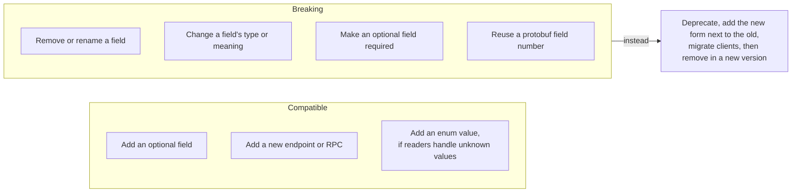
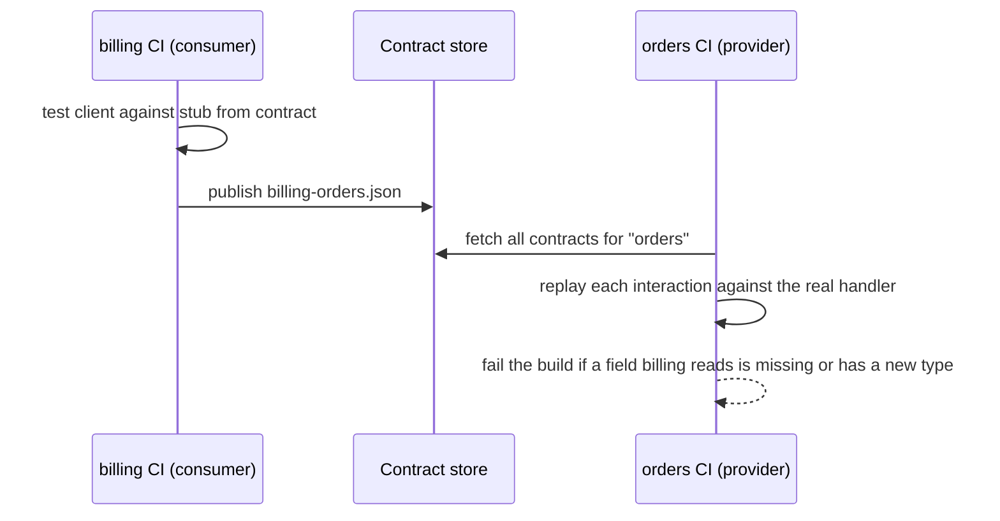

# Evolving APIs

## Why care?

An API is a contract with people you often do not know. Once a client depends on it, every change you make is a change to their program. Typical problems:

- "We renamed `customer_id` to `customer` in the JSON response. Billing has sent invoices without a customer for two days. No test failed."
- "We added a `currency` field. The mobile app crashed on start for every user."
- "Someone deleted field 5 from the `.proto` file. Three months later someone else added a new field 5. Old clients now read prices as quantities."
- "We published `/v2`. A year later, 40 % of traffic still goes to `/v1`, and nobody knows who sends it."

The [previous page](grpc-and-protobuf.md) showed what JSON and protobuf send on the wire. This page uses that knowledge to answer one question: **which changes are safe, which are breaking, and how do you catch a breaking change before it ships?** You will see a real `buf breaking` failure, a JSON rename that breaks an old client in a Go test, and a consumer-driven contract test in plain Go.

## The idea: compatibility has two directions

A change is **compatible** when existing programs keep working without being changed or rebuilt. There are two directions, and you usually need both:

- **Backward compatible**: new servers work with old clients. You need this because you cannot update every client at the moment you deploy.
- **Forward compatible**: old servers (or old readers) work with data from newer writers. You need this during a rolling deploy, when half the Pods run the old version, and for messages in queues that an old consumer may still read.

Most of the rules follow from one principle, often called **Postel's law** or the **tolerant reader**: a reader ignores what it does not understand, and a writer never changes the meaning of what it already sends. Adding is safe. Removing, renaming and changing meaning are not.



The breaking side has one standard process: **add the new form next to the old one, migrate consumers, then remove the old form**. This is sometimes called **expand and contract**, the same pattern used for database schema changes in [Migrations](../databases/migrations.md).

## Under the hood: what breaks, and why

### JSON over HTTP

JSON has no schema on the wire, so compatibility depends on what clients do with the data. The table assumes clients are tolerant readers (they ignore unknown fields):

| Change                                   | Old clients                                                       | Verdict      |
| ---------------------------------------- | ----------------------------------------------------------------- | ------------ |
| Add a response field                     | Ignore it                                                         | Compatible   |
| Add an optional request field            | Don't send it; the server must use a default                      | Compatible   |
| Add a required request field             | Requests from old clients are now rejected                        | **Breaking** |
| Remove or rename a response field        | Read the zero value, **silently** in Go                           | **Breaking** |
| Change a type (`700` to `"7.00"`)        | Decoding fails, or the value is misread                           | **Breaking** |
| Add an enum value (`"refunded"`)         | Compatible only if clients have a default case for unknown values | Risky        |
| Change a default, a unit, or the meaning | Programs keep running with wrong results                          | **Breaking** |
| Change the status code or error format   | Client error handling takes the wrong branch                      | **Breaking** |
| Tighten validation (max 100 items → 50)  | Requests that worked yesterday fail today                         | **Breaking** |

The last three rows matter most because no tool detects them. Only tests and documentation protect you there.

### Protocol Buffers

Protobuf identifies fields by number (see [the wire format](grpc-and-protobuf.md#under-the-hood-the-wire-format-byte-by-byte)), and decoders keep **unknown fields** instead of failing. This changes the rules:

| Change                                     | Binary wire                                                   | Generated code and JSON mapping    |
| ------------------------------------------ | ------------------------------------------------------------- | ---------------------------------- |
| Add a field with a new number              | Compatible: old readers keep it as an unknown field           | Compatible                         |
| Rename a field, keep the number            | Compatible: names are not on the wire                         | **Breaking**                       |
| Delete a field, mark its number `reserved` | Compatible                                                    | **Breaking** for code that uses it |
| Delete a field without `reserved`          | Compatible today, **dangerous** later (number can be reused)  | **Breaking**                       |
| Change a type (`int32` to `string`)        | **Breaking**                                                  | **Breaking**                       |
| Change `int32` to `int64`                  | Same wire type; values above 2³¹ are truncated by old readers | **Breaking**                       |
| Reuse a field number with a new meaning    | **Breaking, silently**                                        | **Breaking**                       |

You can see these rules in action. This program writes bytes as a newer or incompatible writer would (with `protowire`, the low-level encoding package) and reads them with the generated `Order` and `Item` types from the previous page:

```go
// A newer writer added "string currency = 6".
newer, _ := proto.Marshal(&ordersv1.Order{Id: "o-1", TotalCents: 700})
newer = protowire.AppendTag(newer, 6, protowire.BytesType)
newer = protowire.AppendString(newer, "EUR")

var old ordersv1.Order
err := proto.Unmarshal(newer, &old)
fmt.Printf("1. old reader, new field: err=%v id=%q total=%d unknown=% x\n",
	err, old.GetId(), old.GetTotalCents(), old.ProtoReflect().GetUnknown())
again, _ := proto.Marshal(&old)
fmt.Printf("   re-marshalled by old code: % x\n", again)

// A writer changed "int32 quantity = 2" to "string quantity = 2".
var item []byte
item = protowire.AppendTag(item, 2, protowire.BytesType)
item = protowire.AppendString(item, "2")
var it ordersv1.Item
err = proto.Unmarshal(item, &it)
fmt.Printf("2. int32 field sent as string: err=%v quantity=%d unknown=% x\n",
	err, it.GetQuantity(), it.ProtoReflect().GetUnknown())

// A writer sends 5,000,000,000 in a varint field.
var o []byte
o = protowire.AppendTag(o, 5, protowire.VarintType)
o = protowire.AppendVarint(o, uint64(int64(5_000_000_000)))
var ord ordersv1.Order
proto.Unmarshal(o, &ord) // total_cents is int64
fmt.Printf("3. int64 written, read back:  total=%d\n", ord.GetTotalCents())
var smaller ordersv1.Item // quantity is int32, same varint wire type
q := protowire.AppendTag(nil, 2, protowire.VarintType)
q = protowire.AppendVarint(q, uint64(int64(5_000_000_000)))
proto.Unmarshal(q, &smaller)
fmt.Printf("   same bytes into an int32:  quantity=%d\n", smaller.GetQuantity())
```

```console
$ go run ./cmd/unknown
1. old reader, new field: err=<nil> id="o-1" total=700 unknown=32 03 45 55 52
   re-marshalled by old code: 0a 03 6f 2d 31 28 bc 05 32 03 45 55 52
2. int32 field sent as string: err=<nil> quantity=0 unknown=12 01 32
3. int64 written, read back:  total=5000000000
   same bytes into an int32:  quantity=705032704
```

1. **A new field is safe.** The old reader does not know field 6, so it keeps the bytes `32 03 45 55 52` (field 6, `LEN`, `EUR`) as unknown fields. When the old code marshals the message again, for example a proxy that forwards it, the unknown field is still there. Data from a newer writer survives a trip through an older service.
2. **A type change is not detected.** The reader expected a varint for field 2 and got a length-delimited value. It does not fail; it keeps the bytes as unknown and `quantity` reads as 0. Your program continues with a wrong value and no error.
3. **Widening a type silently truncates.** `int32` and `int64` share the varint wire type, so the bytes decode without error. An old reader with `int32` gets 705,032,704 (the low 32 bits of 5,000,000,000), not an error.

Cases 2 and 3 are the reason for tooling: the runtime will not warn you, so you need a check before merge.

### `reserved`: deleting a field safely

When you delete a protobuf field, reserve its number **and** its name:

```protobuf
message Order {
  string id = 1;
  string customer_id = 2;
  repeated Item items = 3;
  Status status = 4;
  reserved 5;
  reserved "total_cents";
}
```

`protoc` and `buf` then reject any future field that uses number 5 or the name `total_cents`. Reserving the number prevents the "prices read as quantities" problem from the list above: an old client that still sends field 5 cannot be misread by a new field 5. Reserving the name prevents someone from adding `total_cents = 7` later, which would break the JSON mapping (JSON uses names, not numbers). Enum values work the same way: `reserved 4; reserved "STATUS_CANCELLED";`.

## Try it: `buf breaking` in a git repository

`buf breaking` compares the current `.proto` files with an earlier version and reports changes that break the chosen rules. The earlier version can be a git branch, a tag, a directory or a published module. Set up a scratch repository with the `orders.proto` and `buf.yaml` from the previous page:

```sh
cd ~/tutor/breaking
git init -q -b main .
mkdir -p proto/orders/v1
cp ../grpc/proto/orders/v1/orders.proto proto/orders/v1/
cp ../grpc/buf.yaml .
buf lint                      # no output: the v1 file is clean
git add . && git commit -qm "orders v1"
git switch -qc rename
```

On the branch, make four changes that look harmless in review: rename a field, change a type, delete a field, delete an enum value.

```console
$ git diff
diff --git a/proto/orders/v1/orders.proto b/proto/orders/v1/orders.proto
index 5ef6fa2..50335d4 100644
--- a/proto/orders/v1/orders.proto
+++ b/proto/orders/v1/orders.proto
@@ -15,17 +15,16 @@ service OrderService {
 // Item is one line of an order. Money is integer cents.
 message Item {
   string sku = 1;
-  int32 quantity = 2;
+  string quantity = 2;
   int64 price_cents = 3;
 }

 // Order is a customer's order.
 message Order {
   string id = 1;
-  string customer_id = 2;
+  string buyer_id = 2;
   repeated Item items = 3;
   Status status = 4;
-  int64 total_cents = 5;
 }

 // Status is the lifecycle state of an order.
@@ -34,7 +33,6 @@ enum Status {
   STATUS_PENDING = 1;
   STATUS_PAID = 2;
   STATUS_SHIPPED = 3;
-  STATUS_CANCELLED = 4;
 }

 message GetOrderRequest {
```

```console
$ buf breaking --against '.git#branch=main'
proto/orders/v1/orders.proto:18:3:Field "2" with name "quantity" on message "Item" changed type from "int32" to "string".
proto/orders/v1/orders.proto:23:1:Previously present field "5" with name "total_cents" on message "Order" was deleted.
proto/orders/v1/orders.proto:25:3:Field "2" with name "buyer_id" on message "Order" changed option "json_name" from "customerId" to "buyerId".
proto/orders/v1/orders.proto:25:10:Field "2" on message "Order" changed name from "customer_id" to "buyer_id".
proto/orders/v1/orders.proto:31:1:Previously present enum value "4" on enum "Status" was deleted.
$ echo $?
100
```

All four changes are reported, with file and line. The exit code is non-zero, so a CI job fails. The rename is reported twice: once for the name (generated code breaks) and once for `json_name` (the JSON mapping breaks).

### Rule sets: what kind of compatibility do you promise?

`buf breaking` has four rule sets, from strict to loose. The `buf.yaml` above uses `FILE`, the default:

| Rule set    | Protects                                                                         |
| ----------- | -------------------------------------------------------------------------------- |
| `FILE`      | Generated source code, per file. Moving a message to another file breaks         |
| `PACKAGE`   | Generated source code, per package. Moving between files of a package is allowed |
| `WIRE_JSON` | The binary encoding and the JSON mapping. Renames break, deletions do not        |
| `WIRE`      | Only the binary encoding. Renames are allowed                                    |

Run the same branch against `WIRE`, which only protects the binary encoding:

```console
$ buf breaking --against '.git#branch=main' \
    --config '{"version":"v2","modules":[{"path":"proto"}],"breaking":{"use":["WIRE"]}}'
proto/orders/v1/orders.proto:18:3:Field "2" with name "quantity" on message "Item" changed type from "int32" to "string". See https://developers.google.com/protocol-buffers/docs/proto3#updating for wire compatibility rules.
proto/orders/v1/orders.proto:23:1:Previously present field "5" with name "total_cents" on message "Order" was deleted without reserving the number "5".
proto/orders/v1/orders.proto:31:1:Previously present enum value "4" on enum "Status" was deleted without reserving the number "4".
```

The rename is no longer reported, because it does not change the bytes. The deletions are reported only because the numbers are **not reserved**. The type change is always breaking.

Now fix the branch the correct way. Undo all four edits with `git checkout -q proto`, then make the change properly: keep the name and the type, reserve the deleted number and name, and add a new field instead:

```console
$ git diff
diff --git a/proto/orders/v1/orders.proto b/proto/orders/v1/orders.proto
index 5ef6fa2..e600142 100644
--- a/proto/orders/v1/orders.proto
+++ b/proto/orders/v1/orders.proto
@@ -25,7 +25,10 @@ message Order {
   string customer_id = 2;
   repeated Item items = 3;
   Status status = 4;
-  int64 total_cents = 5;
+  reserved 5;
+  reserved "total_cents";
+  // Added in v1.3. Old clients skip it as an unknown field.
+  string currency = 6;
 }

 // Status is the lifecycle state of an order.
@@ -34,7 +37,8 @@ enum Status {
   STATUS_PENDING = 1;
   STATUS_PAID = 2;
   STATUS_SHIPPED = 3;
-  STATUS_CANCELLED = 4;
+  reserved 4;
+  reserved "STATUS_CANCELLED";
 }

 message GetOrderRequest {
$ buf breaking --against '.git#branch=main'
proto/orders/v1/orders.proto:23:1:Previously present field "5" with name "total_cents" on message "Order" was deleted.
proto/orders/v1/orders.proto:35:1:Previously present enum value "4" on enum "Status" was deleted.
$ buf breaking --against '.git#branch=main' \
    --config '{"version":"v2","modules":[{"path":"proto"}],"breaking":{"use":["WIRE_JSON"]}}'
$ echo $?
0
```

With `WIRE_JSON`, the change passes: every existing client, binary or JSON, keeps working. With `FILE`, the deletion is still breaking, because Go code that calls `GetTotalCents()` no longer compiles after regeneration. That is the correct answer for a package that other teams import as generated code. **Choose the rule set that matches what you promise**: `FILE` if other teams compile against your generated code, `WIRE_JSON` if they only talk to you over the network. In both cases a deletion is a decision that needs a deprecation period, not a refactoring.

Only adding things passes every rule set. A branch that adds `string currency = 6;` and `STATUS_REFUNDED = 5;` (and nothing else) gives no output and exit code 0 with the default `FILE` rules.

In CI, run `buf breaking --against "$REPO.git#branch=main"` on every pull request, next to `buf lint`. See [CI pipelines](../delivery/ci-pipelines.md).

## Try it: a JSON rename breaks an old client

JSON has no equivalent of `buf breaking` that works without a schema, so a rename is easy to ship. Here is the billing team's client for the `orders` API. It was written against v1 and has not changed:

```go
// Package consumer is the billing team's client for the orders API.
// It was written against v1 and has not changed since.
package consumer

// Order holds only the fields billing uses.
type Order struct {
	ID         string `json:"id"`
	CustomerID string `json:"customer_id"`
	TotalCents int64  `json:"total_cents"`
}

// GetOrder fetches one order. Unknown fields are ignored (tolerant reader).
func GetOrder(ctx context.Context, c *http.Client, baseURL, id string) (Order, error) {
	req, err := http.NewRequestWithContext(ctx, http.MethodGet, baseURL+"/v1/orders/"+id, nil)
	if err != nil {
		return Order{}, err
	}
	resp, err := c.Do(req)
	if err != nil {
		return Order{}, err
	}
	defer resp.Body.Close()
	if resp.StatusCode != http.StatusOK {
		return Order{}, fmt.Errorf("GET order %s: %s", id, resp.Status)
	}
	var o Order
	if err := json.UnmarshalRead(resp.Body, &o); err != nil { // encoding/json/v2
		return Order{}, err
	}
	return o, nil
}
```

The orders team's handler (the provider) returns this struct:

```go
type orderResponse struct {
	ID         string `json:"id"`
	CustomerID string `json:"customer_id"`
	Status     string `json:"status"`
	TotalCents int64  `json:"total_cents"`
}
```

A test runs billing's unchanged client against the provider's current handler, in-process with `httptest`:

```go
// TestGetOrderAgainstProvider runs billing's unchanged client against the
// orders team's current handler.
func TestGetOrderAgainstProvider(t *testing.T) {
	srv := httptest.NewServer(provider.Handler(provider.Seed()))
	defer srv.Close()

	o, err := GetOrder(t.Context(), srv.Client(), srv.URL, "o-1")
	if err != nil {
		t.Fatal(err)
	}
	t.Logf("billing sees: %+v", o)
	if o.CustomerID == "" {
		t.Errorf("CustomerID is empty: billing cannot send the invoice")
	}
}
```

```console
$ go test ./consumer -run AgainstProvider -v
=== RUN   TestGetOrderAgainstProvider
    client_test.go:20: billing sees: {ID:o-1 CustomerID:c-42 TotalCents:700}
--- PASS: TestGetOrderAgainstProvider (0.02s)
PASS
ok  	example.com/evolve/consumer	0.029s
```

Now the orders team renames the JSON field to `customer`, a one-word change in a struct tag:

```console
$ sed -i 's/`json:"customer_id"`/`json:"customer"`/' provider/provider.go
$ go test ./consumer -run AgainstProvider -v
=== RUN   TestGetOrderAgainstProvider
    client_test.go:20: billing sees: {ID:o-1 CustomerID: TotalCents:700}
    client_test.go:22: CustomerID is empty: billing cannot send the invoice
--- FAIL: TestGetOrderAgainstProvider (0.02s)
FAIL
FAIL	example.com/evolve/consumer	0.029s
FAIL
```

The decode **did not fail**. The client ignored the unknown `customer` field (as a tolerant reader should) and left `CustomerID` at its zero value. The only reason this is caught is that the test checks a field billing actually depends on. In production, nothing would fail; invoices would go out without a customer. That is the first problem from the list at the top of the page.

### The opposite mistake: a strict reader

A client can also be too strict. If it rejects unknown fields, then **adding** a field, which should be safe, breaks it. With `encoding/json/v2` the option is `json.RejectUnknownMembers(true)` (in `encoding/json` v1 it is `Decoder.DisallowUnknownFields`):

```go
// The orders team added "currency". Which readers survive?
const newer = `{"id":"o-1","customer_id":"c-42","total_cents":700,"currency":"EUR"}`

func TestTolerantReader(t *testing.T) {
	var o Order
	err := json.Unmarshal([]byte(newer), &o)
	t.Logf("tolerant: %+v, err=%v", o, err)
}

func TestStrictReader(t *testing.T) {
	var o Order
	err := json.Unmarshal([]byte(newer), &o, json.RejectUnknownMembers(true))
	t.Logf("strict:   %+v, err=%v", o, err)
}
```

```console
$ go test ./consumer -run Reader -v
=== RUN   TestTolerantReader
    strict_test.go:14: tolerant: {ID:o-1 CustomerID:c-42 TotalCents:700}, err=<nil>
--- PASS: TestTolerantReader (0.00s)
=== RUN   TestStrictReader
    strict_test.go:20: strict:   {ID:o-1 CustomerID:c-42 TotalCents:700}, err=json: cannot unmarshal JSON string into Go consumer.Order: unknown object member name "currency"
--- PASS: TestStrictReader (0.00s)
PASS
ok  	example.com/evolve/consumer	0.004s
```

That is the "mobile app crashed when we added `currency`" problem. Strict decoding is right for **requests your server receives** (a typo in a field name should be a `400`, not silently ignored). It is wrong for **responses your client reads** from a service that evolves independently.

## Try it: a consumer-driven contract test

The rename test above works, but it has a problem: it lives in the billing repository and runs only when billing changes. The orders team changes its code without running billing's tests. A **consumer-driven contract** turns this around:

1. Each **consumer** writes down the requests it sends and the parts of each response it depends on. That file is the **contract**.
2. The consumer tests its client against a stub built from the contract. This proves the contract describes what the consumer really needs.
3. The **provider** runs every consumer's contract against its real handler in its own CI. A provider change that breaks a consumer fails the **provider's** build, before deploy.



Tools like Pact implement this with a broker service and libraries for many languages. The idea is small enough to build in plain Go, which shows what the tools do.

The contract file, written by the billing team:

```json
{
  "consumer": "billing",
  "provider": "orders",
  "interactions": [
    {
      "description": "get an existing order",
      "given": "order o-1 exists",
      "request": { "method": "GET", "path": "/v1/orders/o-1" },
      "response": {
        "status": 200,
        "body": { "id": "o-1", "customer_id": "c-42", "total_cents": 700 }
      }
    },
    {
      "description": "get a missing order",
      "given": "order o-404 does not exist",
      "request": { "method": "GET", "path": "/v1/orders/o-404" },
      "response": { "status": 404 }
    }
  ]
}
```

The `body` lists only the three fields billing reads. It does not mention `status`, so the orders team remains free to change `status`. The `given` field names the **provider state**: the data the provider must load before it replays the interaction.

A shared package loads it. Body values are kept as raw JSON (`jsontext.Value`) so the provider can compare JSON kinds (string, number, object) without knowing Go types:

```go
// Interaction is one request and the response the consumer needs.
type Interaction struct {
	Description string `json:"description"`
	Given       string `json:"given"`
	Request     struct {
		Method string `json:"method"`
		Path   string `json:"path"`
	} `json:"request"`
	Response struct {
		Status int `json:"status"`
		// Body is an example. The provider must return every field in
		// it, with the same JSON kind; values and extra fields are free.
		Body map[string]jsontext.Value `json:"body,omitempty"`
	} `json:"response"`
}
```

**Consumer side**: serve each interaction from a stub and run the real client against it.

```go
func TestContract(t *testing.T) {
	c, err := contract.Load("contracts/billing-orders.json")
	if err != nil {
		t.Fatal(err)
	}
	for _, in := range c.Interactions {
		t.Run(in.Description, func(t *testing.T) {
			stub := httptest.NewServer(http.HandlerFunc(func(w http.ResponseWriter, r *http.Request) {
				if r.Method != in.Request.Method || r.URL.Path != in.Request.Path {
					t.Errorf("client sent %s %s, contract says %s %s", r.Method, r.URL.Path, in.Request.Method, in.Request.Path)
				}
				w.WriteHeader(in.Response.Status)
				if in.Response.Body != nil {
					json.MarshalWrite(w, in.Response.Body)
				}
			}))
			defer stub.Close()

			id := in.Request.Path[len("/v1/orders/"):]
			o, err := GetOrder(t.Context(), stub.Client(), stub.URL, id)
			switch in.Response.Status {
			case http.StatusOK:
				if err != nil || o.CustomerID == "" {
					t.Errorf("got %+v, %v", o, err)
				}
			default:
				if err == nil {
					t.Errorf("want an error for status %d", in.Response.Status)
				}
			}
		})
	}
}
```

**Provider side**: replay every contract against the real handler, and check that each field the consumer reads is present with the same JSON kind.

```go
// TestConsumerContracts replays every consumer's contract against the
// real handler. In a real setup the files come from a shared repository
// or a broker, not from a sibling directory.
func TestConsumerContracts(t *testing.T) {
	files, _ := filepath.Glob("../consumer/contracts/*.json")
	for _, f := range files {
		c, err := contract.Load(f)
		if err != nil {
			t.Fatal(err)
		}
		for _, in := range c.Interactions {
			t.Run(c.Consumer+"/"+in.Description, func(t *testing.T) {
				h := Handler(Seed()) // provider state: "order o-1 exists"
				rec := httptest.NewRecorder()
				h.ServeHTTP(rec, httptest.NewRequest(in.Request.Method, in.Request.Path, nil))

				if rec.Code != in.Response.Status {
					t.Fatalf("status %d, %s expects %d", rec.Code, c.Consumer, in.Response.Status)
				}
				if in.Response.Body == nil {
					return
				}
				var got map[string]jsontext.Value
				if err := json.Unmarshal(rec.Body.Bytes(), &got); err != nil {
					t.Fatal(err)
				}
				for name, want := range in.Response.Body {
					g, ok := got[name]
					switch {
					case !ok:
						t.Errorf("field %q is missing; %s reads it", name, c.Consumer)
					case g.Kind() != want.Kind():
						t.Errorf("field %q is JSON kind %v, %s expects %v", name, g.Kind(), c.Consumer, want.Kind())
					}
				}
			})
		}
	}
}
```

Both sides pass with the current code:

```console
$ go test ./... -run 'Contract|AgainstProvider' -v 2>&1 | grep -v '^=== '
    client_test.go:20: billing sees: {ID:o-1 CustomerID:c-42 TotalCents:700}
--- PASS: TestGetOrderAgainstProvider (0.03s)
--- PASS: TestContract (0.02s)
    --- PASS: TestContract/get_an_existing_order (0.01s)
    --- PASS: TestContract/get_a_missing_order (0.01s)
PASS
ok  	example.com/evolve/consumer	0.051s
?   	example.com/evolve/contract	[no test files]
--- PASS: TestConsumerContracts (0.00s)
    --- PASS: TestConsumerContracts/billing/get_an_existing_order (0.00s)
    --- PASS: TestConsumerContracts/billing/get_a_missing_order (0.00s)
PASS
ok  	example.com/evolve/provider	0.004s
```

Now the orders team makes two changes in its own code: it renames `customer_id` and changes `total_cents` to a formatted string. It runs only **its own** tests. (The scratch directory is not a git repository, so the diff compares with a saved copy of the original file.)

```console
$ git diff --no-index ../provider.go.orig provider/provider.go
diff --git a/../provider.go.orig b/provider/provider.go
index 8ae4559..7182cab 100644
--- a/../provider.go.orig
+++ b/provider/provider.go
@@ -10,9 +10,9 @@ import (

 type orderResponse struct {
 	ID         string `json:"id"`
-	CustomerID string `json:"customer_id"`
+	CustomerID string `json:"customer"`
 	Status     string `json:"status"`
-	TotalCents int64  `json:"total_cents"`
+	TotalCents string `json:"total_cents"`
 }

 // Handler serves GET /v1/orders/{id} from a fixed set of orders.
@@ -44,6 +44,6 @@ func Deprecated(next http.Handler, since, sunset time.Time, guide string) http.H
 // Seed is the provider state the contract tests start from.
 func Seed() map[string]orderResponse {
 	return map[string]orderResponse{
-		"o-1": {ID: "o-1", CustomerID: "c-42", Status: "paid", TotalCents: 700},
+		"o-1": {ID: "o-1", CustomerID: "c-42", Status: "paid", TotalCents: "7.00"},
 	}
 }
$ go test ./provider
--- FAIL: TestConsumerContracts (0.00s)
    --- FAIL: TestConsumerContracts/billing/get_an_existing_order (0.00s)
        contract_test.go:43: field "customer_id" is missing; billing reads it
        contract_test.go:45: field "total_cents" is JSON kind string, billing expects number
FAIL
FAIL	example.com/evolve/provider	0.004s
FAIL
```

The provider's build fails, names the consumer, and names the exact fields. The orders team now knows **who** depends on **what**, before deploy.

The contract also tells the provider what it **may** change. A different change removes `status` (billing does not read it) and adds `currency`:

```console
$ git diff --no-index ../provider.go.orig provider/provider.go | grep '^[-+]'
--- a/../provider.go.orig
+++ b/provider/provider.go
-	Status     string `json:"status"`
+	Currency   string `json:"currency"`
-		"o-1": {ID: "o-1", CustomerID: "c-42", Status: "paid", TotalCents: 700},
+		"o-1": {ID: "o-1", CustomerID: "c-42", Currency: "EUR", TotalCents: 700},
$ go test ./...
ok  	example.com/evolve/consumer	0.049s
?   	example.com/evolve/contract	[no test files]
ok  	example.com/evolve/provider	0.004s
```

It passes. Whether removing `status` is safe depends on the **other** consumers; if one of them reads it, its contract fails here. With contracts from every consumer, "who uses this field?" becomes a question with an answer.

Limits of this approach, which also apply to Pact:

- A contract covers only the consumers who wrote one. Public APIs with unknown clients cannot use it; they need versioning and long deprecation periods.
- It checks structure, not meaning. Changing `total_cents` from cents to euros passes every check here.
- The contracts must reach the provider's CI: a shared repository, an artifact store, or a broker. Without that, the tests run on stale files.

## Versioning

When a breaking change is necessary, give it a new **version** and run both versions side by side until the old one is unused.

**For HTTP APIs**, the common choices are:

| Where      | Example                                      | Notes                                                                 |
| ---------- | -------------------------------------------- | --------------------------------------------------------------------- |
| URL path   | `/v1/orders`, `/v2/orders`                   | Visible in logs, easy to route and to measure. The most common choice |
| Header     | `Api-Version: 2026-11-01`                    | Clean URLs; date-based versions allow many small steps                |
| Media type | `Accept: application/vnd.acme.order.v2+json` | Precise per resource, but hard to use from browsers and tools         |

`orders` uses the path (`/v1/orders`), as on [HTTP API design](http-api-design.md). Version only on **breaking** changes. Additive changes go into the current version without a new number.

**For protobuf**, the version is in the package: `orders.v1` and `orders.v2` are separate packages with separate generated code, and the server registers both services. Method paths differ (`/orders.v1.OrderService/GetOrder` and `/orders.v2.OrderService/GetOrder`), so routing and metrics separate them. The v1 handler is usually a thin adapter that calls the v2 logic and converts the result.

The expensive part is not the second version. It is **removing the first one**: you need to know who still calls v1, tell them, and give them time. That is deprecation.

## Deprecation and sunset

Deprecation is a process with four steps:

1. **Announce**: changelog, documentation, a direct message to known consumers, and a date.
2. **Signal in every response**, so that clients and their monitoring see it without reading your changelog.
3. **Measure** who still calls the old version: per client ID or `User-Agent`, from access logs or metrics (see [Metrics](../observability/metrics.md)). Contact the remaining callers by name.
4. **Remove** after the sunset date, and return `410 Gone` (or gRPC `Unimplemented`) for a while so that late callers get a clear error.

For HTTP there are standard response headers. `Deprecation` (RFC 9745) says since when the resource is deprecated; `Sunset` (RFC 8594) says when it will stop working; a `Link` header points to the migration guide. A small middleware in the provider:

```go
// Deprecated marks every response as deprecated since one date and gone
// after another (RFC 9745 and RFC 8594), with a link to the migration guide.
func Deprecated(next http.Handler, since, sunset time.Time, guide string) http.Handler {
	return http.HandlerFunc(func(w http.ResponseWriter, r *http.Request) {
		w.Header().Set("Deprecation", "@"+strconv.FormatInt(since.Unix(), 10))
		w.Header().Set("Sunset", sunset.UTC().Format(http.TimeFormat))
		w.Header().Add("Link", "<"+guide+">; rel=\"deprecation\"; type=\"text/html\"")
		next.ServeHTTP(w, r)
	})
}
```

```go
func TestDeprecationHeaders(t *testing.T) {
	since := time.Date(2026, 12, 1, 0, 0, 0, 0, time.UTC)
	sunset := time.Date(2027, 6, 30, 0, 0, 0, 0, time.UTC)
	h := Deprecated(Handler(Seed()), since, sunset, "https://api.example.com/docs/migrate-to-v2")

	rec := httptest.NewRecorder()
	h.ServeHTTP(rec, httptest.NewRequest("GET", "/v1/orders/o-1", nil))
	for _, k := range []string{"Deprecation", "Sunset", "Link"} {
		t.Logf("%s: %s", k, rec.Header().Get(k))
	}
}
```

```console
$ go test ./provider -run Deprecation -v
=== RUN   TestDeprecationHeaders
    deprecation_test.go:17: Deprecation: @1796083200
    deprecation_test.go:17: Sunset: Wed, 30 Jun 2027 00:00:00 GMT
    deprecation_test.go:17: Link: <https://api.example.com/docs/migrate-to-v2>; rel="deprecation"; type="text/html"
--- PASS: TestDeprecationHeaders (0.00s)
PASS
ok  	example.com/evolve/provider	0.004s
```

The two headers use different date formats. `Deprecation` is a structured-field date: `@` followed by Unix seconds (1796083200 is 1 December 2026). `Sunset` uses the classic HTTP date format. A client library can log a warning when it sees either header; that turns a deprecation into an alert in the consumer's own monitoring.

In protobuf, mark a field with `[deprecated = true]`, and a message, service or method with `option deprecated = true;`. For `int64 total_cents = 5 [deprecated = true];`, `buf generate` writes:

```go
	// Deprecated: Marked as deprecated in orders/v1/orders.proto.
	TotalCents    int64 `protobuf:"varint,5,opt,name=total_cents,json=totalCents,proto3" json:"total_cents,omitempty"`
```

```go
// Deprecated: Marked as deprecated in orders/v1/orders.proto.
func (x *Order) GetTotalCents() int64 {
```

`staticcheck` (part of `golangci-lint`, see [Tooling and quality](../go/tooling-and-quality.md)) reports every use of an identifier with a `Deprecated:` comment, so each consumer sees the warning in its own lint run.

## Traps

- **Renaming a JSON field "for consistency".** Go clients read the zero value with no error. Add the new name next to the old one, deprecate, then remove in the next version.
- **Strict decoding of responses.** Rejecting unknown fields turns every additive change into an outage. Be strict with input you receive, tolerant with output you read.
- **Deleting a protobuf field without `reserved`.** The number gets reused, and old clients misread the new data with no error.
- **Changing a type at the same field number.** Protobuf does not report it at runtime: the value becomes 0 or is truncated. Only `buf breaking` catches it.
- **Treating an enum as closed.** A new enum value reaches old clients. Every `switch` over an API enum needs a default branch that does something sensible.
- **Semantic changes.** A new unit, default or validation limit passes every schema check. Treat them as breaking, and write them in the changelog.
- **A new version without a removal plan.** Without metrics per client and a sunset date, v1 runs forever.
- **Contract tests on stale files.** If the provider does not fetch the latest contracts in CI, the check protects nothing.

## Check yourself

??? question "1. You add a required field `currency` to the create-order request. Is that compatible?"

    No. Old clients do not send it, so their requests are now rejected. Make it optional with a
    documented default (for example the account's currency), and require it only in the next
    major version.

??? question "2. A protobuf field `int64 total_cents = 5` is no longer needed. What exactly do you do?"

    Mark it `[deprecated = true]` first and announce it. When no consumer reads it, delete it and
    add `reserved 5;` and `reserved "total_cents";`. With `buf breaking` on `FILE` rules this is still
    reported as breaking (generated code changes), so it belongs in a planned release, or in `v2`.

??? question "3. `buf breaking` with `WIRE` rules passes for a rename, but `FILE` fails. Which result is right?"

    Both are right for different promises. `WIRE` says binary clients keep working, which is true.
    `FILE` says code generated from the file keeps compiling, which is false: `GetCustomerId()`
    disappears. If other teams compile against your `.proto` files, or use the JSON mapping, use
    `FILE` or `WIRE_JSON`.

??? question "4. Billing's contract lists `id`, `customer_id` and `total_cents`. The orders team removes `status`. The contract test passes. Is the change safe?"

    Safe for billing. It is safe overall only if **every** consumer has a contract and none of
    them lists `status`. Consumers without a contract are invisible to this check, which is why
    public APIs need versioning and a deprecation period instead.

??? question "5. Your `/v1` endpoint will be removed on 30 June 2027. What should clients see before and after that date?"

    Before: every response carries `Deprecation`, `Sunset: Wed, 30 Jun 2027 00:00:00 GMT` and a
    `Link` to the migration guide, plus direct contact with the callers you can still see in your
    metrics. After: `410 Gone` with a problem-details body that points to `/v2`, kept for a while
    so that late callers get a clear error instead of a `404`.

## Recap

- **Compatible** means existing programs keep working unchanged. You usually need both directions: new servers with old clients, and old readers with data from new writers.
- **Adding is safe; removing, renaming, and changing a type or meaning are breaking.** Make breaking changes with expand and contract: add the new form, migrate, then remove.
- **JSON clients** should be tolerant readers. A rename then gives a zero value with no error, so only tests catch it. Strict decoding of responses turns additive changes into outages.
- **Protobuf** keeps unknown fields and identifies fields by number. Renames are safe on the wire, type changes and reused numbers are not, and the runtime does not report them. Use `reserved` for deleted numbers and names.
- **`buf breaking --against '.git#branch=main'`** catches protobuf breaking changes in CI. Pick the rule set (`FILE`, `PACKAGE`, `WIRE_JSON`, `WIRE`) that matches what you promise.
- **Consumer-driven contracts** let consumers state what they use, and make the provider's build fail when a change breaks one of them.
- **Version** only for breaking changes (`/v2`, `orders.v2`), run versions side by side, and retire the old one with `Deprecation` and `Sunset` headers, per-client metrics, and a date.

Next: the boundaries inside a system, where the same contract thinking applies to packages and modules. [Boundaries and modules](boundaries-and-modules.md).
