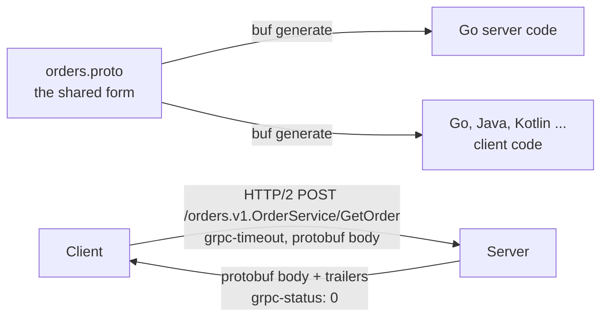
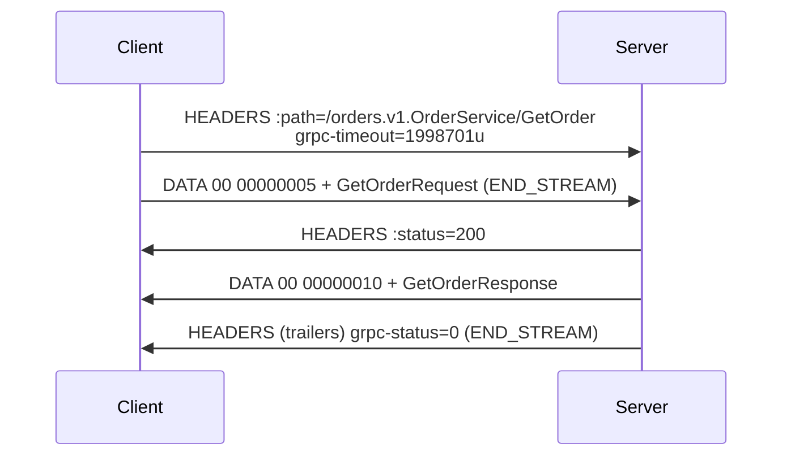

# gRPC and Protocol Buffers

## Why care?

The [previous page](http-api-design.md) designed the `orders` API as JSON over HTTP: resources, status codes, problem details, an OpenAPI sketch. That is the right default for an API that browsers, partners and `curl` must use. Between internal services, the other common choice is **gRPC** (a remote procedure call framework on HTTP/2) with **Protocol Buffers** (protobuf, a binary serialization format with a schema). Teams that use it report problems like these:

- "We moved to gRPC for speed. Latency is the same as before."
- "The billing service shows `customer_id` as empty since Tuesday. Nobody changed billing."
- "A call that should take 50 ms hangs for 30 seconds when the database is slow."
- "We scaled the gRPC server from 2 to 6 Pods. The 4 new ones get no traffic."
- "Every error from the inventory service arrives as `Unknown`."

Each of these comes from a gap in understanding what gRPC sends on the wire and what it guarantees. This page defines the `orders` service in a `.proto` file and then examines the real bytes: the protobuf encoding decoded by hand, the HTTP/2 frames of one call, deadlines, streams and status codes. Benchmarks at the end show when gRPC is better than JSON over HTTP, and when it is not.

## The idea: a shared schema, numbers on the wire

A JSON message is **self-describing**: every value travels with its name, in every message (`"customer_id": "c-42"`). A reader needs no schema to parse it, and the names cost bytes.

A protobuf message is **schema-dependent**. Both sides compile the same `.proto` file, which assigns a number to each field. The sender writes only "field 2: c-42". The receiver looks up field 2 in its own compiled schema and knows it is the customer ID. Because no names travel, the message is small. The cost: without the schema the message is hard to read, and if the two sides disagree about what field 2 means, the receiver decodes the wrong value **without an error**.

gRPC is the transport for these messages. It sends each call as an HTTP/2 request, puts the method name and the deadline in headers, and returns the response with a status code.



Three ideas matter for the rest of the page:

1. **The contract comes first.** You write the `.proto` file, and a generator writes the client and server code in every language. The schema is not documentation next to the code; it **is** the code.
2. **Field numbers, not names, are the contract on the wire.** Rename a field and old clients still work. Reuse a number and they silently read garbage.
3. **gRPC is a set of conventions on HTTP/2**: one `POST` per call, a 5-byte prefix on every message, a deadline in a header, and the status in **trailers**.

## Under the hood: the contract

Here is the `orders` service as a `.proto` file. It mirrors the domain from [Project layout](../go/project-layout.md): integer cents for money, a status enum, a read method, and a stream of changes.

```protobuf
syntax = "proto3";

package orders.v1;

option go_package = "example.com/grpcdemo/gen/orders/v1;ordersv1";

// OrderService reads orders and streams changes to them.
service OrderService {
  // GetOrder returns one order by ID.
  rpc GetOrder(GetOrderRequest) returns (GetOrderResponse);
  // WatchOrders streams one event per order change, until the client cancels.
  rpc WatchOrders(WatchOrdersRequest) returns (stream WatchOrdersResponse);
}

// Item is one line of an order. Money is integer cents.
message Item {
  string sku = 1;
  int32 quantity = 2;
  int64 price_cents = 3;
}

// Order is a customer's order.
message Order {
  string id = 1;
  string customer_id = 2;
  repeated Item items = 3;
  Status status = 4;
  int64 total_cents = 5;
}

// Status is the lifecycle state of an order.
enum Status {
  STATUS_UNSPECIFIED = 0;
  STATUS_PENDING = 1;
  STATUS_PAID = 2;
  STATUS_SHIPPED = 3;
  STATUS_CANCELLED = 4;
}

message GetOrderRequest {
  string id = 1;
}

message GetOrderResponse {
  Order order = 1;
}

message WatchOrdersRequest {
  string customer_id = 1;
}

message WatchOrdersResponse {
  Order order = 1;
}
```

Each of the following is a rule that `buf lint` enforces (see below):

- **The package has a version**: `orders.v1`. A breaking change becomes `orders.v2`, next to v1, not a change to v1. [Evolving APIs](evolving-apis.md) is about that.
- **Every RPC has its own request and response message**, even when `GetOrderResponse` just wraps an `Order`. Later you can add fields to the response (an `etag`, a `warnings` list) without changing the method signature.
- **Enum value 0 is `STATUS_UNSPECIFIED`.** In proto3, every scalar field has a default (0, `""`, `false`), and a missing field reads as the default. If 0 meant `PENDING`, you could not tell "pending" from "the sender forgot to set it".
- **The numbers `= 1`, `= 2` are the field numbers.** They are the only thing that goes on the wire. Choose them once and never change them.

### Generating Go code

The generators are Go programs. Install them as **tool dependencies** of your module, so the version is pinned in `go.mod` like any other dependency (see [Modules](../go/modules.md)):

```console
$ go get -tool google.golang.org/protobuf/cmd/protoc-gen-go
$ go get -tool google.golang.org/grpc/cmd/protoc-gen-go-grpc
$ sed -n '/^tool (/,/^)/p' go.mod
tool (
	google.golang.org/grpc/cmd/protoc-gen-go-grpc
	google.golang.org/protobuf/cmd/protoc-gen-go
)
```

[`buf`](https://buf.build/docs/) is the modern front end for `protoc`: it compiles, lints, checks for breaking changes and runs the generators. Two small config files tell it where the `.proto` files are and which plugins to run. The plugins are **local commands**, so `go tool` runs the versions pinned in `go.mod`:

```yaml
# buf.yaml
version: v2
modules:
  - path: proto
lint:
  use:
    - STANDARD
breaking:
  use:
    - FILE
```

```yaml
# buf.gen.yaml
version: v2
plugins:
  - local: ["go", "tool", "protoc-gen-go"]
    out: gen
    opt: paths=source_relative
  - local: ["go", "tool", "protoc-gen-go-grpc"]
    out: gen
    opt: paths=source_relative
```

```console
$ buf generate
$ find gen -type f
gen/orders/v1/orders.pb.go
gen/orders/v1/orders_grpc.pb.go
$ wc -l gen/orders/v1/*
  493 gen/orders/v1/orders.pb.go
  171 gen/orders/v1/orders_grpc.pb.go
  664 total
```

`orders.pb.go` holds the message types (`Order`, `Item`, with getters like `GetCustomerId()`), `orders_grpc.pb.go` the client and server interfaces:

```go
type OrderServiceServer interface {
	// GetOrder returns one order by ID.
	GetOrder(context.Context, *GetOrderRequest) (*GetOrderResponse, error)
	// WatchOrders streams one event per order change, until the client cancels.
	WatchOrders(*WatchOrdersRequest, grpc.ServerStreamingServer[WatchOrdersResponse]) error
	mustEmbedUnimplementedOrderServiceServer()
}
```

`mustEmbedUnimplementedOrderServiceServer` forces you to embed `UnimplementedOrderServiceServer` in your type. When someone adds a method to the `.proto` file, your server still compiles and answers the new method with `Unimplemented` until you write it. That is forward compatibility for the **code**, not only for the wire.

### `buf lint`: enforcing the style guide

The `.proto` above passes: `buf lint` prints nothing and exits 0. Here is a version of the same service written without these rules:

```protobuf
syntax = "proto3";

package orders;

service Orders {
  rpc getOrder(OrderId) returns (Order);
}

message OrderId {
  string id = 1;
}

message Order {
  string id = 1;
  string customerId = 2;
  State state = 3;
}

enum State {
  PENDING = 0;
  PAID = 1;
}
```

```console
$ buf lint
proto/orders/orders.proto:3:1:Package name "orders" should be suffixed with a correctly formed version, such as "orders.v1".
proto/orders/orders.proto:5:9:Service name "Orders" should be suffixed with "Service".
proto/orders/orders.proto:6:7:RPC name "getOrder" should be PascalCase, such as "GetOrder".
proto/orders/orders.proto:6:16:RPC request type "OrderId" should be named "GetOrderRequest" or "OrdersGetOrderRequest".
proto/orders/orders.proto:6:34:RPC response type "Order" should be named "GetOrderResponse" or "OrdersGetOrderResponse".
proto/orders/orders.proto:15:10:Field name "customerId" should be lower_snake_case, such as "customer_id".
proto/orders/orders.proto:20:3:Enum value name "PENDING" should be prefixed with "STATE_".
proto/orders/orders.proto:20:3:Enum zero value name "PENDING" should be suffixed with "_UNSPECIFIED".
proto/orders/orders.proto:21:3:Enum value name "PAID" should be prefixed with "STATE_".
$ echo $?
100
```

Most of these findings are about compatibility, not taste. A missing version makes v2 impossible without a rename. Reusing `Order` as a response type means you can never add response-only fields. Unprefixed enum values clash: in protobuf, enum values live in the **package** scope (a C++ rule), so two enums in one package cannot both have `PENDING`. Run `buf lint` in CI, next to `golangci-lint` (see [Tooling and quality](../go/tooling-and-quality.md)).

## Under the hood: the wire format, byte by byte

This program fills one small `Order` and marshals it both ways:

```go
o := &ordersv1.Order{
	Id:         "o-1",
	CustomerId: "c-42",
	Items:      []*ordersv1.Item{{Sku: "TEA", Quantity: 2, PriceCents: 350}},
	Status:     ordersv1.Status_STATUS_PAID,
	TotalCents: 700,
}
b, err := proto.Marshal(o)
// ... write b to order.bin, print it, then the same order as JSON
```

```console
$ go run ./cmd/wire
protobuf: 28 bytes
0a 03 6f 2d 31 12 04 63 2d 34 32 1a 0a 0a 03 54 45 41 10 02 18 de 02 20 02 28 bc 05
json:     122 bytes
{"id":"o-1","customer_id":"c-42","items":[{"sku":"TEA","quantity":2,"price_cents":350}],"status":"paid","total_cents":700}
```

28 bytes against 122: no field names, quotes or braces. The next sections decode the 28 bytes by hand.

### Every field is a key, then a value

A protobuf message is just a list of fields, one after another. Each field starts with a **key**, and the key is one number:

```text
key = (field number << 3) | wire type
```

The low 3 bits are the **wire type**: how to find the end of the value. Only a few exist, and two cover almost everything:

| Wire type | Name     | Used for                                                | How long is the value?        |
| --------- | -------- | ------------------------------------------------------- | ----------------------------- |
| 0         | `VARINT` | `int32`, `int64`, `uint32`, `bool`, enums, `sint32` ... | until a byte with high bit 0  |
| 1         | `I64`    | `fixed64`, `double`                                     | always 8 bytes                |
| 2         | `LEN`    | `string`, `bytes`, nested messages, packed `repeated`   | a varint length, then N bytes |
| 5         | `I32`    | `fixed32`, `float`                                      | always 4 bytes                |

The first byte is `0a` = `0000 1010`. Low 3 bits `010` = 2 (`LEN`). The rest, `0000 1`, is field 1. So: "field 1, length-delimited". Field 1 is `id`. The next byte, `03`, is the length, and `6f 2d 31` is `o-1` in ASCII.

### Varints: 7 bits per byte

Numbers use **varints**: 7 bits of value per byte, least significant group first, and the high bit of each byte says "more bytes follow". Small numbers take one byte; `int64` values up to 127 never cost 8 bytes.

`price_cents = 350` is encoded as `de 02`:

```text
de = 1101 1110  high bit 1: more follows, value bits 101 1110 = 94
02 = 0000 0010  high bit 0: last byte,   value bits 000 0010 = 2
value = 94 + (2 << 7) = 94 + 256 = 350
```

And `total_cents = 700` is `bc 05`: `0x3c` (60) + 5 × 128 = 700.

### The whole message, decoded

| Bytes               | Key: field, type | Value                     | Meaning                  |
| ------------------- | ---------------- | ------------------------- | ------------------------ |
| `0a 03 6f 2d 31`    | 1, `LEN`         | 3 bytes: `o-1`            | `id`                     |
| `12 04 63 2d 34 32` | 2, `LEN`         | 4 bytes: `c-42`           | `customer_id`            |
| `1a 0a ...`         | 3, `LEN`         | 10 bytes: a nested `Item` | `items[0]`               |
| ↳ `0a 03 54 45 41`  | 1, `LEN`         | `TEA`                     | `items[0].sku`           |
| ↳ `10 02`           | 2, `VARINT`      | 2                         | `items[0].quantity`      |
| ↳ `18 de 02`        | 3, `VARINT`      | 350                       | `items[0].price_cents`   |
| `20 02`             | 4, `VARINT`      | 2                         | `status` = `STATUS_PAID` |
| `28 bc 05`          | 5, `VARINT`      | 700                       | `total_cents`            |

The rows marked ↳ are inside the nested `Item`. Notice what that nested message is: **just more bytes inside a `LEN` field**. From the outside, a nested message and a string look the same. A `repeated` field is simply the same key appearing again for every element. And the enum travels as its number, 2, not as `"STATUS_PAID"`.

You don't need the `.proto` file to see the structure. `protoc --decode_raw` reads any protobuf message and guesses:

```console
$ protoc --decode_raw < order.bin
1: "o-1"
2: "c-42"
3 {
  1: "TEA"
  2: 2
  3: 350
}
4: 2
5: 700
```

This is useful when you debug a message from a queue or a log. It shows numbers, not names: the names live only in the `.proto` file.

### Try it: a decoder in 40 lines

The format is simple enough to decode without any library. Here is a decoder with only the standard library: no `.proto`, no generated code. It handles the two wire types this message uses.

```go
// Command decode reads protobuf bytes from stdin and prints each field,
// using only the standard library: no .proto file, no generated code.
package main

import (
	"fmt"
	"io"
	"os"
	"strings"
)

// varint reads a base-128 varint: 7 bits per byte, low bits first,
// high bit set means "more bytes follow".
func varint(b []byte) (v uint64, n int) {
	for i, c := range b {
		v |= uint64(c&0x7f) << (7 * i)
		if c < 0x80 {
			return v, i + 1
		}
	}
	panic("truncated varint")
}

func decode(b []byte, depth int) {
	pad := strings.Repeat("  ", depth)
	for len(b) > 0 {
		key, n := varint(b)
		field, wire := key>>3, key&7
		fmt.Printf("%s% x  field %d, wire type %d", pad, b[:n], field, wire)
		b = b[n:]
		switch wire {
		case 0: // varint
			v, n := varint(b)
			fmt.Printf(", varint % x = %d\n", b[:n], v)
			b = b[n:]
		case 2: // length-delimited: string, bytes, or a nested message
			l, n := varint(b)
			body := b[n : n+int(l)]
			fmt.Printf(", length %d: %q\n", l, body)
			if strings.ContainsFunc(string(body), func(r rune) bool { return r < 0x20 }) {
				decode(body, depth+1) // not text: try it as a message
			}
			b = b[n+int(l):]
		default:
			panic(fmt.Sprintf("wire type %d not handled", wire))
		}
	}
}

func main() {
	b, err := io.ReadAll(os.Stdin)
	if err != nil {
		panic(err)
	}
	decode(b, 0)
}
```

```console
$ go run ./cmd/decode < order.bin
0a  field 1, wire type 2, length 3: "o-1"
12  field 2, wire type 2, length 4: "c-42"
1a  field 3, wire type 2, length 10: "\n\x03TEA\x10\x02\x18\xde\x02"
  0a  field 1, wire type 2, length 3: "TEA"
  10  field 2, wire type 0, varint 02 = 2
  18  field 3, wire type 0, varint de 02 = 350
20  field 4, wire type 0, varint 02 = 2
28  field 5, wire type 0, varint bc 05 = 700
```

The "is it text or a message?" guess is the same one `--decode_raw` makes. The wire cannot tell you; only the schema can.

### Negative numbers: `int32` versus `sint32`

Varints are compact for small positive numbers, but not for negative ones. An `int32` of -1 is sign-extended to 64 bits, all ones, and that takes **10 bytes**. `sint32` and `sint64` use **ZigZag** encoding first (0 → 0, -1 → 1, 1 → 2, -2 → 3 ...), so small negative numbers stay small. A run with `protowire`, the low-level package under `proto`:

```go
for _, v := range []int64{1, 127, 128, 350, 700, -1} {
	fmt.Printf("int32  %5d -> % x\n", v, protowire.AppendVarint(nil, uint64(v)))
}
for _, v := range []int64{-1, 1, -350} {
	fmt.Printf("sint32 %5d -> % x\n", v, protowire.AppendVarint(nil, protowire.EncodeZigZag(v)))
}
```

```console
$ go run ./cmd/varint
int32      1 -> 01
int32    127 -> 7f
int32    128 -> 80 01
int32    350 -> de 02
int32    700 -> bc 05
int32     -1 -> ff ff ff ff ff ff ff ff ff 01
sint32    -1 -> 01
sint32     1 -> 02
sint32  -350 -> bb 05
```

127 fits in one byte, 128 needs two. For a field that is often negative (a temperature, a delta, a balance), use `sint32`/`sint64`. For money that is never negative, `int64` is fine. And the type is part of the contract: switching `int32` to `sint32` later changes the meaning of the bytes.

## Under the hood: one gRPC call on the wire

gRPC runs on HTTP/2 (see [HTTP](../networking/http.md#http2-binary-frames-on-one-connection) for frames, streams and HPACK). This program starts the `orders` gRPC server on loopback, wraps the server's connection so every byte is copied into a buffer, makes **one** `GetOrder` call with a 2-second timeout, and then parses the captured bytes with the HTTP/2 framer from `golang.org/x/net/http2`:

```go
// tapConn copies every byte read and written into two buffers.
type tapConn struct {
	net.Conn
	mu      *sync.Mutex
	in, out *bytes.Buffer
}

func (c tapConn) Read(p []byte) (int, error) {
	n, err := c.Conn.Read(p)
	c.mu.Lock()
	c.in.Write(p[:n])
	c.mu.Unlock()
	return n, err
}

// ... Write is the same for c.out. A tapListener wraps Accept.
// dump() strips the client preface, then loops over http2.Framer.ReadFrame,
// decoding HEADERS with hpack and printing DATA as hex.
```

```console
$ go run ./cmd/frames
client -> server
  SETTINGS stream=0 len=0
  SETTINGS stream=0 len=0
  HEADERS stream=1 END_HEADERS
    :method: POST
    :scheme: http
    :path: /orders.v1.OrderService/GetOrder
    :authority: 127.0.0.1:46034
    content-type: application/grpc
    user-agent: grpc-go/1.85.0
    te: trailers
    grpc-timeout: 1998701u
  DATA    stream=1 END_STREAM len=10
    00 00 00 00 05 0a 03 6f 2d 31
  PING stream=0 len=8
  WINDOW_UPDATE stream=0 len=4
  PING stream=0 len=8
server -> client
  SETTINGS stream=0 len=6
  SETTINGS stream=0 len=0
  WINDOW_UPDATE stream=0 len=4
  PING stream=0 len=8
  HEADERS stream=1 END_HEADERS
    :status: 200
    content-type: application/grpc
  DATA    stream=1  len=21
    00 00 00 00 10 0a 0e 0a 03 6f 2d 31 12 04 63 2d 34 32 28 bc 05
  HEADERS stream=1 END_STREAM|END_HEADERS
    grpc-status: 0
    grpc-message:
  PING stream=0 len=8
```



What the frames show:

1. **Every call is an HTTP/2 `POST`** on a new stream (stream 1 here; the next call would be stream 3). The `:path` is `/<package>.<Service>/<Method>`. That is the only routing information.
2. **`grpc-timeout: 1998701u`** is the client's deadline, sent as **time remaining**: 1,998,701 microseconds. The client asked for 2 s; 1.3 ms had already passed while the connection was set up. The server turns this header back into a `context` deadline. This is how a deadline crosses process boundaries (more below).
3. **The message has a 5-byte prefix**: 1 byte "compressed?" (`00` = no), then a 4-byte big-endian length (`00 00 00 05` = 5). Then the protobuf: `0a 03 6f 2d 31` is field 1, `"o-1"`, the `GetOrderRequest`. This is the encoding from the previous section.
4. **The response** is the same: prefix `00 00 00 00 10` (16 bytes), then `0a 0e ...`: field 1 (`order`), a 14-byte nested `Order` with `id`, `customer_id` and `total_cents` = `bc 05` = 700.
5. **The status comes in trailers**, a second `HEADERS` frame **after** the body: `grpc-status: 0` (`OK`). The HTTP status is 200 even for errors. A `NotFound` is also `:status: 200` with `grpc-status: 5`. This is why `te: trailers` is in the request, and why proxies that drop trailers break gRPC.
6. **Everything else is connection housekeeping**: `SETTINGS`, `WINDOW_UPDATE` (flow control), `PING` (grpc-go uses pings to measure the connection's bandwidth-delay product and size its windows). The exact set changes from run to run.

Because the status is in a trailer and the length prefix is binary, a browser's `fetch` cannot speak gRPC directly. For browsers you need gRPC-Web through a proxy, or a JSON gateway, or the Connect protocol. This is one reason public APIs stay JSON over HTTP.

## Deadlines, streams and status codes

This demo starts the server with a simulated 200 ms dependency in `GetOrder`, then makes four unary calls, opens a stream, and finally calls a stopped server. The server:

```go
func (s *Server) GetOrder(ctx context.Context, req *ordersv1.GetOrderRequest) (*ordersv1.GetOrderResponse, error) {
	if dl, ok := ctx.Deadline(); ok && !s.Quiet {
		log.Printf("server: GetOrder %q, deadline in %v", req.GetId(), time.Until(dl).Round(time.Millisecond))
	}
	if req.GetId() == "" {
		return nil, status.Error(codes.InvalidArgument, "id is required")
	}
	if s.Delay > 0 {
		select {
		case <-time.After(s.Delay): // the "database"
		case <-ctx.Done():
			log.Printf("server: GetOrder gave up: %v", ctx.Err())
			return nil, status.FromContextError(ctx.Err()).Err()
		}
	}
	o, ok := s.Orders[req.GetId()]
	if !ok {
		return nil, status.Errorf(codes.NotFound, "order %q not found", req.GetId())
	}
	return &ordersv1.GetOrderResponse{Order: o}, nil
}

func (s *Server) WatchOrders(req *ordersv1.WatchOrdersRequest, stream grpc.ServerStreamingServer[ordersv1.WatchOrdersResponse]) error {
	ctx := stream.Context()
	statuses := []ordersv1.Status{ordersv1.Status_STATUS_PENDING, ordersv1.Status_STATUS_PAID, ordersv1.Status_STATUS_SHIPPED}
	for i := 0; ; i++ {
		o := &ordersv1.Order{Id: "o-1", CustomerId: req.GetCustomerId(), Status: statuses[i%len(statuses)]}
		if err := stream.Send(&ordersv1.WatchOrdersResponse{Order: o}); err != nil {
			return err
		}
		log.Printf("server: sent event %d", i+1)
		select {
		case <-time.After(50 * time.Millisecond):
		case <-ctx.Done():
			log.Printf("server: WatchOrders ends: %v", ctx.Err())
			return ctx.Err()
		}
	}
}
```

The client side of a unary call, with a timeout on every call:

```go
conn, err := grpc.NewClient(ln.Addr().String(), grpc.WithTransportCredentials(insecure.NewCredentials()))
// ...
c := ordersv1.NewOrderServiceClient(conn)

call := func(id string, timeout time.Duration) {
	ctx, cancel := context.WithTimeout(context.Background(), timeout)
	defer cancel()
	start := time.Now()
	resp, err := c.GetOrder(ctx, &ordersv1.GetOrderRequest{Id: id})
	took := time.Since(start).Round(time.Millisecond)
	if err != nil {
		st := status.Convert(err)
		log.Printf("client: GetOrder(%q, %v) after %v: code=%v msg=%q", id, timeout, took, st.Code(), st.Message())
		return
	}
	log.Printf("client: GetOrder(%q, %v) after %v: total_cents=%d", id, timeout, took, resp.GetOrder().GetTotalCents())
}
```

And the stream: read events, cancel after the third.

```go
ctx, cancel := context.WithCancel(context.Background())
stream, err := c.WatchOrders(ctx, &ordersv1.WatchOrdersRequest{CustomerId: "c-42"})
// ...
for i := 1; ; i++ {
	ev, err := stream.Recv()
	if errors.Is(err, io.EOF) {
		break // the server ended the stream normally
	}
	if err != nil {
		log.Printf("client: Recv: code=%v", status.Code(err))
		break
	}
	log.Printf("client: event %d: %v", i, ev.GetOrder().GetStatus())
	if i == 3 {
		cancel()
	}
}
```

```console
$ go run ./cmd/demo
16:58:20.356954 --- unary calls
16:58:20.358589 server: GetOrder "o-1", deadline in 999ms
16:58:20.559721 client: GetOrder("o-1", 1s) after 203ms: total_cents=700
16:58:20.560118 server: GetOrder "o-9", deadline in 1s
16:58:20.761280 client: GetOrder("o-9", 1s) after 202ms: code=NotFound msg="order \"o-9\" not found"
16:58:20.761703 server: GetOrder "", deadline in 1s
16:58:20.762003 client: GetOrder("", 1s) after 1ms: code=InvalidArgument msg="id is required"
16:58:20.762305 server: GetOrder "o-1", deadline in 100ms
16:58:20.863022 server: GetOrder gave up: context canceled
16:58:20.863078 client: GetOrder("o-1", 100ms) after 101ms: code=DeadlineExceeded msg="context deadline exceeded"
16:58:20.863090 --- server stream, client cancels after 3 events
16:58:20.863745 server: sent event 1
16:58:20.863905 client: event 1: STATUS_PENDING
16:58:20.914586 server: sent event 2
16:58:20.914953 client: event 2: STATUS_PAID
16:58:20.964748 server: sent event 3
16:58:20.965119 client: event 3: STATUS_SHIPPED
16:58:20.965193 client: Recv: code=Canceled
16:58:20.965432 server: WatchOrders ends: context canceled
16:58:20.986256 --- server stopped
16:58:20.987029 client: GetOrder("o-1", 1s) after 1ms: code=Unavailable msg="error reading from server: EOF"
```

### Deadlines travel with the call

- **The server knows the client's budget.** "deadline in 999ms" on the server for a client timeout of 1 s. No application code passes it: the client library put it in `grpc-timeout`, the server library made it the handler's `ctx` deadline. If this handler calls another gRPC service **with the same `ctx`**, the deadline goes along, shrinking at every hop. This is the "one budget for the whole request" from [Retries and idempotency](../distributed-systems/retries-and-idempotency.md#deadlines-one-budget-for-the-whole-request), without extra code.
- **The 100 ms call stopped at 101 ms on both sides.** The client got `DeadlineExceeded`. The server's `select` on `ctx.Done()` let it **stop working** for a caller who has gone. Look at the server's reason, though: `context canceled`, not `deadline exceeded`. When the client's timer fires, the client sends an HTTP/2 `RST_STREAM` to cancel the stream, and that cancellation reached the server a moment before the server's own copy of the deadline fired. Don't build logic on which of the two you see; treat both as "the caller is gone".
- **Without a timeout there is no deadline.** gRPC has **no default deadline**. A `GetOrder(context.Background(), ...)` against a stuck server waits forever (this is the 30-second hang from the list above, ended only by a proxy timeout). Always call with `context.WithTimeout`, or a `ctx` that already has a deadline. See [Context](../go/context.md).
- **Validate before you work.** The empty ID failed in 1 ms because the check comes before the slow call. `o-9` took the full 200 ms to say `NotFound`.

### Four kinds of RPC

| Kind             | `.proto`                                     | Use it for                                                     |
| ---------------- | -------------------------------------------- | -------------------------------------------------------------- |
| Unary            | `rpc Get(Req) returns (Resp)`                | Almost everything: one request, one answer                     |
| Server streaming | `rpc Watch(Req) returns (stream Resp)`       | Change feeds, large result sets in pieces, progress updates    |
| Client streaming | `rpc Upload(stream Req) returns (Resp)`      | Uploads, batches of metrics or events                          |
| Bidirectional    | `rpc Chat(stream Req) returns (stream Resp)` | Interactive protocols where both sides talk whenever they want |

All four are one HTTP/2 stream each. A stream is the same `POST`, with many length-prefixed messages in the `DATA` frames instead of one, and the trailers at the very end. In the run above, the **client** ended the stream with `cancel()`: its `Recv` returned `Canceled`, and the server's `stream.Context()` was cancelled, so the loop returned. If the **server** returns `nil`, the client's `Recv` gets `io.EOF` instead.

Streams are useful but **expensive to operate**. A stream that lives for hours pins one client to one server (load balancers balance connections and streams, not messages), it survives deploys badly, and every proxy on the path needs a long idle timeout. Prefer unary calls plus pagination; use server streaming when the data really is a feed.

### Status codes

gRPC has 17 status codes instead of HTTP's many. Each tells the client **what to do next**. From `google.golang.org/grpc/codes`:

| Code | Name                 | Meaning, and what the client should do                                                       |
| ---- | -------------------- | -------------------------------------------------------------------------------------------- |
| 0    | `OK`                 | Success                                                                                      |
| 1    | `Canceled`           | The caller cancelled. Nobody to answer                                                       |
| 2    | `Unknown`            | The server returned a plain Go `error`, not a `status` error. Fix the server                 |
| 3    | `InvalidArgument`    | The request is wrong, whatever the state of the system. Don't retry                          |
| 4    | `DeadlineExceeded`   | Time ran out. The work may or may not have happened                                          |
| 5    | `NotFound`           | The thing does not exist                                                                     |
| 6    | `AlreadyExists`      | Create failed, it exists                                                                     |
| 7    | `PermissionDenied`   | Known caller, not allowed                                                                    |
| 8    | `ResourceExhausted`  | Quota or rate limit. Retry later, with backoff                                               |
| 9    | `FailedPrecondition` | The system is not in the right state (an ETag mismatch). Don't retry until something changes |
| 10   | `Aborted`            | A concurrency conflict. Retry the whole read-modify-write                                    |
| 11   | `OutOfRange`         | Past the end (a page token past the last page)                                               |
| 12   | `Unimplemented`      | No such method on this server (often: client newer than server)                              |
| 13   | `Internal`           | An invariant broke. Something is very wrong                                                  |
| 14   | `Unavailable`        | Transient: server down, connection lost. Safe to retry **if the call is idempotent**         |
| 15   | `DataLoss`           | Unrecoverable data loss                                                                      |
| 16   | `Unauthenticated`    | No valid credentials                                                                         |

The comments in `codes.go` give a useful litmus test for the three that people mix up: **`Unavailable`** if the client can retry just this call, **`Aborted`** if it must retry a whole sequence, **`FailedPrecondition`** if it must not retry until the state has been fixed.

The "every error is `Unknown`" problem is caused by a server that does `return nil, err` with a plain error from its database layer. Map your domain errors **once**, at the edge, the same way [Services](../go/services.md#errors-to-http-one-place) maps them to HTTP:

```go
func toStatus(err error) error {
	switch {
	case errors.Is(err, order.ErrNotFound):
		return status.Error(codes.NotFound, err.Error())
	case errors.Is(err, order.ErrInvalid):
		return status.Error(codes.InvalidArgument, err.Error())
	case errors.Is(err, context.DeadlineExceeded), errors.Is(err, context.Canceled):
		return status.FromContextError(err).Err()
	default:
		return status.Error(codes.Internal, "internal error") // log err, don't leak it
	}
}
```

Most teams put this in a server **interceptor**, the gRPC name for middleware, so no handler can forget it.

## Try it: JSON versus protobuf, measured

Protobuf is faster than JSON, but the question is at **what**, and whether it matters for your calls. Here is a benchmark on an order with 10 lines (closer to real traffic than the 1-item toy), with the same data in a JSON struct and in the generated protobuf type. It measures encoding, decoding, and a full call over loopback TCP: HTTP/1.1 with JSON from `httptest`, and gRPC.

```go
func BenchmarkMarshal(b *testing.B) {
	p, j := sample()
	b.Run("json-v1", func(b *testing.B) {
		for b.Loop() {
			jsonv1.Marshal(j) // encoding/json
		}
	})
	b.Run("json-v2", func(b *testing.B) {
		for b.Loop() {
			json.Marshal(j) // encoding/json/v2
		}
	})
	b.Run("protobuf", func(b *testing.B) {
		for b.Loop() {
			proto.Marshal(p)
		}
	})
}

// BenchmarkUnmarshal is the same with Unmarshal.

// BenchmarkRoundTrip: one caller, one call at a time, connection reused.
func BenchmarkRoundTrip(b *testing.B) {
	p, j := sample()
	b.Run("http-json", func(b *testing.B) {
		c, url := httpSetup(b, j) // httptest server that writes j as JSON
		for b.Loop() {
			httpCall(b, c, url) // GET, decode the body into orderJSON
		}
	})
	b.Run("grpc", func(b *testing.B) {
		c := grpcSetup(b, p) // the OrderService above, on 127.0.0.1:0
		ctx := context.Background()
		for b.Loop() {
			if _, err := c.GetOrder(ctx, &ordersv1.GetOrderRequest{Id: p.Id}); err != nil {
				b.Fatal(err)
			}
		}
	})
}

// BenchmarkParallel: the same two calls from 64 goroutines at once
// (b.SetParallelism(4) x 16 CPUs), with b.RunParallel.
```

First the sizes, raw and gzipped:

```console
$ go test ./bench -run TestSizes -v
=== RUN   TestSizes
    bench_test.go:63: protobuf:  241 bytes, gzip  145
    bench_test.go:64: json:      645 bytes, gzip  208
--- PASS: TestSizes (0.00s)
PASS
ok  	example.com/grpcdemo/bench	0.009s
```

```console
$ go test ./bench -run '^$' -bench . -benchmem
goos: linux
goarch: amd64
pkg: example.com/grpcdemo/bench
cpu: AMD Ryzen 7 5800H with Radeon Graphics
BenchmarkMarshal/json-v1-16         	  530300	      2324 ns/op	     864 B/op	       3 allocs/op
BenchmarkMarshal/json-v2-16         	  514035	      2372 ns/op	     864 B/op	       3 allocs/op
BenchmarkMarshal/protobuf-16        	 1422849	       838.1 ns/op	     256 B/op	       1 allocs/op
BenchmarkUnmarshal/json-v1-16       	  248194	      4718 ns/op	    1233 B/op	      16 allocs/op
BenchmarkUnmarshal/json-v2-16       	  309172	      4031 ns/op	    1233 B/op	      16 allocs/op
BenchmarkUnmarshal/protobuf-16      	  572778	      2105 ns/op	    1384 B/op	      28 allocs/op
BenchmarkParallel/http-json-16      	   38988	     31388 ns/op	    7811 B/op	      86 allocs/op
BenchmarkParallel/grpc-16           	   44967	     28026 ns/op	   12634 B/op	     166 allocs/op
BenchmarkRoundTrip/http-json-16     	    2551	    457683 ns/op	    7420 B/op	      86 allocs/op
BenchmarkRoundTrip/grpc-16          	    2515	    471720 ns/op	   11315 B/op	     177 allocs/op
PASS
ok  	example.com/grpcdemo/bench	12.956s
```

(WSL2, Go 1.27.4, grpc-go 1.85.0, protobuf-go 1.36.12. Your numbers will differ; the ratios are what matter. Repeated runs moved each number by about 10 %.)

What the numbers say:

- **Size: 2.7× smaller raw, 1.4× smaller with gzip.** No field names is a big win on the raw bytes. Compression takes most of JSON's repeated names away again, so on a gzipped public API the gap is small.
- **CPU: protobuf encodes 2.8× faster and decodes about 2× faster** than JSON. That is real, and it adds up on a service doing 50,000 messages per second, or on large messages.
- **Latency of one call: the same.** About 460 µs both ways. The 2 µs saved on encoding disappear in the time of a loopback round trip, goroutine wake-ups, and HTTP machinery. (Loopback on WSL2 is slow; on bare Linux expect tens of µs, but still the same for both.) On a real network with 0.5 ms or more between services, the format matters even less. This explains the first problem in the list: **gRPC did not make the call faster because encoding was never the slow part.**
- **Many callers at once: gRPC slightly ahead,** with 64 goroutines: one HTTP/2 connection carries all calls as streams, where HTTP/1.1 needs a connection per call in flight. The gain is small here; it grows with connection setup cost (TLS), and over a real network.
- **gRPC allocates more per call** (177 against 86 allocations). The framework does more work per call: HTTP/2 framing, metadata, interceptors, flow control.

### When gRPC beats JSON over HTTP

Choose gRPC for:

- **Internal service-to-service calls** where both ends are yours. The `.proto` file gives typed clients in every language, generated, not hand-written.
- **Contracts checked by a machine.** `buf lint` and `buf breaking` (next page) catch problems before review does. OpenAPI can do this too, but in practice the `.proto` file is the source and cannot drift from the code.
- **Streaming**: server push, uploads, bidirectional protocols. HTTP/1.1 has no good answer except WebSockets or Server-Sent Events.
- **High message rates or large messages**, where the CPU saving shows up in your cost and tail latency.
- **Deadlines and cancellation across hops**, built in.

Stay with JSON over HTTP for:

- **Public and partner APIs, and browsers.** Everyone can call them with `curl` and read the answer. Caching, CDNs, ETags (previous page) all work.
- **Small teams with few services**, where the generator toolchain costs more than it saves.
- **Debuggability by humans.** A protobuf message in a log is a hex dump until someone finds the right `.proto` file.

Many companies use both: gRPC inside, a JSON gateway at the edge, generated from the same `.proto` file (protobuf has a standard JSON mapping, which is where the `json=customerId` in the generated struct tag comes from).

### Operating gRPC

- **Load balancing.** One client, one long-lived HTTP/2 connection, all calls on it. An L4 balancer or a Kubernetes `Service` picks a backend per **connection**, so new Pods get nothing. This explains the "4 new Pods get no traffic" problem. Use an L7 proxy or mesh, or client-side balancing (`dns:///` target with a headless Service and the `round_robin` policy). See [Load balancers](../networking/load-balancers.md) and [Services and DNS](../kubernetes/services-and-dns.md).
- **TLS.** The demo uses `insecure.NewCredentials()` to keep the output readable. In production use TLS, or mTLS in a mesh. See [TLS](../networking/tls.md) and [Security](../security/index.md).
- **Health checks.** gRPC has a standard health service (`grpc.health.v1.Health`); Kubernetes probes can call it directly. See [Services](../go/services.md#health-checks-liveness-vs-readiness).
- **Tracing and metrics** come from interceptors; OpenTelemetry has them for grpc-go. See [Distributed tracing](../observability/distributed-tracing.md).
- **Command-line calls.** `grpcurl` is a command-line client for gRPC, similar to `curl` for HTTP. It uses server **reflection** (`reflection.Register(srv)`) or a `.proto` file to turn JSON into protobuf.

<!-- TODO(real-output): grpcurl is not installed here. With it: register reflection in cmd/demo, then run `grpcurl -plaintext 127.0.0.1:PORT list` (expect `grpc.reflection.v1.ServerReflection` and `orders.v1.OrderService`) and `grpcurl -plaintext -d '{"id":"o-1"}' 127.0.0.1:PORT orders.v1.OrderService/GetOrder` (expect the order as JSON with camelCase names: "customerId", "totalCents": "700" as a string, because int64 maps to a JSON string). -->

## Traps

- **Reusing a field number.** The old meaning and the new one share the same bytes. Old readers decode the new data as the old field, without an error. Mark deleted numbers `reserved` (next page).
- **No deadline.** gRPC has no default timeout. Every client call needs a `ctx` with a deadline, and every server must pass its incoming `ctx` on.
- **Returning plain errors.** The client sees `Unknown` and can't decide whether to retry. Map errors to `status` codes in one interceptor.
- **Enum 0 with meaning.** `PENDING = 0` makes "not set" and "pending" the same thing. Always `X_UNSPECIFIED = 0`.
- **`int32` for numbers that are often negative.** Ten bytes each. Use `sint32`/`sint64`.
- **Confusing proto3 defaults with "missing".** `total_cents = 0` and "no total sent" look the same. If you need the difference, mark the field `optional` (in Go, generated as a pointer field, so `nil` means "not set") or use a wrapper message.
- **Long-lived streams behind an L4 balancer.** One Pod gets all the work; deploys cut streams. Prefer unary calls; plan reconnects for streams.
- **Expecting speed without extra code.** On small messages, the network and the framework dominate. Measure before you migrate.

## Check yourself

??? question "1. Decode these bytes from a message where field 1 is a string and field 2 is an `int64`: `0a 02 68 69 10 96 01`."

    `0a`: field 1, wire type 2 (`LEN`); length `02`; `68 69` = `"hi"`. `10`: field 2, wire type 0
    (`VARINT`). `96 01`: `0x16` (22) + 1 × 128 = 150. So `{1: "hi", 2: 150}`.

??? question "2. The billing team renamed `customer_id = 2` to `buyer_id = 2` in their copy of the `.proto` file. Does the binary protocol break? What might still break?"

    The wire format carries only the number 2, so binary messages work as before. Things that use
    the **name** break: generated code (`GetCustomerId()` is gone, so it is a compile error for
    anyone who regenerates), the JSON mapping (`customerId` becomes `buyerId`), and tools that
    use reflection. `buf breaking` with the default rules reports the rename for that reason.

??? question "3. Your gRPC client sets a 300 ms timeout. The server calls two other services. How do those calls learn about the 300 ms, and what must the server code do for that?"

    The client library sends the remaining time in the `grpc-timeout` header; the server library
    turns it into the deadline of the handler's `ctx`. The server must pass **that `ctx`** to its
    outgoing calls (not `context.Background()`), and the gRPC client library then sends the
    **remaining** time on again, in a new `grpc-timeout`.

??? question "4. A gRPC call fails, and the HTTP/2 response has `:status: 200`. How is that possible, and where is the error?"

    gRPC uses HTTP status 200 for every call that reached the gRPC layer. The result is in the
    **trailers** at the end of the stream: `grpc-status` (a code like 5 for `NotFound`) and
    `grpc-message`. HTTP statuses other than 200 mean something before gRPC went wrong, like a
    proxy error.

??? question "5. Which code would you return for: (a) an empty order ID, (b) an update with a stale ETag, (c) a database connection that just dropped?"

    (a) `InvalidArgument`: wrong whatever the state, don't retry. (b) `FailedPrecondition`: the
    resource does not match the condition; the client must re-read before trying again.
    (c) `Unavailable`: transient, the client may retry with backoff if the call is idempotent.

??? question "6. Your team wants to move all internal APIs from JSON to gRPC \"for performance\". Each call takes 40 ms, mostly in the database. What do you say?"

    Encoding is a few microseconds of those 40 ms; the benchmark showed equal latency per call
    even on loopback. The performance argument is weak. The good arguments are typed generated
    clients, `buf` checks on the contract, deadlines across hops, and streaming. Decide on those,
    and write it down in an [ADR](decision-records.md).

## Recap

- A **`.proto` file is the contract**: messages with numbered fields, services with methods. `buf generate` with `protoc-gen-go` and `protoc-gen-go-grpc` (pinned as `go tool` dependencies) writes the Go code. `buf lint` enforces versioned packages, `XRequest`/`XResponse` messages, and `_UNSPECIFIED = 0` enums.
- **On the wire**, every field is a key (`field << 3 | wire type`) and a value. Integers are **varints**, 7 bits per byte; strings and nested messages are **length-delimited**. Names never travel, only numbers. `protoc --decode_raw` shows any message.
- **A gRPC call is an HTTP/2 `POST`** to `/package.Service/Method`, with a 5-byte prefix per message, the deadline in `grpc-timeout`, and the status in **trailers**.
- **Deadlines propagate** through `ctx`, cancellation reaches the server, and there is **no default timeout**. Streams are long-lived HTTP/2 streams; prefer unary calls.
- **Status codes tell the client what to do**: `InvalidArgument` don't retry, `Unavailable` retry, `FailedPrecondition` fix first. Map errors once, in an interceptor.
- Measured here: protobuf is **2.7× smaller** (1.4× gzipped) and **2-3× cheaper in CPU**, but **one call takes the same time** as JSON over HTTP. Choose gRPC for contracts, generated clients, streaming and deadlines, and JSON over HTTP for public APIs and browsers.

Next: how to change a contract without breaking the people who use it. [Evolving APIs](evolving-apis.md).
