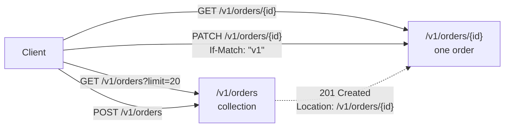
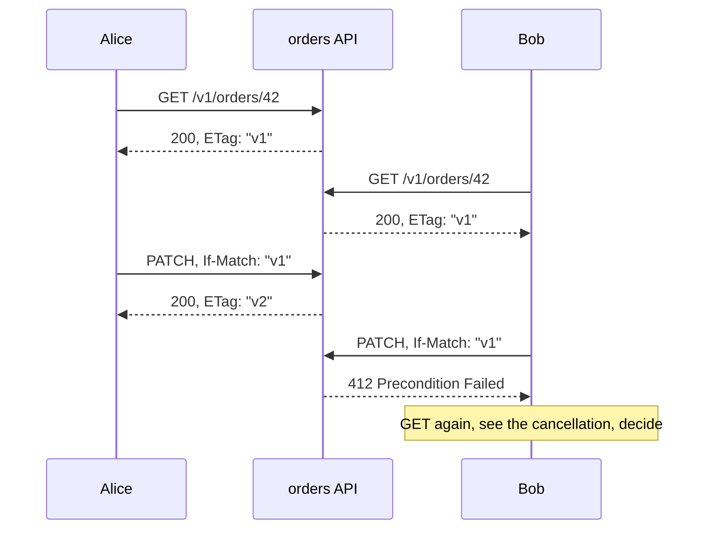

# HTTP API design

## Why care?

Five problems that teams with JSON-over-HTTP APIs report again and again:

- "The client retried a `POST` after a timeout, and the customer got two orders."
- "Our errors are `{"error": "something went wrong"}`. The partner team parses the English text to decide what to do."
- "`GET /orders?page=40` takes 9 seconds, and while a user pages through, orders appear twice or go missing."
- "Two support agents edited the same order at the same time. The second save silently overwrote the first."
- "Nobody knows which fields the API returns. The documentation is a wiki page from two years ago."

A public API is a **one-way door** in the sense of [Thinking in trade-offs](trade-offs.md): once other teams depend on it, every mistake in it stays with you for years. Most of these mistakes have standard solutions in HTTP itself. This page covers them in the order you meet them when you design an endpoint: resources and URLs, methods, status codes, errors (RFC 9457), pagination, conditional requests with ETags, and a machine-readable contract in OpenAPI. The running example is the real `examples/orders/internal/httpapi` package. In the Try it section you extend a copy of it with typed errors, cursor pagination and `If-Match`.

This page is about the **contract**: what a client sends and what it gets back. How HTTP moves bytes over connections is in [HTTP/1.1, HTTP/2 and HTTP/3](../networking/http.md). How the Go handlers are wired is in [Building a service](../go/services.md).

## The idea: resources with a uniform interface

An HTTP API is designed around **resources**. A resource is anything with a name that a client can refer to: one order, the list of all orders, the items of one order. Each resource has a **URL** that identifies it.

Clients act on resources with a small, fixed set of **methods** (`GET`, `POST`, `PUT`, `PATCH`, `DELETE`). Every resource uses the same methods with the same meaning. This is the **uniform interface**, and it is the main difference from remote procedure calls (RPC), where every operation has its own name (`createOrder`, `cancelOrderNow`, `getOrdersForCustomerV2`).

The uniform interface has a practical benefit: software between the client and the server understands it without knowing your API. A cache knows that `GET` can be cached. A proxy knows that `PUT` can be retried. A client library knows that `412` means "your copy is old". You get this behaviour for free when you use HTTP as designed, and you lose it when you send everything as `POST /api`.



The `orders` API has exactly this shape: a collection (`/v1/orders`) and its members (`/v1/orders/{id}`).

## Under the hood: resources and URLs

### Naming rules

| Rule                                         | Good                     | Avoid                         |
| -------------------------------------------- | ------------------------ | ----------------------------- |
| Nouns for resources, methods for actions     | `POST /v1/orders`        | `POST /v1/createOrder`        |
| Plural collection, ID for a member           | `/v1/orders/{id}`        | `/v1/order?id=...`            |
| Nest only for real ownership, one level deep | `/v1/orders/{id}/items`  | `/v1/customers/1/orders/2/…`  |
| Filters, sorting and paging in the query     | `/v1/orders?status=paid` | `/v1/orders/paid`             |
| Opaque, stable IDs                           | `019ac0de-…` (UUIDv7)    | Database row numbers          |
| Major version in the path                    | `/v1/orders`             | A version in every field name |

Two of these rules need an explanation.

**IDs.** The ID in a URL is a one-way door. Clients store it, log it and put it in their own databases. `orders` uses UUIDv7 (see [Building a service](../go/services.md)): it reveals nothing about how many orders exist, it can be generated without asking the database, and it sorts by creation time. Sequential integers leak business numbers and invite clients to guess other customers' IDs.

**Actions that are not create, read, update or delete.** "Cancel an order" is a change of state, so it fits `PATCH /v1/orders/{id}` with `{"status": "cancelled"}`. Some actions do not fit any resource well, for example "send the invoice again". For those, a sub-resource that represents the action is acceptable: `POST /v1/orders/{id}/invoice-deliveries`. Use this sparingly; if most of your endpoints are verbs, you are designing RPC, and [gRPC](grpc-and-protobuf.md) may be the better tool.

### Versioning

`orders` puts the major version in the path: `/v1/`. A new major version is a new contract that runs next to the old one, and it is expensive for everyone, so you want to need one rarely. Most changes can be made **compatible** instead: add a field, add an endpoint, accept a new optional parameter. The rules for that are in [Evolving APIs](evolving-apis.md).

## Under the hood: methods

RFC 9110 defines two properties for every method:

- **Safe**: the client does not ask for a change on the server. A crawler, a cache or a prefetcher may send it at any time.
- **Idempotent**: sending the same request twice has the same effect on the server as sending it once. A client or proxy may retry it after a timeout without asking the user.

| Method   | Safe | Idempotent | Typical use                                      | `orders` route            |
| -------- | ---- | ---------- | ------------------------------------------------ | ------------------------- |
| `GET`    | yes  | yes        | Read a resource                                  | `GET /v1/orders`, `/{id}` |
| `HEAD`   | yes  | yes        | Like `GET`, headers only                         | automatic for every `GET` |
| `POST`   | no   | **no**     | Create a member of a collection, start an action | `POST /v1/orders`         |
| `PUT`    | no   | yes        | Replace a resource with the body                 |                           |
| `PATCH`  | no   | no (\*)    | Change part of a resource                        | Try it: cancel            |
| `DELETE` | no   | yes        | Remove a resource                                |                           |

(\*) `PATCH` is not idempotent in general. A merge patch that sets `status` to a value is idempotent in effect, and with `If-Match` (below) a repeat is rejected anyway.

Idempotent describes the **effect on the server**, not the response. A second `DELETE` of the same order may answer `404` instead of `204`; it is still idempotent, because the server state is the same.

`POST` is the method that causes duplicate orders. A client sends `POST /v1/orders`, the network times out, and the client cannot know whether the order was created. The standard fix is an `Idempotency-Key` header that the client generates once per logical operation and the server remembers. It is covered in full in [Retries and idempotency](../distributed-systems/retries-and-idempotency.md#idempotency-keys-make-the-retry-safe).

Go's `http.ServeMux` follows the method rules for you. A `GET` pattern also matches `HEAD`, and a request with a method that no pattern allows gets `405` with an `Allow` header. Build the real `ordersd` and send it requests (any free port other than 8080 works):

```console
$ cd examples/orders
$ go build -o bin/ ./cmd/...
$ ./bin/ordersd -addr 127.0.0.1:18081 &
$ curl -si -X DELETE 127.0.0.1:18081/v1/orders
HTTP/1.1 405 Method Not Allowed
Allow: GET, HEAD, POST
Content-Type: text/plain; charset=utf-8
X-Content-Type-Options: nosniff
X-Request-Id: 01a21db6-6f3e-7b0b-8bea-9ed1aa7983d4
Date: Fri, 27 Nov 2026 15:53:45 GMT
Content-Length: 19

Method Not Allowed
```

Note the `Content-Type`: `text/plain`. This answer comes from the mux, not from the `orders` handlers, so it does not use the JSON error format described below. The section [Traps](#traps) comes back to this.

## Under the hood: status codes

A status code tells the client **what kind of thing happened**, so that generic code can react without reading the body. Use a small set and use it consistently:

| Code  | Meaning                | Use it when                                                           |
| ----- | ---------------------- | --------------------------------------------------------------------- |
| `200` | OK                     | A read or an update succeeded and the body has the result             |
| `201` | Created                | `POST` created a resource; send `Location` with its URL               |
| `204` | No Content             | Success with no body, for example `DELETE`                            |
| `304` | Not Modified           | A conditional `GET` and the client's copy is still current            |
| `400` | Bad Request            | Malformed syntax, an unknown field, an invalid query parameter        |
| `401` | Unauthorized           | No valid credentials (despite the name, it means "not authenticated") |
| `403` | Forbidden              | Authenticated, but not allowed to do this                             |
| `404` | Not Found              | The resource does not exist, **or** the caller may not know it exists |
| `409` | Conflict               | The request conflicts with the current state (cancel a shipped order) |
| `412` | Precondition Failed    | `If-Match` did not match: the client's copy is old                    |
| `415` | Unsupported Media Type | Wrong `Content-Type`                                                  |
| `422` | Unprocessable Content  | Well-formed, but the values break a rule                              |
| `428` | Precondition Required  | The server requires `If-Match` and the client did not send it         |
| `429` | Too Many Requests      | Rate limit; send `Retry-After`                                        |
| `500` | Internal Server Error  | A bug or an unexpected failure; never show the details                |
| `503` | Service Unavailable    | Overloaded or shutting down; send `Retry-After` if you know           |

Three decisions come up in every design review:

- **`400` or `422` for validation errors?** Both are correct by RFC 9110. `orders` uses `400` for all bad input, which is simple and common. Many APIs use `422` for "valid JSON, invalid values". Choose one rule, write it down, and apply it everywhere. Go's `http.StatusText(422)` still returns the old name "Unprocessable Entity"; RFC 9110 renamed it to "Unprocessable Content".
- **`403` or `404` for another customer's order?** If the caller may not even know that the order exists, answer `404`. A `403` confirms that the ID is valid. See [Authorization](../security/authorization.md).
- **`409` or `412`?** `412` means "your precondition (`If-Match`) failed": the client should read again and retry. `409` means "the request is not allowed in the current state", even with fresh data: retrying will not help. Try it shows both.

The `5xx` codes mean "the server failed", and clients and load balancers treat them as retryable. Never return `500` for bad input, and never return `200` with `{"error": ...}` in the body: both break every generic client, retry policy and dashboard.

## Under the hood: errors with RFC 9457 problem details

An error body needs a standard shape, so that clients, gateways and logging tools can read it without custom code. **RFC 9457, "Problem Details for HTTP APIs"** (2023, it replaces RFC 7807) defines one. The media type is `application/problem+json`, and the members are:

| Member     | Meaning                                                                                       |
| ---------- | --------------------------------------------------------------------------------------------- |
| `type`     | A URI that identifies the **kind** of problem. Clients switch on this. Default `about:blank`. |
| `title`    | A short summary of the kind, the same for every occurrence.                                   |
| `status`   | The HTTP status code, repeated for convenience.                                               |
| `detail`   | An explanation of **this** occurrence, for humans.                                            |
| `instance` | A URI that identifies this occurrence, for example a link to a log entry.                     |

Any other member is an **extension**. `orders` already adds `request_id`. The real service answers an unknown order like this:

```console
$ curl -si 127.0.0.1:18081/v1/orders/019ac0de-0000-7000-8000-000000000001
HTTP/1.1 404 Not Found
Content-Type: application/problem+json
X-Content-Type-Options: nosniff
X-Request-Id: 01a21db6-82ce-72c4-ab10-64f155f66738
Date: Fri, 27 Nov 2026 15:53:50 GMT
Content-Length: 135

{"type":"about:blank","title":"Not Found","status":404,"detail":"order not found","request_id":"01a21db6-82ce-72c4-ab10-64f155f66738"}
```

`about:blank` is a special type. It says: "this problem has no meaning beyond the status code". With `about:blank`, the `title` must be the standard text of the status code. That is correct here: a `404` needs no further type.

It is not enough when the client must react differently to problems that share a status code. A `400` can mean "your JSON is broken" (a bug in the client) or "the customer ID is missing" (show a message to the user). A `412` and a `409` both need specific handling. For those cases, define your own **problem types**:

- Give each type a stable URI that you own, for example `https://api.acme.example/problems/invalid-order`. The URI is an identifier; it does not have to resolve, but a page with documentation at that address is helpful.
- Keep `title` the same for every occurrence of a type, and put the specific text in `detail`.
- Add extension members for data that a program needs, such as a list of the broken rules. Never make a client parse `detail`.
- Treat the list of types as part of the contract. Adding a type is a compatible change. Changing the meaning of a type is not.

!!! warning "Problem details must not leak internals"

    `detail` is shown to clients. An error such as `dial tcp 10.0.0.7:5432: connection refused`
    reveals your network and your database. `orders` logs such errors in full with the request ID
    and returns a generic `500` (see [Building a service](../go/services.md#errors-to-http-one-place)).
    Only errors written for clients, such as validation messages, go into `detail`. More on this
    in [Web and API security](../security/web-and-api-security.md).

The `request_id` extension connects the client's view with the server's logs. A support ticket that quotes the request ID leads directly to the log line ([Structured logging](../observability/structured-logging.md)).

## Under the hood: pagination

A collection can grow without limit, so a list endpoint must return it in **pages**. There are two common designs.

**Offset pagination** (`?offset=40&limit=20`, or `?page=3`) asks the database to skip rows. It has two problems:

1. **It is slow for deep pages.** `OFFSET 100000` makes the database read and discard 100,000 rows before it returns 20 (see [Query planning](../databases/query-planning.md)).
2. **It is unstable while data changes.** If a new order is inserted before the current position, every row moves down by one. The client sees one order twice. If an order is deleted, the client misses one.

**Cursor pagination** (also called keyset pagination) remembers **where the last page ended**, not how many rows to skip. The server sorts by a unique, stable key, here `(created_at, id)`, and the next page starts strictly after the last key the client saw:

```sql
SELECT ... FROM orders
WHERE (created_at, id) > ($1, $2)
ORDER BY created_at, id
LIMIT 21;
```

With an index on `(created_at, id)`, every page costs the same, however deep it is ([Indexes](../databases/indexes.md)). Inserts and deletes before the cursor do not move it, so no order appears twice.

The server returns the cursor as an **opaque page token**: a string that the client sends back unchanged and must not build or parse. Opaque tokens let you change the sort key or the encoding later without breaking clients. Opaque is not the same as secret, as Try it shows: if the token contains anything sensitive, encrypt or sign it.

Cursor pagination has one cost: a client cannot jump to "page 37". For APIs that is rarely a real need; for user interfaces with page numbers, offset pagination over a small, bounded result can still be the better choice.

Common rules for the contract:

- A **default** page size and a **maximum**. Reject larger values with `400`, or clamp them and document it. Never return everything.
- The response has the token for the next page, and **no token on the last page**. Clients loop until the token is missing.
- Fetch `limit + 1` rows. If the extra row exists, there is a next page. This avoids a separate `COUNT(*)`, which is expensive on large tables.

## Under the hood: conditional requests and ETags

### The lost update

Two support agents open the same order. Alice cancels it. Bob, still looking at his old copy, changes the shipping address and saves. Without protection, the server accepts Bob's write, and nobody notices that he acted on old data. This is the **lost update** problem.



HTTP solves this with **conditional requests** (RFC 9110, section 13). This is **optimistic concurrency control**: the server does not lock the order while a person looks at it. It only checks, at write time, that the data has not changed since the client read it.

### ETags

An **entity tag** (`ETag` header) is a short string that identifies one version of a resource's representation. When the resource changes, the ETag changes. The server chooses how to compute it: a version number, a hash of the body, or a database row version.

- A **strong** ETag (`"v2"`) promises that two responses with the same tag are byte-for-byte identical.
- A **weak** ETag (`W/"v2"`) only promises that they are equivalent in meaning, for example the same data with different JSON whitespace.

### The conditional headers

| Request header  | Used with           | Server answers when the condition fails | Comparison |
| --------------- | ------------------- | --------------------------------------- | ---------- |
| `If-None-Match` | `GET`               | `304 Not Modified`, no body             | weak       |
| `If-Match`      | `PUT`, `PATCH`, ... | `412 Precondition Failed`               | strong     |

- `If-None-Match` on `GET` saves bandwidth: "send the body only if it is different from what I have". Caches and browsers use it automatically.
- `If-Match` on a write prevents lost updates: "apply this only if the resource is still the version I read". A weak ETag never matches in `If-Match`.
- A server that wants to forbid blind writes answers `428 Precondition Required` when `If-Match` is missing (RFC 6585).

The check must be **atomic** with the write. If the server reads the version, compares it, and then writes in a separate step, two requests can pass the check at the same time. In SQL, put the version in the `WHERE` clause: `UPDATE orders SET ..., version = version + 1 WHERE id = $1 AND version = $2`, and treat "0 rows updated" as a failed precondition. Transactions and locks are covered in [MVCC and locks](../databases/mvcc-and-locks.md).

## Under the hood: OpenAPI, the contract as a file

An API needs a description that machines can read: to generate client code, to validate requests in a gateway, to produce documentation, and to detect breaking changes in CI. For JSON over HTTP, the standard format is **OpenAPI** (version 3.1 is the current widely supported version; it aligns its schemas with JSON Schema).

There are two ways to work with it:

- **Design first**: write the OpenAPI file, review it with the client teams, then implement it. The contract is agreed before any code exists, which suits APIs that other teams or companies use.
- **Code first**: generate the file from the Go code. It is always in sync with the code, but reviewers see the contract only after it is built.

For a public API, design first is usually the better choice: the review of the contract is the most valuable review, and it is cheapest before the code exists. Whichever way you choose, check the file into the repository next to the code, and review changes to it like code.

Here is a sketch for the extended `orders` API from Try it. It is a starting point, not a complete file: it shows the structure and the parts that matter for this page.

```yaml
openapi: 3.1.0
info:
  title: Orders API
  version: 1.1.0
servers:
  - url: https://api.acme.example
paths:
  /v1/orders:
    get:
      operationId: listOrders
      parameters:
        - {
            name: limit,
            in: query,
            schema: { type: integer, minimum: 1, maximum: 100, default: 20 },
          }
        - { name: page_token, in: query, schema: { type: string } }
      responses:
        "200":
          description: One page of orders, oldest first.
          content:
            application/json:
              schema: { $ref: "#/components/schemas/OrderList" }
        "400": { $ref: "#/components/responses/Problem" }
    post:
      operationId: createOrder
      requestBody:
        required: true
        content:
          application/json:
            schema: { $ref: "#/components/schemas/NewOrder" }
      responses:
        "201":
          description: Created.
          headers:
            Location: { schema: { type: string } }
            ETag: { schema: { type: string } }
          content:
            application/json:
              schema: { $ref: "#/components/schemas/Order" }
        "400": { $ref: "#/components/responses/Problem" }
  /v1/orders/{id}:
    parameters:
      - {
          name: id,
          in: path,
          required: true,
          schema: { type: string, format: uuid },
        }
    get:
      operationId: getOrder
      parameters:
        - { name: If-None-Match, in: header, schema: { type: string } }
      responses:
        "200":
          description: The order.
          headers:
            ETag: { schema: { type: string } }
          content:
            application/json:
              schema: { $ref: "#/components/schemas/Order" }
        "304": { description: Not modified. }
        "404": { $ref: "#/components/responses/Problem" }
    patch:
      operationId: cancelOrder
      parameters:
        - {
            name: If-Match,
            in: header,
            required: true,
            schema: { type: string },
          }
      requestBody:
        required: true
        content:
          application/merge-patch+json:
            schema:
              type: object
              additionalProperties: false
              required: [status]
              properties:
                status: { const: cancelled }
      responses:
        "200":
          {
            description: Cancelled.,
            content:
              {
                application/json:
                  { schema: { $ref: "#/components/schemas/Order" } },
              },
          }
        "409": { $ref: "#/components/responses/Problem" }
        "412": { $ref: "#/components/responses/Problem" }
        "428": { $ref: "#/components/responses/Problem" }
components:
  responses:
    Problem:
      description: An RFC 9457 problem.
      content:
        application/problem+json:
          schema: { $ref: "#/components/schemas/Problem" }
  schemas:
    Problem:
      type: object
      required: [type, title, status]
      properties:
        type: { type: string, format: uri }
        title: { type: string }
        status: { type: integer }
        detail: { type: string }
        request_id: { type: string }
        errors: { type: array, items: { type: string } }
    Item:
      type: object
      additionalProperties: false
      required: [sku, quantity, price_cents]
      properties:
        sku: { type: string, minLength: 1 }
        quantity: { type: integer, minimum: 1, maximum: 1000 }
        price_cents: { type: integer, format: int64, minimum: 0 }
    NewOrder:
      type: object
      additionalProperties: false
      required: [customer_id, items]
      properties:
        customer_id: { type: string, minLength: 1 }
        items:
          {
            type: array,
            minItems: 1,
            maxItems: 100,
            items: { $ref: "#/components/schemas/Item" },
          }
    Order:
      type: object
      required: [id, customer_id, items, status, total_cents, created_at]
      properties:
        id: { type: string, format: uuid }
        customer_id: { type: string }
        items: { type: array, items: { $ref: "#/components/schemas/Item" } }
        status: { type: string, enum: [pending, paid, shipped, cancelled] }
        total_cents: { type: integer, format: int64 }
        created_at: { type: string, format: date-time }
    OrderList:
      type: object
      required: [orders]
      properties:
        orders: { type: array, items: { $ref: "#/components/schemas/Order" } }
        next_page_token:
          { type: string, description: Absent on the last page. Opaque. }
```

<!-- TODO(real-output): no OpenAPI linter is installed on this machine; validate the sketch with an OpenAPI linter (for example Redocly CLI or Spectral) and show its real output. -->

Note how the domain rules from `internal/order` (at most 100 items, quantity 1 to 1000, price not negative) appear again as schema limits. That is useful for clients and gateways, and it is also duplication: when the rule changes in Go, the file must change too. A contract test that sends the examples from the file to the real handler keeps the two in line ([Evolving APIs](evolving-apis.md)).

## Try it: extend a copy of `httpapi`

You will add three features to a copy of `examples/orders`, and check every one of them with in-process tests. In-process means the test calls the handler directly with `httptest.NewRecorder`, with no network and no running server. All write requests on this page go through such tests.

```shell
cp -r examples/orders ~/tutor/httpapi
cd ~/tutor/httpapi
```

The changes touch `internal/order` (a version number and two operations), `internal/storage/memory` (the store), and `internal/httpapi` (the contract). The domain still knows nothing about HTTP.

A test helper, `call`, sends one request to the handler and, with `go test -v`, prints the exchange: `>` lines are the request and `<` lines the response. It prints only the `Content-Type`, `Location` and `ETag` response headers, and it re-indents JSON bodies so they are easier to read. Every request carries `X-Request-ID: req-<method>`, so the IDs in the output are short.

### Step 1: problem types for validation errors

In `respond.go`, the `problem` type gets an `errors` extension member, and three problem types are defined:

```go
type problem struct {
	Type      string `json:"type"`
	Title     string `json:"title"`
	Status    int    `json:"status"`
	Detail    string `json:"detail,omitzero"`
	RequestID string `json:"request_id,omitzero"`
	// Errors is an extension member for validation problems: one entry per
	// broken rule, so a client can show each next to the right field.
	Errors []string `json:"errors,omitzero"`
}

// Problem types. A type is a URI that names the kind of problem; clients
// switch on it, never on the human-readable title or detail.
const (
	typeInvalidOrder = "https://api.acme.example/problems/invalid-order"
	typeStaleOrder   = "https://api.acme.example/problems/stale-order"
	typeOrderState   = "https://api.acme.example/problems/order-state"
)
```

`writeError` is still the one place where domain errors become HTTP answers. Its validation case now sends a typed problem:

```go
	case errors.Is(err, order.ErrInvalid):
		// Validation messages are written for clients, so they are safe to show.
		a.send(w, r, problem{
			Type:   typeInvalidOrder,
			Title:  "Invalid order",
			Status: http.StatusBadRequest,
			// Same detail as before: orderctl prints it, so changing it would
			// break a client. The errors member is new, and adding is safe.
			Detail: strings.ReplaceAll(err.Error(), "\n", "; "),
			Errors: ruleErrors(err),
		})
```

`ruleErrors` walks the error tree that `NewOrder.Validate` builds with `errors.Join`, and returns one string per broken rule.

The comment on `Detail` records a real lesson. A first version of this change put a short generic sentence in `detail`. The existing test `TestErrors` failed at once, because it expects the old text, and so does `orderctl`, which prints `detail` to the user. Changing the content of an existing member is a breaking change even when the JSON shape stays the same. Adding the `errors` member is compatible. [Evolving APIs](evolving-apis.md) builds on this.

Run the test:

```console
$ go test -count=1 -run TestProblemDetails -v ./internal/httpapi/
=== RUN   TestProblemDetails
> POST /v1/orders
> Content-Type: application/json
>
> {"customer_id":"","items":[{"sku":"BOOK-1","quantity":0,"price_cents":-5}]}
< 400 Bad Request
< Content-Type: application/problem+json
<
{
  "type": "https://api.acme.example/problems/invalid-order",
  "title": "Invalid order",
  "status": 400,
  "detail": "invalid order: customer ID is required; item 0: quantity must be between 1 and 1000, got 0; item 0: price must not be negative, got -5",
  "request_id": "req-post",
  "errors": [
    "customer ID is required",
    "item 0: quantity must be between 1 and 1000, got 0",
    "item 0: price must not be negative, got -5"
  ]
}

--- PASS: TestProblemDetails (0.00s)
PASS
ok  	github.com/acme/orders/internal/httpapi	0.004s
```

A client now checks `type`, and shows each entry of `errors` to the user. It never needs to split `detail`.

### Step 2: cursor pagination

The domain gets a `Cursor` (the sort key of the last order seen) and the `Repository` gets a method that lists after it:

```go
// ListAfter returns at most limit orders that sort after c, by
// (CreatedAt, ID). The zero Cursor means "from the start".
ListAfter(ctx context.Context, c Cursor, limit int) ([]Order, error)

// Cursor is a position in the list of orders: the sort key of the last
// order a client has seen.
type Cursor struct {
	CreatedAt time.Time
	ID        uuid.UUID
}
```

The cursor belongs in the repository, not in the handler. A handler that loads all orders and then skips some would make every page as expensive as the whole list. The memory store does a binary search; a SQL store runs the `WHERE (created_at, id) > ($1, $2)` query from above.

The handler validates `limit`, decodes the token, asks for one extra order, and creates the next token from the last order it returns:

```go
	// Ask for one more than we return: if it exists, there is a next page.
	orders, err := a.svc.ListPage(r.Context(), cur, limit+1)
	if err != nil {
		a.writeError(w, r, err)
		return
	}
	var resp listOrdersResponse
	if len(orders) > limit {
		orders = orders[:limit]
		resp.NextPageToken = encodeCursor(orders[limit-1])
	}
```

```go
// Page tokens are opaque to clients: base64url of "created_at|id". Clients
// must not build or parse them, so we can change the format at any time.
func encodeCursor(o order.Order) string {
	raw := o.CreatedAt.Format(time.RFC3339Nano) + "|" + o.ID.String()
	return base64.RawURLEncoding.EncodeToString([]byte(raw))
}
```

The test creates five orders, then follows the tokens with `limit=2` until there is no token, and checks that it saw each order exactly once, oldest first. The full output has every order body; `grep` keeps the request lines, the status lines, the customer IDs and the tokens:

```console
$ go test -count=1 -run TestCursorPagination -v ./internal/httpapi/ \
    | grep -E '^> GET|^< [0-9]|customer_id|next_page_token|detail'
> GET /v1/orders?limit=2
< 200 OK
      "customer_id": "c-1",
      "customer_id": "c-2",
  "next_page_token": "MjAyNi0xMS0yN1QxNTo1NzowMS4xMzUyMTQyMzJafDAxYTIxZGI5LTZkNGYtNzM2YS1hM2QwLTlhM2JhODVmYTQ2ZQ"
> GET /v1/orders?limit=2&page_token=MjAyNi0xMS0yN1QxNTo1NzowMS4xMzUyMTQyMzJafDAxYTIxZGI5LTZkNGYtNzM2YS1hM2QwLTlhM2JhODVmYTQ2ZQ
< 200 OK
      "customer_id": "c-3",
      "customer_id": "c-4",
  "next_page_token": "MjAyNi0xMS0yN1QxNTo1NzowMS4xMzUyMzgyMDVafDAxYTIxZGI5LTZkNGYtNzNjYy05MmM0LTU0ODlhYjdjZmZmMA"
> GET /v1/orders?limit=2&page_token=MjAyNi0xMS0yN1QxNTo1NzowMS4xMzUyMzgyMDVafDAxYTIxZGI5LTZkNGYtNzNjYy05MmM0LTU0ODlhYjdjZmZmMA
< 200 OK
      "customer_id": "c-5",
> GET /v1/orders?limit=500
< 400 Bad Request
  "detail": "limit must be between 1 and 100",
```

The third page has one order and no `next_page_token`, so the client stops. The last request shows the maximum page size at work.

The token looks opaque, but it is only encoded. Anyone can decode it (`base64 -d` needs the `=` padding that base64url leaves out):

```console
$ echo 'MjAyNi0xMS0yN1QxNTo1NzowMS4xMzUyMTQyMzJafDAxYTIxZGI5LTZkNGYtNzM2YS1hM2QwLTlhM2JhODVmYTQ2ZQ==' | base64 -d
2026-11-27T15:57:01.135214232Z|01a21db9-6d4f-736a-a3d0-9a3ba85fa46e
```

Here that is acceptable: the token contains a timestamp and an order ID that the client has already seen. If a token ever contains a filter on data the caller may not see, or an internal value, sign or encrypt it, and reject tokens that were changed.

### Step 3: ETags, `If-None-Match` and `If-Match`

The domain `Order` gets a `Version` that starts at 1 and grows by one on every change. Two new errors describe the two ways a change can fail, still without any HTTP in them:

```go
	// ErrConflict means the change is not allowed in the order's current state.
	ErrConflict = errors.New("order state conflict")
	// ErrStale means the caller's version is old: someone else changed the order.
	ErrStale = errors.New("order version is stale")
```

The repository's `Update` does the version check and the write in one step, under the store's lock. This is the atomic check from the section on ETags:

```go
// Update implements order.Repository.
func (s *Store) Update(ctx context.Context, o order.Order, wantVersion int) error {
	if err := ctx.Err(); err != nil {
		return err
	}
	s.mu.Lock()
	defer s.mu.Unlock()
	cur, ok := s.orders[o.ID]
	if !ok {
		return order.ErrNotFound
	}
	if cur.Version != wantVersion {
		return order.ErrStale
	}
	s.orders[o.ID] = clone(o)
	return nil
}
```

In `httpapi`, the ETag is derived from the version. A version-based tag can be strong because the JSON representation of an order is fully determined by its version:

```go
// etag is a strong entity tag for one order. The version changes on every
// write, so it changes whenever the JSON representation does.
func etag(o order.Order) string { return fmt.Sprintf(`"v%d"`, o.Version) }
```

The new route `PATCH /v1/orders/{id}` accepts a JSON Merge Patch (RFC 7396, media type `application/merge-patch+json`) that may only set `status` to `"cancelled"`. The handler requires `If-Match`, compares it with the current ETag, and maps the domain errors: `ErrStale` to `412`, `ErrConflict` to `409`:

```go
	ifMatch := r.Header.Get("If-Match")
	if ifMatch == "" {
		a.writeProblem(w, r, http.StatusPreconditionRequired, "send If-Match with the ETag from your last GET")
		return
	}
```

The test plays the Alice and Bob story from the sequence diagram:

```console
$ go test -count=1 -run TestConditionalRequests -v ./internal/httpapi/
=== RUN   TestConditionalRequests
> POST /v1/orders
> Content-Type: application/json
>
> {"customer_id":"c-42","items":[{"sku":"BOOK-1","quantity":2,"price_cents":1250}]}
< 201 Created
< Content-Type: application/json
< Location: /v1/orders/01a21db9-43a3-75c9-acca-2419e05eed46
< ETag: "v1"
<
{
  "id": "01a21db9-43a3-75c9-acca-2419e05eed46",
  "customer_id": "c-42",
  "items": [
    {
      "sku": "BOOK-1",
      "quantity": 2,
      "price_cents": 1250
    }
  ],
  "status": "pending",
  "total_cents": 2500,
  "created_at": "2026-11-27T15:56:50.467363369Z"
}

> GET /v1/orders/01a21db9-43a3-75c9-acca-2419e05eed46
< 200 OK
< Content-Type: application/json
< ETag: "v1"
<
{
  "id": "01a21db9-43a3-75c9-acca-2419e05eed46",
  "customer_id": "c-42",
  "items": [
    {
      "sku": "BOOK-1",
      "quantity": 2,
      "price_cents": 1250
    }
  ],
  "status": "pending",
  "total_cents": 2500,
  "created_at": "2026-11-27T15:56:50.467363369Z"
}

> GET /v1/orders/01a21db9-43a3-75c9-acca-2419e05eed46
> If-None-Match: "v1"
< 304 Not Modified
< ETag: "v1"

> PATCH /v1/orders/01a21db9-43a3-75c9-acca-2419e05eed46
> Content-Type: application/merge-patch+json
>
> {"status":"cancelled"}
< 428 Precondition Required
< Content-Type: application/problem+json
<
{
  "type": "about:blank",
  "title": "Precondition Required",
  "status": 428,
  "detail": "send If-Match with the ETag from your last GET",
  "request_id": "req-patch"
}

> PATCH /v1/orders/01a21db9-43a3-75c9-acca-2419e05eed46
> Content-Type: application/merge-patch+json
> If-Match: "v1"
>
> {"status":"cancelled"}
< 200 OK
< Content-Type: application/json
< ETag: "v2"
<
{
  "id": "01a21db9-43a3-75c9-acca-2419e05eed46",
  "customer_id": "c-42",
  "items": [
    {
      "sku": "BOOK-1",
      "quantity": 2,
      "price_cents": 1250
    }
  ],
  "status": "cancelled",
  "total_cents": 2500,
  "created_at": "2026-11-27T15:56:50.467363369Z"
}

> PATCH /v1/orders/01a21db9-43a3-75c9-acca-2419e05eed46
> Content-Type: application/merge-patch+json
> If-Match: "v1"
>
> {"status":"cancelled"}
< 412 Precondition Failed
< Content-Type: application/problem+json
< ETag: "v2"
<
{
  "type": "https://api.acme.example/problems/stale-order",
  "title": "Order was changed",
  "status": 412,
  "detail": "the order changed since you read it; GET it again and retry",
  "request_id": "req-patch"
}

> PATCH /v1/orders/01a21db9-43a3-75c9-acca-2419e05eed46
> Content-Type: application/merge-patch+json
> If-Match: "v2"
>
> {"status":"cancelled"}
< 409 Conflict
< Content-Type: application/problem+json
<
{
  "type": "https://api.acme.example/problems/order-state",
  "title": "Change not allowed in this state",
  "status": 409,
  "detail": "only pending orders can be cancelled",
  "request_id": "req-patch"
}

--- PASS: TestConditionalRequests (0.00s)
PASS
ok  	github.com/acme/orders/internal/httpapi	0.005s
```

Read the exchanges in order:

1. `POST` returns `201` with `Location` and the first ETag, `"v1"`. The client does not need a second request to learn either.
2. `GET` with `If-None-Match: "v1"` returns `304` with no body: the client's copy is current.
3. `PATCH` without `If-Match` is refused with `428`. Blind writes are not possible.
4. Alice's `PATCH` with `"v1"` succeeds and returns the new ETag `"v2"`.
5. Bob's `PATCH` with the old `"v1"` gets `412`. The response includes the current ETag, and the problem `detail` tells him to read again.
6. With the fresh `"v2"` the precondition holds, but the domain rule does not: the order is already cancelled. `409` tells the client that a retry will not help.

Finally, run the whole suite with the race detector, to check that the old tests still pass:

```console
$ go test -race -count=1 ./...
ok  	github.com/acme/orders/cmd/orderctl	1.110s
ok  	github.com/acme/orders/cmd/ordersd	1.082s
ok  	github.com/acme/orders/internal/buildinfo	1.026s
ok  	github.com/acme/orders/internal/client	1.090s
ok  	github.com/acme/orders/internal/config	1.028s
ok  	github.com/acme/orders/internal/httpapi	1.067s
ok  	github.com/acme/orders/internal/order	1.029s
ok  	github.com/acme/orders/internal/storage/memory	1.033s
```

When you are done with the running `ordersd` from the methods section, stop it with `kill %1`.

## Traps

- **Errors from the router in a different format.** The real `ordersd` returns `text/plain` for an unknown path (`404 page not found`) and for a wrong method (`405`), because those answers come from `http.ServeMux`, not from the handlers. Clients that expect `application/problem+json` for every error break here. Add a catch-all route, or wrap the mux to rewrite these answers, if your contract promises problem details for everything.
- **`200` with an error in the body.** Retries, caches, dashboards and client libraries all trust the status code. Use the right one.
- **Clients that parse `detail`.** Then `detail` is part of the contract and you can never improve the text. Give clients a `type` and extension members instead.
- **Offset pagination on a large, changing table.** Slow on deep pages and unstable under inserts. Use a cursor on a unique, indexed sort key.
- **A cursor on a key that is not unique.** Sorting by `created_at` alone skips or repeats orders that share a timestamp. Add the ID as a tie-breaker.
- **An unbounded list endpoint.** One client asks for everything and the service runs out of memory. Always have a maximum page size.
- **Read-compare-write in separate steps.** An `If-Match` check that is not atomic with the write lets two requests pass at once. Put the version in the `UPDATE ... WHERE`.
- **Weak ETags with `If-Match`.** `If-Match` uses strong comparison, so `W/"..."` never matches. Use strong ETags on resources that clients update.
- **A non-idempotent `POST` behind automatic retries.** A gateway or client that retries `POST` creates duplicates. Use an `Idempotency-Key`.
- **The OpenAPI file as an afterthought.** If it is written after the code and never checked, it is wrong within a month. Check it in CI.

## Check yourself

??? question "1. A client sends `DELETE /v1/orders/42` twice. The first answer is `204`, the second is `404`. Is `DELETE` still idempotent?"

    Yes. Idempotency is about the **effect on the server**, not the response. After one or two
    requests, the order is gone. The client can safely retry `DELETE` after a timeout.

??? question "2. Why is `about:blank` the right problem type for \"order not found\", but not for a failed validation?"

    `about:blank` means the problem has no meaning beyond its status code. For "not found", the
    `404` says everything the client needs. A `400` can have several causes that need different
    handling (broken JSON is a client bug; a missing customer ID is a message for the user), so
    validation gets its own type URI and an `errors` extension member.

??? question "3. A user pages through orders with `?offset=` while new orders are created. They report seeing one order twice. Explain the cause and the fix."

    New orders were inserted before the current position, so every row moved down, and the
    first row of the next page was the last row of the previous one. With a cursor on
    `(created_at, id)`, the next page starts strictly after the last key seen, so inserts
    before it do not move it. It is also faster, because the database seeks in an index instead
    of skipping rows.

??? question "4. Bob sends `PATCH` with `If-Match: \"v1\"`, but the order is at `\"v2\"`. What should the server answer, and what should Bob's client do?"

    `412 Precondition Failed`: his copy is old. The client should `GET` the order again, show
    Bob the current state (here: already cancelled), and let him decide. It must not retry the
    same `PATCH` with the new ETag automatically, because that would overwrite the change it
    has never shown him, which is exactly the lost update that `If-Match` is meant to prevent.

??? question "5. Why does the scratch copy put `ListAfter` in the `Repository` instead of paging in the handler?"

    Paging in the handler means loading every order and then dropping most of them, so every
    page costs as much as the whole list. The repository can use an index and read only
    `limit + 1` rows. The domain interface stays free of HTTP: it speaks in cursors and limits,
    not in query parameters and tokens.

??? question "6. You change the `detail` text of the validation problem to a nicer sentence. The JSON shape is the same. Is this a compatible change?"

    Not if any client reads `detail`. In `orders`, `orderctl` prints it and `TestErrors`
    expects it, so the change broke a test at once. The shape of a contract includes the
    meaning and content of fields that clients use. Add new members instead of changing old ones.

## Recap

- Design around **resources** (nouns with URLs) and the **uniform interface** of HTTP methods. Then caches, proxies and client libraries understand your API without extra work.
- **Safe** methods change nothing; **idempotent** methods may be retried. `POST` is neither, so it needs an `Idempotency-Key` when clients retry.
- Use a small, consistent set of **status codes**: `201` with `Location` for creation, `409` for a state conflict, `412` for a stale precondition, `428` when `If-Match` is required.
- Send errors as **RFC 9457 problem details** (`application/problem+json`). Clients switch on `type`; extension members carry data such as the list of broken rules. Never leak internals in `detail`.
- Use **cursor pagination** on a unique, indexed sort key, with an opaque token, a maximum page size, and no token on the last page. Opaque is not secret.
- Prevent lost updates with **ETags** and `If-Match`, and make the version check atomic with the write. `If-None-Match` on `GET` saves bandwidth with `304`.
- Keep the contract in an **OpenAPI** file, reviewed like code, designed first for APIs that other teams use.

Next: the same contract questions with a binary wire format and generated code. [gRPC and Protocol Buffers](grpc-and-protobuf.md).
