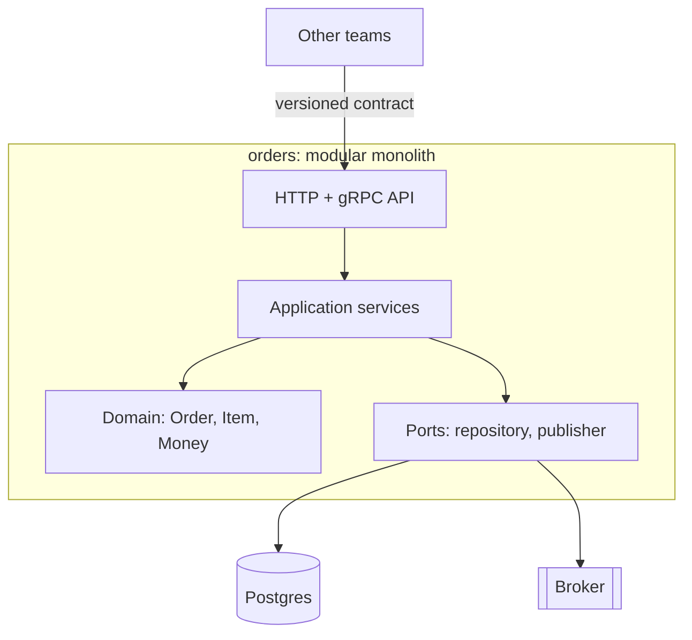

# Architecture and API design

How to split a system into parts, design the contracts between them, and write down why.

## Why go deeper?

Architecture is the set of decisions that are expensive to change later. Bad ones look like this:

- Twelve microservices, one team, and every feature touches six of them.
- A "small" API change breaks three mobile app versions still in use.
- Nobody remembers why the system uses two message brokers, so nobody dares to remove one.
- The `utils` package imports everything, and everything imports `utils`.
- The code says `Account` in one place and `Customer` in another, and they mean the same thing. Or not.

Good architecture is not a diagram with many boxes. It is **clear boundaries**, **stable contracts**, and **written trade-offs**. This chapter takes the package design from the [Go chapter](../go/project-layout.md) up to the level of whole systems.

## The big picture

1. **Boundaries first.** Group code by what changes together, not by technical layer.
2. **Contracts are products.** An API is used by people you do not know. Design it, version it, and evolve it with care.
3. **Every decision is a trade-off.** Write it down (an ADR), with the options you rejected and why.

## Reading order

!!! note "Planned chapter"

    This section is a roadmap. The pages below are written in later sessions and linked here when they land.

| #   | Page                         | You will learn                                                                  |
| --- | ---------------------------- | ------------------------------------------------------------------------------- |
| 1   | Thinking in trade-offs       | Quality attributes, coupling and cohesion, Conway's law, cost of change         |
| 2   | HTTP API design              | Resources, methods, status codes, errors (RFC 9457), pagination, OpenAPI        |
| 3   | gRPC and Protocol Buffers    | The wire format, streaming, deadlines, `buf`, when gRPC beats JSON over HTTP    |
| 4   | Evolving APIs                | Compatible changes, versioning, deprecation, consumer-driven contract tests     |
| 5   | Boundaries and modules       | Monolith, modular monolith, microservices; hexagonal architecture in Go         |
| 6   | Domain modeling              | Ubiquitous language, bounded contexts, aggregates, and DDD without the ceremony |
| 7   | Decision records             | ADRs, RFCs and design docs that people actually read                            |
| 8   | The twelve-factor app, today | Which factors still matter in a Kubernetes world, and which ones changed        |

## How each page works

The same shape as the [Fundamentals](../fundamentals/index.md): **Why care?**, **The idea**, **Under the hood**, **Try it**, **Traps** and **Check yourself**. Most examples redesign parts of the `orders` service, and we write real ADRs for the choices made in earlier chapters.
