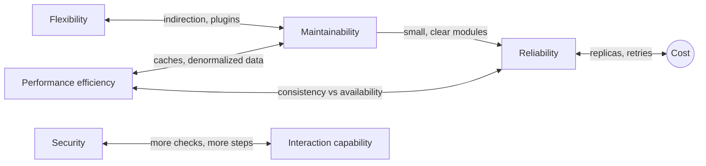
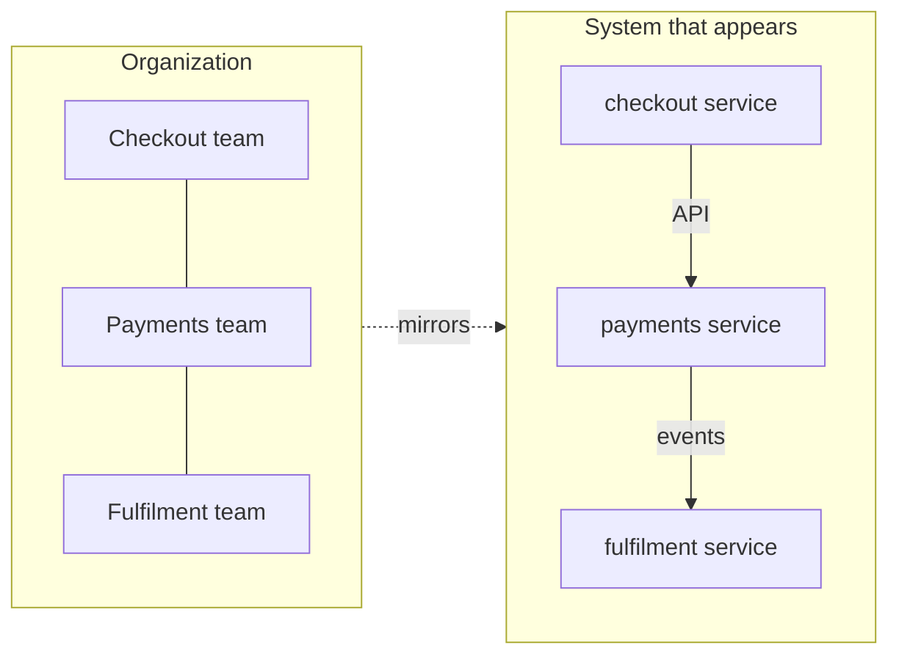

# Thinking in trade-offs

## Why care?

Four requirements from one planning meeting:

- "The orders API must be **fast**." How fast? For whom? At what load?
- "Make it **flexible**, we may need other payment providers one day." Every extra layer makes today's code slower to read and change.
- "Split it into **microservices**." The whole system is built by one team of five people.
- "We can change the **order ID format** later." After 40 partner systems have stored the IDs, that is no longer true.

Each one hides a trade-off. A faster system often costs memory or simplicity. A flexible system costs indirection. Microservices buy independent deployment and pay with network calls, partial failures and many pipelines. And some decisions are cheap to undo while others are almost impossible.

Architecture rarely has one right answer. It is the choice of **which costs you accept** in return for which benefits, made on purpose and written down. This page gives you the terms for that: quality attributes, coupling and cohesion, Conway's law, cost of change, and reversible versus irreversible decisions. Then you measure coupling in `examples/orders` and in this repository with nothing but `go list` and `git log`.

## The idea: qualities share one budget

A **quality attribute** is a property of a system that is not a feature: how fast it is, how often it fails, how easy it is to change. Users rarely ask for these directly, but they decide whether a system succeeds.

Quality attributes are not independent. They draw on the same limited budget: time, money, people, and most of all **complexity**. Improving one usually costs some of another:

- A cache improves latency, but adds a second copy of the data that can be stale, and more code to maintain.
- Replicas and retries improve reliability, but cost money and make failures harder to reason about.
- A plugin system improves flexibility, but every extension point is indirection that a reader must follow.

So the useful question is never "is this good?" It is "is this the right quality for this system, and what does it cost?" The diagram shows common tensions:



Not every relation is a conflict. Maintainability often **supports** reliability: code that people understand is code they can fix quickly during an incident. The skill is to know which qualities matter most for this system, and to state clearly what you give up for them.

## Under the hood: naming the qualities

### ISO 25010: a shared list of words

People mean different things by "quality". The ISO/IEC 25010 standard gives a common list. Its 2023 edition has nine **product quality characteristics**, each with sub-characteristics:

| Characteristic         | In plain words                              | Sub-characteristics (some)                          |
| ---------------------- | ------------------------------------------- | --------------------------------------------------- |
| Functional suitability | Does it do the right thing, correctly?      | Completeness, correctness, appropriateness          |
| Performance efficiency | How fast, how much CPU and memory, how many | Time behaviour, resource utilization, capacity      |
| Compatibility          | Does it work next to and with other systems | Co-existence, interoperability                      |
| Interaction capability | Can people learn and use it?                | Learnability, operability, user error protection    |
| Reliability            | Does it keep working, and come back?        | Faultlessness, availability, fault tolerance        |
| Security               | Only the right people do the right things   | Confidentiality, integrity, authenticity            |
| Maintainability        | How easy is it to understand and change?    | Modularity, reusability, analysability, testability |
| Flexibility            | Can it move to new places and loads?        | Adaptability, scalability, installability           |
| Safety                 | Does it avoid harm to people and property?  | Fail safe, hazard warning, risk identification      |

Older books use the 2011 names: **usability** for interaction capability and **portability** for flexibility. Safety is new in 2023. You do not need to learn the standard by heart. Use its names, so that "maintainability" means the same thing in your design document and in another team's.

!!! tip "Scalability lives under Flexibility"

    In 2023 the standard put **scalability** under flexibility: the ability to adapt to more (or
    less) load. Performance efficiency is how well you use the resources you have; scalability is
    how easily you get more. A service can be fast and still not scale (one big lock), or scale
    well and be slow per request (many network hops).

### Quality attribute scenarios: make "fast" testable

"The API must be fast" cannot be tested, so nobody can say when it is achieved. A **quality attribute scenario** turns a wish into a measurable statement with six parts:

| Part                 | Question                    | Example for `orders`                           |
| -------------------- | --------------------------- | ---------------------------------------------- |
| **Source**           | Who or what causes it?      | Partner checkout systems                       |
| **Stimulus**         | What happens?               | Send `GET /v1/orders/{id}`                     |
| **Artifact**         | Which part of the system?   | `ordersd` and its database                     |
| **Environment**      | Under which conditions?     | Normal load, 300 requests per second, one zone |
| **Response**         | What should the system do?  | Return the order                               |
| **Response measure** | How do we know it was good? | p99 latency under 50 ms over a 5-minute window |

The same shape works for every quality:

- **Availability:** "When one of three `ordersd` pods is killed during peak load, fewer than 0.1% of requests fail, and the error rate is back to normal within 10 seconds."
- **Maintainability:** "A developer new to the team adds a new order status, with tests, in less than one day, touching only `internal/order` and `internal/httpapi`."
- **Security:** "A client with a valid token for customer A that asks for an order of customer B gets `404`, and the attempt is logged with the request ID."

Now you can test the claim, alert on it ([SLOs and alerting](../observability/slos-and-alerting.md)), and, most importantly, **compare options** against it. "Should we add a cache?" becomes "does the p99 scenario fail without one?"

!!! abstract "Convention: no quality requirement without a number"

    **Rule:** every quality requirement in a design doc is written as a scenario with a response
    measure. "Fast", "secure", "scalable" alone are not accepted in review.

    **Why:** without a number, every option "improves performance", and the decision depends on
    opinion. With a number, you know when you are done, and when an expensive option is not needed.

### Pick the few that matter

You cannot maximise nine qualities at once. List the scenarios, then rank each by **business value** (high, medium, low) and **technical risk** (high, medium, low). The few that are high on both drive the architecture. The rest you meet with ordinary good engineering.

For a typical enterprise orders service the top three are often reliability (orders must not be lost), maintainability (the rules change every quarter) and compatibility (many partner systems call it). Raw performance is rarely in the top three. For a trading engine, the ranking is different. The ranking depends on the system, which is why you make it explicit.

## Under the hood: coupling and cohesion

### Definitions

- **Coupling** is how much one part needs to know about another. If changing A forces a change in B, they are coupled.
- **Cohesion** is how much the things **inside** one part belong together. A cohesive package changes for one reason.

The usual goal is **low coupling between parts and high cohesion inside them.** Low does not mean zero: parts must communicate, or the system does nothing. The real question is which coupling you have, whether it is visible, and whether it is worth its cost.

### Kinds of coupling you will meet

| Kind                   | You see it as                                                       | Example in `orders`                                         |
| ---------------------- | ------------------------------------------------------------------- | ----------------------------------------------------------- |
| **Static (code)**      | An `import`, a type, a function call                                | `httpapi` imports `order`                                   |
| **Contract (data)**    | A shared message or JSON shape                                      | `orderctl` and `ordersd` agree on `{"customer_id": ...}`    |
| **Temporal (runtime)** | A must be up and answer before B can finish                         | A synchronous call to a payment service in the request path |
| **Change (logical)**   | Files that change in the same commits, even with no import between  | A wire type and its OpenAPI file                            |
| **Semantic**           | Both sides must share a hidden assumption (units, order, time zone) | "Prices are integer cents" in the client and the server     |

The compiler checks static coupling. No tool checks semantic coupling, so it causes the most surprising failures. `orders` makes one assumption explicit in the type name: `PriceCents int64`, not `Price float64`.

Temporal coupling is the hidden cost of microservices. Two services that call each other synchronously behave like one system with a network in the middle: if one is down, both are effectively down. The [Distributed systems](../distributed-systems/index.md) chapter is mostly about paying this cost well.

### Fan-in, fan-out and instability

For one package, count two numbers:

- **Fan-in** (afferent coupling, _Ca_): how many packages import it. Many importers mean a change here hurts many places.
- **Fan-out** (efferent coupling, _Ce_): how many packages it imports. Many imports mean many reasons to break.

Robert C. Martin combines them into **instability**: `I = Ce / (Ca + Ce)`. `I = 0` is a package that many others use and that uses nothing: it is hard to change, so it should be stable. `I = 1` is a package that nobody imports and that imports many others: it is cheap to change, because no other package depends on it.

The **stable dependencies principle** says: dependencies should point toward stability, from high `I` to low `I`. In Go terms: `main` packages and adapters may import the domain, and the domain imports nothing of yours. That is exactly the [dependency direction](../go/project-layout.md#dependency-direction-the-domain-imports-nothing) from the Go chapter. You will measure it below.

### Cohesion: group by reason to change

A package has high cohesion when everything in it changes for the same reason. That is why the Go chapter groups code [by feature, not by layer](../go/project-layout.md#package-by-feature-not-by-layer): a `models/`, `handlers/`, `services/` split puts one feature in three packages, so every feature change touches all three. That is low cohesion **and** high coupling at the same time.

A simple test: describe the package in one sentence without "and". "Package `order` holds the order rules" passes. "Package `common` has helpers and constants and the DB client" fails.

## Under the hood: Conway's law

In April 1968, Melvin Conway published "How Do Committees Invent?" in _Datamation_. Its thesis, now called **Conway's law**:

> Any organization that designs a system (defined broadly) will produce a design whose structure is a copy of the organization's communication structure.

The reason is practical. People design interfaces where they need to coordinate, and they coordinate along the lines where they communicate. If three teams build a compiler, the result tends to have three main parts. If the frontend team and the backend team rarely talk, the API between them tends to fit neither side well.



Three things follow:

1. **A boundary between teams becomes a boundary in the system.** It will be an API, so it needs the care of [HTTP API design](http-api-design.md) and [Evolving APIs](evolving-apis.md).
2. **Many services for one team works against the law.** Five people who deploy twelve services pay all the costs of distribution and get none of the team independence that services are meant to provide.
3. **The inverse Conway maneuver.** If you want a certain architecture, shape the team structure to match it first. Want an independent payments component? Give it a team that owns it end to end, with its own backlog.

When you draw the components of a new system, draw the owning teams next to them. A component with no owner, or with two owning teams, is a design problem to solve before you build it. Module boundaries inside one team are the topic of [Boundaries and modules](boundaries-and-modules.md).

## Under the hood: cost of change

### What makes a change expensive

A change costs more when it touches more things, and when the things it touches belong to more people:

| Change                                   | Touches                                      | Cost        |
| ---------------------------------------- | -------------------------------------------- | ----------- |
| Rename a local variable                  | One function                                 | Minutes     |
| Rename a field in `internal/order`       | Packages in one module, one PR               | An hour     |
| Rename a JSON field in `/v1/orders`      | Every client, in other teams and companies   | Months      |
| Change the order ID from integer to UUID | Every database, log query, partner system    | A project   |
| Move from one database vendor to another | Every query, backup, runbook, team skill set | A programme |

The pattern: the cost of a change grows with how far its **effects travel**. Inside a package the compiler finds everything. Across a public contract, nothing finds it for you. That is why the Go chapter keeps almost everything in `internal/`, and why the API pages of this chapter treat a contract as a product.

### Reversible and irreversible decisions

Jeff Bezos's 2015 letter to Amazon shareholders splits decisions in two:

- **Type 1 decisions, "one-way doors":** "If you walk through and don’t like what you see on the other side, you can’t get back to where you were before." Make them "methodically, carefully, slowly".
- **Type 2 decisions, "two-way doors":** "changeable, reversible". Make them quickly, in small groups.

The letter's main warning is about the second kind: large organisations tend to use the slow Type 1 process for everything, and become slow.

In a typical service:

| Usually one-way (Type 1)                   | Usually two-way (Type 2)                     |
| ------------------------------------------ | -------------------------------------------- |
| Public API shape, field names, ID formats  | Which HTTP router or logging library you use |
| Data model of stored data, primary keys    | Internal package layout                      |
| Wire format between teams (JSON, protobuf) | Cache in front of a slow call                |
| The system of record for money or orders   | Number of replicas, timeouts, pool sizes     |
| Event names that other teams consume       | An internal function signature               |

Two skills matter more than the list:

1. **Turn one-way doors into two-way doors.** Put a seam in front of the risky choice. `order.Repository` is an interface, so the database is a two-way door: a new store is a new adapter, not a rewrite. A feature flag ([Feature flags](../delivery/feature-flags.md)) makes a new behaviour reversible in seconds. Expand-and-contract migrations ([Migrations](../databases/migrations.md)) make a schema change reversible step by step.
2. **Decide one-way doors at the last responsible moment.** Not at the start, when you know least, and not so late that the choice is made for you by default. "We will choose the message broker when the second consumer appears" is a valid decision, if you write it down.

Write down every one-way decision, with the options you rejected. That is an ADR, the topic of [Decision records](decision-records.md).

## Try it: measure coupling in `examples/orders`

You need a clone of this repository and Go 1.27.

### Step 1: static coupling from `go list`

`go list` knows every import. This prints one line per import edge inside the module:

```console
$ cd examples/orders
$ go list -f '{{range .Imports}}{{$.ImportPath}} {{.}}{{"\n"}}{{end}}' ./... \
    | grep ' github.com/acme/orders/' | sed 's#github.com/acme/orders/##g'
cmd/orderctl internal/buildinfo
cmd/orderctl internal/client
cmd/orderctl internal/order
cmd/ordersd internal/buildinfo
cmd/ordersd internal/config
cmd/ordersd internal/httpapi
cmd/ordersd internal/order
cmd/ordersd internal/storage/memory
internal/client internal/order
internal/httpapi internal/order
internal/storage/memory internal/order
```

The `grep` drops standard library imports: they are stable and never your problem. Now count fan-in, fan-out and instability per package with `awk`:

```console
$ go list -f '{{range .Imports}}{{$.ImportPath}} {{.}}{{"\n"}}{{end}}' ./... \
    | grep ' github.com/acme/orders/' | sed 's#github.com/acme/orders/##g' \
    | awk '{fo[$1]++; fi[$2]++; p[$1]; p[$2]}
           END {for (k in p) printf "%-24s %3d %3d %5.2f\n", k, fi[k], fo[k], fo[k]/(fi[k]+fo[k])}' \
    | sort -k4,4n -k1,1
internal/buildinfo         2   0  0.00
internal/config            1   0  0.00
internal/order             5   0  0.00
internal/client            1   1  0.50
internal/httpapi           1   1  0.50
internal/storage/memory    1   1  0.50
cmd/orderctl               0   3  1.00
cmd/ordersd                0   5  1.00
```

The columns are fan-in, fan-out and instability. How to read it:

- **`internal/order` has fan-in 5 and fan-out 0.** It is the most depended-on package and imports nothing of ours. Every change to it hits five packages, so it must change least and carefully. This is the domain package, and this is the right place for the most stable code.
- **The adapters (`httpapi`, `client`, `storage/memory`) sit at 0.50.** Each depends on the domain and is used by one `main`.
- **The `cmd/` packages are at 1.00.** Nothing imports them, so they are the cheapest place for messy wiring code.
- **Every edge goes from a higher `I` to a lower one.** Check the first list: no line points from a 0.00 package to a 0.50 one. The stable dependencies principle holds.

What would a violation look like? If `internal/order` imported `internal/httpapi` (say, to return an HTTP status from the domain), `order` would get fan-out 1, and Go would refuse to build anyway: `httpapi` already imports `order`, and Go forbids import cycles. In bigger systems the cycle is often longer and not caught. [Boundaries and modules](boundaries-and-modules.md) adds a test that fails the build on such an import.

### Step 2: change coupling from `git log`

Imports show what the **code** says. History shows what **people actually change together**, including files with no import between them. `git log --name-only` lists the files of every commit. This small `awk` script, `cochange.awk`, counts pairs:

```awk
# Input: git log --format='@%h' --name-only. Output: file pairs that changed
# together at least twice, with how often, and the share of changes of A that
# also touched B. Commits with more than 20 files are skipped (bulk edits).
/^@/ { flush(); next }
NF   { f[++n] = $0 }
function flush(   i, j) {
    if (n > 0 && n <= 20)
        for (i = 1; i <= n; i++) {
            c[f[i]]++
            for (j = 1; j <= n; j++) if (i != j) pair[f[i] SUBSEP f[j]]++
        }
    n = 0
}
END {
    flush()
    for (p in pair) {
        split(p, x, SUBSEP)
        if (pair[p] >= 2) printf "%-34s %-28s %2d of %2d  %4.0f%%\n", x[1], x[2], pair[p], c[x[1]], 100 * pair[p] / c[x[1]]
    }
}
```

Run it on the whole repository, sorted by the share:

```console
$ cd ../..
$ git log --no-show-signature --format='@%h' --name-only | awk -f cochange.awk | sort -k6,6nr -k3,3nr | head -8
docs/fundamentals/index.md         zensical.toml                 3 of  3   100%
docs/index.md                      README.md                     3 of  3   100%
docs/index.md                      zensical.toml                 3 of  3   100%
.markdownlint-cli2.yaml            docs/fundamentals/index.md    2 of  2   100%
.markdownlint-cli2.yaml            zensical.toml                 2 of  2   100%
docs/containers/index.md           zensical.toml                 2 of  2   100%
docs/databases/index.md            zensical.toml                 2 of  2   100%
docs/delivery/index.md             zensical.toml                 2 of  2   100%
```

Your numbers will be different: the history grows with every chapter. The shape stays.

- **Every chapter `index.md` changed together with `zensical.toml`, every time.** No import links a Markdown page to a TOML file. But the site navigation lives in `zensical.toml`, so adding a page means editing two files. That is change coupling, and it is a design choice: the nav could also be generated from the folders.
- **`docs/index.md` and `README.md` changed together 3 times out of 3.** They both list the chapters. That is duplication, and duplication always creates change coupling: sooner or later someone updates only one of the two.

Now look from the other side:

```console
$ git log --no-show-signature --format='@%h' --name-only | awk -f cochange.awk | grep '^zensical.toml' | sort -k3,3nr | head -3
zensical.toml                      README.md                     3 of 15    20%
zensical.toml                      docs/fundamentals/index.md    3 of 15    20%
zensical.toml                      docs/index.md                 3 of 15    20%
```

Change coupling is **not symmetric**. When `docs/index.md` changes, `zensical.toml` changes too (100%). When `zensical.toml` changes, `docs/index.md` changes only 20% of the time. `zensical.toml` is the hub that many things depend on, like `internal/order` in step 1.

!!! note "Why not run step 2 on `examples/orders` alone?"

    `git log --oneline -- examples/orders` shows only three commits. Change coupling needs
    history: tens or hundreds of commits. On a young project, use static coupling (step 1); on an
    old one, change coupling finds the coupling that no import shows. Tools such as CodeScene
    and code-maat do the same analysis at scale.

## Traps

- **"Best practice" without a scenario.** A cache, a queue, or a second region is only an improvement if a scenario needs it. Otherwise it is cost and new failure modes.
- **Reading "low coupling" as "no coupling".** Parts must talk. Make coupling explicit (an import, a contract) instead of hidden (a shared database table, a shared assumption).
- **Microservices for one team.** You pay for network calls, partial failures, distributed tracing and many pipelines, and you gain no team independence in return.
- **A `common` or `shared` package.** High fan-in, low cohesion, and every team edits it. It becomes the most coupled thing in the system.
- **Treating every decision as a one-way door.** Long reviews about which logging library to use. Decide two-way doors fast; spend your care on contracts and data.
- **Treating a one-way door as a two-way door.** "We can rename the field later." Not once a partner has shipped a client.
- **Measuring coupling once.** Coupling grows commit by commit. Put the import check in CI ([Boundaries and modules](boundaries-and-modules.md)) and look at change coupling every few months.

## Check yourself

??? question "1. A product owner writes: \"The service must be highly available.\" Rewrite it as a quality attribute scenario."

    For example: "**Source:** a node failure. **Stimulus:** one of three `ordersd` pods dies.
    **Artifact:** the orders API. **Environment:** peak load, 300 requests per second.
    **Response:** traffic moves to the other pods. **Response measure:** fewer than 0.1% of
    requests fail, and the error rate is normal again within 10 seconds." The numbers are the
    point: now you can test it and compare options.

??? question "2. Package `pricing` has fan-in 1 and fan-out 6. Package `money` has fan-in 9 and fan-out 0. Which one may change often, and which import direction is fine?"

    `pricing` has `I = 6/7 ≈ 0.86`: unstable, few depend on it, so it may change often. `money`
    has `I = 0`: stable, nine packages depend on it, so changes must be rare and careful.
    `pricing` importing `money` points toward stability and is fine. `money` importing `pricing`
    would break the stable dependencies principle: a stable package would depend on a volatile one.

??? question "3. Two files never import each other, but they changed together in 18 of 20 commits. What does that tell you, and what can you do?"

    They have strong **change coupling**: a hidden dependency, for example a wire type and its
    hand-written docs, or two copies of the same rule. Options: merge them into one place (one
    source of truth), generate one from the other, or make the dependency explicit with an import
    and a test. Leaving it means someone will one day change only one of them.

??? question "4. Your company has a mobile team, a web team and a backend team. Every feature needs all three. What does Conway's law predict, and what could you change?"

    The system will have the same three parts with two big contracts between them, and every
    feature will need three backlogs and meetings to agree on those contracts. You can design
    the contracts with great care (see the API pages), or apply the inverse Conway maneuver:
    form teams around features or business areas, each with mobile, web and backend skills.

??? question "5. Which of these are one-way doors? (a) the JSON field name `customer_id` in `/v1/orders`, (b) using `log/slog` for logs, (c) the format of order IDs, (d) the HTTP server timeouts."

    (a) and (c) are one-way doors: clients and other systems store and depend on them. (b) and
    (d) are two-way doors: you can change them in one PR and roll back in minutes. Spend review
    time on (a) and (c), and write an ADR for them.

??? question "6. How does the `order.Repository` interface change the cost of the decision \"which database do we use\"?"

    It turns most of a one-way door into a two-way door. The domain and the HTTP layer depend on
    the interface, not on a database, so a new store is a new adapter package plus a data
    migration. The data migration is still expensive; the code change is not.

## Recap

- Architecture is choosing **which costs you accept** for which benefits. Every quality has a cost, often paid in complexity.
- Use the **ISO 25010** names (2023: functional suitability, performance efficiency, compatibility, interaction capability, reliability, security, maintainability, flexibility, safety) so everyone means the same thing.
- Write qualities as **scenarios** with a measurable response. Rank them; only the top few drive the design.
- **Coupling** is what one part must know about another; **cohesion** is how well a part's insides belong together. Watch static, contract, temporal, change and semantic coupling.
- **Instability** `I = Ce / (Ca + Ce)`. Dependencies should point toward stable packages. In `examples/orders`, `internal/order` has `I = 0` and every edge points to it.
- **Change coupling** from `git log` shows dependencies no import shows, and it is not symmetric.
- **Conway's law:** systems copy the communication structure of the organisation. Shape teams and boundaries together.
- The cost of a change grows with how far its effects travel. Separate **one-way doors** (contracts, data, IDs) from **two-way doors**, add seams to make doors reversible, and write the one-way decisions down.

Next: the most common one-way door of all, the public contract of a service. [HTTP API design](http-api-design.md).
