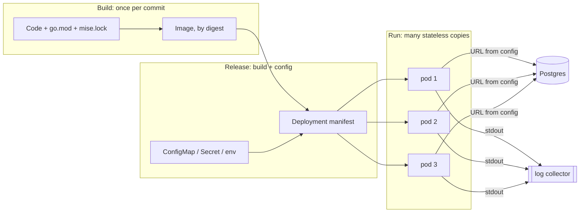

# The twelve-factor app, today

## Why care?

Five typical incidents from a platform team. Each one comes from a service that breaks a rule written down in 2011:

- "The new pod is up, but it still talks to the staging database. The URL is in `application.properties`, inside the image."
- "Scaling from 2 to 3 replicas made the shopping carts disappear for a third of the users."
- "Every rollout gives us a burst of 502s. The pods die mid-request."
- "We can't see the logs. The service writes to `/var/log/orders/orders.log`, and the pod is gone."
- "It works in Docker Compose, it fails in production. Locally we use SQLite."

The **twelve-factor app** is a set of twelve rules, written by engineers at Heroku (Adam Wiggins and others), for building services that a platform can deploy, scale, restart and replace without manual work. Heroku was the platform then. Kubernetes is the common platform now, and it makes the same assumptions, often more strictly. Some factors are now handled by the platform, some have changed, and some are still a common cause of failed rollouts.

This page goes through all twelve, states which ones still need work in your code, and checks each one against the real `ordersd` from the [Go chapter](../go/services.md).

## The idea: processes the platform can replace at any time

A platform such as Kubernetes treats each process as **replaceable**. It starts copies of your service on any node, stops them during every rollout, moves them when a node is drained, and adds or removes copies when load changes. It does this without asking the process, and without a human watching.

That only works if the process makes no assumptions about the machine it runs on. The twelve factors are the list of those assumptions to avoid:

- **The artifact is the same everywhere.** It is built once and does not contain anything that differs per environment. Everything that differs (addresses, credentials, log level) is **config**, given to the process from outside.
- **The process holds no state that must survive it.** Data lives in **backing services**: databases, caches, brokers, object storage, reached by an address from config.
- **The process starts fast and stops cleanly.** It can be stopped at any moment without losing requests or data.
- **The process reports through standard channels.** Logs go to stdout; the platform collects them.

The diagram shows how a commit becomes running processes, and where config and state come in:



## Under the hood: the twelve factors, checked against `ordersd`

A summary first. "Platform" means Kubernetes does most of the work; "Your code" means the service itself must get it right.

| #    | Factor              | 2011 rule                             | Today, in Kubernetes                                             | Who does the work |
| ---- | ------------------- | ------------------------------------- | ---------------------------------------------------------------- | ----------------- |
| I    | Codebase            | One repo per app, many deploys        | Monorepos are fine; one **build** per commit, many deploys       | You and CI        |
| II   | Dependencies        | Declare and isolate everything        | `go.mod`/`go.sum`, a static binary in a distroless image         | Mostly done by Go |
| III  | Config              | Config in environment variables       | Env **or mounted files**; secrets preferably as files            | Your code         |
| IV   | Backing services    | Attached resources, by URL            | Same, plus Service DNS names and managed cloud services          | Your code         |
| V    | Build, release, run | Strictly separate stages              | Image digest + manifest; GitOps makes "release" a commit         | Platform + CI     |
| VI   | Processes           | Stateless, share nothing              | Same. State goes to databases, caches, object storage            | Your code         |
| VII  | Port binding        | The app serves HTTP itself            | Same; the Service and Ingress route to the container port        | Done              |
| VIII | Concurrency         | Scale out with processes              | Replicas and autoscalers; goroutines inside one process          | Platform          |
| IX   | Disposability       | Fast start, graceful stop             | **SIGTERM, readiness, grace period**: the source of rollout 502s | Your code         |
| X    | Dev/prod parity     | Keep environments alike               | Containers, pinned tools, real dependencies in tests             | You and CI        |
| XI   | Logs                | Write an event stream to stdout       | Same; **structured** (JSON), collected by an agent on the node   | Your code         |
| XII  | Admin processes     | One-off tasks in the same environment | Jobs, init containers, the same image with another command       | Platform + you    |

Now each one, with what `ordersd` does.

### I. Codebase: one build, many deploys

The original rule was "one codebase per app". Monorepos (one repository for many services) do not follow it literally, but they keep its purpose: **what runs in staging and what runs in production come from the same commit**, built once. `examples/orders` lives in this site's repository next to the docs, which is acceptable. Separate long-lived branches for staging and production are not: then you test one thing and ship another. See [Trunk-based development](../delivery/trunk-based-development.md).

### II. Dependencies: declared in `go.mod`, verified by `go.sum`

The rule: declare every dependency, and never rely on what happens to be installed on the server. Go modules do this, and also verify the content of each module against `go.sum`:

```console
$ go mod verify
all modules verified
```

A static binary (`CGO_ENABLED=0`) in a `distroless/static` image even removes the system libraries from the question: there is no `libc`, no shell and no `curl` to depend on by mistake ([Building images](../containers/building-images.md)). The `ordersd` `go.mod` also pins its one tool, `govulncheck`, with a `tool` line. What remains is the tools that _build_ the binary. This repository pins them with `mise.toml` and `mise.lock`, and [Decision records](decision-records.md) has the ADR for why.

### III. Config: environment variables, flags, and files

**Config** is everything that differs between deploys: addresses, credentials, log level. It is _not_ every value that could be tuned. `ordersd` makes this distinction explicit in code:

```go
// HTTP server limits. These protect the process from slow or hostile
// clients; they are engineering decisions, not deployment settings.
const (
	readHeaderTimeout = 5 * time.Second  // slow-header ("Slowloris") attacks
	readTimeout       = 10 * time.Second // slow request bodies
	...
)
```

Timeouts are constants, reviewed in code. The listen address, log settings and shutdown timings are config, from `internal/config`, with a clear precedence: defaults, then `ORDERS_*` environment variables, then flags. The help text says so:

```console
$ ordersd -h
Usage of ordersd:
  -addr address
    	listen address (env ORDERS_ADDR) (default ":8080")
  -log-format format
    	log format: json or text (env ORDERS_LOG_FORMAT) (default "json")
  -log-level level
    	minimum log level: debug, info, warn, error (env ORDERS_LOG_LEVEL) (default INFO)
  -shutdown-delay duration
    	serve this long after turning not-ready (env ORDERS_SHUTDOWN_DELAY)
  -shutdown-timeout duration
    	max time to drain requests (env ORDERS_SHUTDOWN_TIMEOUT) (default 15s)
```

What changed since 2011:

- **Files are back.** Kubernetes can give config as environment variables _or_ as files from a ConfigMap. Files can update while the pod runs; environment variables never do. [Config and secrets](../kubernetes/config-and-secrets.md) shows both.
- **Secrets should not be environment variables.** Environment variables are easy to expose: through `/proc/<pid>/environ`, crash dumps, child processes, and debug pages that print all settings. Mount secrets as files, or fetch them from a secret manager at start ([Secrets management](../security/secrets-management.md)). The original rule predates this experience.
- **Validate at start, and fail clearly.** A pod that starts with a wrong setting and fails on the first request is worse than one that never becomes ready. `ordersd` validates everything before it listens. The real output is in [Try it](#try-it-a-twelve-factor-audit-of-ordersd).

### IV. Backing services: attached by URL

A **backing service** is any service the app uses over the network: a database, a broker, a cache, another team's API. Each one is attached by config, so replacing one (local Postgres with a managed one) changes config, not code. `ordersd` today uses an in-memory store, wired in exactly one place:

```go
// Wiring: build every dependency here, explicitly, and pass it down.
// Swapping the store for a database means changing this one line.
svc := order.NewService(memory.New())
```

The client already follows the rule. `orderctl` finds its backing service, `ordersd`, by URL from `ORDERS_SERVER`, so the same binary talks to any deploy (the run is in Try it). In Kubernetes, that URL is usually a Service DNS name such as `http://ordersd.shop.svc.cluster.local` ([Services and DNS](../kubernetes/services-and-dns.md)).

### V. Build, release, run: a digest and a manifest

- **Build** turns a commit into an artifact. Once.
- **Release** combines that artifact with the config for one environment. A release is immutable and has an ID, so you can roll back to it.
- **Run** starts processes from a release.

The point is that **the same bytes** go to every environment. Build `ordersd` once, with a version, and check its hash:

```console
$ CGO_ENABLED=0 go build -trimpath -ldflags="-s -w -X github.com/acme/orders/internal/buildinfo.version=v1.4.0" -o release/ordersd ./cmd/ordersd
$ sha256sum release/ordersd
c15320af722362b594aae53ea9a6736348d03c637b031b5dc4f32fa83a3f8930  release/ordersd
```

Try it runs this one binary as "staging" and "production", with nothing but different environment variables. Today the build is a container image referenced **by digest**, the release is a Deployment manifest (often rendered by Helm or Kustomize), and with [GitOps](../delivery/gitops.md) every release is a commit you can revert. Kubernetes keeps old ReplicaSets as release history ([Workloads](../kubernetes/workloads.md)).

### VI. Processes: stateless

Any process can be stopped at any moment, and any request can go to any copy. So a process keeps **nothing** that must outlive the request: no sessions in memory, no uploaded files on local disk. State goes to a backing service.

`ordersd` breaks this rule on purpose: its store is in memory, which is acceptable for the tutorial but wrong for two replicas. A test in a scratch copy of the module reproduces the shopping-cart incident from the start of this page. Two handlers, each with its own `memory.New()`, are two pods behind one Service:

```go
func replica() http.Handler {
	logger := slog.New(slog.NewTextHandler(io.Discard, nil))
	svc := order.NewService(memory.New())
	return httpapi.NewHandler(svc, logger, func() bool { return true })
}

func TestTwoReplicas(t *testing.T) {
	a, b := replica(), replica() // two pods behind one Service

	body := `{"customer_id":"c-42","items":[{"sku":"BOOK-1","quantity":2,"price_cents":1250}]}`
	req := httptest.NewRequest(http.MethodPost, "/v1/orders", strings.NewReader(body))
	req.Header.Set("Content-Type", "application/json")
	rec := httptest.NewRecorder()
	a.ServeHTTP(rec, req) // the load balancer picks pod A
	var created struct{ ID string }
	if err := json.Unmarshal(rec.Body.Bytes(), &created); err != nil {
		t.Fatal(err)
	}
	t.Logf("POST to A: %d, id %s", rec.Code, created.ID)

	for i, h := range []http.Handler{a, b} {
		rec := httptest.NewRecorder()
		h.ServeHTTP(rec, httptest.NewRequest(http.MethodGet, "/v1/orders/"+created.ID, nil))
		t.Logf("GET from %c: %d", 'A'+i, rec.Code)
	}
}
```

```console
$ go test -v -count=1 ./internal/replicas/
=== RUN   TestTwoReplicas
    replicas_test.go:37: POST to A: 201, id 01a21db5-ba15-71a4-b602-24c72c004aa3
    replicas_test.go:42: GET from A: 200
    replicas_test.go:42: GET from B: 404
--- PASS: TestTwoReplicas (0.00s)
PASS
ok  	github.com/acme/orders/internal/replicas	0.004s
```

The order exists, but requests that reach the other replica do not find it. **Sticky sessions** (the load balancer sends each client to the same replica) hide this until the next rollout or scale-down. The fix is the backing service from factor IV: a Postgres store behind the same `order.Repository` port ([Go and SQL](../databases/go-and-sql.md)). Workloads that are stateful by nature, like the database itself, use a different Kubernetes object: [StatefulSets](../kubernetes/workloads.md#under-the-hood-statefulsets).

### VII. Port binding: the service serves HTTP itself

The app is self-contained and serves HTTP on a port from config, instead of being a module loaded into Apache or a WAR in Tomcat. Every Go service does this by default: `ordersd` listens on `ORDERS_ADDR`. In Kubernetes the container port is the contract, and the Service maps to it. No change is needed.

### VIII. Concurrency: replicas outside, goroutines inside

Scale **out** by running more processes, not up with a bigger one. In Kubernetes that is `replicas` and the HorizontalPodAutoscaler. Inside one process, goroutines handle concurrent requests, so one process per container is normally enough. Two points need attention:

- **Different work, different process types.** An HTTP API and a queue worker scale differently. Run them as two Deployments from the same image, with different commands.
- **The CPU limit defines the available CPU.** Go 1.25 and later set `GOMAXPROCS` from the cgroup CPU limit; `GOMEMLIMIT` you still set yourself ([Namespaces and cgroups](../linux/namespaces-and-cgroups.md#go-in-a-cgroup-gomaxprocs-and-gomemlimit)).

### IX. Disposability: fast start, graceful stop

**Disposability** means a process can be started or stopped at any time without harm. In 2011 it was one line: fast startup and graceful shutdown. In Kubernetes it decides whether a rollout drops requests. When a pod is deleted, two things happen **at the same time**: the kubelet sends SIGTERM to your process, and the control plane starts removing the pod from load balancers. The second one is slower. A process that exits immediately on SIGTERM still receives requests for a short time, and those fail with 502 errors ([Pods](../kubernetes/pods.md), section "Termination").

`ordersd` handles this in three steps, in `cmd/ordersd/main.go`:

1. On SIGTERM, `/readyz` returns 503, but the server **keeps serving** for `ShutdownDelay`, so load balancers notice and stop sending traffic.
2. Then `http.Server.Shutdown` closes the listener and waits for in-flight requests, up to `ShutdownTimeout`.
3. If that takes too long, it closes everything hard and returns an error.

A second SIGTERM (or Ctrl-C) restores the default handling and kills the process at once. Try it shows all of this with a real run. In Kubernetes, `ShutdownDelay + ShutdownTimeout` must stay below `terminationGracePeriodSeconds` (30 seconds by default), or the kubelet sends SIGKILL in the middle of step 2. The Linux side of signals is in [Signals and processes](../linux/signals-and-processes.md), the Go side in [Building a service](../go/services.md#graceful-shutdown).

Fast startup matters as well: the autoscaler and the rollout wait for each new pod to become ready. `ordersd` goes from its first log line to listening in about 25 ms, because it does no work at start. A service that warms a cache for two minutes needs a `startupProbe`, and slows every rollout and every recovery.

### X. Dev/prod parity: same tools, same dependencies

The 2011 gaps were time (weeks between deploys), people (developers vs ops) and tools (SQLite locally, Postgres in production). Continuous delivery closed the first two in most teams. The third is still common:

- **Use the real backing service in tests.** Postgres in a container, not SQLite or a mock ([Go and SQL](../databases/go-and-sql.md)).
- **Pin the toolchain.** On this repository, a developer laptop once ran Go 1.26.5 while CI ran 1.27.4, from the same `mise.toml`. The fix is the [mise ADR](decision-records.md#worked-example-an-adr-for-this-repository).
- **Run the same image.** The image you test in CI is the image you deploy, by digest ([Reproducible builds](../delivery/reproducible-builds.md)).

### XI. Logs: an event stream on stdout

The app never manages log files. It writes events, one per line, to **stdout**, and the platform collects them. In Kubernetes the container runtime writes stdout to a file on the node, and an agent (Fluent Bit, Vector, the OpenTelemetry Collector) forwards it to a central log store. `ordersd` writes JSON to stdout, and only fatal start errors go to stderr. Try it checks that.

What changed: in 2011 a log line was text for people to read. Today it is **structured data** with a request ID and a trace ID, so a machine can filter and join it ([Structured logging](../observability/structured-logging.md)). Also new: logs are one of three signals. Metrics and traces are not in the original twelve; see below.

### XII. Admin processes: same image, different command

One-off tasks, like a database migration or a data fix, run in the **same environment** as the app: same image, same config, same version of the code. Not from a laptop with a different binary. In Kubernetes: a Job, or an init container that runs before the app starts ([Workloads](../kubernetes/workloads.md#under-the-hood-jobs-and-cronjobs), [Migrations](../databases/migrations.md)). For Go services, a simple approach is a subcommand in the same binary, like `ordersd migrate`, so there is never a version mismatch between the app and its migration.

### What the twelve factors do not cover

The list is from 2011. Later authors added what it misses (Kevin Hoffman's _Beyond the Twelve-Factor App_ lists fifteen). The ones that matter most for a Go service in Kubernetes:

- **Telemetry**: metrics, traces and health endpoints, not only logs ([Observability](../observability/index.md)).
- **Security and identity**: every service authenticates, and gets least privilege ([Security](../security/index.md), and the service account in [Config and secrets](../kubernetes/config-and-secrets.md)).
- **API first**: the contract is designed and versioned before the code ([HTTP API design](http-api-design.md), [Evolving APIs](evolving-apis.md)).

## Try it: a twelve-factor audit of `ordersd`

Build the binaries into a scratch folder, `~/tutor/12factor`, and run every check from there. Port 8080 may be in use, so the examples use 18081.

```sh
cd examples/orders
go build -o ~/tutor/12factor/bin/ ./cmd/...
cd ~/tutor/12factor
```

### Config (III): bad config fails before anything listens

```console
$ ORDERS_LOG_FORMAT=yaml ORDERS_SHUTDOWN_TIMEOUT=0s ./bin/ordersd; echo "exit=$?"
ordersd: invalid config: log format "yaml": must be json or text
shutdown timeout 0s: must be positive
exit=1
$ ORDERS_LOG_LEVEL=loud ./bin/ordersd; echo "exit=$?"
ordersd: ORDERS_LOG_LEVEL: slog: level string "loud": unknown name
exit=1
```

Two details matter. `Validate` reports **every** invalid field at once (`errors.Join`), so a broken deploy is fixed in one attempt, not several. And the environment variable error names the variable, so the person reading `kubectl logs` knows where to look. In Kubernetes this pod goes to `CrashLoopBackOff` at once, and the rollout stops before any old pod is replaced.

### Build, release, run (V) and backing services (IV): one binary, two environments

The same `release/ordersd` from above, started twice with different config. `orderctl` finds it by URL:

```bash
for env in staging prod; do
  if [ $env = staging ]; then export ORDERS_LOG_FORMAT=text ORDERS_LOG_LEVEL=debug; else export ORDERS_LOG_FORMAT=json ORDERS_LOG_LEVEL=info; fi
  ORDERS_ADDR=127.0.0.1:18081 ./release/ordersd > $env.log 2>&1 & PID=$!; sleep 0.3
  ORDERS_SERVER=http://127.0.0.1:18081 ./bin/orderctl list; echo "orderctl exit=$?"
  kill -TERM $PID; wait $PID; echo "== $env"; cat $env.log
done
```

```text
ID  CUSTOMER  STATUS  ITEMS  TOTAL  CREATED
orderctl exit=0
== staging
time=2026-11-27T16:52:33.902+01:00 level=INFO msg=starting service=ordersd version=v1.4.0 revision=673c760dd06661aac812c8f4e4575cb16f851711 go_version=go1.27.4
time=2026-11-27T16:52:33.932+01:00 level=INFO msg=listening service=ordersd addr=127.0.0.1:18081
time=2026-11-27T16:52:34.206+01:00 level=INFO msg="http request" service=ordersd request_id=01a21db5-5a9e-750e-9a99-3f506e981155 method=GET path=/v1/orders route="GET /v1/orders" status=200 bytes=14 duration=102.24µs
time=2026-11-27T16:52:34.208+01:00 level=INFO msg="shutting down" service=ordersd delay=0s timeout=15s
time=2026-11-27T16:52:34.208+01:00 level=INFO msg="shutdown complete" service=ordersd
ID  CUSTOMER  STATUS  ITEMS  TOTAL  CREATED
orderctl exit=0
== prod
{"time":"2026-11-27T16:52:34.213513824+01:00","level":"INFO","msg":"starting","service":"ordersd","version":"v1.4.0","revision":"673c760dd06661aac812c8f4e4575cb16f851711","go_version":"go1.27.4"}
{"time":"2026-11-27T16:52:34.237888262+01:00","level":"INFO","msg":"listening","service":"ordersd","addr":"127.0.0.1:18081"}
{"time":"2026-11-27T16:52:34.517033891+01:00","level":"INFO","msg":"http request","service":"ordersd","request_id":"01a21db5-5bd4-7e98-bdee-00dd7ee64c4a","method":"GET","path":"/v1/orders","route":"GET /v1/orders","status":200,"bytes":14,"duration":107860}
{"time":"2026-11-27T16:52:34.518603847+01:00","level":"INFO","msg":"shutting down","service":"ordersd","delay":0,"timeout":15000000000}
{"time":"2026-11-27T16:52:34.518694266+01:00","level":"INFO","msg":"shutdown complete","service":"ordersd"}
```

Same `version=v1.4.0`, same `revision`, same bytes. Only the config differs, and the first log line states which build is running, which is the first question in most incidents. Note also that JSON shows durations as nanoseconds (`"timeout":15000000000`) and text shows `15s`. Tools that read the JSON logs must know the unit.

### Disposability (IX) and logs (XI): a real SIGTERM

Start `ordersd` with a 2 s shutdown delay, stdout and stderr in separate files. Make two requests, send SIGTERM, and probe it while it drains:

```bash
ORDERS_ADDR=127.0.0.1:18081 ORDERS_SHUTDOWN_DELAY=2s ORDERS_SHUTDOWN_TIMEOUT=5s ./bin/ordersd > ordersd.log 2> ordersd.err &
PID=$!; sleep 0.5
curl -s -i http://127.0.0.1:18081/readyz; echo
curl -s http://127.0.0.1:18081/v1/orders; echo
kill -TERM $PID; T0=$(date +%s.%N)
sleep 0.5
curl -s -o /dev/null -w 'readyz during drain: %{http_code}\n' http://127.0.0.1:18081/readyz
curl -s -o /dev/null -w 'healthz during drain: %{http_code}\n' http://127.0.0.1:18081/healthz
wait $PID; echo "exit=$?"; T1=$(date +%s.%N); echo "took $(echo "$T1 - $T0" | bc)s"
curl -s -o /dev/null -w '%{http_code}\n' http://127.0.0.1:18081/healthz; echo "curl exit=$?"
```

```text
HTTP/1.1 200 OK
Content-Type: application/json
X-Content-Type-Options: nosniff
X-Request-Id: 01a21db5-0703-7000-94fd-97043e47f35d
Date: Fri, 27 Nov 2026 15:52:12 GMT
Content-Length: 19

{"status":"ready"}

{"orders":[]}

readyz during drain: 503
healthz during drain: 200
exit=0
took 2.003670228s
000
curl exit=7
```

Read it as a timeline:

- **Before SIGTERM:** ready, serving.
- **During the delay:** `/readyz` returns 503 (do not send new traffic), but `/healthz` still returns 200 (the process is healthy, do not restart it), and the server still answers requests. That is the window in which Kubernetes takes the pod out of the load balancers. If liveness also failed here, the kubelet would restart a pod that is shutting down properly.
- **After about 2 s** (the delay; nothing was in flight, so draining took no time): exit code 0. A clean exit, not a crash.
- **Afterwards:** `curl` exit 7, "failed to connect". The port is free for the next process.

The logs, from stdout only:

```console
$ cat ordersd.log
{"time":"2026-11-27T16:52:12.297113414+01:00","level":"INFO","msg":"starting","service":"ordersd","version":"(devel)","revision":"673c760dd06661aac812c8f4e4575cb16f851711","go_version":"go1.27.4"}
{"time":"2026-11-27T16:52:12.320581378+01:00","level":"INFO","msg":"listening","service":"ordersd","addr":"127.0.0.1:18081"}
{"time":"2026-11-27T16:52:12.811121771+01:00","level":"INFO","msg":"http request","service":"ordersd","request_id":"01a21db5-070b-7072-9e47-2e63f11983ad","method":"GET","path":"/v1/orders","route":"GET /v1/orders","status":200,"bytes":14,"duration":84178}
{"time":"2026-11-27T16:52:12.812617207+01:00","level":"INFO","msg":"shutting down","service":"ordersd","delay":2000000000,"timeout":5000000000}
{"time":"2026-11-27T16:52:14.814879921+01:00","level":"INFO","msg":"shutdown complete","service":"ordersd"}
$ wc -c ordersd.err
0 ordersd.err
```

Every event is one JSON line on stdout; stderr is empty. There is no log file and no rotation, so nothing is lost when the pod is removed. Startup took 23 ms from `starting` to `listening`. The probe requests are missing on purpose: `ordersd` logs `/healthz` and `/readyz` at debug level, because probes every few seconds would hide the real traffic. The shutdown is also visible in the logs, with its settings, so during an incident you can check with `grep` whether a pod shut down cleanly.

**A second signal.** A 10 s delay, the first SIGTERM after 0.3 s, and a second one 0.3 s later:

```console
$ ORDERS_ADDR=127.0.0.1:18081 ORDERS_SHUTDOWN_DELAY=10s ./bin/ordersd > twice.log 2>&1 &
$ sleep 0.3; kill -TERM $!; sleep 0.3; kill -TERM $!; wait $!; echo "exit=$?"
exit=143
```

The log ends at `"msg":"shutting down"`. There is no `shutdown complete`. After the first signal, `main` called `stop()`, which restores the default action for SIGTERM, so the second one killed the process: exit code 143 is 128 + 15 (SIGTERM). This is the expected behaviour when a person presses Ctrl-C twice. In Kubernetes the kubelet sends SIGTERM only once; what ends a slow shutdown there is SIGKILL after the grace period (exit code 137).

### Audit summary

| Factor              | `ordersd` today                                  | Verdict          |
| ------------------- | ------------------------------------------------ | ---------------- |
| III Config          | Env + flags, validated, all errors at once       | Pass             |
| IV Backing services | `orderctl` uses a URL; the store is in-process   | Pass for now     |
| V Build/release/run | One binary, version in the first log line        | Pass             |
| VI Processes        | In-memory store: two replicas disagree           | **Fail** (known) |
| IX Disposability    | Readiness off, delay, drain, exit 0; 23 ms start | Pass             |
| XI Logs             | JSON to stdout, nothing on stderr                | Pass             |

## Traps

- **Secrets in environment variables.** They end up in `/proc/<pid>/environ`, crash reports and debug endpoints. Mount them as files or load them from a secret manager.
- **Config baked into the image.** One image per environment means you never test the bytes you ship. Build once; config comes from outside.
- **Treating every knob as config.** Timeouts and buffer sizes in a ConfigMap get changed during an incident, by someone who doesn't know why they were set. Keep engineering decisions in code, reviewed.
- **Exiting immediately on SIGTERM.** Load balancers still send requests for a few seconds. Turn readiness off, keep serving for a short delay, then drain.
- **Liveness that fails during shutdown.** Then the kubelet restarts a pod that is closing correctly. Liveness answers "is the process healthy?", readiness answers "should it get traffic?". These are different questions.
- **Shutdown longer than the grace period.** `ShutdownDelay + ShutdownTimeout` above `terminationGracePeriodSeconds` means SIGKILL in the middle of draining.
- **"Stateless" with sticky sessions.** This works only until the next rollout or scale-down. Put session state in a backing service.
- **Log files inside the container.** They are lost with the pod, and they can fill the node's disk. Write to stdout.
- **Migrations from a laptop.** A different binary, different config, no audit trail. Run them as a Job from the release image.

## Check yourself

??? question "1. A team stores the database password in an environment variable from a Kubernetes Secret. It's \"twelve-factor\". What's the problem, and what's better?"

    Environment variables are easy to leak: any process that can read `/proc/<pid>/environ` sees them, they are
    inherited by child processes, and they often show up in crash dumps and "print config" debug pages. They
    also never update without a restart. Mount the Secret as a file (read it at start or watch it), or fetch the
    credential from a secret manager, ideally a short-lived one. The rule "config comes from outside the code"
    still holds; only "in environment variables" is outdated.

??? question "2. In the SIGTERM run, `/readyz` returned 503 and `/healthz` returned 200 during the drain. Why must they differ?"

    They answer different questions. Readiness: "should the load balancer send me new requests?" During
    shutdown the answer is no. Liveness: "is this process broken, should the kubelet restart it?" During a
    clean shutdown the answer is also no. If liveness failed too, the kubelet would kill and restart a pod that
    was shutting down correctly, and in-flight requests would be lost.

??? question "3. `ordersd` runs with `ShutdownDelay=10s` and `ShutdownTimeout=25s`. The pod uses the default grace period. What can go wrong?"

    The default `terminationGracePeriodSeconds` is 30. 10 s delay plus up to 25 s drain is 35 s, so a slow
    request still in flight after 20 s of draining gets SIGKILL (exit 137), with no `shutdown complete` in the
    log. Either shorten the timings or raise the grace period above their sum, with some margin.

??? question "4. Which factors does a plain Go service in Kubernetes get almost for free, and which ones still need your code?"

    Mostly free: II (Go modules, static binaries), VII (Go serves HTTP itself), VIII (replicas and
    goroutines). Your code: III (what is config, validation, secrets as files), VI (no state in memory or on
    disk), IX (readiness, delay, drain within the grace period), XI (structured logs to stdout). I, V, X and XII
    are shared between your CI and the platform.

??? question "5. The replica test passed, but showed `GET from B: 404`. Why is that a failing grade for factor VI, and what changes in `ordersd` to fix it?"

    Each replica has its own in-memory store, so data written through one pod is invisible to the others, and
    lost when a pod restarts. The fix is a backing service: a Postgres implementation of the same repository
    port, chosen by config (a database URL), wired in `cmd/ordersd`. The domain and HTTP code do not change;
    this is the benefit of the port.

??? question "6. Why did the second SIGTERM give exit code 143 instead of a graceful shutdown?"

    After the first signal, `main` calls `stop()` from `signal.NotifyContext`, which restores the default
    action for SIGTERM. The default action is to terminate, so the second SIGTERM kills the process at once.
    143 = 128 + 15, the shell's code for "killed by signal 15". This is a deliberate way for a person to force an exit.

## Recap

- The twelve factors are a set of rules from 2011 for services a platform can deploy, scale and replace. Kubernetes makes the same assumptions.
- **Mostly solved by Go and the platform:** dependencies (II), port binding (VII), concurrency (VIII).
- **Changed:** config (III) can be files, and secrets should be; build/release/run (V) is an image digest plus a manifest, often a GitOps commit; logs (XI) are structured, not just text.
- **Still the job of your code:** stateless processes (VI), and above all disposability (IX): readiness off, a short delay, drain, all inside the grace period. Getting this wrong causes 502 errors during rollouts.
- `ordersd` passes the config, release, disposability and logging checks with real runs, and fails factor VI on purpose: its in-memory store gives two replicas two different sets of data.
- Add what the list misses: telemetry, security and identity, and API-first contracts.

## You finished Architecture

You can now reason about trade-offs, design HTTP and gRPC contracts and evolve them without breaking clients, draw module boundaries and a domain model, record decisions so the reasons remain available after the people who made them have moved on, and check a service against the platform it runs on.

So far, this tutor has been about systems: processes, networks, containers, clusters and services. The next chapter looks at the data structures inside them: the hash maps, trees and queues that Git, Postgres and Kubernetes are built on, and how to predict when code that is fast with 1,000 orders becomes slow with 1,000,000. Continue with [Data structures and algorithms](../algorithms/index.md).
