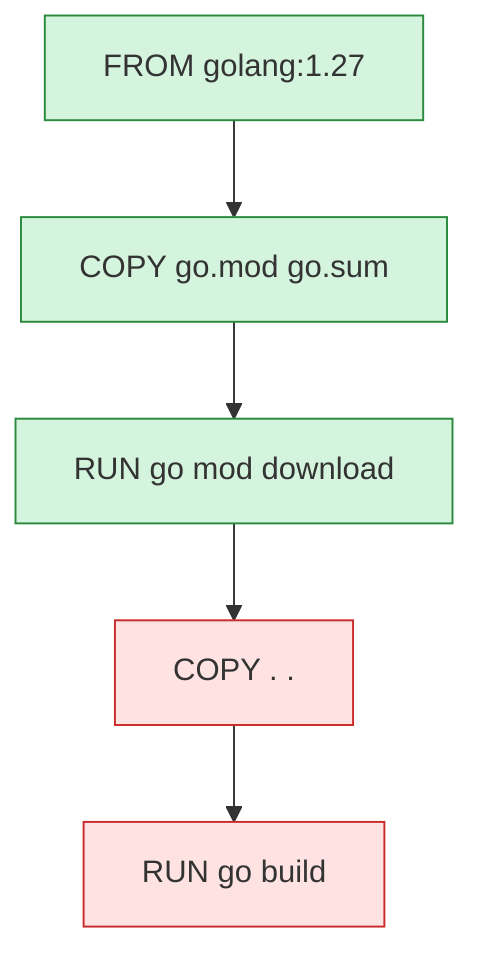

# Building good images

## Why care?

Three tickets you will meet:

- "CI takes 4 minutes for a one-line change. It downloads every Go module, every time."
- "The image is 1.3 GB. Our binary is 7 MB."
- "We rebuilt the same commit, and the digest changed. Is it still the same image?"

A `Dockerfile` looks like a shell script. It is not. Every line makes a **layer**, every layer has a **cache key**, and the order of the lines decides how much work a rebuild must do. On this page you take the `ordersd` [Dockerfile](../go/services.md) apart line by line, and you measure what each choice costs: rebuild time, image size, and whether two builds give the same digest.

## The idea: a cache key for every step

The builder saves the result of every step as a layer. Each layer has a **cache key**, made from the step and its inputs. On the next build, the builder goes through the steps in order and compares keys. If the step and its inputs are the same as last time, it reuses the saved layer and skips the work.

As soon as one key is different, the builder cannot reuse any layer **after** it, because each layer builds on the one before. A changed step 3 means steps 3, 4, 5 and 6 run again, even if they did not change.

This gives one rule: **put the steps that rarely change first, and the steps that change all the time last.**



Green steps change when you add a dependency (rare). Red steps change on every commit. A code change starts the work at `COPY . .` and never touches the green part.

## Under the hood: the Dockerfile, line by line

Here is `examples/orders/Dockerfile` again, without its comments:

```dockerfile
FROM golang:1.27 AS build
WORKDIR /src
COPY go.mod go.sum ./
RUN go mod download
COPY . .
ARG VERSION=dev
RUN CGO_ENABLED=0 go build -trimpath \
      -ldflags="-s -w -X github.com/acme/orders/internal/buildinfo.version=${VERSION}" \
      -o /out/ordersd ./cmd/ordersd

FROM gcr.io/distroless/static-debian12:nonroot
COPY --from=build /out/ordersd /ordersd
USER nonroot:nonroot
EXPOSE 8080
ENTRYPOINT ["/ordersd"]
```

| Line                             | What it really does                                                                                                                                                                                                         |
| -------------------------------- | --------------------------------------------------------------------------------------------------------------------------------------------------------------------------------------------------------------------------- |
| `FROM golang:1.27 AS build`      | Starts stage `build` from the Go image. The tag is resolved to a digest **once per build**; a re-pushed tag silently gives you a different base. `AS build` names the stage so a later stage can copy from it.              |
| `WORKDIR /src`                   | Creates `/src` if needed and makes it the working folder for later lines. It changes only the image config, plus an empty folder.                                                                                           |
| `COPY go.mod go.sum ./`          | Copies two files. The cache key is a **checksum of the file contents**, not its time stamp. Same bytes, same key.                                                                                                           |
| `RUN go mod download`            | Fills the module cache (`/go/pkg/mod`) inside this layer. The cache key is the **command text** and the parent layer. Docker does not know or care that this step uses the network.                                         |
| `COPY . .`                       | Copies the whole build context (minus [`.dockerignore`](#dockerignore-what-the-builder-never-sees)). Any change to any copied file gives a new key here, and every line after it runs again.                                |
| `ARG VERSION=dev`                | A build-time variable. Its value becomes part of the cache key of the `RUN` lines that use it. `--build-arg VERSION=v0.2.0` rebuilds the binary, nothing before it.                                                         |
| `RUN CGO_ENABLED=0 go build ...` | Builds a static binary. Explained in [Build flags](#build-flags-that-matter-inside-an-image).                                                                                                                               |
| `FROM gcr.io/distroless/...`     | Starts a **new, empty stage** from a tiny base. Nothing from the `build` stage comes along unless you copy it. This is the whole point of a multi-stage build: the 1.3 GB toolchain never reaches the final image.          |
| `COPY --from=build ...`          | Copies one file out of the other stage. Its key is the checksum of that file, so an identical binary means a cached layer (you will see this below).                                                                        |
| `USER nonroot:nonroot`           | Sets the default user in the image config. The name is looked up in the image's own `/etc/passwd` when the container **starts**, not at build time.                                                                         |
| `EXPOSE 8080`                    | Documentation only. It writes `ExposedPorts` into the config. It does not open or publish anything (see [Container networking](networking.md)).                                                                             |
| `ENTRYPOINT ["/ordersd"]`        | The JSON (exec) form: `/ordersd` is PID 1 itself, so it gets `SIGTERM` directly. The shell form (`ENTRYPOINT /ordersd`) wraps it in `sh -c`, and distroless has no `sh` (see [Signals](../linux/signals-and-processes.md)). |

Only `FROM`, `COPY`, `ADD` and `RUN` make filesystem layers. `WORKDIR`, `ARG`, `ENV`, `USER`, `EXPOSE` and `ENTRYPOINT` change the image **config** JSON (see [Images and layers](images-and-layers.md)).

!!! warning "Copy `go.sum` too"

    `COPY go.mod go.sum ./` copies both files on purpose. With only `go.mod`, `go mod download` runs
    without `go.sum` and checks every module against the checksum database, and a change to `go.sum`
    alone does not rebuild the layer. An earlier version of the example made exactly this mistake.

### BuildKit: a graph, not a list

The modern builder, **BuildKit**, turns the `Dockerfile` into a graph of steps. Stages that don't depend on each other run in parallel, and stages the final image does not need are skipped. It also adds the `RUN --mount=...` features used later on this page.

On this machine the `buildx` plugin is not installed, so plain `docker build` falls back to the old builder:

```console
$ docker build -q -t tutor-b-legacy-test .
DEPRECATED: The legacy builder is deprecated and will be removed in a future release.
            Install the buildx component to build images with BuildKit:
            https://docs.docker.com/go/buildx/

sha256:782a32a4af4ceafb1a4072ee813cd92d06c07659e81426421794c208f95e0c56
```

`buildx` is installed as a standalone binary instead (`docker-buildx`). It is the same program as `docker buildx`, so every command below says `docker buildx build`; on this machine it was typed as `docker-buildx build`.

```console
$ docker buildx ls
NAME/NODE     DRIVER/ENDPOINT   STATUS    BUILDKIT   PLATFORMS
default*      docker
 \_ default    \_ default       running   v0.26.2    linux/amd64 (+3)
```

## Try it: measure the layer order

Two Dockerfiles that produce the same image. The good one is the example above. The bad one copies the source **before** downloading modules:

```dockerfile
FROM golang:1.27 AS build
WORKDIR /src
COPY . .
RUN go mod download
# ... the same build line and final stage
```

The test: build once with `--no-cache` (cold), add a comment to one `.go` file, and build again. Times are wall-clock, measured on this laptop, with the base images already pulled.

| Module                                                 | Dockerfile                | Cold build | Rebuild after a code change |
| ------------------------------------------------------ | ------------------------- | ---------- | --------------------------- |
| `orders` as it is (no real dependencies)               | good order                | 10.8 s     | 7.1 s                       |
| `orders` as it is                                      | bad order                 | 9.6 s      | 9.1 s                       |
| `orders` + AWS S3 SDK, `pgx`, Prometheus client (copy) | good order                | 16.9 s     | 14.2 s                      |
| same                                                   | bad order                 | 16.6 s     | 16.4 s                      |
| same                                                   | good order + cache mounts | 17.0 s     | **1.8 s**                   |

Look at the good-order rebuild with `--progress=plain`:

```console
$ docker buildx build --progress=plain --load -t tutor-good .
...
#9 [build 3/6] COPY go.mod ./
#9 CACHED
#10 [build 4/6] RUN go mod download
#10 CACHED
#11 [build 5/6] COPY . .
#11 DONE 0.1s
#12 [build 6/6] RUN CGO_ENABLED=0 go build -trimpath       -ldflags="-s -w -X github.com/acme/orders/internal/buildinfo.version=dev"       -o /out/ordersd ./cmd/ordersd
#12 DONE 6.8s
#13 [stage-1 2/2] COPY --from=build /out/ordersd /ordersd
#13 CACHED
```

Three lessons from these numbers:

1. **Layer order saves the download, and only the download.** Here `go mod download` took 1.1 s (and 2.1 s with the extra modules), because the Go module proxy is fast from this laptop. In CI with a cold runner, a private proxy, or hundreds of modules, the same step is often a minute. The good order makes it free.
2. **The real cost is compiling.** `go build` inside a fresh layer starts with an empty Go build cache and compiles the standard library and every dependency again: 6.8 s here, 14 s with the extra modules. Layer order cannot help with that. A **cache mount** can (next section).
3. **`COPY --from=build` was `CACHED`.** A comment does not change the compiled binary, so the copied file had the same checksum, and the final layer was reused. BuildKit keys `COPY` by content, not by "did the step before run again".

### Cache mounts: keep the Go caches between builds

A cache mount is a folder that BuildKit keeps **outside** the image and mounts into a `RUN` step. It never becomes a layer, so it does not make the image bigger, and it survives between builds:

```dockerfile
COPY go.mod go.sum ./
RUN --mount=type=cache,target=/go/pkg/mod \
    go mod download
COPY . .
RUN --mount=type=cache,target=/go/pkg/mod \
    --mount=type=cache,target=/root/.cache/go-build \
    CGO_ENABLED=0 go build ...
```

`/go/pkg/mod` is the module cache, `/root/.cache/go-build` is the compiler cache (`go env GOCACHE` in the `golang` image). With both, the rebuild compiled one package and linked: 1.8 s instead of 14.2 s. BuildKit lists them:

```console
$ docker buildx du --filter type=exec.cachemount --verbose | grep -E '^(Size|Description)'
Size:         132.3MB
Description:  cached mount /go/pkg/mod from exec /bin/sh -c go mod download with id "//go/pkg/mod"
Size:         224.9MB
Description:  cached mount /root/.cache/go-build from exec /bin/sh -c CGO_ENABLED=0 go build -trimpath       -ldflags="-s -w -X github.com/acme/orders/internal/buildinfo.version=${VERSION}"       -o /out/ordersd ./cmd/ordersd with id "//root/.cache/go-build"
```

!!! note "Cache mounts live on the builder"

    A cache mount is local to one BuildKit instance. A fresh CI runner starts empty. To share caches
    between runners, export the **layer** cache (`--cache-to type=registry` or `type=gha`), or keep a
    long-lived builder. Cache mounts themselves are not exported.

### `.dockerignore`: what the builder never sees

Before the first line runs, the client sends the **build context** (the folder you name, usually `.`) to BuildKit. `.dockerignore` filters it. The example's file is three lines:

```text
bin/
coverage.*
.git
```

In a copy with a Git history and a `make build` output in `bin/` (20 MB), with the file and without it:

```console
$ docker buildx build --progress=plain --no-cache -t tutor-b-ctx --load . 2>&1 | grep 'transferring context:'
#8 transferring context: 84.93kB done
$ mv .dockerignore ../di.bak
$ docker buildx build --progress=plain --no-cache -t tutor-b-ctx --load . 2>&1 | grep 'transferring context:'
#5 transferring context: 20.21MB 0.1s done
```

Size is the smaller problem. Without the file, `COPY . .` copies `bin/` and `.git` into the build stage, so **every commit and every local build changes the cache key** of `COPY . .`, even when no Go file changed. It also puts files in the context that you never meant to ship (`.env`, local keys). Treat `.dockerignore` like `.gitignore`: written on day one.

## Choosing the base image

The final stage needs almost nothing, because `CGO_ENABLED=0` makes a **static** binary: no `libc`, no dynamic loader, no shared libraries. It runs on any Linux kernel with any (or no) userland. With cgo on, the Go linker produces a binary that needs the C library of the build image, and it fails on `scratch` or on Alpine's `musl`.

Four final stages, same binary (`-trimpath -ldflags="-s -w"`), `USER 65532:65532`:

```console
$ docker image ls --format '{{.Repository}}:{{.Tag}} {{.Size}}' tutor-b-base
tutor-b-base:golang 1.31GB
tutor-b-base:alpine 22.6MB
tutor-b-base:distroless 16MB
tutor-b-base:scratch 9.85MB
```

This Docker uses the containerd image store, so `docker image ls` shows the disk use: the compressed layers plus the unpacked copy. The `CONTENT SIZE` column is what a registry stores and a node downloads:

| Base                                | Disk    | Download (compressed) | What you get besides the binary                                 |
| ----------------------------------- | ------- | --------------------- | --------------------------------------------------------------- |
| `scratch`                           | 9.85 MB | 2.96 MB               | Nothing. Not even `/tmp`.                                       |
| `gcr.io/distroless/static-debian12` | 16 MB   | 3.68 MB               | CA certificates, `tzdata`, `/etc/passwd` with `nonroot`, `/tmp` |
| `alpine:3.22`                       | 22.6 MB | 6.76 MB               | A shell, `apk`, BusyBox tools, CA certificates                  |
| `golang:1.27` (no multi-stage)      | 1.31 GB | 320 MB                | A full Debian, the Go toolchain, `git`, `gcc`                   |

"Nothing" causes real failures. A small probe program asks the questions a real service asks at start-up: can I verify TLS certificates, can I load a time zone, who am I?

```go
// Command probe reports what a base image gives a static Go binary.
package main

import (
	"crypto/x509"
	"fmt"
	"os"
	"os/user"
	"time"
)

func main() {
	if pool, err := x509.SystemCertPool(); err != nil {
		fmt.Println("CA certs:  error:", err)
	} else {
		fmt.Println("CA certs: ", len(pool.Subjects()), "roots") //nolint:staticcheck // fine for counting
	}
	if _, err := time.LoadLocation("Europe/Amsterdam"); err != nil {
		fmt.Println("tzdata:    error:", err)
	} else {
		fmt.Println("tzdata:    ok")
	}
	if u, err := user.Current(); err != nil {
		fmt.Println("user:      error:", err)
	} else {
		fmt.Println("user:     ", u.Username, u.HomeDir)
	}
	if _, err := os.Stat("/bin/sh"); err != nil {
		fmt.Println("shell:     none")
	} else {
		fmt.Println("shell:     /bin/sh")
	}
	if _, err := os.Stat("/tmp"); err != nil {
		fmt.Println("/tmp:      missing")
	} else {
		fmt.Println("/tmp:      ok")
	}
}
```

```console
$ docker run --rm --network none tutor-b-probe    # FROM scratch
CA certs:  0 roots
tzdata:    error: unknown time zone Europe/Amsterdam
user:      error: user: Current requires cgo or $USER set in environment
shell:     none
/tmp:      missing
$ docker run --rm --network none tutor-b-probe    # FROM gcr.io/distroless/static-debian12:nonroot
CA certs:  150 roots
tzdata:    ok
user:      nonroot /home/nonroot
shell:     none
/tmp:      ok
$ docker run --rm --network none tutor-b-probe    # FROM alpine:3.22
CA certs:  118 roots
tzdata:    error: unknown time zone Europe/Amsterdam
user:      error: user: Current requires cgo or $USER set in environment
shell:     /bin/sh
/tmp:      ok
```

Read it carefully:

- **`scratch` gives an empty certificate pool, not an error.** Your first HTTPS call fails with `x509: certificate signed by unknown authority`, long after start-up.
- **Alpine has no `tzdata` by default**, and UID 65532 has no line in its `/etc/passwd` (it has `nobody` at 65534). The user lookup fails, so does anything that needs a home folder.
- **distroless/static** has exactly the four things a static Go service needs. That is why the example uses it.

And `USER nonroot` on `scratch`? The name is resolved when the container starts:

```console
$ docker run --rm --network none tutor-b-probe:nonroot
docker: Error response from daemon: unable to find user nonroot: no matching entries in passwd file
```

On `scratch`, use a number (`USER 65532:65532`), copy the CA bundle from the build stage (`COPY --from=build /etc/ssl/certs/ca-certificates.crt /etc/ssl/certs/`), and embed the time zones with `import _ "time/tzdata"` or `-tags timetzdata`. That costs about 400 KB:

```console
$ CGO_ENABLED=0 go build -trimpath -o p1 . ; CGO_ENABLED=0 go build -trimpath -tags timetzdata -o p2 .
$ ls -l p1 p2 | awk '{print $5, $9}'
4509375 p1
4923735 p2
```

!!! abstract "Convention: distroless/static for Go services"

    **Rule:** final stage `gcr.io/distroless/static-debian12:nonroot`, pinned by digest, binary built
    with `CGO_ENABLED=0`. Use `:debug-nonroot` (it has a BusyBox shell) only for local debugging,
    never in production.

    **Why:** it gives the service the files it needs (certificates, time zones, a non-root user) and
    nothing an attacker could use. `scratch` saves 0.7 MB of download and causes three bugs.

## Build flags that matter inside an image

[The toolchain page](../go/toolchain.md) explains `-trimpath` and `-ldflags`. In an image they matter for two extra reasons. Built in the `golang` image with the source in `/src`, three ways:

```console
$ ls -l /tmp/a /tmp/b /tmp/c | awk '{print $5, $9}'    # plain, -trimpath, -trimpath -ldflags="-s -w"
10142593 /tmp/a
10126895 /tmp/b
6881440 /tmp/c
$ for f in a b c; do echo "$f: $(strings /tmp/$f | grep -c '^/src/')"; done
a: 10
b: 0
c: 0
$ strings /tmp/a | grep -m2 '^/src/'
/src/internal/buildinfo/buildinfo.go
/src/internal/config/config.go
```

1. **`-trimpath` makes the binary independent of where it was built.** Without it, the build folder is inside the binary. Build in `/src` on one runner and `/builds/x7f/src` on another, and you get two different binaries from the same commit.
2. **`-s -w` saves 3.2 MB (32%)**, which is half of a distroless image. Panics still print stack traces. Debuggers and some profilers lose detail.
3. **`-X ...version=${VERSION}`** is the only way the binary knows its version, because `.dockerignore` keeps `.git` out of the context and the toolchain cannot stamp `vcs.revision` (see [Building a service](../go/services.md)).

`go version -m` shows what went in:

```console
$ go version -m /tmp/c | head -12
/tmp/c: go1.27.4
	path	github.com/acme/orders/cmd/ordersd
	mod	github.com/acme/orders	(devel)
	build	-buildmode=exe
	build	-compiler=gc
	build	-trimpath=true
	build	CGO_ENABLED=0
	build	GOARCH=amd64
	build	GOOS=linux
	build	GOAMD64=v1
```

## Secrets: never in `ARG` or `ENV`

A private module needs a token at build time. The obvious way leaks it:

```dockerfile
FROM alpine:3.22
ARG GIT_TOKEN
RUN echo "using token of ${#GIT_TOKEN} chars"
```

```console
$ docker buildx build --progress=plain --build-arg GIT_TOKEN=s3cr3t-t0ken --load -t tutor-b-sec:arg .
...
 - SecretsUsedInArgOrEnv: Do not use ARG or ENV instructions for sensitive data (ARG "GIT_TOKEN") (line 2)
$ docker history --no-trunc --format '{{.CreatedBy}}' tutor-b-sec:arg | head -2
RUN |1 GIT_TOKEN=s3cr3t-t0ken /bin/sh -c echo "using token of ${#GIT_TOKEN} chars" # buildkit
ARG GIT_TOKEN=s3cr3t-t0ken
```

The token is in the image history, in plain text, for anyone who can pull the image. BuildKit warns, and builds it anyway. A **secret mount** puts the file in place for one `RUN` step only, as a `tmpfs`, and never in a layer:

```dockerfile
FROM alpine:3.22
RUN --mount=type=secret,id=netrc,target=/root/.netrc \
    wc -c /root/.netrc
RUN ls -la /root
```

```console
$ docker buildx build --progress=plain --secret id=netrc,src=netrc --load -t tutor-b-sec:secret .
...
#5 [stage-0 2/3] RUN --mount=type=secret,id=netrc,target=/root/.netrc     wc -c /root/.netrc
#5 0.392 55 /root/.netrc
#5 DONE 0.4s
$ docker history --no-trunc --format '{{.CreatedBy}}' tutor-b-sec:secret | head -2
RUN /bin/sh -c ls -la /root # buildkit
RUN /bin/sh -c wc -c /root/.netrc # buildkit
$ docker run --rm tutor-b-sec:secret ls -la /root
total 8
drwx------    2 root     root          4096 Nov  5 09:19 .
drwxr-xr-x    1 root     root          4096 Nov 26 17:18 ..
```

For Go, mount a `.netrc` (or set `GOPRIVATE` and a `GOAUTH` command) in the `go mod download` step. The secret is also not part of the cache key, so rotating the token does not bust the cache.

## Multi-arch: cross-compile, don't emulate

Your laptop may be ARM, production x86, or the reverse. `--platform linux/amd64,linux/arm64` builds one image per platform and an **index** that points to both (see [Images and layers](images-and-layers.md)).

The naive way runs every `RUN` step **on** the target platform. This machine has no QEMU emulator registered in `binfmt_misc`, so it fails at the first `RUN`:

```console
$ docker buildx build --platform linux/amd64,linux/arm64 -t tutor-b-multi:naive --load .
...
#20 0.418 exec /bin/sh: exec format error
#20 ERROR: process "/bin/sh -c go mod download" did not complete successfully: exit code: 255
```

With QEMU it works, but compiling Go under emulation is many times slower. Go can cross-compile instead, so run the build stage on the **build** platform and only tell Go the **target**:

```dockerfile
FROM --platform=$BUILDPLATFORM golang:1.27 AS build
# ...
ARG TARGETOS TARGETARCH VERSION=dev
RUN CGO_ENABLED=0 GOOS=$TARGETOS GOARCH=$TARGETARCH go build -trimpath ...
```

BuildKit sets `BUILDPLATFORM`, `TARGETOS` and `TARGETARCH` for you. The log shows an amd64 machine building for arm64:

```console
$ docker buildx build --progress=plain --platform linux/amd64,linux/arm64 -f Dockerfile.multi -t tutor-b-multi:dev --load .
...
#14 [linux/amd64->arm64 build 6/6] RUN CGO_ENABLED=0 GOOS=linux GOARCH=arm64 go build -trimpath ...
#15 [linux/amd64 build 6/6] RUN CGO_ENABLED=0 GOOS=linux GOARCH=amd64 go build -trimpath ...
$ docker image ls --tree tutor-b-multi
IMAGE                ID             DISK USAGE   CONTENT SIZE   EXTRA
tutor-b-multi:dev    313932b0dbff       19.4MB         7.08MB
├─ linux/amd64       55106b0117f2         16MB         3.68MB
└─ linux/arm64       910cf8b4df62        3.4MB          3.4MB
$ file ordersd-arm64
ordersd-arm64: ELF 64-bit LSB executable, ARM aarch64, version 1 (SYSV), statically linked, Go BuildID=-J00IjryoUhg7HZ8b4G5/t3a_04n0nKUaevOJYPX5/uaI2IFsSnWWc-N0ZwKTI/3gGivmgxfM33b05nIPIA, BuildID[sha1]=85cf7329407c9b1341e94161235cbd9763a445c5, stripped
$ docker run --rm --platform linux/arm64 tutor-b-multi:dev
exec /ordersd: exec format error
```

The arm64 variant is stored but not unpacked (disk equals content size), because nothing here can run it, as the last command proves. The final stage is `FROM` distroless with no `--platform`, so it picks the arm64 distroless for the arm64 image. No `RUN` there, so no emulation.

## Reproducible builds: same input, same digest?

Build the same commit twice, `--no-cache`, and compare:

```console
$ docker image ls --no-trunc --format '{{.Repository}}:{{.Tag}} {{.ID}}' tutor-b-repro
tutor-b-repro:2 sha256:33c16721c23c523d5b46f13d953a14d345adcc8c83f911c25e9c7eb83e9ff6ad
tutor-b-repro:1 sha256:0d0636f41572727eb24c7686cd7ab64aef884d7add86812f4ac51dc91b202a8c
```

Different digests. Save both, unpack the last layer, and look inside:

```console
$ tar -tvf r1/blobs/sha256/1efc6d2e0980ffe1436d6d2b453522af86ee7ef88c8fc52c81d67168ec79ed69 --full-time ; sha256sum x1/ordersd
-rwxr-xr-x 0/0         6881440 2026-11-26 18:16:17 ordersd
64623a14a17ed871e3485217fe06566e2e61f303e2536a3d845c154e3ee4b5dc  x1/ordersd
$ tar -tvf r2/blobs/sha256/9b0642f9517f5e6a4530e78c9c788b35bebeb54070a33833e51a840e709c3cb3 --full-time ; sha256sum x2/ordersd
-rwxr-xr-x 0/0         6881440 2026-11-26 18:16:27 ordersd
64623a14a17ed871e3485217fe06566e2e61f303e2536a3d845c154e3ee4b5dc  x2/ordersd
```

**The binary is byte-for-byte identical.** Go with `-trimpath` is reproducible. What differs is the **file time stamp in the layer tar** (18:16:17 vs 18:16:27), plus the `created` time in the config. A different tar is a different layer digest, a different manifest, a different image.

BuildKit fixes both with `SOURCE_DATE_EPOCH` (sets every time stamp) and `rewrite-timestamp=true` (rewrites file times in new layers to that value):

```console
$ SOURCE_DATE_EPOCH=1764115200 docker buildx build -q --no-cache --output type=oci,dest=oci5.tar,rewrite-timestamp=true .
sha256:f8402a9bc41427b2fc0e0faa6daa9d535f60f9654b4a104bb0c15e3570acb641
$ SOURCE_DATE_EPOCH=1764115200 docker buildx build -q --no-cache --output type=oci,dest=oci6.tar,rewrite-timestamp=true .
sha256:f8402a9bc41427b2fc0e0faa6daa9d535f60f9654b4a104bb0c15e3570acb641
$ sha256sum oci5.tar oci6.tar
4107c7b7a7da212938d6198aaa19b43f959cc0efce2897fdc48c8fe42fa1ffdb  oci5.tar
4107c7b7a7da212938d6198aaa19b43f959cc0efce2897fdc48c8fe42fa1ffdb  oci6.tar
```

Same image, same bytes. `SOURCE_DATE_EPOCH` **alone** is not enough: two builds with it but without `rewrite-timestamp` gave two different tarballs (`cb50837d...` and `797284fb...`). In CI, use the commit time: `SOURCE_DATE_EPOCH=$(git log -1 --format=%ct)`.

Two limits:

- On this machine, `rewrite-timestamp=true` with `--load` failed: `exporter option "rewrite-timestamp" conflicts with "unpack"`. The containerd image store unpacks images as it stores them. Export to an OCI tarball instead, or push straight to a registry (`--output type=image,push=true,rewrite-timestamp=true`, not tested here: no registry in this run).
- Reproducible also means **pinned inputs**. `FROM golang:1.27` today and next week may be different images. Pin by digest (`crane digest golang:1.27`), and let a bot like Renovate or Dependabot bump the digest in a pull request.

## SBOM: the list of packages in the image

A Software Bill of Materials lists every package in the image. `syft` reads the Debian package database in distroless **and** the module list Go embeds in every binary (the same data as `go version -m`):

```console
$ syft -q tutor-b-base:distroless
NAME                    VERSION           TYPE
base-files              12.4+deb12u15     deb
ca-certificates         20250419~deb12u1  deb
github.com/acme/orders  UNKNOWN           go-module
media-types             10.0.0            deb
netbase                 6.4               deb
stdlib                  go1.27.4          go-module
tzdata                  2026b-0+deb12u1   deb
$ syft -q tutor-heavy:latest | head -6
NAME                                                           VERSION                             TYPE
base-files                                                     12.4+deb12u15                       deb
ca-certificates                                                20250419~deb12u1                    deb
github.com/acme/orders                                         UNKNOWN                             go-module
github.com/aws/aws-sdk-go-v2                                   v1.48.1                             go-module
github.com/aws/aws-sdk-go-v2/aws/protocol/eventstream          v1.7.28                             go-module
```

Seven packages for `ordersd`, 31 with three common libraries. `github.com/acme/orders UNKNOWN` is the missing VCS stamp again: the module version is `(devel)`. A scanner (Trivy, Grype) matches this list against vulnerability databases; [Container security](security.md) does that. BuildKit can also attach an SBOM to the image itself with `--sbom=true`.

## Putting it together

The example's `Dockerfile` with every fix from this page. It was built for both platforms and run (`/healthz` answered `{"status":"ok"}`); a rebuild of both platforms after a code change took 2.4 s.

```dockerfile
# syntax=docker/dockerfile:1
FROM --platform=$BUILDPLATFORM golang:1.27@sha256:5f1b98fa02fe396ebce2a0227a0e08309e11792915b9dd2e1f71053d7e7e6666 AS build
WORKDIR /src

COPY go.mod go.sum ./
RUN --mount=type=cache,target=/go/pkg/mod \
    go mod download

COPY . .
ARG TARGETOS TARGETARCH VERSION=dev
RUN --mount=type=cache,target=/go/pkg/mod \
    --mount=type=cache,target=/root/.cache/go-build \
    CGO_ENABLED=0 GOOS=$TARGETOS GOARCH=$TARGETARCH \
    go build -trimpath \
      -ldflags="-s -w -X github.com/acme/orders/internal/buildinfo.version=${VERSION}" \
      -o /out/ordersd ./cmd/ordersd

FROM gcr.io/distroless/static-debian12:nonroot@sha256:afa5c872c891853ca7fcf1f12c3edb23f7eeef36189728842dd51042ff57f7ab
COPY --from=build /out/ordersd /ordersd
USER nonroot:nonroot
EXPOSE 8080
ENTRYPOINT ["/ordersd"]
```

```console
$ docker buildx build --platform linux/amd64,linux/arm64 -f Dockerfile.prod --build-arg VERSION=v0.1.0 -t tutor-b-prod:v0.1.0 --load .
$ docker image ls --tree tutor-b-prod
IMAGE                 ID             DISK USAGE   CONTENT SIZE   EXTRA
tutor-b-prod:v0.1.0   98300f34a57f       23.8MB         8.85MB
├─ linux/amd64        5d23b7765f41       19.5MB         4.61MB
└─ linux/arm64        20a2fc7c16d1       4.24MB         4.24MB
```

(This one was built from the copy with the three extra modules, hence 4.61 MB instead of 3.68 MB.)

## Traps

- **`RUN apt-get update` is cached forever.** The cache key is the command text. Docker does not know the package lists changed. Combine `apt-get update && apt-get install` in one `RUN`, pin versions, or rebuild with `--no-cache` on a schedule.
- **`COPY . .` too early.** Every commit rebuilds everything after it. Copy dependency manifests first.
- **No `.dockerignore`.** `.git` and `bin/` in the context bust the cache on every commit and can leak files.
- **Secrets in `ARG` or `ENV`.** They are in `docker history`. Use `--mount=type=secret`. Deleting a file in a later layer does not help: the earlier layer still has it.
- **`USER nonroot` on `scratch`.** No `/etc/passwd`, so the container fails to start. Use a number.
- **`scratch` and HTTPS.** An empty certificate pool fails at the first TLS call, not at start-up.
- **cgo by accident.** `CGO_ENABLED` defaults to 1 when a C compiler is present (it is in `golang:1.27`). A package like `net` or `os/user` may then link against `libc`, and the binary fails on distroless/static. Always set `CGO_ENABLED=0` explicitly.
- **Emulated multi-arch builds.** Slow, or broken without QEMU. Use `--platform=$BUILDPLATFORM` and `GOOS/GOARCH`.
- **Floating tags.** `golang:1.27` moves. Pin by digest for builds you need to reproduce.
- **Shell-form `ENTRYPOINT`.** `sh -c` becomes PID 1 and swallows `SIGTERM`; on distroless it does not even start.

## Check yourself

??? question "1. You change only `README.md`. With the example `Dockerfile` and its `.dockerignore`, which steps run again?"

    `COPY . .` copies `README.md`, so its key changes, and the `go build` step after it runs again.
    The binary comes out identical, so `COPY --from=build` is cached and the final image has the same
    layers (but a new config time stamp, so possibly a new digest). Add `*.md` to `.dockerignore` if
    you want docs changes to skip the build.

??? question "2. Why does a cache mount speed up `go build` when layer order cannot?"

    A layer is either reused whole or rebuilt from nothing. When `COPY . .` changes, the `go build`
    layer starts in a fresh filesystem with an empty `GOCACHE`, so Go compiles the standard library
    and all dependencies again. A cache mount keeps `/root/.cache/go-build` outside the layers, so Go
    finds its compiled packages and rebuilds only what changed.

??? question "3. Two CI runs of the same commit give two image digests. Your binary is built with `-trimpath`. What differs, and how do you make them equal?"

    The file time stamps inside the layer tarballs and the `created` field in the image config.
    Set `SOURCE_DATE_EPOCH` to the commit time and export with `rewrite-timestamp=true`. Also pin the
    base images by digest, or a new base image changes the result.

??? question "4. Your image works on your M-series Mac and fails in production with `exec format error`. What happened, and what is the fix?"

    The image was built for `linux/arm64` only, and the production nodes are `linux/amd64`. Build
    for both with `--platform linux/amd64,linux/arm64`, and cross-compile in a build stage that has
    `--platform=$BUILDPLATFORM` with `GOOS=$TARGETOS GOARCH=$TARGETARCH`.

??? question "5. A teammate switches the final stage from distroless to `scratch` to save space. What breaks?"

    HTTPS calls (no CA certificates: empty pool), time zone loading (no `tzdata`), `USER nonroot`
    (no `/etc/passwd`, the container does not start), and anything writing to `/tmp` (it doesn't
    exist). The saving is about 0.7 MB of download.

??? question "6. Why is `--mount=type=secret` safe when `ARG TOKEN` plus `rm` in the next step is not?"

    `ARG` values used by a `RUN` are recorded in the image history. Even without that, a file written
    in one layer and deleted in the next is still inside the first layer's tarball. A secret mount is
    a `tmpfs` that exists only while that one `RUN` runs, and is never written to a layer or the
    history.

## Recap

- Each `RUN`, `COPY` and `ADD` makes a layer with a **cache key**: the command text for `RUN`, the file checksums for `COPY`. A changed key rebuilds every step after it.
- **Order** from rarely changing to often changing: base, `go.mod`/`go.sum`, `go mod download`, source, build.
- **Cache mounts** keep Go's module and build caches between builds: 14.2 s became 1.8 s here.
- **`.dockerignore`** keeps `.git`, `bin/` and secrets out of the context and the cache key.
- **Multi-stage** plus `CGO_ENABLED=0` plus **distroless/static**: 16 MB instead of 1.31 GB, with certificates, time zones and a non-root user.
- **Secrets** go in `--mount=type=secret`, never `ARG`/`ENV`.
- **Multi-arch**: `--platform=$BUILDPLATFORM` and `GOOS/GOARCH`, no emulation.
- **Reproducible**: `-trimpath`, pinned base digests, `SOURCE_DATE_EPOCH` and `rewrite-timestamp=true`.
- **SBOM**: `syft` lists Debian packages and the Go modules embedded in the binary.

Next: [Runtimes](runtimes.md), where you follow the finished image from `docker run` down to `runc`, and run it without Docker at all.
