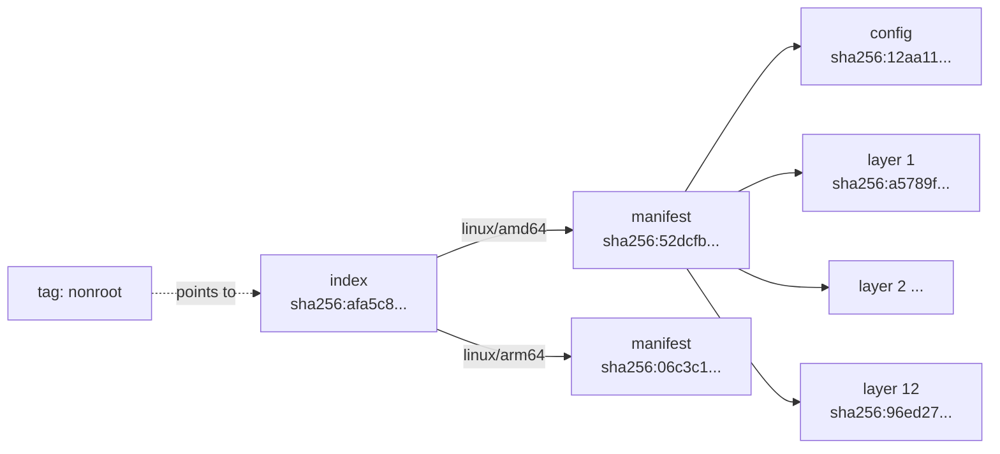

# Images and layers

## Why care?

Four things that go wrong with images, and all four make sense once you have opened one:

- You delete a 500 MB build cache in a later `RUN` step, and the image is still 500 MB bigger.
- `FROM golang:1.27` built fine yesterday, and today the same commit gives a different image.
- The image runs on your Mac and fails on the server with `exec format error`.
- A secret you `COPY`'d in and then `rm`'d is still readable by anyone who pulls the image.

An image is not a disk file and not a black box. It is a handful of JSON documents and tarballs, each named by the SHA-256 hash of its bytes. On this page you take the `ordersd` image apart, check every hash yourself with `sha256sum`, and follow a tag through a real registry to the bytes behind it.

## The idea: content-addressed storage

An image is stored as a set of objects. Each object is named by a **hash of its contents** (its fingerprint), not by a chosen name. This is called **content-addressed storage**.

- A **layer** is a tarball of files.
- The **config** is a JSON document: which program to run, as which user, and the hashes of the unpacked layers.
- The **manifest** is a JSON list: "the config with hash X, then layers A, B, C, in this order".
- An **index** is a list of manifests, one per kind of machine: "for amd64 use manifest P, for arm64 use manifest Q".
- A **tag** (`nonroot`, `dev`, `latest`) is a name that points to one manifest or index today: "`nonroot` is manifest P". Anyone with push access can move it.

Because every object is named by its hash, you can always check that you received what the manifest lists. Two images that contain the same layer share it: it is stored and sent once.

Git uses the same idea. A Git commit points to a tree, which points to blobs, all named by their hash ([Git objects](../git/objects.md)). A branch is a movable name for a commit, like a tag here.



Every arrow is a **digest**: `sha256:` plus the hash of the exact bytes it points to. Only the dashed arrow, the tag, is a name.

## Under the hood: open the image

These formats are written down by the Open Container Initiative (OCI) in the **image spec**. Docker, containerd, Podman, Kubernetes and every registry speak it.

### `docker save`: the image as a directory

`docker save` writes an image as one tar file. Docker 29 with the containerd image store writes an **OCI image layout**:

```console
$ docker save -o ordersd.tar tutor-ordersd:dev
$ ls -lh ordersd.tar | awk '{print $5, $9}'
3.6M ordersd.tar
$ mkdir img && tar -xf ordersd.tar -C img && cd img
$ cat oci-layout
{"imageLayoutVersion":"1.0.0"}
$ jq . index.json
{
  "schemaVersion": 2,
  "mediaType": "application/vnd.oci.image.index.v1+json",
  "manifests": [
    {
      "mediaType": "application/vnd.oci.image.manifest.v1+json",
      "digest": "sha256:92aefe8829eeb7301e322b3d32c49cab2a0b54cb13fe6d71be3d0d1b38ab56e8",
      "size": 3115,
      "annotations": {
        "io.containerd.image.name": "docker.io/library/tutor-ordersd:dev",
        "org.opencontainers.image.ref.name": "dev"
      }
    }
  ]
}
```

Three things in the top directory:

| File            | What it is                                                                                                    |
| --------------- | ------------------------------------------------------------------------------------------------------------- |
| `oci-layout`    | A marker: "this directory is an OCI layout, version 1.0.0"                                                    |
| `index.json`    | The entry point: which manifests are in here, and the tag (`ref.name`) for each                               |
| `manifest.json` | Docker's older format of the same information, kept so old tools (and `docker load` on old Docker) still work |
| `blobs/sha256/` | Every other object, in one flat directory, each file **named by its own hash**                                |

There is no directory per layer, and no file names like `config.json`. Just 15 blobs: one manifest, one config, 13 layers. To know which is which, you follow the digests from `index.json`.

The image ID that `docker images` shows is the start of that first digest:

```console
$ docker image ls tutor-ordersd:dev
IMAGE               ID             DISK USAGE   CONTENT SIZE   EXTRA
tutor-ordersd:dev   92aefe8829ee         16MB         3.68MB   U
$ docker image inspect tutor-ordersd:dev --format '{{.Id}}'
sha256:92aefe8829eeb7301e322b3d32c49cab2a0b54cb13fe6d71be3d0d1b38ab56e8
```

`CONTENT SIZE` is the compressed blobs (what a pull downloads). `DISK USAGE` adds the unpacked layers, which is what a container runs from. `U` means a container is using it.

### The manifest: the list of parts

```console
$ cd blobs/sha256
$ jq . 92aefe8829eeb7301e322b3d32c49cab2a0b54cb13fe6d71be3d0d1b38ab56e8
{
  "mediaType": "application/vnd.oci.image.manifest.v1+json",
  "schemaVersion": 2,
  "config": {
    "mediaType": "application/vnd.oci.image.config.v1+json",
    "digest": "sha256:b10af4102acf1b11aa59ba7a874f40e626c7df03d089f29687c3023bb22609a7",
    "size": 2941
  },
  "layers": [
    {
      "mediaType": "application/vnd.oci.image.layer.v1.tar+gzip",
      "digest": "sha256:a5789fc40e828c4e7467626e3f69ec5dea8e5da22fe660db8ae6d16f777b0bbf",
      "size": 83900
    },
    {
      "mediaType": "application/vnd.oci.image.layer.v1.tar+gzip",
      "digest": "sha256:990a9c434e5e0f11549a8d4a41a1991e621b04e30cd63269adbc97b1dc38fd7e",
      "size": 12481
    },
```

(and eleven more layer entries). Each entry is a **descriptor**: three fields that say what kind of thing it is (`mediaType`), its fingerprint (`digest`) and its length in bytes (`size`). The full list of layer sizes and types:

```console
$ jq -r '.layers[] | "\(.size)\t\(.mediaType | sub("application/";""))"' 92aefe8829eeb7301e322b3d32c49cab2a0b54cb13fe6d71be3d0d1b38ab56e8
83900	vnd.oci.image.layer.v1.tar+gzip
12481	vnd.oci.image.layer.v1.tar+gzip
445709	vnd.oci.image.layer.v1.tar+gzip
29005	vnd.oci.image.layer.v1.tar+gzip
67	vnd.oci.image.layer.v1.tar+gzip
188	vnd.oci.image.layer.v1.tar+gzip
123	vnd.oci.image.layer.v1.tar+gzip
162	vnd.oci.image.layer.v1.tar+gzip
80	vnd.oci.image.layer.v1.tar+gzip
351	vnd.oci.image.layer.v1.tar+gzip
314	vnd.oci.image.layer.v1.tar+gzip
143347	vnd.oci.image.layer.v1.tar+gzip
2957059	vnd.docker.image.rootfs.diff.tar.gzip
```

Twelve OCI layers from the distroless base, and our own layer last, with a **Docker** media type. The old builder on this machine writes the older Docker type for new layers, and keeps the base's layers exactly as they were (it cannot change their type without changing their bytes, and so their digests). Every runtime accepts both.

Now check the most important property: is the manifest's name really the hash of its bytes?

```console
$ sha256sum 92aefe8829eeb7301e322b3d32c49cab2a0b54cb13fe6d71be3d0d1b38ab56e8
92aefe8829eeb7301e322b3d32c49cab2a0b54cb13fe6d71be3d0d1b38ab56e8  92aefe8829eeb7301e322b3d32c49cab2a0b54cb13fe6d71be3d0d1b38ab56e8
$ wc -c < 92aefe8829eeb7301e322b3d32c49cab2a0b54cb13fe6d71be3d0d1b38ab56e8
3115
```

The hash of the file **is** its name, and the size matches `"size": 3115` in `index.json`. Change one space in that JSON and it becomes a different manifest with a different digest. That is why a digest is a promise and a tag is not.

### The config: how to run the image

```console
$ sha256sum b10af4102acf1b11aa59ba7a874f40e626c7df03d089f29687c3023bb22609a7; wc -c < b10af4102acf1b11aa59ba7a874f40e626c7df03d089f29687c3023bb22609a7
b10af4102acf1b11aa59ba7a874f40e626c7df03d089f29687c3023bb22609a7  b10af4102acf1b11aa59ba7a874f40e626c7df03d089f29687c3023bb22609a7
2941
$ jq . b10af4102acf1b11aa59ba7a874f40e626c7df03d089f29687c3023bb22609a7
{
  "created": "2026-11-26T18:10:55.128464016+01:00",
  "architecture": "amd64",
  "os": "linux",
  "rootfs": {
    "type": "layers",
    "diff_ids": [
      "sha256:7223ea1323e8c1159ec17f07d35acc27bdd1cc2bc3ed425b44ef21dac9915db0",
      "sha256:8fa10c0194df9b7c054c90dbe482585f768a54428fc90a5b78a0066a123b1bba",
      "sha256:35b5ba6e08cdd034b8d1920f9c7203e5d66f258e1915f164a01de0af14f34710",
      "sha256:114dde0fefebbca13165d0da9c500a66190e497a82a53dcaabc3172d630be1e9",
      "sha256:4d049f83d9cf21d1f5cc0e11deaf36df02790d0e60c1a3829538fb4b61685368",
      "sha256:af5aa97ebe6ce1604747ec1e21af7136ded391bcabe4acef882e718a87c86bcc",
      "sha256:6f1cdceb6a3146f0ccb986521156bef8a422cdbb0863396f7f751f575ba308f4",
      "sha256:bd3cdfae1d3fdd83a2231d608969b38b82349777c2fff9a7c12d54f8ac5c9b38",
      "sha256:4cde6b0bb6f50a5f255eef7b2a42162c661cf776b803225dcac9a659e396bb6b",
      "sha256:ad51d0769d16ba578106a177987dfe3d2e02c1668c852b795b2f6b024068242a",
      "sha256:6e7fbcf090d09b73a4aa85f9dce690d0ace73877c150b7c56955487b6e7a822a",
      "sha256:5904c32f457c96a16c8c68f5ccdf518c8138cd9e5971de9ce6d564fc481af222",
      "sha256:8982579079598123df5e240ccad1cafbc5d458bb9516572a4c88df4b7480a860"
    ]
  },
  "history": [
    {
      "created": "1970-01-01T00:00:00Z",
      "created_by": "bazel build @bookworm//base-files/amd64:data_statusd"
    },
    ...
    {
      "created": "2026-11-26T17:10:53.859546889Z",
      "created_by": "/bin/sh -c #(nop) COPY file:ca65c3200ede15b7b302fe6674edd6bcf2ec318da5047a53f557963f96247ac0 in /ordersd "
    },
    {
      "created": "2026-11-26T18:10:54.368248042+01:00",
      "created_by": "/bin/sh -c #(nop)  USER nonroot:nonroot",
      "empty_layer": true
    },
    {
      "created": "2026-11-26T18:10:54.740884611+01:00",
      "created_by": "/bin/sh -c #(nop)  EXPOSE 8080",
      "empty_layer": true
    },
    {
      "created": "2026-11-26T18:10:55.128464016+01:00",
      "created_by": "/bin/sh -c #(nop)  ENTRYPOINT [\"/ordersd\"]",
      "empty_layer": true
    }
  ],
  "config": {
    "User": "nonroot:nonroot",
    "ExposedPorts": {
      "8080/tcp": {}
    },
    "Env": [
      "PATH=/usr/local/sbin:/usr/local/bin:/usr/sbin:/usr/bin:/sbin:/bin",
      "SSL_CERT_FILE=/etc/ssl/certs/ca-certificates.crt"
    ],
    "Entrypoint": [
      "/ordersd"
    ],
    "WorkingDir": "/home/nonroot"
  }
}
```

(The `...` hides eleven more `bazel build` entries.) Four parts:

- **`architecture` and `os`**: which machine this image is for. The runtime refuses (or emulates) a mismatch.
- **`config`**: what [What a container is](what-a-container-is.md) saw become the process: user, environment, entrypoint, working directory. `EXPOSE` is only a note here; it opens nothing.
- **`history`**: one line per Dockerfile step. Steps like `USER` and `ENTRYPOINT` change only this JSON, so they are `empty_layer: true` and make no tarball. The distroless steps say `bazel build` and were made on `1970-01-01`: Google builds these images with Bazel, with every timestamp set to zero, so the same inputs always give the same bytes (more in [Building images](building-images.md)). The `created` times of our own steps change on every build, which is one reason a rebuild gives a new digest.
- **`rootfs.diff_ids`**: one hash per layer, but **not** the same hashes as in the manifest. The next section explains why there are two.

### Layers: digest vs diff ID

A layer has two fingerprints:

- The **digest** (in the manifest) is the hash of the **compressed** blob, the bytes that travel over the network. A registry checks it when you push and pull.
- The **diff ID** (in the config) is the hash of the **uncompressed** tar, the actual file changes. A runtime checks it after unpacking.

Check both for our `ordersd` layer:

```console
$ L=a06d9ae3c30a11303a73cdc9879287f2d3977e39367ac3570931011554698fd9
$ sha256sum $L
a06d9ae3c30a11303a73cdc9879287f2d3977e39367ac3570931011554698fd9  a06d9ae3c30a11303a73cdc9879287f2d3977e39367ac3570931011554698fd9
$ gzip -dc $L | sha256sum
8982579079598123df5e240ccad1cafbc5d458bb9516572a4c88df4b7480a860  -
$ jq -r '.rootfs.diff_ids[-1]' b10af4102acf1b11aa59ba7a874f40e626c7df03d089f29687c3023bb22609a7
sha256:8982579079598123df5e240ccad1cafbc5d458bb9516572a4c88df4b7480a860
```

Both match. The same check for all 13 layers at once (bash or zsh):

```console
$ M=92aefe8829eeb7301e322b3d32c49cab2a0b54cb13fe6d71be3d0d1b38ab56e8 C=b10af4102acf1b11aa59ba7a874f40e626c7df03d089f29687c3023bb22609a7
$ paste <(jq -r '.layers[].digest' $M) <(jq -r '.rootfs.diff_ids[]' $C) | while read d id; do
  f=${d#sha256:}
  [ "$(sha256sum < $f | cut -d' ' -f1)" = "$f" ] && [ "sha256:$(gzip -dc $f | sha256sum | cut -d' ' -f1)" = "$id" ] && echo "ok ${f:0:12} -> ${id:7:12}" || echo "BAD $f"
done
ok a5789fc40e82 -> 7223ea1323e8
ok 990a9c434e5e -> 8fa10c0194df
ok 39dc083afc39 -> 35b5ba6e08cd
ok bf7a4185f015 -> 114dde0fefeb
ok 2780920e5dbf -> 4d049f83d9cf
ok 7c12895b777b -> af5aa97ebe6c
ok 3214acf345c0 -> 6f1cdceb6a31
ok 52630fc75a18 -> bd3cdfae1d3f
ok dd64bf2dd177 -> 4cde6b0bb6f5
ok b839dfae01f6 -> ad51d0769d16
ok dcaa5a89b0cc -> 6e7fbcf090d0
ok 96ed2737ae31 -> 5904c32f457c
ok a06d9ae3c30a -> 898257907959
```

Every byte of this image is now checked: `index.json` vouches for the manifest, the manifest for the config and the compressed layers, the config for the unpacked layers. Nothing in the chain can be swapped without breaking a hash. This is what a signature (with `cosign`, in [Container security](security.md)) builds on: sign one digest, and you have signed everything below it.

Why not use only the uncompressed hash? Because the same files can be compressed in many ways (gzip level, zstd), giving different blobs. The diff ID stays the same; the digest does not. The registry deals in blobs, the runtime in file trees.

### Inside the layers

A layer is a plain tar file, gzipped. Open ours:

```console
$ TZ=UTC tar -tvzf $L
-rwxr-xr-x 0/0         6881440 2026-11-26 17:10 ordersd
```

One file: the 6.9 MB static binary, owned by `0/0` (root), mode `rwxr-xr-x`. It compresses to 2.9 MB. That is the whole contribution of our `Dockerfile`'s `COPY` line.

Here are all 13 layers of the image (sizes in bytes, from `wc -c` on the blob and on `gzip -dc` of it; entries from `tar -t | wc -l`; the step from `history`):

| #   | Digest         | Compressed | Tar     | Entries | Made by                                   |
| --- | -------------- | ---------- | ------- | ------- | ----------------------------------------- |
| 1   | `a5789fc40e82` | 83900      | 327680  | 90      | `base-files`: `/etc/debian_version`, …    |
| 2   | `990a9c434e5e` | 12481      | 40960   | 17      | `netbase`: `/etc/protocols`, …            |
| 3   | `39dc083afc39` | 445709     | 2416640 | 1325    | `tzdata`: `/usr/share/zoneinfo/...`       |
| 4   | `bf7a4185f015` | 29005      | 102400  | 17      | `media-types`: `/etc/mime.types`          |
| 5   | `2780920e5dbf` | 67         | 1536    | 1       | `//common:rootfs`: `./`                   |
| 6   | `7c12895b777b` | 188        | 2560    | 2       | `//common:passwd`: `/etc/passwd`          |
| 7   | `3214acf345c0` | 123        | 2560    | 3       | `//common:home`: `/root`, `/home/nonroot` |
| 8   | `52630fc75a18` | 162        | 2560    | 2       | `//common:group`: `/etc/group`            |
| 9   | `dd64bf2dd177` | 80         | 1536    | 1       | `//common:tmp`: `/tmp`                    |
| 10  | `b839dfae01f6` | 351        | 2048    | 1       | `//static:nsswitch`                       |
| 11  | `dcaa5a89b0cc` | 314        | 3072    | 3       | `//common:os_release_debian12`            |
| 12  | `96ed2737ae31` | 143347     | 276480  | 15      | `ca-certificates`                         |
| 13  | `a06d9ae3c30a` | 2957059    | 6883328 | 1       | our `COPY ... /ordersd`                   |

The tar sizes are multiples of 512: tar works in 512-byte blocks, and a one-directory layer is three blocks of header and padding. Look at a tiny one:

```console
$ TZ=UTC tar -tvzf 7c12895b777bcaa8ccae0605b4de635b68fc32d60fa08f421dc3818bf55ee212
drwxr-xr-x 0/0               0 1970-01-01 00:00 ./etc/
-rw-r--r-- 0/0             149 1970-01-01 00:00 ./etc/passwd
$ tar -xzOf 7c12895b777bcaa8ccae0605b4de635b68fc32d60fa08f421dc3818bf55ee212 ./etc/passwd
root:x:0:0:root:/root:/sbin/nologin
nobody:x:65534:65534:nobody:/nonexistent:/sbin/nologin
nonroot:x:65532:65532:nonroot:/home/nonroot:/sbin/nologin
```

So that is where `nonroot` = 65532 and `HOME=/home/nonroot` came from. `USER nonroot` in the Dockerfile works because a layer put this line in `/etc/passwd`, and the runtime reads the file from the merged image when it starts the container.

The distroless image is twelve small layers of exactly the files a static Go binary may need: CA certificates for TLS, time zones, `/etc/passwd`, `/tmp`. No shell, no package manager, no libc. [Building images](building-images.md) compares it with `scratch` and `alpine`.

## Tags and digests

### A tag is a pointer, a digest is a fact

A registry is a content-addressed store with an HTTP API (the OCI **distribution spec**). You ask for a manifest by tag or by digest at `/v2/<name>/manifests/<tag-or-digest>`, and for a blob by digest at `/v2/<name>/blobs/<digest>`.

Ask Google's registry what `nonroot` means today:

```console
$ curl -sS -o /dev/null -D - -H 'Accept: application/vnd.oci.image.index.v1+json' https://gcr.io/v2/distroless/static-debian12/manifests/nonroot | grep -i -E '^(HTTP|content-type|content-length|docker-content-digest)'
HTTP/2 200
content-length: 1514
content-type: application/vnd.oci.image.index.v1+json
docker-content-digest: sha256:afa5c872c891853ca7fcf1f12c3edb23f7eeef36189728842dd51042ff57f7ab
```

The `Docker-Content-Digest` header is the resolved digest. `crane` (from Google's `go-containerregistry`) does the same in one command, and you can check its answer yourself:

!!! tip "New tool: `crane`"

    ```sh
    mise use crane@0.22.1
    ```

    This adds it to the project's `mise.toml`, pinned to an exact version. See [Adding tools as you go](../toolbox/mise.md#adding-tools-as-you-go).

```console
$ crane digest gcr.io/distroless/static-debian12:nonroot
sha256:afa5c872c891853ca7fcf1f12c3edb23f7eeef36189728842dd51042ff57f7ab
$ crane manifest gcr.io/distroless/static-debian12:nonroot | sha256sum
afa5c872c891853ca7fcf1f12c3edb23f7eeef36189728842dd51042ff57f7ab  -
```

The local copy has the same ID, because this machine pulled the same bytes:

```console
$ docker image inspect gcr.io/distroless/static-debian12:nonroot --format '{{.Id}}'
sha256:afa5c872c891853ca7fcf1f12c3edb23f7eeef36189728842dd51042ff57f7ab
```

Different tags are different pointers. They may point to the same digest, or not:

```console
$ for t in nonroot latest debug-nonroot; do echo "$t $(crane digest gcr.io/distroless/static-debian12:$t)"; done
nonroot sha256:afa5c872c891853ca7fcf1f12c3edb23f7eeef36189728842dd51042ff57f7ab
latest sha256:d75cdd72874d4790092fcb1b058493ecf6bb5bf2b2b897045b00ff01d91843f2
debug-nonroot sha256:d5563cc7f2f44313f332e91138cc8c6a158899afeeeab2fce3b0f9ccdb3cf9ee
```

Next week, when Debian ships a CA certificate update, the distroless team rebuilds and moves `nonroot` to a new digest. Your `FROM ...:nonroot` silently changes. `FROM ...@sha256:afa5c8...` never does. Pin by digest, and let a bot (Renovate, Dependabot) open a pull request when the tag moves:

```console
$ docker pull -q gcr.io/distroless/static-debian12@sha256:afa5c872c891853ca7fcf1f12c3edb23f7eeef36189728842dd51042ff57f7ab
gcr.io/distroless/static-debian12@sha256:afa5c872c891853ca7fcf1f12c3edb23f7eeef36189728842dd51042ff57f7ab
```

You can write both, `image:nonroot@sha256:...`. The tag is then only a comment for humans; the digest decides.

### The index: one tag, five machines

The `content-type` above said **index**, not manifest. The tag points to a list:

```console
$ crane manifest gcr.io/distroless/static-debian12:nonroot | jq -r '.manifests[] | "\(.digest[7:19])  \(.platform.os)/\(.platform.architecture)\(.platform.variant // "" | if . == "" then "" else "/" + . end)"'
52dcfbabb745  linux/amd64
06c3c14b7fa2  linux/arm64/v8
ed55430d2779  linux/arm/v7
f8f7116c7de2  linux/s390x
9154fe977c98  linux/ppc64le
```

When this amd64 machine pulled `nonroot`, Docker fetched the index, picked the `linux/amd64` entry, and fetched that manifest. A Mac with Apple silicon picks `linux/arm64/v8` from the same tag. That's how one name works everywhere, and also how "works on my Mac" happens: your laptop and the server ran **different** images. Our own `tutor-ordersd:dev` has only an amd64 manifest. Pushed as-is, it would fail on an arm64 node with `exec format error`. [Building images](building-images.md) builds a multi-arch index.

### Walking the chain over HTTP

Follow the amd64 entry by hand, with nothing but `curl` and `sha256sum`:

```console
$ B=https://gcr.io/v2/distroless/static-debian12
$ curl -sS -H 'Accept: application/vnd.oci.image.manifest.v1+json' $B/manifests/sha256:52dcfbabb7457ea47c82f6e13af8c8a4a1d9f7b0145142b3ecab20f2b888411d -o amd64.json && sha256sum amd64.json && jq '{config, first_layer: .layers[0]}' amd64.json
52dcfbabb7457ea47c82f6e13af8c8a4a1d9f7b0145142b3ecab20f2b888411d  amd64.json
{
  "config": {
    "mediaType": "application/vnd.oci.image.config.v1+json",
    "size": 2735,
    "digest": "sha256:12aa113e298cbae388b298c0dc163fa1547beba948153b23eb9094e16a07a770"
  },
  "first_layer": {
    "size": 83900,
    "digest": "sha256:a5789fc40e828c4e7467626e3f69ec5dea8e5da22fe660db8ae6d16f777b0bbf",
    "mediaType": "application/vnd.oci.image.layer.v1.tar+gzip"
  }
}
$ curl -sSL $B/blobs/sha256:12aa113e298cbae388b298c0dc163fa1547beba948153b23eb9094e16a07a770 -o cfg.json && sha256sum cfg.json && jq -c '.config' cfg.json
12aa113e298cbae388b298c0dc163fa1547beba948153b23eb9094e16a07a770  cfg.json
{"Env":["PATH=/usr/local/sbin:/usr/local/bin:/usr/sbin:/usr/bin:/sbin:/bin","SSL_CERT_FILE=/etc/ssl/certs/ca-certificates.crt"],"User":"65532","WorkingDir":"/home/nonroot"}
```

Index → manifest → config, each fetched by digest, each verified. And look at `first_layer`: `a5789fc40e82`, size 83900. That is layer 1 of **our** image too.

(gcr.io allows anonymous pulls of public images. Docker Hub first wants an anonymous bearer token from `auth.docker.io`; `crane` and `docker` fetch it for you.)

### Your image shares the base's layers

```console
$ crane manifest gcr.io/distroless/static-debian12@sha256:52dcfbabb7457ea47c82f6e13af8c8a4a1d9f7b0145142b3ecab20f2b888411d | jq -r '.layers[].digest' > base.txt
$ jq -r '.layers[].digest' img/blobs/sha256/92aefe8829eeb7301e322b3d32c49cab2a0b54cb13fe6d71be3d0d1b38ab56e8 > mine.txt
$ diff base.txt mine.txt
12a13
> sha256:a06d9ae3c30a11303a73cdc9879287f2d3977e39367ac3570931011554698fd9
```

Our image is the base's twelve layers, byte for byte, plus one. `FROM` does not copy the base; it **refers** to its layers by digest. Consequences:

- A registry stores each blob once, however many images use it. Pushing `ordersd` to a registry that already has distroless uploads one 2.9 MB blob; the client asks "do you have blob X?" (`HEAD /v2/<name>/blobs/<digest>`) and skips the rest.
- A node that already runs one service on distroless downloads only the top layer of the next one.
- The order of layers matters: put what changes least at the bottom. That is the whole idea behind Dockerfile layer caching ([Building images](building-images.md)).

<!-- TODO(real-output): push tutor-ordersd:dev twice to a local registry (`crane registry serve --address 127.0.0.1:5099`, then `docker push localhost:5099/tutor-ordersd:dev`) and show the second push reporting "Layer already exists" for every layer. The push was blocked by this session's safety check. -->

## Under the hood: deleting files does not shrink an image

Layers only ever **add**. So how does a later step delete a file? Try it with a three-line image:

```dockerfile
FROM busybox:1.37
RUN head -c 10485760 /dev/urandom > /big.bin
RUN rm /big.bin /etc/group
```

```console
$ docker build -q -t tutor-whiteout:dev .
sha256:63337a0c5de96bd4872f6e0b9f2ad0ea167db304b87d0a6bf8fefa212b30da0f
$ docker history tutor-whiteout:dev
IMAGE          CREATED                  CREATED BY                                      SIZE      COMMENT
63337a0c5de9   Less than a second ago   /bin/sh -c rm /big.bin /etc/group               8.19kB
a54092171e25   1 second ago             /bin/sh -c head -c 10485760 /dev/urandom > /…   10.5MB
a7dbc319b143   2 years ago              BusyBox 1.37.0 (glibc), Debian 13               4.55MB
```

(The legacy-builder warning is cut from the build output.) Save it and look at the last two layers:

```console
$ docker save -o wh.tar tutor-whiteout:dev && mkdir x && tar -xf wh.tar -C x && cd x
$ jq -r '.[0].Layers[1:][]' manifest.json | while read l; do echo "== $(basename $l | cut -c1-12) $(wc -c < $l) bytes"; TZ=UTC tar -tvzf $l; done
== c3b95dd4b27a 10489104 bytes
-rw-r--r-- 0/0        10485760 2026-11-26 17:14 big.bin
== 8c01b493f24d 142 bytes
---------- 0/0               0 1970-01-01 00:00 .wh.big.bin
drwxr-xr-x 0/0               0 2026-11-26 17:14 etc/
---------- 0/0               0 1970-01-01 00:00 etc/.wh.group
$ docker run --rm tutor-whiteout:dev sh -c 'ls -l /big.bin; grep -c . /etc/group'
ls: /big.bin: No such file or directory
grep: /etc/group: No such file or directory
$ docker image ls tutor-whiteout:dev
IMAGE                ID             DISK USAGE   CONTENT SIZE   EXTRA
tutor-whiteout:dev   63337a0c5de9       27.8MB         12.7MB
```

The delete is an empty file named **`.wh.<name>`**, a **whiteout**. In a tar it cannot be the character device `0,0` that overlayfs uses (you saw that one in [Filesystems](../linux/filesystems.md#under-the-hood-overlayfs-the-container-filesystem)), so the OCI spec uses a name prefix instead. When the runtime unpacks the layer, it turns `.wh.big.bin` into an overlayfs whiteout, and the file disappears from the container's view.

But the 10 MB layer is still there, still in the image (12.7 MB of content for 4.5 MB of visible files), still downloaded by every pull, and **still readable**: `tar -xzOf c3b95... big.bin` gives you the data back. Replace `big.bin` with `id_rsa` or `.npmrc`, and you have the classic leaked secret. Delete in the **same** `RUN` step that creates the file, use a multi-stage build so the file never reaches the final image, or use a BuildKit secret mount. All three are in [Building images](building-images.md).

## Under the hood: from layers to a running root filesystem

A registry and `docker save` deal in compressed tarballs. A container needs directories. When containerd pulls an image, it stores the blobs in its **content store**, then unpacks each layer once into a **snapshot** directory: an overlayfs-ready directory tree. The snapshot for a layer depends on all the layers below it (containerd keys it by a "chain ID" built from the diff IDs), so two images share a snapshot only if they share the whole stack beneath it.

Start two containers from the same image, and read their root mounts from the host (the long path is shortened to `$S`):

```console
$ docker run -d --name tutor-orders-2 tutor-ordersd:dev >/dev/null
$ for c in tutor-orders tutor-orders-2; do p=$(docker inspect -f '{{.State.Pid}}' $c); echo "== $c"; grep ' / / ' /proc/$p/mountinfo | tr ',' '\n' | grep -E 'dir=' | sed -E 's#/var/lib/containerd/io.containerd.snapshotter.v1.overlayfs/snapshots#$S#g'; done
== tutor-orders
lowerdir=$S/142/fs:$S/122/fs:$S/49/fs:$S/48/fs:$S/47/fs:$S/46/fs:$S/45/fs:$S/44/fs:$S/43/fs:$S/42/fs:$S/41/fs:$S/40/fs:$S/39/fs:$S/38/fs
upperdir=$S/143/fs
workdir=$S/143/work
== tutor-orders-2
lowerdir=$S/339/fs:$S/122/fs:$S/49/fs:$S/48/fs:$S/47/fs:$S/46/fs:$S/45/fs:$S/44/fs:$S/43/fs:$S/42/fs:$S/41/fs:$S/40/fs:$S/39/fs:$S/38/fs
upperdir=$S/340/fs
workdir=$S/340/work
```

Read it from right to left (overlayfs lists the **top** layer first):

| Snapshot          | What it is                                                                                                                                               | Shared?      |
| ----------------- | -------------------------------------------------------------------------------------------------------------------------------------------------------- | ------------ |
| 38 … 49           | The twelve distroless layers, unpacked                                                                                                                   | yes, both    |
| 122               | Our `ordersd` layer                                                                                                                                      | yes, both    |
| 142 / 339         | Docker's **init layer**: empty files and directories where it later bind-mounts `/etc/hosts`, `/etc/resolv.conf` and `/etc/hostname`, plus `/.dockerenv` | no, one each |
| 143 / 340 (upper) | The container's own writable layer                                                                                                                       | no, one each |

That is the 14 lower directories from the previous page: 13 image layers plus one init layer. Two containers, one copy of the image on disk. A hundred containers would still be one copy, plus a hundred (usually empty) upper directories.

The upper directory is root-only, but `docker diff` lists it for you. Our `ordersd` container has written nothing, so `docker diff tutor-orders` prints nothing. A container that does change files:

```console
$ docker run --name tutor-diff golang:1.27 sh -c 'echo hi > /tmp/new.txt; rm /etc/issue.net; echo x >> /etc/hostname.bak; echo changed > /etc/motd'
$ docker diff tutor-diff
C /etc
C /etc/motd
A /etc/hostname.bak
D /etc/issue.net
C /tmp
A /tmp/new.txt
```

`A`dded, `C`hanged (copied up), `D`eleted (a whiteout). `docker commit` would turn exactly this upper directory into a new layer tarball, with `.wh.issue.net` in it.

### Flatten it: one tarball of the final view

Sometimes you just want the files the container sees, all layers applied. `crane export` does that, applying whiteouts as it goes:

```console
$ crane export --platform linux/amd64 gcr.io/distroless/static-debian12:nonroot - | tar -t | wc -l
1436
$ crane export --platform linux/amd64 gcr.io/distroless/static-debian12:nonroot - | tar -t | grep -c '^usr/share/zoneinfo/'
1307
```

1436 entries, and 1307 of them are time zone data. That is the real content of "distroless": a few certificates, a few `/etc` files, and the time zone database.

## Try it

1. Run `docker save` on `golang:1.27` (it is big) or any small image, and repeat the `sha256sum` loop above. Then change one byte in a layer blob with a hex editor and run `docker load -i` on the edited tar. What error do you get?
2. Find the digest of `golang:1.27` for `linux/arm64` with `crane digest --platform linux/arm64 golang:1.27`. Compare it with `crane digest --platform linux/amd64 golang:1.27`, and with `crane digest golang:1.27`. Which one is the index?
3. Run `crane config gcr.io/distroless/static-debian12:nonroot | jq .history` and `... :debug-nonroot`. What layers does the debug variant add?
4. Rebuild `tutor-ordersd:dev` without changing any code (`docker build --no-cache`). Compare the old and new manifest digests, config digests and the `ordersd` layer digest. Which changed, and why? (Hint: look at the `created` fields and the tar timestamps.)
5. Build the whiteout image again, but with `RUN head -c 10485760 /dev/urandom > /big.bin && rm /big.bin` as one step. Compare `docker history`.

## Traps

- **Tags move.** `FROM golang:1.27` and `image: myapp:latest` give you whatever the tag points to today. Pin base images and deployed images by digest. In Kubernetes, a moving tag with `imagePullPolicy: IfNotPresent` means different nodes can run different code under the same name.
- **Deleting in a later layer saves nothing.** The bytes stay in the lower layer, downloadable and readable. Clean up in the same `RUN`, or use multi-stage builds.
- **Secrets in layers are public.** Anyone who can pull the image can untar every layer, including deleted files and `ENV` values in the config. Use BuildKit secret mounts and runtime secrets.
- **Single-arch images on mixed clusters.** An amd64-only image on an arm64 node fails with `exec format error`. Check `crane manifest <image>`: an index with the platforms you need, or a single manifest?
- **`docker images` sizes are not download sizes.** `CONTENT SIZE` is compressed; `DISK USAGE` adds the unpacked layers. Images that share a base share its blobs and snapshots, so adding up the rows overcounts. `docker system df` gives the total.
- **Layer count is not the problem; layer content is.** The distroless base has twelve layers and is 0.7 MB. One `RUN apt-get install` layer can be 300 MB.
- **Writing big files in the container.** Changes go to the upper layer with whole-file copy-up, and vanish with the container. Data goes on a volume.

## Check yourself

??? question "1. What is the difference between a layer's digest and its diff ID?"

    The digest is the SHA-256 of the **compressed** blob, as stored in the registry and listed
    in the manifest. The diff ID is the SHA-256 of the **uncompressed** tar, listed in the
    config's `rootfs.diff_ids`. Recompressing a layer changes its digest but not its diff ID.

??? question "2. Your manifest says a layer is `sha256:a06d...`. How can you, without trusting the registry, check that the blob you downloaded is that layer?"

    Run `sha256sum` on the downloaded bytes and compare with the digest (and the size field).
    Content addressing means the name **is** the checksum. Runtimes do this automatically
    and refuse a blob that does not match.

??? question "3. `docker pull app:1.4` on your Mac and on an x86 server give different image IDs. Is the registry broken?"

    No. `app:1.4` points to an **index**. Each machine picks the manifest for its own
    platform (`linux/arm64` vs `linux/amd64`). Those are different manifests with different
    layers (different binaries), so different digests. Both are correct.

??? question "4. A Dockerfile has `COPY .env /app/.env` and, two steps later, `RUN rm /app/.env`. Is the secret gone from the image?"

    No. The `COPY` layer still contains `.env`. The later layer only adds a whiteout
    `.wh..env` that hides it in the container's view. Anyone can extract it from the
    `COPY` layer with `docker save` and `tar`. Rotate the secret, and keep it out of the
    build context (`.dockerignore`) or use a BuildKit secret mount.

??? question "5. Ten containers run from the same 300 MB image. How much disk do the image files use on the node?"

    About 300 MB unpacked, plus the compressed blobs in the content store. overlayfs shares
    the read-only snapshots between all ten. Each container adds only its init layer and
    its upper directory, which hold just the files that container wrote.

??? question "6. Why does a rebuild with no code changes still give a new image digest, even though the distroless layers keep theirs?"

    The distroless layers are reproducible: fixed inputs, all timestamps at zero. Our build
    writes the current time into the config's `created` and `history` fields, and the
    file times into the `ordersd` layer's tar header. New bytes, new hash, and the manifest
    that lists them gets a new hash too. [Building images](building-images.md) shows how to
    make builds reproducible.

## Recap

- An image is an **index** (per platform) → **manifest** → **config** + **layers**. All are blobs named by `sha256:` of their bytes.
- `docker save` gives an **OCI layout**: `oci-layout`, `index.json` and a flat `blobs/sha256/` directory. `sha256sum` on a blob gives its own name.
- Layers have a **digest** (compressed, in the manifest) and a **diff ID** (uncompressed, in the config).
- A layer is a **tar**. Deletes are **whiteout** files (`.wh.<name>`); the deleted bytes stay in the lower layer.
- A **tag** is a movable pointer, resolved by the registry (`Docker-Content-Digest`). A **digest** never changes meaning. Pin by digest.
- `FROM` refers to base layers by digest, so images, registries and nodes **share** them.
- A running container is an overlayfs stack of unpacked **snapshots**, plus Docker's **init layer**, plus one writable **upper** directory.

Next: [Building images](building-images.md), where you write the `Dockerfile` that produces these layers, and make them small, cached and reproducible.
