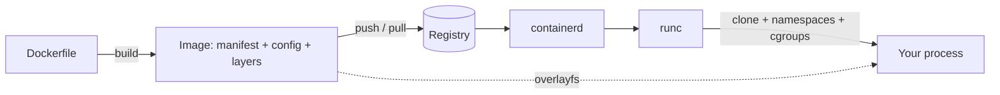

# Containers

A container is not a small virtual machine. It is a normal process with walls around it, started from a stack of tarballs.

## Why go deeper?

`docker run` hides a lot of detail. That detail matters when:

- The image is 1.2 GB for a 15 MB Go binary.
- A one-line code change makes CI rebuild every layer and download every module again.
- `docker stop` takes exactly 10 seconds every time, then the process is killed.
- The container works on your laptop (ARM) and crashes in production (x86).
- A security scan lists 300 vulnerabilities in packages you never use.

All of these follow from three facts: images are **layers**, a container is a **Linux process** in namespaces and cgroups, and a **runtime** glues the two together. [Linux and the OS](../linux/index.md) gives you the namespaces and cgroups. This chapter adds the rest.

## The big picture

1. **An image** is a manifest, a JSON config, and a list of layer tarballs, all addressed by hash (like [Git objects](../git/objects.md)).
2. **A registry** is a content-addressed store with an HTTP API.
3. **A runtime** unpacks the layers into a root filesystem and starts your process inside namespaces and cgroups.

## Reading order

Each page builds on the one before it.

| #   | Page                                          | You will learn                                                                              |
| --- | --------------------------------------------- | ------------------------------------------------------------------------------------------- |
| 1   | [What a container is](what-a-container-is.md) | Run a process in namespaces by hand, then see what Docker adds; containers vs VMs           |
| 2   | [Images and layers](images-and-layers.md)     | The OCI image format, digests vs tags, overlayfs, open an image with `skopeo` and `tar`     |
| 3   | [Building good images](building-images.md)    | Cache-friendly Dockerfiles, multi-stage Go builds, distroless, multi-arch, BuildKit secrets |
| 4   | [Runtimes](runtimes.md)                       | Docker, containerd, runc, Podman, rootless containers, and the OCI runtime spec             |
| 5   | [Container networking](networking.md)         | veth pairs, bridges, port publishing, NAT, and container DNS                                |
| 6   | [Container security](security.md)             | Non-root users, capabilities, seccomp, read-only roots, image scanning and signing          |

The [Building a service](../go/services.md) page already ships `ordersd` in a distroless image. This chapter explains every line of that `Dockerfile` and takes it apart.

## How each page works

The same shape as the [Fundamentals](../fundamentals/index.md): **Why care?**, **The idea**, **Under the hood**, **Try it**, **Traps** and **Check yourself**. All output comes from real runs on WSL2 with Docker 29.1 (containerd and runc), Go 1.27.4, `crane`, `syft` and `cosign`.
