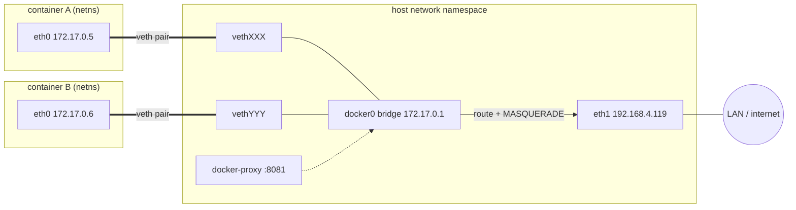

# Container networking

## Why care?

Four tickets that all live on this page:

- "The service listens on `127.0.0.1:8080` inside the container. `-p 8080:8080` is set. `curl` from the host gets `connection reset`."
- "`orders` can't reach `postgres` by name, but the IP address works."
- "The logs show every client as `172.17.0.1`. Where are the real client IPs?"
- "We closed port 8080 in the firewall. It is still open from the internet."

In [Namespaces and cgroups](../linux/namespaces-and-cgroups.md#network-namespaces-a-separate-network-stack) you saw that a new network namespace has only a loopback interface, and it is down. In [Layers and packets](../networking/layers-and-packets.md#try-it-watch-arp-happen) you joined two namespaces with a veth pair, by hand. Docker does exactly that, plus three more things: a **bridge** to connect many containers, **NAT** rules to reach them from outside, and a small **DNS server** so they find each other by name. On this page you find every one of those pieces on a real machine.

## The idea: a bridge, NAT and a DNS server

- Each container has its own **network namespace**, with its own `eth0` interface.
- A **veth pair** (a virtual cable with two ends) connects each container's `eth0` to a **bridge** on the host (`docker0`). A bridge is a software switch: all containers on one bridge can reach each other directly.
- The host has **one** address on the network. Outgoing traffic from a container leaves with the host's address as its source (**masquerading**, a kind of NAT, network address translation).
- Incoming traffic to a published host port, for example 8081, is sent on to the container's port, for example 8080 (**port publishing**: a NAT rule or a proxy process).
- On user-defined networks, a **DNS server** at `127.0.0.11` resolves the names of other containers on the same network.



## Under the hood: one container, one cable

### The bridge on the host

A Docker host has a bridge called `docker0`. A bridge is a software Ethernet switch inside the kernel. It also has an IP address, so it is the **router** for the containers on it:

```console
$ ip -br addr show docker0
docker0          UP             172.17.0.1/16
$ ip route | grep docker0
172.17.0.0/16 dev docker0 proto kernel scope link src 172.17.0.1
$ docker network inspect bridge --format '{{json .IPAM.Config}}'
[{"Subnet":"172.17.0.0/16","IPRange":"","Gateway":"172.17.0.1"}]
```

`172.17.0.0/16` is private address space (see [CIDR](../networking/layers-and-packets.md#cidr-the-slash-number)). Every container on the default network gets one address from it.

### Follow the cable from both ends

Start a container. Alpine has BusyBox `ip`, which is enough:

```console
$ docker run -d --name tutor-net-a alpine:3.22 sleep 600
$ docker exec tutor-net-a ip addr show eth0
2: eth0@if248: <BROADCAST,MULTICAST,UP,LOWER_UP,M-DOWN> mtu 1500 qdisc noqueue state UP
    link/ether 2e:da:2d:79:29:6b brd ff:ff:ff:ff:ff:ff
    inet 172.17.0.5/16 brd 172.17.255.255 scope global eth0
       valid_lft forever preferred_lft forever
```

`eth0@if248` says: "my other end is interface number 248". Not in this namespace, so it must be somewhere else. Each interface has an **ifindex** (its own number) and an **iflink** (the number of its peer). Both are files in `/sys`:

```console
$ docker exec tutor-net-a cat /sys/class/net/eth0/ifindex /sys/class/net/eth0/iflink
2
248
$ grep -lx 248 /sys/class/net/*/ifindex
/sys/class/net/veth976bb0d/ifindex
$ cat /sys/class/net/veth976bb0d/iflink
2
$ ip link show veth976bb0d
248: veth976bb0d@if2: <BROADCAST,MULTICAST,UP,LOWER_UP> mtu 1500 qdisc noqueue master docker0 state UP mode DEFAULT group default
    link/ether e6:73:dd:27:6e:83 brd ff:ff:ff:ff:ff:ff link-netnsid 3
$ readlink /sys/class/net/veth976bb0d/master
../docker0
```

Read it as the two ends of one cable:

- In the container: `eth0` is ifindex 2, peer 248.
- On the host: `veth976bb0d` is ifindex 248, peer 2, and its **master** is `docker0`. It is plugged into the switch.

Note: ifindex numbers are only unique **per namespace**. On a busy host, many veths show `@if2`, because every container's `eth0` happens to be number 2 in its own namespace. So always search from the container side (its `iflink`) to the host. That is the only direction that gives one answer.

The two ends really are in different namespaces. Compare the namespace inodes, as in [the namespaces page](../linux/namespaces-and-cgroups.md#the-eight-namespaces):

```console
$ readlink /proc/self/ns/net
net:[4026531840]
$ docker exec tutor-net-a readlink /proc/self/ns/net
net:[4026532615]
```

!!! note "Why not `nsenter`?"

    The classic way to look inside is `nsenter -t <pid> -n ip addr` on the host. That needs
    real root (`CAP_SYS_ADMIN` in the host namespaces), and so does reading
    `/proc/<pid>/ns/net` of a process owned by root:

    ```console
    $ nsenter -t 262141 -n ip -br addr
    nsenter: reassociate to namespaces failed: Operation not permitted
    ```

    `docker exec` gets in anyway, because `dockerd` runs as root and does the `setns` for you.
    That is a hint for the [security page](security.md): being in the `docker` group is as
    good as being root.

### Routes and neighbours inside

```console
$ docker exec tutor-net-a ip route
default via 172.17.0.1 dev eth0
172.17.0.0/16 dev eth0 scope link  src 172.17.0.5
```

Two routes, nothing more. Other containers on `172.17.0.0/16` are "on the link": reach them directly by MAC address. Everything else goes to `172.17.0.1`, the bridge on the host. ARP and the neighbour table work exactly as in [Layers and packets](../networking/layers-and-packets.md#the-next-hop-arp-and-the-neighbour-table):

```console
$ docker exec tutor-net-a ip neigh
172.17.0.1 dev eth0 lladdr d6:f8:6e:d2:e3:1a ref 1 used 0/0/0 probes 4 REACHABLE
$ ping -c1 -W1 172.17.0.5 | sed -n 2p
64 bytes from 172.17.0.5: icmp_seq=1 ttl=64 time=0.205 ms
$ ip neigh show 172.17.0.5
172.17.0.5 dev docker0 lladdr 2e:da:2d:79:29:6b REACHABLE
```

The bridge itself learns which MAC address sits behind which port, like a hardware switch. That is the **forwarding database**:

```console
$ bridge fdb show br docker0 | grep veth976bb0d
2e:da:2d:79:29:6b dev veth976bb0d master docker0
e6:73:dd:27:6e:83 dev veth976bb0d vlan 1 master docker0 permanent
e6:73:dd:27:6e:83 dev veth976bb0d master docker0 permanent
33:33:00:00:00:01 dev veth976bb0d self permanent
01:00:5e:00:00:01 dev veth976bb0d self permanent
```

The first line was **learned**: the container's MAC (`2e:da:...`, its `eth0`) is behind this port. The `permanent` lines are the veth's own address and two multicast groups.

### Out to the internet: forwarding and masquerade

```console
$ docker exec tutor-net-a ping -c1 -W1 1.1.1.1
PING 1.1.1.1 (1.1.1.1): 56 data bytes
64 bytes from 1.1.1.1: seq=0 ttl=57 time=8.013 ms

--- 1.1.1.1 ping statistics ---
1 packets transmitted, 1 packets received, 0% packet loss
round-trip min/avg/max = 8.013/8.013/8.013 ms
$ cat /proc/sys/net/ipv4/ip_forward
1
```

Two things make this work:

1. **IP forwarding.** The host must route packets from `docker0` to `eth1`. `ip_forward = 1` turns the host into a router. Docker sets it when it starts.
2. **Masquerading.** The internet has no route back to `172.17.0.5`. So on the way out, the host's firewall rewrites the source address to its own (`192.168.4.119`), and remembers the connection in the **conntrack** table so it can rewrite the replies back. Docker adds a rule like `-A POSTROUTING -s 172.17.0.0/16 ! -o docker0 -j MASQUERADE` to the `nat` table.

<!-- TODO(real-output): `sudo iptables -t nat -S` and `sudo iptables -S DOCKER-FORWARD` (or `sudo nft list ruleset`) on the host. Needs real root; the session has none. Paste the MASQUERADE, DOCKER and DNAT lines here. -->

This machine uses the iptables backend (`docker info` says `Firewall Backend: iptables`), and `iptables` here is `iptables v1.8.10 (nf_tables)`: the old command, writing rules into the new nftables engine. Listing them needs root:

```console
$ iptables -t nat -S
iptables v1.8.10 (nf_tables): Could not fetch rule set generation id: Permission denied (you must be root)
```

## Under the hood: `-p` publishes a port, two ways

`-p 8081:8080` means "host port 8081 goes to container port 8080". Docker does this **twice**, on purpose:

- A **DNAT rule** in the `nat` table rewrites the destination of incoming packets from `<host>:8081` to `172.17.0.x:8080`. The packet is then forwarded over `docker0` like any routed packet. The client's address is not touched.
- A **userland proxy**, `docker-proxy`, listens on port 8081 itself. It accepts the connection and opens a **second** connection to the container. It catches the cases the DNAT rule can't, mainly traffic to `127.0.0.1`, which the kernel never routes out of `lo`.

Run `ordersd` with a published port and look:

```console
$ docker run -d --name tutor-net-orders -p 8081:8080 tutor-ordersd:dev
$ docker port tutor-net-orders
8080/tcp -> 0.0.0.0:8081
8080/tcp -> [::]:8081
$ ps -eo pid,user,args | grep 'docker-proxy.*8081'
 272904 root     /usr/bin/docker-proxy -proto tcp -host-ip 0.0.0.0 -host-port 8081 -container-ip 172.17.0.2 -container-port 8080 -use-listen-fd
 272910 root     /usr/bin/docker-proxy -proto tcp -host-ip :: -host-port 8081 -container-ip 172.17.0.2 -container-port 8080 -use-listen-fd
$ ss -ltn 'sport = :8081'
State  Recv-Q Send-Q Local Address:Port Peer Address:PortProcess
LISTEN 0      4096         0.0.0.0:8081      0.0.0.0:*
LISTEN 0      4096            [::]:8081         [::]:*
$ curl -s http://127.0.0.1:8081/healthz
{"status":"ok"}
```

One `docker-proxy` per address family. `-use-listen-fd` means `dockerd` opened the listening socket and handed it over, so the port is taken even before the proxy runs.

### Which one carried my request?

`ordersd` doesn't log client addresses, so here is a small server that answers with its own TCP connection table. BusyBox `nc -e` runs a script for each connection, and `netstat` inside shows who is on the other end:

```console
$ docker run -d --name tutor-net-echo -p 8082:8080 alpine:3.22 sh -c '
    printf "#!/bin/sh\nprintf \"HTTP/1.0 200 OK\\r\\n\\r\\n\"; netstat -tn | grep ESTAB\n" > /who.sh
    chmod +x /who.sh; exec nc -lk -p 8080 -e /who.sh'
$ curl -s http://127.0.0.1:8082/
tcp       78      0 ::ffff:172.17.0.5:8080  ::ffff:172.17.0.1:46229 ESTABLISHED
$ curl -s http://192.168.4.119:8082/
tcp       82      0 ::ffff:172.17.0.5:8080  ::ffff:192.168.4.119:45943 ESTABLISHED
```

Same port, two different paths:

- Via `127.0.0.1`: the container sees the client as **`172.17.0.1`**, the bridge. That was `docker-proxy`, opening its own connection from the host's bridge address.
- Via the LAN address `192.168.4.119`: the container sees the **real** source address. That was the DNAT rule; the packet was only rewritten, not re-sent.

You can watch the proxy's two connections from the host, with a server that holds each connection open for 3 seconds:

```console
$ docker run -d --name tutor-net-slow -p 8083:8080 alpine:3.22 sh -c '
    printf "#!/bin/sh\nsleep 3\n" > /s.sh; chmod +x /s.sh; exec nc -lk -p 8080 -e /s.sh'
$ curl -s --max-time 4 http://127.0.0.1:8083/ &
$ ss -tn '( dport = :8083 or sport = :8083 or dst 172.17.0.4 )'
State Recv-Q Send-Q Local Address:Port  Peer Address:Port Process
ESTAB 0      0         172.17.0.1:47411   172.17.0.4:8080
ESTAB 0      0          127.0.0.1:8083     127.0.0.1:44799
ESTAB 0      0          127.0.0.1:44799    127.0.0.1:8083
```

The bottom two lines are curl and the proxy, both on loopback. The top line is the proxy's second connection, from `172.17.0.1` to the container. That is the "every client is `172.17.0.1`" ticket from the top of this page. In production (no `docker-proxy` path, or behind a load balancer) you get the real client address from the packet, or from `X-Forwarded-For` / the PROXY protocol (see [Load balancers](../networking/load-balancers.md)).

### Publish to one address only

`-p 8081:8080` listens on **all** host addresses: `0.0.0.0` and `[::]`. Your service is on the LAN, and maybe the internet. For a local database or debug port, bind to loopback:

```console
$ docker run -d --name tutor-net-lo -p 127.0.0.1:8084:8080 tutor-ordersd:dev
$ docker port tutor-net-lo
8080/tcp -> 127.0.0.1:8084
$ ss -ltn 'sport = :8084'
State  Recv-Q Send-Q Local Address:Port Peer Address:PortProcess
LISTEN 0      4096       127.0.0.1:8084      0.0.0.0:*
$ curl -s -m2 http://127.0.0.1:8084/healthz
{"status":"ok"}
$ curl -s -m2 http://192.168.4.119:8084/healthz; echo "exit=$?"
exit=7
```

Exit 7 is curl's "failed to connect".

!!! note "WSL2 on this machine"

    Docker Engine runs **inside** the WSL2 distribution here (`dockerd` and `containerd` are
    normal processes in it), not Docker Desktop. WSL2 is set to `networkingMode=mirrored`, so
    Linux and Windows share `localhost` and the LAN address (see
    [Networking: debugging](../networking/debugging.md)). A published port is reachable from
    Windows too:

    ```console
    $ /mnt/c/Windows/System32/curl.exe -s -m 3 http://localhost:8081/healthz
    {"status":"ok"}
    ```

    With Docker Desktop, the engine runs in its own small VM instead, and Docker Desktop
    forwards ports from Windows into it. The bridge and veths on this page then live in
    that VM, not in your distribution.

## Under the hood: user-defined networks and DNS

The default `bridge` network is old and limited. The main gap: **no names**. Containers on it can only find each other by IP address:

```console
$ docker run -d --name tutor-net-a alpine:3.22 sleep 300
$ docker run --rm alpine:3.22 sh -c 'getent hosts tutor-net-a; echo "exit=$?"; grep nameserver /etc/resolv.conf'
exit=2
nameserver 10.255.255.254
```

No answer, and the container simply got the host's resolver (`10.255.255.254` is the WSL DNS proxy from [DNS](../networking/dns.md)). Create your own network instead:

```console
$ docker network create tutor-net
$ docker network inspect tutor-net --format '{{json .IPAM.Config}} {{.Driver}}'
[{"Subnet":"172.18.0.0/16","IPRange":"","Gateway":"172.18.0.1"}] bridge
$ ip -br addr show br-a66228542879
br-a66228542879  UNKNOWN        172.18.0.1/16
```

Same driver, a new bridge (`br-` plus the start of the network ID) and a new subnet. Now start `ordersd` on it, with an extra name (**alias**), and call it from another container:

```console
$ docker run -d --name tutor-net-orders --network tutor-net --network-alias orders tutor-ordersd:dev
$ docker run --rm --network tutor-net alpine:3.22 sh -c 'cat /etc/resolv.conf; wget -qO- http://orders:8080/healthz'
# Generated by Docker Engine.
# This file can be edited; Docker Engine will not make further changes once it
# has been modified.

nameserver 127.0.0.11
search localdomain
options ndots:0

# Based on host file: '/etc/resolv.conf' (internal resolver)
# ExtServers: [host(10.255.255.254)]
# Overrides: []
# Option ndots from: internal
{"status":"ok"}
$ docker run --rm --network tutor-net alpine:3.22 sh -c 'nslookup -type=a tutor-net-orders.; getent hosts orders'
Server:		127.0.0.11
Address:	127.0.0.11:53

Non-authoritative answer:
Name:	tutor-net-orders
Address: 172.18.0.2

172.18.0.2        orders  orders
```

Now `resolv.conf` points to **`127.0.0.11`**, Docker's embedded DNS server. It answers names of containers (and aliases) on the **same network**. For every other name it asks the host's resolver (`ExtServers: [host(10.255.255.254)]`). `ndots:0` means "never try the search list first", so `orders` is asked as `orders`, not `orders.localdomain` (see [ndots](../networking/dns.md#search-domains-and-ndots-one-lookup-eight-queries)).

!!! tip "BusyBox `nslookup` and the search list"

    Without the trailing dot, BusyBox `nslookup` reports only a failure, although the
    name resolves fine (`getent` and `wget` find it):

    ```console
    $ docker run --rm --network tutor-net alpine:3.22 nslookup tutor-net-orders
    Server:		127.0.0.11
    Address:	127.0.0.11:53

    ** server can't find tutor-net-orders.localdomain: NXDOMAIN

    ** server can't find tutor-net-orders.localdomain: NXDOMAIN
    ```

    BusyBox also tries the search domain and prints that failure. Use a trailing dot or
    `getent hosts` to test.

### Where is `127.0.0.11`?

It is a loopback address **inside the container**, but no program in the container serves it. Look at the listening sockets:

```console
$ docker run --rm --network tutor-net alpine:3.22 sh -c 'netstat -lnu; netstat -lnt'
Active Internet connections (only servers)
Proto Recv-Q Send-Q Local Address           Foreign Address         State
udp        0      0 127.0.0.11:48244        0.0.0.0:*
Active Internet connections (only servers)
Proto Recv-Q Send-Q Local Address           Foreign Address         State
tcp        0      0 127.0.0.11:32805        0.0.0.0:*               LISTEN
```

Not port 53, but random high ports. `dockerd` opens these sockets **in the container's network namespace** and serves them from its own process on the host. A NAT rule inside the container moves port 53 to the real port. Inside its own namespace, a container with `NET_ADMIN` may read its own firewall, so we can see the rules without host root:

```console
$ docker run --rm --network tutor-net --cap-add NET_ADMIN alpine:3.22 sh -c 'apk add -q iptables >/dev/null; iptables -t nat -S'
-P PREROUTING ACCEPT
-P INPUT ACCEPT
-P OUTPUT ACCEPT
-P POSTROUTING ACCEPT
-N DOCKER_OUTPUT
-N DOCKER_POSTROUTING
-A OUTPUT -d 127.0.0.11/32 -j DOCKER_OUTPUT
-A POSTROUTING -d 127.0.0.11/32 -j DOCKER_POSTROUTING
-A DOCKER_OUTPUT -d 127.0.0.11/32 -p tcp -m tcp --dport 53 -j DNAT --to-destination 127.0.0.11:39479
-A DOCKER_OUTPUT -d 127.0.0.11/32 -p udp -m udp --dport 53 -j DNAT --to-destination 127.0.0.11:58470
-A DOCKER_POSTROUTING -s 127.0.0.11/32 -p tcp -m tcp --sport 39479 -j SNAT --to-source :53
-A DOCKER_POSTROUTING -s 127.0.0.11/32 -p udp -m udp --sport 58470 -j SNAT --to-source :53
```

(Another container than the `netstat` one, so other random ports.) Queries to `127.0.0.11:53` are rewritten to the real port, and replies get source port 53 back, so the resolver in your program never notices. This is the same DNAT idea as `-p`, on a smaller scale.

The consequence: DNS inside the container depends on `dockerd`. If you edit `/etc/resolv.conf` in the image, or mount your own, you lose container names.

### Networks isolate containers

Containers on different networks can't talk, even by IP address. The host can reach both bridges:

```console
$ docker run --rm alpine:3.22 sh -c 'ping -c1 -W1 172.18.0.2 | tail -2; wget -qO- -T 2 http://172.18.0.2:8080/healthz; echo exit=$?'
--- 172.18.0.2 ping statistics ---
1 packets transmitted, 0 packets received, 100% packet loss
wget: download timed out
exit=1
$ ping -c1 -W1 172.18.0.2 | tail -2
1 packets transmitted, 1 received, 0% packet loss, time 0ms
rtt min/avg/max/mdev = 0.100/0.100/0.100/0.000 ms
```

The routing is there (the host is a router for both). Docker's firewall rules in the `filter` table drop packets forwarded from one bridge to another. To let a container talk to both, connect it to both. It gets a second veth and a second interface:

```console
$ docker run -d --name tutor-net-a alpine:3.22 sleep 300
$ docker network connect tutor-net tutor-net-a
$ docker exec tutor-net-a sh -c 'ip -o -4 addr | awk "{print \$2, \$4}"; ip route; wget -qO- -T 2 http://orders:8080/healthz'
lo 127.0.0.1/8
eth0 172.17.0.5/16
eth1 172.18.0.3/16
default via 172.17.0.1 dev eth0
172.17.0.0/16 dev eth0 scope link  src 172.17.0.5
172.18.0.0/16 dev eth1 scope link  src 172.18.0.3
{"status":"ok"}
```

This is how Docker Compose works: one network per project, every service on it, service names in DNS. A "frontend" and "backend" network with only the API on both is a simple way to isolate your database.

## Under the hood: `none` and `host`

Two special network modes skip the bridge entirely.

**`--network none`**: a new network namespace with only loopback. Docker turns `lo` on for you:

```console
$ docker run --rm --network none alpine:3.22 sh -c 'ip addr; ip route; ping -c1 -W1 1.1.1.1'
1: lo: <LOOPBACK,UP,LOWER_UP> mtu 65536 qdisc noqueue state UNKNOWN qlen 1000
    link/loopback 00:00:00:00:00:00 brd 00:00:00:00:00:00
    inet 127.0.0.1/8 scope host lo
       valid_lft forever preferred_lft forever
    inet6 ::1/128 scope host
       valid_lft forever preferred_lft forever
PING 1.1.1.1 (1.1.1.1): 56 data bytes
ping: sendto: Network unreachable
```

No routes at all. Use it for batch jobs that should never talk to the network: converting files, running untrusted tests.

**`--network host`**: **no** new network namespace. The container uses the host's interfaces, ports and firewall:

```console
$ docker run --rm --network host alpine:3.22 sh -c 'ip -o link | cut -d: -f2 | grep -v veth; readlink /proc/self/ns/net; hostname'
 lo
 eth0
 loopback0
 eth1
 docker0
 br-a66228542879
net:[4026531840]
laptop
$ readlink /proc/self/ns/net
net:[4026531840]
```

Same namespace inode as the host. No veth, no NAT, no proxy: the fastest path, and `-p` is ignored. The price: the container's ports are the host's ports (two containers can't both use 8080), and a process in it that binds `0.0.0.0` is open on the LAN. Even the hostname is the host's, because Docker also shares the UTS namespace in host mode.

| Mode            | Own netns? | Reach it from outside | Container to container | Typical use                           |
| --------------- | ---------- | --------------------- | ---------------------- | ------------------------------------- |
| `bridge`        | yes        | `-p` (DNAT + proxy)   | by IP only             | Default; quick tests                  |
| user-defined    | yes        | `-p` (DNAT + proxy)   | by name (`127.0.0.11`) | Every real project, Compose           |
| `none`          | yes        | not at all            | no                     | Jobs that must not use the network    |
| `host`          | **no**     | directly, host ports  | via host ports         | Network tools, very high packet rates |
| `container:<n>` | shares n's | as `n`                | `localhost` with `n`   | Sidecars, debugging (Kubernetes pods) |

The last row is the Kubernetes pod model: all containers of a pod share **one** network namespace and talk over `localhost`. You will meet it in the [Kubernetes](../kubernetes/index.md) chapter.

## Try it

1. Start `docker run -d --name tutor-net-a alpine:3.22 sleep 600`. Find its host veth with the `iflink` trick. Then run `docker network connect` to a second network and find the second veth. Which bridge is its master?
2. Run the `who.sh` server from this page with `-p 8082:8080`. Connect via `127.0.0.1` and via your LAN address. Which source addresses does the container see?
3. Create `tutor-net`, start two containers on it, and resolve one from the other with `getent hosts`. Then `docker network disconnect` one of them and try again.
4. Run the same `wget` from a `--network none` container. What is the error, and at which layer does it fail?
5. Clean up: `docker rm -f tutor-net-a tutor-net-orders tutor-net-echo` and `docker network rm tutor-net`.

## Traps

- **Listening on `127.0.0.1` inside the container.** Each network namespace has its own loopback. `-p` forwards to the container's `eth0` address, where nothing listens. Inside a container, listen on `:8080` (all addresses). This is the "connection reset" ticket.
- **`-p 8080:8080` is open to the world.** It binds `0.0.0.0` and `[::]`. And Docker's NAT rules run before the host firewall's `INPUT` chain, so tools like `ufw` don't see the traffic. Bind to `127.0.0.1:` for local-only ports, or filter in the `DOCKER-USER` chain.
- **Client IP is `172.17.0.1`.** That was `docker-proxy`. Behind a real load balancer use `X-Forwarded-For` or the PROXY protocol; never trust a header from an untrusted network.
- **No DNS on the default bridge.** Use a user-defined network. The old `--link` flag is legacy.
- **Overwriting `/etc/resolv.conf`.** Docker generates it. Replace it and you lose `127.0.0.11` and container names. Use `--dns` and `--dns-search` instead.
- **Subnet clashes.** `172.17.0.0/16` and the next networks (`172.18`, `172.19`, ...) can overlap with a VPN or office network. Then the route to `docker0` wins and the office is unreachable. Set `default-address-pools` in `/etc/docker/daemon.json`.
- **MTU in tunnels.** Docker gives containers MTU 1500. If the host's uplink is a VPN with MTU 1400, big packets are lost while small ones work (see [MTU](../networking/layers-and-packets.md#mtu-mss-and-fragmentation)). Set the network's `com.docker.network.driver.mtu`.
- **Debugging needs the namespace.** `ss`, `ip` and `tcpdump` on the host show the host's namespace. Run them in the container (`docker exec`) or, if the image has no tools, in a helper that shares the namespace: `docker run --rm -it --network container:<name> <tools-image>`.

## Check yourself

??? question "1. In a container, `ip link` shows `eth0@if91`. What does `91` mean, and how do you find the other end?"

    It is the ifindex of the peer of this veth. The peer is in another namespace (the host).
    Read `/sys/class/net/eth0/iflink` in the container (91), then on the host find the
    interface whose `ifindex` file contains 91: `grep -lx 91 /sys/class/net/*/ifindex`.
    Don't search the other way: many host veths show `@if2`, because every container's
    `eth0` is number 2 in its own namespace.

??? question "2. A container reaches `1.1.1.1`, but its address is `172.17.0.5`, a private address. Why do replies come back?"

    The host is a router (`ip_forward = 1`) and masquerades: a `MASQUERADE` rule in the
    `nat` table rewrites the source to the host's own address on the way out. The kernel's
    connection tracking remembers the mapping and rewrites replies back to `172.17.0.5`.

??? question "3. `curl 127.0.0.1:8081` reaches the container. Is that DNAT or `docker-proxy`? How can you tell?"

    `docker-proxy`. Traffic to `127.0.0.1` stays on `lo` and is never routed, so the DNAT
    path doesn't apply. You can tell by the source address in the container: it sees
    `172.17.0.1` (the proxy's second connection), and on the host `ss` shows two
    connections, one on loopback and one from `172.17.0.1` to the container. Via the host's
    LAN address, the container sees the real client.

??? question "4. Two containers on `tutor-net` can call each other by name. One on the default bridge can't, even by IP. Why both?"

    Names: only user-defined networks get the embedded DNS server at `127.0.0.11`, and it
    only knows containers on the same network. IP: Docker's isolation rules drop packets
    forwarded between different bridges. `docker network connect` the container to
    `tutor-net` fixes both.

??? question "5. Your container's `/etc/resolv.conf` says `nameserver 127.0.0.11`, but nothing in the container listens on port 53. Who answers?"

    `dockerd`. It opens sockets on `127.0.0.11` at random ports inside the container's
    network namespace, and a DNAT rule in the container's own `nat` table sends port 53 to
    them (and an SNAT rule makes the replies come from port 53). Names it doesn't know, it
    forwards to the host's resolver.

??? question "6. When would you use `--network host`, and what do you give up?"

    When NAT and the bridge cost too much (very high packet rates) or a tool must see the
    host's interfaces (monitoring, `tcpdump`). You give up network isolation: the host's
    ports, the host's firewall, no `-p` mapping, port clashes between containers, and
    every `0.0.0.0` listener is on the LAN.

## Recap

- A container has its own network namespace. Docker connects it with a **veth pair**: `eth0` inside, `vethXXXX` on the host, plugged into a **bridge** (`docker0` or `br-<id>`).
- Match the ends with `/sys/class/net/*/ifindex` and `iflink`, starting from the container side.
- Inside: one address, a route to the subnet, a default route to the bridge's IP.
- Out: the host forwards (`ip_forward = 1`) and **masquerades** the source address.
- In: `-p` adds a **DNAT** rule and starts **`docker-proxy`**. The proxy handles `127.0.0.1` and hides the client IP; DNAT keeps it.
- **User-defined networks** add DNS at **`127.0.0.11`** (served by `dockerd`, reached by a NAT rule inside the container) and isolation from other networks.
- `none` = loopback only. `host` = no network namespace at all. `container:<name>` = share one, like a Kubernetes pod.

Next: [Container security](security.md). The container has its own network, but its root user may still be the host's root.
