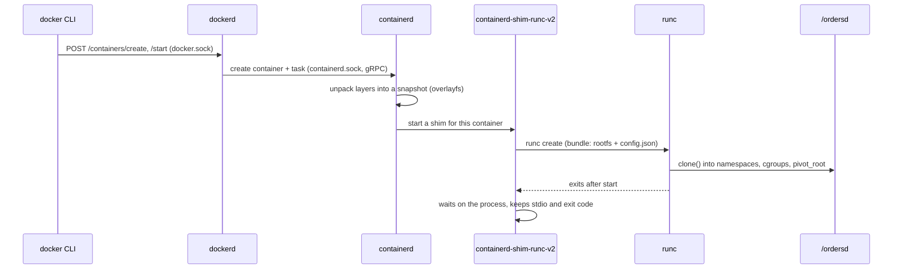
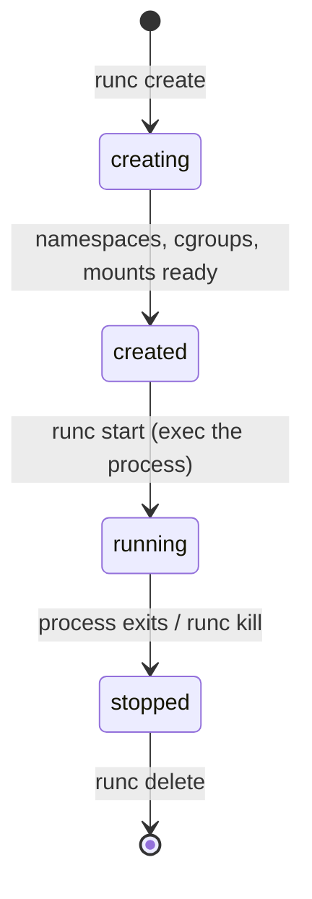

# Runtimes

## Why care?

Messages you will see, and need to place:

- `OCI runtime create failed: runc create failed: unable to start container process: ...`. Which program is the "OCI runtime", and what failed?
- "Kubernetes removed dockershim. Do our images still work?" (Yes. Why?)
- "Anyone in the `docker` group is root on that machine." True, and the reason is on this page.
- "Run containers rootless." What does that change, and why does it fail with `cannot setgid to unmapped gid`?

`docker run` is not one program. It is a chain of five, each with one job. When something breaks, the error message comes from one link in that chain, and knowing the chain tells you where to look. On this page you watch the chain from the host, read the **OCI runtime spec** that the last link gets, and then skip Docker completely and start `ordersd` with `runc` as a normal user.

## The idea: a chain of programs, each with one job

- **The `docker` CLI** sends your request to the daemon: "run `ordersd`, publish port 8080."
- **`dockerd`** handles the Docker-level features: networks, volumes, port publishing, logs, and the Docker API.
- **`containerd`** manages images, snapshots (unpacked layers), and the list of containers and where they run.
- **`containerd-shim-runc-v2`** (the shim) stays with each container for its whole life. It holds the container's stdio and records its exit code.
- **`runc`** sets up the container (namespaces, cgroups, mounts), starts the process, and **exits**. It does not watch the process.

The input to `runc` is defined by a standard: the **OCI runtime spec**, one file called `config.json`. Any runtime that reads that file (`runc`, `crun`, `runsc`, Kata) can do the job.



## Under the hood: the chain, from the host

Start `ordersd` in Docker, then look at the process tree. (Only this container's shim is shown; other containers were running on the machine.)

```console
$ docker run -d --name tutor-b-rt tutor-ordersd:dev
$ ps --forest -o pid,ppid,user,args -p 1,219,311,351750,351774
    PID    PPID USER     COMMAND
      1       0 root     /usr/lib/systemd/systemd --system --deserialize=98
    219       1 root     /usr/bin/containerd
    311       1 root     /usr/bin/dockerd -H fd:// --containerd=/run/containerd/containerd.sock
 351750       1 root     /usr/bin/containerd-shim-runc-v2 -namespace moby -id d6d70352f2a0344e2c471b3ba251a882d254c1fae068325b470e5f3cb547acc0 -address /run/con
 351774  351750 65532     \_ /ordersd
```

Four things to notice:

1. **`/ordersd` is a child of the shim, not of `dockerd` or `containerd`.** The shim's parent is PID 1 (systemd): the shim detaches itself. So `containerd` (and, with `live-restore`, `dockerd`) can restart or upgrade without killing running containers.
2. **`runc` is not there.** It did its work and exited:

   ```console
   $ echo "runc procs: $(pgrep -c -x runc)"
   runc procs: 0
   ```

3. **`-namespace moby`** is a containerd namespace (a label for grouping, nothing to do with kernel namespaces). Docker keeps its containers in `moby`. Kubernetes uses `k8s.io` on the same containerd.
4. **The user is `65532`, on the host too.** Docker does not use a user namespace by default, so UID 65532 in the container is UID 65532 on the host. More on that [below](#user-namespaces-and-rootless).

When you stop the container, the shim leaves with it:

```console
$ docker stop tutor-b-rt    # took 530 ms: ordersd handles SIGTERM
$ docker inspect tutor-b-rt -f '{{.State.Status}} {{.State.ExitCode}}'
exited 0
```

### The sockets are the security boundary

Each link talks to the next over a Unix socket. Who may open the socket decides who controls the link:

```console
$ ls -l /run/containerd/containerd.sock /var/run/docker.sock
srw-rw---- 1 root root   0 Nov 26 07:33 /run/containerd/containerd.sock
srw-rw---- 1 root docker 0 Nov 26 07:33 /var/run/docker.sock
```

Members of the `docker` group may talk to `dockerd`, and `dockerd` runs as root and does whatever the API asks: `docker run -v /:/host --privileged ...` gives a full root shell on the host. That is why **the `docker` group is root**. The containerd socket is root-only, so `ctr` (containerd's own debug CLI) refuses a normal user:

```console
$ ctr -n moby containers ls
ctr: rpc error: code = Unavailable desc = connection error: desc = "transport: Error while dialing: dial unix /run/containerd/containerd.sock: connect: permission denied"
```

<!-- TODO(real-output): needs root. Run `sudo ctr -n moby containers ls` and `sudo ctr -n moby tasks ls` while tutor-b-rt runs, and paste both. Expected: the container ID from `docker inspect`, image docker.io/library/tutor-ordersd:dev, runtime io.containerd.runc.v2; the task with the host PID and status RUNNING. -->

`ctr` is a low-level tool for containerd developers. For daily use on a containerd host there are `nerdctl` (Docker-compatible CLI) and, on Kubernetes nodes, `crictl` (talks the Kubernetes CRI API). None of the three is installed here besides `ctr`.

### Why Kubernetes could drop Docker

The kubelet talks to a runtime through the **CRI** (Container Runtime Interface), a gRPC API. containerd has a CRI plugin built in, and so does CRI-O. Before Kubernetes 1.24, the kubelet had a translation layer (dockershim) to drive `dockerd`, which then drove containerd. Removing it removed one link. The images are OCI images, and containerd runs them the same way, so nothing about your images changed.

## The OCI runtime spec: a bundle is a folder

`runc` knows nothing about images, registries or layers. It wants a **bundle**: a folder with

- `rootfs/`: the root filesystem, already unpacked (containerd makes it from the layers with overlayfs, see [Images and layers](images-and-layers.md)), and
- `config.json`: everything else.

`runc spec` writes a default `config.json`. Its top level is small:

```console
$ runc spec && jq -r 'keys[]' config.json | tr '\n' ' '; echo; jq -r '.linux|keys[]' config.json | tr '\n' ' '
hostname linux mounts ociVersion process root
maskedPaths namespaces readonlyPaths resources
```

```console
$ jq '{process: {user: .process.user, args: .process.args, env: .process.env, cwd: .process.cwd, capabilities: {bounding: .process.capabilities.bounding}, noNewPrivileges: .process.noNewPrivileges}, root, namespaces: [.linux.namespaces[].type], maskedPaths: (.linux.maskedPaths|length), readonlyPaths: .linux.readonlyPaths}' config.json
{
  "process": {
    "user": {
      "uid": 0,
      "gid": 0
    },
    "args": [
      "sh"
    ],
    "env": [
      "PATH=/usr/local/sbin:/usr/local/bin:/usr/sbin:/usr/bin:/sbin:/bin",
      "TERM=xterm"
    ],
    "cwd": "/",
    "capabilities": {
      "bounding": [
        "CAP_AUDIT_WRITE",
        "CAP_KILL",
        "CAP_NET_BIND_SERVICE"
      ]
    },
    "noNewPrivileges": true
  },
  "root": {
    "path": "rootfs",
    "readonly": true
  },
  "namespaces": [
    "pid",
    "network",
    "ipc",
    "uts",
    "mount"
  ],
  "maskedPaths": 10,
  "readonlyPaths": [
    "/proc/bus",
    "/proc/fs",
    "/proc/irq",
    "/proc/sys",
    "/proc/sysrq-trigger"
  ]
}
```

Everything you built by hand with `unshare` in [Namespaces and cgroups](../linux/namespaces-and-cgroups.md) is a field here: the namespaces, the user, the root, the capabilities, cgroup limits under `linux.resources`. `maskedPaths` are files in `/proc` and `/sys` that get `/dev/null` mounted over them, so the container cannot read kernel details such as `/proc/kcore`.

### From `docker run` to `config.json`

Docker's job is to merge three inputs into that file: the **image config** (what the image author wanted), your **`docker run` flags** (what you want), and **Docker's defaults** (seccomp profile, capability list, masked paths). `docker inspect` shows the first two:

```console
$ docker inspect tutor-b-rt | jq '.[0] | {Path, Args, Config: {Hostname: .Config.Hostname, User: .Config.User, Env: .Config.Env, Entrypoint: .Config.Entrypoint, Cmd: .Config.Cmd, WorkingDir: .Config.WorkingDir}, HostConfig: {Runtime: .HostConfig.Runtime, Memory: .HostConfig.Memory, CapAdd: .HostConfig.CapAdd, CapDrop: .HostConfig.CapDrop, ReadonlyRootfs: .HostConfig.ReadonlyRootfs, NetworkMode: .HostConfig.NetworkMode}}'
{
  "Path": "/ordersd",
  "Args": [],
  "Config": {
    "Hostname": "d6d70352f2a0",
    "User": "nonroot:nonroot",
    "Env": [
      "PATH=/usr/local/sbin:/usr/local/bin:/usr/sbin:/usr/bin:/sbin:/bin",
      "SSL_CERT_FILE=/etc/ssl/certs/ca-certificates.crt"
    ],
    "Entrypoint": [
      "/ordersd"
    ],
    "Cmd": null,
    "WorkingDir": "/home/nonroot"
  },
  "HostConfig": {
    "Runtime": "runc",
    "Memory": 0,
    "CapAdd": null,
    "CapDrop": null,
    "ReadonlyRootfs": false,
    "NetworkMode": "bridge"
  }
}
```

| `docker inspect` / `docker run`                                         | `config.json`                                                                |
| ----------------------------------------------------------------------- | ---------------------------------------------------------------------------- |
| `Config.Entrypoint` + `Config.Cmd`                                      | `process.args`                                                               |
| `Config.Env`, `-e`                                                      | `process.env`                                                                |
| `Config.User` (`nonroot:nonroot`)                                       | `process.user` as **numbers** (65532), looked up in the rootfs `/etc/passwd` |
| `Config.WorkingDir`                                                     | `process.cwd`                                                                |
| `Config.Hostname`                                                       | `hostname`                                                                   |
| `HostConfig.Memory` (`-m`), `NanoCpus` (`--cpus`)                       | `linux.resources.memory.limit`, `linux.resources.cpu`                        |
| `CapAdd`, `CapDrop`, `--privileged`                                     | `process.capabilities`                                                       |
| `--security-opt seccomp=...`                                            | `linux.seccomp` (a full syscall filter, not a file name)                     |
| `ReadonlyRootfs` (`--read-only`)                                        | `root.readonly`                                                              |
| `-v`, `--tmpfs`, plus `/proc`, `/dev`, `/etc/hosts`, `/etc/resolv.conf` | `mounts`                                                                     |
| `NetworkMode: bridge`                                                   | a `network` namespace, given as a path that `dockerd` already set up         |

<!-- TODO(real-output): needs root. While tutor-b-rt runs: `sudo jq '{args: .process.args, user: .process.user, caps: (.process.capabilities.bounding|length), seccomp: (.linux.seccomp.syscalls|length), namespaces: .linux.namespaces}' /run/containerd/io.containerd.runtime.v2.task/moby/<id>/config.json`. Expected: args ["/ordersd"], uid/gid 65532, 14 bounding capabilities, a seccomp section, a network namespace with a "path" to /var/run/docker/netns/... -->

You can see the result of that merge without root, from the process itself:

```console
$ grep -E 'CapBnd|NoNewPrivs|Seccomp' /proc/351774/status
CapBnd:	00000000a80425fb
NoNewPrivs:	0
Seccomp:	2
Seccomp_filters:	2
$ capsh --decode=00000000a80425fb
0x00000000a80425fb=cap_chown,cap_dac_override,cap_fowner,cap_fsetid,cap_kill,cap_setgid,cap_setuid,cap_setpcap,cap_net_bind_service,cap_net_raw,cap_sys_chroot,cap_mknod,cap_audit_write,cap_setfcap
```

Docker's 14 default capabilities, and **two** seccomp filters. On WSL2 every process, even PID 1, already has one filter from Microsoft's `init`; Docker's default profile is the second. [Container security](security.md) takes these apart.

### The lifecycle: `create`, then `start`

The spec defines states, and `runc` has a command for each step: `create` sets everything up and stops just before your program runs; `start` lets it go. The gap is where containerd and Kubernetes do work between the two (network setup, hooks). You will see it in the next section.



## Try it: run a container with `runc`, no Docker, no root

You need a rootfs and a `config.json`. Take the rootfs from Alpine (Docker is used only to get the files, then never again):

```console
$ mkdir -p bundle/rootfs && cd bundle
$ docker create --name tutor-b-export alpine:3.22 && docker export tutor-b-export | tar -x -C rootfs && docker rm tutor-b-export
$ ls rootfs | tr '\n' ' '
bin dev etc home lib media mnt opt proc root run sbin srv sys tmp usr var
$ runc spec --rootless
```

`--rootless` changes the default spec so a normal user can run it:

```console
$ jq '{namespaces: [.linux.namespaces[].type], uidMappings: .linux.uidMappings, gidMappings: .linux.gidMappings}' config.json
{
  "namespaces": [
    "pid",
    "ipc",
    "uts",
    "mount",
    "user"
  ],
  "uidMappings": [
    {
      "containerID": 0,
      "hostID": 1000,
      "size": 1
    }
  ],
  "gidMappings": [
    {
      "containerID": 0,
      "hostID": 1000,
      "size": 1
    }
  ]
}
```

A **user** namespace is added, mapping root in the container to your UID 1000, exactly like `unshare -Ur`. The **network** namespace is gone: without root, nobody can wire a new network namespace to the outside, so the rootless spec shares the host network. (Rootless Docker and Podman solve that with a user-space network stack, `slirp4netns` or `pasta`.)

Turn off the terminal, give it a command, and run it. `--root` puts runc's state in a folder you own, instead of `/run/runc`:

```console
$ jq '.process.terminal=false | .process.args=["sh","-c","echo \"PID $$ on $(hostname)\"; id; ps; cat /proc/self/uid_map"]' config.json > c.tmp && mv c.tmp config.json
$ runc --root ../runc-state run tutor-b-runc
PID 1 on runc
uid=0(root) gid=0(root) groups=65534(nobody),65534(nobody),65534(nobody),65534(nobody),65534(nobody),65534(nobody),65534(nobody),65534(nobody),65534(nobody),65534(nobody),65534(nobody),65534(nobody),0(root)
PID   USER     TIME  COMMAND
    1 root      0:00 sh -c echo "PID $$ on $(hostname)"; id; ps; cat /proc/self/uid_map
    9 root      0:00 ps
         0       1000          1
```

This is a container: PID 1, its own hostname, root inside. The twelve `nobody` groups are your host groups (`adm`, `sudo`, `docker` and so on): they are not mapped into the user namespace, so the kernel shows them as the overflow ID 65534. You still have them, you just can't see their names.

### Watch the lifecycle

Now with `sleep 300`, in steps:

```console
$ jq '.process.args=["sleep","300"]' config.json > c.tmp && mv c.tmp config.json
$ runc --root ../runc-state create tutor-b-runc </dev/null >/dev/null 2>&1
$ runc --root ../runc-state state tutor-b-runc | jq '{status, pid}'
{
  "status": "created",
  "pid": 353334
}
$ ps -o pid,ppid,user,args -p 353334
    PID    PPID USER     COMMAND
 353334     588 you      runc init
$ runc --root ../runc-state start tutor-b-runc
$ ps -o pid,ppid,user,args -p 353334
    PID    PPID USER     COMMAND
 353334     588 you      sleep 300
```

In `created`, the process exists, in all its namespaces, but it is still `runc init`, blocked on a FIFO, waiting. `start` opens the FIFO, and `runc init` calls `execve` on `sleep`: same PID, new program. Its namespaces, seen from the host:

```console
$ ls -l /proc/353334/ns/ | awk 'NR>1{print $9,$11}'
cgroup cgroup:[4026531835]
ipc ipc:[4026532841]
mnt mnt:[4026532839]
net net:[4026531840]
pid pid:[4026532842]
pid_for_children pid:[4026532842]
time time:[4026531834]
time_for_children time:[4026531834]
user user:[4026532838]
uts uts:[4026532840]
```

New `ipc`, `mnt`, `pid`, `user` and `uts`. The same `net` (`4026531840`) and `cgroup` as your shell, as the spec said. Clean up:

```console
$ runc --root ../runc-state kill tutor-b-runc KILL
$ runc --root ../runc-state list
ID             PID         STATUS      BUNDLE   CREATED                          OWNER
tutor-b-runc   0           stopped     bundle   2026-11-26T17:21:21.507296864Z   you
$ runc --root ../runc-state delete tutor-b-runc
```

(The `BUNDLE` column was the full path of the folder; shortened here.)

### Now `ordersd`

Same steps with the rootfs of `tutor-ordersd:dev`, the distroless image from [Building good images](building-images.md). There is no network namespace, so give it a free host port:

```console
$ mkdir -p ob/rootfs && cd ob
$ docker create --name tutor-b-export tutor-ordersd:dev && docker export tutor-b-export | tar -x -C rootfs && docker rm tutor-b-export
$ runc spec --rootless
$ jq '.process.terminal=false | .process.args=["/ordersd","-addr","127.0.0.1:18181"]' config.json > c && mv c config.json
$ runc --root ../runc-state run -d tutor-b-ordersd </dev/null >ob.log 2>&1
$ cat ob.log
{"time":"2026-11-26T17:22:01.063985142Z","level":"INFO","msg":"starting","service":"ordersd","version":"dev","revision":"","go_version":"go1.27.4"}
{"time":"2026-11-26T17:22:01.088831807Z","level":"INFO","msg":"listening","service":"ordersd","addr":"127.0.0.1:18181"}
$ curl -s -i http://127.0.0.1:18181/healthz | head -1
HTTP/1.1 200 OK
$ runc --root ../runc-state kill tutor-b-ordersd TERM
$ tail -2 ob.log
{"time":"2026-11-26T17:22:12.820614509Z","level":"INFO","msg":"shutting down","service":"ordersd","delay":0,"timeout":15000000000}
{"time":"2026-11-26T17:22:12.820699512Z","level":"INFO","msg":"shutdown complete","service":"ordersd"}
$ runc --root ../runc-state delete tutor-b-ordersd
```

The same image, the same process, no daemon. Here the process ran as root-in-a-user-namespace (your UID on the host), not as `nonroot`, because the spec says `uid: 0`. Try to fix that, and you hit the limits of rootless.

### Where rootless stops

Run as UID 65534 inside (`config.one` is a saved copy of the working rootless `config.json` from the Alpine bundle):

```console
$ jq '.process.args=["id"] | .process.user={"uid":65534,"gid":65534}' config.one > config.json
$ runc --root ../runc-state run tutor-b-runc3
time="2026-11-26T18:21:51+01:00" level=error msg="runc run failed: unable to start container process: error during container init: unable to setup user: cannot setgid to unmapped gid 65534 in user namespace"
```

The map has **one** ID: container 0 is host 1000. There is no 65534 in this namespace, so no process can become it. A normal user may only write a one-line map of their own UID. To map more, you need the setuid helpers `newuidmap`/`newgidmap` (package `uidmap`) and a range in `/etc/subuid`:

```console
$ grep "^you:" /etc/subuid /etc/subgid
/etc/subuid:you:100000:65536
/etc/subgid:you:100000:65536
$ which newuidmap newgidmap
newuidmap not found
newgidmap not found
```

The range is reserved, but the helpers are not installed. Ask `runc` for it anyway:

```console
$ jq '.process.args=["id"] | .linux.uidMappings += [{"containerID":1,"hostID":100000,"size":65536}] | .linux.gidMappings += [{"containerID":1,"hostID":100000,"size":65536}]' config.one > config.json
$ runc --root ../runc-state run tutor-b-runc2
time="2026-11-26T18:21:44+01:00" level=fatal msg="nsexec-0[354097]: mapping tool not present: Operation not permitted"
time="2026-11-26T18:21:44+01:00" level=fatal msg="nsexec-1[354098]: failed to sync with parent: read(SYNC_USERMAP_ACK): Success"
time="2026-11-26T18:21:44+01:00" level=warning msg="unable to get oom kill count" error="no directory specified for memory.oom_control"
time="2026-11-26T18:21:44+01:00" level=error msg="runc run failed: unable to start container process: can't get final child's PID from pipe: EOF"
```

With `uidmap` installed, the same config maps container 1 to 65536 onto host 100000 to 165535, and UID 65532 (`nonroot`) becomes host UID 165532: a user that owns nothing on the host. That is what rootless Podman and rootless Docker set up for you.

<!-- TODO(real-output): needs `sudo apt install uidmap` (not done: no root). Then rerun the two-range mapping with `.process.user={"uid":65532,"gid":65532}` and `.process.args=["/ordersd","-addr","127.0.0.1:18181"]` on the ordersd bundle, and show `ps -o user,pid,args` from the host (expected user 165532). -->

The other thing rootless cannot do here is **cgroups**. The `oom kill count` warning above is `runc` noticing it has no cgroup to read: on this machine's cgroup v1, a normal user gets no cgroup at all, so `linux.resources` limits would be ignored. With cgroup v2 and systemd delegation, rootless containers do get limits (see [Namespaces and cgroups](../linux/namespaces-and-cgroups.md)).

### Docker vs bare `runc`

| Measured on this machine             | `docker run` (`tutor-ordersd:dev`) | `runc run`, rootless spec                                               |
| ------------------------------------ | ---------------------------------- | ----------------------------------------------------------------------- |
| Bounding capabilities (`CapBnd`)     | 14 (`00000000a80425fb`)            | 3 (`0000000020000420`: `cap_kill,cap_net_bind_service,cap_audit_write`) |
| `NoNewPrivs`                         | 0                                  | 1                                                                       |
| Seccomp filters (WSL2's + runtime's) | 2                                  | 1 (no profile in the spec)                                              |
| Network                              | own namespace, bridge, NAT         | the host's                                                              |
| Start and stop `true`, three runs    | 395, 394, 371 ms                   | 130, 129, 132 ms                                                        |

The timing runs used `docker run --rm --network none alpine:3.22 true`, so no veth pair or NAT rules were set up. The 260 ms difference is the rest of the chain: API calls, containerd preparing a snapshot, a new shim, log plumbing, and removing it all again. You pay it once per container start, which is why "containers are fast" is true, and also why starting a container per request is not.

## Other runtimes, same spec

Because the interface is a bundle, the bottom link is replaceable. None of these is installed here, so this section is from their documentation:

| Runtime          | What it is                                                                                                                  |
| ---------------- | --------------------------------------------------------------------------------------------------------------------------- |
| `runc`           | The reference implementation, in Go. Default for Docker and containerd.                                                     |
| `crun`           | The same job in C. Smaller and faster to start. Default for Podman on Fedora and RHEL.                                      |
| `runsc` (gVisor) | A user-space kernel in Go. The container's syscalls go to gVisor, not the host kernel. Stronger isolation, slower syscalls. |
| Kata Containers  | Each container (or pod) in a tiny virtual machine with its own kernel. VM isolation, container interface.                   |

Higher up, **Podman** replaces `dockerd` and containerd. It has **no daemon**: `podman run` forks a small monitor (`conmon`, the shim's counterpart) and calls the OCI runtime itself, and it was rootless from the start, with `newuidmap` and `/etc/subuid` as above. Its CLI is Docker-compatible, and it can also run Kubernetes pod YAML. **Rootless Docker** runs `dockerd` itself inside a user namespace of a normal user.

## User namespaces and rootless

Three different things are called "rootless". Keep them apart:

1. **Non-root in the container** (`USER nonroot`, UID 65532). No user namespace. UID 65532 inside is 65532 on the host, as `ps` showed above. Good, and the minimum. [Container security](security.md) covers it.
2. **A user namespace for the container** (Docker `--userns-remap`, Kubernetes `hostUsers: false`). The daemon still runs as root, but root in the container maps to an unused high UID on the host. A process that escapes the container runs as a user with no rights on the host.
3. **A rootless runtime** (rootless Podman, rootless Docker, `runc` as you ran it). Even the runtime runs as a normal user. An escape gets at most what that user has.

The kernel feature behind 2 and 3 is the one from [User namespaces](../linux/namespaces-and-cgroups.md). This machine allows up to 63662 of them per user:

```console
$ cat /proc/sys/user/max_user_namespaces
63662
```

## Traps

- **"Docker group is fine, it isn't sudo."** It is root. Treat membership like `sudo`.
- **Reading errors from the wrong link.** `OCI runtime create failed: ... exec: "/bin/sh": ... no such file or directory` comes from `runc` and means the `process.args` program does not exist in the rootfs, not that Docker is broken.
- **`USER` names on images without `/etc/passwd`.** The name is resolved to a number before `runc` runs, and it fails (see [Building good images](building-images.md)).
- **Rootless without `uidmap`.** One ID only. Any image that switches user (`USER nonroot`, `postgres`, `nginx`) fails with `cannot setgid to unmapped gid`.
- **Rootless on cgroup v1.** Limits are silently missing. Check you are on cgroup v2 before you trust a rootless `--memory`.
- **Expecting `runc` in `ps`.** It exits after start. The long-lived process next to your container is the shim.
- **Killing the shim.** The container's stdio and exit status go with it. Stop containers through the runtime.

## Check yourself

??? question "1. `containerd` is restarted for an upgrade. What happens to running containers, and why?"

    Nothing. Each container's process is a child of its own `containerd-shim-runc-v2`, which is
    re-parented to PID 1, not a child of containerd. The shim keeps the process, its stdio and its
    exit status. When containerd comes back, it reconnects to the shims.

??? question "2. Why could Kubernetes remove dockershim without anyone rebuilding images?"

    Images are OCI images, and containerd (with its CRI plugin) pulls and runs them the same way
    `dockerd` did, through containerd underneath. Only the extra Docker link between the kubelet and
    containerd was removed.

??? question "3. Name three things in `config.json` that come from the image, and three that come from `docker run`."

    From the image config: `process.args` (Entrypoint + Cmd), `process.env`, `process.user`,
    `process.cwd`. From `docker run`: memory and CPU limits (`linux.resources`), capabilities
    (`--cap-drop`), `root.readonly` (`--read-only`), extra `mounts` (`-v`), the network namespace.

??? question "4. What is the process in the `created` state, before `runc start`?"

    `runc init`, already inside all the new namespaces, blocked on a FIFO. `runc start` opens the
    FIFO, and `runc init` calls `execve` on the real program, keeping the same PID.

??? question "5. Rootless `runc` fails with `cannot setgid to unmapped gid 65534`. Explain, and name the fix."

    The user namespace maps only container ID 0 to your host UID, because a normal user may only
    map their own ID. 65534 does not exist in the namespace. Install `newuidmap`/`newgidmap`
    (`uidmap`), reserve a range in `/etc/subuid` and `/etc/subgid`, and map it (rootless Podman and
    Docker do this for you).

??? question "6. UID 65532 in a Docker container and UID 165532 in a rootless Podman container. Which one is a real user on the host, and does it matter?"

    Both are host UIDs. 65532 is the same number inside and out (no user namespace), so if another
    container or a host service also uses 65532, they share file permissions. 165532 comes from your
    subordinate range, owns nothing on the host, and cannot touch files outside the container.

## Recap

- `docker run` is a chain: **CLI → dockerd → containerd → shim → runc → your process**. Each link has one job and one socket.
- The **shim** stays with each container (stdio, exit code) and lets daemons restart. **runc** sets up and exits.
- The **docker group is root**, because `dockerd` runs as root and does what its socket says.
- The **OCI runtime spec** is a bundle: `rootfs/` and `config.json`. Docker merges image config, your flags and its defaults into it.
- `runc create` stops at `runc init`; `runc start` execs your program.
- `runc spec --rootless` plus `runc --root <dir> run` gives a real container without root: user, PID, mount, IPC and UTS namespaces, but the host network, no cgroups here, and only one mapped ID without `newuidmap`.
- `crun`, gVisor and Kata replace runc; Podman replaces the daemons; Kubernetes uses containerd or CRI-O through the CRI.
- "Rootless" means three things: a non-root user, a user namespace, or a rootless runtime. Aim for at least the first, and the second where you can.

Next: [Container networking](networking.md), where you follow the network namespace that `dockerd` prepared, and the veth pair, bridge and NAT rules behind `-p 8080:8080`.
