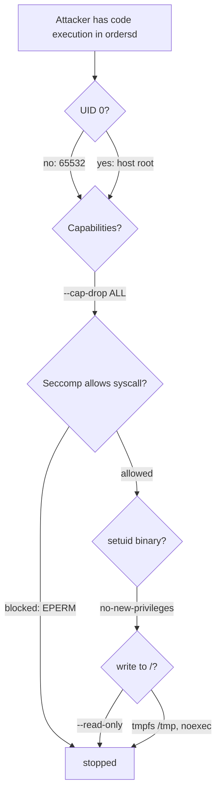

# Container security

## Why care?

Four statements that come up in security reviews:

- "The container runs as root, but that's fine, it's a container."
- "We need `--privileged`, otherwise it doesn't work."
- "The scanner found 300 vulnerabilities in the image."
- "How do we know the image in production is the one CI built?"

The first two are wrong, and dangerous. The last two have good answers, if you know what an image contains and how to prove where it came from.

A container is a normal Linux process (see [What a container is](what-a-container-is.md)). The kernel is **shared** with the host and every other container. So container security is about one question: if the process in the box is taken over, how much of the kernel and the host can the attacker reach? Docker answers with several layers of protection, each one small. On this page you remove them one at a time and measure each one on a real machine.

## The idea: several small layers of defence

No single setting isolates a container completely. Each one limits a different thing:

- The **user** (root or not) decides which files and processes the container can touch. Without a user namespace, root in a container is root on the host.
- **Capabilities** split root's power into separate rights. Docker removes most of them when it starts the container.
- **Seccomp** is a filter on system calls. A call that is not on the allowed list (a kernel function a normal service never needs) fails.
- **no-new-privileges** stops a process from gaining rights later, for example by running a setuid binary.
- A **read-only root** filesystem lets the process read and run its files, but not change them.
- **Image scanning and signing** happen before the container runs: does the image contain known vulnerable packages, and who built it?

None of these is enough alone. Together they are a strong defence.



## Under the hood: who are you?

### Root in a container is root

`ordersd`'s image says which user to run as (see the `USER nonroot:nonroot` line in [the Dockerfile](building-images.md)). Alpine's image doesn't, so it runs as root. Start both and look at them **from the host**:

```console
$ docker inspect tutor-ordersd:dev --format 'User={{.Config.User}} Entrypoint={{.Config.Entrypoint}}'
User=nonroot:nonroot Entrypoint=[/ordersd]
$ docker run -d --name tutor-sec-orders tutor-ordersd:dev
$ docker run -d --name tutor-sec-root alpine:3.22 sleep 1800
$ ps -o pid,uid,user,comm -p 302070
    PID   UID USER     COMMAND
 302070 65532 65532    ordersd
$ ps -o pid,uid,user,comm -p 360991
    PID   UID USER     COMMAND
 360991     0 root     sleep
$ cat /proc/360991/uid_map
         0          0 4294967295
```

(The PIDs come from `docker inspect --format '{{.State.Pid}}'`.) The `uid_map` says: "UID 0 inside is UID 0 outside, for all 4 billion IDs". That is the **identity map**: the container is **not** in its own user namespace. Compare the one-ID map from `unshare -Ur` in [Namespaces and cgroups](../linux/namespaces-and-cgroups.md#user-namespaces-root-inside-unprivileged-outside). Root in this container is root on the host, with fewer capabilities.

You can see this as soon as a container writes to a host directory:

```console
$ docker run --rm -v "$PWD:/data" alpine:3.22 touch /data/by-root
$ docker run --rm -v "$PWD:/data" --user 65532:65532 alpine:3.22 touch /data/by-nonroot
touch: /data/by-nonroot: Permission denied
$ docker run --rm -v "$PWD:/data" --user "$(id -u):$(id -g)" alpine:3.22 touch /data/by-me
$ ls -ln
total 0
-rw-r--r-- 1 1000 1000 0 Nov 26 18:17 by-me
-rw-r--r-- 1    0    0 0 Nov 26 18:17 by-root
```

- Root in the container made a file owned by **real root** on the host.
- UID 65532 is not the owner of the host directory (owned by 1000), so normal permission rules refuse the write.
- `--user` with your own IDs is the usual fix for "my build container leaves root-owned files behind".

UIDs are just numbers. The kernel does not care about names in the image's `/etc/passwd`; UID 65532 is "nonroot" in distroless and nobody at all on the host.

!!! warning "The `docker` group is root"

    Anyone who can talk to `/var/run/docker.sock` can run
    `docker run -v /:/host --privileged ...` and take full control of the machine. `dockerd` runs as root and
    does what it is asked. Treat membership of the `docker` group like `sudo` without a
    password. On this machine, the user is in that group, and that's how every example on
    this page runs without `sudo`.

### The real fix: user namespaces

Two ways to make container root harmless, both covered in [Runtimes](runtimes.md):

- **`userns-remap`** in `dockerd`: every container gets a user namespace, and UID 0 inside maps to a high, unused range from `/etc/subuid` (for example 100000+). Not enabled here; the map above proves it.
- **Rootless** Docker or Podman: the whole engine runs as your user, inside a user namespace. Root in the container is you on the host.

Kubernetes has the same idea as `hostUsers: false` in the pod spec. Until you have one of these, the next layers matter even more.

## Under the hood: capabilities

Since Linux 2.2, root's power is split into about 40 **capabilities** (`man 7 capabilities`): `CAP_NET_BIND_SERVICE` to bind ports below 1024, `CAP_CHOWN` to change file owners, `CAP_SYS_ADMIN` for "most admin things" (mount, namespaces, and much more). The kernel checks the capability, not the UID.

Each process has five sets in `/proc/<pid>/status`. The two that matter here:

- **CapEff**, effective: what the kernel checks right now.
- **CapBnd**, bounding: the upper limit. Nothing the process does (not even running a setuid-root program) can get a capability outside this set.

### Docker's default capabilities

The alpine container, running as root:

```console
$ grep -E '^(Uid|Cap)' /proc/360991/status
Uid:	0	0	0	0
CapInh:	0000000000000000
CapPrm:	00000000a80425fb
CapEff:	00000000a80425fb
CapBnd:	00000000a80425fb
CapAmb:	0000000000000000
$ capsh --decode=00000000a80425fb
0x00000000a80425fb=cap_chown,cap_dac_override,cap_fowner,cap_fsetid,cap_kill,cap_setgid,cap_setuid,cap_setpcap,cap_net_bind_service,cap_net_raw,cap_sys_chroot,cap_mknod,cap_audit_write,cap_setfcap
```

Each bit is one capability (bit 0 is `cap_chown`, bit 10 is `cap_net_bind_service`, and so on). Docker gives root **14** of them. Missing, among others: `cap_sys_admin`, `cap_net_admin`, `cap_sys_ptrace`, `cap_sys_module`, `cap_sys_time`. The effect is immediate:

```console
$ docker run --rm alpine:3.22 sh -c "ip link add d0 type dummy; date -s 2020-01-01 >/dev/null; mount -t tmpfs none /mnt"
ip: RTNETLINK answers: Operation not permitted
date: can't set date: Operation not permitted
mount: permission denied (are you root?)
$ docker run --rm --cap-add NET_ADMIN alpine:3.22 sh -c "ip link add d0 type dummy && echo dummy ok"
dummy ok
```

The process is root, and the call still fails. Root without the capability is not enough.

Now `ordersd`, running as UID 65532:

```console
$ grep -E '^(Uid|Cap)' /proc/302070/status
Uid:	65532	65532	65532	65532
CapInh:	0000000000000000
CapPrm:	0000000000000000
CapEff:	0000000000000000
CapBnd:	00000000a80425fb
CapAmb:	0000000000000000
```

A non-root process has **no** effective capabilities. But the bounding set is still the 14. A setuid-root binary in the image could pick all 14 up again. That's why we close the bounding set too.

### `--cap-drop ALL`, then add back what you need

```console
$ docker run --rm --cap-drop ALL alpine:3.22 grep -E '^Cap(Prm|Eff|Bnd)' /proc/self/status
CapPrm:	0000000000000000
CapEff:	0000000000000000
CapBnd:	0000000000000000
$ docker run --rm --cap-drop ALL --cap-add NET_BIND_SERVICE alpine:3.22 grep -E '^Cap(Prm|Eff|Bnd)' /proc/self/status
CapPrm:	0000000000000400
CapEff:	0000000000000400
CapBnd:	0000000000000400
$ capsh --decode=0000000000000400
0x0000000000000400=cap_net_bind_service
```

`0x400` is bit 10. Even root with an empty set is weak:

```console
$ docker run --rm --cap-drop ALL alpine:3.22 sh -c "id -u; chown nobody /etc/hostname; echo chown-exit=\$?; ping -c1 -W1 172.17.0.1 >/dev/null; echo ping-exit=\$?; sysctl net.ipv4.ping_group_range net.ipv4.ip_unprivileged_port_start"
0
chown: /etc/hostname: Operation not permitted
chown-exit=1
ping-exit=0
net.ipv4.ping_group_range = 0	2147483647
net.ipv4.ip_unprivileged_port_start = 0
```

`chown` fails without `CAP_CHOWN`. But `ping` still works without `CAP_NET_RAW`, and the reason is in the two `sysctl` lines. Docker sets two network sysctls in every container's namespace:

- `ping_group_range = 0 2147483647`: every group may open unprivileged ICMP sockets, so `ping` needs no raw socket.
- `ip_unprivileged_port_start = 0`: **any** user may bind any port, even 80.

The host has the strict defaults (`1 0` and `1024`, see [Networking: debugging](../networking/debugging.md)). So with Docker, a non-root `ordersd` with zero capabilities can still listen on port 80:

```console
$ docker run --rm -d --name tutor-sec-p80 --cap-drop ALL -e ORDERS_ADDR=:80 tutor-ordersd:dev
$ docker logs tutor-sec-p80 2>&1 | tail -1
{"time":"2026-11-26T17:17:47.663758519Z","level":"INFO","msg":"listening","service":"ordersd","addr":"[::]:80"}
```

For most Go services the answer is simple: `--cap-drop ALL` and add nothing.

### `--privileged`: all capabilities and all devices

```console
$ docker run --rm --privileged alpine:3.22 grep -E '^Cap(Prm|Eff|Bnd)' /proc/self/status
CapPrm:	000001ffffffffff
CapEff:	000001ffffffffff
CapBnd:	000001ffffffffff
$ capsh --decode=000001ffffffffff | tr ',' '\n' | wc -l
41
$ docker run --rm alpine:3.22 sh -c "ls /dev | wc -l"
15
$ docker run --rm --privileged alpine:3.22 sh -c "ls /dev | wc -l; ls /dev | grep -E \"^sd[a-z]$\" | tr \"\n\" \" \"; echo"
169
sda sdb sdc
```

All 41 capabilities this kernel knows, and all host devices, including the disks (`sda`, `sdb`, `sdc` are the WSL2 virtual disks). With `CAP_SYS_ADMIN` and the disk, mounting the host's filesystem is one command. `--privileged` also turns off seccomp and the masked `/proc` paths. It is not "a bit more access". It is **no container** for security purposes. If something "only works with `--privileged`", find the one capability or device it needs (`--cap-add`, `--device`).

## Under the hood: seccomp, the syscall filter

Capabilities control **what** a syscall may do. **Seccomp** (secure computing mode) decides **which syscalls** may be made at all. A small BPF program, attached to the process, looks at each syscall number and its arguments before the kernel runs it (see [System calls](../linux/system-calls.md)). Docker's default profile is an **allowlist** of a few hundred syscalls; everything else fails with `EPERM`. It blocks calls that containers rarely need and that have a history of kernel bugs: `kexec_load`, `init_module`, `add_key`/`keyctl`, `open_by_handle_at`, and `unshare` or `clone` with namespace flags unless the container has `CAP_SYS_ADMIN`.

`/proc/<pid>/status` shows the mode:

```console
$ grep -E '^Seccomp' /proc/302070/status
Seccomp:	2
Seccomp_filters:	2
```

`Seccomp: 2` is filter mode (`0` is off, `1` the old strict mode). The unexpected part is `Seccomp_filters: 2`. Look at the host:

```console
$ grep -E '^Seccomp' /proc/1/status /proc/self/status
/proc/1/status:Seccomp:	2
/proc/1/status:Seccomp_filters:	1
/proc/self/status:Seccomp:	2
/proc/self/status:Seccomp_filters:	1
```

On this WSL2 machine **every** process, even `systemd` as PID 1, already has one filter. It must be installed before systemd starts, so most likely by WSL's own init. Filters stack and can never be removed, so containers inherit that one and Docker adds its own on top:

```console
$ docker run --rm alpine:3.22 grep -E "^Seccomp" /proc/self/status
Seccomp:	2
Seccomp_filters:	2
$ docker run --rm --security-opt seccomp=unconfined alpine:3.22 grep -E "^Seccomp" /proc/self/status
Seccomp:	2
Seccomp_filters:	1
$ docker run --rm --privileged alpine:3.22 grep -E "^Seccomp" /proc/self/status
Seccomp:	2
Seccomp_filters:	1
```

On a normal Linux host, the last two would show `Seccomp: 0`.

### A blocked syscall

`unshare` makes new namespaces, which is exactly what an attacker wants for many kernel exploits. Try it in a container, as root:

```console
$ docker run --rm alpine:3.22 sh -c "unshare -U true 2>&1 && echo user-ns ok; unshare -n true 2>&1 && echo net-ns ok"
unshare: unshare(0x10000000): Operation not permitted
unshare: unshare(0x40000000): Operation not permitted
$ docker run --rm --security-opt seccomp=unconfined alpine:3.22 sh -c "unshare -U true 2>&1 && echo user-ns ok; unshare -n true 2>&1 && echo net-ns ok"
user-ns ok
unshare: unshare(0x40000000): Operation not permitted
$ docker run --rm --cap-add SYS_ADMIN alpine:3.22 sh -c "unshare -U true 2>&1 && echo user-ns ok; unshare -n true 2>&1 && echo net-ns ok"
user-ns ok
net-ns ok
```

Three runs, two different guards:

1. **Default**: both fail. `0x10000000` is `CLONE_NEWUSER`, `0x40000000` is `CLONE_NEWNET`.
2. **Seccomp off**: the user namespace now works. Remember, any user may create one (see [Namespaces and cgroups](../linux/namespaces-and-cgroups.md#user-namespaces-root-inside-unprivileged-outside)). So **seccomp** was the only thing that blocked it. The network namespace still fails: that one needs `CAP_SYS_ADMIN`, a **capability** check.
3. **With `CAP_SYS_ADMIN`**: Docker's profile allows namespace flags when the container has that capability, and the capability check passes too.

Both errors look the same: `Operation not permitted`. A blocked syscall and a missing capability are indistinguishable from inside. When something fails only in a container, test with `seccomp=unconfined` and with `--cap-add` (on a test machine) to see which guard it is.

You can write your own profile. This one allows everything except `mkdir`, and returns `EACCES` (13) instead of `EPERM`:

```json
{
  "defaultAction": "SCMP_ACT_ALLOW",
  "syscalls": [
    {
      "names": ["mkdir", "mkdirat"],
      "action": "SCMP_ACT_ERRNO",
      "errnoRet": 13
    }
  ]
}
```

```console
$ docker run --rm --security-opt seccomp=no-mkdir.json alpine:3.22 sh -c 'mkdir /x; echo exit=$?; grep Seccomp_filters /proc/self/status'
mkdir: can't create directory '/x': Permission denied
exit=1
Seccomp_filters:	2
```

Root, all default capabilities, and `mkdir` says "Permission denied". Real profiles go the other way: default **deny**, and a list of the syscalls your program uses. For a Go binary that list is short but not obvious (the runtime uses `clone`, `futex`, `mmap`, `epoll_*`, `rt_sigaction`, ...). Record it with `strace -f -c` or a tracing tool, and keep Docker's default unless you have a reason.

!!! note "AppArmor and SELinux"

    On Ubuntu and RHEL hosts, Docker also applies an AppArmor or SELinux profile: a third
    guard, based on file paths and labels. Not on this machine:
    `docker info --format '{{json .SecurityOptions}}'` prints `["name=seccomp,profile=builtin"]`.

## Under the hood: no new privileges

A **setuid** binary runs as its owner, not as the caller. `passwd` and `sudo` work this way. In a container that is a way back up: a non-root process runs a setuid-root binary and becomes root again (with the capabilities in the bounding set). To show it, a small Go program that prints its real and effective UID:

```go
// Command ids prints the real and effective UID and the NoNewPrivs flag.
package main

import (
	"bufio"
	"fmt"
	"os"
	"strings"
)

func main() {
	nnp := "?"
	if f, err := os.Open("/proc/self/status"); err == nil {
		s := bufio.NewScanner(f)
		for s.Scan() {
			if v, ok := strings.CutPrefix(s.Text(), "NoNewPrivs:"); ok {
				nnp = strings.TrimSpace(v)
			}
		}
	}
	fmt.Printf("uid=%d euid=%d NoNewPrivs=%s\n", os.Getuid(), os.Geteuid(), nnp)
}
```

Built into a distroless image as a setuid-root file:

```dockerfile
FROM golang:1.27 AS build
WORKDIR /src
COPY . .
RUN CGO_ENABLED=0 go build -o /ids . && chmod 4755 /ids

FROM gcr.io/distroless/static-debian12:nonroot
# A setuid-root binary: whoever runs it gets euid 0.
COPY --from=build /ids /ids
USER nonroot
ENTRYPOINT ["/ids"]
```

(`COPY` keeps the mode bits, and the file belongs to root because it was built as root.)

```console
$ docker build -q -t tutor-sec-suid:dev .
$ docker run --rm tutor-sec-suid:dev
uid=65532 euid=0 NoNewPrivs=0
$ docker run --rm --security-opt no-new-privileges tutor-sec-suid:dev
uid=65532 euid=65532 NoNewPrivs=1
```

The first run started as nonroot and got **effective UID 0**, from one file in the image. With `no-new-privileges`, the kernel ignores the setuid bit (and file capabilities) on `execve`. The flag is inherited by every child and can never be turned off. It is the same `prctl(PR_SET_NO_NEW_PRIVS)` that systemd's `NoNewPrivileges=yes` sets (see [systemd](../linux/systemd.md)). Kubernetes calls it `allowPrivilegeEscalation: false`.

## Under the hood: a read-only root

An attacker who gets in likes to write: a downloaded tool, a changed config, a web shell. `docker diff` shows what a container changed in its writable layer (the overlayfs upper directory, see [Images and layers](images-and-layers.md)):

```console
$ docker exec tutor-sec-root touch /etc/hacked
$ docker diff tutor-sec-root
C /etc
A /etc/hacked
$ docker diff tutor-sec-orders
```

`ordersd` wrote nothing, so it can run with a **read-only** root filesystem. Programs that need scratch space get a `tmpfs`, in memory, gone when the container stops:

```console
$ docker run --rm --read-only alpine:3.22 sh -c "touch /etc/x; touch /tmp/x; echo exit=\$?"
touch: /etc/x: Read-only file system
touch: /tmp/x: Read-only file system
exit=1
$ docker run --rm --read-only --tmpfs /tmp:rw,noexec,nosuid,size=16m alpine:3.22 sh -c 'touch /tmp/x && echo wrote /tmp/x; awk '\''$2=="/"||$2=="/tmp" {split($4,o,","); print $2, $3, o[1]}'\'' /proc/mounts; cp /bin/busybox /tmp/bb; /tmp/bb true'; echo exit=$?
wrote /tmp/x
/ overlay ro
/tmp tmpfs rw
sh: /tmp/bb: Permission denied
exit=126
```

`/` is mounted `ro`. `/tmp` is writable, but `noexec`: a binary copied there can't run. `size=16m` stops a full `/tmp` from eating the host's memory (a tmpfs counts against the container's memory cgroup).

### All together for `ordersd`

```console
$ docker run -d --name tutor-sec-hard --read-only --cap-drop ALL --security-opt no-new-privileges --tmpfs /tmp:rw,noexec,nosuid,size=16m -p 127.0.0.1:8086:8080 tutor-ordersd:dev
$ curl -s http://127.0.0.1:8086/healthz
{"status":"ok"}
$ grep -E "^(Uid|CapEff|CapBnd|NoNewPrivs|Seccomp)" /proc/<pid>/status
Uid:	65532	65532	65532	65532
CapEff:	0000000000000000
CapBnd:	0000000000000000
NoNewPrivs:	1
Seccomp:	2
Seccomp_filters:	2
```

Non-root, zero capabilities, no way up, seccomp on, nothing writable but a small `noexec` tmpfs, and only reachable from loopback. The service works exactly as before. Distroless adds one more layer at no cost: there is no shell for an attacker to use.

```console
$ docker exec tutor-sec-orders sh
OCI runtime exec failed: exec failed: unable to start container process: exec: "sh": executable file not found in $PATH
```

In Kubernetes, the same settings live in the pod's `securityContext`: `runAsNonRoot: true`, `readOnlyRootFilesystem: true`, `allowPrivilegeEscalation: false`, `capabilities: {drop: [ALL]}`, `seccompProfile: {type: RuntimeDefault}`.

## Under the hood: what is in the image?

Everything above limits what a compromised process can do. Now: how likely is it to be compromised, through code you didn't write?

### SBOM: a list of every component

A **software bill of materials** lists every package in an image, with versions and IDs. `syft` reads the image layers and finds Debian packages (from `/var/lib/dpkg`), Go modules (from the build info inside the binary, see [Modules](../go/modules.md)), and much more:

```console
$ syft -q tutor-ordersd:dev
NAME                    VERSION           TYPE
base-files              12.4+deb12u15     deb
ca-certificates         20250419~deb12u1  deb
github.com/acme/orders  UNKNOWN           go-module
media-types             10.0.0            deb
netbase                 6.4               deb
stdlib                  go1.27.4          go-module
tzdata                  2026b-0+deb12u1   deb
```

Seven packages. Distroless brings five tiny Debian packages (no libc, no shell); the binary brings the Go standard library and its own module. `ordersd` has no third-party dependencies, so there is nothing else. The main module's version is `UNKNOWN` because the image was built without VCS information (`.git` is not in the build context), so Go stamped it `(devel)` (`go version -m ordersd` prints `mod github.com/acme/orders (devel)`).

Write it in the two standard formats, SPDX and CycloneDX:

```console
$ syft -q tutor-ordersd:dev -o cyclonedx-json=ordersd.cdx.json -o spdx-json=ordersd.spdx.json
$ jq -r '.components[] | select(.type=="library") | "\(.name) \(.version) \(.purl)"' ordersd.cdx.json
base-files 12.4+deb12u15 pkg:deb/debian/base-files@12.4%2Bdeb12u15?arch=amd64&distro=debian-12.15
ca-certificates 20250419~deb12u1 pkg:deb/debian/ca-certificates@20250419~deb12u1?arch=all&distro=debian-12.15
github.com/acme/orders UNKNOWN pkg:golang/github.com/acme/orders
media-types 10.0.0 pkg:deb/debian/media-types@10.0.0?arch=all&distro=debian-12.15
netbase 6.4 pkg:deb/debian/netbase@6.4?arch=all&distro=debian-12.15
stdlib go1.27.4 pkg:golang/stdlib@1.27.4
tzdata 2026b-0+deb12u1 pkg:deb/debian/tzdata@2026b-0%2Bdeb12u1?arch=all&distro=debian-12.15
$ jq '[.components[] | .type] | group_by(.) | map({(.[0]): length}) | add' ordersd.cdx.json
{
  "file": 950,
  "library": 7,
  "operating-system": 1
}
```

The **purl** (package URL) is the key: `pkg:golang/stdlib@1.27.4` is the same string in every tool and every vulnerability database. The JSON also lists all 950 files with their hashes.

### Scanning: match the list against known bugs

A scanner such as **Trivy** or **Grype** does two steps: build an SBOM like the one above (or read yours), then look up every purl and version in vulnerability databases (the Debian security tracker, the Go vulnerability database, GitHub advisories, NVD). Neither is installed on this machine, so no output here; the idea is the same for both: `grype sbom:ordersd.spdx.json` or `trivy sbom ordersd.cdx.json`.

!!! tip "New tool: `grype`"

    ```sh
    mise use grype@0.122.1
    ```

    This adds it to the project's `mise.toml`, pinned to an exact version. See [Adding tools as you go](../toolbox/mise.md#adding-tools-as-you-go).

What to know before you read a scan report:

- **The base image is most of it.** An image `FROM golang:1.27` has hundreds of Debian packages, and a report with hundreds of CVEs. The distroless image above has five. The cheapest fix for a long report is a smaller base (see [Building good images](building-images.md)).
- **"Present" is not "reachable".** A scanner flags a vulnerable function in the Go standard library even if you never call it. `govulncheck` (pinned in `examples/orders`, `make vuln`) analyses the call graph and reports only what your code can actually reach. Use the scanner for the OS packages, `govulncheck` for the Go code.
- **Scan again later.** An image that was clean last month is not clean now; the databases grow. Scan in CI **and** on a schedule against what runs in production.

### Signing: proving who built an image

A tag like `tutor-ordersd:dev` can point anywhere tomorrow. A digest (`sha256:...`) is exact, but says nothing about **who** made it. A **signature** binds a digest to a key, so a deploy can refuse anything CI didn't sign.

**Cosign** (from the Sigstore project) signs images and files. It has two modes:

- **Key pair**: you make a key, keep the private half secret, publish the public half. Simple to understand; key management is your problem.
- **Keyless**: no long-lived key. CI proves its identity with an OIDC token (for example GitHub Actions: "repo `acme/orders`, workflow `release.yml`"). Sigstore's CA, **Fulcio**, issues a certificate valid for 10 minutes for a fresh key. Cosign signs, records the signature in the public transparency log **Rekor**, and throws the key away. A verifier checks "signed by workflow X of repo Y" instead of "signed by key Z", and Rekor proves the signature existed while the certificate was valid.

Here: a key pair, and a file instead of an image. We sign the SBOM.

!!! tip "New tool: `cosign`"

    ```sh
    mise use cosign@3.1.6
    ```

    This adds it to the project's `mise.toml`, pinned to an exact version. See [Adding tools as you go](../toolbox/mise.md#adding-tools-as-you-go).

```console
$ unshare -Urn cosign generate-key-pair
Private key written to cosign.key
Public key written to cosign.pub
```

`unshare -Urn` runs cosign in an empty network namespace (see [Namespaces and cgroups](../linux/namespaces-and-cgroups.md#network-namespaces-a-separate-network-stack)), so nothing can leave the machine. That matters, because by default cosign talks to the public Sigstore services even with a local key:

```console
$ unshare -Urn cosign sign-blob --key cosign.key --bundle ordersd.spdx.json.bundle -y ordersd.spdx.json
Error: error getting signing config from TUF: error getting signing config from TUF: failed to load metadata: tuf refresh failed: Get "https://tuf-repo-cdn.sigstore.dev/17.root.json": dial tcp: lookup tuf-repo-cdn.sigstore.dev on 10.255.255.254:53: dial udp 10.255.255.254:53: connect: network is unreachable
```

Cosign 3 first downloads a **signing config** (which CA, which transparency log, which timestamp server to use) through TUF, a secure update protocol. With network access, it would then upload the signature to Rekor, a **public** log, forever. For a private key and a private file, give it a local signing config that names no services:

```console
$ cat signing-config.json
{
  "mediaType": "application/vnd.dev.sigstore.signingconfig.v0.2+json",
  "rekorTlogConfig": { "selector": "ANY" },
  "tsaConfig": { "selector": "ANY" }
}
$ unshare -Urn cosign sign-blob --key cosign.key --signing-config signing-config.json --bundle ordersd.spdx.json.bundle -y ordersd.spdx.json
Using payload from: ordersd.spdx.json
Signing artifact...
Wrote bundle to file ordersd.spdx.json.bundle
$ jq . ordersd.spdx.json.bundle
{
  "mediaType": "application/vnd.dev.sigstore.bundle.v0.3+json",
  "verificationMaterial": {
    "publicKey": {
      "hint": "s+gZDAbKcBrhX1mG9NVWU6K0lYazVpObXqN7yLndK14="
    }
  },
  "messageSignature": {
    "messageDigest": {
      "algorithm": "SHA2_256",
      "digest": "m3/04SbduYcSDbdR8wRZYJYRIrLRx26pFYUUhKMSAn0="
    },
    "signature": "MEUCIDfU2iVhIZdlGzqjTcmWe13SKZdzG+okxlqi0THQb34mAiEA/3fGuaIOMst+86z4HUTFIet7lxrFwflr1ZukBgs0EYM="
  }
}
```

The **bundle** is everything a verifier needs besides the public key: a hint which key it was, the SHA-256 of the file, and an ECDSA signature over it. No certificate and no log entry, because we used neither. The digest is just the file's hash, in base64:

```console
$ sha256sum ordersd.spdx.json
9b7ff4e126ddb987120db751f3045960961122b2d1c76ea915851484a312027d  ordersd.spdx.json
$ jq -r .messageSignature.messageDigest.digest ordersd.spdx.json.bundle | base64 -d | xxd -p -c32
9b7ff4e126ddb987120db751f3045960961122b2d1c76ea915851484a312027d
```

Verify, then change one character and verify again:

```console
$ unshare -Urn cosign verify-blob --key cosign.pub --bundle ordersd.spdx.json.bundle --insecure-ignore-tlog ordersd.spdx.json
WARNING: Skipping tlog verification is an insecure practice that lacks transparency and auditability verification for the blob.
Verified OK
$ sed s/go1.27.4/go1.27.5/ ordersd.spdx.json > tampered.json
$ unshare -Urn cosign verify-blob --key cosign.pub --bundle ordersd.spdx.json.bundle --insecure-ignore-tlog tampered.json; echo exit=$?
WARNING: Skipping tlog verification is an insecure practice that lacks transparency and auditability verification for the blob.
Error: failed to verify signature: could not verify message: invalid signature when validating ASN.1 encoded signature
error during command execution: failed to verify signature: could not verify message: invalid signature when validating ASN.1 encoded signature
exit=1
```

`--insecure-ignore-tlog` says "I know there is no Rekor entry". The warning is fair: without a transparency log, nobody else can see that this signature exists, or notice if the key signs something it shouldn't.

Signing an **image** works the same way, with the image digest as the "file". The signature is stored **in the registry**, next to the image: older cosign versions push it as a tag named `sha256-<digest>.sig`, newer ones as an OCI 1.1 **referrer** artifact that points at the image's digest.

<!-- TODO(real-output): image signing against a local registry. Planned: `docker run -d --name tutor-registry -p 127.0.0.1:5005:5000 registry:2`, `docker push localhost:5005/ordersd:dev`, `cosign sign --key cosign.key localhost:5005/ordersd@sha256:...`, `crane ls localhost:5005/ordersd`, `cosign verify --key cosign.pub --insecure-ignore-tlog localhost:5005/ordersd@sha256:...`. The session's safety hook blocks `docker push` (package publishing), so this was not run. -->

Always sign and verify by **digest**, never by tag: `cosign sign repo/app@sha256:...`. A tag can move between your check and the pull. In Kubernetes, an admission controller (Sigstore policy-controller, Kyverno, or Connaisseur) runs `cosign verify` before a pod starts and refuses unsigned images.

## Try it

1. Run `docker run --rm alpine:3.22 grep Cap /proc/self/status` and decode every set with `capsh --decode`. Repeat with `--user 65532`. Which sets change?
2. Find a capability `ordersd` needs: run it with `--cap-drop ALL`. Does anything break? (Answer for this service: no.)
3. Build the `ids` image above. Run it with and without `--security-opt no-new-privileges`, then with `--cap-drop ALL` but without `no-new-privileges`. What is `euid` now, and what could that root do?
4. Write a seccomp profile that blocks `socket` and run `ordersd` with it. Read the error in `docker logs`.
5. Run `syft` on `golang:1.27` and count the packages. Compare with the distroless image.
6. Clean up: `docker rm -f tutor-sec-orders tutor-sec-root` and `docker rmi tutor-sec-suid:dev`.

## Traps

- **"It's in a container, root is fine."** Without a user namespace, container root is host root with 14 capabilities. A kernel bug or a mounted host path (`-v /:/host`, the Docker socket) is all it takes. Set `USER` in the image.
- **`--privileged` as a fix.** It turns off capabilities, seccomp and device isolation together. Find the one `--cap-add` or `--device` you need.
- **Mounting `/var/run/docker.sock`.** CI runners and "Docker-in-Docker" setups often do it. It gives the container full control of the host's Docker, which is root on the host.
- **Non-root, but setuid binaries in the image.** Without `no-new-privileges`, one setuid-root file is a way back to root and the bounding set. Distroless and scratch have none; Debian and Alpine bases have several (`su`, `mount`, `passwd`).
- **"Operation not permitted" means many things.** Missing capability, seccomp, read-only mount, `no-new-privileges`, AppArmor. Change one guard at a time, on a test machine, to find which.
- **A read-only root breaks hidden writes.** Some libraries write to `$HOME`, `/tmp` or a cache dir at start-up. Mount a small `tmpfs` there; don't drop `--read-only`.
- **Scanner output without context.** 300 CVEs in OS packages you never call is a base image problem, not 300 bugs. A clean scan is not "secure" either; it only means "no **known** bug in the **listed** packages".
- **Signing a tag.** Sign and verify by digest. And verifying a key-pair signature only proves someone with the key signed it: protect the key (KMS, hardware) or use keyless signing with a transparency log.
- **Cosign talks to the internet by default.** Keyless signing and the transparency log are public. Don't sign internal artifact names or private email identities into Rekor unless that is acceptable.

## Check yourself

??? question "1. `ps` on the host shows your container's process as UID 0. Is that a problem if the container has the default capabilities?"

    Yes. Without a user namespace (`/proc/<pid>/uid_map` is `0 0 4294967295`), UID 0 in
    the container is UID 0 on the host. It has 14 capabilities instead of 41 and a seccomp
    filter, but every file it can reach (bind mounts, a kernel bug) it can reach as root.
    Run as a non-root UID (`USER` in the image), or use user namespaces or rootless mode.

??? question "2. A non-root process has `CapEff: 0000000000000000` and `CapBnd: 00000000a80425fb`. Why bother dropping the bounding set?"

    The bounding set is the ceiling. Effective is zero now, but `execve` of a setuid-root
    binary (or one with file capabilities) gives the process capabilities again, up to the
    bounding set. `--cap-drop ALL` makes the ceiling zero, and `no-new-privileges` stops
    the setuid bit itself.

??? question "3. Inside a default container, as root, `unshare -U true` fails with `Operation not permitted`. A user on the host can run it. Which guard blocks it, and how do you prove it?"

    Seccomp. Docker's default profile blocks `unshare` with namespace flags unless the
    container has `CAP_SYS_ADMIN`. Proof: with `--security-opt seccomp=unconfined` the same
    command works, because creating a user namespace needs no capability. `unshare -n`
    still fails then, which is the capability check for `CAP_SYS_ADMIN`.

??? question "4. `ordersd` runs as UID 65532 with `--cap-drop ALL`. It listens on port 80 without error. How?"

    Docker sets `net.ipv4.ip_unprivileged_port_start = 0` in the container's network
    namespace, so any user may bind any port. No `CAP_NET_BIND_SERVICE` needed. On the
    host the default is 1024.

??? question "5. The scanner reports 280 CVEs for `FROM golang:1.27` images and 3 for distroless. The Go code is the same. What does that tell you, and what do you do?"

    Almost all findings are in OS packages of the base image, which the service doesn't
    use at run time. Use a multi-stage build with a minimal run image (distroless or
    scratch). Then check the Go code with `govulncheck`, which only reports vulnerable
    functions your code can actually reach.

??? question "6. What does a cosign key-pair signature prove, and what does keyless signing add?"

    Key pair: someone who had the private key signed exactly this digest. Keyless: the
    signer is an identity (an OIDC subject such as a CI workflow in a specific repo),
    certified by Fulcio for a few minutes, and the signature is in the public Rekor log
    with a timestamp. There is no long-lived key to steal, and anyone can audit what was
    signed under that identity.

## Recap

- A container shares the host kernel. Security is layers that shrink what a compromised process can reach.
- **User**: without a user namespace, container root is host root (`uid_map` = `0 0 4294967295`). Run as non-root; use userns-remap or rootless for more.
- **Capabilities**: Docker gives root 14 of 41. `--cap-drop ALL` empties effective **and** bounding sets. `--privileged` gives all of them and more.
- **Seccomp**: an allowlist of syscalls. `Seccomp: 2` in `/proc/<pid>/status`. It blocks `unshare` in a default container. On WSL2 there is already one inherited filter.
- **no-new-privileges**: setuid bits stop working. Turn it on.
- **Read-only root** plus a small `noexec` tmpfs: nothing to change, nowhere to run a download.
- **SBOM** (`syft`) lists what is inside; **scanners** match it against known bugs; `govulncheck` tells you which Go bugs you can reach.
- **Cosign** binds a digest to a key or an identity. Sign and verify by digest. By default it uses the public Sigstore services.

## You finished Containers

You can now take a container apart: the namespaces and cgroups of its process, the layers and digests of its image, the Dockerfile that builds it small and fast, the runtimes that start it, the veth cable and NAT rules that connect it, and the guards that limit what a compromised process can reach.

Next: [Kubernetes](../kubernetes/index.md). It runs these same containers on many machines. A pod is containers sharing one network namespace, a `securityContext` is the flags from this page, and a Service is NAT rules again, at cluster scale.
