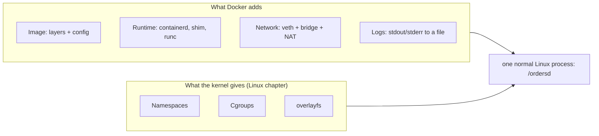
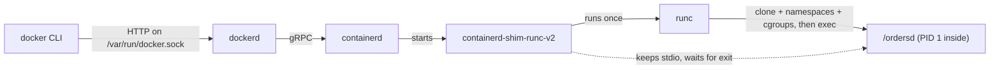
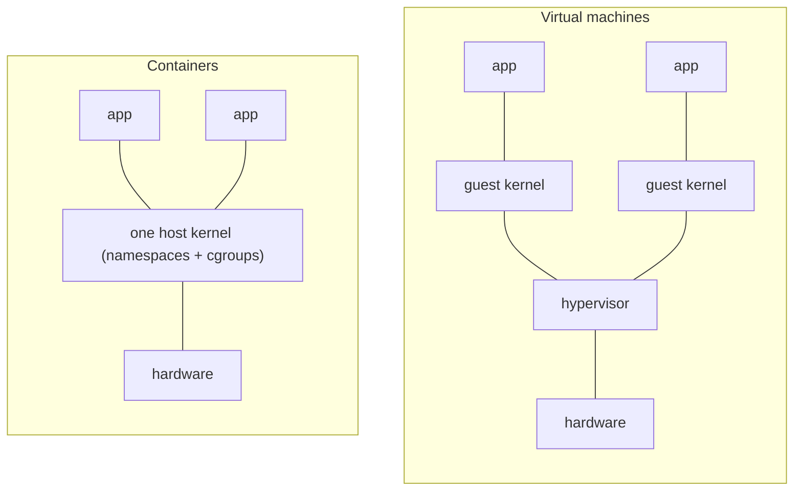

# What a container is

## Why care?

Three questions that come up in every team that ships containers:

- "Is the container a VM? How much memory does its OS use?"
- "`docker exec` does not work: the image has no shell. How do I look inside?"
- "The node's disk is full, and `du` blames a directory called `/var/lib/docker/containers`."

All three have the same answer: a container is **not** a small machine. It is one normal Linux process, plus files Docker keeps for it. In [Namespaces and cgroups](../linux/namespaces-and-cgroups.md) you built that process by hand with `unshare`. On this page you start `ordersd` with `docker run`, then look at it **from the host**, and find every piece Docker added.

## The idea: the flat you built, now from a builder

On the Linux page, a container was a flat with frosted windows (namespaces) and an electricity meter with a fuse (cgroups). You built one yourself: you made the walls with `unshare`, carried the furniture in by hand (a `rootfs` directory with one binary), and plugged nothing into the network.

Docker is a building company that does the same job, every time, from a **kit**:

- The **kit** is the image: the furniture (files, in layers) and an instruction sheet (which program to run, as which user, with which environment).
- The **crew** is the runtime: it puts up the walls, installs the meter, and moves the tenant in.
- The **company** also plugs in a phone line (networking), and keeps a **logbook** of everything the tenant shouts (stdout and stderr).

The flat itself is the same as yours. A container is still a process in namespaces and cgroups. Docker just makes it repeatable.



## What `docker run` adds to your box

Here is your hand-made box next to what `docker run` does. Each row is a page in this chapter.

| Piece       | Your `box.sh`                                | `docker run`                                                         | More on                                                                          |
| ----------- | -------------------------------------------- | -------------------------------------------------------------------- | -------------------------------------------------------------------------------- |
| Root files  | A directory you filled with `cp`             | Image layers, stacked with overlayfs, plus one writable layer        | [Images and layers](images-and-layers.md)                                        |
| What to run | Typed on the command line                    | The image **config**: entrypoint, user, env, working dir             | [Images and layers](images-and-layers.md), [Building images](building-images.md) |
| Namespaces  | `unshare` flags                              | `runc`, from an OCI runtime spec                                     | [Runtimes](runtimes.md)                                                          |
| Who watches | Your shell                                   | `containerd-shim-runc-v2`, one per container                         | [Runtimes](runtimes.md)                                                          |
| Network     | Only `lo`, and you had to switch it on       | A veth pair to the `docker0` bridge, an IP, port publishing with NAT | [Container networking](networking.md)                                            |
| Logs        | Redirect to `box.log` yourself               | stdout/stderr captured into a JSON file per container                | below                                                                            |
| Limits      | None (you saw cgroups do nothing for a user) | cgroups set by root, from `--memory`, `--cpus`, `--pids-limit`       | below                                                                            |
| Safety      | Root in a user namespace                     | Dropped capabilities, a seccomp filter, no user namespace by default | [Container security](security.md)                                                |

## Under the hood: one `docker run`, seen from the host

Build the `ordersd` image from `examples/orders` (the `Dockerfile` is explained line by line in [Building images](building-images.md)), and start it:

```console
$ cd examples/orders && docker build -q -t tutor-ordersd:dev .
DEPRECATED: The legacy builder is deprecated and will be removed in a future release.
            Install the buildx component to build images with BuildKit:
            https://docs.docker.com/go/buildx/

sha256:92aefe8829eeb7301e322b3d32c49cab2a0b54cb13fe6d71be3d0d1b38ab56e8
$ docker run -d --name tutor-orders -p 18080:8080 tutor-ordersd:dev
19039eb5dc8b4f4b7582755c9bddcb951c6c958776f23674db6ed89d0c94e329
$ curl -sS localhost:18080/healthz
{"status":"ok"}
```

(This machine's Docker has no `buildx` plugin, so `docker build` uses the old builder. The image is the same kind of image; [Building images](building-images.md) covers BuildKit.)

Now forget Docker for a moment. Where is this thing?

### It is a process. Here is its PID

```console
$ pid=$(docker inspect -f '{{.State.Pid}}' tutor-orders); echo $pid
267149
$ ps -o pid,ppid,user,args -p "$pid,$(ps -o ppid= -p $pid | tr -d ' ')"
    PID    PPID USER     COMMAND
 267124       1 root     /usr/bin/containerd-shim-runc-v2 -namespace moby -id 19039eb5dc8b4f4b7582755c9bddcb951c6c958776f23674db6ed89d0c94e329 -address /run/containerd/containerd.sock
 267149  267124 65532    /ordersd
$ grep -E 'NSpid|Uid' /proc/$pid/status
Uid:	65532	65532	65532	65532
NSpid:	267149	1
```

There it is, in the host's normal process list: PID 267149 on the host, PID 1 inside (`NSpid`), running as UID 65532 (the `nonroot` user of the distroless image). Its parent is not `dockerd` and not `docker`. It is a small **shim** process, whose own parent is PID 1 (systemd). That is why `containerd` can restart without killing your containers (and `dockerd` too, with `live-restore` turned on). [Runtimes](runtimes.md) takes this chain apart.



`runc` sets up the box and exits. The shim stays, holds the container's stdout and stderr, and collects its exit code.

### Its namespaces

As a normal user, you cannot read another user's namespace links:

```console
$ ls -l /proc/$pid/ns
ls: cannot open directory '/proc/267149/ns': Permission denied
```

But you are in the `docker` group, so you can ask Docker for a helper container that shares the **host's** PID namespace and may trace other processes. (Note what that means: anyone in the `docker` group can do this. See the Traps.)

```console
$ docker run --rm --pid=host --cap-add SYS_PTRACE golang:1.27 sh -c "ls -l /proc/$pid/ns | awk 'NR>1 {print \$9, \$10, \$11}'"
cgroup -> cgroup:[4026531835]
ipc -> ipc:[4026532385]
mnt -> mnt:[4026532383]
net -> net:[4026532387]
pid -> pid:[4026532386]
pid_for_children -> pid:[4026532386]
time -> time:[4026531834]
time_for_children -> time:[4026531834]
user -> user:[4026531837]
uts -> uts:[4026532384]
$ ls -l /proc/self/ns | awk 'NR>1 {print $9, $10, $11}'
cgroup -> cgroup:[4026531835]
ipc -> ipc:[4026532244]
mnt -> mnt:[4026532255]
net -> net:[4026531840]
pid -> pid:[4026532257]
pid_for_children -> pid:[4026532257]
time -> time:[4026531834]
time_for_children -> time:[4026531834]
user -> user:[4026531837]
uts -> uts:[4026532256]
```

Compare the numbers (same number = same namespace):

| Namespace | Container  | Host       | Shared? | Why                                                                                     |
| --------- | ---------- | ---------- | ------- | --------------------------------------------------------------------------------------- |
| mnt       | 4026532383 | 4026532255 | no      | Its own `/`: the image                                                                  |
| uts       | 4026532384 | 4026532256 | no      | Its own hostname: the short container ID                                                |
| ipc       | 4026532385 | 4026532244 | no      | `IpcMode: private`                                                                      |
| pid       | 4026532386 | 4026532257 | no      | `ordersd` is PID 1                                                                      |
| net       | 4026532387 | 4026531840 | no      | Its own interfaces and its own `127.0.0.1`                                              |
| user      | 4026531837 | 4026531837 | **yes** | Docker uses no user namespace by default. UID 65532 inside **is** UID 65532 on the host |
| cgroup    | 4026531835 | 4026531835 | **yes** | `CgroupnsMode: host`, Docker's default on a cgroup v1 host like this one                |
| time      | 4026531834 | 4026531834 | **yes** | Docker never makes a time namespace                                                     |

Your `box.sh` made seven new namespaces. Docker, by default, makes five. The missing **user** namespace is the big one: it is why "root in a container" is real root on the host. [Container security](security.md) comes back to it.

`docker inspect` tells you the same story in its own words:

```console
$ docker inspect tutor-orders | jq '.[0].HostConfig | {NetworkMode, CgroupnsMode, IpcMode, PidMode, UsernsMode}'
{
  "NetworkMode": "bridge",
  "CgroupnsMode": "host",
  "IpcMode": "private",
  "PidMode": "",
  "UsernsMode": ""
}
```

An empty `PidMode` and `UsernsMode` mean "the default": a new PID namespace, and no user namespace.

!!! tip "No shell in the image? Bring your own"

    Distroless images have no `sh`, so `docker exec tutor-orders sh` fails. Join the
    container's namespaces from a container that **has** tools instead:

    ```console
    $ docker run --rm --pid container:tutor-orders --user 65532 golang:1.27 ps -o pid,user,comm
        PID USER     COMMAND
          1 65532    ordersd
         46 65532    ps
    ```

    The same works for the network: `--network container:tutor-orders`. It is the
    container version of the `nsenter` trick from the Linux page. Kubernetes calls it an
    ephemeral debug container (`kubectl debug`).

### Its cgroups

`/proc/<pid>/cgroup` is readable by anyone:

```console
$ cat /proc/$pid/cgroup
15:name=systemd:/docker/19039eb5dc8b4f4b7582755c9bddcb951c6c958776f23674db6ed89d0c94e329
14:misc:/docker/19039eb5dc8b4f4b7582755c9bddcb951c6c958776f23674db6ed89d0c94e329
13:rdma:/docker/19039eb5dc8b4f4b7582755c9bddcb951c6c958776f23674db6ed89d0c94e329
12:pids:/docker/19039eb5dc8b4f4b7582755c9bddcb951c6c958776f23674db6ed89d0c94e329
11:hugetlb:/docker/19039eb5dc8b4f4b7582755c9bddcb951c6c958776f23674db6ed89d0c94e329
10:net_prio:/docker/19039eb5dc8b4f4b7582755c9bddcb951c6c958776f23674db6ed89d0c94e329
9:perf_event:/docker/19039eb5dc8b4f4b7582755c9bddcb951c6c958776f23674db6ed89d0c94e329
8:net_cls:/docker/19039eb5dc8b4f4b7582755c9bddcb951c6c958776f23674db6ed89d0c94e329
7:freezer:/docker/19039eb5dc8b4f4b7582755c9bddcb951c6c958776f23674db6ed89d0c94e329
6:devices:/docker/19039eb5dc8b4f4b7582755c9bddcb951c6c958776f23674db6ed89d0c94e329
5:memory:/docker/19039eb5dc8b4f4b7582755c9bddcb951c6c958776f23674db6ed89d0c94e329
4:blkio:/docker/19039eb5dc8b4f4b7582755c9bddcb951c6c958776f23674db6ed89d0c94e329
3:cpuacct:/docker/19039eb5dc8b4f4b7582755c9bddcb951c6c958776f23674db6ed89d0c94e329
2:cpu:/docker/19039eb5dc8b4f4b7582755c9bddcb951c6c958776f23674db6ed89d0c94e329
1:cpuset:/docker/19039eb5dc8b4f4b7582755c9bddcb951c6c958776f23674db6ed89d0c94e329
0::/docker/19039eb5dc8b4f4b7582755c9bddcb951c6c958776f23674db6ed89d0c94e329
```

This is the [hybrid machine](../linux/namespaces-and-cgroups.md#this-machine-hybrid-and-honest-about-it) from the Linux page: one line per v1 tree. In every tree, the container has its own cgroup, named `/docker/<container id>`. The host sees the full path because the cgroup namespace is shared. Inside the container, `/proc/self/cgroup` shows the same long path.

Remember how your user-level `MemoryMax=64M` was accepted and ignored? Docker's daemon runs as root, so it writes the v1 files directly, and the limits are real:

```console
$ docker run -d --name tutor-orders-limited --memory 256m --cpus 1.5 --pids-limit 100 tutor-ordersd:dev
047e8df7d33ef723644033c3b9fc2249f2b6d6e9644aecb1b2a3835f664bf2e2
$ id=$(docker inspect -f '{{.Id}}' tutor-orders-limited)
$ cat /sys/fs/cgroup/memory/docker/$id/memory.limit_in_bytes /sys/fs/cgroup/cpu/docker/$id/cpu.cfs_quota_us /sys/fs/cgroup/cpu/docker/$id/cpu.cfs_period_us /sys/fs/cgroup/pids/docker/$id/pids.max
268435456
150000
100000
100
```

256 MiB, 150 ms of CPU per 100 ms period (1.5 CPUs), 100 tasks. Without flags (the first container), the memory limit is `9223372036854771712` (no limit) and the CPU quota is `-1`. **A container has no limits unless you ask for them.** On a pure cgroup v2 host the same flags write `memory.max`, `cpu.max` and `pids.max`, under `/sys/fs/cgroup/system.slice/docker-<id>.scope/` when Docker uses the systemd cgroup driver.

### Its root filesystem

`/proc/<pid>/mountinfo` is readable too. The first line is the container's `/`:

```console
$ grep ' / / ' /proc/$pid/mountinfo | tr ',' '\n' | grep 'dir=' | sed -E 's#/var/lib/containerd/io.containerd.snapshotter.v1.overlayfs/snapshots#$S#g'
lowerdir=$S/142/fs:$S/122/fs:$S/49/fs:$S/48/fs:$S/47/fs:$S/46/fs:$S/45/fs:$S/44/fs:$S/43/fs:$S/42/fs:$S/41/fs:$S/40/fs:$S/39/fs:$S/38/fs
upperdir=$S/143/fs
workdir=$S/143/work
```

An [overlayfs](../linux/filesystems.md#under-the-hood-overlayfs-the-container-filesystem) mount, exactly like the one you built by hand: 14 read-only lower directories and one writable upper. Where these 14 come from (13 image layers and one extra), and what is inside each, is the next page.

### The image config became the process

The image carries an instruction sheet, and Docker followed it. Read the process's environment and working directory (again from a helper, because they are private to UID 65532):

```console
$ tr '\0' ' ' < /proc/$pid/cmdline; echo
/ordersd
$ docker run --rm --pid=host --cap-add SYS_PTRACE golang:1.27 sh -c "tr '\0' '\n' < /proc/$pid/environ; readlink /proc/$pid/cwd"
PATH=/usr/local/sbin:/usr/local/bin:/usr/sbin:/usr/bin:/sbin:/bin
HOSTNAME=19039eb5dc8b
SSL_CERT_FILE=/etc/ssl/certs/ca-certificates.crt
HOME=/home/nonroot
/home/nonroot
$ docker inspect tutor-orders | jq '.[0].Config | {User, Env, Entrypoint, Cmd, WorkingDir}'
{
  "User": "nonroot:nonroot",
  "Env": [
    "PATH=/usr/local/sbin:/usr/local/bin:/usr/sbin:/usr/bin:/sbin:/bin",
    "SSL_CERT_FILE=/etc/ssl/certs/ca-certificates.crt"
  ],
  "Entrypoint": [
    "/ordersd"
  ],
  "Cmd": null,
  "WorkingDir": "/home/nonroot"
}
```

`Entrypoint`, `User`, `Env` and `WorkingDir` all came from the image. Docker added two variables of its own: `HOSTNAME` (the short container ID, also the UTS hostname) and `HOME` (from the `nonroot` line in the image's `/etc/passwd`).

Two more lines from `/proc/<pid>/status` show the safety work:

```console
$ grep -E 'CapEff|Seccomp' /proc/$pid/status
CapEff:	0000000000000000
Seccomp:	2
Seccomp_filters:	2
```

No effective capabilities (it is not root), and `Seccomp: 2` means a seccomp **filter** is active: Docker's default profile blocks a list of risky system calls. [Container security](security.md) decodes both.

### Its network

```console
$ docker inspect tutor-orders | jq '.[0].NetworkSettings.Networks.bridge | {IPAddress, Gateway}'
{
  "IPAddress": "172.17.0.3",
  "Gateway": "172.17.0.1"
}
```

Your box had only `lo`. Docker gave this one a veth pair into the `docker0` bridge, the address `172.17.0.3`, and a NAT rule that sends host port 18080 to container port 8080. That is how `curl localhost:18080` reached it. [Container networking](networking.md) follows the packet.

### Its logs

`ordersd` writes JSON lines to stdout. The shim holds the other end of that pipe and Docker's logging driver (`json-file` by default) writes every line to a file on the host:

```console
$ docker logs tutor-orders
{"time":"2026-11-26T17:11:02.44383447Z","level":"INFO","msg":"starting","service":"ordersd","version":"dev","revision":"","go_version":"go1.27.4"}
{"time":"2026-11-26T17:11:02.481824218Z","level":"INFO","msg":"listening","service":"ordersd","addr":"[::]:8080"}
$ docker inspect -f '{{.HostConfig.LogConfig.Type}} {{.LogPath}}' tutor-orders
json-file /var/lib/docker/containers/19039eb5dc8b4f4b7582755c9bddcb951c6c958776f23674db6ed89d0c94e329/19039eb5dc8b4f4b7582755c9bddcb951c6c958776f23674db6ed89d0c94e329-json.log
```

That file lives as long as the container. That is the `/var/lib/docker/containers` directory that fills disks (see Traps). This is also why the "log to stdout" advice from [Logging with `slog`](../go/services.md#logging-with-slog) works: the runtime collects it, and in Kubernetes the node's log agent reads these files.

### It stops like a process

`docker stop` sends `SIGTERM` to PID 1, waits up to 10 seconds, then sends `SIGKILL`. `ordersd` handles `SIGTERM` (see [Signals and process lifetime](../linux/signals-and-processes.md)). Start a second copy and stop it:

```console
$ docker run -d --name tutor-orders-2 tutor-ordersd:dev >/dev/null
$ /usr/bin/time -f 'docker stop: %e s' docker stop tutor-orders-2
tutor-orders-2
docker stop: 0.43 s
$ docker logs tutor-orders-2 2>&1 | tail -2
{"time":"2026-11-26T17:16:03.912540471Z","level":"INFO","msg":"shutting down","service":"ordersd","delay":0,"timeout":15000000000}
{"time":"2026-11-26T17:16:03.91294555Z","level":"INFO","msg":"shutdown complete","service":"ordersd"}
$ docker inspect -f '{{.State.Status}} {{.State.ExitCode}}' tutor-orders-2
exited 0
```

And it starts like a process. From `docker run` to the first healthy answer:

```console
$ /usr/bin/time -f 'docker run to healthy: %e s' sh -c 'docker run -d --name tutor-orders-3 -p 18081:8080 tutor-ordersd:dev >/dev/null; until curl -sf localhost:18081/healthz >/dev/null; do :; done'
docker run to healthy: 0.78 s
```

Under a second, and most of that is Docker's bookkeeping (network, mounts, the shim). There is no operating system to boot.

## Containers vs virtual machines

A **virtual machine** emulates hardware. It runs its own kernel, which boots, mounts its own disk and starts its own PID 1. A **container** shares the host's kernel. Only its view of the kernel is different.



Proof that the container has no kernel of its own: it reports the host's kernel, while its user space is a different distribution.

```console
$ uname -r; head -1 /etc/os-release
5.15.167.4-microsoft-standard-WSL2
PRETTY_NAME="Ubuntu 24.04.5 LTS"
$ docker run --rm golang:1.27 sh -c 'uname -r; head -1 /etc/os-release'
5.15.167.4-microsoft-standard-WSL2
PRETTY_NAME="Debian GNU/Linux 13 (trixie)"
```

"Debian in a container on Ubuntu" means Debian's **files** running on the host's kernel. And the host's kernel here is not Ubuntu's either: it is Microsoft's. That is the twist on this machine:

```console
$ systemd-detect-virt
wsl
$ grep -m1 -o hypervisor /proc/cpuinfo
hypervisor
```

**WSL2 itself is a VM.** Windows runs one lightweight Hyper-V virtual machine with a Microsoft-built Linux kernel, and every WSL distribution (and Docker) runs in namespaces inside it (the Linux page noted the "host" namespaces are not the first ones). Docker Desktop on macOS and Windows does the same thing: Linux containers need a Linux kernel, so there is always a Linux VM somewhere. On a Linux server there is none.

| Topic          | Container                                                          | Virtual machine                                     |
| -------------- | ------------------------------------------------------------------ | --------------------------------------------------- |
| Kernel         | The host's, shared                                                 | Its own                                             |
| Start-up       | A process start: well under a second (0.78 s above)                | A kernel boot: seconds to minutes                   |
| Memory cost    | Only what the process uses                                         | A whole guest OS, reserved up front                 |
| Isolation      | System-call boundary: one kernel bug can break all containers      | Hardware boundary: a much smaller attack surface    |
| Other OS       | No: a Linux container needs a Linux kernel (and the same CPU arch) | Yes: Windows on Linux, Linux on macOS               |
| Image size     | Just the files the app needs (this image: 3.7 MB compressed)       | A full disk image                                   |
| Who uses which | Your services, CI jobs                                             | Cloud tenants, and the nodes your containers run on |

They combine all the time. In the cloud, your Kubernetes node is a VM, and your pods are containers on it. Sandboxes such as gVisor and Kata Containers sit in between: a container interface, with an extra kernel layer underneath for stronger isolation.

## Try it

1. Start `tutor-ordersd:dev` with `--memory 128m --cpus 0.5`. Find the PID with `docker inspect`, read its `/proc/<pid>/cgroup`, and `cat` the memory limit file in the matching directory under `/sys/fs/cgroup/memory/`.
2. Run two containers with `--network container:` pointing at the first. Check that `readlink /proc/self/ns/net` gives the same number in both. This is how a Kubernetes pod shares one network between containers.
3. Run `docker run --rm --pid=host golang:1.27 ps -e | head`. What do you see, and what does that mean for a container started with `--pid=host` in production?
4. Run `docker run --rm golang:1.27 sh -c 'cat /proc/self/cgroup | head -3; hostname'`, then add `--cgroupns private` and run it again. What changed?
5. If you have `sudo`: set `"live-restore": true` in `/etc/docker/daemon.json`, restart Docker, start `tutor-orders`, then `sudo systemctl restart docker` again. Does the container survive? Which process kept it alive?

## Traps

- **"It's a lightweight VM."** It is not. There is one kernel. A kernel exploit in one container affects the host and every other container. If you need a hardware boundary between tenants, use VMs (or a sandbox runtime).
- **The `docker` group is root.** You just used it to read another user's private `/proc` files. `docker run -v /:/host` gives full write access to the host's files. Treat access to `/var/run/docker.sock` like `sudo`. Never mount the socket into a container you don't fully trust.
- **No limits by default.** Without `--memory`, `--cpus` and `--pids-limit`, a container can use the whole machine. Kubernetes pods without `resources.limits` are the same.
- **Logs grow forever.** The `json-file` driver does not rotate unless you set `max-size` and `max-file` (per container with `--log-opt`, or in `/etc/docker/daemon.json`). A chatty container fills `/var/lib/docker/containers`.
- **Same UID on both sides.** With no user namespace, UID 65532 inside is UID 65532 outside, and UID 0 inside is root outside. A bind-mounted host directory sees exactly those UIDs.
- **Same kernel, same architecture.** An image built for `arm64` (your Mac) does not run on an `amd64` node without emulation. The kernel version is the host's too, so a feature your app needs (say, a new `io_uring` call) must exist on the node's kernel, not on your laptop's.
- **A shell as PID 1.** `docker stop` takes exactly 10 seconds when PID 1 ignores `SIGTERM`. `ordersd` stopped in 0.43 s because it handles the signal and the entrypoint is the binary itself.

## Check yourself

??? question "1. `ps` on the host shows `/ordersd` with PID 267149. Inside the container it is PID 1. Which is the \"real\" PID?"

    Both. The process has one PID in **each** PID namespace it is visible in: 267149 in the
    host's, 1 in the container's. `NSpid` in `/proc/<pid>/status` lists them, outermost
    first. Signals sent from the host use 267149; from inside, 1.

??? question "2. `containerd` restarts and the containers keep running. Who is their parent, and why does that help?"

    `containerd-shim-runc-v2`, one per container, whose parent is PID 1 (systemd). `runc`
    exited right after starting the process. The shim holds stdio and waits for the exit
    code, so `containerd` does not need to stay up for the process to live. `dockerd` stops
    its containers when it shuts down, unless `live-restore` is set in `daemon.json`; then
    it reconnects to the shims instead.

??? question "3. Which namespaces does a default `docker run` share with the host on this machine, and which one matters most for security?"

    User, cgroup and time. The **user** namespace matters most: without it, UIDs are not
    remapped, so root inside the container is UID 0 on the host, held back only by dropped
    capabilities and seccomp.

??? question "4. A teammate says a container \"uses 1 GB for its operating system\". What do you answer?"

    There is no operating system to run. The container is a process on the host kernel.
    It costs the memory that process uses, plus page cache for the files it reads. The
    image's files sit on disk (shared between containers through overlayfs), not in RAM.
    A VM would reserve memory for a whole guest kernel and OS.

??? question "5. The image has no shell. How do you check which processes and sockets the container has?"

    Start a helper container that joins its namespaces:
    `docker run --rm --pid container:<name> --network container:<name> <image-with-tools> ps`
    (or `ss -tlnp`). From the host as root, `nsenter -t <pid> -n ss -tlnp` does the same
    with the host's tools. In Kubernetes, `kubectl debug` adds an ephemeral container.

??? question "6. Why can Docker on macOS run Linux containers at all?"

    It can't, directly: a Linux container needs a Linux kernel. Docker Desktop starts a
    small Linux VM and runs the containers in it. WSL2 does the same on Windows: this whole
    page ran inside a Hyper-V VM.

## Recap

- A container is a **process**. `docker inspect -f '{{.State.Pid}}'` gives its host PID; `/proc/<pid>/` shows everything.
- Its parent is a **shim**, not `dockerd`. `runc` sets up the box and exits.
- By default Docker makes **five** new namespaces (mnt, uts, ipc, pid, net) and shares **user**, cgroup (on v1) and time with the host.
- Docker's **cgroups** are real (it is root): `--memory`, `--cpus` and `--pids-limit` become files under `/sys/fs/cgroup/.../docker/<id>/`. Without flags, there are no limits.
- The root filesystem is an **overlayfs** mount of image layers plus one writable layer.
- The image **config** decides the program, user, environment and working directory.
- stdout and stderr go to a **JSON log file** per container. Rotate it.
- Containers share the host **kernel**; VMs bring their own. WSL2 and Docker Desktop are VMs that run your containers.

Next: [Images and layers](images-and-layers.md), where you open the image and check every byte of it.
