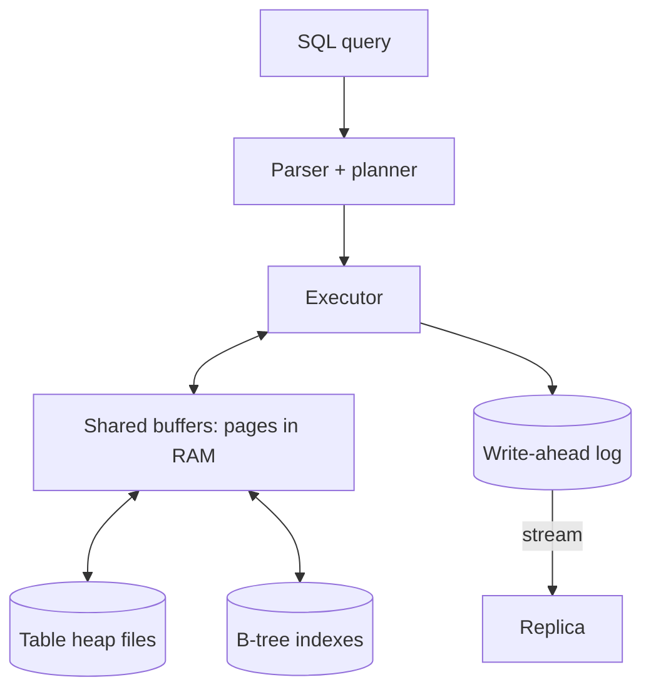

# Databases

How a database stores your rows, finds them fast, and keeps them correct when many people write at once.

## Why go deeper?

The database is usually the most important and least understood part of a service. Then:

- A query takes 2 ms in development and 4 seconds in production.
- Two customers buy the last item, and both succeed.
- A migration locks the `orders` table for ten minutes during peak hours.
- The service runs out of connections, while the database is almost idle.
- Adding an index makes writes slower, and the query still does not use it.

The answers are in a few data structures (pages, B-trees, the write-ahead log) and a few rules (transactions and isolation levels). This chapter uses **PostgreSQL** as the example, and explains which ideas are true for every database.

## The big picture

1. **Data lives in fixed-size pages** on disk, cached in memory.
2. **Indexes** are separate structures (usually B-trees) that point into those pages.
3. **Every change is written to the WAL first.** That is how a crash loses nothing, and how replicas stay in sync.
4. **The planner** decides _how_ to run your query. Most slow queries are a planner decision you can read and change.

## Reading order

!!! note "Planned chapter"

    This section is a roadmap. The pages below are written in later sessions and linked here when they land.

| #   | Page                       | You will learn                                                                           |
| --- | -------------------------- | ---------------------------------------------------------------------------------------- |
| 1   | How data is stored         | Pages, tuples, the heap, the WAL, `fsync`; B-trees vs LSM trees                          |
| 2   | Indexes                    | B-tree structure, composite and covering indexes, partial indexes, when indexes hurt     |
| 3   | Transactions and isolation | ACID in plain words, isolation levels, the anomalies each level allows, with real races  |
| 4   | MVCC and locks             | Row versions, `VACUUM`, row and table locks, deadlocks, `SELECT ... FOR UPDATE`          |
| 5   | Query planning             | `EXPLAIN ANALYZE`, statistics, joins, and fixing a slow query step by step               |
| 6   | Schema migrations          | Online migrations, expand and contract, lock-safe DDL, running migrations in CI/CD       |
| 7   | Go and SQL                 | `database/sql`, `pgx`, `sqlc`, connection pools, context timeouts, testing with real DBs |
| 8   | Replication and scaling    | Streaming replication, read replicas, replication lag, partitioning, sharding            |

## How each page works

The same shape as the [Fundamentals](../fundamentals/index.md): **Why care?**, **The idea**, **Under the hood**, **Try it**, **Traps** and **Check yourself**. The examples run PostgreSQL in a container, and move the `orders` service from the [Go chapter](../go/index.md) from memory to a real database.
