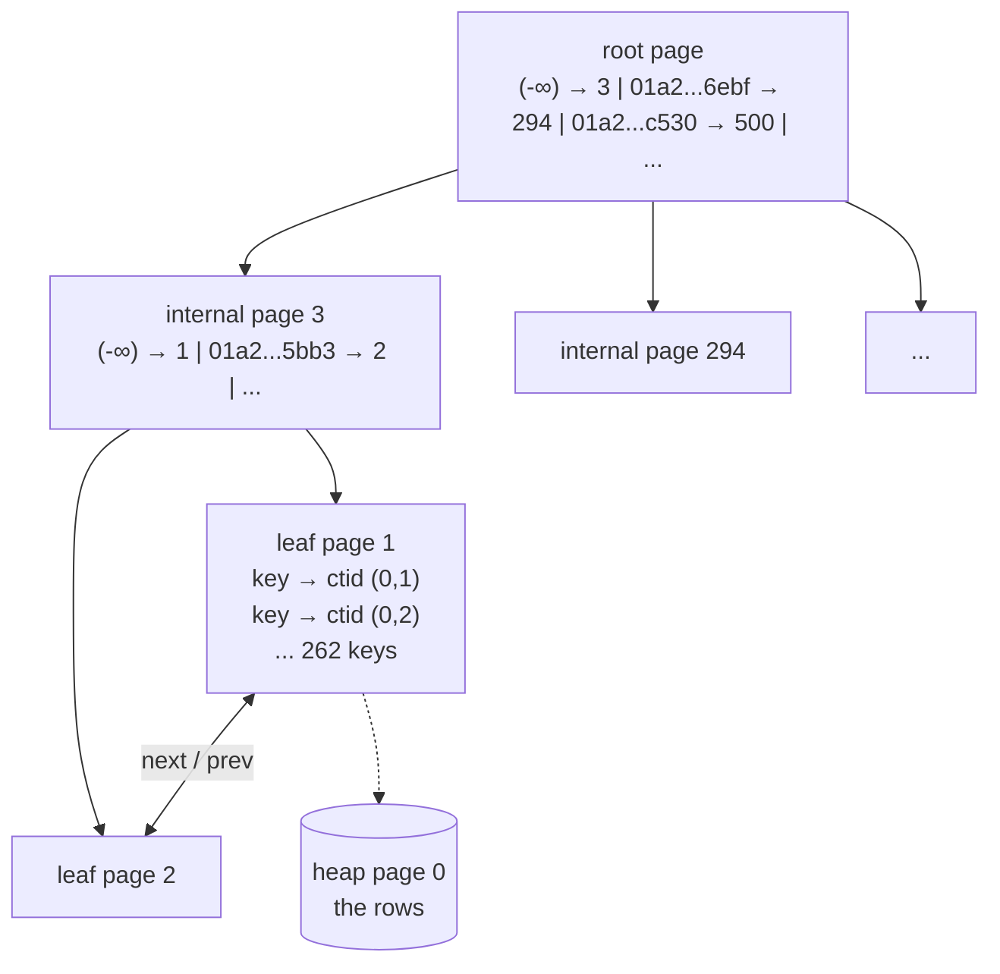

# Indexes

## Why care?

- "The query is fast in development and takes 4 seconds in production." In development the table had 1,000 rows.
- "We added an index, and the planner still does a sequential scan."
- "Our insert rate halved after the last release." The release added three indexes.

An index is a second copy of some of your data, sorted, with a pointer back to the row. It makes some reads cheap and every write more expensive. This page shows what that copy looks like inside, how to build one that matches your query, and when to leave it out.

You need the `tutor-pg` container from [How data is stored](storage.md#setup-your-own-postgresql), and a database for this page:

```console
$ docker exec tutor-pg createdb -U postgres tutor_indexes
$ docker exec -it tutor-pg psql -U postgres -d tutor_indexes
tutor_indexes=#
```

## The idea: a sorted copy that points to rows

An index works like the index at the back of a book: sorted terms, each with the pages where they appear.

- **Without an index**, PostgreSQL reads every page of the table and checks every row. That is a **sequential scan**. It is often a good plan: reading pages in order is fast, and if half the rows match, nothing else is faster.
- **With an index**, PostgreSQL looks up the value in the sorted index, which is fast because the index is sorted. The index entry gives the row addresses, for example "page 12, page 97, page 341". PostgreSQL reads only those pages. That is an **index scan**.
- An index is **sorted by its key columns**. An index on `customer_id` does not help a query that filters on `created_at`.
- If the index entry already holds every column the query needs, PostgreSQL does not read the table page at all. That is an **index-only scan**.
- Every new row must also be added to every index on the table. A table with ten indexes is slow to write.

A PostgreSQL B-tree is such an index, built from 8 kB pages. It has only a few levels, so it never needs more than a handful of page reads to find a key.



## Under the hood: a real B-tree

Make an `orders` table with a million rows. 20,000 customers, three statuses (70% `paid`, 29% `shipped`, 1% `pending`), one order every 30 seconds starting in January 2026:

```console
tutor_indexes=# CREATE EXTENSION pageinspect;
CREATE EXTENSION
tutor_indexes=# CREATE TABLE orders (
    id          uuid PRIMARY KEY DEFAULT uuidv7(),
    customer_id text NOT NULL,
    status      text NOT NULL DEFAULT 'pending',
    created_at  timestamptz NOT NULL DEFAULT now(),
    total_cents bigint NOT NULL DEFAULT 0
);
CREATE TABLE
tutor_indexes=# INSERT INTO orders (customer_id, status, created_at, total_cents)
SELECT 'customer-' || (i % 20000),
       CASE WHEN i % 100 = 0 THEN 'pending' WHEN i % 10 < 3 THEN 'shipped' ELSE 'paid' END,
       timestamptz '2026-01-01' + i * interval '30 seconds',
       (i::bigint * 7919) % 50000
FROM generate_series(1, 1000000) AS i;
INSERT 0 1000000
tutor_indexes=# VACUUM ANALYZE orders;
VACUUM
tutor_indexes=# SELECT pg_size_pretty(pg_relation_size('orders')) AS heap,
       pg_size_pretty(pg_relation_size('orders_pkey')) AS pkey;
 heap  | pkey
-------+-------
 81 MB | 30 MB
(1 row)
```

`PRIMARY KEY` created a B-tree index called `orders_pkey`. Its first page (the **meta page**) says where the root is:

```console
tutor_indexes=# SELECT * FROM bt_metap('orders_pkey');
 magic  | version | root | level | fastroot | fastlevel | last_cleanup_num_delpages | last_cleanup_num_tuples | allequalimage
--------+---------+------+-------+----------+-----------+---------------------------+-------------------------+---------------
 340322 |       4 |  295 |     2 |      295 |         2 |                         0 |                      -1 | t
(1 row)
```

The root is page 295, at level 2. Leaves are level 0, so the tree has three levels: root, internal pages, leaves. Look at the root:

```console
tutor_indexes=# SELECT blkno, type, live_items, avg_item_size, free_size, btpo_prev, btpo_next, btpo_level
FROM bt_page_stats('orders_pkey', 295);
 blkno | type | live_items | avg_item_size | free_size | btpo_prev | btpo_next | btpo_level
-------+------+------------+---------------+-----------+-----------+-----------+------------
   295 | r    |         19 |            23 |      7632 |         0 |         0 |          2
(1 row)
tutor_indexes=# SELECT itemoffset, ctid, itemlen, data FROM bt_page_items('orders_pkey', 295) LIMIT 3;
 itemoffset |  ctid   | itemlen |                      data
------------+---------+---------+-------------------------------------------------
          1 | (3,0)   |       8 |
          2 | (294,1) |      24 | 01 a2 19 f6 22 f9 79 a1 a3 b0 78 88 8f b8 6e bf
          3 | (500,1) |      24 | 01 a2 19 f6 23 a8 75 50 a2 43 e7 78 b2 ab c5 30
(3 rows)
```

In an inner page, `ctid` is not a row address. Its first number is a **child page**. Read the items as "keys smaller than `01a2...6ebf` are below page 3; keys from `01a2...6ebf` up to `01a2...c530` are below page 294", and so on. Item 1 has no key: it means "minus infinity". 19 items fill only a small part of the root (`free_size` 7632 of 8192 bytes).

Go one level down, then to a leaf:

```console
tutor_indexes=# SELECT blkno, type, live_items, free_size, btpo_prev, btpo_next, btpo_level
FROM bt_page_stats('orders_pkey', 3);
 blkno | type | live_items | free_size | btpo_prev | btpo_next | btpo_level
-------+------+------------+-----------+-----------+-----------+------------
     3 | i    |        205 |      2424 |         0 |       294 |          1
(1 row)
tutor_indexes=# SELECT blkno, type, live_items, free_size, btpo_prev, btpo_next, btpo_level
FROM bt_page_stats('orders_pkey', 1);
 blkno | type | live_items | free_size | btpo_prev | btpo_next | btpo_level
-------+------+------------+-----------+-----------+-----------+------------
     1 | l    |        262 |       812 |         0 |         2 |          0
(1 row)
tutor_indexes=# SELECT itemoffset, ctid, itemlen, data FROM bt_page_items('orders_pkey', 1) LIMIT 4;
 itemoffset | ctid  | itemlen |                      data
------------+-------+---------+-------------------------------------------------
          1 | (2,1) |      24 | 01 a2 19 f6 22 5a 7c 95 92 25 42 78 bb 49 5b b3
          2 | (0,1) |      24 | 01 a2 19 f6 22 59 7b aa a7 3b 2d b9 03 1b ba ce
          3 | (0,2) |      24 | 01 a2 19 f6 22 5a 70 01 86 80 d0 36 10 cd df 31
          4 | (0,3) |      24 | 01 a2 19 f6 22 5a 70 38 ac 23 21 32 14 4a d5 7b
(4 rows)
tutor_indexes=# SELECT ctid, id, customer_id FROM orders ORDER BY id LIMIT 2;
 ctid  |                  id                  | customer_id
-------+--------------------------------------+-------------
 (0,1) | 01a219f6-2259-7baa-a73b-2db9031bbace | customer-1
 (0,2) | 01a219f6-225a-7001-8680-d03610cddf31 | customer-2
(2 rows)
```

- A **leaf** item is a key (the 16 UUID bytes) plus the `ctid` of the row in the heap: `(0,1)` is page 0, item 1 of `orders`, exactly what the last query shows.
- Item 1 on a page that is not the rightmost is the **high key**: the upper bound for this page. Every key on leaf page 1 is below `01a2...5bb3`. Real entries start at item 2.
- `btpo_prev` and `btpo_next` link the leaves in a chain, in key order. A range query (`BETWEEN`, `ORDER BY ... LIMIT`) finds the first key and then walks right along the chain.
- A leaf holds 262 keys and an internal page about 205 children. So three levels reach `19 × 205 × 262 ≈ 1,000,000` rows. One more level would reach 200 million. B-trees are **wide and shallow**: the depth grows with the logarithm of the row count, with a big base.

Count what a lookup by primary key costs:

```console
tutor_indexes=# EXPLAIN (ANALYZE, BUFFERS, COSTS OFF)
SELECT * FROM orders WHERE id = '01a219f6-225a-7001-8680-d03610cddf31';
                                     QUERY PLAN
-------------------------------------------------------------------------------------
 Index Scan using orders_pkey on orders (actual time=0.029..0.029 rows=1.00 loops=1)
   Index Cond: (id = '01a219f6-225a-7001-8680-d03610cddf31'::uuid)
   Index Searches: 1
   Buffers: shared hit=4
 Planning:
   Buffers: shared hit=73
 Planning Time: 0.337 ms
 Execution Time: 0.076 ms
(8 rows)
```

`shared hit=4`: root, internal page, leaf, heap page. Four pages out of 14,000. That is why an index lookup is fast.

### An index on a column with duplicates

Find all orders of one customer, first without an index:

```console
tutor_indexes=# EXPLAIN (ANALYZE, BUFFERS, COSTS OFF) SELECT * FROM orders WHERE customer_id = 'customer-42';
                                    QUERY PLAN
----------------------------------------------------------------------------------
 Gather (actual time=0.267..31.252 rows=50.00 loops=1)
   Workers Planned: 2
   Workers Launched: 2
   Buffers: shared hit=10310
   ->  Parallel Seq Scan on orders (actual time=0.723..25.609 rows=16.67 loops=3)
         Filter: (customer_id = 'customer-42'::text)
         Rows Removed by Filter: 333317
         Buffers: shared hit=10310
 Planning:
   Buffers: shared hit=8
 Planning Time: 0.039 ms
 Execution Time: 31.278 ms
(12 rows)
tutor_indexes=# CREATE INDEX orders_customer_idx ON orders (customer_id);
CREATE INDEX
tutor_indexes=# EXPLAIN (ANALYZE, BUFFERS, COSTS OFF) SELECT * FROM orders WHERE customer_id = 'customer-42';
                                          QUERY PLAN
----------------------------------------------------------------------------------------------
 Bitmap Heap Scan on orders (actual time=0.049..0.121 rows=50.00 loops=1)
   Recheck Cond: (customer_id = 'customer-42'::text)
   Heap Blocks: exact=50
   Buffers: shared hit=50 read=3
   ->  Bitmap Index Scan on orders_customer_idx (actual time=0.035..0.035 rows=50.00 loops=1)
         Index Cond: (customer_id = 'customer-42'::text)
         Index Searches: 1
         Buffers: shared read=3
 Planning:
   Buffers: shared hit=19 read=1
 Planning Time: 0.217 ms
 Execution Time: 0.152 ms
(12 rows)
```

From 10,310 pages (two helper processes plus the main one reading the whole table) to 53. The plan is a **bitmap scan** in two steps: first collect all matching `ctid`s from the index into a bitmap of heap pages, then read those pages in physical order. PostgreSQL picks it when there are more than a few matches. Here the 50 orders lie on 50 different heap pages (`Heap Blocks: exact=50`), because one customer's orders were spread over the year.

That last number is the hidden cost of an index scan: **one random heap page per row**, in the worst case. An index helps when it removes most pages. When it doesn't, see "low selectivity" below.

## Composite indexes: column order matters

The orders page in a shop shows "the last 5 orders of this customer":

```sql
SELECT id, status, created_at FROM orders
WHERE customer_id = 'customer-42' ORDER BY created_at DESC LIMIT 5;
```

With only `orders_customer_idx`, PostgreSQL finds all 50 orders, then sorts them:

```console
 Limit (actual time=0.339..0.340 rows=5.00 loops=1)
   Buffers: shared hit=56
   ->  Sort (actual time=0.338..0.338 rows=5.00 loops=1)
         Sort Key: created_at DESC
         Sort Method: top-N heapsort  Memory: 25kB
         Buffers: shared hit=56
         ->  Bitmap Heap Scan on orders (actual time=0.044..0.315 rows=50.00 loops=1)
               Recheck Cond: (customer_id = 'customer-42'::text)
               Heap Blocks: exact=50
               Buffers: shared hit=53
               ->  Bitmap Index Scan on orders_customer_idx (actual time=0.027..0.028 rows=50.00 loops=1)
...
```

Fine for 50 orders. A big business customer with 200,000 orders makes that sort expensive. An index on **two** columns sorts by the first, and inside equal first values by the second, like a phone book (last name, then first name):

```console
tutor_indexes=# CREATE INDEX orders_customer_created_idx ON orders (customer_id, created_at);
CREATE INDEX
tutor_indexes=# EXPLAIN (ANALYZE, BUFFERS, COSTS OFF) SELECT id, status, created_at FROM orders
WHERE customer_id = 'customer-42' ORDER BY created_at DESC LIMIT 5;
                                                     QUERY PLAN
--------------------------------------------------------------------------------------------------------------------
 Limit (actual time=0.044..0.052 rows=5.00 loops=1)
   Buffers: shared hit=5 read=3
   ->  Index Scan Backward using orders_customer_created_idx on orders (actual time=0.044..0.051 rows=5.00 loops=1)
         Index Cond: (customer_id = 'customer-42'::text)
         Index Searches: 1
         Buffers: shared hit=5 read=3
 Planning:
   Buffers: shared hit=20 read=1
 Planning Time: 0.268 ms
 Execution Time: 0.065 ms
(10 rows)
```

No sort. The index already has customer 42's orders in `created_at` order. PostgreSQL walks the leaf chain **backwards** (that's why there's a `btpo_prev`), and stops after 5 rows. The cost no longer depends on how many orders the customer has.

Now ask for a time range, without a customer:

```console
tutor_indexes=# EXPLAIN (ANALYZE, BUFFERS, COSTS OFF) SELECT count(*) FROM orders
WHERE created_at >= '2026-03-01' AND created_at < '2026-03-01 00:10';
...
               ->  Parallel Seq Scan on orders (actual time=18.750..26.100 rows=6.67 loops=3)
                     Filter: ((created_at >= '2026-03-01 00:00:00+00'::timestamp with time zone) AND (created_at < '2026-03-01 00:10:00+00'::timestamp with time zone))
                     Rows Removed by Filter: 333327
                     Buffers: shared hit=10310
...
 Execution Time: 31.832 ms
```

The `(customer_id, created_at)` index is useless here. Orders from 1 March are spread over 20,000 customer sections of the index. A phone book sorted by last name does not help you find everyone called "Anna". The rule: **put the columns you filter with `=` first, then the column you sort or range over.**

PostgreSQL 18 softens the rule with **skip scan**: when the first column has only a few distinct values, it jumps into each section of the index. With an index on `(status, created_at)` (three statuses), the same query uses the index:

```console
tutor_indexes=# CREATE INDEX orders_status_created_idx ON orders (status, created_at);
CREATE INDEX
tutor_indexes=# EXPLAIN (ANALYZE, BUFFERS, COSTS OFF) SELECT count(*) FROM orders
WHERE created_at >= '2026-03-01' AND created_at < '2026-03-01 00:10';
...
   ->  Index Only Scan using orders_status_created_idx on orders (actual time=0.094..0.189 rows=20.00 loops=1)
         Index Cond: ((created_at >= '2026-03-01 00:00:00+00'::timestamp with time zone) AND (created_at < '2026-03-01 00:10:00+00'::timestamp with time zone))
         Heap Fetches: 0
         Index Searches: 7
         Buffers: shared hit=16 read=14
...
 Execution Time: 0.231 ms
```

`Index Searches: 7`: a few descents from the root, one per status section and some to find the next section, instead of one. With 20,000 customers it would be 20,000 descents, and the planner chose the sequential scan. Skip scan is a useful extra, not a reason to get the column order wrong.

## Covering indexes and index-only scans

In the last plan, `Index Only Scan` and `Heap Fetches: 0` mean PostgreSQL answered **without reading the table**: everything the query needed (`created_at` for the filter, nothing else for `count(*)`) was in the index.

You can add columns to an index only to carry them along, with `INCLUDE`. They are stored in the leaves, but are not part of the sort order:

```console
tutor_indexes=# CREATE INDEX orders_customer_cover_idx ON orders (customer_id) INCLUDE (status, total_cents);
CREATE INDEX
tutor_indexes=# EXPLAIN (ANALYZE, BUFFERS, COSTS OFF) SELECT status, total_cents FROM orders
WHERE customer_id = 'customer-42';
                                               QUERY PLAN
---------------------------------------------------------------------------------------------------------
 Index Only Scan using orders_customer_cover_idx on orders (actual time=0.050..0.056 rows=50.00 loops=1)
   Index Cond: (customer_id = 'customer-42'::text)
   Heap Fetches: 0
   Index Searches: 1
   Buffers: shared hit=1 read=3
 Planning:
   Buffers: shared hit=17 read=8 dirtied=2
 Planning Time: 0.291 ms
 Execution Time: 0.070 ms
(9 rows)
```

4 pages instead of 53 with the plain index. This only works while the rows do not change. Change those rows and ask again:

```console
tutor_indexes=# UPDATE orders SET total_cents = total_cents + 1 WHERE customer_id = 'customer-42';
UPDATE 50
tutor_indexes=# EXPLAIN (ANALYZE, BUFFERS, COSTS OFF) SELECT status, total_cents FROM orders
WHERE customer_id = 'customer-42';
                                               QUERY PLAN
---------------------------------------------------------------------------------------------------------
 Index Only Scan using orders_customer_cover_idx on orders (actual time=0.180..0.190 rows=50.00 loops=1)
   Index Cond: (customer_id = 'customer-42'::text)
   Heap Fetches: 100
   Index Searches: 1
   Buffers: shared hit=55
 Planning Time: 0.039 ms
 Execution Time: 0.201 ms
(7 rows)
tutor_indexes=# VACUUM orders;
VACUUM
tutor_indexes=# EXPLAIN (ANALYZE, BUFFERS, COSTS OFF) SELECT status, total_cents FROM orders
WHERE customer_id = 'customer-42';
                                               QUERY PLAN
---------------------------------------------------------------------------------------------------------
 Index Only Scan using orders_customer_cover_idx on orders (actual time=0.042..0.050 rows=50.00 loops=1)
   Index Cond: (customer_id = 'customer-42'::text)
   Heap Fetches: 0
   Index Searches: 1
   Buffers: shared hit=4
 Planning:
   Buffers: shared hit=7
 Planning Time: 0.121 ms
 Execution Time: 0.072 ms
(9 rows)
```

An index entry has no idea whether its row version is still visible to your transaction (that information is in the heap tuple, see [MVCC and locks](mvcc-and-locks.md)). So an "index-only" scan checks the **visibility map** first: one bit per heap page that says "every row on this page is visible to everybody". If the bit is set, skip the heap. If not, fetch the heap page and check.

The `UPDATE` cleared the bit on 50 pages, and left 100 index entries (50 old versions and 50 new ones; `total_cents` is in the index, so each update added a new entry). `VACUUM` removed the dead versions and set the bits again. On a busy table, index-only scans are only as good as your autovacuum.

## Partial and expression indexes

Only 1% of orders are `pending`, and the background job asks for exactly those. Index only those rows:

```console
tutor_indexes=# CREATE INDEX orders_pending_idx ON orders (created_at) WHERE status = 'pending';
CREATE INDEX
tutor_indexes=# CREATE INDEX orders_status_idx ON orders (status);
CREATE INDEX
tutor_indexes=# SELECT relname AS index, pg_size_pretty(pg_relation_size(oid)) AS size
FROM pg_class WHERE relname IN ('orders_pending_idx', 'orders_status_idx');
       index        |  size
--------------------+---------
 orders_pending_idx | 240 kB
 orders_status_idx  | 6792 kB
(2 rows)
tutor_indexes=# EXPLAIN (ANALYZE, BUFFERS, COSTS OFF) SELECT id, customer_id FROM orders
WHERE status = 'pending' ORDER BY created_at LIMIT 10;
                                            QUERY PLAN
---------------------------------------------------------------------------------------------------
 Limit (actual time=0.025..0.108 rows=10.00 loops=1)
   Buffers: shared read=12
   ->  Index Scan using orders_pending_idx on orders (actual time=0.024..0.106 rows=10.00 loops=1)
         Index Searches: 1
         Buffers: shared read=12
 Planning:
   Buffers: shared hit=106 read=17
 Planning Time: 0.483 ms
 Execution Time: 0.120 ms
(9 rows)
```

A partial index is 28 times smaller than the full one, and only `INSERT`s and `UPDATE`s of pending rows have to maintain it. There's no `Index Cond` in the plan: the `WHERE` of the index already is the condition. The planner only uses a partial index when it can **prove** your query's `WHERE` implies the index's `WHERE`. `status = 'pending'` works; `status = $1` with a parameter often does not (it depends on whether the plan is generic). Write the literal value in the query.

An **expression index** stores the result of a function. A case-insensitive lookup does not use the plain index on `customer_id`:

```console
tutor_indexes=# EXPLAIN (COSTS OFF) SELECT id FROM orders WHERE lower(customer_id) = 'customer-42';
                         QUERY PLAN
------------------------------------------------------------
 Gather
   Workers Planned: 2
   ->  Parallel Seq Scan on orders
         Filter: (lower(customer_id) = 'customer-42'::text)
(4 rows)
tutor_indexes=# CREATE INDEX orders_customer_lower_idx ON orders (lower(customer_id));
CREATE INDEX
tutor_indexes=# ANALYZE orders;
ANALYZE
tutor_indexes=# EXPLAIN (COSTS OFF) SELECT id FROM orders WHERE lower(customer_id) = 'customer-42';
                           QUERY PLAN
----------------------------------------------------------------
 Bitmap Heap Scan on orders
   Recheck Cond: (lower(customer_id) = 'customer-42'::text)
   ->  Bitmap Index Scan on orders_customer_lower_idx
         Index Cond: (lower(customer_id) = 'customer-42'::text)
(4 rows)
tutor_indexes=# EXPLAIN (COSTS OFF) SELECT id FROM orders WHERE customer_id ILIKE 'customer-42';
                      QUERY PLAN
-------------------------------------------------------
 Gather
   Workers Planned: 2
   ->  Parallel Seq Scan on orders
         Filter: (customer_id ~~* 'customer-42'::text)
(4 rows)
```

The query must use **the same expression** as the index. `ILIKE` means the same thing to a human, but it is a different expression, so no index. Run `ANALYZE` after creating an expression index: PostgreSQL then collects statistics on the expression's values, which helps its estimates.

The function must be `IMMUTABLE` (same input, same output, forever). `lower()` is. `created_at::date` on a `timestamptz` is not, because the result depends on the session's time zone. PostgreSQL refuses to build that index:

```console
tutor_indexes=# CREATE INDEX ON orders ((created_at::date));
ERROR:  functions in index expression must be marked IMMUTABLE
```

## When indexes hurt

### Every write pays for every index

The table has six indexes at this point (this run came before the expression index above). Compare inserting 100,000 rows into a copy that has only a primary key. `EXPLAIN (ANALYZE, WAL)` runs the statement and counts the WAL it wrote:

```console
tutor_indexes=# CREATE TABLE orders_lean (LIKE orders INCLUDING DEFAULTS);
CREATE TABLE
tutor_indexes=# ALTER TABLE orders_lean ADD PRIMARY KEY (id);
ALTER TABLE
tutor_indexes=# EXPLAIN (ANALYZE, WAL, COSTS OFF) INSERT INTO orders_lean (customer_id, status, created_at, total_cents)
SELECT 'customer-' || (i % 20000), 'paid', now(), i FROM generate_series(1, 100000) AS i;
                                          QUERY PLAN
----------------------------------------------------------------------------------------------
 Insert on orders_lean (actual time=286.020..286.021 rows=0.00 loops=1)
   Buffers: shared hit=204385 read=11 dirtied=1420 written=1416
   WAL: records=200385 fpi=4 bytes=18639188 buffers full=1577
   ->  Function Scan on generate_series i (actual time=6.045..117.744 rows=100000.00 loops=1)
 Planning:
   Buffers: shared hit=17 read=7
 Planning Time: 0.243 ms
 Execution Time: 286.370 ms
(8 rows)
tutor_indexes=# EXPLAIN (ANALYZE, WAL, COSTS OFF) INSERT INTO orders (customer_id, status, created_at, total_cents)
SELECT 'customer-' || (i % 20000), 'paid', now(), i FROM generate_series(1, 100000) AS i;
                                          QUERY PLAN
----------------------------------------------------------------------------------------------
 Insert on orders (actual time=2598.295..2598.296 rows=0.00 loops=1)
   Buffers: shared hit=1359565 read=55129 dirtied=61845 written=53250
   WAL: records=627549 fpi=13845 bytes=166069441 buffers full=14488
   ->  Function Scan on generate_series i (actual time=6.237..150.187 rows=100000.00 loops=1)
 Planning Time: 0.073 ms
 Execution Time: 2598.319 ms
(6 rows)
```

9× slower, 9× more WAL (166 MB against 18.6 MB), and 13,845 full-page images. The three indexes that start with `customer_id` take new entries all over their key range, so almost every insert touches a different leaf page, and the first change to each page after a checkpoint copies it whole into the WAL (see [full-page writes](storage.md#full-page-writes-the-30-kb-status-change)). The primary key is cheap by comparison: `uuidv7()` values grow, so new entries all go to the rightmost leaf.

That rightmost-leaf effect is why the ID type matters. A million random UUIDs (version 4) against a million time-ordered ones (version 7):

```console
tutor_indexes=# CREATE TABLE ids_v4 (id uuid PRIMARY KEY);
CREATE TABLE
tutor_indexes=# CREATE TABLE ids_v7 (id uuid PRIMARY KEY);
CREATE TABLE
tutor_indexes=# \timing on
Timing is on.
tutor_indexes=# INSERT INTO ids_v4 SELECT gen_random_uuid() FROM generate_series(1, 1000000);
INSERT 0 1000000
Time: 3838.635 ms (00:03.839)
tutor_indexes=# INSERT INTO ids_v7 SELECT uuidv7() FROM generate_series(1, 1000000);
INSERT 0 1000000
Time: 2597.090 ms (00:02.597)
tutor_indexes=# SELECT relname, pg_size_pretty(pg_relation_size(oid)) FROM pg_class
WHERE relname IN ('ids_v4_pkey', 'ids_v7_pkey');
   relname   | pg_size_pretty
-------------+----------------
 ids_v4_pkey | 37 MB
 ids_v7_pkey | 30 MB
(2 rows)
```

Random keys split leaf pages in the middle, leaving them about 70% full, and every insert dirties a random page. Ordered keys fill one page at a time. On a table much bigger than RAM the difference is much larger than 1.5×, because random leaves are no longer in the cache. If your Go service generates IDs, use version 7 (for example `uuid.NewV7()` in `github.com/google/uuid`).

### Updates and HOT

Remember the **HOT update** from [How data is stored](storage.md#full-page-writes-the-30-kb-status-change): when the new row version fits on the same heap page **and no indexed column changed**, PostgreSQL does not touch any index. It chains the new version to the old one inside the page. Two conditions, and you control both.

```console
tutor_indexes=# CREATE TABLE hot100 (id bigint PRIMARY KEY, customer_id text, total_cents bigint);
CREATE TABLE
tutor_indexes=# CREATE TABLE hot90  (id bigint PRIMARY KEY, customer_id text, total_cents bigint) WITH (fillfactor = 90);
CREATE TABLE
tutor_indexes=# CREATE INDEX ON hot100 (customer_id);
CREATE INDEX
tutor_indexes=# CREATE INDEX ON hot90 (customer_id);
CREATE INDEX
tutor_indexes=# INSERT INTO hot100 SELECT i, 'customer-' || (i % 20000), i FROM generate_series(1, 100000) i;
INSERT 0 100000
tutor_indexes=# INSERT INTO hot90  SELECT i, 'customer-' || (i % 20000), i FROM generate_series(1, 100000) i;
INSERT 0 100000
tutor_indexes=# VACUUM ANALYZE hot100, hot90;
VACUUM
tutor_indexes=# UPDATE hot100 SET total_cents = total_cents + 1 WHERE id % 10 = 0;
UPDATE 10000
tutor_indexes=# UPDATE hot90  SET total_cents = total_cents + 1 WHERE id % 10 = 0;
UPDATE 10000
tutor_indexes=# SELECT relname, n_tup_upd, n_tup_hot_upd FROM pg_stat_user_tables
WHERE relname IN ('hot100', 'hot90') ORDER BY relname;
 relname | n_tup_upd | n_tup_hot_upd
---------+-----------+---------------
 hot100  |     10000 |             0
 hot90   |     10000 |         10000
(2 rows)
tutor_indexes=# UPDATE hot90 SET customer_id = customer_id || '-x' WHERE id % 10 = 1;
UPDATE 10000
tutor_indexes=# SELECT relname, n_tup_upd, n_tup_hot_upd FROM pg_stat_user_tables
WHERE relname IN ('hot100', 'hot90') ORDER BY relname;
 relname | n_tup_upd | n_tup_hot_upd
---------+-----------+---------------
 hot100  |     10000 |             0
 hot90   |     20000 |         10000
(2 rows)
```

- `hot100`: the pages were packed full by the insert, so no new version fits next to the old one. 0% HOT: every update writes to both indexes.
- `hot90`: `fillfactor = 90` leaves 10% of every page free on insert. All 10,000 updates of `total_cents` were HOT.
- Updating `customer_id`, an indexed column, is never HOT, free space or not.

So for a table with many updates (an `orders` table whose `status` changes four times), two habits pay off: a `fillfactor` of 80 to 90, and **no index on columns you update often** unless you really query by them. Every extra index can turn HOT updates into full updates. (The `INCLUDE` columns of a covering index count as indexed, too.)

### Low selectivity: an index that saves nothing

29% of orders are `shipped`. Sum them with the index on `status`, and then with a plain sequential scan (the `enable_*` settings are for experiments like this, never for production):

```console
tutor_indexes=# EXPLAIN (ANALYZE, BUFFERS, COSTS OFF) SELECT sum(total_cents) FROM orders WHERE status = 'shipped';
...
               ->  Parallel Bitmap Heap Scan on orders (actual time=6.729..28.563 rows=96666.67 loops=3)
                     Recheck Cond: (status = 'shipped'::text)
                     Heap Blocks: exact=3381
                     Buffers: shared hit=708 read=9889
                     Worker 0:  Heap Blocks: exact=3456
                     Worker 1:  Heap Blocks: exact=3473
                     ->  Bitmap Index Scan on orders_status_idx (actual time=7.293..7.293 rows=290000.00 loops=1)
                           Index Cond: (status = 'shipped'::text)
                           Index Searches: 1
                           Buffers: shared read=247
...
 Execution Time: 40.663 ms
tutor_indexes=# SET enable_bitmapscan = off;
SET
tutor_indexes=# SET enable_indexscan = off;
SET
tutor_indexes=# EXPLAIN (ANALYZE, BUFFERS, COSTS OFF) SELECT sum(total_cents) FROM orders WHERE status = 'shipped';
...
               ->  Parallel Seq Scan on orders (actual time=0.145..42.635 rows=96666.67 loops=3)
                     Filter: (status = 'shipped'::text)
                     Rows Removed by Filter: 236667
                     Buffers: shared read=10310
...
 Execution Time: 54.978 ms
tutor_indexes=# RESET ALL;
RESET
```

The bitmap scan read 3381 + 3456 + 3473 = 10,310 heap pages: **every page of the table**, plus 247 index pages. With one shipped order in every ten rows and about 100 rows per page, every page has some. The index could not skip a single page. Timings on a shared, busy laptop jump around (run it again and the two swap places); the page counts don't.

A rule of thumb: a B-tree helps when the query keeps a small fraction of the rows, a few percent at most, or when it saves a sort (`ORDER BY ... LIMIT`). An index on a boolean or a three-value status is usually waste, unless it's a **partial** index for the rare value. `pg_stats` shows what the planner knows:

```console
tutor_indexes=# SELECT most_common_vals, most_common_freqs FROM pg_stats
WHERE tablename = 'orders' AND attname = 'status';
    most_common_vals    |       most_common_freqs
------------------------+-------------------------------
 {paid,shipped,pending} | {0.6987333,0.292,0.009266667}
(1 row)
```

### Find the indexes nobody uses

```console
tutor_indexes=# SELECT indexrelname AS index, idx_scan, pg_size_pretty(pg_relation_size(indexrelid)) AS size
FROM pg_stat_user_indexes WHERE relname = 'orders' ORDER BY idx_scan, indexrelname;
            index            | idx_scan |  size
-----------------------------+----------+---------
 orders_created_brin         |        0 | 24 kB
 orders_created_btree        |        0 | 23 MB
 orders_customer_lower_idx   |        0 | 8488 kB
 orders_pending_idx          |        1 | 240 kB
 orders_customer_created_idx |        2 | 39 MB
 orders_customer_idx         |        2 | 14 MB
 orders_pkey                 |        2 | 36 MB
 orders_status_idx           |        3 | 8056 kB
 orders_customer_cover_idx   |        4 | 95 MB
(9 rows)
```

`idx_scan = 0` after weeks of production traffic means the index only costs you. Check every replica too (each has its own counters), then drop it. Also look for indexes that are a **prefix** of another one: `orders_customer_idx (customer_id)` is covered by `orders_customer_created_idx (customer_id, created_at)`, which can answer the same queries.

Look at the sizes, too. The covering index is the biggest of all, 95 MB for a table of 1.2 million rows. Since PostgreSQL 13, a B-tree stores a key that repeats (like a customer with 60 orders) once, with a list of `ctid`s: **deduplication**. That is why `orders_customer_idx` is only 14 MB. An index with `INCLUDE` columns can't deduplicate, and the 200,000 later inserts split its pages all over the key range.

## Other index types, in one paragraph

B-tree is the default and the right choice for `=`, `<`, `>`, `BETWEEN`, `ORDER BY` and prefix `LIKE 'abc%'`. Two others are worth knowing by name. **GIN** (generalized inverted index) maps each **element** to the rows that contain it: the words in a text (full-text search), the keys in a `jsonb` document (`WHERE attrs @> '{"gift": true}'`), the items in an array. Fast to search, slow to update. **BRIN** (block range index) stores only the min and max value for every 128 heap pages. It is tiny and only useful when the column's order follows the physical order of the table, like `created_at` on an append-only table. On this table it is **24 kB against 23 MB** for the B-tree on the same column (both rows above). Hash, GiST (geometry, ranges, nearest-neighbour) and SP-GiST exist too; reach for them when the documentation for your data type says so.

## Try it

1. Create the million-row `orders` table above. Find the root of `orders_customer_idx` with `bt_metap` and look at its items. Are the keys readable? (They are text this time.)
2. Write the query "pending orders of one customer, newest first, 20 at a time". Design one index that serves it with no sort and as few heap pages as possible. Check with `EXPLAIN (ANALYZE, BUFFERS)`.
3. Create the covering index, run 1,000 random `UPDATE`s of `total_cents`, and watch `Heap Fetches` grow. Then run `VACUUM` and watch it go back to 0.
4. Make a table with `fillfactor = 100` and one with `70`. Run the same update twice on each. Compare `n_tup_hot_upd` and `pg_relation_size`. What do you pay for the free space?

Clean up:

```sh
docker exec tutor-pg dropdb -U postgres tutor_indexes
```

## Traps

- **Testing on a small table.** With 1,000 rows every query is fast, and the planner often ignores your index. Test with production-like volume and distribution.
- **Wrong column order.** `(created_at, customer_id)` does not serve `WHERE customer_id = ? ORDER BY created_at`. Equality columns first, then the sort or range column.
- **Wrapping the column in a function.** `WHERE lower(email) = ?`, `WHERE created_at::date = ?` and `WHERE id::text = ?` can't use a plain index on the column. Write the condition on the bare column (`created_at >= ? AND created_at < ?`) or build an expression index.
- **Indexing every column "just in case".** Each one slows every insert, may turn HOT updates into full updates, and takes RAM from the cache.
- **Expecting index-only scans on a busy table.** Without a recent `VACUUM`, they read the heap anyway (`Heap Fetches`).
- **Random UUIDs as primary keys.** Use UUIDv7, or a `bigint` identity, so inserts go to the right edge of the index.
- **`CREATE INDEX` on a live table.** It blocks writes until it is done. In production use `CREATE INDEX CONCURRENTLY`, see [Schema migrations](migrations.md).
- **Forgetting that the foreign key column needs its own index.** PostgreSQL indexes the referenced primary key, not the referencing column. Deleting a customer then scans the whole `orders` table.

## Check yourself

??? question "1. A B-tree has 3 levels. How many pages does a lookup of one row by primary key read, and why does a table 100 times bigger usually need only one more?"

    Three index pages (root, internal, leaf) plus one heap page: four, like `shared hit=4` above. Each
    level multiplies the reach by the fan-out, a few hundred keys per page. 100× more rows fits under
    one extra level.

??? question "2. You have an index on `(customer_id, created_at)`. Which of these can use it well: `WHERE customer_id = ?`, `WHERE created_at > ?`, `WHERE customer_id = ? ORDER BY created_at DESC LIMIT 10`?"

    The first and the third. The index is sorted by `customer_id` first, so it finds one customer's
    section, and inside it the rows are already in `created_at` order. The second needs the second
    column without the first. It's spread over every customer's section; at best a skip scan if
    there are very few customers.

??? question "3. An index-only scan shows `Heap Fetches: 48000`. What does that mean, and what would you check?"

    Many heap pages are not marked all-visible in the visibility map, so PostgreSQL had to read the
    heap to check visibility. Check when the table was last vacuumed (`pg_stat_user_tables`,
    `last_autovacuum`) and whether autovacuum keeps up with the write rate.

??? question "4. `orders.status` is updated four times per order, and you added an index on `status` for a dashboard. What did that cost?"

    Each status update now changes an indexed column, so it can never be a HOT update: every update
    writes a new entry into **every** index on the table, plus more WAL. Better: a partial index on
    the rare values the dashboard needs, or no index and a query on a replica.

??? question "5. Why can a query with `WHERE status = 'shipped'` choose a sequential scan, even though there is an index on `status`?"

    29% of rows match, spread over every page. The index would still require reading every heap page,
    plus the index itself. The planner knows the frequency from `pg_stats` and correctly prefers
    reading the table in order.

## Recap

- A B-tree is a **wide, shallow tree of 8 kB pages**. Leaves hold `key → ctid` in sorted order and are linked left and right. A lookup reads one page per level plus the heap page.
- **Bitmap scans** collect matching pages first, then read them in order. Every row still costs a heap page unless the index covers the query.
- **Composite indexes** sort by the first column, then the next. Put equality columns first, then the sort or range column. PostgreSQL 18's skip scan helps only when the first column has few values.
- **Covering indexes** (`INCLUDE`) allow **index-only scans**, which depend on the **visibility map**, which depends on `VACUUM`.
- **Partial indexes** index only the rows you query. **Expression indexes** index a function result; the query must use the same expression.
- Indexes **cost writes**: more WAL, more full-page images, fewer **HOT updates**. Leave room with `fillfactor`, don't index columns you update often, use ordered IDs, and drop indexes with `idx_scan = 0`.
- **GIN** indexes elements (`jsonb`, arrays, full text). **BRIN** is tiny and works for columns that follow the table's physical order.

Next: what happens when two transactions touch the same rows at the same time. [Transactions and isolation](transactions.md).
