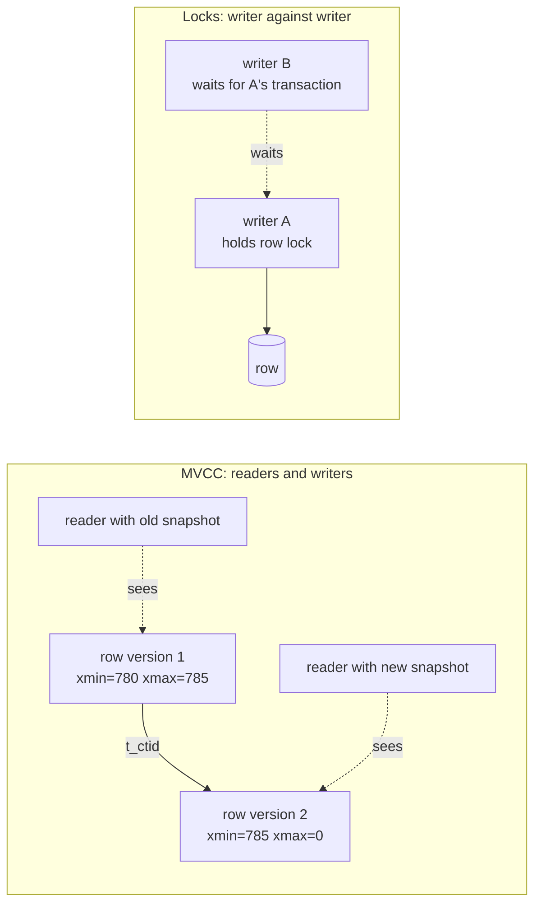
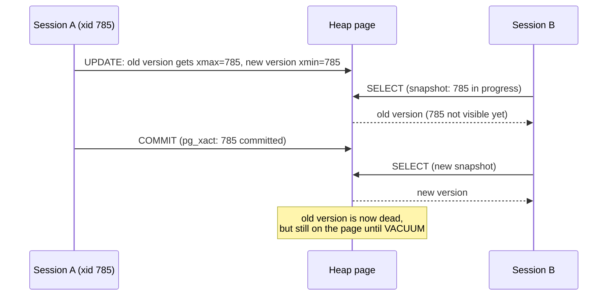
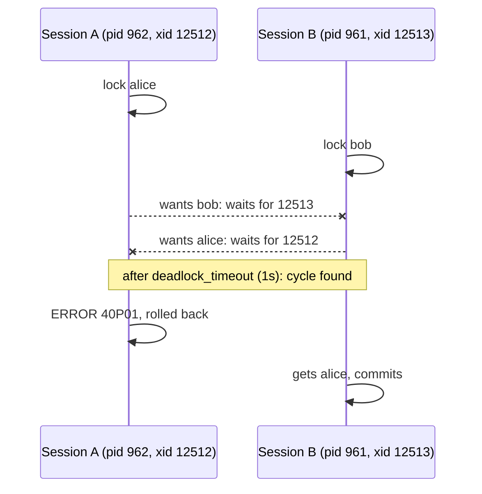

# MVCC and locks

## Why care?

Five tickets from services that "just store orders":

- "The `orders` table has 2 million rows and uses 40 GB on disk. We only ever update rows, we never insert many."
- "Every night at 02:00, the database gets slow. That's when the reporting job runs."
- "Two workers sometimes process the same order twice."
- "`ERROR: deadlock detected`, a few times a day, always in the checkout handler."
- "We added a column. The deploy took ten seconds, and for those ten seconds every request timed out."

On [How data is stored](storage.md#an-update-writes-a-new-row) you saw that an `UPDATE` does not overwrite a row: it writes a new version and leaves the old one on the page. On [Transactions and isolation](transactions.md) you saw what each isolation level promises. This page shows the machine underneath both: **row versions** (MVCC) for readers, and **locks** for writers. Every ticket above is one of them doing its job.

## The idea: a shared notebook with a pencil and sticky notes

A team keeps the order list in one big notebook. Many people read it, a few change it.

- Nobody erases anything. To change a line, you **cross it out**, write the new line below, and write your name and the time on both. A reader who opened the notebook at 10:00 simply ignores everything written after 10:00. So readers **never wait for writers**, and writers never wait for readers. That is **MVCC**, multi-version concurrency control.
- Crossed-out lines pile up. Once nobody who opened the notebook before the change is still reading, a cleaner can erase them, and the space can be used again. The cleaner is **`VACUUM`**.
- Two people who want to change **the same line** can't both do it. The first one puts a sticky note on it: "mine, until I'm done". The second one waits. That is a **row lock**.
- Some jobs need the whole notebook, for example when you add a new column to every page. Then you need a note on the cover: "nobody touch this". That is a **table lock**.
- Two people each hold a sticky note, and each waits for the other's. Someone must give up. That is a **deadlock**.



## Under the hood: row versions

The examples use the `tutor-pg` container from [How data is stored](storage.md#setup-your-own-postgresql), with its own database:

```console
$ docker exec tutor-pg createdb -U postgres tutor_mvcc
$ docker exec -it tutor-pg psql -U postgres -d tutor_mvcc
tutor_mvcc=#
```

For two sessions at once, open a second terminal and run the same `psql` command again. Inside a transaction, the prompt changes from `=#` to `=*#`.

### `xmin`, `xmax`, and who may see a row

Every row version (a **tuple**) carries two transaction IDs in its header, and you can select them as hidden columns:

- **`xmin`**: the transaction that created this version.
- **`xmax`**: the transaction that deleted it, or replaced it with a newer version. `0` means "nobody, yet".

`autovacuum_enabled = false` switches off the automatic cleaner for this table, so you can watch dead versions pile up:

```console
tutor_mvcc=# CREATE EXTENSION pageinspect;
CREATE EXTENSION
tutor_mvcc=# CREATE TABLE orders (
    id          uuid PRIMARY KEY DEFAULT gen_random_uuid(),
    customer_id text NOT NULL,
    status      text NOT NULL DEFAULT 'pending',
    created_at  timestamptz NOT NULL DEFAULT now()
) WITH (autovacuum_enabled = false);
CREATE TABLE
tutor_mvcc=# INSERT INTO orders (customer_id) VALUES ('alice');
INSERT 0 1
tutor_mvcc=# SELECT ctid, xmin, xmax, customer_id, status FROM orders;
 ctid  | xmin | xmax | customer_id | status
-------+------+------+-------------+---------
 (0,1) |  780 |    0 | alice       | pending
(1 row)
```

Transaction 780 created alice's order. Now two sessions. **Session A** pays the order but does not commit yet:

```console
tutor_mvcc=# BEGIN;
BEGIN
tutor_mvcc=*# SELECT pg_current_xact_id();
 pg_current_xact_id
--------------------
                785
(1 row)
tutor_mvcc=*# UPDATE orders SET status = 'paid' WHERE customer_id = 'alice';
UPDATE 1
tutor_mvcc=*# SELECT ctid, xmin, xmax, status FROM orders;
 ctid  | xmin | xmax | status
-------+------+------+--------
 (0,2) |  785 |    0 | paid
(1 row)
```

**Session B** looks at the same table, at the same moment:

```console
tutor_mvcc=# SELECT ctid, xmin, xmax, status FROM orders;
 ctid  | xmin | xmax | status
-------+------+------+---------
 (0,1) |  780 |  785 | pending
(1 row)
```

Two sessions, two different rows. A sees its own new version at `(0,2)`. B sees the old version at `(0,1)`, which now says `xmax = 785`: "transaction 785 is replacing me". But 785 has not committed, so for B the old version is still the live one. B did not wait. Nothing was locked against reading.

**Session A** commits (`COMMIT`). Now **session B** sees the new version, and `pageinspect` shows that both versions are still on the page:

```console
tutor_mvcc=# SELECT ctid, xmin, xmax, status FROM orders;
 ctid  | xmin | xmax | status
-------+------+------+--------
 (0,2) |  785 |    0 | paid
(1 row)
tutor_mvcc=# SELECT lp, lp_off, t_xmin, t_xmax, t_ctid FROM heap_page_items(get_raw_page('orders', 0));
 lp | lp_off | t_xmin | t_xmax | t_ctid
----+--------+--------+--------+--------
  1 |   8128 |    780 |    785 | (0,2)
  2 |   8064 |    785 |      0 | (0,2)
(2 rows)
```

Line pointer 1 is the old version, deleted by 785, with a forward pointer `t_ctid = (0,2)` to its successor. Line pointer 2 is the new version. `SELECT` hides version 1, because it is no longer visible to anyone.

### Rollback leaves a mark, too

What if a transaction changes a row and then rolls back? Run an `UPDATE` to `'shipped'` in a transaction (it got xid 788), then `ROLLBACK`:

```console
tutor_mvcc=# SELECT ctid, xmin, xmax, status FROM orders;
 ctid  | xmin | xmax | status
-------+------+------+--------
 (0,2) |  785 |  788 | paid
(1 row)
tutor_mvcc=# SELECT lp, t_xmin, t_xmax, t_ctid FROM heap_page_items(get_raw_page('orders', 0));
 lp | t_xmin | t_xmax | t_ctid
----+--------+--------+--------
  1 |    780 |    785 | (0,2)
  2 |    785 |    788 | (0,3)
  3 |    788 |      0 | (0,3)
(3 rows)
tutor_mvcc=# SELECT pg_xact_status('785') AS x785, pg_xact_status('788') AS x788;
   x785    |  x788
-----------+---------
 committed | aborted
(1 row)
```

The visible row says `xmax = 788`, and the page holds a third version written by 788. **A rollback does not undo anything on the page.** PostgreSQL only writes "788 aborted" into the commit log (`pg_xact`, two bits per transaction). Every reader then checks: "my `xmax` is 788, 788 aborted, so I am still alive." Version 3 is dead from birth. That is why `ROLLBACK` is instant in PostgreSQL, no matter how many rows you changed, and why a big rolled-back batch still leaves bloat behind.

To avoid looking up `pg_xact` on every read, the first reader that learns a transaction's fate writes **hint bits** into the tuple header (for example `HEAP_XMIN_COMMITTED`, which you will see further down). So a plain `SELECT` can make a page dirty and cause a write. That surprises people the first time they see it.

### Snapshots: "what may I see?"

A **snapshot** is the list a transaction uses to decide visibility. `pg_current_snapshot()` shows it. Here **session A** holds an uncommitted update (xid 788, the one from above, before its rollback), and **session B** starts a `REPEATABLE READ` transaction:

```console
tutor_mvcc=# BEGIN ISOLATION LEVEL REPEATABLE READ;
BEGIN
tutor_mvcc=*# SELECT pg_current_snapshot();
 pg_current_snapshot
---------------------
 787:792:787,788
(1 row)
tutor_mvcc=*# SELECT status, xmin, xmax FROM orders;
 status | xmin | xmax
--------+------+------
 paid   |  785 |  788
(1 row)
```

Read `787:792:787,788` as `xmin:xmax:in-progress list`:

- Every transaction **below 787** has finished. Its changes are visible if it committed.
- Every transaction **from 792 up** started after this snapshot. Its changes are invisible, even if it commits a millisecond later.
- **787 and 788** were still running when the snapshot was taken. Their changes are invisible too.
- Everything else in between (789, 790, 791) had already finished.

Where does 787 come from? Not from this page. Transaction IDs are counted for the **whole server**, not per database, and another database on the same server had a transaction open at that moment. Your numbers will be different. A snapshot is a cheap thing: three numbers and a short list. It doesn't copy any data.

Then the visibility rule for a tuple is, in short: **`xmin` must be committed and visible in my snapshot, and `xmax` must be empty, aborted, or not visible in my snapshot.** That is all of MVCC. The isolation levels from [Transactions and isolation](transactions.md) differ mostly in **when** the snapshot is taken: `READ COMMITTED` takes a new one for every statement, `REPEATABLE READ` and `SERIALIZABLE` take one at the first statement of the transaction and keep it.



## Under the hood: dead tuples and `VACUUM`

A row version that no snapshot can ever see again is a **dead tuple**. Dead tuples take space in the table and in every index until `VACUUM` removes them. Here is the "we only update, and the disk grows" ticket, with 100,000 orders. The table is recreated with the same `CREATE TABLE` as above:

```console
tutor_mvcc=# INSERT INTO orders (customer_id) SELECT 'c' || (g % 1000) FROM generate_series(1, 100000) g;
INSERT 0 100000
tutor_mvcc=# VACUUM orders;
VACUUM
tutor_mvcc=# SELECT pg_size_pretty(pg_relation_size('orders')) AS size;
  size
---------
 6672 kB
(1 row)
tutor_mvcc=# UPDATE orders SET status = 'paid';
UPDATE 100000
tutor_mvcc=# SELECT pg_stat_force_next_flush();
 pg_stat_force_next_flush
--------------------------

(1 row)
tutor_mvcc=# SELECT pg_size_pretty(pg_relation_size('orders')) AS size, n_dead_tup, n_tup_upd, n_tup_hot_upd
FROM pg_stat_user_tables WHERE relname = 'orders';
 size  | n_dead_tup | n_tup_upd | n_tup_hot_upd
-------+------------+-----------+---------------
 13 MB |     100000 |    100000 |             0
(1 row)
```

One `UPDATE` of every row **doubled** the table: 100,000 live versions plus 100,000 dead ones. (A session sends its statistics to the shared counters about once a second. `pg_stat_force_next_flush()` sends them now, so the numbers are not zero yet. You don't need it in production.)

Now clean up, with `VERBOSE` to see what the cleaner did:

```console
tutor_mvcc=# VACUUM (VERBOSE) orders;
INFO:  vacuuming "tutor_mvcc.public.orders"
INFO:  finished vacuuming "tutor_mvcc.public.orders": index scans: 1
pages: 0 removed, 1666 remain, 1666 scanned (100.00% of total), 0 eagerly scanned
tuples: 100000 removed, 100000 remain, 0 are dead but not yet removable
removable cutoff: 814, which was 0 XIDs old when operation ended
new relfrozenxid: 813, which is 1 XIDs ahead of previous value
frozen: 0 pages from table (0.00% of total) had 0 tuples frozen
visibility map: 1666 pages set all-visible, 833 pages set all-frozen (0 were all-visible)
index scan needed: 834 pages from table (50.06% of total) had 100000 dead item identifiers removed
index "orders_pkey": pages: 746 in total, 0 newly deleted, 0 currently deleted, 0 reusable
avg read rate: 0.000 MB/s, avg write rate: 0.000 MB/s
buffer usage: 4939 hits, 0 reads, 0 dirtied
WAL usage: 4077 records, 0 full page images, 1120917 bytes, 0 buffers full
system usage: CPU: user: 0.03 s, system: 0.00 s, elapsed: 0.03 s
...
VACUUM
tutor_mvcc=# CREATE EXTENSION pgstattuple;
CREATE EXTENSION
tutor_mvcc=# SELECT pg_size_pretty(pg_relation_size('orders')) AS size, round(free_percent) AS free_pct FROM pgstattuple('orders');
 size  | free_pct
-------+----------
 13 MB |       50
(1 row)
```

(`...` marks the same report for the table's TOAST table, left out.) Read the important lines:

- **`tuples: 100000 removed`**: the dead versions are gone.
- **`index scan needed ... 100000 dead item identifiers removed`**: `VACUUM` also had to remove 100,000 entries from `orders_pkey`, because each dead version had its own index entry. Indexes make `VACUUM` more expensive.
- **`removable cutoff: 814`**: versions deleted by transactions before 814 may be removed. Remember that line.
- **`visibility map: 1666 pages set all-visible`**: every page now holds only rows that every snapshot can see. Index-only scans need that (see [Indexes](indexes.md#covering-indexes-and-index-only-scans)).
- **The file is still 13 MB.** `VACUUM` marks the space as free **inside** the file, for future rows. It gives back disk space to the operating system only for empty pages at the very end of the file. Half of every page is now empty, and the file stays the same size.

So a table that is updated often settles at a size of "live rows plus the dead rows between two vacuums". That is fine. It only becomes a problem when `VACUUM` can't keep up, or can't remove anything. To really shrink a file, `VACUUM FULL` rewrites the table, but it takes an `ACCESS EXCLUSIVE` lock for the whole time: nobody can even read the table. In production, people use the `pg_repack` extension instead, which needs only short locks.

### Free space must be on the same page: HOT

Run the same full-table update again on the vacuumed table:

```console
tutor_mvcc=# UPDATE orders SET status = 'shipped';
UPDATE 100000
tutor_mvcc=# SELECT pg_stat_force_next_flush();
 pg_stat_force_next_flush
--------------------------

(1 row)
tutor_mvcc=# SELECT pg_size_pretty(pg_relation_size('orders')) AS size, n_dead_tup, n_tup_upd, n_tup_hot_upd
FROM pg_stat_user_tables WHERE relname = 'orders';
 size  | n_dead_tup | n_tup_upd | n_tup_hot_upd
-------+------------+-----------+---------------
 13 MB |     100000 |    200000 |            55
(1 row)
```

Good news: the file did not grow, the new versions went into the free space. Bad news: only 55 of 100,000 updates were **HOT** (heap-only tuple). You met HOT on [Indexes](indexes.md#updates-and-hot): if the new version fits **on the same page** and no indexed column changed, PostgreSQL does not add new index entries. Here the free space was in the wrong place. The first update had moved every row to the second half of the file. `VACUUM` emptied the first half. So the live rows sat on full pages, and their new versions had to go to other (empty) pages, with new index entries.

With `fillfactor = 50`, every page keeps half of its space free on insert, right next to its rows:

```console
tutor_mvcc=# CREATE TABLE orders_ff (LIKE orders INCLUDING ALL) WITH (fillfactor = 50, autovacuum_enabled = false);
CREATE TABLE
tutor_mvcc=# INSERT INTO orders_ff (customer_id) SELECT 'c' || (g % 1000) FROM generate_series(1, 100000) g;
INSERT 0 100000
tutor_mvcc=# UPDATE orders_ff SET status = 'paid';
UPDATE 100000
tutor_mvcc=# SELECT pg_stat_force_next_flush();
 pg_stat_force_next_flush
--------------------------

(1 row)
tutor_mvcc=# SELECT pg_size_pretty(pg_relation_size('orders_ff')) AS size, n_dead_tup, n_tup_upd, n_tup_hot_upd
FROM pg_stat_user_tables WHERE relname = 'orders_ff';
 size  | n_dead_tup | n_tup_upd | n_tup_hot_upd
-------+------------+-----------+---------------
 13 MB |     100000 |    100000 |        100000
(1 row)
tutor_mvcc=# SELECT lp, t_xmin, t_xmax, t_ctid, f.raw_flags
FROM heap_page_items(get_raw_page('orders_ff', 0)) h,
     heap_tuple_infomask_flags(h.t_infomask, h.t_infomask2) f
WHERE lp IN (1, 60);
 lp | t_xmin | t_xmax | t_ctid |                             raw_flags
----+--------+--------+--------+-------------------------------------------------------------------
  1 |    819 |    820 | (0,60) | {HEAP_HASVARWIDTH,HEAP_XMIN_COMMITTED,HEAP_HOT_UPDATED}
 60 |    820 |      0 | (0,60) | {HEAP_HASVARWIDTH,HEAP_XMAX_INVALID,HEAP_UPDATED,HEAP_ONLY_TUPLE}
(2 rows)
```

All 100,000 updates were HOT. The flags show the chain: version 1 is `HEAP_HOT_UPDATED` ("my successor is on this page"), version 60 is a `HEAP_ONLY_TUPLE` ("no index points at me; find me through the chain from line pointer 1"). The index still points at line pointer 1. A HOT chain can also be cleaned up without a full `VACUUM`: any query that reads the page and finds it nearly full may **prune** it on the spot. A 50% fillfactor is extreme, it doubles the table. The point is: HOT needs free space **on the page of the row**, and you reserve it with `fillfactor` (80 to 90 is usual for tables like `orders`).

### The long transaction that stops `VACUUM`

Back to the "removable cutoff". `VACUUM` may only remove a version when **no snapshot on the server can still see it**. One old snapshot holds back the cleanup for every table in the database. Watch it. **Session A** is a report that opens a transaction and then does something slow (here: nothing, for four seconds):

```console
tutor_mvcc=# BEGIN ISOLATION LEVEL REPEATABLE READ;
BEGIN
tutor_mvcc=*# SELECT count(*) FROM orders;
 count
--------
 100000
(1 row)
```

**Session B** (the table was recreated and frozen first, so it starts clean) cancels 100 orders and vacuums:

```console
tutor_mvcc=# UPDATE orders SET status = 'cancelled' WHERE customer_id = 'c1';
UPDATE 100
tutor_mvcc=# SELECT pid, state, backend_xmin, now() - xact_start AS xact_age, left(query, 30) AS query
FROM pg_stat_activity WHERE datname = 'tutor_mvcc' AND backend_xmin IS NOT NULL;
 pid |        state        | backend_xmin |    xact_age     |             query
-----+---------------------+--------------+-----------------+--------------------------------
 783 | active              |        12478 | 00:00:00        | SELECT pid, state, backend_xmi
 785 | idle in transaction |        12477 | 00:00:01.015941 | SELECT count(*) FROM orders;
(2 rows)
tutor_mvcc=# VACUUM (VERBOSE, PROCESS_TOAST false) orders;
INFO:  vacuuming "tutor_mvcc.public.orders"
INFO:  finished vacuuming "tutor_mvcc.public.orders": index scans: 0
...
tuples: 0 removed, 100078 remain, 100 are dead but not yet removable
removable cutoff: 12477, which was 1 XIDs old when operation ended
...
```

**`100 are dead but not yet removable`.** Session A is `idle in transaction`: it does nothing, but its snapshot (`backend_xmin = 12477`) might still want to see the old versions, so the cutoff is stuck at 12477. After **session A** commits, the same `VACUUM` in session B says:

```text
tuples: 100 removed, 99974 remain, 0 are dead but not yet removable
removable cutoff: 12479, which was 1 XIDs old when operation ended
```

(`...` marks lines left out. The `remain` numbers are estimates, so they wobble.) Here it was four seconds. In production it is a report that runs for two hours, a migration someone forgot to commit in a SQL console, or a Go handler that returns early without `tx.Rollback()`. During that time no dead tuple in that database is removed, the busy tables grow, queries scan more and more dead rows, and the night gets slow. That's the 02:00 ticket. The same happens with a **replication slot** that nobody reads, or a replica with `hot_standby_feedback = on` and a long query (see [Replication and scaling](replication.md)).

Find the culprits with `pg_stat_activity`: sort by `xact_start`, look at `state = 'idle in transaction'` and at `backend_xmin`. Then protect yourself with timeouts (`idle_in_transaction_session_timeout`, and `transaction_timeout` since PostgreSQL 17; both are `0`, off, by default).

### Autovacuum

You don't run `VACUUM` by hand. The **autovacuum launcher** wakes up every `autovacuum_naptime` and starts workers for tables that need it:

```console
tutor_mvcc=# SELECT name, setting FROM pg_settings WHERE name ~ '^(autovacuum|vacuum_failsafe|vacuum_freeze)' ORDER BY name;
                 name                  |  setting
---------------------------------------+------------
 autovacuum                            | on
 autovacuum_analyze_scale_factor       | 0.1
 autovacuum_analyze_threshold          | 50
 autovacuum_freeze_max_age             | 200000000
 autovacuum_max_workers                | 3
 autovacuum_multixact_freeze_max_age   | 400000000
 autovacuum_naptime                    | 60
 autovacuum_vacuum_cost_delay          | 2
 autovacuum_vacuum_cost_limit          | -1
 autovacuum_vacuum_insert_scale_factor | 0.2
 autovacuum_vacuum_insert_threshold    | 1000
 autovacuum_vacuum_max_threshold       | 100000000
 autovacuum_vacuum_scale_factor        | 0.2
 autovacuum_vacuum_threshold           | 50
 autovacuum_worker_slots               | 16
 autovacuum_work_mem                   | -1
 vacuum_failsafe_age                   | 1600000000
 vacuum_freeze_min_age                 | 50000000
 vacuum_freeze_table_age               | 150000000
(19 rows)
```

A table gets vacuumed when its dead tuples pass **`threshold + scale_factor × rows`**, here 50 + 20% of the table (and never more than `autovacuum_vacuum_max_threshold`, new in PostgreSQL 18). For a 10-million-row `orders` table that means waiting for 2 million dead rows. For big, busy tables, set it per table:

```sql
ALTER TABLE orders SET (autovacuum_vacuum_scale_factor = 0.02);
```

`autovacuum_vacuum_cost_delay` and `cost_limit` slow the workers down on purpose, so they don't eat all the disk bandwidth. On fast disks, the defaults are often too gentle, and autovacuum falls behind on big tables. Check `last_autovacuum` and `n_dead_tup` in `pg_stat_user_tables` before you blame it.

### Transaction ID wraparound

Transaction IDs on disk are **32-bit**. That's about 4 billion, and PostgreSQL compares them in a circle: for every xid, about 2 billion are "the past" and 2 billion are "the future". A busy server that does 5,000 write transactions per second uses 2 billion in under five days. After that, an old row's `xmin` would suddenly look like it is in the future, and the row would vanish.

The fix is **freezing**. `VACUUM` marks old tuples as **frozen**: "visible to everyone, forever, no matter what the xid says". Each table remembers its oldest unfrozen xid in `relfrozenxid`, and each database in `datfrozenxid`:

```console
tutor_mvcc=# SELECT datname, age(datfrozenxid) FROM pg_database ORDER BY 2 DESC LIMIT 3;
    datname    |  age
---------------+-------
 tutor_storage | 11745
 template1     | 11745
 postgres      | 11745
(3 rows)
tutor_mvcc=# SELECT relname, relfrozenxid, age(relfrozenxid) FROM pg_class WHERE relname = 'orders';
 relname | relfrozenxid | age
---------+--------------+-----
 orders  |        12477 |  13
(1 row)
```

`age()` is "how many xids ago". The milestones, from the settings above:

| Age of a table's `relfrozenxid` | What happens                                                                                 |
| ------------------------------- | -------------------------------------------------------------------------------------------- |
| 150 million                     | `vacuum_freeze_table_age`: the next normal vacuum scans the whole table to freeze it         |
| 200 million                     | `autovacuum_freeze_max_age`: autovacuum **forces** a vacuum, even with autovacuum turned off |
| 1.6 billion                     | `vacuum_failsafe_age`: vacuum drops its cost delay and skips index cleanup, to finish faster |
| about 2 billion                 | the server refuses new write transactions until someone vacuums the database (an outage)     |

The forced "to prevent wraparound" vacuum at 200 million is normal and harmless on most tables, but on a 2 TB table it reads everything, and it does not give way to your lock requests the way a normal autovacuum does. The outage at the end only happens when something stopped vacuum for a very long time: the same long transactions and forgotten replication slots as above. Monitor `age(datfrozenxid)` and alert at, say, 500 million.

The same circle exists for **multixacts**: IDs for "several transactions share a lock on this row", which `FOR SHARE` and foreign keys create (next section).

## Under the hood: row locks

MVCC keeps readers and writers apart. **Writers against writers** need locks. When you `UPDATE` or `DELETE` a row, PostgreSQL locks that row until your transaction ends. There is no lock table for rows: the lock is your xid in the tuple's `xmax`, plus a flag. A second writer reads `xmax`, sees a running transaction, and **waits for that transaction to end**.

### Seeing a wait

**Session A** (pid 900) locks alice's order with `SELECT ... FOR UPDATE`, then thinks for four seconds:

```console
tutor_mvcc=# BEGIN;
BEGIN
tutor_mvcc=*# SELECT status FROM orders WHERE customer_id = 'alice' FOR UPDATE;
 status
---------
 pending
(1 row)
```

**Session B** (pid 905) wants to cancel the same order:

```console
tutor_mvcc=# \timing on
Timing is on.
tutor_mvcc=# UPDATE orders SET status = 'cancelled' WHERE customer_id = 'alice';
```

It hangs. A **third session** asks what is going on:

```console
tutor_mvcc=# SELECT pid, state, wait_event_type, wait_event, pg_blocking_pids(pid) AS blocked_by, left(query, 40) AS query
FROM pg_stat_activity WHERE datname = 'tutor_mvcc' AND pid <> pg_backend_pid();
 pid |        state        | wait_event_type |  wait_event   | blocked_by |                  query
-----+---------------------+-----------------+---------------+------------+------------------------------------------
 900 | idle in transaction | Client          | ClientRead    | {}         | SELECT status FROM orders WHERE customer
 905 | active              | Lock            | transactionid | {900}      | UPDATE orders SET status = 'cancelled' W
(2 rows)
tutor_mvcc=# SELECT l.pid, l.locktype, l.relation::regclass AS rel, l.mode, l.granted, l.transactionid AS xid
FROM pg_locks l JOIN pg_stat_activity a USING (pid)
WHERE a.datname = 'tutor_mvcc' AND l.pid <> pg_backend_pid()
ORDER BY l.pid, l.granted DESC, l.locktype;
 pid |   locktype    |     rel     |       mode       | granted |  xid
-----+---------------+-------------+------------------+---------+-------
 900 | relation      | orders      | RowShareLock     | t       |
 900 | relation      | orders_pkey | RowShareLock     | t       |
 900 | transactionid |             | ExclusiveLock    | t       | 12493
 900 | virtualxid    |             | ExclusiveLock    | t       |
 905 | relation      | orders_pkey | RowExclusiveLock | t       |
 905 | relation      | orders      | RowExclusiveLock | t       |
 905 | transactionid |             | ExclusiveLock    | t       | 12494
 905 | tuple         | orders      | ExclusiveLock    | t       |
 905 | virtualxid    |             | ExclusiveLock    | t       |
 905 | transactionid |             | ShareLock        | f       | 12493
(10 rows)
```

This is the most useful query of this page. Read it from the bottom:

- **`905 transactionid ShareLock granted=f xid=12493`**: B waits for **transaction 12493** to end. That is A's transaction. Every transaction holds an `ExclusiveLock` on its own xid (third line); waiting for a row means asking for a share lock on that xid, which you only get when its owner commits or rolls back.
- **`905 tuple ExclusiveLock`**: B is first in line for this row. If a third writer came, it would wait on the tuple lock behind B, in order.
- **`RowShareLock` / `RowExclusiveLock` on `orders`**: table-level locks that every `SELECT ... FOR UPDATE` or `UPDATE` takes. They don't conflict with each other (next section).
- `pg_stat_activity` says the same in short: B is `wait_event_type = Lock`, `blocked_by = {900}`. And A is `idle in transaction`: it holds the lock and **does nothing**. In real life, that's a Go handler that called an HTTP service between `BEGIN` and `COMMIT`.

**Session A** updates the order to `'paid'` and commits. Session B finishes immediately:

```console
UPDATE 1
Time: 2996.268 ms (00:02.996)
tutor_mvcc=# SELECT status FROM orders WHERE customer_id = 'alice';
  status
-----------
 cancelled
(1 row)
```

B waited three seconds, then overwrote A's `'paid'` with `'cancelled'`. In `READ COMMITTED`, B re-reads the newest version of the row after the wait and applies its update to it. Whether that is correct is a business question; the anomalies are on [Transactions and isolation](transactions.md).

### Four row lock strengths

`FOR UPDATE` is the strongest of four row lock modes. An `UPDATE` that does not change a key column takes the weaker `FOR NO KEY UPDATE`, and a foreign key check takes the weakest, `FOR KEY SHARE`:

| Row lock            | Taken by                                    | Blocks                        |
| ------------------- | ------------------------------------------- | ----------------------------- |
| `FOR KEY SHARE`     | foreign key checks (`INSERT` into a child)  | `FOR UPDATE` only             |
| `FOR SHARE`         | `SELECT ... FOR SHARE`                      | `FOR NO KEY UPDATE` and above |
| `FOR NO KEY UPDATE` | `UPDATE` that changes no unique/key column  | `FOR SHARE` and above         |
| `FOR UPDATE`        | `DELETE`, key `UPDATE`, `SELECT FOR UPDATE` | everything                    |

Why it matters: an order is being updated while someone adds an item to it. **Session A** runs `UPDATE orders SET status = 'shipped' WHERE customer_id = 'alice'` in an open transaction. **Session B**, with an `order_items` table whose `order_id` references `orders(id)`:

```console
tutor_mvcc=# INSERT INTO order_items VALUES ('00000000-0000-0000-0000-00000000000a', 'BOOK-1', 1);
INSERT 0 1
Time: 4.782 ms
tutor_mvcc=# SELECT customer_id FROM orders WHERE customer_id = 'alice' FOR KEY SHARE;
 customer_id
-------------
 alice
(1 row)

Time: 1.864 ms
tutor_mvcc=# SELECT customer_id FROM orders WHERE customer_id = 'alice' FOR SHARE;
 customer_id
-------------
 alice
(1 row)

Time: 1494.985 ms (00:01.495)
```

The foreign key check (`FOR KEY SHARE` on the parent row) did not wait for the status update. `FOR SHARE` waited until A committed. Before PostgreSQL 9.3 there were only two modes, and every child insert waited for every parent update. If you write `SELECT ... FOR UPDATE` by habit when you only want to change a status, use `FOR NO KEY UPDATE` instead: it does not block foreign key checks.

### `NOWAIT` and `SKIP LOCKED`: a job queue

Waiting is not always what you want. Two options change it:

- **`NOWAIT`**: fail at once if the row is locked.
- **`SKIP LOCKED`**: pretend the locked rows aren't there.

`SKIP LOCKED` turns a table into a safe job queue. Four pending orders, two workers. **Worker A** takes the oldest pending order and keeps its transaction open while it works:

```console
tutor_mvcc=# BEGIN;
BEGIN
tutor_mvcc=*# SELECT customer_id FROM orders
WHERE status = 'pending' ORDER BY created_at
LIMIT 1 FOR UPDATE SKIP LOCKED;
 customer_id
-------------
 alice
(1 row)
```

**Worker B**, a second later, runs the same query, and then tries alice's order directly with `NOWAIT`:

```console
tutor_mvcc=# BEGIN;
BEGIN
tutor_mvcc=*# SELECT customer_id FROM orders
WHERE status = 'pending' ORDER BY created_at
LIMIT 1 FOR UPDATE SKIP LOCKED;
 customer_id
-------------
 bob
(1 row)
tutor_mvcc=*# SELECT customer_id FROM orders WHERE customer_id = 'alice' FOR UPDATE NOWAIT;
ERROR:  could not obtain lock on row in relation "orders"
tutor_mvcc=!# ROLLBACK;
ROLLBACK
```

B got bob, not alice, and did not wait. The `NOWAIT` error has SQLSTATE `55P03` (`lock_not_available`). The `=!#` prompt means "this transaction failed; only `ROLLBACK` works now". Without `SKIP LOCKED`, worker B's plain `FOR UPDATE` would wait for A and then get alice, which A had already processed: that is the "two workers process the same order twice" ticket, when the worker forgets to re-check the status.

The job queue pattern in one statement, for Go workers:

```sql
UPDATE orders SET status = 'processing'
WHERE id = (
    SELECT id FROM orders
    WHERE status = 'pending'
    ORDER BY created_at
    LIMIT 1
    FOR UPDATE SKIP LOCKED
)
RETURNING id, customer_id;
```

Commit quickly after it, or do the work inside the transaction if the job is short and must be exactly-once with the database changes. Note that `SKIP LOCKED` gives an inconsistent view **on purpose**: never use it for reports or checks.

## Under the hood: table locks

Every statement also takes a lock on each table it touches. Most of these never conflict, which is why you rarely see them:

| Table lock mode          | Taken by (examples)                                                  | Conflicts with                          |
| ------------------------ | -------------------------------------------------------------------- | --------------------------------------- |
| `ACCESS SHARE`           | `SELECT`                                                             | `ACCESS EXCLUSIVE` only                 |
| `ROW SHARE`              | `SELECT ... FOR UPDATE / SHARE`                                      | `EXCLUSIVE`, `ACCESS EXCLUSIVE`         |
| `ROW EXCLUSIVE`          | `INSERT`, `UPDATE`, `DELETE`                                         | `SHARE` and stronger                    |
| `SHARE UPDATE EXCLUSIVE` | `VACUUM`, `ANALYZE`, `CREATE INDEX CONCURRENTLY`, some `ALTER TABLE` | itself and stronger                     |
| `SHARE`                  | `CREATE INDEX` (without `CONCURRENTLY`)                              | `ROW EXCLUSIVE` and stronger: no writes |
| `ACCESS EXCLUSIVE`       | `DROP`, `TRUNCATE`, `VACUUM FULL`, most `ALTER TABLE`                | everything, even `SELECT`               |

(There are two more, `SHARE ROW EXCLUSIVE` and `EXCLUSIVE`, which you rarely meet. The full table is in the PostgreSQL docs under "Explicit Locking".)

The dangerous one is `ACCESS EXCLUSIVE`, because most `ALTER TABLE` forms need it, even quick ones like adding a nullable column. **Session A** has an open transaction that read `orders` (it holds `ACCESS SHARE` until it ends). **Session B** adds a column, with a safety belt:

```console
tutor_mvcc=# SET lock_timeout = '1s';
SET
tutor_mvcc=# ALTER TABLE orders ADD COLUMN note text;
ERROR:  canceling statement due to lock timeout
Time: 1011.461 ms (00:01.011)
```

While B was waiting, `pg_locks` showed:

```console
tutor_mvcc=# SELECT locktype, relation::regclass AS rel, mode, granted, pid FROM pg_locks
WHERE relation = 'orders'::regclass ORDER BY granted DESC;
 locktype |  rel   |        mode         | granted | pid
----------+--------+---------------------+---------+------
 relation | orders | AccessShareLock     | t       | 1015
 relation | orders | AccessExclusiveLock | f       | 1009
(2 rows)
```

Without `lock_timeout`, B would wait until A ends, and here is the catch: **every new query on `orders` would queue behind B**, because locks are granted in order. One forgotten transaction plus one `ALTER TABLE` and the whole service stops: that's the "deploy took ten seconds" ticket. [Schema migrations](migrations.md) is all about this lock queue and how to avoid it. The short version: always set `lock_timeout` for DDL, and retry.

## Under the hood: deadlocks

Two checkout requests each update two orders, in different order. **Session A** updates alice, then (a second later) bob. **Session B** updates bob, then alice:

```console
tutor_mvcc=# BEGIN;
BEGIN
tutor_mvcc=*# UPDATE orders SET status = 'paid' WHERE customer_id = 'alice';
UPDATE 1
tutor_mvcc=*# UPDATE orders SET status = 'paid' WHERE customer_id = 'bob';
ERROR:  deadlock detected
DETAIL:  Process 962 waits for ShareLock on transaction 12513; blocked by process 961.
Process 961 waits for ShareLock on transaction 12512; blocked by process 962.
HINT:  See server log for query details.
CONTEXT:  while updating tuple (0,2) in relation "orders"
tutor_mvcc=!# \echo :LAST_ERROR_SQLSTATE
40P01
tutor_mvcc=!# COMMIT;
ROLLBACK
```

Session B (process 961) waited until A was rolled back, then its update of alice went through: `UPDATE 1`, and its `COMMIT` worked.



How PostgreSQL finds it: a session that has waited for `deadlock_timeout` (1 s by default) checks the graph of "who waits for whom". If there is a cycle, it cancels **itself**. So the victim is the one whose timer ran out first, not the "cheaper" one. Note the `COMMIT` that answered `ROLLBACK`: after an error, the whole transaction is gone. Alice is not paid either. The server log has the queries:

```console
$ docker logs tutor-pg 2>&1 | grep -A7 'deadlock detected'
2026-11-26 22:23:01.602 UTC [962] ERROR:  deadlock detected
2026-11-26 22:23:01.602 UTC [962] DETAIL:  Process 962 waits for ShareLock on transaction 12513; blocked by process 961.
	Process 961 waits for ShareLock on transaction 12512; blocked by process 962.
	Process 962: UPDATE orders SET status = 'paid' WHERE customer_id = 'bob';
	Process 961: UPDATE orders SET status = 'paid' WHERE customer_id = 'alice';
2026-11-26 22:23:01.602 UTC [962] HINT:  See server log for query details.
2026-11-26 22:23:01.602 UTC [962] CONTEXT:  while updating tuple (0,2) in relation "orders"
2026-11-26 22:23:01.602 UTC [962] STATEMENT:  UPDATE orders SET status = 'paid' WHERE customer_id = 'bob';
```

`pg_stat_database.deadlocks` counts them per database; graph that number. To prevent deadlocks:

1. **Lock in a fixed order.** Sort the order IDs before you update them, or lock them all at once: `SELECT ... WHERE id = ANY($1) ORDER BY id FOR UPDATE`.
2. **Keep transactions short.** No network calls between `BEGIN` and `COMMIT`.
3. **Retry.** A deadlock victim lost nothing that was committed. `40P01` is safe to retry, like the serialization failure `40001` from [Transactions and isolation](transactions.md). [Go and SQL](go-and-sql.md) shows the retry loop.

## Timeouts: your safety net

| Setting                               | Cancels                                            | Typical value   |
| ------------------------------------- | -------------------------------------------------- | --------------- |
| `lock_timeout`                        | one statement that **waits for a lock** too long   | 1-5 s for DDL   |
| `statement_timeout`                   | one statement that **runs** too long (incl. waits) | 5-30 s for OLTP |
| `idle_in_transaction_session_timeout` | a session that sits **idle inside a transaction**  | 30-60 s         |
| `transaction_timeout` (PG 17+)        | a whole transaction that lasts too long            | depends         |
| `deadlock_timeout`                    | not a timeout: when to **check** for a deadlock    | leave at 1 s    |

All are `0` (off) by default, except `deadlock_timeout`. Set them per role (`ALTER ROLE ordersd SET statement_timeout = '10s'`) or per session, not in your head. Also turn on `log_lock_waits` (off by default here): it logs every wait longer than `deadlock_timeout`, with the blocking process. A Go `context` deadline also cancels the query on the server (pgx sends a cancel request), but only if your context actually has a deadline.

## Try it

1. Create `tutor_mvcc` and the `orders` table with `autovacuum_enabled = false`. Update one row three times. Use `heap_page_items` to find all versions and follow the `t_ctid` chain.
2. Start a `REPEATABLE READ` transaction in one session and leave it open. In another, update 1,000 rows and run `VACUUM (VERBOSE)`. Find the "dead but not yet removable" line. Find the culprit with `pg_stat_activity`, then end it with `SELECT pg_terminate_backend(<pid>)`.
3. Build the job queue: insert 10 pending orders, run the `UPDATE ... FOR UPDATE SKIP LOCKED` statement from three sessions inside open transactions. Each must get a different order.
4. Make your own deadlock, then fix it by sorting: both sessions lock alice first.
5. Hold a `SELECT` transaction open, run `ALTER TABLE orders ADD COLUMN x int` **without** `lock_timeout` in a second session, and a plain `SELECT count(*) FROM orders` in a third. Watch the third one hang, then look at `pg_locks`.

Clean up with `docker exec tutor-pg dropdb -U postgres tutor_mvcc`.

## Traps

- **"We update, so the table can't grow."** Every `UPDATE` writes a new version. Without vacuum, a table grows by its own size with every full pass.
- **Idle in transaction.** A transaction that waits for a user, an HTTP call, or a missing `Rollback()` holds its locks and stops vacuum for the whole database. Set `idle_in_transaction_session_timeout`, and in Go always `defer tx.Rollback()`.
- **`VACUUM FULL` to "fix" bloat in production.** It takes `ACCESS EXCLUSIVE` for the whole rewrite. Use `pg_repack`, or just let normal vacuum keep up.
- **Disabling autovacuum** because it "uses resources". It must run, at the latest at 200 million xids, and then it runs at the worst moment. Tune it instead.
- **`SELECT ... FOR UPDATE` by habit.** It blocks foreign key checks from other transactions. Use `FOR NO KEY UPDATE` unless you change the key.
- **DDL without `lock_timeout`.** One long transaction plus one `ALTER TABLE` queues every query on the table.
- **Locking rows in random order.** Map iteration order in Go is random, so "update every order in this map" is a deadlock waiting to happen. Sort first.
- **Not retrying `40P01`.** A deadlock is a normal, retryable error under load. Retry the whole transaction, not just the statement.
- **Abandoned replication slots.** They hold back vacuum just like a long transaction, and also keep WAL on disk.

## Check yourself

??? question "1. A row shows `xmin = 900, xmax = 905`, and `SELECT` returns it. How is that possible?"

    `xmax` is only a claim. Transaction 905 either aborted (then the row is fully alive), or it is
    still running, or it committed after this query's snapshot was taken, or it only **locked** the
    row (`SELECT ... FOR UPDATE` also writes `xmax`). In all four cases the version is still
    visible. `pg_xact_status('905')` tells you which one.

??? question "2. `VACUUM VERBOSE` says `5000000 are dead but not yet removable`. What do you look for, and where?"

    Something holds an old snapshot: the "removable cutoff" is stuck. Check `pg_stat_activity` for
    old `xact_start` and `backend_xmin` (especially `idle in transaction`), `pg_replication_slots`
    for an inactive slot with an old `xmin` or `catalog_xmin`, prepared transactions in
    `pg_prepared_xacts`, and replicas with `hot_standby_feedback = on` running long queries.

??? question "3. Why does `ROLLBACK` of a one-million-row `UPDATE` take a millisecond, and what does it leave behind?"

    Rollback only marks the xid as aborted in `pg_xact`. Nothing on the pages is undone. It leaves
    one million dead new versions (plus `xmax` marks on the old ones) and their index entries,
    which vacuum must clean up later.

??? question "4. Your queue workers run `SELECT ... WHERE status = 'pending' LIMIT 1 FOR UPDATE`. Under load, throughput is the same with 1 or 10 workers. Why, and what is the fix?"

    All ten workers pick the same oldest row. One gets the lock; nine wait for it, then re-check
    and (in `READ COMMITTED`) find the row no longer matches, so they get nothing or start over.
    The workers run one at a time. `FOR UPDATE SKIP LOCKED` lets each worker take the next free
    row.

??? question "5. A migration `ALTER TABLE orders ADD COLUMN note text` is instant on a copy of production, but in production all requests time out for 30 seconds. What happened?"

    The `ALTER` itself is quick, but it needs `ACCESS EXCLUSIVE`. A long transaction (a report, an
    idle session) held `ACCESS SHARE`, so the `ALTER` waited, and every new query on `orders`
    queued behind the `ALTER`. Use `lock_timeout` with retries, and see
    [Schema migrations](migrations.md).

??? question "6. Two sessions deadlock. Which one gets the error, and is it safe to retry?"

    The one whose `deadlock_timeout` (1 s) ran out first runs the check, finds the cycle, and
    cancels itself with `40P01`. Its whole transaction is rolled back, the other one continues.
    Retrying the whole transaction is safe, because nothing from the victim was committed.

## Recap

- Every row version has **`xmin`** (created by) and **`xmax`** (deleted or locked by). An `UPDATE` is a delete plus an insert. A rollback only marks the xid as aborted.
- A **snapshot** (`xmin:xmax:in-progress`) decides what a transaction sees. Readers never block writers and writers never block readers.
- Old versions become **dead tuples**. **`VACUUM`** removes them from the table and the indexes, and makes the space reusable, but doesn't shrink the file. **HOT** updates need free space on the same page: use `fillfactor`.
- **One old snapshot** (idle in transaction, a long report, a replication slot) stops vacuum for the whole database. Find it in `pg_stat_activity`. Set timeouts.
- **Autovacuum** starts at 50 + 20% dead rows by default; lower the scale factor for big tables. **Freezing** protects against 32-bit **xid wraparound**; monitor `age(datfrozenxid)`.
- **Row locks** live in the tuple; waiters wait for the holder's **transaction**. `pg_locks`, `pg_stat_activity.wait_event` and `pg_blocking_pids()` show who waits for whom. Prefer `FOR NO KEY UPDATE`; use **`SKIP LOCKED`** for queues and **`NOWAIT`** to fail fast.
- **Table locks** are mostly harmless, except **`ACCESS EXCLUSIVE`** from `ALTER TABLE`, which queues everyone behind it. Always use **`lock_timeout`** for DDL.
- **Deadlocks** are detected after `deadlock_timeout`; the victim gets `40P01`. Lock in a fixed order, keep transactions short, retry.

Next: how PostgreSQL decides **how** to run your query. [Query planning](query-planning.md).
