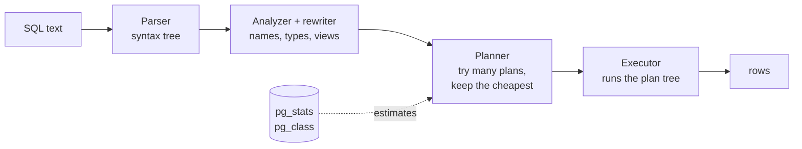

# Query planning

## Why care?

Four tickets, one root cause:

- "The order list for a customer takes 2 ms on my laptop and 125 ms in production. Same query."
- "After the nightly import, every refund report is slow until about 03:00. Then it is fast again."
- "We added an index. `EXPLAIN` shows it is not used."
- "The query is fast in `psql`, and slow from our Go service."

SQL says **what** you want, never **how** to get it. The **planner** picks the how: which index, which join algorithm, in which order. It picks with a cost model and statistics about your data. When the statistics are wrong, or the model doesn't fit your machine, or there is simply no good path, it picks badly. This page teaches you to read its decision with `EXPLAIN (ANALYZE)`, find the slow queries with `pg_stat_statements`, and fix a slow `orders` query step by step.

## The idea: a route planner

You ask a navigation app for a route from home to the airport.

- It doesn't drive every possible route to see which is fastest. It **estimates**: distance, speed limits, and traffic data it collected earlier.
- With good data, it is usually right. With old traffic data (the road closed yesterday), it sends you into a traffic jam with confidence.
- It can only choose roads that exist. If there is no highway, you get the side streets, however clever the app is.

PostgreSQL's planner is that app. The **statistics** (`pg_stats`) are its traffic data, collected by `ANALYZE`. The **cost model** turns "how many pages and rows" into a number. **Indexes** are the highways you can build. And `EXPLAIN ANALYZE` is driving the route with a stopwatch, then comparing it with the estimate.



1. The **parser** checks the syntax and builds a tree.
2. The **analyzer** looks up table and column names and types, and the **rewriter** expands views and rules.
3. The **planner** (also called the optimizer) builds possible plans, estimates the cost of each, and keeps the cheapest. For a join of many tables, the number of possible join orders explodes. The planner searches them systematically, but it reorders at most `join_collapse_limit` (8) explicit `JOIN`s, and from `geqo_threshold` (12) tables on it switches to a genetic algorithm that only samples orders.
4. The **executor** runs the plan: a tree of nodes, where each node pulls rows from its children, one at a time.

## Setup: a million orders

The examples use the `tutor-pg` container from [How data is stored](storage.md#setup-your-own-postgresql), with its own database. The container was started with `shared_preload_libraries=pg_stat_statements`, which this page needs.

```console
$ docker exec tutor-pg createdb -U postgres tutor_planning
$ docker exec -it tutor-pg psql -U postgres -d tutor_planning
tutor_planning=#
```

The data: 10,000 customers, one million orders over the last year (one every 30 seconds), and two items per order. Most orders are delivered, a few are cancelled:

```sql
CREATE EXTENSION pg_stat_statements;
CREATE TABLE customers (
    id      text PRIMARY KEY,
    country text NOT NULL
);
CREATE TABLE orders (
    id          uuid PRIMARY KEY DEFAULT gen_random_uuid(),
    customer_id text NOT NULL REFERENCES customers (id),
    status      text NOT NULL,
    created_at  timestamptz NOT NULL
);
CREATE TABLE order_items (
    order_id uuid NOT NULL REFERENCES orders (id),
    sku      text NOT NULL,
    qty      int  NOT NULL,
    price    numeric(10,2) NOT NULL
);
INSERT INTO customers
SELECT 'cust-' || g, (ARRAY['NL','DE','FR','US','GB'])[1 + g % 5]
FROM generate_series(1, 10000) g;
INSERT INTO orders (customer_id, status, created_at)
SELECT 'cust-' || (1 + (random() * 9999)::int),
       CASE WHEN r < 0.90 THEN 'delivered'
            WHEN r < 0.95 THEN 'shipped'
            WHEN r < 0.98 THEN 'paid'
            WHEN r < 0.999 THEN 'pending'
            ELSE 'cancelled' END,
       timestamptz '2026-11-26 00:00+00' - (g * interval '30 seconds')
FROM (SELECT g, random() AS r FROM generate_series(1, 1000000) g) s;
INSERT INTO order_items
SELECT o.id, 'SKU-' || (1 + (random() * 499)::int), 1 + (random() * 3)::int, (5 + random() * 95)::numeric(10,2)
FROM orders o, generate_series(1, 2) n;
VACUUM ANALYZE;
```

```console
tutor_planning=# SELECT relname, reltuples::bigint, relpages, pg_size_pretty(pg_relation_size(oid))
FROM pg_class WHERE relname IN ('customers','orders','order_items') ORDER BY 1;
   relname   | reltuples | relpages | pg_size_pretty
-------------+-----------+----------+----------------
 customers   |     10000 |       55 | 440 kB
 order_items |   2000000 |    16667 | 130 MB
 orders      |   1000000 |     9324 | 73 MB
(3 rows)
```

The data is random, so your counts and timings will differ a little. Note that there are no indexes except the primary keys. That is on purpose.

## Under the hood: `EXPLAIN` and the cost model

`EXPLAIN` shows the plan the planner chose, without running it:

```console
tutor_planning=# EXPLAIN SELECT * FROM orders;
                           QUERY PLAN
-----------------------------------------------------------------
 Seq Scan on orders  (cost=0.00..19324.00 rows=1000000 width=42)
(1 row)
```

- **`Seq Scan on orders`**: the node type. Read every page of the table, in order.
- **`cost=0.00..19324.00`**: two numbers. The first is the **startup cost** (before the first row comes out), the second the **total cost** (all rows). A `Sort` has a high startup cost: it must read everything before it can return the first row.
- **`rows=1000000`**: the estimated number of rows this node returns.
- **`width=42`**: the estimated average row size in bytes.

The cost has **no unit**. It is "arbitrary units, where reading one page sequentially costs 1". The planner's price list:

| Setting                | Default | Price of                                           |
| ---------------------- | ------- | -------------------------------------------------- |
| `seq_page_cost`        | 1       | reading one page as part of a sequential scan      |
| `random_page_cost`     | 4       | reading one page out of order (index lookups)      |
| `cpu_tuple_cost`       | 0.01    | handling one row                                   |
| `cpu_index_tuple_cost` | 0.005   | handling one index entry                           |
| `cpu_operator_cost`    | 0.0025  | one operator or function call, like `=` in `WHERE` |

You can check the 19324 by hand. It reads 9324 pages and handles one million rows:

```console
tutor_planning=# SELECT relpages, reltuples, relpages * 1.0 + reltuples * 0.01 AS total_cost FROM pg_class WHERE relname = 'orders';
 relpages | reltuples | total_cost
----------+-----------+------------
     9324 |     1e+06 |      19324
(1 row)
```

`relpages` and `reltuples` in `pg_class` are the planner's idea of the table size, updated by `VACUUM` and `ANALYZE`. A `WHERE` clause adds one `cpu_operator_cost` per row: 19324 + 1,000,000 × 0.0025 = 21824. You'll see exactly that number below.

`random_page_cost = 4` says "a random read is four times as expensive as a sequential one". That was true for spinning disks. On SSDs, and when the data is in RAM anyway, many teams set it to 1.1 to 2, which makes index scans look cheaper. It is a real knob, but turn it only after you've seen that the estimated **rows** are right. Most bad plans are bad row estimates, not bad prices.

### `EXPLAIN (ANALYZE)`: run it and compare

`EXPLAIN (ANALYZE)` **runs** the query and adds what really happened. Careful: it really runs it. For an `UPDATE` or `DELETE`, wrap it in `BEGIN` and `ROLLBACK`.

Here is the query that `orderctl` would use to list a customer's latest orders with their totals:

```sql
SELECT o.id, o.status, o.created_at, sum(i.qty * i.price) AS total
FROM orders o
JOIN order_items i ON i.order_id = o.id
WHERE o.customer_id = 'cust-42'
GROUP BY o.id
ORDER BY o.created_at DESC
LIMIT 20;
```

Its plan comes further down, in the fix. First, a smaller one, to learn to read the output:

```console
tutor_planning=# EXPLAIN SELECT * FROM orders WHERE status = 'cancelled';
                                 QUERY PLAN
----------------------------------------------------------------------------
 Gather  (cost=1000.00..15635.63 rows=1033 width=42)
   Workers Planned: 2
   ->  Parallel Seq Scan on orders  (cost=0.00..14532.33 rows=430 width=42)
         Filter: (status = 'cancelled'::text)
(4 rows)
```

A plan is a **tree**. Read it from the most indented node outwards: two **parallel workers** (plus the main process) each scan part of the table, and the **`Gather`** node collects their rows. `Filter` is a condition checked on every row the scan reads.

With `ANALYZE`, every node gets a second bracket: `(actual time=startup..total rows=N loops=L)`. Times are in milliseconds and **per loop**: a node with `loops=90` and `actual time=0.023..0.029` ran 90 times, about 0.03 ms each. Since PostgreSQL 18, `ANALYZE` also shows **`Buffers:`** by default: `shared hit` pages came from [shared buffers](storage.md#under-the-hood-shared-buffers), `read` pages had to come from the operating system (its page cache, or the disk). Buffers are the best measure of work: timings change with load, buffer counts don't.

The one comparison to make on every node: **estimated `rows` vs actual `rows`**. If they are close, the planner had good information. If they differ by 10× or more, you have found the problem.

## Under the hood: statistics

Where did `rows=1033` for `'cancelled'` come from? From `pg_stats`, which `ANALYZE` fills from a random sample of the table (300 × `default_statistics_target` = 30,000 rows by default):

```console
tutor_planning=# SELECT attname, null_frac, n_distinct, most_common_vals, most_common_freqs, correlation
FROM pg_stats WHERE tablename = 'orders' AND attname = 'status';
 attname | null_frac | n_distinct |              most_common_vals              |               most_common_freqs                | correlation
---------+-----------+------------+--------------------------------------------+------------------------------------------------+-------------
 status  |         0 |          5 | {delivered,shipped,paid,pending,cancelled} | {0.9004,0.0499,0.029,0.019666666,0.0010333334} |  0.81745684
(1 row)
tutor_planning=# SELECT count(*) FROM orders WHERE status = 'cancelled';
 count
-------
  1002
(1 row)
```

`cancelled` has frequency 0.0010333334 in the sample, times one million rows: 1033. The truth is 1002. Close enough. The columns that matter:

- **`null_frac`**: share of NULLs.
- **`n_distinct`**: number of distinct values. A **negative** number is a share of the row count: `-1` means "every row is different" (like a primary key), so it grows with the table.
- **`most_common_vals` / `most_common_freqs`** (MCV): the most frequent values and how often they appear. Up to 100 of them, with the default target.
- **`histogram_bounds`**: for the other values, 101 bounds that split them into 100 groups of equal size. Range conditions (`created_at >= ...`) use it.
- **`correlation`**: how well the physical order of rows on disk matches the sorted order of the column, from -1 to 1. This decides whether an index scan reads pages in order or jumps around.

For all columns of `orders`:

```console
tutor_planning=# SELECT attname, n_distinct, array_length(most_common_vals, 1) AS n_mcv, array_length(histogram_bounds, 1) AS n_hist, correlation
FROM pg_stats WHERE tablename = 'orders' ORDER BY attname;
   attname   | n_distinct | n_mcv | n_hist |  correlation
-------------+------------+-------+--------+---------------
 created_at  |         -1 |       |    101 |   -0.99995875
 customer_id |      10014 |     9 |    101 |  0.0087604495
 id          |         -1 |       |    101 | -0.0031567481
 status      |          5 |     5 |        |    0.81745684
(4 rows)
```

`created_at` has correlation almost -1: the rows were inserted newest first, so the table is sorted by `created_at`, backwards. `customer_id` and `id` (random UUIDs) are scattered all over the table, correlation 0. Keep that in mind for the scan types.

For a customer that is not in the MCV list, the planner spreads the rest evenly: about 1,000,000 / 10,014 ≈ 100 rows per customer. `cust-42` really has 90:

```console
tutor_planning=# EXPLAIN SELECT * FROM orders WHERE customer_id = 'cust-42';
                                QUERY PLAN
---------------------------------------------------------------------------
 Gather  (cost=1000.00..15542.33 rows=100 width=42)
   Workers Planned: 2
   ->  Parallel Seq Scan on orders  (cost=0.00..14532.33 rows=42 width=42)
         Filter: (customer_id = 'cust-42'::text)
(4 rows)
```

Two limits of these statistics cause most surprises:

- **They are per column.** For `WHERE country = 'NL' AND city = 'Amsterdam'`, the planner multiplies both selectivities as if the columns were independent, and underestimates. `CREATE STATISTICS ... (dependencies) ON country, city FROM ...` teaches it that they are related.
- **They are a snapshot.** They describe the table as it was at the last `ANALYZE`. Autovacuum runs `ANALYZE` after 50 + 10% of the rows changed (`autovacuum_analyze_scale_factor`, see [MVCC and locks](mvcc-and-locks.md#autovacuum)). Until then, the planner plans for yesterday's data. That's the nightly import ticket, and you'll see it below.

## Find the slow query: `pg_stat_statements`

In production you don't know which query to `EXPLAIN`. **`pg_stat_statements`** records every statement the server runs, with constants replaced by `$1`, `$2`, so all calls of the same query add up into one row. Simulate traffic with `pgbench`, which is in the image: a mix of the order list query for random customers (script `list.pgb`) and a cheap customer lookup (`get.pgb`), 20 lookups for each list, from 4 clients for 15 seconds:

```sql
-- list.pgb
\set c random(1, 10000)
SELECT o.id, o.status, o.created_at, sum(i.qty * i.price) AS total
FROM orders o
JOIN order_items i ON i.order_id = o.id
WHERE o.customer_id = 'cust-' || :c
GROUP BY o.id
ORDER BY o.created_at DESC
LIMIT 20;
```

```sql
-- get.pgb
\set c random(1, 10000)
SELECT id, country FROM customers WHERE id = 'cust-' || :c;
```

Copy both into the container (for example to `/tmp/tutor-planning/`), reset the counters for this database only, and run:

```console
$ docker exec tutor-pg psql -U postgres -d tutor_planning -c "SELECT pg_stat_statements_reset(0, (SELECT oid FROM pg_database WHERE datname = 'tutor_planning'), 0)"
$ docker exec tutor-pg pgbench -U postgres -n -c 4 -j 2 -T 15 -f /tmp/tutor-planning/list.pgb@1 -f /tmp/tutor-planning/get.pgb@20 tutor_planning
...
SQL script 1: /tmp/tutor-planning/list.pgb
 - weight: 1 (targets 4.8% of total)
 - 465 transactions (4.8% of total)
 - number of transactions actually processed: 465 (tps = 30.739036)
 - number of failed transactions: 0 (0.000%)
 - latency average = 125.781 ms
 - latency stddev = 20.254 ms
SQL script 2: /tmp/tutor-planning/get.pgb
 - weight: 20 (targets 95.2% of total)
 - 9239 transactions (95.2% of total)
 - number of transactions actually processed: 9239 (tps = 610.748284)
 - number of failed transactions: 0 (0.000%)
 - latency average = 0.205 ms
 - latency stddev = 0.256 ms
```

Now ask `pg_stat_statements` where the time went:

```console
tutor_planning=# SELECT calls,
       round(total_exec_time) AS total_ms,
       round(mean_exec_time::numeric, 2) AS mean_ms,
       round((100 * total_exec_time / sum(total_exec_time) OVER ())::numeric, 1) AS pct,
       shared_blks_hit + shared_blks_read AS blocks,
       left(regexp_replace(query, '\s+', ' ', 'g'), 50) AS query
FROM pg_stat_statements
WHERE dbid = (SELECT oid FROM pg_database WHERE datname = current_database())
ORDER BY total_exec_time DESC
LIMIT 3;
 calls | total_ms | mean_ms | pct  |  blocks  |                       query
-------+----------+---------+------+----------+----------------------------------------------------
   465 |    58251 |  125.27 | 99.7 | 12060248 | SELECT o.id, o.status, o.created_at, sum(i.qty * i
  9240 |      156 |    0.02 |  0.3 |    27720 | SELECT id, country FROM customers WHERE id = $1 ||
     1 |        0 |    0.06 |  0.0 |        1 | SELECT pg_stat_statements_reset(0, (SELECT oid FRO
(3 rows)
```

Sort by **`total_exec_time`**, not by mean: a 0.5 ms query called a million times can cost more than a 2-second report. Here it's clear: the list query is called 20 times less often, and uses **99.7%** of the database's time, and 12 million buffer accesses (about 26,000 per call). The lookup costs 3 per call.

(`total_exec_time` is server time only. Network round trips and time in your Go pool are not in it; see [Go and SQL](go-and-sql.md).)

## Fix it, step by step

### Step 0: read the plan

```console
tutor_planning=# EXPLAIN (ANALYZE)
SELECT o.id, o.status, o.created_at, sum(i.qty * i.price) AS total
FROM orders o
JOIN order_items i ON i.order_id = o.id
WHERE o.customer_id = 'cust-42'
GROUP BY o.id
ORDER BY o.created_at DESC
LIMIT 20;
                                                                              QUERY PLAN
-----------------------------------------------------------------------------------------------------------------------------------------------------------------------
 Limit  (cost=42752.57..42752.62 rows=20 width=65) (actual time=121.261..125.199 rows=20.00 loops=1)
   Buffers: shared hit=3950 read=22058
   ->  Sort  (cost=42752.57..42752.82 rows=100 width=65) (actual time=121.259..125.196 rows=20.00 loops=1)
         Sort Key: o.created_at DESC
         Sort Method: top-N heapsort  Memory: 27kB
         Buffers: shared hit=3950 read=22058
         ->  GroupAggregate  (cost=42723.37..42749.91 rows=100 width=65) (actual time=121.101..125.158 rows=90.00 loops=1)
               Group Key: o.id
               Buffers: shared hit=3947 read=22058
               ->  Gather Merge  (cost=42723.37..42746.66 rows=200 width=43) (actual time=121.082..125.072 rows=180.00 loops=1)
                     Workers Planned: 2
                     Workers Launched: 2
                     Buffers: shared hit=3947 read=22058
                     ->  Sort  (cost=41723.35..41723.56 rows=83 width=43) (actual time=118.624..118.634 rows=60.00 loops=3)
                           Sort Key: o.id
                           Sort Method: quicksort  Memory: 29kB
                           Buffers: shared hit=3947 read=22058
                           Worker 0:  Sort Method: quicksort  Memory: 29kB
                           Worker 1:  Sort Method: quicksort  Memory: 28kB
                           ->  Parallel Hash Join  (cost=14532.86..41720.70 rows=83 width=43) (actual time=29.840..118.544 rows=60.00 loops=3)
                                 Hash Cond: (i.order_id = o.id)
                                 Buffers: shared hit=3933 read=22058
                                 ->  Parallel Seq Scan on order_items i  (cost=0.00..25000.33 rows=833333 width=26) (actual time=0.149..46.309 rows=666666.67 loops=3)
                                       Buffers: shared hit=1425 read=15242
                                 ->  Parallel Hash  (cost=14532.33..14532.33 rows=42 width=33) (actual time=28.283..28.284 rows=30.00 loops=3)
                                       Buckets: 1024  Batches: 1  Memory Usage: 104kB
                                       Buffers: shared hit=2508 read=6816
                                       ->  Parallel Seq Scan on orders o  (cost=0.00..14532.33 rows=42 width=33) (actual time=1.852..28.205 rows=30.00 loops=3)
                                             Filter: (customer_id = 'cust-42'::text)
                                             Rows Removed by Filter: 333303
                                             Buffers: shared hit=2508 read=6816
 Planning:
   Buffers: shared hit=149 read=3
 Planning Time: 0.501 ms
 Execution Time: 125.273 ms
(35 rows)
```

Long, but read it from the inside out and it is a short story:

1. **`Parallel Seq Scan on orders`**: three processes read all 9,324 pages of `orders` to find 90 rows (`rows=30.00 loops=3`). `Rows Removed by Filter: 333303` per process: almost all the work is thrown away.
2. **`Parallel Hash`**: those 90 orders go into a hash table.
3. **`Parallel Seq Scan on order_items`**: read **all two million items** (`rows=666666.67 loops=3`), and look each one up in the hash table. 180 match.
4. Sort by `o.id`, `GroupAggregate` the items into 90 totals, sort by `created_at`, keep 20.

The estimates are fine (100 vs 90 orders, 200 vs 180 items). The planner did the best it could. **There is no better road.** 26,000 buffers to return 20 rows means: we need indexes.

### Step 1: index the foreign key

PostgreSQL creates an index for a primary key, but **not** for a foreign key. `order_items.order_id` has none, so every join from orders to items must scan all items. Add it:

```console
tutor_planning=# CREATE INDEX order_items_order_id_idx ON order_items (order_id);
CREATE INDEX
```

The same `EXPLAIN (ANALYZE)` now ends with (top nodes left out, they are the same as before):

```text
                           ->  Nested Loop  (cost=0.43..15054.92 rows=83 width=43) (actual time=1.693..28.300 rows=60.00 loops=3)
                                 Buffers: shared hit=1260 read=8516
                                 ->  Parallel Seq Scan on orders o  (cost=0.00..14532.33 rows=42 width=33) (actual time=1.642..27.382 rows=30.00 loops=3)
                                       Filter: (customer_id = 'cust-42'::text)
                                       Rows Removed by Filter: 333303
                                       Buffers: shared hit=1089 read=8235
                                 ->  Index Scan using order_items_order_id_idx on order_items i  (cost=0.43..12.42 rows=2 width=26) (actual time=0.023..0.029 rows=2.00 loops=90)
                                       Index Cond: (order_id = o.id)
                                       Index Searches: 90
                                       Buffers: shared hit=171 read=281
 Planning:
   Buffers: shared hit=134 read=9 dirtied=1
 Planning Time: 0.588 ms
 Execution Time: 33.187 ms
```

The hash join became a **nested loop**: for each of the 90 orders, one index lookup into `order_items` (`loops=90`, about 5 buffers each). 125 ms → 33 ms. The rest is now the scan of all of `orders`.

### Step 2: an index that matches the query

The query filters on `customer_id` and sorts by `created_at DESC`. A composite index in exactly that order serves both (column order is explained on [Indexes](indexes.md#composite-indexes-column-order-matters)):

```console
tutor_planning=# CREATE INDEX orders_customer_created_idx ON orders (customer_id, created_at DESC);
CREATE INDEX
```

```text
 Limit  (cost=1633.69..1633.74 rows=20 width=65) (actual time=2.963..2.966 rows=20.00 loops=1)
   Buffers: shared hit=461 read=84
   ->  Sort  (cost=1633.69..1633.94 rows=100 width=65) (actual time=2.962..2.963 rows=20.00 loops=1)
         Sort Key: o.created_at DESC
         Sort Method: top-N heapsort  Memory: 27kB
         Buffers: shared hit=461 read=84
         ->  GroupAggregate  (cost=1627.28..1631.03 rows=100 width=65) (actual time=2.874..2.948 rows=90.00 loops=1)
               Group Key: o.id
               Buffers: shared hit=461 read=84
               ->  Sort  (cost=1627.28..1627.78 rows=200 width=43) (actual time=2.866..2.873 rows=180.00 loops=1)
                     Sort Key: o.id
                     Sort Method: quicksort  Memory: 37kB
                     Buffers: shared hit=461 read=84
                     ->  Nested Loop  (cost=5.63..1619.63 rows=200 width=43) (actual time=0.216..2.794 rows=180.00 loops=1)
                           Buffers: shared hit=458 read=84
                           ->  Bitmap Heap Scan on orders o  (cost=5.20..375.38 rows=100 width=33) (actual time=0.198..1.682 rows=90.00 loops=1)
                                 Recheck Cond: (customer_id = 'cust-42'::text)
                                 Heap Blocks: exact=88
                                 Buffers: shared hit=8 read=84
                                 ->  Bitmap Index Scan on orders_customer_created_idx  (cost=0.00..5.17 rows=100 width=0) (actual time=0.033..0.034 rows=90.00 loops=1)
                                       Index Cond: (customer_id = 'cust-42'::text)
                                       Index Searches: 1
                                       Buffers: shared read=4
                           ->  Index Scan using order_items_order_id_idx on order_items i  (cost=0.43..12.42 rows=2 width=26) (actual time=0.008..0.011 rows=2.00 loops=90)
                                 Index Cond: (order_id = o.id)
                                 Index Searches: 90
                                 Buffers: shared hit=450
 Planning:
   Buffers: shared hit=157 read=3
 Planning Time: 0.554 ms
 Execution Time: 2.992 ms
```

33 ms → 3 ms, 545 buffers. But look: the index returns orders **already sorted** by `created_at DESC`, and the plan still reads all 90 orders, joins all 180 items, sorts by `o.id` for the `GROUP BY`, and sorts again by `created_at`. Why? Because of the shape of the query. `GROUP BY o.id` must see all of a customer's orders before the `LIMIT` can cut. The planner can't push the `LIMIT 20` below the join and the aggregate.

### Step 3: say what you mean

What we really want: "the 20 newest orders, and for each one, its total". Write exactly that with `LATERAL`, a subquery that runs once per order:

```sql
SELECT o.id, o.status, o.created_at, t.total
FROM orders o
CROSS JOIN LATERAL (
    SELECT sum(i.qty * i.price) AS total
    FROM order_items i
    WHERE i.order_id = o.id
) t
WHERE o.customer_id = 'cust-42'
ORDER BY o.created_at DESC
LIMIT 20;
```

```text
 Limit  (cost=12.90..341.56 rows=20 width=65) (actual time=0.060..0.380 rows=20.00 loops=1)
   Buffers: shared hit=122
   ->  Nested Loop  (cost=12.90..1656.16 rows=100 width=65) (actual time=0.059..0.377 rows=20.00 loops=1)
         Buffers: shared hit=122
         ->  Index Scan using orders_customer_created_idx on orders o  (cost=0.42..406.16 rows=100 width=33) (actual time=0.025..0.064 rows=20.00 loops=1)
               Index Cond: (customer_id = 'cust-42'::text)
               Index Searches: 1
               Buffers: shared hit=22
         ->  Aggregate  (cost=12.48..12.49 rows=1 width=32) (actual time=0.015..0.015 rows=1.00 loops=20)
               Buffers: shared hit=100
               ->  Index Scan using order_items_order_id_idx on order_items i  (cost=0.43..12.46 rows=2 width=10) (actual time=0.011..0.014 rows=2.00 loops=20)
                     Index Cond: (order_id = o.id)
                     Index Searches: 20
                     Buffers: shared hit=100
 Planning:
   Buffers: shared hit=251
 Planning Time: 0.568 ms
 Execution Time: 0.422 ms
```

No sort at all. The `Index Scan` walks the index in `created_at DESC` order and stops after 20 rows, because the `Limit` above it stops asking. Each of the 20 orders gets one small aggregate. **122 buffers, 0.4 ms.** Both queries return the same 20 rows for this data. One difference: an order **without items** shows up here with a `NULL` total, while the `JOIN` version drops it. For the order list, that is arguably more correct.

### Step 4: measure again

Same `pgbench` run, with `fast.pgb` (the `LATERAL` query with `'cust-' || :c`) instead of `list.pgb`, after resetting the counters:

```console
$ docker exec tutor-pg pgbench -U postgres -n -c 4 -j 2 -T 15 -f /tmp/tutor-planning/fast.pgb@1 -f /tmp/tutor-planning/get.pgb@20 tutor_planning
...
SQL script 1: /tmp/tutor-planning/fast.pgb
 - weight: 1 (targets 4.8% of total)
 - 16402 transactions (4.7% of total)
 - number of transactions actually processed: 16402 (tps = 1093.618096)
 - number of failed transactions: 0 (0.000%)
 - latency average = 0.418 ms
 - latency stddev = 0.172 ms
...
```

```text
 calls  | total_ms | mean_ms | pct  | blocks  |                       query
--------+----------+---------+------+---------+----------------------------------------------------
  16402 |     3225 |    0.20 | 50.6 | 2017541 | SELECT o.id, o.status, o.created_at, t.total FROM
 330083 |     3145 |    0.01 | 49.4 |  990249 | SELECT id, country FROM customers WHERE id = $1 ||
      1 |        0 |    0.05 |  0.0 |       1 | SELECT pg_stat_statements_reset(0, (SELECT oid FRO
(3 rows)
```

From 30 to 1,094 order lists per second, and from 126 ms to 0.4 ms each. The whole benchmark went from 642 to 23,102 transactions per second, because the slow query was also eating the CPU that the cheap lookups needed. The order list now costs about as much as all the lookups together, which is a healthy picture.

The method, for every slow query: **find it** by total time, **read the plan** inside out, compare estimated and actual rows, look at where the **buffers** go, then give the planner a better road (an index) or a better question (a rewritten query).

## Scan types

With these indexes, plus one on `created_at`, you can see every scan type by changing only the `WHERE`:

```console
tutor_planning=# CREATE INDEX orders_created_idx ON orders (created_at);
CREATE INDEX
tutor_planning=# EXPLAIN SELECT * FROM orders WHERE created_at >= '2026-11-25 23:00+00';
                                     QUERY PLAN
-------------------------------------------------------------------------------------
 Index Scan using orders_created_idx on orders  (cost=0.42..11.39 rows=110 width=42)
   Index Cond: (created_at >= '2026-11-25 23:00:00+00'::timestamp with time zone)
(2 rows)
tutor_planning=# EXPLAIN SELECT count(*) FROM orders WHERE created_at >= '2026-11-25 00:00+00';
                                           QUERY PLAN
------------------------------------------------------------------------------------------------
 Aggregate  (cost=85.32..85.33 rows=1 width=8)
   ->  Index Only Scan using orders_created_idx on orders  (cost=0.42..78.71 rows=2645 width=0)
         Index Cond: (created_at >= '2026-11-25 00:00:00+00'::timestamp with time zone)
(3 rows)
tutor_planning=# EXPLAIN SELECT * FROM orders WHERE id < '00100000-0000-0000-0000-000000000000';
                                  QUERY PLAN
-------------------------------------------------------------------------------
 Bitmap Heap Scan on orders  (cost=147.18..8289.30 rows=5000 width=42)
   Recheck Cond: (id < '00100000-0000-0000-0000-000000000000'::uuid)
   ->  Bitmap Index Scan on orders_pkey  (cost=0.00..145.93 rows=5000 width=0)
         Index Cond: (id < '00100000-0000-0000-0000-000000000000'::uuid)
(4 rows)
tutor_planning=# EXPLAIN SELECT * FROM orders WHERE id < '80000000-0000-0000-0000-000000000000';
                           QUERY PLAN
----------------------------------------------------------------
 Seq Scan on orders  (cost=0.00..21824.00 rows=504999 width=42)
   Filter: (id < '80000000-0000-0000-0000-000000000000'::uuid)
(2 rows)
```

| Scan                 | How it works                                                                                             | Chosen when                                            |
| -------------------- | -------------------------------------------------------------------------------------------------------- | ------------------------------------------------------ |
| **Seq Scan**         | Read every page in order                                                                                 | Many rows match, or no usable index                    |
| **Index Scan**       | Walk the B-tree, fetch each heap row it points to, in index order                                        | Few rows, or rows needed in index order (`ORDER BY`)   |
| **Index Only Scan**  | Answer from the index alone; visit the heap only for pages not all-visible                               | All needed columns are in the index, table is vacuumed |
| **Bitmap Heap Scan** | First collect all matching row addresses in a bitmap (`Bitmap Index Scan`), then read the pages in order | A medium number of rows, scattered over the table      |

Note the `21824.00`: the 19324 from before plus 0.0025 for each of the million `id < ...` checks.

Now the surprise, which `correlation` explains:

```console
tutor_planning=# EXPLAIN SELECT * FROM orders WHERE created_at >= '2026-06-01 00:00+00';
                                        QUERY PLAN
-------------------------------------------------------------------------------------------
 Index Scan using orders_created_idx on orders  (cost=0.42..19228.36 rows=508411 width=42)
   Index Cond: (created_at >= '2026-06-01 00:00:00+00'::timestamp with time zone)
(2 rows)
```

Half the table, and still an index scan, while half the table by `id` was a seq scan. The difference is the physical order. `created_at` has correlation -1: index order equals table order (backwards), so the index scan reads the pages **sequentially**, each page once. `id` is random: in index order, each row is on a different page, so reading half the rows through the index means jumping all over the table. The planner prices those jumps with `random_page_cost`, and for scattered rows it either prefers a bitmap (which sorts the page addresses first) or gives up and scans everything. "An index is only useful for few rows" is a rule of thumb, not a law.

## Join algorithms

PostgreSQL has three ways to join two inputs. To see all three on the same query, turn off parallel query (to keep the plans small) and then forbid the planner's favourites one by one with the `enable_*` settings. These settings don't really forbid anything, they make a node type look extremely expensive. Use them to **learn and debug**, never in production code.

```console
tutor_planning=# SET max_parallel_workers_per_gather = 0;
SET
tutor_planning=# EXPLAIN (ANALYZE, BUFFERS OFF)
SELECT c.country, count(*)
FROM orders o JOIN customers c ON c.id = o.customer_id
GROUP BY c.country;
                                                             QUERY PLAN
-------------------------------------------------------------------------------------------------------------------------------------
 HashAggregate  (cost=27230.11..27230.16 rows=5 width=11) (actual time=363.909..363.913 rows=5.00 loops=1)
   Group Key: c.country
   Batches: 1  Memory Usage: 32kB
   ->  Hash Join  (cost=280.00..22230.11 rows=1000000 width=3) (actual time=3.068..238.635 rows=1000000.00 loops=1)
         Hash Cond: (o.customer_id = c.id)
         ->  Seq Scan on orders o  (cost=0.00..19324.00 rows=1000000 width=9) (actual time=0.188..63.662 rows=1000000.00 loops=1)
         ->  Hash  (cost=155.00..155.00 rows=10000 width=12) (actual time=2.788..2.789 rows=10000.00 loops=1)
               Buckets: 16384  Batches: 1  Memory Usage: 567kB
               ->  Seq Scan on customers c  (cost=0.00..155.00 rows=10000 width=12) (actual time=0.226..1.413 rows=10000.00 loops=1)
 Planning Time: 0.839 ms
 Execution Time: 364.028 ms
(11 rows)
```

**Hash join**: read the smaller input (`customers`, 10,000 rows) into a hash table in memory (`Memory Usage: 567kB`), then stream the bigger input past it, one lookup per row. Cost: one pass over each side. It needs `work_mem` (4 MB by default) for the hash table; if the table doesn't fit, it splits into `Batches` on disk and gets slower. It only works for `=`.

```console
tutor_planning=# SET enable_hashjoin = off;
SET
tutor_planning=# SET enable_nestloop = off;
SET
tutor_planning=# EXPLAIN (ANALYZE, BUFFERS OFF) ... same query ...
 HashAggregate  (cost=54391.14..54391.19 rows=5 width=11) (actual time=343.912..343.913 rows=5.00 loops=1)
   Group Key: c.country
   Batches: 1  Memory Usage: 32kB
   ->  Merge Join  (cost=6.24..49391.14 rows=1000000 width=3) (actual time=0.024..221.323 rows=1000000.00 loops=1)
         Merge Cond: (o.customer_id = c.id)
         ->  Index Only Scan using orders_customer_created_idx on orders o  (cost=0.42..36332.43 rows=1000000 width=9) (actual time=0.010..116.806 rows=1000000.00 loops=1)
               Heap Fetches: 0
               Index Searches: 1
         ->  Index Scan using customers_pkey on customers c  (cost=0.29..533.71 rows=10000 width=12) (actual time=0.012..3.044 rows=10000.00 loops=1)
               Index Searches: 1
 Planning Time: 0.738 ms
 Execution Time: 343.990 ms
(12 rows)
```

**Merge join**: both inputs sorted on the join key, then walk them side by side like a zipper. Here both come sorted for free, from indexes. Without such indexes, it needs two `Sort` nodes first. Good for big inputs that are already sorted. Like the hash join, it needs an equality condition.

```console
tutor_planning=# RESET enable_nestloop;
RESET
tutor_planning=# SET enable_mergejoin = off;
SET
tutor_planning=# SET enable_memoize = off;
SET
tutor_planning=# EXPLAIN (ANALYZE, BUFFERS OFF) ... same query ...
 HashAggregate  (cost=57553.00..57553.05 rows=5 width=11) (actual time=322.739..322.741 rows=5.00 loops=1)
   Group Key: c.country
   Batches: 1  Memory Usage: 32kB
   ->  Nested Loop  (cost=0.42..52553.00 rows=1000000 width=3) (actual time=0.023..201.486 rows=1000000.00 loops=1)
         ->  Seq Scan on customers c  (cost=0.00..155.00 rows=10000 width=12) (actual time=0.006..0.632 rows=10000.00 loops=1)
         ->  Index Only Scan using orders_customer_created_idx on orders o  (cost=0.42..4.24 rows=100 width=9) (actual time=0.006..0.013 rows=100.00 loops=10000)
               Index Cond: (customer_id = c.id)
               Heap Fetches: 0
               Index Searches: 10000
 Planning Time: 0.135 ms
 Execution Time: 322.783 ms
(11 rows)
```

**Nested loop**: for each row of the outer input, look up matches in the inner input (`loops=10000`), ideally with an index. Unbeatable when the outer side is small (the 20 orders of step 3), terrible when the planner **thinks** it is small and it is not (next section). It is also the only algorithm for conditions like `<` or `LIKE` without an index. (With `enable_memoize` on, the planner can put a **`Memoize`** cache between the loop and the inner side, so repeated keys skip the lookup.)

Look at the numbers honestly: the planner chose the hash join (cost 27230), and on this machine the other two were **not slower** (344 and 323 ms against 364 ms). Everything was in memory, so the "random" index reads cost nothing like 4× a sequential read. The costs are estimates on a model of a generic machine. When the planner's choice is within a few percent, it doesn't matter. What you look for is the plan that is **10×** off. And that almost always comes from a wrong row count.

## Row estimates gone wrong

Here is the nightly import ticket. Autovacuum is switched off for both tables to stand in for "the import just finished, and autovacuum hasn't run `ANALYZE` yet". An index on `status` exists for the support team's queries. Then 100,000 refunds arrive, a status the statistics have never seen:

```console
tutor_planning=# ALTER TABLE orders SET (autovacuum_enabled = false);
ALTER TABLE
tutor_planning=# ALTER TABLE order_items SET (autovacuum_enabled = false);
ALTER TABLE
tutor_planning=# CREATE INDEX orders_status_idx ON orders (status);
CREATE INDEX
tutor_planning=# INSERT INTO orders (customer_id, status, created_at)
SELECT 'cust-' || (1 + g % 10000), 'refunded', timestamptz '2026-11-26 00:00+00' + g * interval '1 second'
FROM generate_series(1, 100000) g;
INSERT 0 100000
tutor_planning=# INSERT INTO order_items
SELECT o.id, 'SKU-1', 1, 10.00 FROM orders o, generate_series(1, 2) WHERE o.status = 'refunded';
INSERT 0 200000
tutor_planning=# EXPLAIN (ANALYZE)
SELECT count(*), sum(i.qty * i.price)
FROM orders o JOIN order_items i ON i.order_id = o.id
WHERE o.status = 'refunded';
                                                                          QUERY PLAN
--------------------------------------------------------------------------------------------------------------------------------------------------------------
 Aggregate  (cost=20.95..20.96 rows=1 width=40) (actual time=299.742..299.743 rows=1.00 loops=1)
   Buffers: shared hit=401016 read=10
   ->  Nested Loop  (cost=0.86..20.93 rows=2 width=10) (actual time=0.038..264.242 rows=200000.00 loops=1)
         Buffers: shared hit=401016 read=10
         ->  Index Scan using orders_status_idx on orders o  (cost=0.43..8.45 rows=1 width=16) (actual time=0.027..14.305 rows=100000.00 loops=1)
               Index Cond: (status = 'refunded'::text)
               Index Searches: 1
               Buffers: shared hit=1016 read=10
         ->  Index Scan using order_items_order_id_idx on order_items i  (cost=0.43..12.46 rows=2 width=26) (actual time=0.002..0.002 rows=2.00 loops=100000)
               Index Cond: (order_id = o.id)
               Index Searches: 100000
               Buffers: shared hit=400000
 Planning Time: 0.517 ms
 Execution Time: 299.768 ms
(16 rows)
```

**`rows=1`** estimated, **`rows=100000.00`** actual. The statistics say the only statuses are the five in the MCV list, so `'refunded'` "can't" have more than about one row. For one order, a nested loop with an index lookup is perfect. For 100,000, it does 100,000 index lookups, 400,000 buffer accesses. Fix the information, not the plan:

```console
tutor_planning=# ANALYZE orders, order_items;
ANALYZE
tutor_planning=# EXPLAIN (ANALYZE) ... same query ...
 Finalize Aggregate  (cost=44132.97..44132.98 rows=1 width=40) (actual time=179.572..182.424 rows=1.00 loops=1)
   Buffers: shared hit=2623 read=16737
   ->  Gather  (cost=44132.75..44132.96 rows=2 width=40) (actual time=177.991..182.411 rows=3.00 loops=1)
         Workers Planned: 2
         Workers Launched: 2
         Buffers: shared hit=2623 read=16737
         ->  Partial Aggregate  (cost=43132.75..43132.76 rows=1 width=40) (actual time=174.464..174.467 rows=1.00 loops=3)
               Buffers: shared hit=2623 read=16737
               ->  Parallel Hash Join  (cost=12399.59..42306.52 rows=82622 width=10) (actual time=138.583..161.736 rows=66666.67 loops=3)
                     Hash Cond: (i.order_id = o.id)
                     Buffers: shared hit=2623 read=16737
                     ->  Parallel Seq Scan on order_items i  (cost=0.00..27500.67 rows=916667 width=26) (actual time=0.150..55.625 rows=733333.33 loops=3)
                           Buffers: shared hit=1668 read=16666
                     ->  Parallel Hash  (cost=11883.21..11883.21 rows=41311 width=16) (actual time=11.398..11.399 rows=33333.33 loops=3)
                           Buckets: 131072  Batches: 1  Memory Usage: 5760kB
                           Buffers: shared hit=955 read=71
                           ->  Parallel Bitmap Heap Scan on orders o  (cost=1108.82..11883.21 rows=41311 width=16) (actual time=0.802..4.388 rows=33333.33 loops=3)
                                 Recheck Cond: (status = 'refunded'::text)
                                 Heap Blocks: exact=368
                                 Buffers: shared hit=955 read=71
                                 Worker 0:  Heap Blocks: exact=297
                                 Worker 1:  Heap Blocks: exact=280
                                 ->  Bitmap Index Scan on orders_status_idx  (cost=0.00..1084.03 rows=99147 width=0) (actual time=2.263..2.264 rows=100000.00 loops=1)
                                       Index Cond: (status = 'refunded'::text)
                                       Index Searches: 1
                                       Buffers: shared hit=10 read=71
 Planning Time: 0.428 ms
 Execution Time: 182.463 ms
```

Now it estimates 99,147 refunds (actual 100,000), and picks a parallel hash join: 19,000 buffers instead of 401,000, 300 ms → 182 ms. On this small, warm test the gap is "only" 1.6×. On a production table where the inner index lookups go to disk, the same rows=1 mistake turns seconds into hours. The fix in your import job: **run `ANALYZE` on the tables you changed, right after the import**. Autovacuum would have done it eventually: that's the "fast again at 03:00".

Undo the experiment before you continue:

```console
tutor_planning=# DELETE FROM order_items WHERE order_id IN (SELECT id FROM orders WHERE status = 'refunded');
DELETE 200000
tutor_planning=# DELETE FROM orders WHERE status = 'refunded';
DELETE 100000
tutor_planning=# DROP INDEX orders_status_idx;
DROP INDEX
tutor_planning=# ALTER TABLE orders RESET (autovacuum_enabled);
ALTER TABLE
tutor_planning=# ALTER TABLE order_items RESET (autovacuum_enabled);
ALTER TABLE
tutor_planning=# VACUUM ANALYZE orders, order_items;
VACUUM
```

Other common causes of bad estimates:

- **Correlated columns** (`country` and `city`): `CREATE STATISTICS`, as above.
- **Expressions**: `WHERE date_trunc('day', created_at) = ...` or `WHERE lower(email) = ...` have no statistics; the planner falls back to fixed guesses (like 0.5% for `=`). An expression index (see [Indexes](indexes.md#partial-and-expression-indexes)) also gives the expression its own statistics.
- **Skewed data with too few samples**: raise the target for one column, `ALTER TABLE orders ALTER COLUMN customer_id SET STATISTICS 1000`, then `ANALYZE`.

## Prepared statements and generic plans

The last ticket: "fast in `psql`, slow from Go". Go drivers usually send queries as **prepared statements** with parameters (`$1`), not as text with the values pasted in. A prepared statement can be planned in two ways:

- a **custom plan**, made for the actual parameter values of this call, or
- a **generic plan**, made once for "any value of `$1`", and reused without planning.

With the default `plan_cache_mode = auto`, PostgreSQL makes custom plans for the first five executions. From the sixth on, it uses the generic plan if that is not more expensive than the average custom plan. That saves planning time, but the generic plan has to guess the value. For a skewed column like `status`, the guess is "1/5 of the rows":

```console
tutor_planning=# CREATE INDEX orders_status_idx ON orders (status);
CREATE INDEX
tutor_planning=# EXPLAIN (COSTS OFF) SELECT * FROM orders WHERE status = 'cancelled';
                  QUERY PLAN
----------------------------------------------
 Index Scan using orders_status_idx on orders
   Index Cond: (status = 'cancelled'::text)
(2 rows)
tutor_planning=# EXPLAIN (COSTS OFF) SELECT * FROM orders WHERE status = 'delivered';
               QUERY PLAN
----------------------------------------
 Seq Scan on orders
   Filter: (status = 'delivered'::text)
(2 rows)
tutor_planning=# EXPLAIN (GENERIC_PLAN) SELECT * FROM orders WHERE status = $1;
                                       QUERY PLAN
----------------------------------------------------------------------------------------
 Bitmap Heap Scan on orders  (cost=2242.43..14066.42 rows=200000 width=42)
   Recheck Cond: (status = $1)
   ->  Bitmap Index Scan on orders_status_idx  (cost=0.00..2192.43 rows=200000 width=0)
         Index Cond: (status = $1)
(4 rows)
```

The right plan depends on the value: an index scan for 1,000 cancelled orders, a seq scan for 900,000 delivered ones. The generic plan is a bitmap scan for an imagined 200,000. Now prepare a statement and run it six times with `'delivered'`:

```console
tutor_planning=# PREPARE spend(text) AS SELECT count(*), max(customer_id) FROM orders WHERE status = $1;
PREPARE
tutor_planning=# EXPLAIN (ANALYZE, BUFFERS OFF) EXECUTE spend('delivered');
                                                                 QUERY PLAN
---------------------------------------------------------------------------------------------------------------------------------------------
 Finalize Aggregate  (cost=17408.73..17408.74 rows=1 width=40) (actual time=85.078..87.075 rows=1.00 loops=1)
   ->  Gather  (cost=17408.51..17408.72 rows=2 width=40) (actual time=85.036..87.069 rows=3.00 loops=1)
         Workers Planned: 2
         Workers Launched: 2
         ->  Partial Aggregate  (cost=16408.51..16408.52 rows=1 width=40) (actual time=82.984..82.984 rows=1.00 loops=3)
               ->  Parallel Seq Scan on orders  (cost=0.00..14532.33 rows=375236 width=9) (actual time=0.161..43.077 rows=299991.00 loops=3)
                     Filter: (status = 'delivered'::text)
                     Rows Removed by Filter: 33342
 Planning Time: 0.542 ms
 Execution Time: 87.140 ms
(10 rows)
tutor_planning=# EXECUTE spend('delivered') \g /dev/null
tutor_planning=# EXECUTE spend('delivered') \g /dev/null
tutor_planning=# EXECUTE spend('delivered') \g /dev/null
tutor_planning=# EXECUTE spend('delivered') \g /dev/null
tutor_planning=# EXPLAIN (ANALYZE, BUFFERS OFF) EXECUTE spend('delivered');
                                                                          QUERY PLAN
--------------------------------------------------------------------------------------------------------------------------------------------------------------
 Finalize Aggregate  (cost=14024.98..14024.99 rows=1 width=40) (actual time=111.080..114.432 rows=1.00 loops=1)
   ->  Gather  (cost=14024.76..14024.97 rows=2 width=40) (actual time=110.037..114.423 rows=3.00 loops=1)
         Workers Planned: 2
         Workers Launched: 2
         ->  Partial Aggregate  (cost=13024.76..13024.77 rows=1 width=40) (actual time=108.250..108.251 rows=1.00 loops=3)
               ->  Parallel Bitmap Heap Scan on orders  (cost=2242.43..12608.09 rows=83333 width=9) (actual time=18.537..65.241 rows=299991.00 loops=3)
                     Recheck Cond: (status = $1)
                     Heap Blocks: exact=3160
                     Worker 0:  Heap Blocks: exact=3100
                     Worker 1:  Heap Blocks: exact=3064
                     ->  Bitmap Index Scan on orders_status_idx  (cost=0.00..2192.43 rows=200000 width=0) (actual time=19.039..19.040 rows=899973.00 loops=1)
                           Index Cond: (status = $1)
                           Index Searches: 1
 Planning Time: 0.101 ms
 Execution Time: 114.473 ms
(15 rows)
tutor_planning=# SELECT name, generic_plans, custom_plans FROM pg_prepared_statements;
 name  | generic_plans | custom_plans
-------+---------------+--------------
 spend |             1 |            5
(1 row)
```

The sixth run switched to the generic plan: `status = $1` instead of `'delivered'`, an estimate of 200,000 rows against 899,973 real ones, and 87 ms → 114 ms. Planning got faster (0.5 → 0.1 ms) and execution got slower. Here it is 30%. With joins under the bad estimate, it can be 100×, and it starts only after the sixth call, which is why it never shows up in `psql`.

How to recognise and fix it:

- In `EXPLAIN`, a generic plan shows `$1` in its conditions. `pg_prepared_statements` counts `generic_plans` and `custom_plans` per statement in your session.
- `SET plan_cache_mode = force_custom_plan` (per session, per role, or per transaction with `SET LOCAL`) plans every execution for its values. You pay the planning time on every call.
- Better: avoid one statement for very different values. "Pending orders" (rare) and "delivered orders" (90%) are two different queries for the business, too.
- In Go, `pgx` prepares and caches statements on each connection by default; [Go and SQL](go-and-sql.md) shows the exec modes and how a pooler like PgBouncer changes this.

## Try it

1. Build `tutor_planning` with the setup script. Run `EXPLAIN` on `SELECT * FROM orders WHERE status = 'paid'` and compute the `rows` estimate yourself from `pg_stats`.
2. Do the four fix steps yourself, with `EXPLAIN (ANALYZE)` after each one. Write down buffers and execution time for each step.
3. Reset `pg_stat_statements` for your database, run the `pgbench` mix before and after the fix, and compare `total_exec_time`.
4. Make a bad estimate with correlated columns: `CREATE TABLE t AS SELECT g AS a, g % 100 AS b, g % 100 AS c FROM generate_series(1, 100000) g; ANALYZE t;`. Compare estimated and actual rows for `WHERE b = 5 AND c = 5`. Then run `CREATE STATISTICS t_bc (dependencies) ON b, c FROM t; ANALYZE t;` and compare again.
5. Set `random_page_cost = 1.1` in your session and check which scans and joins change in this page's examples.

Clean up with `docker exec tutor-pg dropdb -U postgres tutor_planning`.

## Traps

- **Reading the total cost as milliseconds.** Costs have no unit. Compare costs only between plans of the same query.
- **`EXPLAIN ANALYZE` on writes.** It runs the statement. Use `BEGIN; EXPLAIN ANALYZE UPDATE ...; ROLLBACK;`.
- **Testing with a tiny database.** With 100 rows, every plan is a seq scan and every query is fast. Plans depend on data size and distribution; test with production-like volumes.
- **No index on foreign keys.** PostgreSQL doesn't create them. Every join from parent to child, and every `DELETE` of a parent (which checks the children), scans the whole child table.
- **`enable_seqscan = off` in production.** It doesn't fix the cause, and the next query pays for it. Fix the statistics, the index, or the query.
- **Forgetting `ANALYZE` after bulk loads.** Imports, `pg_restore` and big deletes leave the planner with old statistics until autovacuum catches up.
- **Functions on indexed columns.** `WHERE created_at::date = '2026-11-25'` can't use the index on `created_at`. Write a range: `created_at >= '2026-11-25' AND created_at < '2026-11-26'`.
- **Sorting by mean time in `pg_stat_statements`.** Sort by total time. The query that runs a million times a day is often the one to fix.
- **Generic plans on skewed data.** Fast for five calls, slow from the sixth. Look for `$1` in the plan.

## Check yourself

??? question "1. A plan node says `(cost=0.42..406.16 rows=100 width=33) (actual time=0.025..0.064 rows=20.00 loops=1)`. Why did it return 20 rows, not 100, and is the estimate wrong?"

    Probably not. A `Limit` above the node stopped asking for rows after 20. The estimate of 100
    is for running the node to the end. The executor pulls rows on demand, so a node under a
    `Limit` often stops early. Compare `rows` only for nodes that ran to completion.

??? question "2. `pg_stats` for `orders.status` shows `most_common_vals = {delivered,shipped}` with frequencies `{0.9, 0.08}`, and `n_distinct = 4`. How many rows does the planner expect for `status = 'pending'` in a table of one million rows?"

    The remaining 2% (1 - 0.9 - 0.08) is shared by the 2 values not in the MCV list: 1% each,
    so about 10,000 rows.

??? question "3. A nested loop shows `loops=250000` on its inner index scan, and the outer node estimated `rows=3`. What happened, and what do you check first?"

    The planner chose a nested loop because it expected 3 outer rows; there were 250,000, so it
    did 250,000 index lookups. Check the outer node's statistics: was the table analyzed after a
    big load? Are there correlated columns or an expression without statistics? Fix the estimate
    with `ANALYZE`, `CREATE STATISTICS` or an expression index, not with `enable_nestloop`.

??? question "4. Why can an index scan be chosen to read half a table on one column, but not on another column of the same table?"

    Physical order (`correlation` in `pg_stats`). If the table is stored in the order of the
    column, the index scan reads each page once, in order. If not, it reads pages in random order
    and many pages several times, which the planner prices with `random_page_cost`.

??? question "5. Your `orderctl list` query has an index on `(customer_id, created_at DESC)`, but the plan still sorts all of the customer's orders. What is a likely reason?"

    Something above the scan needs all rows before the `LIMIT` can apply: a `GROUP BY`, a
    `DISTINCT`, or a join whose result must be sorted again. Restructure so that the `LIMIT`
    applies to the orders first (a `LATERAL` subquery or a subquery with `ORDER BY ... LIMIT`),
    then join the details.

??? question "6. A query is fast in `psql`, and slow when your Go service runs it, from about the sixth call on each connection. What is your guess, and how do you confirm it?"

    The Go driver uses a prepared statement, and after five custom plans PostgreSQL switched to a
    generic plan that guesses the parameter value badly. Confirm with
    `PREPARE ... ; EXPLAIN EXECUTE ...` six times in `psql` (look for `$1` in the plan), or with
    `pg_prepared_statements.generic_plans`. Fix with `plan_cache_mode = force_custom_plan` for that
    role or transaction, or with separate queries for very different values.

## Recap

- The **parser** builds a tree, the **planner** picks the cheapest plan using **statistics**, the **executor** runs the plan as a tree of nodes that pull rows from their children.
- **Cost** is in units of "one sequential page read". `seq_page_cost`, `random_page_cost`, `cpu_*_cost`, plus `relpages` and `reltuples`, give you the numbers by hand.
- **`EXPLAIN (ANALYZE)`** runs the query and shows actual rows, loops, time, and (since PostgreSQL 18, by default) **buffers**. Compare **estimated and actual rows** on every node.
- **`pg_stats`** (MCVs, histogram, `n_distinct`, `correlation`) is filled by **`ANALYZE`**. Stale or per-column statistics are the main cause of bad plans. Run `ANALYZE` after bulk loads.
- **Scans**: seq, index, index-only, bitmap. **Joins**: nested loop (small outer side), hash (big unsorted inputs, `=` only), merge (sorted inputs).
- **`pg_stat_statements`** finds the queries that cost the most **total** time.
- Fixing a slow query: index the **foreign key**, add an index that matches **filter and sort**, and write the query so the **`LIMIT`** applies early. 126 ms → 0.4 ms here.
- **Generic plans** for prepared statements can turn a fast query slow from the sixth call. Look for `$1` in the plan.

Next: changing the schema of a busy table without stopping the service. [Schema migrations](migrations.md).
