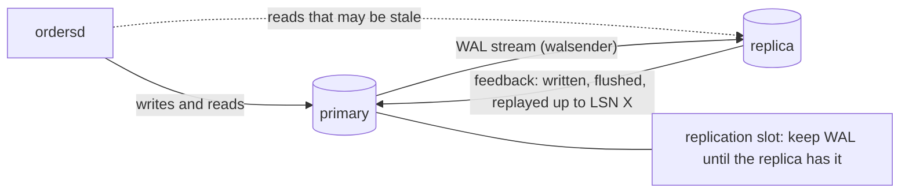
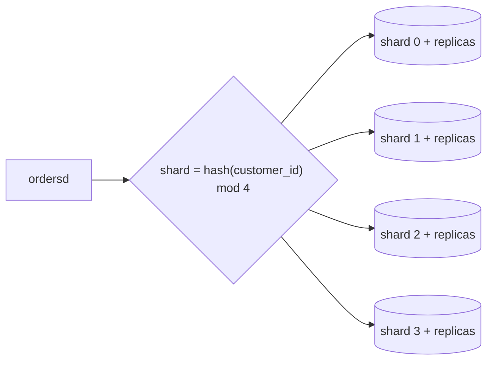

# Replication and scaling

## Why care?

Five messages from the incident channel:

- "The customer pays, the page reloads, and the order still says `pending`. Refresh again, and it's `paid`."
- "The primary's disk filled up overnight. Nobody wrote much. The replica had been down since Friday."
- "We turned on synchronous replication for safety. Then the replica's VM was rebooted, and every write on the primary hung."
- "After the failover, two servers both accepted orders for 30 seconds. Now we have orders that exist on only one of them."
- "Deleting last year's orders took 6 hours and made the table bigger."

One database server has limits: one machine can fail, and one machine can only do so much work. **Replication** keeps copies of the data on other servers, for safety and for reads. **Partitioning** splits one big table into smaller ones on the same server. **Sharding** splits the data across servers. Each one solves a real problem, and each one adds a new way to be wrong. This page builds a primary and a replica, breaks them in each of the ways above, and ends with what sharding costs.

## The idea: a teacher dictating

A teacher (the **primary**) writes in the class book, and reads every sentence aloud as she writes it. Students (the **replicas**) copy every sentence into their own books.

- The teacher doesn't wait for the students. She writes, reads aloud, moves on. A student who writes slowly is a few sentences **behind**. Ask him a question, and you get yesterday's answer. That's **asynchronous replication** and **replication lag**.
- The teacher can decide to wait until at least one student says "got it" before she moves on. Safer: if her book burns, a student has every sentence. Slower: every sentence waits for a student. And if the only student leaves the room, she waits forever. That's **synchronous replication**.
- A student who leaves for a week comes back and asks "what did I miss?" The teacher must have kept her notes since he left. A **replication slot** is her promise to keep them, even if her desk overflows.
- If the teacher gets sick, a student takes over (**failover**). If the teacher comes back and keeps writing in her own book too, the class now has two different books.

The "sentences" are the **WAL**, the write-ahead log from [How data is stored](storage.md). The primary already writes every change there before it touches the table. Streaming replication just sends that same log to other servers, which replay it.



## Setup: a primary and a replica

Two new containers on their own Docker network, so they can reach each other by name. They're separate from `tutor-pg` (from [How data is stored](storage.md#setup-your-own-postgresql)), on ports 55433 and 55434:

```console
$ docker network create tutor-repl
$ docker run -d --name tutor-pg-primary --network tutor-repl -e POSTGRES_PASSWORD=tutor \
    -p 127.0.0.1:55433:5432 postgres:18 -c wal_level=replica -c max_wal_senders=10
```

On the primary: a role that may replicate, a replication slot for the replica, and a line in `pg_hba.conf` that lets the role connect for replication (the image's default `host all all all` line does **not** cover replication connections):

```console
$ docker exec tutor-pg-primary psql -U postgres \
    -c "CREATE ROLE replicator WITH REPLICATION LOGIN PASSWORD 'tutor'" \
    -c "SELECT pg_create_physical_replication_slot('replica1')"
CREATE ROLE
 pg_create_physical_replication_slot
-------------------------------------
 (replica1,)
(1 row)

$ docker exec tutor-pg-primary sh -c 'echo "host replication replicator all scram-sha-256" >> "$PGDATA/pg_hba.conf"'
$ docker exec tutor-pg-primary psql -U postgres -c 'SELECT pg_reload_conf()'
```

The replica starts as a **copy of the primary's files**, made by `pg_basebackup`, and then follows the WAL. The container runs the backup if its data directory is empty, then starts PostgreSQL:

```console
$ docker run -d --name tutor-pg-replica --network tutor-repl --user postgres -e PGPASSWORD=tutor \
    -p 127.0.0.1:55434:5432 --entrypoint sh postgres:18 -c \
    '[ -f "$PGDATA/PG_VERSION" ] || pg_basebackup -h tutor-pg-primary -U replicator -D "$PGDATA" -R -S replica1 -X stream
     exec postgres -D "$PGDATA"'
$ docker logs tutor-pg-replica 2>&1 | tail -5
2026-11-27 05:50:24.063 UTC [14] LOG:  entering standby mode
2026-11-27 05:50:24.070 UTC [14] LOG:  redo starts at 0/2000028
2026-11-27 05:50:24.071 UTC [14] LOG:  completed backup recovery with redo LSN 0/2000028 and end LSN 0/2000120
2026-11-27 05:50:24.071 UTC [1] LOG:  database system is ready to accept read-only connections
2026-11-27 05:50:24.084 UTC [15] LOG:  started streaming WAL from primary at 0/3000000 on timeline 1
```

- `-R` writes the replica's settings: an empty file `standby.signal` ("start as a replica") and a `primary_conninfo` plus `primary_slot_name = 'replica1'` in `postgresql.auto.conf`. That file also holds the password in plain text; in production, use a `.pgpass` file or certificates.
- `-S replica1` makes the backup and the replica use the slot, so no WAL is lost between "backup done" and "replica connected".
- `-X stream` copies the WAL that is written **during** the backup, too.
- `[ -f "$PGDATA/PG_VERSION" ] ||` matters. A container runs its command again on every restart, and the first version of this command, without the check, failed after `docker start` with `pg_basebackup: error: directory "/var/lib/postgresql/18/docker" exists but is not empty`.

In the commands below, `primary` and `replica` are two shell functions:

```sh
primary() { docker exec -i tutor-pg-primary psql -U postgres -X "$@"; }
replica() { docker exec -i tutor-pg-replica psql -U postgres -X "$@"; }
```

## Under the hood: streaming replication

Write on the primary, read on the replica:

```console
$ primary -c "CREATE TABLE orders (id bigint GENERATED ALWAYS AS IDENTITY PRIMARY KEY,
    customer_id text NOT NULL, status text NOT NULL DEFAULT 'pending',
    created_at timestamptz NOT NULL DEFAULT now())" \
  -c "INSERT INTO orders (customer_id) VALUES ('c-1'), ('c-2')"
CREATE TABLE
INSERT 0 2
$ replica -c 'SELECT id, customer_id, status FROM orders' -c 'SELECT pg_is_in_recovery()' \
  -c "INSERT INTO orders (customer_id) VALUES ('c-3')"
 id | customer_id | status
----+-------------+---------
  1 | c-1         | pending
  2 | c-2         | pending
(2 rows)

 pg_is_in_recovery
-------------------
 t
(1 row)

ERROR:  cannot execute INSERT in a read-only transaction
```

The table and its rows arrived, without anybody creating them on the replica: **physical** replication copies everything, byte for byte, the whole cluster, DDL included. `pg_is_in_recovery() = t`: the replica is permanently "recovering", replaying WAL as it arrives. It answers reads, and refuses writes.

The primary sees the replica in `pg_stat_replication`:

```console
$ primary -x -c 'SELECT * FROM pg_stat_replication'
-[ RECORD 1 ]----+------------------------------
pid              | 106
usesysid         | 16384
usename          | replicator
application_name | walreceiver
client_addr      | 172.18.0.3
client_hostname  |
client_port      | 45790
backend_start    | 2026-11-27 05:50:24.078616+00
backend_xmin     |
state            | streaming
sent_lsn         | 0/3038D68
write_lsn        | 0/3038D68
flush_lsn        | 0/3038D68
replay_lsn       | 0/3038D68
write_lag        | 00:00:00.000256
flush_lag        | 00:00:00.00146
replay_lag       | 00:00:00.001463
sync_priority    | 0
sync_state       | async
reply_time       | 2026-11-27 05:50:44.61388+00
```

An **LSN** (log sequence number) is a position in the WAL, a byte offset written as two hex numbers. Four LSNs tell you where each WAL byte is on its way:

| Column       | Meaning: the replica has...                         |
| ------------ | --------------------------------------------------- |
| `sent_lsn`   | ...been sent WAL up to here                         |
| `write_lsn`  | ...written it to its OS (not yet safe on disk)      |
| `flush_lsn`  | ...`fsync`ed it: it survives a crash of the replica |
| `replay_lsn` | ...applied it: **queries on the replica see it**    |

Here all four are equal: the replica is fully caught up. `sync_state = async`: the primary doesn't wait for it. `pg_wal_lsn_diff(a, b)` gives the distance between two LSNs in bytes, which is the best "how far behind" number.

### Replication slots: the promise to keep WAL

Without a slot, the primary deletes old WAL after a checkpoint, whether a replica still needs it or not. A replica that was away too long then can't catch up, and needs a new base backup. **With** a slot, the primary keeps all WAL the slot's replica hasn't confirmed, **without limit**. Stop the replica and write 500,000 orders:

```console
$ docker stop tutor-pg-replica
$ primary -qc "INSERT INTO orders (customer_id) SELECT 'c-' || g FROM generate_series(1, 500000) g" -c CHECKPOINT
$ primary -c "SELECT slot_name, active, wal_status,
    pg_size_pretty(pg_wal_lsn_diff(pg_current_wal_lsn(), restart_lsn)) AS retained
    FROM pg_replication_slots"
 slot_name | active | wal_status | retained
-----------+--------+------------+----------
 replica1  | f      | reserved   | 78 MB
(1 row)

$ docker start tutor-pg-replica
$ primary -c "SELECT slot_name, active, wal_status, pg_size_pretty(pg_wal_lsn_diff(pg_current_wal_lsn(), restart_lsn)) AS retained FROM pg_replication_slots"
 slot_name | active | wal_status | retained
-----------+--------+------------+----------
 replica1  | t      | reserved   | 0 bytes
(1 row)

$ replica -Atc 'SELECT count(*) FROM orders'
1001004
```

78 MB of WAL kept for a replica that wasn't there. It came back, caught up in a few seconds, and the slot let the WAL go. Now imagine the replica was deleted, and nobody dropped its slot: the primary keeps WAL forever, and its disk fills up. That's ticket 2.

```console
$ primary -c 'SHOW max_slot_wal_keep_size'
 max_slot_wal_keep_size
------------------------
 -1
(1 row)
```

`-1` means no limit. Set `max_slot_wal_keep_size` (for example to a fraction of the WAL disk). Past that size, PostgreSQL gives up on the slot (`wal_status` becomes `lost`), and that replica needs a new base backup, but the primary lives. Alert on `retained` and on slots with `active = f`, and drop slots you don't need: `SELECT pg_drop_replication_slot('name')`.

## Synchronous replication: safer, and it can stop your writes

By default, `COMMIT` returns when the WAL is on the **primary's** disk. If the primary dies a moment later, the last few transactions may not be on the replica yet. After a failover, they're gone. For data you must not lose, make commits wait for a replica:

```console
$ primary -c "ALTER SYSTEM SET synchronous_standby_names = 'walreceiver'" -c "SELECT pg_reload_conf()"
$ primary -c "SELECT application_name, sync_state FROM pg_stat_replication"
 application_name | sync_state
------------------+------------
 walreceiver      | sync
(1 row)
```

(`walreceiver` is the replica's `application_name`, because its `primary_conninfo` doesn't set one. In production, set `application_name` in `primary_conninfo` to name each replica.) How long `COMMIT` waits is set by `synchronous_commit`, per transaction if you want:

| `synchronous_commit` | `COMMIT` returns when the WAL is...                                             |
| -------------------- | ------------------------------------------------------------------------------- |
| `off`                | in the primary's memory (a crash may lose the last commits, but never corrupts) |
| `local`              | on the primary's disk                                                           |
| `remote_write`       | on the primary's disk and written (not flushed) on the sync replica             |
| `on` (default)       | on the primary's disk and **flushed** on the sync replica                       |
| `remote_apply`       | ...and **replayed** on the sync replica: visible to its queries                 |

Without synchronous replicas, `on`, `remote_write` and `remote_apply` all act like `local`. With one, normal inserts are still fast on a short network:

```console
Timing is on.
INSERT 0 1
Time: 4.223 ms
```

Now the danger. Pause replay on the replica (`SELECT pg_wal_replay_pause()`, which you'd never do in production, but a stuck or slow replica looks the same), and commit with `remote_apply`, with a 2-second `statement_timeout` as a "safety net":

```console
$ replica -qc 'SELECT pg_wal_replay_pause()'
$ printf '%s\n' '\timing on' "SET synchronous_commit = remote_apply;" "SET statement_timeout = '2s';" \
    "INSERT INTO orders (customer_id) VALUES ('c-apply');" | primary
```

It didn't return. Not after 2 seconds, not after two minutes. From a second session:

```console
$ primary -c "SELECT pid, now() - query_start AS waiting, wait_event_type, wait_event, query
    FROM pg_stat_activity WHERE query LIKE 'INSERT%c-apply%'"
 pid |    waiting     | wait_event_type | wait_event |                        query
-----+----------------+-----------------+------------+------------------------------------------------------
 213 | 00:02:06.36816 | IPC             | SyncRep    | INSERT INTO orders (customer_id) VALUES ('c-apply');
(1 row)

$ primary -c "SELECT pg_cancel_backend(213)"
```

And the first session finally printed:

```console
WARNING:  canceling wait for synchronous replication due to user request
DETAIL:  The transaction has already committed locally, but might not have been replicated to the standby.
INSERT 0 1
Time: 126545.161 ms (02:06.545)
```

Three lessons in one output:

1. **A missing sync replica stops all writes** that wait for it (`wait_event = SyncRep`). With one sync replica, the replica's reboot is the primary's outage. That's ticket 3. Run at least **two** replicas and use `synchronous_standby_names = 'ANY 1 (r1, r2)'`, so one may be away.
2. **`statement_timeout` doesn't end the wait.** The commit was already done locally; only a cancel (or the client's own timeout) ends it.
3. **Cancelling doesn't undo it.** `INSERT 0 1`: the row is committed on the primary, and the client got a WARNING, not an error. A Go client that cancelled its context and saw an error can't tell whether the order exists. That's the "did it happen or not?" problem from [Distributed systems](../distributed-systems/index.md): make writes idempotent.

Reset it: `ALTER SYSTEM RESET synchronous_standby_names` and `SELECT pg_reload_conf()`, then `SELECT pg_wal_replay_resume()` on the replica.

## Replication lag and read-your-writes

Sending reads to replicas spreads the load. The price: a replica is **behind**, by milliseconds normally, and by minutes when it is busy, replaying a big batch, or waiting for a long query on the replica itself. Simulate a slow replica by pausing replay, then write:

```console
$ replica -qc 'SELECT pg_wal_replay_pause()'
$ primary -c "INSERT INTO orders (customer_id) SELECT 'c-' || g FROM generate_series(3, 1000) g" \
  -c "SELECT pg_current_wal_lsn()"
INSERT 0 998
 pg_current_wal_lsn
--------------------
 0/30AA768
(1 row)

$ replica -c 'SELECT count(*) FROM orders' \
  -c 'SELECT pg_last_wal_receive_lsn() AS received, pg_last_wal_replay_lsn() AS replayed, pg_get_wal_replay_pause_state()'
 count
-------
     2
(1 row)

 received  | replayed  | pg_get_wal_replay_pause_state
-----------+-----------+-------------------------------
 0/30AA768 | 0/3084290 | paused
(1 row)

$ primary -c "SELECT application_name, state, pg_wal_lsn_diff(sent_lsn, replay_lsn) AS bytes_behind, replay_lag FROM pg_stat_replication"
 application_name |   state   | bytes_behind |   replay_lag
------------------+-----------+--------------+-----------------
 walreceiver      | streaming |       156888 | 00:00:00.002133
(1 row)
```

The replica **received** all the WAL (`0/30AA768`, the primary's position), but **replayed** less, so its queries still see 2 orders, not 1,000. Look at `replay_lag`: **2 ms**, while the replica is 157 kB behind and not moving at all. A second test sampled it every 3 seconds during a pause:

```console
05:51:02|192|00:00:00.001681
05:51:05|192|00:00:00.001681
05:51:08|192|00:00:00.001681
```

(`time | bytes behind | replay_lag`.) After `pg_wal_replay_resume()`, `replay_lag` jumped to `00:00:09.725292`. The `*_lag` columns measure how long **recent WAL** took to get through, and they only update when the replica reports progress. A replica that is stuck reports nothing new, so the number freezes. **Alert on `pg_wal_lsn_diff(sent_lsn, replay_lsn)` in bytes**, not only on `replay_lag`. The other popular check, `now() - pg_last_xact_replay_timestamp()` on the replica, is wrong in the opposite way: it grows on an idle primary that commits nothing (here it said `00:00:11.079495` with the replica fully caught up).

### Read-your-writes

Ticket 1: the customer pays (a write to the primary), the page reloads, and the read goes to a replica that hasn't replayed the payment yet. Three ways out, from simple to clever:

1. **Read from the primary after a write.** For a few seconds after a user writes, send that user's reads to the primary (a cookie or a session flag says "wrote at time T").
2. **Read from the primary for the pages that matter.** Order status after checkout, yes; the product catalog, no.
3. **Wait for the replica to catch up to your write.** After `COMMIT`, ask the primary for its WAL position, and on the replica, read only when it has replayed that far:

```console
$ replica -qc 'SELECT pg_wal_replay_pause()'
$ L=$(primary -Atc "INSERT INTO orders (customer_id) VALUES ('c-ryw')" -c "SELECT pg_current_wal_insert_lsn()" | tail -1); echo "commit LSN: $L"
commit LSN: 0/30B70C0
$ replica -c "SELECT pg_last_wal_replay_lsn() >= '$L' AS caught_up, (SELECT count(*) FROM orders WHERE customer_id = 'c-ryw') AS found"
 caught_up | found
-----------+-------
 f         |     0
(1 row)

$ replica -qc 'SELECT pg_wal_replay_resume()'
$ replica -c "SELECT pg_last_wal_replay_lsn() >= '$L' AS caught_up, (SELECT count(*) FROM orders WHERE customer_id = 'c-ryw') AS found"
 caught_up | found
-----------+-------
 t         |     1
(1 row)
```

`caught_up = f` means "this replica doesn't have your write yet": wait a moment, try another replica, or fall back to the primary. In Go, the write path returns the LSN (store it in the session), and the read path checks it on the replica first. (`synchronous_commit = remote_apply` is a fourth way: the commit itself waits until the replica shows it. You've seen what that costs when the replica is slow.)

And whatever you choose: **writes always go to the primary**. A connection string with several hosts and `target_session_attrs=read-write` (libpq and pgx both support it) finds the current primary for you.

### Failover

When the primary dies, a replica is **promoted**: it stops replaying and starts accepting writes. On the replica:

```console
$ replica -c 'SELECT pg_promote()' -c 'SELECT pg_is_in_recovery()' \
  -c "INSERT INTO orders (customer_id) VALUES ('c-after-promote') RETURNING id"
 pg_promote
------------
 t
(1 row)

 pg_is_in_recovery
-------------------
 f
(1 row)

   id
---------
 1001021
(1 row)

INSERT 0 1
$ docker logs tutor-pg-replica 2>&1 | tail -4
2026-11-27 06:02:55.527 UTC [12] LOG:  last completed transaction was at log time 2026-11-27 05:55:42.254926+00
2026-11-27 06:02:55.532 UTC [12] LOG:  selected new timeline ID: 2
2026-11-27 06:02:55.578 UTC [12] LOG:  archive recovery complete
2026-11-27 06:02:55.587 UTC [1] LOG:  database system is ready to accept connections
```

The promoted server starts **timeline 2**: a new branch of history. But in this test the old primary didn't die. It is still running, and still takes writes:

```console
$ primary -c 'SELECT pg_is_in_recovery()' -c "INSERT INTO orders (customer_id) VALUES ('c-old-primary') RETURNING id" \
  -c 'SELECT count(*) FROM pg_stat_replication'
 pg_is_in_recovery
-------------------
 f
(1 row)

   id
---------
 1001005
(1 row)

INSERT 0 1
 count
-------
     0
(1 row)
```

Two primaries, two different orders, each on one server only: **split brain**, ticket 4. The old primary has no replica anymore (`count` 0), and nothing tells it that it has been replaced. The two histories can't be merged automatically. Notice the IDs, too: the new primary jumped ahead to 1001021, because sequences are WAL-logged in batches ahead of use, so a failover leaves a gap. IDs are unique, not gap-free.

That's why nobody does failover by hand with `pg_promote()` in production. A failover manager (Patroni, the CloudNativePG operator on Kubernetes, or your cloud provider's managed PostgreSQL) decides who is primary using a consensus store, and **fences** the old primary (stops it, or cuts it off) before promoting. Your service connects through a name that the manager moves (a Kubernetes Service, a DNS name, or a multi-host connection string with `target_session_attrs=read-write`), and it must survive connections being cut: the retry rules from [Go and SQL](go-and-sql.md) apply.

## Logical replication, briefly

Physical replication copies the whole cluster, byte for byte, to a server of the same major version. **Logical replication** sends **row changes** ("insert this row into `orders`") for the tables you choose. The receiver is a normal, writable database. Use it for upgrades between major versions with little downtime, for copying some tables to another service or a warehouse, and for change data capture tools like Debezium, which read the same stream.

It needs `wal_level = logical` on the publisher. That's a trap of its own: the primary above was started with `-c wal_level=replica`, and `ALTER SYSTEM SET wal_level = logical` plus a restart did nothing:

```console
$ primary -c "SELECT name, setting, source FROM pg_settings WHERE name = 'wal_level'" \
  -c "SELECT sourcefile, setting, applied FROM pg_file_settings WHERE name = 'wal_level'"
   name    | setting |    source
-----------+---------+--------------
 wal_level | replica | command line
(1 row)

                     sourcefile                     | setting | applied
----------------------------------------------------+---------+---------
 /var/lib/postgresql/18/docker/postgresql.auto.conf | logical | f
(1 row)
```

**Command-line options beat `ALTER SYSTEM`.** `pg_settings.source` tells you where a value came from, and `pg_file_settings.applied = f` shows a setting in a file that lost. So the example uses a fresh publisher, `tutor-pg-pub` (port 55436, `-c wal_level=logical`), and a subscriber, `tutor-pg-logical` (port 55435), both on the `tutor-repl` network:

```console
$ pub -c "CREATE TABLE orders (id bigint GENERATED ALWAYS AS IDENTITY PRIMARY KEY, customer_id text NOT NULL,
    status text NOT NULL DEFAULT 'pending', created_at timestamptz NOT NULL DEFAULT now())" \
  -c "INSERT INTO orders (customer_id) SELECT 'c-' || g FROM generate_series(1, 3) g" \
  -c "CREATE PUBLICATION orders_pub FOR TABLE orders"
CREATE TABLE
INSERT 0 3
CREATE PUBLICATION
$ sub -c "CREATE TABLE orders (id bigint PRIMARY KEY, customer_id text NOT NULL, status text NOT NULL,
    created_at timestamptz NOT NULL, synced_at timestamptz DEFAULT now())" \
  -c "CREATE SUBSCRIPTION orders_sub CONNECTION 'host=tutor-pg-pub user=postgres password=tutor dbname=postgres' PUBLICATION orders_pub"
CREATE TABLE
NOTICE:  created replication slot "orders_sub" on publisher
CREATE SUBSCRIPTION
$ pub -c "UPDATE orders SET status = 'paid' WHERE id = 2" -c "INSERT INTO orders (customer_id) VALUES ('c-4')"
$ sub -c "SELECT id, customer_id, status, synced_at::time(0) FROM orders ORDER BY id"
 id | customer_id | status  | synced_at
----+-------------+---------+-----------
  1 | c-1         | pending | 05:55:05
  2 | c-2         | paid    | 05:55:05
  3 | c-3         | pending | 05:55:05
  4 | c-4         | pending | 05:55:08
(4 rows)
```

(`pub` and `sub` are shell functions like `primary` and `replica`.) The subscription copied the 3 existing rows first, then streamed the `UPDATE` and the new `INSERT`. The subscriber's table has an **extra column**, `synced_at`, filled by its own default: rows are matched by column **name**, so the two sides may differ. The subscription created a **logical** slot on the publisher (`orders_sub`, plugin `pgoutput`), with the same "keeps WAL forever" risk as before.

What it does **not** replicate: DDL, sequences, and large objects. Change the table on the publisher only:

```console
$ pub -c "ALTER TABLE orders ADD COLUMN note text" -c "INSERT INTO orders (customer_id, note) VALUES ('c-5', 'gift')"
ALTER TABLE
INSERT 0 1
$ sub -Atc "SELECT count(*) FROM orders"
4
$ docker logs tutor-pg-logical 2>&1 | grep ERROR | head -2
2026-11-27 05:55:16.189 UTC [91] ERROR:  logical replication target relation "public.orders" is missing replicated column: "note"
2026-11-27 05:55:16.200 UTC [101] ERROR:  logical replication target relation "public.orders" is missing replicated column: "note"
```

Replication stopped, and the subscriber retries in a loop until someone adds the column there. So with logical replication, every migration runs on the **subscriber first** (add columns there before the publisher sends them): expand and contract again, from [Schema migrations](migrations.md).

## Partitioning: one big table as many small ones

A table of orders that grows forever gets slow to `VACUUM`, its indexes outgrow memory, and deleting old rows is painful (ticket 5: a huge `DELETE` writes a new version of nothing but dead rows, see [MVCC and locks](mvcc-and-locks.md)). **Declarative partitioning** splits one logical table into child tables by a key, usually time. In the `tutor_replication` database on `tutor-pg`:

```sh
docker exec tutor-pg createdb -U postgres tutor_replication
```

The first try fails, and the error teaches the main rule:

```sql
CREATE TABLE orders (
  id          uuid        NOT NULL DEFAULT uuidv7(),
  customer_id text        NOT NULL,
  status      text        NOT NULL DEFAULT 'pending',
  created_at  timestamptz NOT NULL,
  PRIMARY KEY (id)
) PARTITION BY RANGE (created_at);
```

```console
ERROR:  unique constraint on partitioned table must include all partitioning columns
DETAIL:  PRIMARY KEY constraint on table "orders" lacks column "created_at" which is part of the partition key.
```

Each partition has its own indexes. A unique index on `id` alone would have to check **all** partitions on every insert, and PostgreSQL doesn't do that. So the primary key must contain the partition key: `PRIMARY KEY (id, created_at)`. Then one partition per month:

```sql
CREATE TABLE orders (
  id          uuid        NOT NULL DEFAULT uuidv7(),
  customer_id text        NOT NULL,
  status      text        NOT NULL DEFAULT 'pending',
  created_at  timestamptz NOT NULL,
  PRIMARY KEY (id, created_at)
) PARTITION BY RANGE (created_at);
CREATE TABLE orders_2026_09 PARTITION OF orders FOR VALUES FROM ('2026-09-01') TO ('2026-10-01');
CREATE TABLE orders_2026_10 PARTITION OF orders FOR VALUES FROM ('2026-10-01') TO ('2026-11-01');
CREATE TABLE orders_2026_11 PARTITION OF orders FOR VALUES FROM ('2026-11-01') TO ('2026-12-01');
CREATE INDEX ON orders (customer_id);
INSERT INTO orders (customer_id, created_at)
SELECT 'c-' || (g % 1000), timestamptz '2026-09-01' + g * interval '25 seconds'
FROM generate_series(1, 300000) g;
ANALYZE orders;
SELECT tableoid::regclass AS partition, count(*) FROM orders GROUP BY 1 ORDER BY 1;
INSERT INTO orders (customer_id, created_at) VALUES ('c-1', '2026-12-05');
EXPLAIN (COSTS OFF) SELECT count(*) FROM orders WHERE created_at >= '2026-11-01' AND created_at < '2026-11-08';
EXPLAIN (COSTS OFF) SELECT * FROM orders WHERE customer_id = 'c-42';
```

```console
   partition    | count
----------------+--------
 orders_2026_09 | 103679
 orders_2026_10 | 107136
 orders_2026_11 |  89185
(3 rows)

ERROR:  no partition of relation "orders" found for row
DETAIL:  Partition key of the failing row contains (created_at) = (2026-12-05 00:00:00+00).
                                                                         QUERY PLAN
------------------------------------------------------------------------------------------------------------------------------------------------------------
 Aggregate
   ->  Seq Scan on orders_2026_11 orders
         Filter: ((created_at >= '2026-11-01 00:00:00+00'::timestamp with time zone) AND (created_at < '2026-11-08 00:00:00+00'::timestamp with time zone))
(3 rows)

                           QUERY PLAN
-----------------------------------------------------------------
 Append
   ->  Bitmap Heap Scan on orders_2026_09 orders_1
         Recheck Cond: (customer_id = 'c-42'::text)
         ->  Bitmap Index Scan on orders_2026_09_customer_id_idx
               Index Cond: (customer_id = 'c-42'::text)
   ->  Bitmap Heap Scan on orders_2026_10 orders_2
         Recheck Cond: (customer_id = 'c-42'::text)
         ->  Bitmap Index Scan on orders_2026_10_customer_id_idx
               Index Cond: (customer_id = 'c-42'::text)
   ->  Bitmap Heap Scan on orders_2026_11 orders_3
         Recheck Cond: (customer_id = 'c-42'::text)
         ->  Bitmap Index Scan on orders_2026_11_customer_id_idx
               Index Cond: (customer_id = 'c-42'::text)
(13 rows)
```

- **Rows go to the right partition by themselves.** `tableoid::regclass` shows where each row lives.
- **A row with no partition fails.** December doesn't exist yet. Create partitions ahead of time (a cron job, or the `pg_partman` extension), or add a `DEFAULT` partition as a safety net.
- **Partition pruning.** A query with the partition key in its `WHERE` only touches matching partitions: one `Seq Scan on orders_2026_11`, the others aren't even in the plan. Reading the plan is covered in [Query planning](query-planning.md).
- **A query without the key touches every partition.** Looking up one customer is now **three** index scans instead of one. With 36 monthly partitions, it would be 36. Partitioning makes queries by the key cheaper and queries across partitions more expensive. Pick the key from your most important queries, not from habit.

The big win is maintenance. Removing a month is a metadata change, not a `DELETE`:

```console
tutor_replication=# CREATE TABLE orders_2026_12 PARTITION OF orders FOR VALUES FROM ('2026-12-01') TO ('2027-01-01');
CREATE TABLE
Time: 5.630 ms
tutor_replication=# ALTER TABLE orders DETACH PARTITION orders_2026_09 CONCURRENTLY;
ALTER TABLE
Time: 4.056 ms
tutor_replication=# DROP TABLE orders_2026_09;
DROP TABLE
Time: 5.534 ms
```

104,000 rows gone in 10 ms, with no dead tuples, no `VACUUM`, no WAL flood for the replicas. `DETACH ... CONCURRENTLY` uses a weaker lock than a plain `DETACH`, so queries keep running; like `CREATE INDEX CONCURRENTLY`, it can't run inside a transaction. You can also detach and keep the table, to archive it.

Partitioning doesn't make a table faster by itself, and too many partitions (thousands) make planning slow. It is the right tool when data has a natural time key, old data is dropped or archived in whole periods, and most queries name a period.

## Sharding: many databases, and what it costs

Replicas scale **reads**. Partitions help **maintenance** on one server. When **writes** or the data size outgrow one primary, the last step is **sharding**: split the rows across several independent primaries (shards), each with its own replicas. Every order belongs to exactly one shard, chosen by a **shard key**:



Ways to choose the shard:

- **Hash** of the key: even spread. But "orders from last week" must ask every shard.
- **Range** of the key: range queries stay on one shard, but new keys may all go to the same "hot" shard (with time-ordered keys, the newest one gets all writes).
- **A directory**: a lookup table maps each tenant to a shard. Flexible (move one big customer to its own shard), but the lookup is one more thing that must be up.

What you give up, and it is a lot:

- **Transactions across shards.** An order and the customer's balance on two different shards can't change in one ACID transaction anymore. You need sagas or two-phase commit: the [Distributed systems](../distributed-systems/index.md) chapter.
- **Joins and unique constraints across shards.** A unique email across all customers is no longer one index. Joins become application code, or a query to every shard.
- **Rebalancing.** `hash mod 4` to `hash mod 5` moves 80% of the rows. Consistent hashing or many small virtual shards (say 1,024, mapped onto 4 servers) keep moves small, but moving data while live is a project of its own.
- **Operations times N.** N primaries to back up, upgrade, migrate, and fail over. A migration now runs N times, and it can succeed on some shards and fail on others.

So choose the shard key so that **almost every request needs exactly one shard**. For orders, that is usually the customer (or tenant) ID: all of one customer's orders, items and payments live together, and only reports cross shards. Then try everything else first: indexes and query fixes, a bigger machine, read replicas, partitioning, caching, and moving some data to another store. Databases built for this, like Citus (an extension that shards PostgreSQL) or distributed SQL databases (CockroachDB, YugabyteDB, Spanner), do the routing and cross-shard transactions for you, and they still can't make a cross-shard transaction as cheap as a local one.

## Try it

1. Build the primary and the replica. Insert on the primary, read on the replica, and watch the four LSNs in `pg_stat_replication`.
2. Stop the replica, write a lot on the primary, and watch `retained` grow in `pg_replication_slots`. Set `max_slot_wal_keep_size = '64MB'` and repeat: what happens to `wal_status`?
3. Pause replay and watch `replay_lag` freeze while `pg_wal_lsn_diff(sent_lsn, replay_lsn)` doesn't.
4. Do the read-your-writes LSN check with replay paused and resumed.
5. Create the partitioned table, run `EXPLAIN` with and without `created_at` in the `WHERE`, and drop a month.
6. Clean up: `docker rm -f tutor-pg-primary tutor-pg-replica tutor-pg-pub tutor-pg-logical`, `docker network rm tutor-repl`, and `docker exec tutor-pg dropdb -U postgres tutor_replication`.

## Traps

- **Reading your own write from a replica.** It may not be there yet. Read from the primary after a write, or check the replica's replay LSN.
- **A slot without its replica.** The primary keeps WAL until its disk is full. Set `max_slot_wal_keep_size`, alert on inactive slots, drop unused ones.
- **One synchronous replica.** Its outage is your write outage. Use `ANY 1 (...)` with at least two.
- **Trusting `statement_timeout` or a cancel to undo a sync commit.** The commit is already done locally; you only stop waiting.
- **Lag alerts on `replay_lag` only.** It freezes when the replica is stuck. Alert on LSN distance in bytes.
- **Manual failover.** Without fencing, the old primary keeps taking writes: split brain. Use a failover manager.
- **`ALTER SYSTEM` for a setting that is also on the command line.** The command line wins. Check `pg_settings.source`.
- **Logical replication and DDL.** Schema changes aren't replicated, and a missing column stops replication. Migrate the subscriber first.
- **Partitioning by the wrong key.** Queries without it scan every partition. And a primary key or unique index must include the partition key.
- **Sharding too early.** You lose cross-shard transactions, joins and constraints, forever. Exhaust the single-primary options first.

## Check yourself

??? question "1. `pg_stat_replication` shows `sent_lsn` = `write_lsn` = `flush_lsn` = `0/5000000` and `replay_lsn` = `0/4000000`. Is the data safe on the replica? Can queries there see it?"

    Safe: the replica has flushed all WAL up to `0/5000000` to its disk, so it survives a crash
    of either side. Visible: no, only up to `0/4000000` has been replayed, so queries there see
    older data. The replica is about 16 MB (`0x1000000` bytes) behind in replay, often because a
    long query on the replica is blocking replay, or replay is just slow.

??? question "2. A replica was deleted months ago. What can happen to the primary, and how do you prevent it?"

    If its replication slot still exists, the primary keeps every WAL segment since then, and its
    disk fills up until the primary stops. Prevent it with `max_slot_wal_keep_size` (the slot is
    marked `lost` instead), monitoring of inactive slots and retained WAL, and dropping slots
    when you remove a replica.

??? question "3. You set `synchronous_standby_names = 'r1'` and `synchronous_commit = on`. r1's host is rebooted for 10 minutes. What happens to writes, and what's a better setup?"

    Every commit waits for r1 to confirm the flush, so all writes hang for 10 minutes
    (`wait_event = SyncRep`). Better: two or more replicas with `ANY 1 (r1, r2)`, so one may be
    away, and alerting when fewer are connected than you need.

??? question "4. After paying, a user sees their order as `pending`. Reads go to replicas. Give two fixes, and say what each costs."

    (a) Route that user's reads to the primary for a short time after a write: simple, but adds
    load on the primary. (b) Remember the primary's WAL LSN after the write, and only read from a
    replica whose `pg_last_wal_replay_lsn()` is at least that, otherwise wait or fall back:
    precise, but more code and a session value to carry. (`remote_apply` also works, at the price
    of slower commits that hang when a replica is slow.)

??? question "5. You partition `orders` by month on `created_at`. Which of these get faster, and which slower: dropping a year-old month, 'orders of customer c-42', 'orders from last Tuesday'?"

    Dropping a month: much faster (detach and drop, a metadata change, instead of a huge `DELETE`).
    Last Tuesday: a bit faster, pruning leaves one partition. Customer c-42: slower, it has to
    search the customer index of every partition. Partitioning helps queries and maintenance on
    the key, and costs you on queries without it.

??? question "6. Why is `customer_id` a better shard key for orders than `created_at` or the order `id`?"

    Most requests are about one customer: their orders, items and payments. With `customer_id`,
    all of those are on one shard, so they can use normal transactions and joins. `created_at`
    sends all new writes to one hot shard. A hashed order `id` spreads writes evenly, but every
    "orders of this customer" query must ask every shard.

## Recap

- **Streaming replication** sends the WAL to replicas, which replay it. Replicas are read-only copies of the whole cluster. `pg_basebackup -R -S` makes one.
- `pg_stat_replication` shows `sent`, `write`, `flush` and `replay` LSNs. Measure lag in **bytes** with `pg_wal_lsn_diff`; `replay_lag` freezes when the replica is stuck.
- **Replication slots** keep WAL until the replica has it, with no limit by default. Set `max_slot_wal_keep_size` and watch inactive slots.
- **Synchronous replication** trades latency for durability. With one sync replica, its outage stops your writes. A cancelled sync wait is still committed.
- Replicas are **behind**. Read-your-writes needs the primary, or an LSN check.
- **Failover** needs a manager that fences the old primary. Otherwise: split brain.
- **Logical replication** sends row changes for chosen tables to a writable database. It doesn't replicate DDL.
- **Partitioning** splits a table by a key on one server. Pruning helps queries on the key; dropping a partition replaces huge deletes.
- **Sharding** splits data across primaries. It scales writes and costs cross-shard transactions, joins and constraints. Choose a key that keeps each request on one shard, and only shard when nothing else is enough.

## You finished Databases

You now know what happens below `db.QueryContext`: rows in 8 kB pages and a write-ahead log, B-tree indexes and the planner that picks them, transactions and the anomalies each isolation level allows, row versions and locks, migrations that don't stop traffic, a Go connection pool that doesn't leak, and replicas, partitions and shards for when one server isn't enough.

You've also met the edges of what one database can promise. A sync commit that was cancelled but happened anyway. Two primaries after a failover. A transaction that can't span two shards. Those are not database problems anymore. They are the normal state of any system made of several machines and a network. Next chapter: [Distributed systems](../distributed-systems/index.md).
