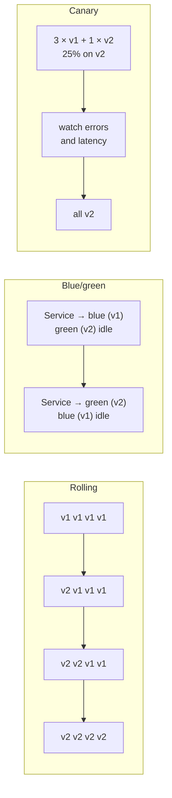
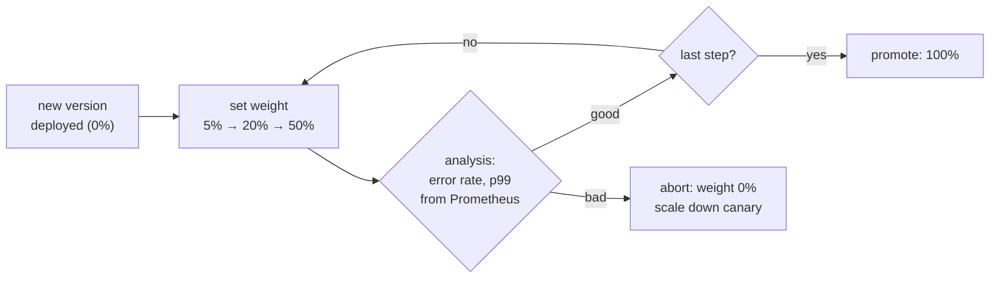

# Deployment strategies

## Why care?

Three sentences you hear after a bad deploy:

- "It worked in staging." Then 100% of production users got the bug at the same moment.
- "Rolling back takes 20 minutes." Revert, wait for CI, wait for the rollout, while the error rate is at 30%.
- "The new pods were fine. The old pods broke." The migration ran first, and the old code could not read the new schema.

A **deployment strategy** answers three questions: how many users see the new version, how fast that number grows, and how fast you can go back. Kubernetes gives you one strategy built in (the rolling update). With plain Deployments and Services you can build two more (blue/green and canary). Tools like Argo Rollouts and Flagger automate the last step: they watch your metrics and decide for you.

On this page you run all three on the `kind` cluster with two builds of `ordersd`, `v1` and `v2`, and count which version served each request.

## The idea: changing the menu in a busy restaurant

You run a restaurant and you have a new menu.

- **Rolling update**: you replace the menu card on one table at a time. For a while, some tables have the old menu and some the new one. The kitchen must cook both.
- **Blue/green**: you open a second dining room next door with the new menu, fully staffed. When it is ready, you change the sign at the entrance. If guests hate it, you change the sign back.
- **Canary**: you give the new menu to one table in ten. You watch their faces. If they are happy, two tables in ten, then half, then all.
- **Progressive delivery**: a manager does the canary for you. They watch the complaints per table, and they stop and go back on their own.



| Strategy    | Two versions at once? | Extra capacity         | Rollback                  | Blast radius of a bug |
| ----------- | --------------------- | ---------------------- | ------------------------- | --------------------- |
| Recreate    | No                    | None                   | Another deploy (downtime) | 100%, plus downtime   |
| Rolling     | Yes, during rollout   | `maxSurge` Pods        | Another rollout           | Grows to 100% quickly |
| Blue/green  | No (one is idle)      | 100% (two full copies) | Switch back: instant      | 100%, but short       |
| Canary      | Yes, on purpose       | A few Pods             | Scale the canary to 0     | The canary share      |
| Progressive | Yes, on purpose       | A few Pods (or 100%)   | Automatic                 | The canary share      |

## Under the hood: the setup

Two images of `ordersd`, built from `examples/orders` with a different `VERSION` (the Dockerfile puts it into `buildinfo` with `-ldflags -X`, see [Reproducible builds](reproducible-builds.md)), then copied onto the `kind` nodes:

```sh
cd examples/orders
for v in v1 v2; do docker build -q --build-arg VERSION=$v -t tutor-ordersd:$v .; done
kind load docker-image --name tutor tutor-ordersd:v1 tutor-ordersd:v2
```

`ordersd` has no "version" endpoint, but it logs its version at start-up, and it logs **every request** as one JSON line:

```console
$ kubectl logs deploy/tutor-orders-green | head -1
{"time":"2026-11-27T11:00:46.45422252Z","level":"INFO","msg":"starting","service":"ordersd","version":"v2","revision":"","go_version":"go1.27.4"}
$ kubectl logs -l app=tutor-canary,track=canary --tail=1 | head -1
{"time":"2026-11-27T11:02:18.011918147Z","level":"INFO","msg":"http request","service":"ordersd","request_id":"01a21cab-9a9b-7e4e-b982-37c5a9e068cb","method":"GET","path":"/v1/orders","route":"GET /v1/orders","status":200,"bytes":14,"duration":17860}
```

So "which version served this request?" becomes "which Pod logged it?". That is also how you would answer it in production, with labels on your metrics instead of `grep` (see [Structured logging](../observability/structured-logging.md) and [Metrics](../observability/metrics.md)).

Everything runs in the namespace `tutor-strategies`. The load comes from a `busybox` Pod with the `load.sh` loop from [Workloads](../kubernetes/workloads.md#try-it-count-the-errors-of-one-rollout), changed to take the Service name as `$1` and the seconds as `$2`. It opens a new connection for every request, and prints every failure.

All Deployments on this page set `ORDERS_SHUTDOWN_DELAY=5s` and a readiness probe on `/readyz`. Without those, every strategy below drops requests. [Workloads](../kubernetes/workloads.md#why-502s-during-a-rollout) explains why.

## Rolling update: the default

[Workloads](../kubernetes/workloads.md#a-rolling-update-step-by-step) takes the rolling update apart step by step. Here is the short version, and the one fact that matters most for this page: **during a rolling update, both versions serve real traffic**.

The two knobs:

| `maxSurge` / `maxUnavailable` | With 4 replicas                        | Good for                                          |
| ----------------------------- | -------------------------------------- | ------------------------------------------------- |
| `25%` / `25%` (default)       | up to 5 Pods, at least 3 ready         | Most services                                     |
| `1` / `0`                     | up to 5 Pods, never fewer than 4 ready | Small services that can't lose capacity           |
| `0` / `1`                     | never more than 4 Pods, sometimes 3    | Tight quotas, or Pods that pin scarce resources   |
| `100%` / `0`                  | 8 Pods for a moment, then 4 new ones   | Fast rollouts, "blue/green inside one Deployment" |

This Deployment uses `maxSurge: 1`, `maxUnavailable: 0`, and `minReadySeconds: 10`: a new Pod must stay ready for 10 seconds before it counts as available. That slows the rollout down so you can watch it, and it is a cheap safety net in real life too (a Pod that crashes after 5 seconds never counts).

A small script (`mix.sh`) prints, every 5 seconds, how many **ready** Pods run each image:

```sh
# mix.sh: every 5 s, count the Ready Pods of tutor-rolling by image.
start=$(date +%s)
while :; do
  t=$(( $(date +%s) - start ))
  mix=$(kubectl get pods -l app=tutor-rolling --no-headers \
    -o custom-columns='IMAGE:.spec.containers[0].image,READY:.status.containerStatuses[0].ready' |
    awk '$2 == "true" {n[$1]++} END {for (i in n) printf "%s=%d ", i, n[i]}')
  printf '%3ds %s\n' "$t" "$mix"
  kubectl rollout status deploy/tutor-rolling --timeout=1s >/dev/null 2>&1 && break
  sleep 5
done
```

Start 75 seconds of load, then change the image:

```console
$ kubectl exec tutor-load -- sh /tmp/load.sh tutor-rolling 75 > roll-load.txt &
$ kubectl set image deploy/tutor-rolling ordersd=tutor-ordersd:v2; sh mix.sh
deployment.apps/tutor-rolling image updated
  0s tutor-ordersd:v1=4
  6s tutor-ordersd:v2=1 tutor-ordersd:v1=4
 12s tutor-ordersd:v2=2 tutor-ordersd:v1=4
 19s tutor-ordersd:v2=2 tutor-ordersd:v1=3
 25s tutor-ordersd:v2=3 tutor-ordersd:v1=3
 32s tutor-ordersd:v2=3 tutor-ordersd:v1=2
 38s tutor-ordersd:v2=4 tutor-ordersd:v1=1
 44s tutor-ordersd:v2=4 tutor-ordersd:v1=1
$ cat roll-load.txt
ok=24551 fail=0
```

Read it slowly:

- For about 40 seconds, `v1` and `v2` both answer requests. Here that's harmless. In real life it means **every change must work next to the version before it**: API responses, message formats, cache entries, and the database schema.
- At 12 s there are 6 ready Pods, with `maxSurge: 1`. One `v1` Pod is already being deleted, but it still reports ready until its readiness probe fails (the 5 s shutdown delay, probe every 2 s). The EndpointSlice already marks it as terminating, so it gets no new connections. This is the "terminating Pods don't count" effect from Workloads.
- Zero failures in 24,551 requests. The readiness probe and the shutdown delay did that, not the strategy.

### Pause: a canary inside one Deployment

`kubectl rollout pause` freezes a rollout where it is. Change the image back to `v1` and pause at once:

```console
$ kubectl set image deploy/tutor-rolling ordersd=tutor-ordersd:v1 && kubectl rollout pause deploy/tutor-rolling
deployment.apps/tutor-rolling image updated
deployment.apps/tutor-rolling paused
$ kubectl get rs -l app=tutor-rolling -o custom-columns='NAME:.metadata.name,IMAGE:.spec.template.spec.containers[0].image,DESIRED:.spec.replicas,READY:.status.readyReplicas'
NAME                       IMAGE              DESIRED   READY
tutor-rolling-6595db7597   tutor-ordersd:v2   4         4
tutor-rolling-755c755f74   tutor-ordersd:v1   1         1
$ kubectl rollout status deploy/tutor-rolling --timeout=2s; echo "exit=$?"
Waiting for deployment "tutor-rolling" rollout to finish: 1 out of 4 new replicas have been updated...
error: timed out waiting for the condition
exit=1
$ kubectl get deploy tutor-rolling -o jsonpath='{range .status.conditions[*]}{.type}{"\t"}{.status}{"\t"}{.reason}{"\n"}{end}'
Available	True	MinimumReplicasAvailable
Progressing	Unknown	DeploymentPaused
```

One Pod of five (20%) runs the new template, and it stays that way until `kubectl rollout resume`. That is a canary, but a fragile one: the share depends on when you pressed pause, any `kubectl apply` of a new template starts over, and the paused Deployment counts against `progressDeadlineSeconds` as `Unknown`. Good for a quick look by hand, not for a process.

## Blue/green: switch the sign

Two Deployments, one per "colour", and one Service that points at one colour:

```yaml
# blue.yaml (green.yaml is the same with "green" and tutor-ordersd:v2)
apiVersion: apps/v1
kind: Deployment
metadata:
  name: tutor-orders-blue
spec:
  replicas: 2
  selector:
    matchLabels:
      app: tutor-orders
      color: blue
  template:
    metadata:
      labels:
        app: tutor-orders
        color: blue
    spec:
      containers:
        - name: ordersd
          image: tutor-ordersd:v1
          imagePullPolicy: Never
          ports:
            - name: http
              containerPort: 8080
          env:
            - name: ORDERS_SHUTDOWN_DELAY
              value: 5s
          readinessProbe:
            httpGet:
              path: /readyz
              port: http
            periodSeconds: 2
---
# svc-bluegreen.yaml
apiVersion: v1
kind: Service
metadata:
  name: tutor-orders
spec:
  selector:
    app: tutor-orders
    color: blue
  ports:
    - name: http
      port: 80
      targetPort: http
```

Both colours run, but the Service's EndpointSlice lists only the blue Pods:

```console
$ kubectl get pods -l app=tutor-orders -L color -o wide | awk '{print $1,$2,$3,$6,$NF}' | column -t
NAME                                 READY  STATUS   IP           COLOR
tutor-orders-blue-6f94bc95c9-2qzng   1/1    Running  10.244.1.20  blue
tutor-orders-blue-6f94bc95c9-68rwg   1/1    Running  10.244.1.19  blue
tutor-orders-green-6c5b58c8df-q2xbl  1/1    Running  10.244.1.22  green
tutor-orders-green-6c5b58c8df-xzmwr  1/1    Running  10.244.1.21  green
$ kubectl get endpointslices -l kubernetes.io/service-name=tutor-orders
NAME                 ADDRESSTYPE   PORTS   ENDPOINTS                 AGE
tutor-orders-v7g5n   IPv4          8080    10.244.1.20,10.244.1.19   4s
```

### Test green before anyone sees it

The big advantage of blue/green: the new version is **fully running** before it gets real traffic. Give it a second, private Service and run your smoke tests against that:

```console
$ kubectl expose deploy tutor-orders-green --name tutor-orders-preview --port 80 --target-port http
service/tutor-orders-preview exposed
$ kubectl exec tutor-load -- wget -qO- http://tutor-orders-preview/healthz
wget: can't connect to remote host (10.96.150.10): No route to host
command terminated with exit code 1
```

Not a bug in green. The Service was one second old. Its EndpointSlice and kube-proxy's rules were not there yet, and kube-proxy rejects connections to a Service with no endpoints (`No route to host` is that reject). A few seconds later:

```console
$ kubectl get endpointslices -l kubernetes.io/service-name=tutor-orders-preview
NAME                         ADDRESSTYPE   PORTS   ENDPOINTS                 AGE
tutor-orders-preview-9r5fl   IPv4          8080    10.244.1.21,10.244.1.22   6s
$ kubectl exec tutor-load -- wget -qO- http://tutor-orders-preview/healthz
{"status":"ok"}
```

Remember this for your pipeline: "create Service, test at once" is a race. Wait for endpoints first.

### The switch, under load

30 seconds of load on the real Service; after 10 seconds, change one label in its selector:

```console
$ kubectl exec tutor-load -- sh /tmp/load.sh tutor-orders 30 > bg-load.txt &
$ sleep 10; kubectl patch service tutor-orders -p '{"spec":{"selector":{"color":"green"}}}'
service/tutor-orders patched
$ kubectl get endpointslices -l kubernetes.io/service-name=tutor-orders
NAME                 ADDRESSTYPE   PORTS   ENDPOINTS                 AGE
tutor-orders-v7g5n   IPv4          8080    10.244.1.22,10.244.1.21   35s
$ cat bg-load.txt
ok=9844 fail=0
```

Now ask the logs who served what (`--tail=-1`, because with a label selector `kubectl logs` shows only the last 10 lines per Pod):

```console
$ for c in blue green; do printf '%s: ' $c; kubectl logs -l app=tutor-orders,color=$c --tail=-1 | grep -c '"path":"/v1/orders"'; done
blue: 3474
green: 6370
$ kubectl logs -l app=tutor-orders,color=blue --tail=-1 | grep '"path":"/v1/orders"' | jq -r .time | sort | tail -1
2026-11-27T11:01:18.855986372Z
$ kubectl logs -l app=tutor-orders,color=green --tail=-1 | grep '"path":"/v1/orders"' | jq -r .time | sort | head -1
2026-11-27T11:01:18.85908645Z
```

The last request to blue and the first request to green are **3 milliseconds** apart. 3474 + 6370 = 9844: every request is accounted for, none failed, and no request went to both.

Rollback is the same patch with the old colour. It is one API call:

```console
$ time kubectl patch service tutor-orders -p '{"spec":{"selector":{"color":"blue"}}}'
service/tutor-orders patched
kubectl patch service tutor-orders -p '{"spec":{"selector":{"color":"blue"}}}'  0.04s user 0.06s system 56% cpu 0.174 total
$ kubectl get endpointslices -l kubernetes.io/service-name=tutor-orders
NAME                 ADDRESSTYPE   PORTS   ENDPOINTS                 AGE
tutor-orders-v7g5n   IPv4          8080    10.244.1.19,10.244.1.20   62s
```

What happened under the hood is plain [Services and cluster DNS](../kubernetes/services-and-dns.md): the EndpointSlice controller saw a new selector, rewrote the slice, and kube-proxy on every node rewrote its iptables rules. Nothing restarted.

The price of blue/green:

- **Double capacity** while both colours run. For a service with 200 Pods, that is 200 more Pods, or a cluster that can autoscale fast.
- **All users switch at once.** A bug that only shows under real traffic hits 100% of users. You find out quickly and switch back quickly, but everyone saw it.
- **Only new connections switch.** kube-proxy's rules decide the backend when a connection **opens**. A client with a long-lived keep-alive connection, or a gRPC stream, keeps talking to blue until that connection closes. Keep blue running until its connections drain, and give clients a maximum connection age.
- **State is shared.** Blue and green use the same database, the same queues. The colours switch, the data does not (see [Database changes](#database-changes-during-a-deploy) below).

## Canary: one table in four

A canary is two Deployments with **different** labels for the version, and one Service that selects **only** the label they share:

```yaml
# stable.yaml: 3 replicas, labels app=tutor-canary, track=stable, image tutor-ordersd:v1
# canary.yaml: 1 replica,  labels app=tutor-canary, track=canary, image tutor-ordersd:v2
# svc-canary.yaml
apiVersion: v1
kind: Service
metadata:
  name: tutor-canary
spec:
  selector:
    app: tutor-canary # no "track": both Deployments are behind it
  ports:
    - name: http
      port: 80
      targetPort: http
```

```console
$ kubectl get pods -l app=tutor-canary -L track
NAME                                   READY   STATUS    RESTARTS   AGE   TRACK
tutor-canary-canary-699bd5fd75-wdl8m   1/1     Running   0          3s    canary
tutor-canary-stable-6d65f5dbff-2grfv   1/1     Running   0          3s    stable
tutor-canary-stable-6d65f5dbff-7k77x   1/1     Running   0          3s    stable
tutor-canary-stable-6d65f5dbff-vphrz   1/1     Running   0          3s    stable
$ kubectl exec tutor-load -- sh /tmp/load.sh tutor-canary 20
ok=6309 fail=0
$ for t in stable canary; do printf '%-7s %s\n' $t "$(kubectl logs -l app=tutor-canary,track=$t --tail=-1 | grep -c '"path":"/v1/orders"')"; done
stable  4716
canary  1593
```

1593 of 6309 is 25.2%. kube-proxy picks a backend at random for each new connection, with equal chances per ready Pod. One Pod in four gets about a quarter of the connections.

Now the important part, the reason you run a canary: **compare the canary with stable**, on the numbers your users feel. Errors and latency, per track:

```console
$ kubectl logs -l app=tutor-canary,track=canary --tail=-1 | jq -r 'select(.msg=="http request") | "\(.status) \(.route)"' | sort | uniq -c
   1593 200 GET /v1/orders
```

All `200`. In production you don't `grep` logs. You put the track (or the version) on your metrics as a label, and compare the canary's error rate and p99 latency with stable's over the same minutes. That's exactly the [SLO burn rate](../observability/slos-and-alerting.md) idea, applied to one small group of Pods.

The weakness of this "plain Kubernetes" canary is the arithmetic. The traffic share is **the share of Pods**:

| Canary share you want | Stable Pods | Canary Pods |
| --------------------- | ----------- | ----------- |
| 50%                   | 1           | 1           |
| 25%                   | 3           | 1           |
| 10%                   | 9           | 1           |
| 5%                    | 19          | 1           |
| 1%                    | 99          | 1           |

To send 1% of traffic to the canary, you need 100 Pods. And the share is per **connection**, not per request: one client with one keep-alive connection is 100% on one track. For fine-grained weights you need something in the path that understands requests: an Ingress controller or a [Gateway API](../kubernetes/ingress-and-gateway-api.md) `HTTPRoute` with `weight` on its `backendRefs`, or a service mesh. Then 1% is a number in YAML, and two Pods are enough.

## Progressive delivery: let the metrics decide

Doing a canary by hand means a human watches dashboards at 2 a.m. and decides "go" or "back". **Progressive delivery** automates that loop:



It is the [reconciliation](../kubernetes/reconciliation.md) loop again, with one more input: the metrics. Two well-known controllers do it. Neither is installed on this cluster; the YAML below shows their shape.

**Argo Rollouts** replaces the Deployment with its own `Rollout` resource. It has the same Pod template, plus a list of steps:

```yaml
apiVersion: argoproj.io/v1alpha1
kind: Rollout
metadata:
  name: tutor-ordersd
spec:
  replicas: 4
  selector:
    matchLabels:
      app: tutor-ordersd
  template: {} # the same Pod template as the Deployment
  strategy:
    canary:
      steps:
        - setWeight: 5
        - pause: { duration: 10m }
        - setWeight: 25
        - pause: { duration: 10m }
        - setWeight: 50
        - pause: { duration: 10m }
      analysis:
        templates:
          - templateName: success-rate # an AnalysisTemplate with a Prometheus query
```

Without a traffic router, Argo Rollouts reaches `setWeight` the same way you did above: by Pod counts. With an Ingress controller, Gateway API or a mesh configured, it sets real weights. It also has a `blueGreen` strategy with a preview Service, like the one you built by hand.

**Flagger** works the other way round: you keep your normal Deployment, and add a `Canary` resource that points at it. Flagger creates the `-primary` copy and the Services, and moves traffic step by step (`stepWeight`, `maxWeight`, `interval`) while it checks metrics such as request success rate and duration. After `threshold` failed checks, it rolls back.

Both need two things you already have from earlier chapters: good **metrics per version** (see [Metrics](../observability/metrics.md)) and a clear idea of "good" (see [SLOs and alerting](../observability/slos-and-alerting.md)). A progressive delivery tool with bad metrics is a very fast way to promote a broken release.

Feature flags are the other half of this story. A canary decides which **Pods** get traffic; a flag decides which **users** get a feature, inside the same Pod. See [Feature flags](feature-flags.md).

## Database changes during a deploy

Every strategy above, except Recreate, has **two versions running against one database**. Even blue/green: blue stays ready as your rollback, so its code must still work with the schema.

That makes the schema change the dangerous part of most deploys. The answer is **expand and contract**, explained with real PostgreSQL output in [Schema migrations](../databases/migrations.md#expand-and-contract-old-and-new-code-at-the-same-time). In one sentence: never change the schema in a way that breaks the code that is running now. Add first, switch the code, remove last, and give each step its own deploy.

How that fits with each strategy:

| Strategy   | When to run the migration                                  | The trap                                                                      |
| ---------- | ---------------------------------------------------------- | ----------------------------------------------------------------------------- |
| Rolling    | Expand **before** the rollout, as its own pipeline step    | The migration inside the app's start-up runs once per Pod                     |
| Blue/green | Expand before green starts; contract after blue is deleted | Switching back to blue after a contract: blue's columns are gone              |
| Canary     | Expand before the canary starts                            | The canary writes data stable can't read (a new enum value, a new JSON field) |

The last row is the subtle one. A schema can be compatible while the **data** is not. If `v2` writes `status = 'on_hold'`, and `v1` panics on unknown statuses, then rolling back the canary does not help: the rows are already there. Make readers tolerant first (accept unknown values), ship that everywhere, then ship the writer.

## Try it

1. Run the canary again with 1 stable Pod and 1 canary Pod. Is the share close to 50%? Run it three times. How much does it move?
2. Do the blue/green switch while a client holds one keep-alive connection: from `tutor-load`, start `while :; do wget -q -O /dev/null http://tutor-orders/v1/orders; done` in one shell, and in another use a tool that reuses connections (any small Go program with `http.Client`, which keeps connections alive by default). Which colour does the Go client hit after the switch, and for how long?
3. Make the canary bad: deploy `canary.yaml` with `ORDERS_LOG_LEVEL=loud`. What happens to the traffic split, and why does a crashing canary cause no user errors here?
4. Change `tutor-rolling` to `maxSurge: 100%`, `maxUnavailable: 0`, and run `mix.sh` again. How is this different from blue/green?

## Traps

- **No readiness probe, no strategy.** Every strategy here moves traffic when Pods are **ready**. Without a probe, a Pod is ready when its process starts, and a broken version gets traffic at once.
- **`kubectl logs -l` shows 10 lines per Pod.** With a selector, `--tail` defaults to 10. Counting requests with it gives nonsense. Use `--tail=-1`, and know that logs of deleted Pods are gone (another reason to ship logs and metrics off the node).
- **A new Service is not ready the moment it exists.** Until the EndpointSlice and kube-proxy catch up, connections are rejected. Wait for endpoints before smoke tests.
- **Blue/green switches connections, not requests.** Long-lived connections stay on the old colour. Don't delete blue the second you switch.
- **Canary by Pod count is coarse.** 1 canary Pod in 4 is 25%, not 5%. For small percentages, use weighted routing.
- **Comparing the canary with nothing.** "The canary has 0.5% errors" means nothing without stable's number over the same time. Always compare, and wait long enough to see enough requests.
- **Rolling back code does not roll back data.** A canary that wrote new data formats leaves them behind. Make readers tolerant before writers change.
- **`kubectl rollout pause` as a process.** It is fine for a look by hand. The share depends on timing, and a paused Deployment confuses alerts on `Progressing`.

## Check yourself

??? question "1. Your Deployment has 10 replicas and the defaults `maxSurge: 25%`, `maxUnavailable: 25%`. What is the most Pods and the fewest available Pods during a rollout?"

    `maxSurge` rounds up: 25% of 10 is 2.5, so 3 extra Pods, 13 at most. `maxUnavailable`
    rounds down: 2.5 becomes 2, so at least 8 available. (Terminating Pods are not counted in
    the 13, so the node can briefly hold more.)

??? question "2. During the blue/green switch on this page, 0 requests failed and 0 went to both colours. What would change if the clients used HTTP keep-alive?"

    kube-proxy chooses a backend when a connection opens. Connections opened before the
    switch keep going to blue Pods until they close. The switch is no longer instant for
    those clients, and if you delete blue at once, their next request on that connection
    fails. Keep blue for a while, and limit connection age on the server or client side.

??? question "3. You want 5% of traffic on the canary. You have 4 stable Pods. What are your options?"

    With plain Services, the share is the Pod share: 1 canary Pod needs 19 stable Pods. Or
    use weighted routing: an `HTTPRoute` with two `backendRefs` and weights 95 and 5, an
    Ingress controller with canary weights, or a service mesh. Then the Pod counts don't
    matter.

??? question "4. Why is blue/green rollback faster than a rolling-update rollback?"

    In blue/green, the old version is still running and ready. Rollback is one change to
    the Service selector, which takes effect in about a second. A rolling rollback
    (`rollout undo`) has to start new Pods, wait for them to be ready, and remove the bad
    ones, one step at a time.

??? question "5. v2 adds a column `customer` and stops writing `customer_id`. You run it as a canary next to v1. What breaks, and how do you fix it?"

    v1 reads `customer_id`, which is now empty for orders written by the canary. Rolling
    back the canary does not fix those rows. Use expand and contract: first a version that
    writes **both** columns and reads the old one, everywhere; then backfill; then a
    version that reads the new column; and only then drop the old one.

??? question "6. Argo Rollouts promoted a release that doubled your p99 latency. The analysis only checked the error rate. What does that teach you?"

    Automation is only as good as its checks. Analysis must cover what users feel: error
    rate **and** latency, ideally your SLIs, compared with the stable version over the same
    window. Otherwise the controller promotes a bad release faster than a human would.

## Recap

- A deployment strategy decides **who** sees a new version, **how fast** that grows, and **how fast** you go back.
- **Rolling** (built in): `maxSurge` and `maxUnavailable` control the pace. Both versions serve traffic during the rollout.
- **Blue/green**: two full Deployments, one Service. Switching the selector moves new connections in milliseconds; rollback is the same switch. Costs double capacity.
- **Canary**: a small second Deployment behind the same Service. The traffic share is the Pod share; weighted routing (Gateway API, mesh) gives fine percentages.
- **Progressive delivery** (Argo Rollouts, Flagger) automates the canary steps and the rollback, based on metrics.
- Readiness probes and a shutdown delay are what make any strategy lossless.
- Two versions share one database: use **expand and contract**, and make readers tolerant before writers change.

Next: [GitOps](gitops.md). So far, you ran `kubectl` by hand. Next you let a controller in the cluster pull the desired state from Git, and fix drift on its own.
