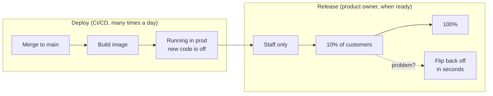
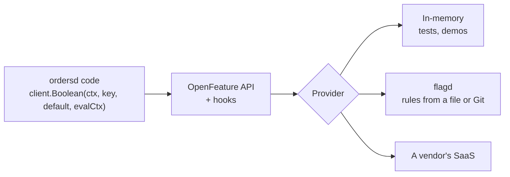

# Feature flags

## Why care?

Four messages from a team that ships often:

- "The new totals code is merged, but marketing wants it live on Monday at 09:00. Do we deploy on Monday morning?"
- "The new code is slow for one big customer. Rollback means a revert, a CI run and a deploy: 25 minutes."
- "The email provider is down. Our checkout waits 30 seconds for it on every order."
- "Someone removed `if newTotals` last year. Today we found a second copy of the old code path. It was still running."

The first three have the same answer: put the new behaviour behind a **feature flag**, and turn it on and off without a deploy. The fourth is what happens when you forget that every flag is a small piece of debt.

This page explains the one idea behind flags (deploy is not release), the four kinds of flags, how the open standard **OpenFeature** works in Go, and how to clean up flags before they bite. You build a small flag setup for the `orders` service with the OpenFeature Go SDK and its in-memory provider.

## The idea: the light switch is not the wiring

An electrician puts new wiring in your house on Tuesday. The new lamp is in the ceiling, connected, tested. But the switch is off. On Saturday you have guests, and you flip the switch. If the lamp flickers, you flip it back. You don't call the electrician to take the wires out again.

- **Deploy** is the wiring: the new binary runs in production. It is a technical event, done by CI/CD.
- **Release** is the switch: users get the new behaviour. It is a business event, done by whoever owns the feature.

Without flags, the two are the same moment. Every deploy is a release, and every rollback is a redeploy. With flags, you deploy many times a day (small, boring, safe) and release when you choose, to whom you choose, and undo it in seconds.



This also explains how [trunk-based development](trunk-based-development.md) works with features that take three weeks: the half-finished code is merged every day, but behind a flag that is off.

## Under the hood: four kinds of flags

Not all flags are the same. They differ in **how long they live** and **who changes them**. Mixing them up is how flag systems turn into a mess. The usual four categories:

| Kind                         | Example in `orders`                                | Lives for       | Changed by     | Decision depends on            |
| ---------------------------- | -------------------------------------------------- | --------------- | -------------- | ------------------------------ |
| **Release**                  | `orders.new-totals`: new discount code, rolled out | Days to weeks   | The team       | Who the customer is, a percent |
| **Ops** (kill switch)        | `orders.confirmation-email`: turn off emails       | Months, or ever | On-call        | Nothing: on or off for all     |
| **Experiment** (A/B test)    | `checkout.cta-text`: "Place order" or "Buy now"    | Weeks           | Product        | A sticky random split          |
| **Permission** (entitlement) | `orders.bulk-export`: only for the enterprise plan | Years           | Sales, billing | The customer's plan            |

Two lessons from the table:

1. **Release flags must die.** They exist to get one change out safely. When the change is at 100% and stable, the flag and the old code path are deleted. A release flag that lives for a year is a bug.
2. **Permission flags are not really flags.** "Enterprise customers can export" is a product rule. It may start in the flag system, but long term it belongs in your authorization code (see the [Security](../security/index.md) chapter), with tests and audit logs. A flag system is the wrong place for "who paid for what".

An **ops flag** is the odd one out: it is meant to live. It is a circuit breaker you flip by hand. When the email provider is down, on-call turns off `orders.confirmation-email`, orders go through without email, and a background job sends the emails later.

### Where does the decision happen?

A flag check is a function call: "for **this** subject, what is the value of flag **X**?". The **subject** (usually a user or customer, sometimes a tenant or a service) is described by an **evaluation context**: an ID called the **targeting key**, plus attributes like email, plan or country. The flag's **rules** (targeting) turn the context into a value.

The rules can run in two places:

| Where                 | How it works                                                         | Good for                      |
| --------------------- | -------------------------------------------------------------------- | ----------------------------- |
| **In your process**   | The SDK downloads all rules, keeps them in memory, evaluates locally | Backends: no network per call |
| **In a flag service** | Each check (or batch) is an HTTP/gRPC call; the service evaluates    | Browsers, mobile apps         |

For a Go service the first is normal: a check is a map lookup and a hash, well under a microsecond, and it still works when the flag service is down. The SDK gets updates by streaming or polling. The second is what browser and mobile SDKs do, because you don't want to send all your rules (including the list of beta customers) to every phone.

### OpenFeature: one API, many vendors

There are many flag products: LaunchDarkly, Unleash, Flagsmith, ConfigCat, GO Feature Flag, flagd, and every big company's own system. Each one used to have its own SDK, so your code was tied to the vendor.

**OpenFeature** is a CNCF project that fixes this the way `database/sql` does for databases: one **API** in your code, and a **provider** (like a database driver) that talks to the actual flag system.



The parts, all in package `github.com/open-feature/go-sdk/openfeature`:

- **Provider** (`FeatureProvider` interface): resolves flags. You set one globally with `SetProviderAndWait`, or one per **domain** with `SetNamedProviderAndWait`.
- **Client** (`NewClient(domain)`): what your code calls. `Boolean`, `String`, `Int`, `Float`, `Object` return the value, or the **default** you passed when anything goes wrong. The `...ValueDetails` forms also return the variant, the reason and an error code.
- **Evaluation context**: `NewEvaluationContext(targetingKey, attributes)`. It can be set at four levels, merged in this order, last one wins: global (`SetEvaluationContext`), transaction (`WithTransactionContext(ctx, ...)`, handy in HTTP middleware), client (`client.SetEvaluationContext`), and the call itself.
- **Hooks**: code that runs `Before`, `After`, on `Error` and `Finally` for each evaluation. Like HTTP middleware, for logging, metrics and tracing.
- **Events**: `PROVIDER_READY`, `PROVIDER_CONFIGURATION_CHANGED`, `PROVIDER_ERROR`, `PROVIDER_STALE`. Your code can react when a flag changes.

!!! note "The default value is part of the contract"

    Every call passes a default: `client.Boolean(ctx, "orders.new-totals", false, ec)`. The SDK
    never panics and never returns an error from `Boolean`. If the provider is not ready, the
    flag does not exist, or the type is wrong, you get the default. So choose the default that
    is **safe when the flag system is down**: usually the old behaviour.

## Try it: flags for `orders`

You will build a small program, `flagdemo`, that evaluates the four flags from the table for a few customers. Everything runs in memory: no flag service, no network.

```console
$ mkdir /tmp/tutor-flags && cd /tmp/tutor-flags
$ go mod init example.com/flagdemo
go: creating new go.mod: module example.com/flagdemo
$ go get github.com/open-feature/go-sdk@latest
go: downloading github.com/open-feature/go-sdk v1.20.0
go: added github.com/open-feature/go-sdk v1.20.0
```

The in-memory provider is in `openfeature/memprovider`. Its flag type has a state, a set of named **variants**, a default variant, and an optional `ContextEvaluator` function for targeting:

```console
$ go doc github.com/open-feature/go-sdk/openfeature/memprovider.InMemoryFlag
package memprovider // import "github.com/open-feature/go-sdk/openfeature/memprovider"

type InMemoryFlag struct {
	Key              string
	State            State
	DefaultVariant   string
	Variants         map[string]any
	ContextEvaluator ContextEvaluator
}
    InMemoryFlag is the feature flag representation accepted by InMemoryProvider

func (flag *InMemoryFlag) Resolve(defaultValue any, flatCtx openfeature.FlattenedContext) (any, openfeature.ProviderResolutionDetail)
```

### Step 1: the flags and their rules

`flags.go` defines the flag keys as constants (one place to find them, one place to delete them) and the rules. The most interesting part is the **percentage rollout**. It must be **sticky**: a customer who got the new totals at 10% must still have them on the next request, and still at 25%. So we don't roll a die; we **hash** the customer ID together with the flag key, and get a bucket from 0 to 99:

```go
package main

import (
	"hash/fnv"
	"strings"

	"github.com/open-feature/go-sdk/openfeature"
	"github.com/open-feature/go-sdk/openfeature/memprovider"
)

// Flag keys. One constant per flag makes "find all uses" and removal easy.
const (
	FlagNewTotals    = "orders.new-totals"         // release
	FlagConfirmEmail = "orders.confirmation-email" // ops: kill switch
	FlagCTAText      = "checkout.cta-text"         // experiment
	FlagBulkExport   = "orders.bulk-export"        // permission
)

// bucket puts a subject in one of 100 buckets. The flag key is part of the
// hash, so the same customer lands in different buckets for different flags.
func bucket(flagKey, targetingKey string) int {
	h := fnv.New32a()
	h.Write([]byte(flagKey + "/" + targetingKey))
	return int(h.Sum32() % 100)
}

// percentRollout returns an evaluator: staff always get "on", everybody else
// gets "on" if their bucket is below percent.
func percentRollout(percent int) memprovider.ContextEvaluator {
	eval := func(f memprovider.InMemoryFlag, ctx openfeature.FlattenedContext) (any, openfeature.ProviderResolutionDetail) {
		key, _ := ctx[openfeature.TargetingKey].(string)
		if key == "" {
			return f.Variants[f.DefaultVariant], openfeature.ProviderResolutionDetail{
				ResolutionError: openfeature.NewTargetingKeyMissingResolutionError("need a customer ID"),
				Reason:          openfeature.ErrorReason,
			}
		}
		if email, _ := ctx["email"].(string); strings.HasSuffix(email, "@acme.example") {
			return f.Variants["on"], openfeature.ProviderResolutionDetail{
				Reason: openfeature.TargetingMatchReason, Variant: "on",
			}
		}
		v := "off"
		if bucket(f.Key, key) < percent {
			v = "on"
		}
		return f.Variants[v], openfeature.ProviderResolutionDetail{
			Reason: openfeature.SplitReason, Variant: v,
		}
	}
	return &eval
}
```

Why put the flag key in the hash? Without it, customer `c-17` is in bucket 3 for **every** flag. The same 10% of customers would be the guinea pigs for every rollout, and an experiment would be mixed up with the release that happens to target the same people.

The other two rules are shorter. `split50` gives half the customers the `buy-now` variant (the same hash, so it is sticky too). `planIs("enterprise")` returns `on` when the `plan` attribute matches. Then `Flags` puts it all together:

```go
var onOff = map[string]any{"on": true, "off": false}

// Flags returns the flag set. rollout is the percentage for the release flag;
// emailOn is the kill switch position.
func Flags(rollout int, emailOn bool) map[string]memprovider.InMemoryFlag {
	email := "on"
	if !emailOn {
		email = "off"
	}
	return map[string]memprovider.InMemoryFlag{
		FlagNewTotals: {
			Key: FlagNewTotals, State: memprovider.Enabled, DefaultVariant: "off",
			Variants: onOff, ContextEvaluator: percentRollout(rollout),
		},
		FlagConfirmEmail: {
			Key: FlagConfirmEmail, State: memprovider.Enabled, DefaultVariant: email,
			Variants: onOff,
		},
		FlagCTAText: {
			Key: FlagCTAText, State: memprovider.Enabled, DefaultVariant: "control",
			Variants:         map[string]any{"control": "Place order", "buy-now": "Buy now"},
			ContextEvaluator: split50(),
		},
		FlagBulkExport: {
			Key: FlagBulkExport, State: memprovider.Enabled, DefaultVariant: "off",
			Variants: onOff, ContextEvaluator: planIs("enterprise"),
		},
	}
}
```

In a real system these rules live in the flag service (a YAML file for flagd, a web UI for a SaaS), not in Go. Writing them by hand here shows what every flag service does for you.

### Step 2: evaluate for four customers

`main.go` registers the provider, makes a client for the domain `ordersd`, and turns a customer into an evaluation context:

```go
// Customer is the subject of a flag evaluation.
type Customer struct{ ID, Email, Plan string }

// evalCtx turns a customer into an OpenFeature evaluation context.
func evalCtx(c Customer) openfeature.EvaluationContext {
	return openfeature.NewEvaluationContext(c.ID, map[string]any{
		"email": c.Email,
		"plan":  c.Plan,
	})
}

var customers = []Customer{
	{"c-1", "ana@shop.example", "free"},
	{"c-2", "bo@shop.example", "enterprise"},
	{"c-3", "cy@acme.example", "free"},
	{"c-4", "di@shop.example", "free"},
}

func main() {
	provider := memprovider.NewInMemoryProvider(Flags(25, true))
	if err := openfeature.SetProviderAndWait(provider); err != nil {
		log.Fatal(err)
	}
	defer openfeature.Shutdown()
	client := openfeature.NewClient("ordersd")
	ctx := context.Background()

	switch os.Args[1] {
	case "eval":
		for _, c := range customers {
			ec := evalCtx(c)
			nt, _ := client.BooleanValueDetails(ctx, FlagNewTotals, false, ec)
			cta, _ := client.StringValueDetails(ctx, FlagCTAText, "Place order", ec)
			bulk := client.Boolean(ctx, FlagBulkExport, false, ec)
			fmt.Printf("%s %-17s new-totals=%-5v (%s)  cta=%-11q (%s)  bulk-export=%v\n",
				c.ID, c.Email, nt.Value, nt.Reason, cta.Value, cta.Variant, bulk)
		}
	// ... the other cases follow below
	}
}
```

```console
$ go build -o flagdemo . && ./flagdemo eval
c-1 ana@shop.example  new-totals=false (SPLIT)  cta="Place order" (control)  bulk-export=false
c-2 bo@shop.example   new-totals=false (SPLIT)  cta="Buy now"   (buy-now)  bulk-export=true
c-3 cy@acme.example   new-totals=true  (TARGETING_MATCH)  cta="Buy now"   (buy-now)  bulk-export=false
c-4 di@shop.example   new-totals=false (SPLIT)  cta="Buy now"   (buy-now)  bulk-export=false
```

Read it line by line:

- `c-3` is staff (`@acme.example`), so the new totals are on, with reason `TARGETING_MATCH`. Staff always go first: "dogfooding".
- The other three are in the 25% rollout lottery (`SPLIT`), and none of them won. With four customers that's not surprising.
- The CTA experiment split them 1 to 3. Again: tiny numbers. Experiments need thousands of subjects.
- Only `c-2`, on the enterprise plan, may bulk-export.

The **reason** is worth logging. "Why did customer X see the new totals?" is a real support question, and `TARGETING_MATCH` versus `SPLIT` answers it.

### Step 3: the rollout, from 1% to 100%

A real rollout raises the percentage step by step, watching the [SLOs](../observability/slos-and-alerting.md) at each step. `UpdateFlags` swaps the flag set at runtime, like a flag service pushing new rules. The `spread` case evaluates 10,000 customers at each step and counts how many customers who **had** the new code lost it again:

```go
	case "spread":
		var before [10_000]bool // who had the new code at the previous step
		for _, pct := range []int{1, 10, 25, 50, 100} {
			provider.UpdateFlags(Flags(pct, true))
			on, lost := 0, 0
			for i := range before {
				ec := openfeature.NewEvaluationContext(fmt.Sprintf("c-%d", i), nil)
				now := client.Boolean(ctx, FlagNewTotals, false, ec)
				if now {
					on++
				} else if before[i] {
					lost++ // was on, now off: a flip-flop the customer would notice
				}
				before[i] = now
			}
			fmt.Printf("rollout %3d%%: %5d of 10000 on, %d switched back off\n", pct, on, lost)
		}
```

```console
$ ./flagdemo spread
rollout   1%:    90 of 10000 on, 0 switched back off
rollout  10%:   990 of 10000 on, 0 switched back off
rollout  25%:  2474 of 10000 on, 0 switched back off
rollout  50%:  5011 of 10000 on, 0 switched back off
rollout 100%: 10000 of 10000 on, 0 switched back off
```

Close to the target at each step (a hash is not a perfect splitter: 90 instead of 100 at 1%). And nobody switched back. Raising the percentage only **adds** customers, because the bucket of a customer never changes: at 25% you are on if your bucket is 0 to 24, and that includes everyone from 0 to 9.

What if you used `rand.IntN(100) < 25` instead? A tiny program compares the hash with a random number, asking twice for the same customer (`cmd/sticky/main.go`):

```go
// Command sticky compares a hashed rollout with a random one.
package main

import (
	"fmt"
	"hash/fnv"
	"math/rand/v2"
)

func hashed(id string) int {
	h := fnv.New32a()
	h.Write([]byte("orders.new-totals/" + id))
	return int(h.Sum32() % 100)
}

func random(string) int { return rand.IntN(100) }

func main() {
	for name, bucket := range map[string]func(string) int{"hashed": hashed, "random": random} {
		flips := 0
		for i := range 10_000 {
			id := fmt.Sprintf("c-%d", i)
			first := bucket(id) < 25
			second := bucket(id) < 25 // the same customer, one request later
			if first != second {
				flips++
			}
		}
		fmt.Printf("%s: %d of 10000 customers saw a different answer on their next request\n", name, flips)
	}
}
```

```console
$ go run ./cmd/sticky | sort
hashed: 0 of 10000 customers saw a different answer on their next request
random: 3735 of 10000 customers saw a different answer on their next request
```

37% of customers would see the new totals on one page and the old totals on the next. (The math: 2 × 0.25 × 0.75 = 0.375.) That's not a rollout; that's a bug report generator.

### Step 4: the kill switch

The email provider is down. On-call flips `orders.confirmation-email` to off. The client hears about it through an event handler:

```go
	case "kill":
		changed := make(chan []string, 1)
		cb := func(d openfeature.EventDetails) { changed <- d.FlagChanges }
		client.AddHandler(openfeature.ProviderConfigChange, &cb)
		ec := evalCtx(customers[0])
		fmt.Println("before: send email =", client.Boolean(ctx, FlagConfirmEmail, true, ec))
		provider.UpdateFlags(Flags(25, false)) // the on-call engineer flips the switch
		select {
		case keys := <-changed:
			fmt.Println("event: PROVIDER_CONFIGURATION_CHANGED, flags:", len(keys))
		case <-time.After(time.Second):
			fmt.Println("no event")
		}
		fmt.Println("after:  send email =", client.Boolean(ctx, FlagConfirmEmail, true, ec))
```

```console
$ ./flagdemo kill
before: send email = true
event: PROVIDER_CONFIGURATION_CHANGED, flags: 4
after:  send email = false
```

No deploy, no restart. The next order skips the email. Two details:

- The default passed in code is `true`. For a kill switch the safe default is "keep working normally": if the flag system breaks, you don't want to silently stop all emails.
- The event says 4 flags changed, not 1. `UpdateFlags` replaces the whole set and, as its doc comment says, reports "the union of the previous and the new flag keys". Don't assume `FlagChanges` is exactly what changed; re-evaluate what you care about.

### Step 5: when things go wrong, you get the default

Three mistakes: a typo in the key, the wrong type (asking a boolean flag for a string), and no targeting key:

```go
	case "errors":
		ec := evalCtx(customers[0])
		d1, err := client.BooleanValueDetails(ctx, "orders.new-total", false, ec) // typo
		show("typo:", d1, err)
		d2, err := client.StringValueDetails(ctx, FlagNewTotals, "off", ec) // wrong type
		show("wrong type:", d2, err)
		d3, err := client.BooleanValueDetails(ctx, FlagNewTotals, false, openfeature.EvaluationContext{})
		show("no subject:", d3, err)
```

```console
$ ./flagdemo errors
typo:       value=false reason=ERROR code=FLAG_NOT_FOUND
            err=error code: FLAG_NOT_FOUND: flag for key orders.new-total not found
wrong type: value=off reason=ERROR code=TYPE_MISMATCH
            err=error code: TYPE_MISMATCH: incorrect type association
no subject: value=false reason=ERROR code=TARGETING_KEY_MISSING
            err=error code: TARGETING_KEY_MISSING: need a customer ID
```

Every time, the value is the **default** from the code. With `client.Boolean` (no `Details`) you would never see these errors at all. The program keeps working, which is good, but a typo in a flag key means the feature is silently never released. And before the provider is ready (say, the flag service is slow at start-up), the SDK uses a no-op provider. The `noprovider` case runs at the very top of `main`, before `SetProviderAndWait`:

```go
	if os.Args[1] == "noprovider" {
		d, err := openfeature.NewClient("ordersd").BooleanValueDetails(context.Background(), FlagBulkExport, false, evalCtx(customers[1]))
		fmt.Printf("value=%v reason=%s provider=%s err=%v\n", d.Value, d.Reason, openfeature.ProviderMetadata().Name, err)
		return
	}
```

```console
$ ./flagdemo noprovider
value=false reason=DEFAULT provider=NoopProvider err=<nil>
```

No error at all. That's why `SetProviderAndWait` exists, and why you should not start serving traffic (report "ready", see [Building a service](../go/services.md)) before the provider is ready.

### Step 6: see every evaluation with a hook

The fix for silent errors is to make them loud. The SDK ships a `LoggingHook` that logs every stage with `log/slog`:

```go
	case "hook":
		logger := slog.New(slog.NewTextHandler(os.Stdout, &slog.HandlerOptions{
			Level: slog.LevelDebug,
			ReplaceAttr: func(_ []string, a slog.Attr) slog.Attr {
				if a.Key == slog.TimeKey {
					return slog.Attr{}
				}
				return a
			},
		}))
		client.AddHooks(hooks.NewLoggingHook(false, logger))
		client.Boolean(ctx, FlagBulkExport, false, evalCtx(customers[1]))
		client.Boolean(ctx, "orders.bulk-exprot", false, evalCtx(customers[1]))
```

```console
$ ./flagdemo hook
level=DEBUG msg="Before stage" domain=ordersd provider_name=InMemoryProvider flag_key=orders.bulk-export default_value=false stage=before
level=DEBUG msg="After stage" domain=ordersd provider_name=InMemoryProvider flag_key=orders.bulk-export default_value=false reason=TARGETING_MATCH variant=on value=true stage=after
level=DEBUG msg="Before stage" domain=ordersd provider_name=InMemoryProvider flag_key=orders.bulk-exprot default_value=false stage=before
level=ERROR msg="Error stage" domain=ordersd provider_name=InMemoryProvider flag_key=orders.bulk-exprot default_value=false error_message="error code: FLAG_NOT_FOUND: flag for key orders.bulk-exprot not found" stage=error
```

The successful stages log at `DEBUG`; errors log at `ERROR`. In production you would keep the error stage and turn the rest into a **metric** per flag key and variant (see [Metrics](../observability/metrics.md)). The first argument, `false`, keeps the evaluation context out of the logs. Keep it `false`: the context often holds emails and other personal data.

### Step 7: test both sides of the flag

A flag doubles the code paths. Both must be tested. Here is the code behind the release flag, in `totals.go`:

```go
// Total returns what the customer pays for an order of cents.
// The new code path, behind FlagNewTotals, gives 5% off orders of 100.00 or more.
func Total(ctx context.Context, flags *openfeature.Client, c Customer, cents int64) int64 {
	if flags.Boolean(ctx, FlagNewTotals, false, evalCtx(c)) && cents >= 100_00 {
		return cents * 95 / 100
	}
	return cents
}
```

The SDK has a `testing` package with a `TestProvider`: each test gets its own flag set, tied to the `context.Context` that `UsingFlags` returns. Tests don't see each other's flags:

```go
var testProvider = oftesting.NewTestProvider()

func TestMain(m *testing.M) {
	if err := openfeature.SetProviderAndWait(testProvider); err != nil {
		panic(err)
	}
	os.Exit(m.Run())
}

// fixed returns a flag set where the release flag is always on or off.
func fixed(on bool) map[string]memprovider.InMemoryFlag {
	v := "off"
	if on {
		v = "on"
	}
	return map[string]memprovider.InMemoryFlag{
		FlagNewTotals: {Key: FlagNewTotals, State: memprovider.Enabled, DefaultVariant: v, Variants: onOff},
	}
}

func TestTotal(t *testing.T) {
	tests := []struct {
		name  string
		flag  bool
		cents int64
		want  int64
	}{
		{"old path, big order", false, 200_00, 200_00},
		{"new path, big order", true, 200_00, 190_00},
		{"new path, small order", true, 50_00, 50_00},
	}
	client := openfeature.NewClient("test")
	for _, tt := range tests {
		t.Run(tt.name, func(t *testing.T) {
			ctx := testProvider.UsingFlags(t, fixed(tt.flag))
			if got := Total(ctx, client, Customer{ID: "c-1"}, tt.cents); got != tt.want {
				t.Errorf("Total(%d) = %d, want %d", tt.cents, got, tt.want)
			}
		})
	}
}
```

```console
$ go test -count=1 -v -run TestTotal ./...
=== RUN   TestTotal
=== RUN   TestTotal/old_path,_big_order
=== RUN   TestTotal/new_path,_big_order
=== RUN   TestTotal/new_path,_small_order
--- PASS: TestTotal (0.00s)
    --- PASS: TestTotal/old_path,_big_order (0.00s)
    --- PASS: TestTotal/new_path,_big_order (0.00s)
    --- PASS: TestTotal/new_path,_small_order (0.00s)
PASS
ok  	example.com/flagdemo	0.003s
?   	example.com/flagdemo/cmd/sticky	[no test files]
```

Notice that `Total` takes a `*openfeature.Client` and a `context.Context`. Passing them in (instead of calling a global inside `Total`) is what makes the per-test flags work. It's the same advice as for any dependency: see [Test doubles](../go/testing.md#test-doubles-fakes-not-mocks).

!!! tip "N flags is not 2^N tests"

    Ten boolean flags make 1,024 combinations. Nobody tests them all. Test each flag's two
    sides in the code it guards, plus the combination you actually run in production. And
    keep the number of live release flags small: that's the real fix.

## Cleaning up: every flag has an end date

A release flag is finished when it is at 100% for all customers and stable for a while (a week or two is common). Then:

1. **Delete the old code path**, not the new one. The `if` goes, the `else` goes, the flag check goes.
2. **Delete the constant.** With one constant per flag, the compiler finds every use for you. A search finds the rest:

   ```console
   $ grep -rn 'FlagNewTotals' --include='*.go' .
   main.go:53:			nt, _ := client.BooleanValueDetails(ctx, FlagNewTotals, false, ec)
   main.go:67:				now := client.Boolean(ctx, FlagNewTotals, false, ec)
   main.go:97:		d2, err := client.StringValueDetails(ctx, FlagNewTotals, "off", ec) // wrong type
   main.go:99:		d3, err := client.BooleanValueDetails(ctx, FlagNewTotals, false, openfeature.EvaluationContext{})
   totals.go:10:// The new code path, behind FlagNewTotals, gives 5% off orders of 100.00 or more.
   totals.go:12:	if flags.Boolean(ctx, FlagNewTotals, false, evalCtx(c)) && cents >= 100_00 {
   flags.go:13:	FlagNewTotals    = "orders.new-totals"         // release
   flags.go:94:		FlagNewTotals: {
   flags.go:95:			Key: FlagNewTotals, State: memprovider.Enabled, DefaultVariant: "off",
   totals_test.go:28:		FlagNewTotals: {Key: FlagNewTotals, State: memprovider.Enabled, DefaultVariant: v, Variants: onOff},
   ```

   Also search for the string key `orders.new-totals`: config files, dashboards, other services and front-ends may use it too.

3. **Deploy that**, and only then **delete the flag in the flag system**. In the other order, the running code asks for a flag that no longer exists and gets the default: `false`, the old path. You just rolled back your own feature.

Ways to make cleanup happen instead of hoping:

- Give each release flag an **owner** and an **expiry date** when you create it. Most flag services can store this as metadata; some warn about stale flags.
- Create the "remove flag" ticket **at the same time** as the flag.
- Add a CI check that fails when a flag's expiry date is in the past.
- Count flag evaluations (the hook above). A flag that always returns the same value for weeks is ready to go.

!!! warning "Never reuse a flag"

    An old flag that nobody evaluates any more looks free to reuse. It is not: some server
    you forgot about may still run the old code that checks it. Turning the "new" flag on
    then turns on old, dead code in that one place. Always use new flag names, and delete
    old code with its flag.

## Traps

- **Unsafe defaults.** The default is what runs when the flag system is down or the key has a typo. For a release flag, that's the old path; for a kill switch, "on". Never default to the risky side.
- **Random instead of sticky.** `rand` in a rollout gives the same customer different answers per request (37% flip-flops above). Hash the targeting key with the flag key.
- **No targeting key.** Without a stable ID (customer ID, account ID; not a session ID that changes on each login), there is nothing to hash. Use a tenant or account ID for B2B, so all users of one company see the same thing.
- **Flags that never die.** Every release flag is an `if` with a dead branch. Ten old flags make code that nobody can read, and a test matrix nobody runs.
- **Permission flags in the flag system forever.** "Who paid for what" needs audit logs, tests and an owner in billing. Move it into authorization code.
- **Personal data in the evaluation context.** It goes to the provider, maybe a SaaS, and into logs if you're not careful. Send what the rules need, and nothing more.
- **A flag check in a hot loop with a remote provider.** In-process providers are fast. A provider that makes a network call per check is not. Evaluate once per request and pass the value down.
- **Database changes behind a flag.** A flag can switch code in seconds. It cannot switch a database schema. Make schema changes compatible with both paths first: see [expand and contract](../databases/migrations.md#expand-and-contract-old-and-new-code-at-the-same-time).
- **Flags as a substitute for testing.** "We'll just turn it off if it breaks" still breaks it for the first customers. A flag reduces the blast radius. It does not remove the need for tests and for a canary.

## Check yourself

??? question "1. What is the difference between deploying and releasing? Why does it matter for rollback?"

    Deploy: the new binary runs in production. Release: users get the new behaviour. Flags
    split them. Rolling back a release is flipping a flag (seconds, no CI). Rolling back a
    deploy is a new build and deploy (minutes), and it also rolls back every other change in
    that deploy.

??? question "2. Your rollout uses `bucket := rand.IntN(100)` on every request. What do customers see at 25%?"

    Each request is a new lottery. About 37.5% of customers (2 × 0.25 × 0.75) see a different
    answer on their next request: new totals on one page, old totals on the next. Hash a
    stable targeting key together with the flag key instead, so a customer's bucket never
    changes and raising the percentage only adds customers.

??? question "3. A developer passes `true` as the default for `orders.new-totals`, so they can test locally without a flag service. What can go wrong?"

    In production, whenever the provider is not ready, the flag service is unreachable, or the
    key has a typo, the SDK returns the default: the new code, for **everyone**, at once. That
    turns a flag-service outage into a full, unplanned release. The default must be the safe,
    old behaviour. Use a local provider (in-memory, or flagd with a file) for local testing.

??? question "4. Name the four kinds of flags, and which one should be deleted soonest."

    Release (days to weeks), ops/kill switch (long-lived), experiment (weeks, until the result
    is clear), permission (long-lived, but should move into authorization code). Release flags
    should die first: as soon as the feature is at 100% and stable.

??? question "5. You finish a rollout. In which order do you remove the flag from the code and from the flag service?"

    Code first: delete the old path and the flag check, deploy that everywhere. Then delete
    the flag in the flag service. In the other order, running code evaluates a flag that no
    longer exists, gets `FLAG_NOT_FOUND`, and falls back to the default (the old path), so
    you roll back your own feature.

??? question "6. Why is the flag key part of the hash in `bucket(flagKey, targetingKey)`?"

    So that each flag splits customers differently. Without it, the same customers fall in
    the first 10% of every rollout and every experiment. They get every risk, and experiment
    results are mixed with the effect of other releases aimed at the same group.

## Recap

- **Deploy is not release.** Ship code switched off; turn it on when you choose, for whom you choose, and off again in seconds.
- Four kinds: **release** (short-lived), **ops** kill switch (long-lived), **experiment** (sticky split), **permission** (belongs in authorization code, long term).
- A flag check takes a key, a **default**, and an **evaluation context** (targeting key + attributes). The default is what you get on any error, so make it the safe side.
- **OpenFeature** is a vendor-neutral API: client, provider, evaluation context, hooks, events. Swap the provider, keep the code. In Go: `github.com/open-feature/go-sdk/openfeature`.
- Percentage rollouts must be **sticky**: hash the targeting key with the flag key.
- Use `...ValueDetails` or a hook to see reasons and errors; plain `Boolean` hides typos.
- Test both sides of each flag with a per-test provider. Pass the client in.
- **Every release flag has an owner and an end date.** Remove code first, then the flag. Never reuse a flag name.

Next: [Deployment strategies](deployment-strategies.md). Flags decide which customers see a feature; rolling, blue/green and canary deploys decide which **servers** run the new binary.
