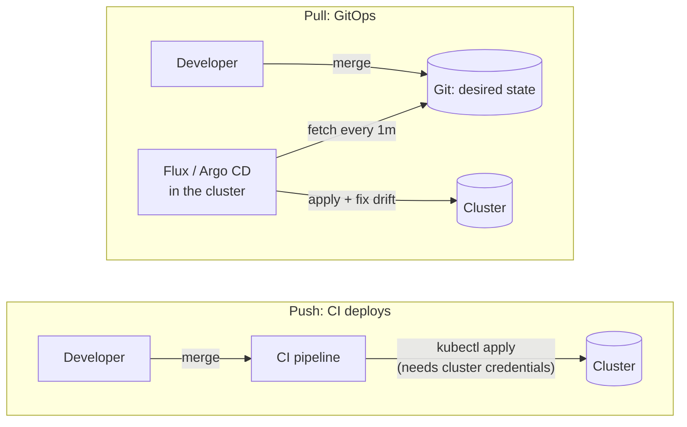
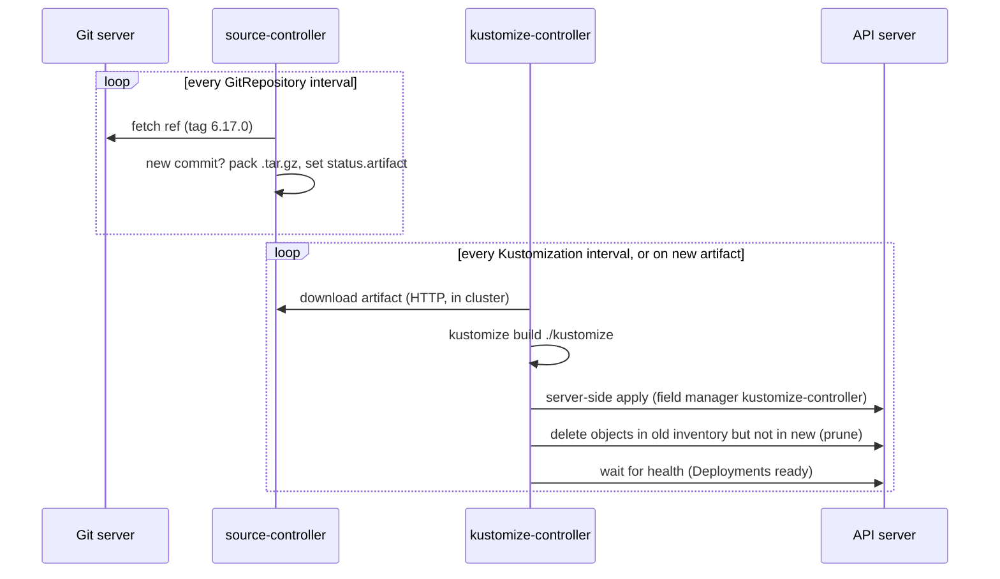

# GitOps

## Why care?

These questions should have a one-line answer. Often they do not:

- "What version of `ordersd` runs in production right now?"
- "Who changed the replica count on Friday, and why?"
- "Staging works and production doesn't. What is different between them?"
- "The CI server has `cluster-admin` on every cluster. What happens if someone steals its token?"

In a push-based setup, the answers are spread over CI logs, shell histories and people's memory. **GitOps** puts them in one place: a Git repository that describes what should run, and a controller **inside** the cluster that makes the cluster match it, all the time. The version in production is a line in a file. The change on Friday is a commit with an author and a review. The difference between staging and production is `git diff`.

On this page you install Flux on the `kind` cluster, let it deploy an app from a public Git repository, break the cluster by hand, and watch Flux repair it. Then you build the repository layout for `ordersd` with staging and production, and promote a version with one commit.

## The idea: Git holds the desired state, a controller enforces it

In GitOps, a Git repository describes what should run. A controller in the cluster reads it and changes the cluster to match. It does this again at a fixed interval, not only once.

- The **Git repository** holds the desired state.
- The **GitOps controller** (Flux or Argo CD) compares the cluster with Git every few minutes and fixes any difference.
- A **hand edit** in production, such as `kubectl edit`, is a difference. The controller reverts it.
- To **change** what runs, you open a pull request against the repository.



Four principles, from the [OpenGitOps](https://opengitops.dev/) project:

1. **Declarative**: the desired state is data (YAML), not a script of steps.
2. **Versioned and immutable**: the desired state lives in Git, with full history.
3. **Pulled automatically**: an agent fetches the desired state; nobody pushes into the cluster.
4. **Continuously reconciled**: the agent keeps comparing and fixing, not only at deploy time.

Push and pull compared:

|                                | Push (CI runs `kubectl`/`helm`) | Pull (GitOps controller)                         |
| ------------------------------ | ------------------------------- | ------------------------------------------------ |
| Who has cluster credentials    | The CI system                   | Only the controller, inside the cluster          |
| Cluster reachable from CI      | Yes, the API must be reachable  | No, the cluster only makes outgoing calls to Git |
| Drift (hand edits)             | Stays until the next deploy     | Reverted within one interval                     |
| "What runs where?"             | Read the cluster, or CI logs    | Read Git                                         |
| Rollback                       | Rerun an old pipeline           | `git revert`                                     |
| Feedback "did the deploy work" | Pipeline step result            | Controller status, events, notifications         |

The CI pipeline does not go away. It still builds and tests the image (see [CI pipelines](ci-pipelines.md)). Its last step changes: instead of deploying, it **writes a new image tag into the config repo** (or opens a pull request that does).

## Under the hood: Flux

Flux is a set of controllers. Each one is a [reconciliation](../kubernetes/reconciliation.md) loop for its own custom resources, exactly like the operator you wrote in [Writing an operator in Go](../kubernetes/operators.md):

| Controller                   | Resources                                                    | Job                                                           |
| ---------------------------- | ------------------------------------------------------------ | ------------------------------------------------------------- |
| source-controller            | `GitRepository`, `OCIRepository`, `HelmRepository`, `Bucket` | Fetch a source, pack it as a `.tar.gz` artifact               |
| kustomize-controller         | `Kustomization` (Flux's, not Kustomize's file)               | Build the artifact with Kustomize, apply, prune, check health |
| helm-controller              | `HelmRelease`                                                | Install and upgrade Helm charts                               |
| notification-controller      | `Provider`, `Alert`, `Receiver`                              | Send events to chat; receive Git webhooks                     |
| image-reflector / automation | `ImageRepository`, `ImagePolicy`, `ImageUpdateAutomation`    | Watch a registry, commit new tags to Git                      |

The `flux` CLI (v2.10.1 here) installs them, creates their resources, and shows their status. Check the cluster first:

```console
$ flux version --client
flux: v2.10.1
$ flux check --pre
► checking prerequisites
✔ Kubernetes 1.37.0 >=1.35.0-0
✔ prerequisites checks passed
```

### Install only what you need

`flux install --export` prints the manifests without applying them. That is how you would put Flux itself under GitOps, or review what it does. This page needs two controllers:

```console
$ flux install --components=source-controller,kustomize-controller --export > flux-system.yaml
$ grep -E '^kind:' flux-system.yaml | sort | uniq -c
      3 kind: ClusterRole
      2 kind: ClusterRoleBinding
      7 kind: CustomResourceDefinition
      2 kind: Deployment
      1 kind: Namespace
      3 kind: NetworkPolicy
      1 kind: ResourceQuota
      1 kind: Service
      2 kind: ServiceAccount
$ grep 'image:' flux-system.yaml
        image: ghcr.io/fluxcd/source-controller:v1.10.2
        image: ghcr.io/fluxcd/kustomize-controller:v1.10.2
```

Seven CRDs, two Deployments, and RBAC. Install it:

```console
$ flux install --components=source-controller,kustomize-controller
...
Deployment/flux-system/kustomize-controller created
Deployment/flux-system/source-controller created
NetworkPolicy/flux-system/allow-egress created
NetworkPolicy/flux-system/allow-scraping created
NetworkPolicy/flux-system/allow-webhooks created
◎ verifying installation
✔ kustomize-controller: deployment ready
✔ source-controller: deployment ready
✔ install finished
$ flux check
► checking prerequisites
✔ Kubernetes 1.37.0 >=1.35.0-0
► checking version in cluster
✔ distribution: flux-v2.10.1
✔ bootstrapped: false
► checking controllers
✔ kustomize-controller: deployment ready
► ghcr.io/fluxcd/kustomize-controller:v1.10.2
✔ source-controller: deployment ready
► ghcr.io/fluxcd/source-controller:v1.10.2
► checking crds
✔ buckets.source.toolkit.fluxcd.io/v1
✔ externalartifacts.source.toolkit.fluxcd.io/v1
✔ gitrepositories.source.toolkit.fluxcd.io/v1
✔ helmcharts.source.toolkit.fluxcd.io/v1
✔ helmrepositories.source.toolkit.fluxcd.io/v1
✔ kustomizations.kustomize.toolkit.fluxcd.io/v1
✔ ocirepositories.source.toolkit.fluxcd.io/v1
✔ all checks passed
```

`bootstrapped: false`: in a real setup you run `flux bootstrap github` (or `gitlab`, `git`) instead. It does the same install, **commits** these manifests into your config repo, and creates a `GitRepository` pointing at that repo, so Flux manages its own upgrades from Git. It needs write access to a Git server, which this laptop cluster does not have.

### A source and a Kustomization

Two resources connect Git to the cluster. The CLI can print them for you to commit (`--export`):

```console
$ flux create source git tutor-podinfo --url=https://github.com/stefanprodan/podinfo --tag=6.17.0 --interval=1m --export
---
apiVersion: source.toolkit.fluxcd.io/v1
kind: GitRepository
metadata:
  name: tutor-podinfo
  namespace: flux-system
spec:
  interval: 1m0s
  ref:
    tag: 6.17.0
  url: https://github.com/stefanprodan/podinfo
$ flux create kustomization tutor-podinfo --source=GitRepository/tutor-podinfo --path=./kustomize --prune=true --interval=1m --target-namespace=tutor-gitops --export
---
apiVersion: kustomize.toolkit.fluxcd.io/v1
kind: Kustomization
metadata:
  name: tutor-podinfo
  namespace: flux-system
spec:
  interval: 1m0s
  path: ./kustomize
  prune: true
  sourceRef:
    kind: GitRepository
    name: tutor-podinfo
  targetNamespace: tutor-gitops
```

[podinfo](https://github.com/stefanprodan/podinfo) is a small demo web app by a Flux maintainer. Its repository has a `kustomize/` folder with a Deployment, a Service and an HPA. It is public, so source-controller can read it with no credentials.

- `GitRepository`: "every minute, fetch tag `6.17.0` of this repo".
- `Kustomization`: "every minute, run Kustomize on `./kustomize` of that source, put everything in `tutor-gitops`, apply it, and delete what disappears from Git" (`prune: true`).

Apply both, without `--export`:

```console
$ kubectl create namespace tutor-gitops
namespace/tutor-gitops created
$ flux create source git tutor-podinfo --url=https://github.com/stefanprodan/podinfo --tag=6.17.0 --interval=1m
✚ generating GitRepository source
► applying GitRepository source
✔ GitRepository source created
◎ waiting for GitRepository source reconciliation
✔ GitRepository source reconciliation completed
✔ fetched revision: 6.17.0@sha1:fd3a834ed8d14b80ea334cf8a2fddd4597924da6
$ flux create kustomization tutor-podinfo --source=GitRepository/tutor-podinfo --path=./kustomize --prune=true --interval=1m --target-namespace=tutor-gitops --wait
✚ generating Kustomization
► applying Kustomization
✔ Kustomization created
◎ waiting for Kustomization reconciliation
✔ Kustomization tutor-podinfo is ready
✔ applied revision 6.17.0@sha1:fd3a834ed8d14b80ea334cf8a2fddd4597924da6
```

```console
$ flux get sources git
NAME         	REVISION            	SUSPENDED	READY	MESSAGE
tutor-podinfo	6.17.0@sha1:fd3a834e	False    	True 	stored artifact for revision '6.17.0@sha1:fd3a834e'
$ flux get kustomizations
NAME         	REVISION            	SUSPENDED	READY	MESSAGE
tutor-podinfo	6.17.0@sha1:fd3a834e	False    	True 	Applied revision: 6.17.0@sha1:fd3a834e
$ flux tree kustomization tutor-podinfo
Kustomization/flux-system/tutor-podinfo
├── Service/tutor-gitops/podinfo
├── Deployment/tutor-gitops/podinfo
└── HorizontalPodAutoscaler/tutor-gitops/podinfo
$ kubectl -n tutor-gitops get deploy,pods
NAME                      READY   UP-TO-DATE   AVAILABLE   AGE
deployment.apps/podinfo   2/2     2            2           28s

NAME                           READY   STATUS    RESTARTS   AGE
pod/podinfo-649798bd87-4bfbs   1/1     Running   0          28s
pod/podinfo-649798bd87-td9nk   1/1     Running   0          28s
```

Nobody ran `kubectl apply`. The revision column is the **Git commit**: `6.17.0@sha1:fd3a834e` answers "what runs here?" exactly.

### The two loops, step by step



source-controller does not apply anything. It turns a Git commit into an **artifact**, a tarball it serves over HTTP inside the cluster:

```console
$ kubectl -n flux-system get gitrepository tutor-podinfo -o json | jq '.status.artifact | {revision, digest, size, url}'
{
  "revision": "6.17.0@sha1:fd3a834ed8d14b80ea334cf8a2fddd4597924da6",
  "digest": "sha256:d3076c90293960961b66173f43f107f52576c4318920df79bafc8fcb52f01383",
  "size": 435362,
  "url": "http://source-controller.flux-system.svc.cluster.local./gitrepository/flux-system/tutor-podinfo/fd3a834ed8d14b80ea334cf8a2fddd4597924da6.tar.gz"
}
```

kustomize-controller remembers what it applied, in an **inventory** in its status. That list is how `prune` knows what to delete when a file disappears from Git:

```console
$ kubectl -n flux-system get kustomization tutor-podinfo -o json | jq -r '.status.inventory.entries[] | "\(.id)  \(.v)"'
tutor-gitops_podinfo__Service  v1
tutor-gitops_podinfo_apps_Deployment  v1
tutor-gitops_podinfo_autoscaling_HorizontalPodAutoscaler  v2
```

It also labels everything it applied, so you can find the owner of any object in the cluster:

```console
$ kubectl -n tutor-gitops get deploy podinfo -o jsonpath='{.spec.template.spec.containers[0].name} {.spec.template.spec.containers[0].image}{"\n"}{.metadata.labels}{"\n"}'
podinfod ghcr.io/stefanprodan/podinfo:6.17.0
{"kustomize.toolkit.fluxcd.io/name":"tutor-podinfo","kustomize.toolkit.fluxcd.io/namespace":"flux-system"}
$ kubectl -n tutor-gitops get deploy podinfo -o json --show-managed-fields | jq -r '.metadata.managedFields[] | "\(.manager)\t\(.operation)"'
kustomize-controller	Apply
kube-controller-manager	Update
```

`kustomize-controller Apply` is [server-side apply](../kubernetes/packaging.md#server-side-apply-the-api-server-keeps-a-list-of-owners): the API server records which fields Flux owns. That matters for the next part.

## Under the hood: drift detection

**Drift** is any difference between Git and the cluster. Someone ran `kubectl edit`, a script scaled something, an object was deleted.

### Flux puts it back

Change the image by hand, then poll until it changes back:

```console
$ kubectl -n tutor-gitops set image deploy/podinfo podinfod=ghcr.io/stefanprodan/podinfo:6.16.0; start=$(date +%s)
deployment.apps/podinfo image updated
$ while :; do img=$(kubectl -n tutor-gitops get deploy podinfo -o jsonpath='{.spec.template.spec.containers[0].image}'); case $img in *6.17.0) echo "$(( $(date +%s)-start ))s reverted to $img"; break;; esac; sleep 1; done
34s reverted to ghcr.io/stefanprodan/podinfo:6.17.0
$ flux events --for Kustomization/tutor-podinfo | tail -2
19s      	Normal	GitOperationSucceeded  	GitRepository/tutor-podinfo	no changes since last reconciliation: observed revision '6.17.0@sha1:fd3a834ed8d14b80ea334cf8a2fddd4597924da6'
0s       	Normal	Progressing            	Kustomization/tutor-podinfo	Deployment/tutor-gitops/podinfo configured
```

34 seconds: the time left until the next 1-minute interval. Git did not change ("no changes since last reconciliation"), but kustomize-controller applies the whole desired state on **every** interval, not only when Git changes. That is the difference from a pipeline: the pipeline applies once and walks away. (The hand edit did start a rollout to `6.16.0` for those 34 seconds. Drift correction is a repair, not a guard.)

### See the drift before Flux fixes it

`flux suspend` stops the loop for one Kustomization. It is the tool for an incident, when you need to change something by hand and don't want Flux to undo it. Suspend, then make three kinds of change:

```console
$ flux suspend kustomization tutor-podinfo
► suspending kustomization tutor-podinfo in flux-system namespace
✔ kustomization suspended
$ kubectl -n tutor-gitops set image deploy/podinfo podinfod=ghcr.io/stefanprodan/podinfo:6.16.0
deployment.apps/podinfo image updated
$ kubectl -n tutor-gitops annotate deploy/podinfo tutor/note=hand-made
deployment.apps/podinfo annotated
$ kubectl -n tutor-gitops delete service podinfo
service "podinfo" deleted from tutor-gitops namespace
```

`flux diff` builds the manifests from a **local** folder, does a server-side dry run, and prints what would change. With a local clone of the same tag:

```console
$ git clone -q --depth 1 --branch 6.17.0 https://github.com/stefanprodan/podinfo podinfo && cd podinfo
$ flux diff kustomization tutor-podinfo --path ./kustomize; echo "exit=$?"
► Deployment/tutor-gitops/podinfo drifted

metadata.generation
± value change
- 6
+ 7

spec.template.spec.containers.podinfod.image
± value change
- ghcr.io/stefanprodan/podinfo:6.16.0
+ ghcr.io/stefanprodan/podinfo:6.17.0

► Service/tutor-gitops/podinfo created
⚠️ identified at least one change, exiting with non-zero exit code
exit=1
```

The image and the deleted Service show up. The annotation does not: it is not in Git, so the diff has nothing to compare it with. Exit code 1 means "differences found", so this command also works as a check in CI: run it in a pull request against the real cluster to show reviewers what the merge will do.

Resume, and look again:

```console
$ flux resume kustomization tutor-podinfo
► resuming kustomization tutor-podinfo in flux-system namespace
✔ kustomization resumed
◎ waiting for Kustomization reconciliation
...
$ kubectl -n tutor-gitops get deploy podinfo -o jsonpath='{.spec.template.spec.containers[0].image}{"\n"}{.metadata.annotations}{"\n"}'
ghcr.io/stefanprodan/podinfo:6.17.0
{"deployment.kubernetes.io/revision":"5"}
$ kubectl -n tutor-gitops get svc
NAME      TYPE        CLUSTER-IP     EXTERNAL-IP   PORT(S)             AGE
podinfo   ClusterIP   10.96.218.58   <none>        9898/TCP,9999/TCP   69s
$ flux events --for Kustomization/tutor-podinfo | tail -5
69s                	Normal 	Progressing            	Kustomization/tutor-podinfo	Service/tutor-gitops/podinfo created
                   	       	                       	                           	Deployment/tutor-gitops/podinfo configured
39s                	Normal 	Progressing            	Kustomization/tutor-podinfo	Health check passed in 30.031799406s
39s                	Normal 	ReconciliationSucceeded	Kustomization/tutor-podinfo	Reconciliation finished in 30.272950054s, next run in 1m0s
25s (x4 over 3m28s)	Normal 	GitOperationSucceeded  	GitRepository/tutor-podinfo	no changes since last reconciliation: observed revision '6.17.0@sha1:fd3a834ed8d14b80ea334cf8a2fddd4597924da6'
```

The image is back, the Service is back (with a **new** ClusterIP: anything that cached the old IP is now wrong). And the hand-made annotation is **gone**, even though the diff did not mention it.

### Whose fields does Flux remove?

One more experiment explains this result. Add two annotations, one with plain `kubectl`, one with a different field manager (as an operator or another tool would), then make Flux reconcile at once with `flux reconcile`:

```console
$ kubectl -n tutor-gitops annotate deploy/podinfo tutor/by-kubectl=yes
deployment.apps/podinfo annotated
$ kubectl -n tutor-gitops annotate deploy/podinfo tutor/by-tool=yes --field-manager=tutor-tool
deployment.apps/podinfo annotated
$ kubectl -n tutor-gitops get deploy podinfo -o json --show-managed-fields | jq -r '.metadata.managedFields[] | "\(.manager)\t\(.operation)"'
kustomize-controller	Apply
kube-controller-manager	Update
kubectl-annotate	Update
tutor-tool	Update
$ flux reconcile kustomization tutor-podinfo
► annotating Kustomization tutor-podinfo in flux-system namespace
✔ Kustomization annotated
◎ waiting for Kustomization reconciliation
✔ applied revision 6.17.0@sha1:fd3a834ed8d14b80ea334cf8a2fddd4597924da6
$ kubectl -n tutor-gitops get deploy podinfo -o jsonpath='{.metadata.annotations}{"\n"}'
{"deployment.kubernetes.io/revision":"5","tutor/by-tool":"yes"}
$ kubectl -n tutor-gitops get deploy podinfo -o json --show-managed-fields | jq -r '.metadata.managedFields[] | "\(.manager)\t\(.operation)"'
kustomize-controller	Apply
kube-controller-manager	Update
```

The `kubectl` annotation is gone, the `tutor-tool` one stayed. kustomize-controller treats changes made **by `kubectl`** (field managers such as `kubectl-annotate`, `kubectl-edit`, `kubectl-client-side-apply`) as drift and takes those fields away. Fields written by other managers (the HPA's controller, an operator, a mutating webhook) are left alone, because the cluster is supposed to change them. That is how the HPA here can change `replicas` without a fight with Flux, as long as Git does not set `replicas`.

`flux reconcile` itself is just an annotation (`reconcile.fluxcd.io/requestedAt`) on the Kustomization. The controller watches for it and runs at once. Use it after a merge, so you don't wait for the interval. A Git webhook into notification-controller's `Receiver` does the same automatically.

## Under the hood: Argo CD

Argo CD is the other widely used GitOps controller. It does the same job with a different design. The `argocd` CLI is not installed on this machine, so here is the concept only:

| Topic          | Flux                                              | Argo CD                                                   |
| -------------- | ------------------------------------------------- | --------------------------------------------------------- |
| Main resource  | `GitRepository` + `Kustomization` / `HelmRelease` | `Application` (source + destination in one object)        |
| UI             | None built in (CLI, events, third-party UIs)      | A web UI with a live tree and diff of every app           |
| Drift          | Always reverted on the next interval              | Shown as `OutOfSync`; reverted only with `selfHeal: true` |
| Pruning        | `prune: true`                                     | `syncPolicy.automated.prune: true`                        |
| Many clusters  | One Flux per cluster, usually                     | One Argo CD can manage many clusters                      |
| Ordering       | `dependsOn` between Kustomizations                | Sync waves and hooks (annotations)                        |
| Access control | Kubernetes RBAC                                   | Its own projects, roles and SSO on top                    |

An `Application` for the same app would look like this:

```yaml
apiVersion: argoproj.io/v1alpha1
kind: Application
metadata:
  name: tutor-podinfo
  namespace: argocd
spec:
  project: default
  source:
    repoURL: https://github.com/stefanprodan/podinfo
    targetRevision: 6.17.0
    path: kustomize
  destination:
    server: https://kubernetes.default.svc
    namespace: tutor-gitops
  syncPolicy:
    automated:
      prune: true
      selfHeal: true
```

<!-- TODO(real-output): argocd app get / argocd app diff for this Application. The argocd CLI is missing on this machine and Argo CD is not installed on the cluster. Expect "Sync Status: Synced" and "Health Status: Healthy", and after a hand edit "OutOfSync" with the changed field in `argocd app diff`. -->

Choose by team, not by feature list. Teams that want a UI and one control plane for many clusters tend to pick Argo CD. Teams that want small controllers and "everything is a Kubernetes resource" tend to pick Flux. Both are fine. Mixing both on one cluster is not.

## Environment promotion: staging, then production

Now the layout for `ordersd`. A separate **config repo** (often called "fleet" or "deploy"), with one shared base and one overlay per environment, built with Kustomize (see [Packaging](../kubernetes/packaging.md) for how overlays work):

```console
$ tree -a -I .git .
.
├── apps
│   └── orders
│       ├── deployment.yaml
│       └── kustomization.yaml
└── envs
    ├── prod
    │   ├── kustomization.yaml
    │   └── namespace.yaml
    └── staging
        ├── kustomization.yaml
        └── namespace.yaml

6 directories, 6 files
```

The base has the Deployment and Service with `image: tutor-ordersd` (no tag). Each environment sets the tag, and production also sets the replica count:

```yaml
# envs/prod/kustomization.yaml
apiVersion: kustomize.config.k8s.io/v1beta1
kind: Kustomization
namespace: tutor-prod
resources:
  - namespace.yaml
  - ../../apps/orders
images:
  - name: tutor-ordersd
    newTag: v1
replicas:
  - name: tutor-ordersd
    count: 3
```

One Flux `Kustomization` per environment points at its folder (`path: ./envs/staging`, `path: ./envs/prod`). Then "what is different between staging and production?" is a real command:

```console
$ git log --oneline
d47d505 orders: v2 in staging, v1 in prod
$ diff -u <(kubectl kustomize envs/staging) <(kubectl kustomize envs/prod)
--- /proc/self/fd/12	2026-11-27 12:12:12.740555342 +0100
+++ /proc/self/fd/13	2026-11-27 12:12:12.740555342 +0100
@@ -1,13 +1,13 @@
 apiVersion: v1
 kind: Namespace
 metadata:
-  name: tutor-staging
+  name: tutor-prod
 ---
 apiVersion: v1
 kind: Service
 metadata:
   name: tutor-ordersd
-  namespace: tutor-staging
+  namespace: tutor-prod
 spec:
   ports:
   - name: http
@@ -20,9 +20,9 @@
 kind: Deployment
 metadata:
   name: tutor-ordersd
-  namespace: tutor-staging
+  namespace: tutor-prod
 spec:
-  replicas: 2
+  replicas: 3
   selector:
     matchLabels:
       app: tutor-ordersd
@@ -35,7 +35,7 @@
       - env:
         - name: ORDERS_SHUTDOWN_DELAY
           value: 5s
-        image: tutor-ordersd:v2
+        image: tutor-ordersd:v1
         imagePullPolicy: Never
         name: ordersd
         ports:
```

Namespace, replicas and image tag. Nothing else differs, and you can prove it.

**Promotion** is a commit that copies the tag from staging to production:

```console
$ sed -i 's/newTag: v1/newTag: v2/' envs/prod/kustomization.yaml && git commit -qam "orders: promote v2 to prod"
$ git show --stat --format='%h %s' HEAD
fb1edd5 orders: promote v2 to prod

 envs/prod/kustomization.yaml | 2 +-
 1 file changed, 1 insertion(+), 1 deletion(-)
$ git show HEAD --format= -- envs/prod
diff --git a/envs/prod/kustomization.yaml b/envs/prod/kustomization.yaml
index d1ebec7..8a755ce 100644
--- a/envs/prod/kustomization.yaml
+++ b/envs/prod/kustomization.yaml
@@ -6,7 +6,7 @@ resources:
   - ../../apps/orders
 images:
   - name: tutor-ordersd
-    newTag: v1
+    newTag: v2
 replicas:
   - name: tutor-ordersd
     count: 3
```

A one-line pull request is easy to review, easy to approve by the right people (branch protection on `envs/prod/**`, or CODEOWNERS), and easy to revert. Before the merge, `flux build` shows exactly what Flux will apply, labels included:

```console
$ flux build kustomization tutor-prod --path ./envs/prod --kustomization-file ../tutor-prod-ks.yaml --dry-run | head -30
apiVersion: v1
kind: Namespace
metadata:
  labels:
    kustomize.toolkit.fluxcd.io/name: tutor-prod
    kustomize.toolkit.fluxcd.io/namespace: flux-system
  name: tutor-prod
---
apiVersion: apps/v1
kind: Deployment
metadata:
  labels:
    kustomize.toolkit.fluxcd.io/name: tutor-prod
    kustomize.toolkit.fluxcd.io/namespace: flux-system
  name: tutor-ordersd
  namespace: tutor-prod
spec:
  replicas: 3
  selector:
    matchLabels:
      app: tutor-ordersd
  template:
    metadata:
      labels:
        app: tutor-ordersd
    spec:
      containers:
      - env:
        - name: ORDERS_SHUTDOWN_DELAY
          value: 5s
        image: tutor-ordersd:v2
```

(`tutor-prod-ks.yaml` is the Flux `Kustomization` for production, kept next to the repo: `path: ./envs/prod`, `prune: true`, `sourceRef` to a `GitRepository` named `tutor-fleet`.)

After the merge, Flux in the production cluster fetches the new commit and rolls out `v2`, using whatever [deployment strategy](deployment-strategies.md) the Deployment defines.

<!-- TODO(real-output): the live part of promotion. Serving this fleet repo from an in-cluster Git server needs a `git push` of `main` to it, which this session's safety check refused. Expect `flux get kustomizations` to show tutor-staging and tutor-prod with revision `main@sha1:<commit>`; after the promote commit, tutor-prod moves to the new commit and `kubectl -n tutor-prod get deploy tutor-ordersd -o jsonpath='{..image}'` prints `tutor-ordersd:v2`. -->

Patterns you will meet:

- **Folder per environment, one branch** (this page). Simple, and `git diff` shows the difference. Most teams start here.
- **Branch per environment**. Promotion is a merge between branches. It looks simple, but branches drift apart with hotfixes, and merges carry changes you did not mean to promote. Avoid it.
- **Automated promotion**. CI writes the new tag to staging (a commit, or a pull request). After tests pass in staging, a job opens the pull request for production. Flux's image-automation controllers can also watch a registry and commit new tags matching a policy.
- **Pin by digest**. `newTag: v2` can be moved to another image by anyone who can push tags. Production overlays should use `digest: sha256:...` (Kustomize `images` supports it), the same digest that passed staging. See [Building images](../containers/building-images.md).

## Try it

1. Delete the podinfo Deployment by hand (`kubectl -n tutor-gitops delete deploy podinfo`). How long until it is back? What happens to the HPA in between?
2. Run `flux suspend kustomization tutor-podinfo`, scale `podinfo` to 4 by hand, and run `flux diff` from the local clone. Is `replicas` in the diff? Why not? (Look at podinfo's `kustomize/deployment.yaml` and the HPA.)
3. Change the `GitRepository` to `--tag=6.16.0` by running the `flux create source git` command again. Watch `flux get kustomizations --watch`. This is a rollback by changing the desired state.
4. In the fleet repo, add `envs/prod/resources.yaml` with a CPU request patch, as in [Packaging](../kubernetes/packaging.md). Run the `diff -u` of both environments again.

## Traps

- **`kubectl edit` in production "just for now".** Flux reverts it within one interval, often in the middle of the incident you were fixing. Use `flux suspend` first, and write the fix into Git before you `resume`.
- **Forgetting to resume.** A suspended Kustomization stays suspended forever, and drift builds up silently. Alert on `SUSPENDED=True`.
- **`prune: false` "to be safe".** Then deleting a file in Git deletes nothing in the cluster, and the cluster slowly fills with objects nobody owns. With `prune: true`, a bad commit that deletes a folder deletes the app: protect the config repo like production, because it **is** production.
- **Setting `replicas` in Git and using an HPA.** Flux sets `replicas` back on every interval, and the HPA sets it again. Leave `replicas` out of Git when an HPA owns it.
- **Secrets in the config repo.** Git history keeps everything forever. Use SOPS-encrypted files (Flux can decrypt them), Sealed Secrets, or an external secret store. See [Config and Secrets](../kubernetes/config-and-secrets.md).
- **Thinking "Ready" means "the deploy worked".** Flux's health check tells you the objects are ready, not that users are happy. Combine GitOps with a [progressive delivery](deployment-strategies.md#progressive-delivery-let-the-metrics-decide) controller or at least SLO alerts.
- **Mutable tags.** `newTag: latest` means Git no longer says what runs. Use versions, better digests.
- **A deleted-and-recreated Service.** It gets a new ClusterIP. DNS follows, but clients that cached the IP don't.

## Check yourself

??? question "1. Name two security benefits of pull-based deploys over CI running `kubectl apply`."

    CI no longer needs credentials for the cluster, so stealing a CI token does not give
    access to production. And the cluster's API does not need to be reachable from the CI
    system: the controller only makes outgoing connections to Git. Every change is also a
    reviewed commit with an author.

??? question "2. Git has not changed for a week. Does kustomize-controller still do anything?"

    Yes. On every interval it builds the manifests and applies them with server-side
    apply, which reverts drift (as the 34-second experiment showed). source-controller
    also fetches Git every interval, and reports "no changes since last reconciliation".

??? question "3. You annotate a Flux-managed Deployment with `kubectl annotate`. An operator adds another annotation to the same object. After the next reconcile, which annotations are left?"

    The operator's. kustomize-controller removes fields owned by `kubectl` field managers
    (here `kubectl-annotate`), because it treats them as hand-made drift. Fields owned by
    other managers stay, because controllers in the cluster are expected to change things.

??? question "4. During an incident you need to set `ORDERS_LOG_LEVEL=debug` in production right now. What is the GitOps way?"

    Either commit the change to the config repo and run `flux reconcile` (fast, recorded),
    or `flux suspend` the Kustomization, change it by hand, and later put the final state
    into Git and `flux resume`. Never edit by hand without suspending: Flux reverts it.

??? question "5. Why is \"folder per environment\" usually better than \"branch per environment\"?"

    With folders, every environment is in one commit, and `diff` between two folders shows
    the real difference. Promotion is a small, explicit change of one value. With
    branches, promotion is a merge that can carry unrelated commits, and the branches drift
    apart over time.

??? question "6. Production should run exactly the image that was tested in staging. What do you put in Git?"

    The image **digest** (`sha256:...`), not only a tag. A tag can be moved to a different
    image; a digest can't. Promote by copying the digest from the staging overlay to the
    production overlay.

## Recap

- **GitOps**: desired state in Git; a controller in the cluster pulls it and reconciles **continuously**.
- **Pull is better than push** for security (no cluster credentials in CI) and for drift (fixed within an interval).
- **Flux**: source-controller turns a Git commit into an artifact; kustomize-controller builds, applies with server-side apply, prunes by inventory, and checks health.
- **Drift**: Flux reverts changes to fields in Git, and fields written by `kubectl`. Fields from other controllers stay. `flux diff` shows drift; `flux suspend`/`resume` stop and start the loop; `flux reconcile` runs it now.
- **Argo CD**: same idea, one `Application` object, a web UI, and `selfHeal` to revert drift.
- **Promotion** is a small commit that copies a tag (better: a digest) from staging's folder to production's.

Next: [Infrastructure as code](infrastructure-as-code.md). GitOps manages what runs **inside** the cluster. The cluster itself, the network and the database come from somewhere too.
