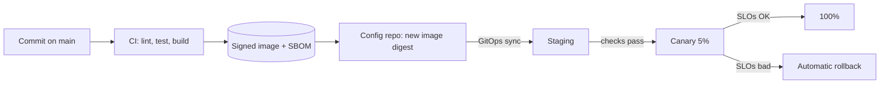

# CI/CD and delivery

How a commit becomes running code in production: safely, often, and without heroes.

## Why go deeper?

Teams that ship small changes many times a day have fewer outages, not more. But getting there is hard:

- CI takes 40 minutes, so people batch changes, so each deploy is bigger and riskier.
- "It built on my machine" and the CI artifact are different binaries.
- A long-lived feature branch takes a week to merge.
- A bad deploy reaches every user at once, and rollback means "revert and wait for CI".
- Nobody knows what is running in production, or who changed the firewall rule.

This chapter is about the machinery that makes small, safe changes cheap: fast pipelines, reproducible artifacts, gradual rollouts, and infrastructure described in code.

## The big picture

1. **Build once.** The same artifact, identified by its digest, goes to every environment.
2. **Git is the source of truth** for code _and_ for what runs where.
3. **Release gradually.** Let real traffic and [SLOs](../observability/index.md) decide if a change is good.
4. **Separate deploy from release.** Feature flags let you ship code that is turned off.

## Reading order

!!! note "Planned chapter"

    This section is a roadmap. The pages below are written in later sessions and linked here when they land.

| #   | Page                    | You will learn                                                                          |
| --- | ----------------------- | --------------------------------------------------------------------------------------- |
| 1   | CI pipelines            | How GitHub Actions runs a job, caching, matrices, fast feedback, keeping CI trustworthy |
| 2   | Reproducible builds     | Pinned tools, lock files, `-trimpath`, build IDs, proving two builds are the same       |
| 3   | Trunk-based development | Small PRs, short-lived branches, stacked changes, merge queues                          |
| 4   | Feature flags           | Deploy vs release, flag types, OpenFeature, cleaning up old flags                       |
| 5   | Deployment strategies   | Rolling, blue/green, canary, progressive delivery, database changes during deploys      |
| 6   | GitOps                  | Pull-based deploys with Argo CD or Flux, drift detection, environment promotion         |
| 7   | Infrastructure as code  | Terraform/OpenTofu state, plans and drift, modules, and reviewing infra changes safely  |

## How each page works

The same shape as the [Fundamentals](../fundamentals/index.md): **Why care?**, **The idea**, **Under the hood**, **Try it**, **Traps** and **Check yourself**. The running example is this site's own repository and the `orders` service: their CI workflows, pinned tools, and a deploy to a local `kind` cluster.
