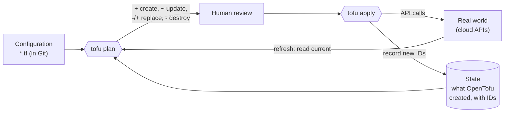
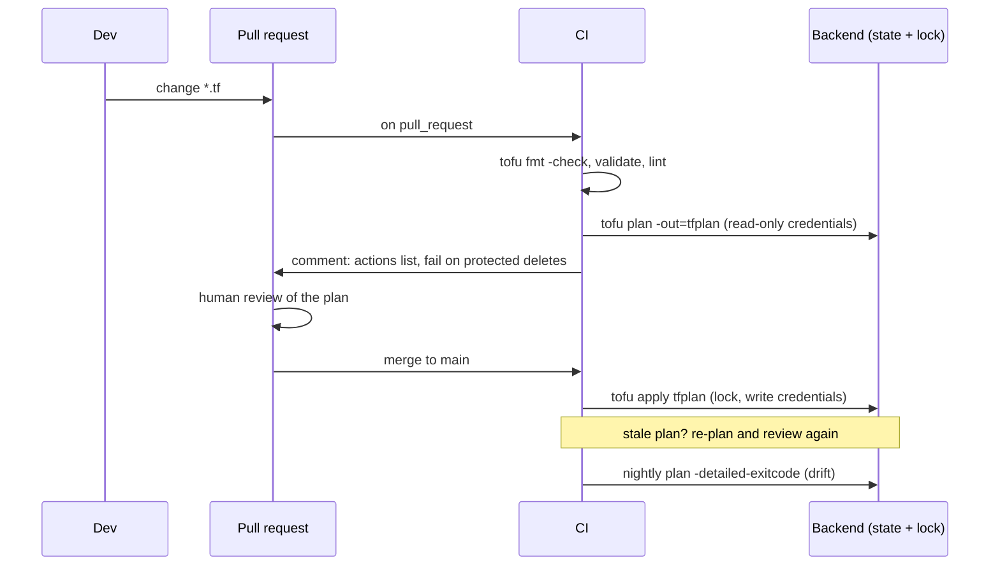

# Infrastructure as code

## Why care?

Four messages from teams that run real infrastructure:

- "Staging works, production doesn't. Somebody changed a firewall rule in the cloud console in March. Nobody knows which one."
- "The PR changed one line in a module. The plan said `3 to destroy`. Nobody read the plan. One of the three was the production database."
- "Two pipelines ran `apply` at the same time. Now the state file says the load balancer doesn't exist, but it does."
- "We found the database password in plain text. In the state file. In a bucket half the company can read."

**Infrastructure as code (IaC)** means you describe servers, networks, DNS records, buckets and databases in files, review them in pull requests like any other code, and let a tool make the real world match. The best-known tools are **Terraform** and its open-source fork **OpenTofu**. They share the language (HCL), the model and almost all commands.

This page explains that model: **configuration, state, plan, apply**. You run all of it for real with OpenTofu 1.13 on a laptop, using providers that create only local files, so nothing costs money and nothing can break. Then you break it on purpose: drift, a lock fight, a stale plan, a secret in the state.

## The idea: the architect, the plans and the site log

A building company works with three documents:

- The **drawing**: what the building should look like. That's your **configuration** (`*.tf` files).
- The **site log**: what was actually built, with the serial number of every beam. That's the **state** (`terraform.tfstate`).
- The **work order**: "add two windows on floor 3, remove the old door". The site manager writes it by comparing the drawing with what is there now. That's the **plan**.

Nobody builds without a work order, and nobody signs a work order without reading it. If someone knocked out a wall without telling anyone, the next inspection finds it: that's **drift**.



This is a cousin of the [Kubernetes reconciliation loop](../kubernetes/reconciliation.md): desired state, observed state, compute the difference, act. There are two big differences. Kubernetes reconciles **all the time, by itself**. OpenTofu reconciles **only when you run it**, and it shows you the difference first and waits for a human. The other: Kubernetes keeps its desired state in etcd; OpenTofu needs its own state file to know which real objects belong to it.

## Under the hood

### Providers and resources

OpenTofu itself knows nothing about AWS, DNS or Kubernetes. A **provider** is a plugin (a separate Go binary, talking gRPC to `tofu`) that maps resource types to API calls: `aws_s3_bucket`, `google_dns_record_set`, `kubernetes_deployment`. A **resource** block declares one object you want:

```hcl
resource "local_file" "config" {
  filename = "out/staging/ordersd.env"
  content  = "ORDERS_REPLICAS=1\n"
}
```

`local_file` is the **type** (from the provider `hashicorp/local`), `config` is the **name** in your code. Together, `local_file.config` is the resource's **address**. The address is how state, plan and every command refer to the object. Remember that: renaming a resource changes its address, and that matters later.

For this page we use three providers that need no cloud account:

| Provider / resource         | Creates                                     | Stands in for                          |
| --------------------------- | ------------------------------------------- | -------------------------------------- |
| `hashicorp/local`           | Files on disk                               | Any real resource (bucket, VM, record) |
| `hashicorp/random`          | Random strings and passwords, kept in state | Generated secrets, unique names        |
| `terraform_data` (built in) | Nothing; stores a value, can be replaced    | "Run something when X changes"         |

### State: the only memory OpenTofu has

The state file maps each **address** in your code to the **ID** of a real object, plus all its attributes the last time OpenTofu looked. Without it, OpenTofu cannot tell "this bucket is mine" from "this bucket happens to have the same name".

Three properties make state the most dangerous file in the repository:

1. **It must be shared.** If two people each have their own state, each thinks they own the infrastructure. Teams keep state in a **remote backend**: an S3 or GCS bucket, Azure blob storage, a PostgreSQL database, or a SaaS.
2. **It must be locked.** Two `apply` runs at the same time read the same old state, both change the world, and the last one to write wins. The backend takes a **lock** for every operation that may write.
3. **It contains secrets.** Every attribute is stored, including generated passwords and private keys. In plain text, unless you encrypt it. You will see this below.

### Plan, then apply

`tofu plan` does three things:

1. **Refresh**: ask each provider to read the current state of every object in the state file.
2. **Diff**: compare that with the configuration.
3. **Propose**: a list of actions, one per resource: `+` create, `~` update in place, `-/+` replace (destroy, then create), `-` destroy.

**Replace** is the one to watch. Some attributes cannot be changed on a live object (the disk type of a VM, the name of a database, the content of a `local_file`). Changing them means a new object, and for a database that means a new, empty database. The plan marks the attribute with `# forces replacement`.

`tofu plan -out=tfplan` saves the plan to a file. `tofu apply tfplan` then does **exactly** that plan, nothing else, and refuses if the state changed in the meantime. This is how a reviewed plan in CI becomes the applied plan.

### Modules: functions for infrastructure

A **module** is a directory of `.tf` files with **variables** (inputs) and **outputs**. Calling it is like calling a function. Every root configuration is a module; modules call other modules. You write one `ordersd-env` module and call it once per environment, so staging and production differ only in their inputs, not in copy-pasted code.

## Try it: `ordersd` environments with OpenTofu

```console
$ tofu version
OpenTofu v1.13.10
on linux_amd64
```

### Step 1: a module for one environment

The module `modules/ordersd-env/main.tf` creates what one environment of `ordersd` needs: a config file, a generated database password, and the password as a file:

```hcl
# Module ordersd-env: everything one environment of ordersd needs.
# Here "infrastructure" is local files, so you can run it on a laptop.

variable "name" {
  type        = string
  description = "Environment name, e.g. staging."
}

variable "replicas" {
  type    = number
  default = 2
  validation {
    condition     = var.replicas >= 1 && var.replicas <= 10
    error_message = "replicas must be between 1 and 10."
  }
}

variable "out_dir" {
  type = string
}

# The database password. random_password marks its result as sensitive.
resource "random_password" "db" {
  length  = 20
  special = false
}

resource "local_file" "config" {
  filename        = "${var.out_dir}/${var.name}/ordersd.env"
  file_permission = "0640"
  content         = <<-EOT
    ORDERS_ADDR=:8080
    ORDERS_LOG_FORMAT=json
    ORDERS_REPLICAS=${var.replicas}
  EOT
}

resource "local_sensitive_file" "db_secret" {
  filename = "${var.out_dir}/${var.name}/db-password"
  content  = random_password.db.result
}

output "config_file" {
  value = local_file.config.filename
}
```

`local_sensitive_file` refers to `random_password.db.result`. That reference is all OpenTofu needs to know the order: password first, then the file. OpenTofu builds a **dependency graph** from references and runs independent resources in parallel.

The root `main.tf` pins the providers and calls the module once per environment with `for_each`:

```hcl
terraform {
  required_version = ">= 1.10"
  required_providers {
    local = {
      source  = "hashicorp/local"
      version = "~> 2.5"
    }
    random = {
      source  = "hashicorp/random"
      version = "~> 3.6"
    }
  }
}

locals {
  out_dir = "${path.module}/out"
  envs = {
    staging = { replicas = 1 }
    prod    = { replicas = 3 }
  }
}

module "env" {
  source   = "./modules/ordersd-env"
  for_each = local.envs

  name     = each.key
  replicas = each.value.replicas
  out_dir  = local.out_dir
}

# A release marker: replaced whenever the image digest changes.
variable "image" {
  type    = string
  default = "ordersd@sha256:1111"
}

resource "terraform_data" "release" {
  triggers_replace = [var.image]
  input            = var.image
}

output "config_files" {
  value = { for k, m in module.env : k => m.config_file }
}
```

### Step 2: `init` downloads and pins the providers

```console
$ cd /tmp/tutor-iac
$ tofu init

Initializing the backend...
Initializing modules...
- env in modules/ordersd-env

Initializing provider plugins...
- terraform.io/builtin/terraform is built in to OpenTofu
- Finding hashicorp/local versions matching "~> 2.5"...
- Finding hashicorp/random versions matching "~> 3.6"...
- Installing hashicorp/random v3.9.1...
- Installing hashicorp/local v2.9.1...
- Installed hashicorp/random v3.9.1 (signed, key ID 0C0AF313E5FD9F80)
- Installed hashicorp/local v2.9.1 (signed, key ID 0C0AF313E5FD9F80)

Providers are signed by their developers.
If you'd like to know more about provider signing, you can read about it here:
https://opentofu.org/docs/cli/plugins/signing/

OpenTofu has created a lock file .terraform.lock.hcl to record the provider
selections it made above. Include this file in your version control repository
so that OpenTofu can guarantee to make the same selections by default when
you run "tofu init" in the future.

OpenTofu has been successfully initialized!
...
```

Two files to know:

- `.terraform/` holds the downloaded provider binaries and module copies. It is a cache. Don't commit it.
- `.terraform.lock.hcl` records the exact provider versions and their checksums. **Commit it.** It is the `go.sum` of OpenTofu, and it is what makes `init` on the CI runner pick the same binaries (see [Reproducible builds](reproducible-builds.md)):

```console
$ head -12 .terraform.lock.hcl
# This file is maintained automatically by "tofu init".
# Manual edits may be lost in future updates.

provider "registry.opentofu.org/hashicorp/local" {
  version     = "2.9.1"
  constraints = "~> 2.5"
  hashes = [
    "h1:0h5XUt+skYQCSCf+BHzPWHwaqVqo0I+6fasc7/9fP2Y=",
    "h1:5Y/Fp+WG8q5OO7fbf832bKjGJtKwrUmo0dK3e87ByVM=",
    "h1:9Ad43Ad5VA6HBc0qZVBQcCYZwuIvOAjhGOS+vUUUsKM=",
    "h1:MQmy73iXTph9jzxSMXNCeOxKdhNHCnjlQvj19kcJ9UI=",
    "h1:O+1x+SbVBhCnXLpYyyDlz1GYO5s22Qk+MZ37h9ofgqA=",
```

The version constraint `~> 2.5` means "2.5 or newer, but below 3.0". The lock file then fixes it to 2.9.1 until someone runs `tofu init -upgrade` and commits the new lock file in a PR.

### Step 3: plan

```console
$ tofu validate
Success! The configuration is valid.
$ tofu plan -out=tfplan | grep -E '^  # |^Plan:|Saved the plan'
  # terraform_data.release will be created
  # module.env["prod"].local_file.config will be created
  # module.env["prod"].local_sensitive_file.db_secret will be created
  # module.env["prod"].random_password.db will be created
  # module.env["staging"].local_file.config will be created
  # module.env["staging"].local_sensitive_file.db_secret will be created
  # module.env["staging"].random_password.db will be created
Plan: 7 to add, 0 to change, 0 to destroy.
Saved the plan to: tfplan
```

Look at the addresses: `module.env["prod"].local_file.config`. The module call, the `for_each` key, the resource. The full plan shows every attribute. Two parts of it:

```text
  # module.env["prod"].local_file.config will be created
  + resource "local_file" "config" {
      + content              = <<-EOT
            ORDERS_ADDR=:8080
            ORDERS_LOG_FORMAT=json
            ORDERS_REPLICAS=3
        EOT
      + content_base64sha256 = (known after apply)
      ...
      + file_permission      = "0640"
      + filename             = "./out/prod/ordersd.env"
      + id                   = (known after apply)
    }

  # module.env["prod"].random_password.db will be created
  + resource "random_password" "db" {
      + bcrypt_hash = (sensitive value)
      + id          = (known after apply)
      + length      = 20
      ...
      + result      = (sensitive value)
      + special     = false
      + upper       = true
    }
```

`(known after apply)`: the value only exists once the object exists, like a cloud ID or an IP address. `(sensitive value)`: the provider marked the attribute as secret, so the plan hides it. Hidden in the plan does **not** mean hidden in the state. Hold that thought.

### Step 4: apply the saved plan

```console
$ tofu apply tfplan
module.env["staging"].local_file.config: Creating...
module.env["prod"].local_file.config: Creating...
module.env["prod"].local_file.config: Creation complete after 0s [id=377796898876306d261a0c159c85e0937f75b516]
module.env["staging"].local_file.config: Creation complete after 0s [id=d16e6b6d5b62b9ad6c720398c69fdba9fea77b32]
terraform_data.release: Creating...
terraform_data.release: Creation complete after 0s [id=debbdf41-7a6c-0f98-e1d8-865f8903b4a6]
module.env["prod"].random_password.db: Creating...
module.env["staging"].random_password.db: Creating...
module.env["staging"].random_password.db: Creation complete after 0s [id=none]
module.env["prod"].random_password.db: Creation complete after 0s [id=none]
module.env["prod"].local_sensitive_file.db_secret: Creating...
module.env["staging"].local_sensitive_file.db_secret: Creating...
module.env["staging"].local_sensitive_file.db_secret: Creation complete after 0s [id=d5707275af9e11f06a623df8dd57a082f632670a]
module.env["prod"].local_sensitive_file.db_secret: Creation complete after 0s [id=6b0eeac28f6ec39a32c686ea90661fc75c369932]

Apply complete! Resources: 7 added, 0 changed, 0 destroyed.

Outputs:

config_files = {
  "prod" = "./out/prod/ordersd.env"
  "staging" = "./out/staging/ordersd.env"
}
```

The graph at work: the config files, the release marker and the passwords start in parallel; each password file starts only after its password exists. No "are you sure?" question: a saved plan was already reviewed.

### Step 5: look at the state

```console
$ tofu state list
terraform_data.release
module.env["prod"].local_file.config
module.env["prod"].local_sensitive_file.db_secret
module.env["prod"].random_password.db
module.env["staging"].local_file.config
module.env["staging"].local_sensitive_file.db_secret
module.env["staging"].random_password.db
$ tofu state show terraform_data.release
# terraform_data.release:
resource "terraform_data" "release" {
    id               = "debbdf41-7a6c-0f98-e1d8-865f8903b4a6"
    input            = "ordersd@sha256:1111"
    output           = "ordersd@sha256:1111"
    triggers_replace = [
        "ordersd@sha256:1111",
    ]
}
$ tofu state show 'module.env["staging"].random_password.db'
# module.env["staging"].random_password.db:
resource "random_password" "db" {
    bcrypt_hash = (sensitive value)
    id          = "none"
    length      = 20
    lower       = true
    min_lower   = 0
    min_numeric = 0
    min_special = 0
    min_upper   = 0
    number      = true
    numeric     = true
    result      = (sensitive value)
    special     = false
    upper       = true
}
```

Looks safe. Now look at the file itself:

```console
$ ls -l terraform.tfstate
-rw-r--r-- 1 you you 10297 Nov 27 11:56 terraform.tfstate
$ jq '{version, terraform_version, serial, lineage, resources: (.resources|length)}' terraform.tfstate
{
  "version": 4,
  "terraform_version": "1.13.10",
  "serial": 1,
  "lineage": "fd8bb2c4-2260-29c9-14c7-429bc3edb3e0",
  "resources": 7
}
$ jq -r '.resources[] | select(.type=="random_password" and .module=="module.env[\"staging\"]") | .instances[0].attributes.result' terraform.tfstate
8Kdgqfqh8NoZCvnnNx9J
$ cat out/staging/db-password
8Kdgqfqh8NoZCvnnNx9J
```

There it is: the staging database password, in plain JSON, in a file that anyone on the machine can read (`-rw-r--r--`). `(sensitive value)` was only a display filter. The fields to know:

- `serial` goes up with each write. A backend can refuse to overwrite a newer serial with an older one.
- `lineage` is set once when the state is created. A state with a different lineage is a different state, even with the same resources: OpenTofu refuses to mix them up.

The fixes, from most to least important: keep state in a backend with tight access control (state readers can read every secret), encrypt it, and avoid generating long-lived secrets in IaC when a secrets manager can do it (see the [Security](../security/index.md) chapter).

### Step 6: encrypt the state (OpenTofu only)

OpenTofu can encrypt state and plan files on the client, before they reach any backend. Terraform has no such feature; there you rely on the backend's encryption (for example S3 server-side encryption), which protects the disk, not the file from someone with read access. In a separate directory:

```hcl
variable "state_passphrase" {
  type      = string
  sensitive = true
}

terraform {
  encryption {
    key_provider "pbkdf2" "team" {
      passphrase = var.state_passphrase
    }
    method "aes_gcm" "main" {
      keys = key_provider.pbkdf2.team
    }
    state {
      method = method.aes_gcm.main
    }
    plan {
      method = method.aes_gcm.main
    }
  }
}

resource "random_password" "db" {
  length  = 20
  special = false
}
```

```console
$ export TF_VAR_state_passphrase=correct-horse-battery-staple
$ tofu init >/dev/null && tofu apply -auto-approve | tail -2
Apply complete! Resources: 1 added, 0 changed, 0 destroyed.
$ jq 'keys' terraform.tfstate
[
  "encrypted_data",
  "encryption_version",
  "lineage",
  "meta",
  "serial"
]
$ tofu state list
random_password.db
$ TF_VAR_state_passphrase=wrong-passphrase-123456 tofu state list

Error: Error refreshing the state

Failed to load state: decryption failed for all provided methods
attempted decryption failed for state: decryption failed: cipher: message
authentication failed
```

Only `serial` and `lineage` stay readable; the resources are one encrypted blob. A passphrase is the simplest key provider. In production you use a key management service (`aws_kms`, `gcp_kms`, `openbao`) so that no human handles the key. Losing the key means losing the state, so plan backups and key rotation before you turn it on.

### Step 7: no changes, then drift

Run a plan with nothing changed:

```console
$ tofu plan | tail -1
No changes. Your infrastructure matches the configuration.
```

Now be the colleague who "quickly fixes" production by hand:

```console
$ echo "ORDERS_REPLICAS=5" >> out/staging/ordersd.env
$ cat out/staging/ordersd.env
ORDERS_ADDR=:8080
ORDERS_LOG_FORMAT=json
ORDERS_REPLICAS=1
ORDERS_REPLICAS=5
$ tofu plan
terraform_data.release: Refreshing state... [id=debbdf41-7a6c-0f98-e1d8-865f8903b4a6]
module.env["staging"].local_file.config: Refreshing state... [id=d16e6b6d5b62b9ad6c720398c69fdba9fea77b32]
module.env["prod"].local_file.config: Refreshing state... [id=377796898876306d261a0c159c85e0937f75b516]
module.env["staging"].random_password.db: Refreshing state... [id=none]
module.env["prod"].random_password.db: Refreshing state... [id=none]
module.env["staging"].local_sensitive_file.db_secret: Refreshing state... [id=d5707275af9e11f06a623df8dd57a082f632670a]
module.env["prod"].local_sensitive_file.db_secret: Refreshing state... [id=6b0eeac28f6ec39a32c686ea90661fc75c369932]

Note: Objects have changed outside of OpenTofu

OpenTofu detected the following changes made outside of OpenTofu since the
last "tofu apply" which may have affected this plan:

  # module.env["staging"].local_file.config has been deleted
  - resource "local_file" "config" {
      - filename             = "./out/staging/ordersd.env" -> null
        id                   = "d16e6b6d5b62b9ad6c720398c69fdba9fea77b32"
        # (9 unchanged attributes hidden)
    }


Unless you have made equivalent changes to your configuration, or ignored the
relevant attributes using ignore_changes, the following plan may include
actions to undo or respond to these changes.

─────────────────────────────────────────────────────────────────────────────

OpenTofu used the selected providers to generate the following execution
plan. Resource actions are indicated with the following symbols:
  + create

OpenTofu will perform the following actions:

  # module.env["staging"].local_file.config will be created
  + resource "local_file" "config" {
      + content              = <<-EOT
            ORDERS_ADDR=:8080
            ORDERS_LOG_FORMAT=json
            ORDERS_REPLICAS=1
        EOT
      ...
    }

Plan: 1 to add, 0 to change, 0 to destroy.
```

Read it in two parts:

1. **"Objects have changed outside of OpenTofu"**: the refresh found drift. How it looks depends on the provider. The `local` provider identifies a file by the checksum of its content (the `id` is the SHA-1). A file with different content is, to this provider, a different file, so the old one "has been deleted". A cloud provider would show `~` with the changed attributes instead.
2. **The plan**: put the file back the way the code says. The manual fix would be undone. That's the point: the code is the truth, and a hand change survives only until the next apply.

You can detect drift in CI without changing anything. `-detailed-exitcode` makes `plan` exit with 2 when there are changes:

```console
$ tofu plan -detailed-exitcode >/dev/null 2>&1; echo "exit=$?"
exit=2
```

A nightly job that runs this against production and alerts on `2` is a cheap drift detector. And `-refresh-only` shows only the drift, with a plan that would update the **state** to match the world, not the other way round. You use it when the hand change was right and you are about to write it into the code too:

```console
$ tofu plan -refresh-only
...
This is a refresh-only plan, so OpenTofu will not take any actions to undo
these. If you were expecting these changes then you can apply this plan to
record the updated values in the OpenTofu state without changing any remote
objects.
```

Here the hand change was wrong, so apply the normal plan:

```console
$ tofu apply -auto-approve | grep -v Refreshing | tail -12
Plan: 1 to add, 0 to change, 0 to destroy.
module.env["staging"].local_file.config: Creating...
module.env["staging"].local_file.config: Creation complete after 0s [id=d16e6b6d5b62b9ad6c720398c69fdba9fea77b32]

Apply complete! Resources: 1 added, 0 changed, 0 destroyed.

Outputs:

config_files = {
  "prod" = "./out/prod/ordersd.env"
  "staging" = "./out/staging/ordersd.env"
}
$ cat out/staging/ordersd.env
ORDERS_ADDR=:8080
ORDERS_LOG_FORMAT=json
ORDERS_REPLICAS=1
```

Same content, so same checksum, so the same `id` as before.

### Step 8: a real change, and how to review it

Now a PR: production gets 4 replicas, and a new image digest. The plan, saved for review:

```console
$ sed -i 's/prod    = { replicas = 3 }/prod    = { replicas = 4 }/' main.tf
$ tofu plan -var image=ordersd@sha256:2222 -out=tfplan
...
OpenTofu used the selected providers to generate the following execution
plan. Resource actions are indicated with the following symbols:
-/+ destroy and then create replacement

OpenTofu will perform the following actions:

  # terraform_data.release must be replaced
-/+ resource "terraform_data" "release" {
      ~ id               = "debbdf41-7a6c-0f98-e1d8-865f8903b4a6" -> (known after apply)
      ~ input            = "ordersd@sha256:1111" -> "ordersd@sha256:2222"
      ~ output           = "ordersd@sha256:1111" -> (known after apply)
      ~ triggers_replace = [
          - "ordersd@sha256:1111",
          + "ordersd@sha256:2222",
        ]
    }

  # module.env["prod"].local_file.config must be replaced
-/+ resource "local_file" "config" {
      ~ content              = <<-EOT # forces replacement
            ORDERS_ADDR=:8080
            ORDERS_LOG_FORMAT=json
          - ORDERS_REPLICAS=3
          + ORDERS_REPLICAS=4
        EOT
      ...
      ~ id                   = "377796898876306d261a0c159c85e0937f75b516" -> (known after apply)
        # (3 unchanged attributes hidden)
    }

Plan: 2 to add, 0 to change, 2 to destroy.
```

`2 to destroy`. For files that's fine. For a database it would be a disaster, and the summary line looks just as calm. That's why reviewers read the **actions**, not the diff of the `.tf` files. A machine-readable plan makes this easy to automate:

```console
$ tofu show -json tfplan | jq -r '.resource_changes[] | select(.change.actions != ["no-op"]) | "\(.change.actions | join(",")) \(.address)"'
delete,create terraform_data.release
delete,create module.env["prod"].local_file.config
```

A CI job can post this list as a PR comment, and **fail** if any `delete` touches a resource type on a protected list (databases, buckets, DNS zones). Tools like Atlantis, or policy engines like OPA/Conftest, are built around exactly this JSON.

Inside the configuration, the last line of defence is `lifecycle { prevent_destroy = true }` on the resources you can't lose: any plan that would destroy them fails.

### Step 9: a stale plan is refused

Keep a copy of the plan, apply the original, then try to apply the copy:

```console
$ cp tfplan old.tfplan
$ tofu apply tfplan | grep -E "Apply|Destroy|Creat"
terraform_data.release: Destroying... [id=debbdf41-7a6c-0f98-e1d8-865f8903b4a6]
terraform_data.release: Creating...
terraform_data.release: Creation complete after 0s [id=8a1f3a4d-fbec-a11b-71e9-86f7a40c7eeb]
module.env["prod"].local_file.config: Destroying... [id=377796898876306d261a0c159c85e0937f75b516]
module.env["prod"].local_file.config: Creating...
module.env["prod"].local_file.config: Creation complete after 0s [id=0735ede0bde768777772b7dcf21c7dd0ece4fc09]
Apply complete! Resources: 2 added, 0 changed, 2 destroyed.
$ tofu apply old.tfplan

Error: Saved plan is stale

The given plan file can no longer be applied because the state was changed by
another operation after the plan was created.
```

This protects you from the classic pipeline bug: plan on Monday, review on Tuesday, apply on Wednesday after someone else already applied a different change. The plan file remembers the state it was made from, and refuses if that state moved. Make a new plan, and review again.

### Step 10: locking

With the default **local** backend, OpenTofu locks the state file with an OS file lock and writes `.terraform.tfstate.lock.info` next to it. In another directory, a resource that takes 8 seconds to create:

```hcl
resource "terraform_data" "slow" {
  provisioner "local-exec" {
    command = "sleep 8"
  }
}
```

Start an apply in the background, then plan in the foreground:

```console
$ tofu apply -auto-approve > first.log 2>&1 &
$ sleep 2
$ jq . .terraform.tfstate.lock.info
{
  "ID": "39376825-63c8-11fd-78c3-06e19a0e7af9",
  "Operation": "OperationTypeApply",
  "Info": "",
  "Who": "you@laptop",
  "Version": "1.13.10",
  "Created": "2026-11-27T10:57:18.989600782Z",
  "Path": "terraform.tfstate"
}
$ tofu plan

Error: Error acquiring the state lock

Error message: resource temporarily unavailable
Lock Info:
  ID:        39376825-63c8-11fd-78c3-06e19a0e7af9
  Path:      terraform.tfstate
  Operation: OperationTypeApply
  Who:       you@laptop
  Version:   1.13.10
  Created:   2026-11-27 10:57:18.989600782 +0000 UTC
  Info:


OpenTofu acquires a state lock to protect the state from being written
by multiple users at the same time. Please resolve the issue above and try
again. For most commands, you can disable locking with the "-lock=false"
flag, but this is not recommended.
```

`Who` and `Created` tell you who to ask. In CI, don't fail at once; wait. `-lock-timeout` retries:

```console
$ tofu apply -auto-approve > first.log 2>&1 &
$ sleep 2
$ date +%T; tofu plan -lock-timeout=30s > second.log 2>&1; echo exit=$?; date +%T
11:57:39
exit=0
11:57:46
$ grep -E "Plan:|No changes" second.log
No changes. Your infrastructure matches the configuration.
```

The plan waited 7 seconds for the apply to finish, then saw the new state. With a remote backend the lock lives in the backend instead (for S3, a lock object next to the state, or a DynamoDB table in older setups; for PostgreSQL, an advisory lock). If a CI runner dies mid-apply, the lock stays. `tofu force-unlock <ID>` removes it, but only after you've checked that the apply really is dead, or you are back to two writers.

### Step 11: refactoring without destroying

Renaming a resource changes its address. To OpenTofu, the old address disappeared (destroy) and a new one appeared (create):

```console
$ sed -i 's/resource "terraform_data" "release" {/resource "terraform_data" "release_marker" {/' main.tf
$ tofu plan -var image=ordersd@sha256:2222 | grep -E '^\s*#|Plan:'
  # terraform_data.release will be destroyed
  # (because terraform_data.release is not in configuration)
  # terraform_data.release_marker will be created
Plan: 1 to add, 0 to change, 1 to destroy.
```

For a database, that rename would delete production. A `moved` block tells OpenTofu that it's the same object under a new name:

```hcl
moved {
  from = terraform_data.release
  to   = terraform_data.release_marker
}
```

```console
$ tofu plan -var image=ordersd@sha256:2222 | sed -n '/will perform/,/Plan:/p'
OpenTofu will perform the following actions:

  # terraform_data.release has moved to terraform_data.release_marker
    resource "terraform_data" "release_marker" {
        id               = "8a1f3a4d-fbec-a11b-71e9-86f7a40c7eeb"
        # (3 unchanged attributes hidden)
    }

Plan: 0 to add, 0 to change, 0 to destroy.
```

The same works for moving resources into a module, or from `count` to `for_each`. `moved` blocks are reviewed in the PR like any other code, unlike `tofu state mv`, which edits the state by hand and leaves no trace in Git. There is a matching `import` block for adopting objects that were created by hand.

### Step 12: inputs are checked

The `validation` block in the module catches bad input before any plan is made:

```console
$ sed -i 's/replicas = 4 }/replicas = 11 }/' main.tf
$ tofu plan -var image=ordersd@sha256:2222 | grep -v Refreshing
Planning failed. OpenTofu encountered an error while generating this plan.


Error: Invalid value for variable

  on main.tf line 28, in module "env":
  28:   replicas = each.value.replicas
    ├────────────────
    │ var.replicas is 11

replicas must be between 1 and 10.

This was checked by the validation rule at
modules/ordersd-env/main.tf:12,3-13.
```

### Clean up

```console
$ tofu destroy -auto-approve -var image=ordersd@sha256:2222 | tail -3
module.env["staging"].random_password.db: Destruction complete after 0s

Destroy complete! Resources: 7 destroyed.
```

## IaC in a delivery pipeline

Put together with the rest of this chapter, a safe workflow for infrastructure looks like this:



Rules that come out of the experiments above:

- **One state per environment** (and often per component: network, database, app), not one giant state. A small state means a small blast radius, faster plans, and shorter lock waits.
- **Plan with read-only credentials, apply with write credentials**, and only from `main`. The PR job should not be able to change production. ([CI pipelines](ci-pipelines.md) covers job permissions.)
- **Apply the reviewed plan file**, not a new plan. OpenTofu refuses stale plans for you.
- **Nobody changes production by hand.** If they must (an incident), the fix goes into code the same day, or the next apply undoes it.
- **Pin everything**: `required_version`, provider versions, the lock file, module versions (`?ref=v1.4.0` with a commit SHA for Git sources).

Terraform and OpenTofu split in 2023, when HashiCorp moved Terraform to a source-available license and the community forked the last open-source version as OpenTofu (now a Linux Foundation project). The language and most of the CLI are still the same; differences are growing in newer features (state encryption above is OpenTofu-only). Pick one per organisation and don't mix them on the same state.

## Traps

- **Reading the `.tf` diff instead of the plan.** A one-line change in a module can replace ten resources. Review the actions (`-/+`, `-`) and let CI fail on protected deletes.
- **`# forces replacement` on a stateful resource.** Some attribute changes destroy and re-create. For databases, volumes and buckets use `prevent_destroy`, and check the provider docs for which attributes force a new object.
- **Renaming without `moved`.** A new address is a new object: destroy plus create.
- **Secrets in state.** `(sensitive value)` hides values on screen only. Anyone who can read the state can read every password and key. Lock down the backend; on OpenTofu, encrypt state.
- **State on a laptop.** Local state is fine for learning. For a team, use a remote backend with locking from day one.
- **`-lock=false` and `force-unlock` in a hurry.** Two writers on one state corrupt it. Check who holds the lock before you break it.
- **Applying an old plan.** OpenTofu refuses a stale plan file; don't work around it by re-planning and applying without review.
- **Hand changes ("ClickOps").** The next apply silently undoes them, or a drifted resource surprises the next person. Detect drift nightly.
- **Floating versions.** `version = ">= 3.0"` without a committed lock file means CI and your laptop may run different provider code.
- **`-target` as a habit.** It plans only part of the graph. It's for emergencies; regular use means your state is too big.

## Check yourself

??? question "1. What are configuration, state and plan, and which one is the truth about the real world?"

    Configuration (`*.tf`) is what you want. State is what OpenTofu created last time, with
    real IDs. The plan is the difference between the configuration and the real world (read
    via refresh), as a list of actions. None of them is the truth: the real world is. That's
    why `plan` refreshes first, and why drift shows up there.

??? question "2. The plan says `Plan: 2 to add, 0 to change, 2 to destroy` for a change that 'only edits one attribute'. What happened, and what do you look for?"

    The attribute cannot be changed in place, so the resource is **replaced**: destroyed,
    then created. Look for `-/+` and `# forces replacement` in the plan. For a stateful
    resource (database, volume), stop: find another way (an in-place attribute, a migration),
    and protect it with `prevent_destroy`.

??? question "3. `tofu state show` prints `result = (sensitive value)`. Is the password safe?"

    No. "Sensitive" only hides the value in CLI output. The state file stores it in plain
    text: `jq` on `terraform.tfstate` printed it above. Restrict who can read the state
    backend, and on OpenTofu enable state encryption with a KMS key.

??? question "4. Why does `tofu apply old.tfplan` fail with `Saved plan is stale`, and why is that good?"

    The state changed (another apply ran) after the plan was made. Applying it anyway would
    act on old assumptions, maybe undoing the other change. OpenTofu refuses, so you make a
    new plan and review it again.

??? question "5. You rename `aws_db_instance.main` to `aws_db_instance.orders`. What will the plan do, and how do you prevent it?"

    The old address is gone from the configuration, so it plans to destroy the database, and
    to create a new, empty one at the new address. Add a `moved { from = aws_db_instance.main
    to = aws_db_instance.orders }` block. The plan then shows "has moved" and 0 changes.

??? question "6. How do you detect drift in production without changing anything?"

    Run `tofu plan -detailed-exitcode` on a schedule (for example nightly), with read-only
    credentials. Exit code 0 means no changes, 2 means the world and the code differ, 1 is
    an error. Alert on 2. `tofu plan -refresh-only` shows only what changed outside OpenTofu.

## Recap

- IaC describes infrastructure in reviewed, versioned files. OpenTofu (and Terraform) **plan** the difference between code and reality, and **apply** it after a human reads it.
- **Providers** turn resource types into API calls. `init` downloads them; `.terraform.lock.hcl` pins versions and checksums. Commit it.
- **State** maps addresses to real IDs. It must be shared (remote backend), locked, and protected: it contains secrets in plain text. OpenTofu can encrypt it.
- Watch for `-/+` (**replace**) and `-` (**destroy**) in every plan. `tofu show -json` lets CI check actions automatically.
- Apply the **saved plan**; stale plans are refused. Locks stop two writers; `-lock-timeout` waits politely.
- **Drift** is any change made outside OpenTofu. `plan` shows it; `-detailed-exitcode` turns it into an alert; the next apply undoes it.
- **Modules** with validated inputs replace copy-paste between environments. `moved` blocks make refactoring safe.

## You finished CI/CD and delivery

You can now follow a change all the way: a [CI pipeline](ci-pipelines.md) that is fast and trustworthy, a [reproducible build](reproducible-builds.md), [small changes on trunk](trunk-based-development.md), [feature flags](feature-flags.md) that separate deploy from release, [rolling, blue/green and canary deploys](deployment-strategies.md), [GitOps](gitops.md) to keep clusters in sync with Git, and infrastructure described in code.

Several times in this chapter, a secret sat somewhere it should not: in a state file, in CI, in a flag context. Next, the [Security](../security/index.md) chapter: how systems get attacked, and the small set of ideas (identity, permissions, secrets, the supply chain) that stop most attacks.
