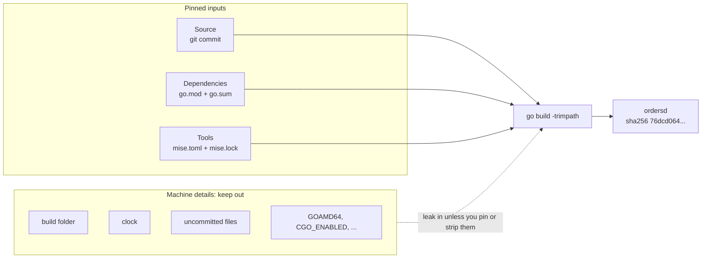

# Reproducible builds

## Why care?

You cannot answer these three questions unless your builds are reproducible:

- "The security team asks: is the `ordersd` binary in production really built from commit `2115e35`? Prove it."
- "We rebuilt last month's release to patch one line, and the diff between the two binaries is 4 MB. What else changed?"
- "CI built it with golangci-lint 2.15, my laptop has 2.10, and the new linter version finds 30 issues on a release branch."

A build is **reproducible** when the same source, built with the same tools, gives the **same bytes**, on any machine, at any time. Then a checksum is a proof. Anyone can rebuild the commit, compare `sha256sum`, and know that nothing was added on the way: not a compromised CI runner, not a developer's local change, not a different compiler.

Go is very good at this, but not by accident. On this page you build `ordersd` twice and get the same hash, then break reproducibility four different ways and see exactly which input leaked in each time.

## The idea: name every input exactly

A build gives the same output only when every input is named exactly. "Go 1.27" is not exact enough; "Go 1.27.4, this download, this checksum" is. A build has three kinds of input:

1. **Source and dependencies**: your code and every module it uses. Fixed by the Git commit, `go.mod` and `go.sum`.
2. **Tools**: the Go toolchain and every other tool. Fixed by `mise.toml` and `mise.lock`.
3. **The build machine**: everything about the machine that the build might pick up. The folder you build in, the time, environment variables, whether the Git tree is clean. You keep these **out** of the result with flags such as `-trimpath`.



## Under the hood: pinning the tools

### `mise.toml` and `mise.lock`

This repository pins every tool by exact version in `mise.toml`:

```toml
[tools]
python = "3.13.18"
"pipx:zensical" = "0.1.3"
go = "1.27.4"
golangci-lint = "2.15.0"
actionlint = "1.7.12"
bun = "1.4.5"

[settings]
# install only what mise.lock records; run `mise lock` after changing a version
locked = true
```

A version number is a name. Names can lie: a release can be re-uploaded, a download mirror can be compromised. So `mise.lock` also records **where** each tool came from and **what its bytes hash to**, per platform:

```toml
[[tools.go]]
version = "1.27.4"
backend = "core:go"
specifiers = ["1.27.4"]

[tools.go."platforms.linux-x64"]
checksum = "sha256:7226736c2339719cda28fbf3a54d71aa63bcefe376e98cef00034268dab24840"
url = "https://dl.google.com/go/go1.27.4.linux-amd64.tar.gz"
```

With `locked = true`, mise only installs what the lock file records and checks the checksum. Your laptop and the CI runner get the same Go, the same linter, the same `actionlint`:

```console
$ mise ls --current
actionlint     1.7.12   ~/src/tutor/mise.toml  1.7.12
bun            1.4.5    ~/src/tutor/mise.toml  1.4.5
go             1.27.4   ~/src/tutor/mise.toml  1.27.4
golangci-lint  2.15.0   ~/src/tutor/mise.toml  2.15.0
pipx:zensical  0.1.3    ~/src/tutor/mise.toml  0.1.3
python         3.13.18  ~/src/tutor/mise.toml  3.13.18
```

The [mise page](../toolbox/mise.md) explains how it puts these on your `PATH`. The [toolchain page](../go/toolchain.md#gotoolchain-go-manages-its-own-version) explains Go's own mechanism, `GOTOOLCHAIN`, which can download a newer Go when `go.mod` asks for one. In CI, set `GOTOOLCHAIN=local` so the build fails instead of quietly using a different compiler.

### `go.sum`: a hash for every dependency

`go.mod` says **which versions** you use. `go.sum` says **what those versions contain**: a hash of each module's files (`h1:`) and of its `go.mod`. The [Modules](../go/modules.md) page explains why Go needs no separate lock file. For reproducibility, the important part is that Go **checks** every module it uses against `go.sum`:

```console
$ go mod verify
all modules verified
$ grep 'x/vuln v1.10.0' go.sum
golang.org/x/vuln v1.10.0 h1:W/Im35AGknunDiqBysVe9VoMfaeTJE7lptrD+1s//aE=
golang.org/x/vuln v1.10.0/go.mod h1:kNpckBWtSQiR+USd0ZgdhJCCWf/ZXOl1+n3Wybcj8eE=
```

Now suppose somebody replaced that module's code. Change four characters of its hash in `go.sum`, and run the tool it provides:

```console
$ go tool govulncheck -version
verifying golang.org/x/vuln@v1.10.0: checksum mismatch
	downloaded: h1:W/Im35AGknunDiqBysVe9VoMfaeTJE7lptrD+1s//aE=
	go.sum:     h1:AAAA35AGknunDiqBysVe9VoMfaeTJE7lptrD+1s//aE=

SECURITY ERROR
This download does NOT match an earlier download recorded in go.sum.
The bits may have been replaced on the origin server, or an attacker may
have intercepted the download attempt.

For more information, see 'go help module-auth'.
```

The build stops. There is no flag to say "build anyway". That's the point. (Put `go.sum` back afterwards.)

## Under the hood: what Go puts into a binary

### Build info: `go version -m`

Every Go binary carries a small text record of how it was built. You saw it on the [toolchain page](../go/toolchain.md#know-what-is-running-version-stamping). Here it is for `ordersd`, built in a Git repository with a clean tree:

```console
$ CGO_ENABLED=0 go build -trimpath -o out/ ./cmd/ordersd
$ go version -m out/ordersd
out/ordersd: go1.27.4
	path	github.com/acme/orders/cmd/ordersd
	mod	github.com/acme/orders	v0.0.0-20261127090000-2115e35e9617
	build	-buildmode=exe
	build	-compiler=gc
	build	-trimpath=true
	build	CGO_ENABLED=0
	build	GOARCH=amd64
	build	GOOS=linux
	build	GOAMD64=v1
	build	vcs=git
	build	vcs.revision=2115e35e961724b06cb454f192658712943a3c94
	build	vcs.time=2026-11-27T09:00:00Z
	build	vcs.modified=false
```

Every line is an **input**. Change any of them, and you get a different binary. That's a good thing: it means the binary tells the truth about where it came from. The Go version, the flags, the environment variables that matter (`CGO_ENABLED`, `GOAMD64`), and the commit. `vcs.modified=false` says the working tree had no changes. Because the tree is clean, Go even gives the main module a version made from the commit time and hash (`v0.0.0-20261127090000-2115e35e9617`) instead of `(devel)`. `orderctl` reads the same record at run time (see [`internal/buildinfo`](../go/cli.md)):

```console
$ orderctl version
orderctl v1.0.0 (go1.27.4, commit 2115e35e961724b06cb454f192658712943a3c94, committed 2026-11-27T09:00:00Z)
```

The `vcs.*` lines are controlled by `-buildvcs`. From `go help build`:

```text
	-buildvcs
		Whether to stamp binaries with version control information
		("true", "false", or "auto"). By default ("auto"), version control
		information is stamped into a binary if the main package, the main module
		containing it, and the current directory are all in the same repository.
```

### Build IDs: how the build cache knows what changed

There is a second, hidden stamp: the **build ID**. `go tool buildid` prints it:

```console
$ go tool buildid out/ordersd
oQpq5p4YYOlepjgZYBsj/414rDRUO6K8TCp_d-_l1/4cBZ0cxFEhFO7dyEHTFO/FMkEk6QHhktuW0IDDhzX
```

Four parts. The Go source (`cmd/go/internal/work/buildid.go`) explains them:

```text
actionID(binary)/actionID(main.a)/contentID(main.a)/contentID(binary)
```

- An **action ID** is a hash of all the **inputs** of a build step: source files, flags, the compiler, and the content IDs of its dependencies.
- A **content ID** is a hash of the **output** of that step.

This is how `go build` knows that nothing needs rebuilding: if the action ID is the same as last time, the result in the build cache is still right. It is also why Go builds are reproducible by design. Each step's action ID is made from the **content** of its inputs, never from time stamps or file dates. Same inputs, same IDs, same bytes, all the way up.

## Try it: same commit, same bytes

### 1. Build twice, compare

A throwaway Git repository at `/tmp/tutor-repro/vcs/orders` holds a copy of `examples/orders`, committed once with a fixed date. Build `ordersd`, add nothing, build again. Then clone it to a completely different path (like a second CI runner would) and build there:

```console
$ cd /tmp/tutor-repro/vcs/orders
$ CGO_ENABLED=0 go build -trimpath -o ../out/ ./cmd/ordersd && sha256sum ../out/ordersd | cut -c1-16
76dcd0649c41cf36
$ CGO_ENABLED=0 go build -trimpath -o ../out/ ./cmd/ordersd && sha256sum ../out/ordersd | cut -c1-16
76dcd0649c41cf36
$ git clone -q /tmp/tutor-repro/vcs/orders /tmp/tutor-repro/vcs/runner-2/work/orders
$ cd /tmp/tutor-repro/vcs/runner-2/work/orders
$ CGO_ENABLED=0 go build -trimpath -o ../../../out2/ ./cmd/ordersd && sha256sum ../../../out2/ordersd | cut -c1-16
76dcd0649c41cf36
$ go tool buildid ../../../out2/ordersd
oQpq5p4YYOlepjgZYBsj/414rDRUO6K8TCp_d-_l1/4cBZ0cxFEhFO7dyEHTFO/FMkEk6QHhktuW0IDDhzX
```

Same hash, same build ID, from a different folder. That is the goal. The next steps break it.

### 2. Break it: no `-trimpath`, different folders

Copy the source (without `.git`) to two folders: one like a developer's checkout, one like a CI runner's. Build with and without `-trimpath` in each, each with its own empty build cache:

```console
$ cd /tmp/tutor-repro/alice/src     && CGO_ENABLED=0 go build -o ../plain-ordersd ./cmd/ordersd
$ cd /tmp/tutor-repro/ci/builds/x7f && CGO_ENABLED=0 go build -o ../plain-ordersd ./cmd/ordersd
$ # ... and the same two with -trimpath, into trim-ordersd
$ cd /tmp/tutor-repro && sha256sum alice/plain-ordersd ci/builds/plain-ordersd alice/trim-ordersd ci/builds/trim-ordersd
212453ece6dd0e6c6569d9c2ac51925daf363450973ca542d49dd26c50173c94  alice/plain-ordersd
a875517c8a6120ba82f68a338afd201f424d83ecc14fdff40922a94306872403  ci/builds/plain-ordersd
1550bdd5f603fc34e5fb19a6e36c97cf25b0f5eae7791cc81a79eea0e4c644ff  alice/trim-ordersd
1550bdd5f603fc34e5fb19a6e36c97cf25b0f5eae7791cc81a79eea0e4c644ff  ci/builds/trim-ordersd
$ strings alice/plain-ordersd | grep -m3 /tmp/tutor-repro
/tmp/tutor-repro/alice/src/internal/buildinfo/buildinfo.go
/tmp/tutor-repro/alice/src/internal/config/config.go
/tmp/tutor-repro/alice/src/internal/order/order.go
$ strings alice/trim-ordersd | grep -c /tmp/tutor-repro
0
```

Without `-trimpath`, Go records **absolute file paths** for stack traces and debug info. Different folder, different bytes. On a laptop it also leaks `/home/<your name>/...` into every binary you ship. With `-trimpath` the paths become module paths (`github.com/acme/orders/internal/...`), and the two builds match.

### 3. Break it: a dirty working tree

Back in the Git repository. Create one untracked file, which isn't even Go code, and build:

```console
$ echo notes > NOTES.txt
$ CGO_ENABLED=0 go build -trimpath -o ../out/ ./cmd/ordersd && sha256sum ../out/ordersd | cut -c1-16
385a1e48c0484dd2
$ go version -m ../out/ordersd | grep vcs
	build	vcs=git
	build	vcs.revision=2115e35e961724b06cb454f192658712943a3c94
	build	vcs.time=2026-11-27T09:00:00Z
	build	vcs.modified=true
$ rm NOTES.txt
$ CGO_ENABLED=0 go build -trimpath -o ../out/ ./cmd/ordersd && sha256sum ../out/ordersd | cut -c1-16
76dcd0649c41cf36
```

`vcs.modified=true` is honest: "this binary is commit `2115e35` **plus something**". An untracked file counts. That's why release builds must come from a clean checkout in CI, never from a laptop. Delete the file and the hash is back.

And `-buildvcs=false`?

```console
$ CGO_ENABLED=0 go build -trimpath -buildvcs=false -o ../out/ ./cmd/ordersd && sha256sum ../out/ordersd | cut -c1-16
1550bdd5f603fc34
```

That's exactly the hash of the `.git`-less copies in step 2. Without VCS stamping, the binary no longer says which commit it is. It is still reproducible, but now **you** must record the commit somewhere else. A Docker build where `.dockerignore` keeps `.git` out of the context is in this situation. That's why the `orders` Dockerfile passes the version with `-ldflags -X` (see [Building good images](../containers/building-images.md#build-flags-that-matter-inside-an-image)).

### 4. Break it: the clock

Many teams put the build time into the version string. This is what it does:

```console
$ for i in 1 2; do
    CGO_ENABLED=0 go build -trimpath \
      -ldflags "-X github.com/acme/orders/internal/buildinfo.version=v1.0.0-$(date +%s%N)" \
      -o ../d$i/ ./cmd/ordersd
    sha256sum ../d$i/ordersd | cut -c1-16
  done
bc5e2c3c838e781c
8b82d65335d41f71
```

Two builds of one commit, two binaries. Nobody can ever rebuild either of them. Use a time that belongs to the **commit** instead:

```console
$ for i in 1 2; do
    CGO_ENABLED=0 go build -trimpath \
      -ldflags "-X github.com/acme/orders/internal/buildinfo.version=v1.0.0+$(git log -1 --format=%cd --date=format:%Y%m%d%H%M%S)" \
      -o ../c$i/ ./cmd/ordersd
    sha256sum ../c$i/ordersd | cut -c1-16
  done
1281db864a4eb77f
1281db864a4eb77f
```

You may not need a time at all. `vcs.time` is already in the binary.

### 5. Break it: the environment

Two environment variables, two more binaries:

```console
$ CGO_ENABLED=0 go build -trimpath -o ../env/1/ ./cmd/ordersd
$ CGO_ENABLED=0 GOAMD64=v3 go build -trimpath -o ../env/2/ ./cmd/ordersd
$ CGO_ENABLED=1 go build -trimpath -o ../env/3/ ./cmd/ordersd
$ for i in 1 2 3; do sha256sum ../env/$i/ordersd | cut -c1-16; done
76dcd0649c41cf36
c3cdcd6a962e8a80
67c219109f9d9e3b
```

`GOAMD64=v3` lets the compiler use newer CPU instructions. `CGO_ENABLED=1` (the default when a C compiler is installed) links against the system's C library: the binary becomes dynamically linked, and now the build machine's `libc` is an input too. Both settings appear in `go version -m`, so the binary is honest about it. But your build is only reproducible if CI **sets** them, instead of inheriting whatever the runner has. That's one more reason for `CGO_ENABLED=0` in the Makefile and the Dockerfile.

### What you proved

| Experiment                       | Same bytes? | The input that leaked       | Fix                                   |
| -------------------------------- | ----------- | --------------------------- | ------------------------------------- |
| Same commit, twice, two folders  | yes         | nothing                     |                                       |
| No `-trimpath`, two folders      | no          | build folder path           | `-trimpath`                           |
| Untracked file in the tree       | no          | `vcs.modified=true`         | build from a clean checkout in CI     |
| `-buildvcs=false`                | yes         | (commit no longer recorded) | record the version with `-ldflags -X` |
| `date` in `-ldflags`             | no          | the clock                   | commit time, or nothing               |
| `GOAMD64`, `CGO_ENABLED` not set | no          | runner environment          | set them explicitly in the build      |

The binary is not the end. A container image wraps it in a tar file with time stamps, and those break reproducibility again. [Building good images](../containers/building-images.md#reproducible-builds-same-input-same-digest) shows the same binary inside two images with different digests, and fixes it with `SOURCE_DATE_EPOCH` and `rewrite-timestamp=true`.

## Why this matters in an enterprise

- **Audits and incidents.** "What is running?" has an exact answer: the digest, which maps to one commit and one set of tool versions.
- **Supply-chain security.** If a second, independent build (another runner, another team) produces the same hash, a compromised CI machine can't sneak code in without being noticed. This is the idea behind SLSA's higher levels and signed provenance, covered in the [Security](../security/index.md) chapter.
- **Build once, promote everywhere.** Staging and production run the same artifact, identified by its hash. You never rebuild "for prod".
- **Cheaper caches.** Reproducible outputs make remote build caches and Docker layer caches hit more often.

## Traps

- **"We use Go, so it's reproducible."** Only with `-trimpath`, from a clean tree, with pinned tools and explicit `CGO_ENABLED` and `GOAMD64`.
- **`latest` anywhere.** `go = "latest"`, `golangci-lint-action` with `version: latest`, `FROM golang:1.27`. Each one changes under you. Pin, and let a bot propose upgrades.
- **Deleting `go.sum` lines to "fix" a checksum error.** That turns off the check. Find out why the bytes changed.
- **Build time in the version.** It makes every build unique. Use `vcs.time` or the commit time.
- **Release builds on a laptop.** `vcs.modified=true`, a local path, a local Go version. Release builds come from CI, from a clean checkout.
- **Checking only the binary.** The image around it has its own time stamps. Check the image digest too.
- **`GOTOOLCHAIN=auto` in CI.** A `go` line in `go.mod` can make CI download and use a different Go than the one you pinned. Set `GOTOOLCHAIN=local`.

## Check yourself

??? question "1. Two CI runners build the same commit with `go build -o ordersd ./cmd/ordersd` and get different hashes. Nothing else differs. What is the most likely cause?"

    No `-trimpath`. Each runner builds in a different directory, and Go records absolute source
    paths in the binary for stack traces and debug info. Add `-trimpath`, and the paths become
    module paths that are the same everywhere.

??? question "2. `go version -m` on a production binary shows `vcs.modified=true`. What does that tell you, and what do you do?"

    The binary was built from commit `vcs.revision` **plus uncommitted or untracked changes**,
    probably on someone's machine. You can't know exactly what's in it, and no one can rebuild
    it. Rebuild and redeploy from a clean CI checkout, and make CI the only way release
    artifacts are produced.

??? question "3. What is the difference between `go.mod`, `go.sum` and `mise.lock`?"

    `go.mod` selects module **versions**. `go.sum` records the **hash** of each module's
    content, and Go refuses to build when a download doesn't match. `mise.lock` does the same
    for **tools**: exact version, download URL, and checksum per platform for Go itself,
    golangci-lint and the other tools.

??? question "4. Why does Go's build cache never give you a stale result, even though it doesn't look at file times?"

    Every build step is keyed by an **action ID**: a hash of its inputs' **content** (source,
    flags, compiler, and the content IDs of dependencies). If anything changes, the action ID
    changes and the step re-runs. Time stamps aren't inputs, which is also what makes the
    output reproducible.

??? question "5. Your Makefile sets `VERSION := $(shell date +%Y%m%d%H%M)` for `-ldflags -X`. Why is this a problem, and what do you use instead?"

    Every build gets a different version string, so every build is a different binary, and no
    build can ever be reproduced. Use something from the commit: `git describe --tags --always`
    (as the `orders` Makefile does) or the commit time. The Go toolchain already stamps
    `vcs.revision` and `vcs.time` when `.git` is available.

??? question "6. Your binary is reproducible, but two image builds of the same commit have different digests. Where do you look?"

    At the image layers and config: file time stamps inside the layer tar files and the
    `created` field. The [image page](../containers/building-images.md#reproducible-builds-same-input-same-digest)
    shows the fix: `SOURCE_DATE_EPOCH` from the commit time, plus `rewrite-timestamp=true`, and
    base images pinned by digest.

## Recap

- **Reproducible** means same inputs, same bytes. Then a hash is proof of what you run.
- Pin the **tools** (`mise.toml` + `mise.lock` with checksums, `GOTOOLCHAIN=local`) and the **dependencies** (`go.mod` + `go.sum`, checked on every build).
- `go version -m` lists what went into a binary; every line is an input. `vcs.modified=true` means "commit plus something".
- **Build IDs** (`go tool buildid`) are content hashes of inputs and outputs. They power the build cache, and make Go reproducible by design.
- Leaks you tested: build folder (fix: `-trimpath`), dirty tree (fix: clean CI checkout), clock in `-ldflags` (fix: commit time), environment (fix: set `CGO_ENABLED`, `GOAMD64`).
- `-buildvcs=false` stays reproducible but forgets the commit. Then stamp the version with `-ldflags -X`.
- Images need their own fix: `SOURCE_DATE_EPOCH` and `rewrite-timestamp`.

Next: you can build any commit and trust the result. Now make the commits themselves small and frequent. [Trunk-based development](trunk-based-development.md).
