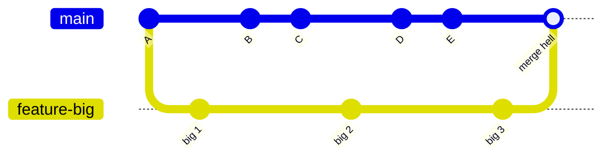
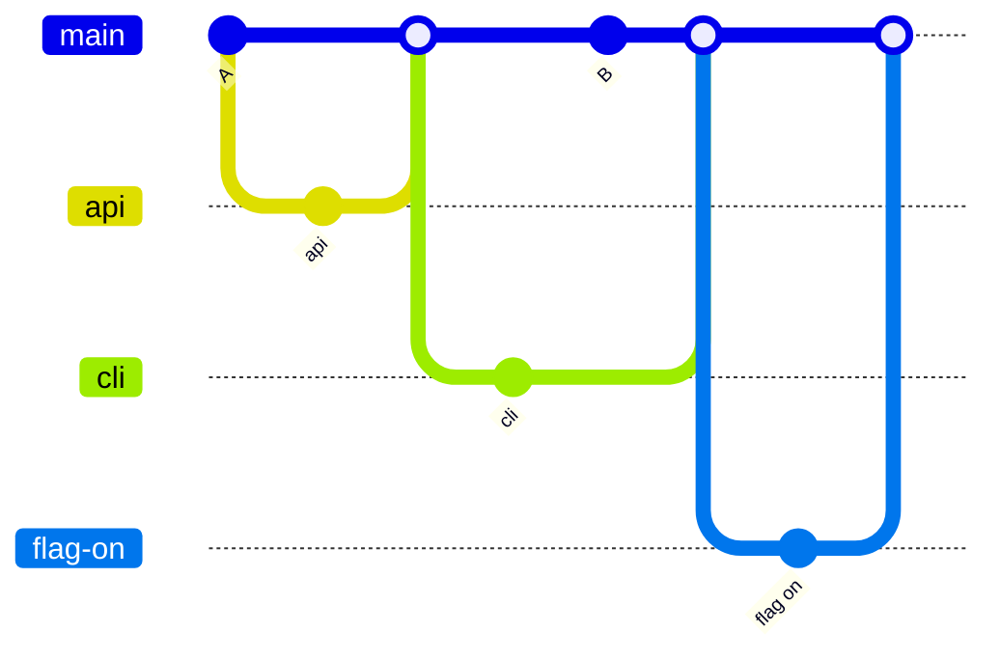
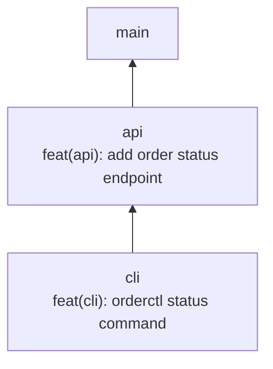
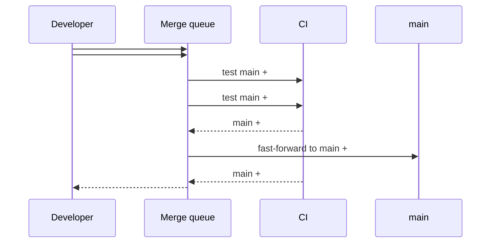

# Trunk-based development

## Why care?

Four sentences that describe a team in trouble:

- "The feature branch is three weeks old. Merging it will take two days."
- "Please don't merge anything this week, we are stabilizing the release branch."
- "My PR has 2,400 changed lines. Nobody wants to review it, so it got an 'LGTM' after five minutes."
- "I can't start part two until part one is merged, and review takes three days."

Every one of these is a **batch size** problem. Big batches wait longer, conflict more, get worse reviews, and fail bigger. **Trunk-based development** is the practice of keeping batches tiny: everybody integrates into one branch (the trunk, `main`) at least once a day, through short-lived branches and small pull requests.

It is not a Git trick. It's the reason the [CI pipeline](ci-pipelines.md) must be fast, the reason [builds must be reproducible](reproducible-builds.md), and the reason you will need [feature flags](feature-flags.md) on the next page. On this page you see why small wins, then you build a **stack** of dependent branches with plain Git and with Git Town, keep it up to date when main moves, and ship it piece by piece.

## The idea: a motorway with short on-ramps

Picture main as a motorway. Every change has to merge into the traffic.

- A **short-lived branch** is a short on-ramp: you join quickly, at the speed of the traffic, and nobody has to brake.
- A **long-lived feature branch** is a side road that runs next to the motorway for 20 km. When you finally try to merge, the traffic has changed completely. You stop, you wait, you cause a jam.
- A **release branch that people develop on** is a second motorway. Now every fix must be driven onto both.



The same work, trunk-based. Three small branches, each merged within a day:



## Under the hood: why small is safer

### Batch size, in numbers you can feel

The risk of a merge grows faster than its size:

- **Conflicts** grow with "lines I changed × lines others changed since I branched". Both factors grow with time. A branch that lives twice as long gets roughly four times the conflict surface.
- **Review quality** drops with size. A reviewer can check 200 lines with care. 2,000 lines get a skim.
- **Finding the bad change** after an incident is a search. With one small change per deploy, `git log` shows the suspect. With 40 changes in one deploy, you start a [bisect](../git/recovery-and-history.md#under-the-hood-git-bisect-run).
- **Rollback cost** grows too. Reverting one small PR is easy. Reverting a three-week branch takes three weeks of other people's work with it.

The DORA research programme (the "Accelerate" book and the yearly State of DevOps reports) found the same thing across thousands of teams: the teams that deploy most often also have the **lowest** change failure rate and the fastest recovery. Speed and stability are not a trade-off. Small batches give you both.

### The rules of the trunk

1. **Main is always releasable.** Every commit on main passed CI and could go to production.
2. **Branches live for hours, not weeks.** A good target: merged within one working day.
3. **Small PRs.** One concern each. A refactoring and a feature are two PRs. A rule of thumb: under 400 changed lines, and reviewable in 15 minutes.
4. **Unfinished work hides behind a flag**, not on a branch. You merge code that is switched off. That is the subject of [Feature flags](feature-flags.md).
5. **Releases are cut from main**, by tag or by a short-lived release branch that only receives cherry-picked fixes. Nobody develops on a release branch.
6. **Fix forward or revert fast.** A red main is everyone's problem. Revert first, discuss later.

### But my feature takes three weeks

It does. It just doesn't have to be **one PR**. Split by layer, and keep each slice working:

1. A PR that adds the domain type and its tests. Nothing calls it yet.
2. A PR that adds the storage method.
3. A PR that adds the HTTP endpoint, behind a flag that is off.
4. A PR that adds the `orderctl` command.
5. A PR that turns the flag on, first in staging.

Each one is small and safe on its own. The problem: PR 2 needs PR 1's code. If you wait for review of each one before starting the next, you lose days. That's where **stacked changes** come in.

## Under the hood: stacked changes

A **stack** is a chain of branches where each branch is based on the one before it, not on main. Each branch becomes its own PR, and each PR shows only its own diff.



You review `api` against `main`, and `cli` against `api`. When `api` merges, `cli` is retargeted to `main`. Simple in theory. In practice, two things go wrong: **main moves**, and **the bottom of the stack gets squash-merged**. Let's make both happen.

## Try it: a stack with plain Git

A small script builds a throwaway repository: one commit on main, then `api` on top of it, then `cli` on top of `api`, then one more commit on main (somebody else's fix). Fixed dates give fixed commit IDs:

```console
$ sh stack.sh /tmp/tutor-trunk/plain && cd /tmp/tutor-trunk/plain
$ git log --oneline --graph --all
* b6408be fix: validate quantity
| * b1e33d0 feat(cli): orderctl status command
| * 5cf4645 feat(api): add order status endpoint
|/
* 3db45c3 feat: order package
```

Main has moved. You're on `cli`, and you want the whole stack on top of the new main. The obvious command:

```console
$ git rebase main
Successfully rebased and updated refs/heads/cli.
$ git log --oneline --graph --all --decorate
* ccc522e (HEAD -> cli) feat(cli): orderctl status command
* ebd9af8 feat(api): add order status endpoint
* b6408be (main) fix: validate quantity
| * 5cf4645 (api) feat(api): add order status endpoint
|/
* 3db45c3 feat: order package
```

Look closely. `cli` moved, and it took a **copy** of the api commit with it (`ebd9af8`). But the `api` branch still points to the **old** commit `5cf4645`. Now there are two versions of the api change. Push `api` and its PR is based on old main; push `cli` and its PR contains the api change a second time. This is the classic stacked-branch mess.

Same starting point, with `--update-refs`:

```console
$ sh stack.sh /tmp/tutor-trunk/refs && cd /tmp/tutor-trunk/refs
$ git rebase --update-refs main
Successfully rebased and updated refs/heads/cli.
Updated the following refs with --update-refs:
	refs/heads/api
$ git log --oneline --graph --all --decorate
* ccc522e (HEAD -> cli) feat(cli): orderctl status command
* ebd9af8 (api) feat(api): add order status endpoint
* b6408be (main) fix: validate quantity
* 3db45c3 feat: order package
```

One straight line. Git noticed that the branch `api` pointed **into** the range it was rebasing, and moved it to the new copy of that commit. The [Merging and rebasing](../git/merging.md) page explains the mechanics. To make it the default:

```sh
git config --global rebase.updateRefs true
```

Plain Git handles the "main moved" problem. It doesn't remember that `cli` **belongs on** `api`: that knowledge is in your head. For one stack, fine. For three stacks, a tool helps.

## Try it: the same stack with Git Town

[Git Town](../git/remotes.md#git-town-a-stacked-branch-tool-on-top) stores the parent of each branch in Git config, and runs ordinary Git commands to keep the tree in shape. It works without any remote, which makes it easy to try. Fresh repository, one commit on main, then:

```console
$ git config git-town.main-branch main
$ git town hack api

[main] git checkout -b api
Switched to a new branch 'api'


branch api is now a child of main

branch api is now a feature branch

$ git add status.go && git commit -qm "feat(api): add order status endpoint"
$ git town append cli

[api] git checkout -b cli
Switched to a new branch 'cli'


branch cli is now a child of api

branch cli is now a feature branch

$ git add ctl.go && git commit -qm "feat(cli): orderctl status command"
```

Every Git Town command prints the Git commands it runs, prefixed with the branch it was on. There's no magic to trust. The stack is now recorded:

```console
$ git town branch
  main
    api
*     cli
$ git config list --local | grep -i town
git-town.main-branch=main
git-town-branch.api.parent=main
git-town-branch.api.branchtype=feature
git-town-branch.cli.parent=api
git-town-branch.cli.branchtype=feature
```

Somebody lands a fix on main (`1be3a23 fix: validate quantity`). Sync the whole stack:

```console
$ git town sync --all

[cli] git checkout api
Switched to branch 'api'

[api] git -c rebase.updateRefs=false rebase --onto main bdde22ce0b9ac5b0984ef04693a1670e9a35b8da
Rebasing (1/1)Successfully rebased and updated refs/heads/api.

[api] git checkout cli
Switched to branch 'cli'

[cli] git -c rebase.updateRefs=false rebase --onto api ccbd61e3a708216057762acd1ee666cb9b59de08
Rebasing (1/1)Successfully rebased and updated refs/heads/cli.

$ git log --oneline --graph --all --decorate
* 9893662 (HEAD -> cli) feat(cli): orderctl status command
* 0c92b4f (api) feat(api): add order status endpoint
* 1be3a23 (main) fix: validate quantity
* bdde22c feat: order package
```

Read what it did: for each branch, **parent first**, `rebase --onto <parent> <old parent commit>`. That's the precise form: "take the commits after the old base, and replay them on the new parent". It switches off `updateRefs` because it moves each branch itself. On a machine with a remote, `sync` would also fetch and push each branch.

!!! note "Rebase or merge?"

    By default `git town sync` **merges** the parent into each branch. This machine's global
    Git config sets `git-town.sync-feature-strategy=rebase`, which is why you see `rebase`
    above. Rebasing keeps each PR's history clean; merging never rewrites commits that a
    reviewer has already seen. Pick one per team.

### Ship the bottom of the stack

`api` is reviewed and approved. Most teams **squash-merge** PRs: the PR becomes one new commit on main. Git Town can do that locally:

```console
$ git switch -q api
$ git town ship -s squash-merge -m "feat(api): add order status endpoint (#41)"

[api] git checkout main
Switched to branch 'main'

[main] git merge --squash --ff api
Updating 1be3a23..0c92b4f
Fast-forward
Squash commit -- not updating HEAD
 status.go | 1 +
 1 file changed, 1 insertion(+)
 create mode 100644 status.go

[main] git commit -m "feat(api): add order status endpoint (#41)"
[main fc985f0] feat(api): add order status endpoint (#41)
 1 file changed, 1 insertion(+)
 create mode 100644 status.go

[main] git branch -D api
Deleted branch api (was 0c92b4f).


branch cli is now a child of main

deleted branch api
$ git log --oneline --graph --all --decorate
* 9893662 (cli) feat(cli): orderctl status command
* 0c92b4f feat(api): add order status endpoint
| * fc985f0 (HEAD -> main) feat(api): add order status endpoint (#41)
|/
* 1be3a23 fix: validate quantity
* bdde22c feat: order package
```

Here is the second classic problem. Main has the api change as the squash commit `fc985f0`. `cli` still has the **original** api commit `0c92b4f` under it. Same change, two commits. Git Town already moved `cli`'s parent to `main`. Sync it:

```console
$ git switch -q cli
$ git town sync

[cli] git -c rebase.updateRefs=false rebase main
warning: skipped previously applied commit 0c92b4f
hint: use --reapply-cherry-picks to include skipped commits
hint: Disable this message with "git config set advice.skippedCherryPicks false"
Rebasing (1/1)Successfully rebased and updated refs/heads/cli.

$ git log --oneline --graph --all --decorate
* d7208cb (HEAD -> cli) feat(cli): orderctl status command
* fc985f0 (main) feat(api): add order status endpoint (#41)
* 1be3a23 fix: validate quantity
* bdde22c feat: order package
$ git town branch
  main
*   cli
```

Git's rebase saw that `0c92b4f` makes exactly the same change as a commit already on main (same **patch ID**), and skipped it. `cli` is now one commit on top of main, and its PR shows only the CLI change.

That worked because `api` had **one** commit. Real branches have several. Same experiment, but `api` has two commits (`api 1`, `api 2`) before it is squash-merged:

```console
$ git log --oneline --graph --all
* a2a6003 api (#41)
| * b7876e1 cli
| * 5989950 api 2
| * b143a37 api 1
|/
* 09c0c1e init
$ git rebase main
Rebasing (1/3)Auto-merging status.go
CONFLICT (content): Merge conflict in status.go
error: could not apply b143a37... api 1
Could not apply b143a37... # api 1
```

No single commit on main has the same patch as `api 1`, so Git replays it onto code that already contains the whole change, and conflicts. `git town sync` ran the same plain `rebase main` in this offline run and stopped with the same conflict (plus a hint to run `git town continue`, `skip` or `undo`). The fix is to replay **only** `cli`'s own commits: everything after the old api tip.

```console
$ git rebase --abort
$ git rebase --onto main 5989950 cli
Rebasing (1/1)Successfully rebased and updated refs/heads/cli.
$ git log --oneline --graph --all
* 6996f35 cli
* a2a6003 api (#41)
* 09c0c1e init
```

`git rebase --onto <new base> <old base> <branch>` reads: "take the commits of `<branch>` that come after `<old base>`, and replay them on `<new base>`". It's the same form Git Town used in `sync --all` above. If you deleted the parent branch already, find its old tip in the reflog (see [Recovery and history](../git/recovery-and-history.md)).

And when a Git Town command surprised you:

```console
$ git town undo

[cli] git reset --hard 98936620a79d49e720345aeb86273ec681ee6605
HEAD is now at 9893662 feat(cli): orderctl status command

```

On GitHub, `git town propose` opens the PR for the current branch against its **parent** branch, not against main. Combined with `sync`, that gives one small PR per layer.

<!-- TODO(real-output): run `git town propose` in a repository with a GitHub remote. Expect the git commands it runs (fetch, rebase, push) and then the "Create pull request" page opening in the browser, with the base branch set to the parent branch. Not run here: this demo has no remote, and the session must not call GitHub. -->

## Under the hood: merge queues

Small PRs and fast CI create a new problem. Picture two PRs, both green:

- PR #41 renames `Order.Qty` to `Order.Quantity` everywhere.
- PR #42 adds a new handler that uses `Order.Qty`.

Each one passed CI **against the main of this morning**. Merge both, and main doesn't compile. Nobody did anything wrong. CI tested each change alone, never the combination.

Two fixes:

1. **"Require branches to be up to date before merging."** Every PR must be rebased on the latest main and pass CI again before it may merge. Correct, but slow: with ten PRs a day, people spend their afternoon in a rebase-wait-rebase loop.
2. **A merge queue.** You don't merge. You say "this PR is ready" and it joins a queue. The queue builds a **temporary branch** with main plus the PRs ahead of it plus yours, runs CI on exactly that, and only then moves main forward. If it fails, your PR is kicked out of the queue, and the ones behind are tested again without it.



What you have to know as a CI author:

- A merge queue tests a commit that **no developer pushed**. On GitHub, it triggers your workflows with the `merge_group` event on a temporary branch. If your workflow only listens to `pull_request` and `push`, the required check never runs, and the queue waits forever. Add `merge_group:` to `on:`.
- Main only ever moves to a commit that passed CI **as it is**. "Main is always green" is no longer a hope, it is guaranteed by construction.
- Queues test several entries in parallel, speculatively (the third entry is tested on top of the first two). Fast CI makes the queue fast. Slow CI makes it a traffic jam.
- GitLab calls the same idea "merge trains". Other tools (Bors, Mergify, Aviator) existed before forges built it in.

<!-- TODO(real-output): on a GitHub repository with a merge queue enabled for main, add `merge_group:` to ci.yml, queue two PRs, and capture `gh run list --event merge_group` (temporary branches named like gh-readonly-queue/main/pr-41-<sha>) and the queue page. GitHub-only feature: not reproducible offline. -->

## Traps

- **"Trunk-based, but my branch is two weeks old."** Then it isn't. Measure branch age: `git for-each-ref --sort=committerdate refs/remotes` shows the oldest first.
- **Big PRs split only for show.** Five PRs that only make sense together, and can't be merged one by one, are one PR with more overhead. Each slice must be safe on main by itself.
- **Plain `git rebase` on a stack.** It moves the top branch and strands the ones below. Use `--update-refs`, or a tool that knows the parents.
- **Rebasing the child after a squash merge of the parent.** The old parent commits come along, and conflict when there are several. Rebase with `--onto main <old parent tip>`.
- **Long-lived release branches with development on them.** Every fix must be made twice, and they drift. Release from main; cherry-pick fixes only.
- **Merge queue without `merge_group` in `on:`.** The queue waits for a check that never starts.
- **Unfinished features without a flag.** Trunk-based development and feature flags come as a pair. Without flags, people go back to long branches.

## Check yourself

??? question "1. Why does a branch that lives twice as long cause more than twice the merge pain?"

    Conflicts come from your changes overlapping with everyone else's changes since you
    branched. Both grow with time: you write more, and others merge more. Their product, the
    conflict surface, grows roughly with the square of the branch age. And the review gets
    bigger and worse at the same time.

??? question "2. You run `git rebase main` on the top branch of a stack `api` ← `cli`. What happens to `api`, and how do you avoid it?"

    `cli` is rebased and takes copies of `api`'s commits with it, but the `api` branch still
    points to the old commits on old main. Now the change exists twice. Use
    `git rebase --update-refs main` (or set `rebase.updateRefs=true`), which also moves every
    branch that points into the rebased range. Or use a tool like Git Town, which knows each
    branch's parent.

??? question "3. `api` was squash-merged into main. Its branch had five commits. Now `git rebase main` on `cli` conflicts. Why, and what is the right command?"

    The squash commit on main has a different patch from each of the five original commits, so
    Git can't recognize them as already applied, and replays them onto code that already has the
    change. Replay only `cli`'s own commits: `git rebase --onto main <old-api-tip> cli`. Find the
    old tip in the reflog if the branch is already deleted.

??? question "4. Two PRs are green. After both merge, main doesn't compile. How can that happen, and what prevents it?"

    Each PR was tested against main **without** the other one. Together they conflict
    semantically (one renames a field, the other uses the old name), even though Git merged
    them without a textual conflict. Requiring branches to be up to date prevents it slowly;
    a **merge queue** prevents it efficiently by testing main + the queued PRs in order before
    main moves.

??? question "5. You enable GitHub's merge queue, and every queued PR waits forever for the `CI` check. What is missing?"

    The workflow doesn't listen to the `merge_group` event. The queue's temporary branch is
    neither a pull request nor a push to main, so `on: [pull_request, push]` never starts.
    Add `merge_group:` to the `on:` section.

??? question "6. Your feature needs three weeks of work. How do you do it trunk-based?"

    Split it into slices that are each safe on main by themselves (type and tests, storage,
    endpoint, CLI), merge each within a day, and hide the unfinished feature behind a flag that
    is off. Stack the branches so you don't wait for each review. Turn the flag on when the last
    slice is in, first in staging.

## Recap

- **Batch size** decides risk: small changes conflict less, get better reviews, are easier to find and to revert. The fastest teams are also the most stable ones.
- **Trunk-based**: one main branch that is always releasable, branches that live for hours, small single-concern PRs, unfinished work behind flags.
- A **stack** is a chain of branches, one PR each, each reviewed against its parent.
- Plain `git rebase` strands lower branches; `git rebase --update-refs` moves them all.
- **Git Town** records parents (`git-town-branch.<name>.parent`), syncs the stack parent-first with `rebase --onto`, ships with squash merge, and re-parents the children. It prints every Git command it runs, and has `undo`.
- After a **squash merge** of a multi-commit parent, rebase the child with `git rebase --onto main <old parent tip>`.
- A **merge queue** tests main plus the queued PRs together before main moves, so main is green by construction. Add `merge_group` to your workflow's events.

Next: you merge unfinished code to main every day. How do you keep it switched off in production, and turn it on safely? [Feature flags](feature-flags.md).
