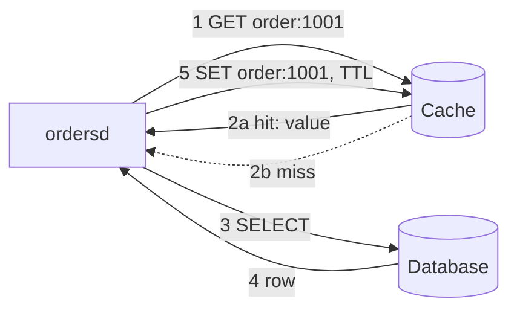

# Caching

## Why care?

Five tickets, from teams that "just added Redis":

- "The order page says `paid`. The customer got the shipping e-mail an hour ago."
- "We fixed the price in the database. Some customers still see the old price. Until tomorrow."
- "Every day at 09:00:00 the database CPU jumps to 100% for a few seconds. Nothing is deployed at 09:00."
- "Redis restarted. The database fell over two seconds later. Then the API."
- "We delete the cache key on every update, like the docs say. Once a week, a key is wrong anyway."

A cache is **a copy of data, kept closer to the reader**, so reads are fast and the database does less work. That is the whole idea, and it is why caches are everywhere: CPU caches ([Memory](../fundamentals/memory.md)), the Linux page cache, DNS resolvers, CDNs, Redis in front of Postgres. But a copy is a **replica**, and everything you learned about replicas in this chapter applies: it can be stale, it can be lost, and two copies can disagree. A well-known saying by Phil Karlton says there are only two hard things in computer science: cache invalidation and naming things. This page is about the first one.

## The idea: a copy with an expiry time

A cache sits between the service and the **database** (the source of truth). The basic flow has four parts:

- The service reads **from the cache** first. A **hit** means the value is there, and no database query is needed.
- On a **miss**, the service reads the database and **writes the answer into the cache** for the next reader. This pattern is called **cache-aside**.
- Every cache entry has an expiry time. After it, the next read is a miss again. This is the **TTL** (time to live).
- When the data changes in the database, the old cache entry must be removed or replaced. This is **invalidation**. If it is skipped, or done at the wrong moment, readers get the old value.
- If the cache is empty (a **cold cache**, for example after a restart), every request goes to the database at once. Many simultaneous misses for the same data are called a **thundering herd**.



## Under the hood: the patterns

### Who talks to the cache?

| Pattern                        | Read path                                         | Write path                                        | Trade-off                                                                 |
| ------------------------------ | ------------------------------------------------- | ------------------------------------------------- | ------------------------------------------------------------------------- |
| **Cache-aside** (lazy loading) | App reads cache; on a miss, reads DB, fills cache | App writes DB, then deletes (or updates) the key  | Simple, only caches what's read. The app owns all the races               |
| **Read-through**               | App reads cache; the **cache** loads from DB      | Like cache-aside                                  | Same as cache-aside, but the load logic lives in a library or the cache   |
| **Write-through**              | Like read-through                                 | App writes the cache; cache writes DB **at once** | Cache is never older than the DB after your own write. Every write slower |
| **Write-back** (write-behind)  | Like read-through                                 | App writes the cache; cache writes DB **later**   | Very fast writes. A cache crash **loses** acknowledged writes             |
| **Refresh-ahead**              | Cache reloads hot keys **before** they expire     | Any                                               | No miss for hot keys. Wastes work on keys nobody reads again              |

In Go services with Redis, **cache-aside** is by far the most common. Redis doesn't know your database, so "read-through" usually means a Go library around Redis that does the loading for you. **Write-back** is rare for business data like orders: it trades durability for speed, and an acknowledged order that disappears is worse than a slow one. You meet write-back in CPU caches and in the Linux page cache instead, where `fsync` exists exactly because of it.

### Where does the cache live?

- **In the process** (a Go map with a mutex, or a library with LRU eviction): nanoseconds, no network. But each pod has its **own** copy. Ten pods, ten copies, ten different ages. Deleting a key in one pod doesn't delete it in the others.
- **Shared** (Redis, Memcached, Valkey): one copy for all pods, about one network round trip per read (often under a millisecond in the same zone). Invalidation is one `DEL`.
- **Both** (two levels): a small, short-lived in-process cache in front of Redis. Fast, but now you have two places to invalidate.

### TTLs: a cap on how wrong you can be

A TTL is a **promise about staleness**: "this value is at most N seconds older than the database". With a TTL of 1 minute, even if every invalidation fails, you're never wrong for more than a minute. That's why you set a TTL **even when you invalidate on every write**: the TTL is the safety net for the bugs and races below.

Choosing the number is a business question, not a technical one: how long may a customer see an old order status? An old price? For a product description, an hour is fine. For "is this payment confirmed", maybe not at all, and then that data shouldn't come from a cache.

## Try it: cache-aside against a slow database

The demo is one Go program with a fake database (every read takes 50 ms, and sees the data as it was when the query **started**, like a real SQL statement) and a map that stands in for Redis. There's no container: the races below depend on timing, and a fake with exact delays shows them on every run.

```sh
mkdir ~/ds-cache && cd ~/ds-cache
go mod init example.com/cachedemo
go get golang.org/x/sync@v0.25.0
```

The fake database and the cache:

```go
// db is a fake database. A read sees the data as it is when the
// query starts, and the answer arrives after delay. A write commits
// after delay.
type db struct {
	mu    sync.Mutex
	rows  map[string]string
	delay time.Duration
	reads atomic.Int64
}

func (d *db) Get(id string) string {
	d.reads.Add(1)
	d.mu.Lock()
	v := d.rows[id] // snapshot at query start
	d.mu.Unlock()
	time.Sleep(d.delay)
	return v
}

func (d *db) Set(id, v string) {
	time.Sleep(d.delay)
	d.mu.Lock()
	d.rows[id] = v // commit at the end
	d.mu.Unlock()
}

// cache stands in for Redis: a shared map with expiry times.
type cache struct {
	mu  sync.Mutex
	m   map[string]entry
	ver map[string]int // bumped by every Delete
}
```

The read path, the part your service would really contain:

```go
// store is the cache-aside read path one service instance uses.
type store struct {
	db     *db
	c      *cache
	ttl    time.Duration
	jitter float64             // 0.2 means ttl ± 20%
	sf     *singleflight.Group // nil: no duplicate suppression
	cas    bool                // fill with SetIf instead of Set
}

func (s *store) ttlFor() time.Duration {
	if s.jitter == 0 {
		return s.ttl
	}
	f := 1 + s.jitter*(2*rand.Float64()-1) // between 1-j and 1+j
	return time.Duration(float64(s.ttl) * f)
}

func (s *store) Get(id string) string {
	if v, ok := s.c.Get(id); ok {
		return v // hit
	}
	load := func() (any, error) { // miss: read the DB, fill the cache
		if !s.cas {
			v := s.db.Get(id)
			s.c.Set(id, v, s.ttlFor())
			return v, nil
		}
		ver := s.c.Version(id)
		v := s.db.Get(id)
		if !s.c.SetIf(id, v, s.ttlFor(), ver) {
			say("reader: fill rejected, key changed since the miss")
		}
		return v, nil
	}
	if s.sf == nil {
		v, _ := load()
		return v.(string)
	}
	v, _, _ := s.sf.Do(id, load)
	return v.(string)
}
```

??? example "The whole program: `main.go`"

    ```go
    // Command cachedemo shows cache-aside in front of a slow fake
    // database: hits and misses, stale reads, the invalidation race,
    // TTL jitter and the thundering herd.
    //
    // Usage: cachedemo aside|stale|race|ttl|herd
    package main

    import (
    	"fmt"
    	"math/rand/v2"
    	"os"
    	"strings"
    	"sync"
    	"sync/atomic"
    	"time"

    	"golang.org/x/sync/singleflight"
    )

    // db is a fake database. A read sees the data as it is when the
    // query starts, and the answer arrives after delay. A write commits
    // after delay.
    type db struct {
    	mu    sync.Mutex
    	rows  map[string]string
    	delay time.Duration
    	reads atomic.Int64
    }

    func (d *db) Get(id string) string {
    	d.reads.Add(1)
    	d.mu.Lock()
    	v := d.rows[id] // snapshot at query start
    	d.mu.Unlock()
    	time.Sleep(d.delay)
    	return v
    }

    func (d *db) Set(id, v string) {
    	time.Sleep(d.delay)
    	d.mu.Lock()
    	d.rows[id] = v // commit at the end
    	d.mu.Unlock()
    }

    // cache stands in for Redis: a shared map with expiry times.
    type cache struct {
    	mu  sync.Mutex
    	m   map[string]entry
    	ver map[string]int // bumped by every Delete
    }

    type entry struct {
    	val string
    	exp time.Time
    }

    func (c *cache) Get(id string) (string, bool) {
    	c.mu.Lock()
    	defer c.mu.Unlock()
    	e, ok := c.m[id]
    	if !ok || time.Now().After(e.exp) {
    		return "", false
    	}
    	return e.val, true
    }

    func (c *cache) Set(id, v string, ttl time.Duration) {
    	c.mu.Lock()
    	defer c.mu.Unlock()
    	c.m[id] = entry{v, time.Now().Add(ttl)}
    }

    func (c *cache) Delete(id string) {
    	c.mu.Lock()
    	defer c.mu.Unlock()
    	delete(c.m, id)
    	c.ver[id]++
    }

    // Version and SetIf are a compare-and-set: the fill only lands if
    // no Delete happened since the miss. (Redis: WATCH/MULTI or Lua.)
    func (c *cache) Version(id string) int {
    	c.mu.Lock()
    	defer c.mu.Unlock()
    	return c.ver[id]
    }

    func (c *cache) SetIf(id, v string, ttl time.Duration, ver int) bool {
    	c.mu.Lock()
    	defer c.mu.Unlock()
    	if c.ver[id] != ver {
    		return false
    	}
    	c.m[id] = entry{v, time.Now().Add(ttl)}
    	return true
    }

    // store is the cache-aside read path one service instance uses.
    type store struct {
    	db     *db
    	c      *cache
    	ttl    time.Duration
    	jitter float64             // 0.2 means ttl ± 20%
    	sf     *singleflight.Group // nil: no duplicate suppression
    	cas    bool                // fill with SetIf instead of Set
    }

    func (s *store) ttlFor() time.Duration {
    	if s.jitter == 0 {
    		return s.ttl
    	}
    	f := 1 + s.jitter*(2*rand.Float64()-1) // between 1-j and 1+j
    	return time.Duration(float64(s.ttl) * f)
    }

    func (s *store) Get(id string) string {
    	if v, ok := s.c.Get(id); ok {
    		return v // hit
    	}
    	load := func() (any, error) { // miss: read the DB, fill the cache
    		if !s.cas {
    			v := s.db.Get(id)
    			s.c.Set(id, v, s.ttlFor())
    			return v, nil
    		}
    		ver := s.c.Version(id)
    		v := s.db.Get(id)
    		if !s.c.SetIf(id, v, s.ttlFor(), ver) {
    			say("reader: fill rejected, key changed since the miss")
    		}
    		return v, nil
    	}
    	if s.sf == nil {
    		v, _ := load()
    		return v.(string)
    	}
    	v, _, _ := s.sf.Do(id, load)
    	return v.(string)
    }

    func newWorld(delay, ttl time.Duration) (*db, *cache, *store) {
    	d := &db{rows: map[string]string{"order-1001": "paid"}, delay: delay}
    	c := &cache{m: map[string]entry{}, ver: map[string]int{}}
    	return d, c, &store{db: d, c: c, ttl: ttl}
    }

    var start = time.Now()

    func say(format string, a ...any) {
    	fmt.Printf("%6.3fs  %s\n", time.Since(start).Seconds(), fmt.Sprintf(format, a...))
    }

    func timed(s *store, id string) {
    	before := s.db.reads.Load()
    	t := time.Now()
    	v := s.Get(id)
    	kind := "hit "
    	if s.db.reads.Load() > before {
    		kind = "MISS"
    	}
    	say("Get(%s) = %-7s %s %v", id, v, kind, time.Since(t).Round(100*time.Microsecond))
    }

    func aside() {
    	_, _, s := newWorld(50*time.Millisecond, time.Second)
    	timed(s, "order-1001")
    	timed(s, "order-1001")
    	timed(s, "order-1001")
    	time.Sleep(1100 * time.Millisecond)
    	say("(slept past the 1s TTL)")
    	timed(s, "order-1001")
    	say("DB reads: %d", s.db.reads.Load())
    }

    func stale() {
    	d, c, s := newWorld(50*time.Millisecond, 2*time.Second)
    	timed(s, "order-1001")
    	d.Set("order-1001", "shipped")
    	say("DB updated to shipped, cache not touched")
    	for range 5 {
    		timed(s, "order-1001")
    		time.Sleep(500 * time.Millisecond)
    	}
    	d.Set("order-1001", "refunded")
    	c.Delete("order-1001")
    	say("DB updated to refunded, then cache key deleted")
    	timed(s, "order-1001")
    }

    // race runs one reader and one writer at the same time, with the
    // writer using the given order of steps.
    func race(name string, cas bool, write func(d *db, c *cache)) {
    	d, c, s := newWorld(100*time.Millisecond, time.Hour)
    	s.cas = cas
    	start = time.Now()
    	fmt.Println("--", name)
    	var wg sync.WaitGroup
    	wg.Go(func() {
    		time.Sleep(10 * time.Millisecond)
    		say("reader: cache miss, reading DB")
    		say("reader: got %q", s.Get("order-1001"))
    	})
    	wg.Go(func() {
    		write(d, c)
    		say("writer: done")
    	})
    	wg.Wait()
    	d.mu.Lock()
    	say("DB says %q", d.rows["order-1001"])
    	d.mu.Unlock()
    	v, _ := c.Get("order-1001")
    	say("cache says %q for the next hour", v)
    }

    func raceAll() {
    	deleteFirst := func(d *db, c *cache) {
    		c.Delete("order-1001")
    		say("writer: cache deleted, updating DB")
    		d.Set("order-1001", "shipped")
    	}
    	updateFirst := func(d *db, c *cache) {
    		say("writer: updating DB")
    		d.Set("order-1001", "shipped")
    		c.Delete("order-1001")
    		say("writer: cache deleted")
    	}
    	race("delete cache, then update DB", false, deleteFirst)
    	race("update DB, then delete cache", false, updateFirst)
    	race("update DB, then delete cache, fill with compare-and-set", true, updateFirst)
    	race("delete cache, then update DB, fill with compare-and-set", true, deleteFirst)
    }

    // ttl loads 1000 keys at once, then reads all of them every 10 ms
    // for 2.5 s and counts DB reads per 100 ms.
    func ttl(jitter float64) {
    	d, _, s := newWorld(0, time.Second)
    	s.jitter = jitter
    	keys := make([]string, 1000)
    	for i := range keys {
    		keys[i] = fmt.Sprintf("order-%d", i)
    		d.rows[keys[i]] = "paid"
    	}
    	var buckets [25]int64
    	t0 := time.Now()
    	for time.Since(t0) < 2500*time.Millisecond {
    		b := int(time.Since(t0) / (100 * time.Millisecond))
    		before := d.reads.Load()
    		for _, k := range keys {
    			s.Get(k)
    		}
    		buckets[min(b, 24)] += d.reads.Load() - before
    		time.Sleep(10 * time.Millisecond)
    	}
    	fmt.Printf("TTL 1s, jitter ±%.0f%%: DB reads per 100 ms\n", jitter*100)
    	for i, n := range buckets {
    		line := fmt.Sprintf("  %.1fs %5d %s", float64(i)/10, n, strings.Repeat("#", int(n/20)))
    		fmt.Println(strings.TrimRight(line, " "))
    	}
    }

    // herd sends 100 concurrent requests for one cold key, spread over
    // the given number of service instances (pods).
    func herd(pods int, useSF bool) {
    	d, c, _ := newWorld(50*time.Millisecond, time.Minute)
    	stores := make([]*store, pods)
    	for i := range stores {
    		stores[i] = &store{db: d, c: c, ttl: time.Minute}
    		if useSF {
    			stores[i].sf = &singleflight.Group{}
    		}
    	}
    	go1 := make(chan struct{})
    	var wg sync.WaitGroup
    	for i := range 100 {
    		wg.Go(func() {
    			<-go1 // all start together
    			stores[i%pods].Get("order-1001")
    		})
    	}
    	t := time.Now()
    	close(go1)
    	wg.Wait()
    	fmt.Printf("pods=%-2d singleflight=%-5v 100 requests -> %3d DB reads in %v\n",
    		pods, useSF, d.reads.Load(), time.Since(t).Round(time.Millisecond))
    }

    func main() {
    	switch os.Args[1] {
    	case "aside":
    		aside()
    	case "stale":
    		stale()
    	case "race":
    		raceAll()
    	case "ttl":
    		ttl(0)
    		ttl(0.2)
    	case "herd":
    		herd(1, false)
    		herd(1, true)
    		herd(10, true)
    	}
    }
    ```

### Hits and misses

```console
$ go build -o cachedemo . && ./cachedemo aside
 0.051s  Get(order-1001) = paid    MISS 51.3ms
 0.051s  Get(order-1001) = paid    hit  0s
 0.051s  Get(order-1001) = paid    hit  0s
 1.152s  (slept past the 1s TTL)
 1.202s  Get(order-1001) = paid    MISS 50.5ms
 1.203s  DB reads: 2
```

The first read misses and costs the full 50 ms of the database. The next two are **hits**: under 0.1 ms (the timer rounds to 100 µs). After the 1-second TTL, the next read misses again. Four reads, two database queries. In real life, with a hot key read thousands of times per TTL, the hit rate is 99% or more, and the database sees a tiny fraction of the traffic.

### Stale read after write

Now someone updates the order in the database, and the code forgets the cache:

```go
func stale() {
	d, c, s := newWorld(50*time.Millisecond, 2*time.Second)
	timed(s, "order-1001")
	d.Set("order-1001", "shipped")
	say("DB updated to shipped, cache not touched")
	for range 5 {
		timed(s, "order-1001")
		time.Sleep(500 * time.Millisecond)
	}
	d.Set("order-1001", "refunded")
	c.Delete("order-1001")
	say("DB updated to refunded, then cache key deleted")
	timed(s, "order-1001")
}
```

```console
$ ./cachedemo stale
 0.050s  Get(order-1001) = paid    MISS 50.3ms
 0.101s  DB updated to shipped, cache not touched
 0.101s  Get(order-1001) = paid    hit  0s
 0.602s  Get(order-1001) = paid    hit  0s
 1.102s  Get(order-1001) = paid    hit  0s
 1.604s  Get(order-1001) = paid    hit  0s
 2.155s  Get(order-1001) = shipped MISS 50.4ms
 2.706s  DB updated to refunded, then cache key deleted
 2.756s  Get(order-1001) = refunded MISS 50.3ms
```

The database says `shipped` from 0.10 s on. The cache keeps saying `paid` for **two more seconds**, until the TTL ends. That's the first ticket. Then the code does it right: update the database, **then delete the key**, and the next read gets `refunded` at once.

From the [consistency models](consistency-models.md) point of view, a cache with a TTL is an **eventually consistent replica**, with the TTL as the upper bound on lag. The customer who just clicked "cancel" and sees "paid" has lost **read-your-writes**, exactly like reading from a lagging database replica ([Replication](../databases/replication.md#read-your-writes)).

### The invalidation order trap

"Update the database, then delete the key." Why that order, and is it enough? Here one reader and one writer run **at the same time**. The database is slower in this test (100 ms per read and per write) to make the window easy to see. The reader starts 10 ms after the writer:

```go
// race runs one reader and one writer at the same time, with the
// writer using the given order of steps.
func race(name string, cas bool, write func(d *db, c *cache)) {
	d, c, s := newWorld(100*time.Millisecond, time.Hour)
	s.cas = cas
	start = time.Now()
	fmt.Println("--", name)
	var wg sync.WaitGroup
	wg.Go(func() {
		time.Sleep(10 * time.Millisecond)
		say("reader: cache miss, reading DB")
		say("reader: got %q", s.Get("order-1001"))
	})
	wg.Go(func() {
		write(d, c)
		say("writer: done")
	})
	wg.Wait()
	d.mu.Lock()
	say("DB says %q", d.rows["order-1001"])
	d.mu.Unlock()
	v, _ := c.Get("order-1001")
	say("cache says %q for the next hour", v)
}

func raceAll() {
	deleteFirst := func(d *db, c *cache) {
		c.Delete("order-1001")
		say("writer: cache deleted, updating DB")
		d.Set("order-1001", "shipped")
	}
	updateFirst := func(d *db, c *cache) {
		say("writer: updating DB")
		d.Set("order-1001", "shipped")
		c.Delete("order-1001")
		say("writer: cache deleted")
	}
	race("delete cache, then update DB", false, deleteFirst)
	race("update DB, then delete cache", false, updateFirst)
	race("update DB, then delete cache, fill with compare-and-set", true, updateFirst)
	race("delete cache, then update DB, fill with compare-and-set", true, deleteFirst)
}
```

```console
$ ./cachedemo race
-- delete cache, then update DB
 0.000s  writer: cache deleted, updating DB
 0.010s  reader: cache miss, reading DB
 0.101s  writer: done
 0.111s  reader: got "paid"
 0.111s  DB says "shipped"
 0.111s  cache says "paid" for the next hour
-- update DB, then delete cache
 0.000s  writer: updating DB
 0.010s  reader: cache miss, reading DB
 0.100s  writer: cache deleted
 0.101s  writer: done
 0.111s  reader: got "paid"
 0.111s  DB says "shipped"
 0.111s  cache says "paid" for the next hour
-- update DB, then delete cache, fill with compare-and-set
 0.000s  writer: updating DB
 0.010s  reader: cache miss, reading DB
 0.101s  writer: cache deleted
 0.101s  writer: done
 0.111s  reader: fill rejected, key changed since the miss
 0.111s  reader: got "paid"
 0.111s  DB says "shipped"
 0.111s  cache says "" for the next hour
-- delete cache, then update DB, fill with compare-and-set
 0.000s  writer: cache deleted, updating DB
 0.010s  reader: cache miss, reading DB
 0.101s  writer: done
 0.111s  reader: got "paid"
 0.111s  DB says "shipped"
 0.111s  cache says "paid" for the next hour
```

The four runs show four results:

1. **Delete first, then update.** The writer deletes the key at 0 ms. The reader misses at 10 ms and queries the database, which still has `paid` (the write commits at 100 ms). The reader puts `paid` into the cache at 111 ms, **after** the write. The cache now says `paid` until the TTL ends. Here, that's an hour. This is the easy race to hit: any read during the write refills the old value.
2. **Update first, then delete.** Better, but not safe. The reader's query started at 10 ms, before the commit at 100 ms, so it saw `paid`. The writer deletes the key at 100 ms (nothing to delete yet). The reader fills `paid` at 111 ms. Same wrong result. It needs a cache miss and a slow read that **overlaps** the write, so it is rare. At scale, rare means "once a week": the fifth ticket.
3. **Update first, then delete, and fill with compare-and-set.** Every `Delete` bumps a version number for the key. The reader remembers the version at the miss, and only fills the cache if the version hasn't changed. The writer's delete happened in between, so the fill is **rejected**: `cache says ""`. The next read loads `shipped`. (The reader's own request still got `paid`. That's fine: its query started before the write committed.)
4. **Delete first, then update, with compare-and-set.** Still wrong. The delete happened **before** the reader's miss, so the version didn't change during its read. Compare-and-set only helps if the delete comes **after** the commit.

So the rule is: **commit to the database first, delete the cache key after, and protect the fill**. In Redis you can protect the fill with `WATCH`/`MULTI` or a small Lua script on a version key. Facebook's memcache paper (2013) describes the same idea as **leases**. If you do not do that, at least keep the TTL short, so the stale value has a time limit.

!!! tip "Who deletes the key when the writer crashes?"

    "Commit, then delete" is a [dual write](outbox-and-sagas.md): if the process dies between the two, the key stays
    stale until the TTL. For data where that matters, drive invalidation from the database instead: write an event
    into the outbox in the same transaction, and let a consumer delete the key. Then a crash only delays the delete.

### TTL jitter

At 09:00 a batch job loads 1,000 orders into the cache, all with the same TTL. Then traffic reads them all the time. The demo counts database reads per 100 ms, without and with **jitter** (each TTL multiplied by a random factor between 0.8 and 1.2):

```console
$ ./cachedemo ttl
TTL 1s, jitter ±0%: DB reads per 100 ms
  0.0s  1000 ##################################################
  0.1s     0
  0.2s     0
  0.3s     0
  0.4s     0
  0.5s     0
  0.6s     0
  0.7s     0
  0.8s     0
  0.9s     0
  1.0s  1000 ##################################################
  1.1s     0
  1.2s     0
  1.3s     0
  1.4s     0
  1.5s     0
  1.6s     0
  1.7s     0
  1.8s     0
  1.9s     0
  2.0s  1000 ##################################################
  2.1s     0
  2.2s     0
  2.3s     0
  2.4s     0
TTL 1s, jitter ±20%: DB reads per 100 ms
  0.0s  1000 ##################################################
  0.1s     0
  0.2s     0
  0.3s     0
  0.4s     0
  0.5s     0
  0.6s     0
  0.7s     0
  0.8s   229 ###########
  0.9s   255 ############
  1.0s   250 ############
  1.1s   256 ############
  1.2s    10
  1.3s     0
  1.4s     0
  1.5s     0
  1.6s    22 #
  1.7s    93 ####
  1.8s   131 ######
  1.9s   231 ###########
  2.0s   232 ###########
  2.1s   151 #######
  2.2s   112 #####
  2.3s    26 #
  2.4s     3
```

Without jitter, all 1,000 keys expire **in the same 100 ms**, every second, and the database gets all 1,000 queries at once. That's the 09:00 ticket: keys that were filled together expire together, and every wave fills them together again, forever.

With ±20% jitter the first wave spreads over 0.8 to 1.2 s, about 250 per 100 ms. The second wave is spread even wider (1.6 to 2.4 s), because each key's two random TTLs add up. After a few rounds the load is flat. Jitter costs one line of code:

```go
f := 1 + s.jitter*(2*rand.Float64()-1) // between 1-j and 1+j
```

### The thundering herd and `singleflight`

Jitter helps when **many keys** expire together. A different problem is **one hot key** that expires (or isn't cached yet), while 100 requests for it arrive in the same millisecond. All 100 miss, and all 100 query the database for the same row. That's a **thundering herd** (also called a **cache stampede**). On a busy product page it's not 100 but thousands.

`golang.org/x/sync/singleflight` fixes it inside one process. `Group.Do(key, fn)` runs `fn` once per key at a time; every caller that arrives while it runs waits and gets the same result:

```go
v, _, _ := s.sf.Do(id, load)
```

The demo starts 100 goroutines behind one closed channel, so they all ask at once:

```go
// herd sends 100 concurrent requests for one cold key, spread over
// the given number of service instances (pods).
func herd(pods int, useSF bool) {
	d, c, _ := newWorld(50*time.Millisecond, time.Minute)
	stores := make([]*store, pods)
	for i := range stores {
		stores[i] = &store{db: d, c: c, ttl: time.Minute}
		if useSF {
			stores[i].sf = &singleflight.Group{}
		}
	}
	go1 := make(chan struct{})
	var wg sync.WaitGroup
	for i := range 100 {
		wg.Go(func() {
			<-go1 // all start together
			stores[i%pods].Get("order-1001")
		})
	}
	t := time.Now()
	close(go1)
	wg.Wait()
	fmt.Printf("pods=%-2d singleflight=%-5v 100 requests -> %3d DB reads in %v\n",
		pods, useSF, d.reads.Load(), time.Since(t).Round(time.Millisecond))
}
```

```console
$ ./cachedemo herd
pods=1  singleflight=false 100 requests -> 100 DB reads in 51ms
pods=1  singleflight=true  100 requests ->   1 DB reads in 50ms
pods=10 singleflight=true  100 requests ->  10 DB reads in 50ms
```

- **Without `singleflight`**: 100 requests, **100** identical database queries. They all took the same 50 ms here because the fake database doesn't slow down under load. A real one would.
- **With `singleflight`**: **1** query. The other 99 goroutines waited for it and shared its answer, in the same 50 ms.
- **10 pods, each with its own `singleflight.Group`**: **10** queries. `singleflight` is a **per-process** lock. Across pods, the herd is as big as the number of pods. For most services that's fine (10 is not 10,000). If it isn't, use a short lock in Redis (`SET key value NX PX 5000`) so only one pod loads, and the others wait or serve the stale value.

`Do` returns `shared bool`: true when the result was given to more than one caller. Count it in a metric to see how often herds happen.

### Other ways to limit a herd

- **Serve stale while refreshing.** Keep the old value a bit after the TTL. The first request after expiry triggers one background reload; everyone else gets the old value at once. Good for data where a few seconds of staleness are fine.
- **Refresh early.** Reload a key a little before its TTL ends, with a probability that grows as the end gets near (the "XFetch" idea from the paper "Optimal Probabilistic Cache Stampede Prevention").
- **Cache misses too.** If many requests ask for an order that **doesn't exist** (a bug, or an attacker), every one goes to the database. Cache "not found" as well, with a short TTL. This is **negative caching**.
- **Warm the cache** before you send traffic to a new cache cluster, and ask: **can the database survive a cold cache?** If it can't, the cache is no longer an optimization. It's a critical dependency, and it needs the same capacity planning and alerts as the database. That's the fourth ticket.

## Traps

- **No TTL, "because we invalidate".** Every bug or race in invalidation is then stale forever.
- **Delete, then update.** The easiest race to hit. Update the database first, then delete.
- **Updating the key instead of deleting it on write.** Two writers can set the cache in the opposite order to their commits. Deleting is safer; the next read loads the truth.
- **Same TTL for keys loaded together.** Add jitter.
- **No herd protection on hot keys.** Use `singleflight` in the process, and a lock or stale-while-revalidate across pods.
- **`singleflight` with the first caller's context.** If `fn` uses the context of the request that started it, and that client disconnects, **every** waiting caller gets `context canceled`. Load with `context.WithoutCancel(ctx)` plus your own timeout.
- **In-process caches with many pods.** Each pod has its own staleness, and one `DEL` doesn't reach them. Keep their TTLs very short, or broadcast invalidations.
- **Caching data you need to be exact**: payment status, stock for the last item, permissions after a revoke. Read those from the source of truth.
- **No hit-rate metric.** You can't tell a useful cache from one that only adds a network hop. Measure hits, misses, load time and `shared` calls.
- **Cache keys without a version.** A deploy that changes the cached struct reads the old format from Redis. Put a version in the key (`order:v2:1001`).

## Check yourself

??? question "1. Your service caches order status with a 5-minute TTL and deletes the key after each update. Why keep the TTL at all?"

    The TTL caps the damage of every invalidation bug: a crash between the commit and the delete, the
    read/write race, a code path that forgets the delete. Without it, one missed delete is stale forever.
    With it, it's stale for at most 5 minutes.

??? question "2. Explain, step by step, how \"update the database, then delete the key\" can still leave a stale value in the cache."

    A reader misses and starts its database query before the write commits, so it reads the old value.
    The writer commits and deletes the key (there's nothing to delete yet). Then the reader's slow query
    returns and it fills the cache with the old value, after the delete. It stays until the TTL ends.

??? question "3. How does compare-and-set on the fill fix that race, and why doesn't it fix \"delete, then update\"?"

    The reader remembers the key's version at the miss. The writer's delete, after the commit, changes the
    version, so the reader's later fill is rejected. With "delete, then update", the delete happens before
    the reader's miss, so the version doesn't change during the read, and the old value is filled.

??? question "4. Every day at the same time, database load spikes for a few seconds. What do you look for in the cache?"

    Keys that were filled at the same time (a batch job, a deploy, a cache restart) with the same TTL, so
    they expire together and are reloaded together, again and again. Add jitter to the TTL.

??? question "5. You add `singleflight` and the database still sees 20 identical queries when a hot key expires. Is `singleflight` broken?"

    Probably not: you run 20 pods, and `singleflight` deduplicates inside one process only. Each pod sends
    one query. If 20 is too many, add a distributed lock or serve stale values while one pod refreshes.

??? question "6. Redis restarts, and the database falls over. What does that tell you, and what would you change?"

    The cache had become a critical dependency: the database can't carry the full read load alone. Options:
    capacity for a cold start, warming the cache before traffic, herd protection (`singleflight`, locks),
    load shedding in the service ([Retries and idempotency](retries-and-idempotency.md)), and replicated or
    persistent cache nodes so a restart doesn't empty everything.

## Recap

- A cache is a **replica** for reads: fast, but **eventually consistent**. The TTL is the upper bound on how stale it can be.
- **Cache-aside** is the common pattern: read the cache, on a miss read the database and fill. **Write-through** writes both at once. **Write-back** writes the database later and can lose data.
- On a write: **commit first, delete the key after**. A slow read can still refill an old value; protect the fill with **compare-and-set** (a version or lease), and keep a **TTL** as the safety net.
- **Jitter** the TTL so keys loaded together don't expire together.
- A **thundering herd** is many misses for one key at once. `singleflight` turns them into one load **per process**; across pods use a lock or serve stale values.
- If the database can't survive a **cold cache**, the cache is a critical dependency. Treat and measure it like one.

## You finished Distributed systems

You now know what changes when your program is many programs: failures that look like slowness, clocks that disagree, consistency models that say what a read may return, retries that need idempotency keys, logs and queues that deliver at least once, outboxes and sagas instead of distributed transactions, Raft keeping one log on several machines, and caches that are fast because they are allowed to be slightly out of date.

All of these patterns share one weakness: when they go wrong, they go wrong **quietly**. A stale cache, a retry storm, a saga stuck halfway, a leader election every few seconds. Nothing crashes, but the numbers slowly drift. To see that, you need metrics, logs and traces that follow one request across all these services. Next chapter: [Observability](../observability/index.md).
