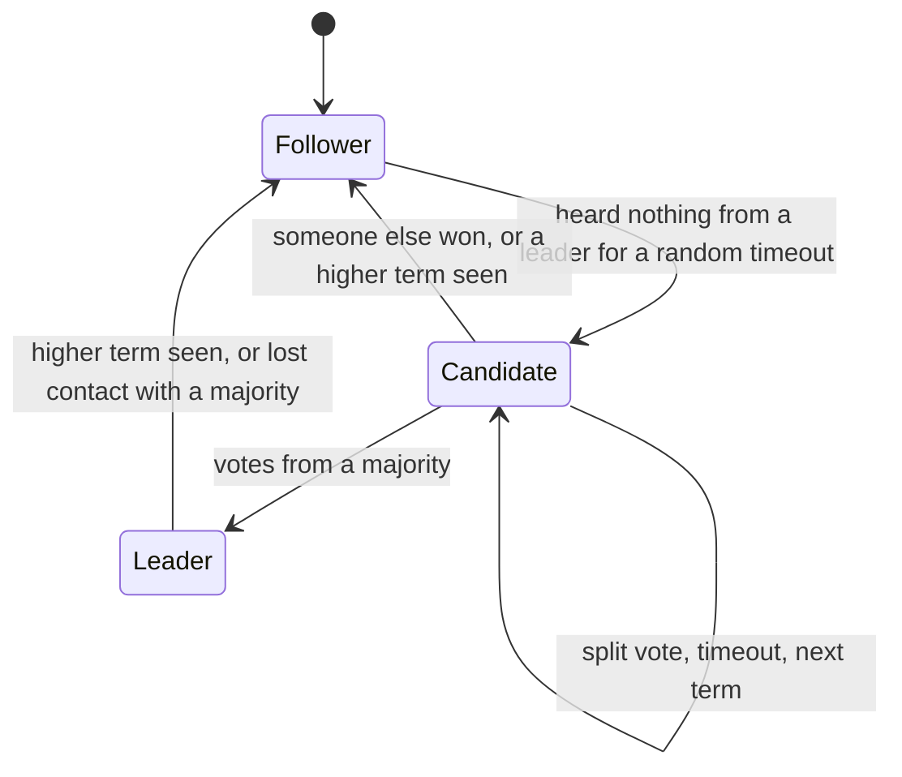
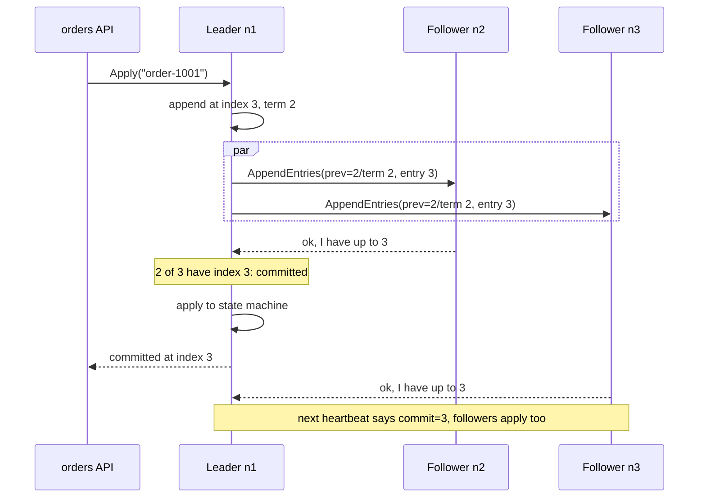

# Consensus and Raft

## Why care?

Four tickets, from teams that "just need one source of truth":

- "We run two `orders` schedulers for high availability. Both ran the nightly invoice job. Customers got two invoices."
- "We moved etcd from 3 to 4 members for more safety. Now a single rack failure took the whole Kubernetes control plane down."
- "The leader timed out a write with `leadership lost`. We told the client it failed. Ten seconds later the order was there anyway."
- "Our Consul cluster has 2 members left out of 5. Every write hangs, and nobody becomes leader."

Each one is about the same question: **how do several machines agree on one value, or one sequence of values, when any of them can crash and the network can lose messages?** That is **consensus**. You will rarely write a consensus algorithm yourself. But you run one every day: etcd under Kubernetes, Consul, Kafka in KRaft mode, CockroachDB, many lock services. When they misbehave, the rules on this page explain why.

On this page you run a real three-node **Raft** cluster in one Go process, crash its leader, and watch the rest elect a new one and keep working, until too many are gone.

## The idea: three treasurers and one ledger

A small club keeps its money records in a ledger. It has three treasurers, and each keeps **a full copy** of the ledger at home, so one fire can't destroy it.

- For a while, one treasurer is **chair**. Only the chair writes new lines. The others copy what the chair sends them.
- A line is **final** when a **majority** (2 of 3) has copied it. Then nobody may ever change it.
- Each chair serves for a numbered **term**. If the chair goes silent for too long, another treasurer says "I'll be chair for term 5. Vote for me?"
- Every treasurer votes **once per term**, and only for someone whose ledger is **at least as complete** as their own.
- If two chairs ever appear, the one with the **higher term** wins, and the old one steps down as soon as it hears about it.

Why does "majority" make this safe? Because **any two majorities of the same group overlap**. Two of three and another two of three always share at least one person. That person has seen the final lines, and would never vote for a chair who doesn't have them. So a new chair always has every final line.

That's Raft. Diego Ongaro and John Ousterhout designed it in 2014 to be easier to understand than Paxos, which solves the same problem.



## Under the hood

Raft splits the problem into three parts: **leader election**, **log replication**, and **safety** (the rules that make the first two correct together).

### Terms: a logical clock for leaders

Time in Raft is divided into **terms**, numbered 1, 2, 3, ... Each term starts with an election and has **at most one** leader. Some terms have no leader (a split vote); then the next term starts.

- Every message carries the sender's term.
- A node that sees a **higher** term updates its own and becomes a follower at once. That is how an old leader, back from a network partition, learns it was replaced.
- A node **rejects** messages with a **lower** term.

The current term and "who I voted for in this term" are written to disk **before** the node answers. Otherwise a node could restart and vote twice in one term. In `hashicorp/raft` these are the keys `CurrentTerm`, `LastVoteTerm` and `LastVoteCand` in the stable store.

A term is like a [Lamport clock](time-and-ordering.md) for leadership: it doesn't tell you the time, but it tells you which leader is newer.

### Leader election

The leader sends **heartbeats** (empty `AppendEntries` messages) to every follower. A follower that hears nothing for its **election timeout** assumes the leader is dead:

1. It increments its term, becomes a **candidate**, and votes for itself.
2. It sends `RequestVote` to all others, with its term and the index and term of its **last log entry**.
3. A node grants its vote if it hasn't voted in this term **and** the candidate's log is at least as up to date as its own (higher last term wins; same last term, longer log wins). That second check is the **election restriction**.
4. With votes from a majority, the candidate becomes leader and starts sending heartbeats.

The timeout is **random** (in `hashicorp/raft`, between 1× and 2× the configured value; `go.etcd.io/raft` does the same). Without randomness, all followers would time out together, all vote for themselves, and nobody would win, again and again. With it, one node usually starts first and wins before the others wake up.

**Pre-vote** is an extension from Ongaro's PhD thesis that `hashicorp/raft` v1.8.0 and etcd (`PreVote: true` by default) both use. Before a real election, the candidate asks "would you vote for me?" without changing anyone's term. Nodes say no if they still hear from a leader. This stops a node that was cut off (and kept timing out, raising its term) from disturbing a healthy cluster when it comes back.

### Log replication

Clients send commands to the leader. Each command becomes a **log entry** with an **index** (its position) and the **term** of the leader that created it.



- **`AppendEntries` carries the index and term of the entry just before** the new ones. A follower that doesn't have exactly that entry says no. The leader then steps back and sends older entries, until the logs match. This **log matching** check makes sure that two logs that agree on one entry agree on everything before it.
- An entry is **committed** when the leader has stored it on a majority. Only then does the leader apply it to its **state machine** (here: the list of orders) and answer the client.
- Followers apply entries when they learn the new **commit index**, from the next `AppendEntries`.
- Every node applies the same entries in the same order. If the state machine is deterministic, every node ends up with the same state. That is **state machine replication**.

### Safety: what can never happen

- **Election safety:** at most one leader per term (each node votes once per term, a majority is needed).
- **Leader completeness:** a committed entry is in the log of every future leader (the election restriction plus overlapping majorities).
- **State machine safety:** if any node applied entry 7, no node will ever apply a different entry 7.

One rule is subtle: **a new leader does not count old entries as committed just because a majority has them now.** It commits an entry from its **own** term first; that commits everything before it too. `hashicorp/raft` does this by appending a **no-op** entry as soon as it becomes leader. You'll see these no-ops in the indexes below.

### Quorums, and why the size is odd

The **quorum** is a majority: `n/2 + 1` (integer division). The cluster keeps working while a quorum is alive and connected.

| Members | Quorum | Failures tolerated |
| ------- | ------ | ------------------ |
| 1       | 1      | 0                  |
| 2       | 2      | 0                  |
| 3       | 2      | 1                  |
| 4       | 3      | 1                  |
| 5       | 3      | 2                  |
| 6       | 4      | 2                  |
| 7       | 4      | 3                  |

Read the table in pairs. **4 members tolerate the same one failure as 3**, but need 3 votes for every write instead of 2, and have one more machine that can fail. So an even size costs more and buys nothing. Worse, a network split of 4 into 2 + 2 leaves **no side** with a majority: everything stops. With 3 or 5, one side of any split always has the majority (or nobody does, but never both).

Bigger is not better either. Every write waits for a majority, so 7 members mean waiting for the 4th-fastest. Most production clusters run **3** (one failure) or **5** (two failures, or one during a planned upgrade). Put each member in a different **failure domain** (a different rack or availability zone, see [Failure models](failure-models.md)), or one power cut takes the quorum with it.

### Changing members, reads, and snapshots

- **Change membership one server at a time.** Raft stores the member list in the log itself (that's index 1 in the demo). Adding or removing one voter at a time keeps old and new majorities overlapping. `hashicorp/raft` has `AddVoter`, `RemoveServer` and `AddNonvoter`; etcd has `member add` and **learners** (members that receive the log but don't vote, until they have caught up). Add a new member as a non-voter first, or a slow new node can make the cluster lose quorum while it copies gigabytes.
- **Reads need care too.** A leader can't just answer from its state machine: it might have been replaced a second ago and not know it yet. For a **linearizable** read ([Consistency models](consistency-models.md)), it first confirms that a majority still follows it. `hashicorp/raft` exposes this as `VerifyLeader()`; etcd calls it **ReadIndex**, and does it for every read unless you ask for a serializable (possibly stale) read.
- **The log can't grow forever.** Every node takes **snapshots** of its state machine and deletes the log before it. A follower that is too far behind receives the snapshot instead of the entries (`InstallSnapshot`). In `hashicorp/raft` the defaults are `SnapshotThreshold: 8192` entries and `TrailingLogs: 10240` kept after a snapshot.

### What Raft does not do

- **Raft tolerates crashes, not liars.** A node with a corrupt disk or a bug that sends wrong data can break it. That's a **Byzantine** failure ([Failure models](failure-models.md)), and needs other algorithms (and usually isn't worth it inside one company).
- **Raft is not fast.** Every write costs at least one round trip to a majority plus an `fsync` on each. Use it for **small, important** data: who is leader, which config is current, which lock is held. Not for your order table.
- **Being leader does not make your code the only one running.** A deposed leader can still be in the middle of a request when the new leader starts. Use the **term** (or etcd's revision) as a **fencing token**: send it with every side effect, and let the receiver reject numbers lower than the highest it has seen.

## Try it: three nodes, one process

The program below uses `github.com/hashicorp/raft` v1.8.0, the library inside Consul, Nomad and Vault. All three nodes live in one process and talk over `InmemTransport`, an in-memory network. Their logs live in `InmemStore`. To "crash" a node, the program cuts its network and shuts it down, but keeps its stores, like a disk that survives a reboot.

The state machine is the `orders` type: every committed entry appends one order ID to a list. On a real system it would be a key-value store (etcd) or a table of locks.

```sh
mkdir ~/ds-raft && cd ~/ds-raft
go mod init example.com/raftdemo
go get github.com/hashicorp/raft@v1.8.0 github.com/hashicorp/go-hclog
```

```go
// Command raftdemo runs a 3-node Raft cluster in one process with
// hashicorp/raft and in-memory transport and stores. It replicates
// "order" entries, kills the leader, and shows what a majority and
// a minority can do.
package main

import (
	"errors"
	"fmt"
	"io"
	"os"
	"strings"
	"sync"
	"time"

	"github.com/hashicorp/go-hclog"
	"github.com/hashicorp/raft"
)

// orders is the state machine: the list of orders this node applied.
type orders struct {
	mu   sync.Mutex
	list []string
}

func (o *orders) Apply(l *raft.Log) any {
	o.mu.Lock()
	defer o.mu.Unlock()
	o.list = append(o.list, string(l.Data))
	return len(o.list)
}

func (o *orders) String() string {
	o.mu.Lock()
	defer o.mu.Unlock()
	return strings.Join(o.list, " ")
}

func (o *orders) Snapshot() (raft.FSMSnapshot, error) { return nil, errors.New("not needed here") }
func (o *orders) Restore(io.ReadCloser) error         { return errors.New("not needed here") }

// node is one cluster member. The stores survive a "crash"; the
// Raft instance, transport and state machine do not.
type node struct {
	id    string
	logs  *raft.InmemStore // log entries + current term and vote
	snaps *raft.InmemSnapshotStore
	trans *raft.InmemTransport
	fsm   *orders
	r     *raft.Raft
}

var (
	start = time.Now()
	nodes = map[string]*node{}
	ids   = []string{"n1", "n2", "n3"}
)

func say(format string, a ...any) {
	fmt.Printf("%5.2fs ==> %s\n", time.Since(start).Seconds(), fmt.Sprintf(format, a...))
}

func (n *node) boot() {
	_, n.trans = raft.NewInmemTransport(raft.ServerAddress(n.id))
	n.fsm = &orders{}
	cfg := raft.DefaultConfig()
	cfg.LocalID = raft.ServerID(n.id)
	cfg.Logger = hclog.New(&hclog.LoggerOptions{
		Name: n.id, Level: hclog.Info, Output: os.Stdout, TimeFormat: "-",
	})
	var err error
	n.r, err = raft.NewRaft(cfg, n.fsm, n.logs, n.logs, n.snaps, n.trans)
	if err != nil {
		panic(err)
	}
	// Wire the network: everyone alive can reach everyone alive.
	for _, o := range nodes {
		if o != n && o.r != nil {
			n.trans.Connect(raft.ServerAddress(o.id), o.trans)
			o.trans.Connect(raft.ServerAddress(n.id), n.trans)
		}
	}
}

// crash stops a node and cuts it off, like kill -9 plus a dead NIC.
func (n *node) crash() {
	n.trans.DisconnectAll()
	for _, o := range nodes {
		if o != n && o.r != nil {
			o.trans.Disconnect(raft.ServerAddress(n.id))
		}
	}
	n.r.Shutdown().Error()
	n.r = nil
}

func waitLeader() *node {
	for {
		for _, n := range nodes {
			if n.r != nil && n.r.State() == raft.Leader {
				return n
			}
		}
		time.Sleep(10 * time.Millisecond)
	}
}

func status() {
	for _, id := range ids {
		n := nodes[id]
		if n.r == nil {
			fmt.Printf("         %s: DOWN\n", id)
			continue
		}
		s := n.r.Stats()
		fmt.Printf("         %s: %-9s term=%s commit=%s orders=[%s]\n",
			id, s["state"], s["term"], s["commit_index"], n.fsm)
	}
}

func apply(leader *node, order string) {
	f := leader.r.Apply([]byte(order), 3*time.Second)
	if err := f.Error(); err != nil {
		say("%s: Apply(%q) FAILED: %v", leader.id, order, err)
		return
	}
	say("%s: Apply(%q) committed at index %d", leader.id, order, f.Index())
}

func main() {
	var servers []raft.Server
	for _, id := range ids {
		nodes[id] = &node{id: id, logs: raft.NewInmemStore(), snaps: raft.NewInmemSnapshotStore()}
		servers = append(servers, raft.Server{ID: raft.ServerID(id), Address: raft.ServerAddress(id)})
	}
	for _, id := range ids {
		nodes[id].boot()
	}
	if err := nodes["n1"].r.BootstrapCluster(raft.Configuration{Servers: servers}).Error(); err != nil {
		panic(err)
	}

	say("1. three nodes, waiting for an election")
	l := waitLeader()
	say("leader is %s", l.id)
	for _, o := range []string{"order-1001", "order-1002", "order-1003"} {
		apply(l, o)
	}
	time.Sleep(100 * time.Millisecond) // let followers learn the commit index
	status()

	say("2. crash the leader %s", l.id)
	old := l
	l.crash()
	l = waitLeader()
	say("new leader is %s", l.id)
	apply(l, "order-1004")
	apply(l, "order-1005")
	time.Sleep(100 * time.Millisecond)
	status()

	var follower *node
	for _, id := range ids {
		if n := nodes[id]; n.r != nil && n != l {
			follower = n
		}
	}
	say("3. crash follower %s: leader %s is alone, 1 of 3", follower.id, l.id)
	follower.crash()
	apply(l, "order-1006")
	status()

	say("4. restart %s with its old disk", old.id)
	old.boot()
	l = waitLeader()
	say("leader is %s", l.id)
	apply(l, "order-1007")
	time.Sleep(100 * time.Millisecond)
	status()
	for _, n := range nodes {
		if n.r != nil {
			n.r.Shutdown().Error()
		}
	}
}
```

`BootstrapCluster` writes the first configuration (three voters) into n1's log, as index 1. In production you bootstrap exactly once, on one node, the first time the cluster starts.

The library logs a lot (every failed heartbeat and append to a dead node, many times per second). The `grep` drops the repetitive lines about the dead nodes; nothing else is changed:

```console
$ go build -o raftdemo . && ./raftdemo > full.txt 2>&1
$ wc -l full.txt
113 full.txt
$ grep -vE 'failed to (appendEntries|heartbeat|pipeline|make requestVote)|failed to contact:|aborting pipeline|added peer|pipelining|initial configuration' full.txt
- [INFO]  n1: entering follower state: follower="Node at n1 [Follower]" leader-address= leader-id=
- [INFO]  n2: entering follower state: follower="Node at n2 [Follower]" leader-address= leader-id=
- [INFO]  n3: entering follower state: follower="Node at n3 [Follower]" leader-address= leader-id=
 0.00s ==> 1. three nodes, waiting for an election
- [WARN]  n1: heartbeat timeout reached, starting election: last-leader-addr= last-leader-id=
- [INFO]  n1: entering candidate state: node="Node at n1 [Candidate]" term=2
- [INFO]  n1: pre-vote successful, starting election: term=2 tally=2 refused=0 votesNeeded=2
- [INFO]  n1: election won: term=2 tally=2
- [INFO]  n1: entering leader state: leader="Node at n1 [Leader]"
- [WARN]  n3: failed to get previous log: previous-index=1 last-index=0 error="log not found"
- [WARN]  n2: failed to get previous log: previous-index=1 last-index=0 error="log not found"
- [WARN]  n1: appendEntries rejected, sending older logs: peer="{Voter n3 n3}" next=1
- [WARN]  n1: appendEntries rejected, sending older logs: peer="{Voter n2 n2}" next=1
 1.06s ==> leader is n1
 1.06s ==> n1: Apply("order-1001") committed at index 3
 1.06s ==> n1: Apply("order-1002") committed at index 4
 1.06s ==> n1: Apply("order-1003") committed at index 5
         n1: Leader    term=2 commit=5 orders=[order-1001 order-1002 order-1003]
         n2: Follower  term=2 commit=5 orders=[order-1001 order-1002 order-1003]
         n3: Follower  term=2 commit=5 orders=[order-1001 order-1002 order-1003]
 1.16s ==> 2. crash the leader n1
- [WARN]  n3: heartbeat timeout reached, starting election: last-leader-addr=n1 last-leader-id=n1
- [INFO]  n3: entering candidate state: node="Node at n3 [Candidate]" term=3
- [WARN]  n2: rejecting pre-vote request since we have a leader: from=n3 leader=n1 leader-id=n1
- [INFO]  n3: pre-vote campaign failed, waiting for election timeout: term=3 tally=1 refused=2 votesNeeded=2
- [WARN]  n2: heartbeat timeout reached, starting election: last-leader-addr=n1 last-leader-id=n1
- [INFO]  n2: entering candidate state: node="Node at n2 [Candidate]" term=3
- [INFO]  n2: pre-vote successful, starting election: term=3 tally=2 refused=0 votesNeeded=2
- [INFO]  n3: entering follower state: follower="Node at n3 [Follower]" leader-address= leader-id=
- [INFO]  n2: election won: term=3 tally=2
- [INFO]  n2: entering leader state: leader="Node at n2 [Leader]"
 2.96s ==> new leader is n2
 2.96s ==> n2: Apply("order-1004") committed at index 7
 2.96s ==> n2: Apply("order-1005") committed at index 8
         n1: DOWN
         n2: Leader    term=3 commit=8 orders=[order-1001 order-1002 order-1003 order-1004 order-1005]
         n3: Follower  term=3 commit=8 orders=[order-1001 order-1002 order-1003 order-1004 order-1005]
 3.06s ==> 3. crash follower n3: leader n2 is alone, 1 of 3
- [WARN]  n2: failed to contact quorum of nodes, stepping down
- [INFO]  n2: entering follower state: follower="Node at n2 [Follower]" leader-address= leader-id=
 3.55s ==> n2: Apply("order-1006") FAILED: leadership lost while committing log
         n1: DOWN
         n2: Follower  term=3 commit=8 orders=[order-1001 order-1002 order-1003 order-1004 order-1005]
         n3: DOWN
 3.55s ==> 4. restart n1 with its old disk
- [INFO]  n1: entering follower state: follower="Node at n1 [Follower]" leader-address= leader-id=
- [WARN]  n1: heartbeat timeout reached, starting election: last-leader-addr= last-leader-id=
- [INFO]  n1: entering candidate state: node="Node at n1 [Candidate]" term=3
- [WARN]  n2: rejecting pre-vote request since our last term is greater: candidate=n1 last-term=3 last-candidate-term=2
- [INFO]  n1: pre-vote campaign failed, waiting for election timeout: term=3 tally=1 refused=2 votesNeeded=2
- [WARN]  n2: heartbeat timeout reached, starting election: last-leader-addr= last-leader-id=
- [INFO]  n2: entering candidate state: node="Node at n2 [Candidate]" term=4
- [INFO]  n2: pre-vote successful, starting election: term=4 tally=2 refused=1 votesNeeded=2
- [INFO]  n1: entering follower state: follower="Node at n1 [Follower]" leader-address= leader-id=
- [INFO]  n2: election won: term=4 tally=2
- [INFO]  n2: entering leader state: leader="Node at n2 [Leader]"
- [WARN]  n1: failed to get previous log: previous-index=9 last-index=5 error="log not found"
- [WARN]  n2: appendEntries rejected, sending older logs: peer="{Voter n1 n1}" next=6
 5.39s ==> leader is n2
 5.39s ==> n2: Apply("order-1007") committed at index 11
         n1: Follower  term=4 commit=11 orders=[order-1001 order-1002 order-1003 order-1004 order-1005 order-1006 order-1007]
         n2: Leader    term=4 commit=11 orders=[order-1001 order-1002 order-1003 order-1004 order-1005 order-1006 order-1007]
         n3: DOWN
```

Read it in four parts.

**1. The first election.** All three start as followers. n1's random timeout fires first (after about 1 s, the `HeartbeatTimeout`). It enters `term=2`, its pre-vote and real vote both get `tally=2` of `votesNeeded=2`, and it is leader. The followers say `failed to get previous log: previous-index=1 last-index=0`: they have an empty log, but the leader's first message assumed they had index 1. The leader answers `sending older logs: next=1` and starts from the beginning. That's the **log matching** check doing its job.

The three orders get **index 3, 4 and 5**. Index 1 is the configuration from `BootstrapCluster`, index 2 is the leader's **no-op** for term 2. All three nodes show `commit=5` and the same three orders.

**2. The leader crashes.** About a second later, n3 times out first and asks for a pre-vote in term 3. n2 **refuses**: `rejecting pre-vote request since we have a leader`. n2's own timer hasn't fired yet, so as far as n2 knows, n1 is still fine. That's pre-vote protecting against an election that may not be needed. Then n2's timer fires, and n2 wins term 3 with its own vote plus n3's. **The term went up from 2 to 3**, and two new orders commit at index 7 and 8 (6 is the new no-op), with only **2 of 3** nodes alive. A majority is enough.

**3. Only one node left.** Now n3 dies too. n2 is still leader, alone. It tries to commit `order-1006`, can't reach anyone, and after `LeaderLeaseTimeout` (500 ms) without contact with a majority it **steps down**: `failed to contact quorum of nodes, stepping down`. The `Apply` returns `leadership lost while committing log`. The `commit` index stays at 8. **A minority can't commit anything**, and it can't elect a leader either, because one vote out of three is not a majority.

**4. n1 comes back with its old disk.** n1 has log up to index 5, term 2. It times out and asks for votes. n2 says no: `rejecting pre-vote request since our last term is greater: last-term=3 last-candidate-term=2`. That's the **election restriction**: n1 is missing committed entries 6 to 8, so it must not lead. A moment later n2 starts an election for term 4 and wins with n1's vote. Then n1's log is repaired: `previous-index=9 last-index=5`, `sending older logs: next=6`, and n1 catches up.

Now look at the final list: **`order-1006` is there.** Step 3 said its `Apply` failed. But the entry was already in n2's log at index 9. When n2 became leader again in term 4, it wrote its no-op at index 10, replicated it to n1, and committing index 10 committed index 9 too. `order-1007` lands at index 11.

!!! warning "A failed write is not a write that didn't happen"

    `leadership lost while committing log` means **"I don't know"**, not "no". The `hashicorp/raft` docs for
    `Apply` say so: "There is no way to guarantee whether the write succeeded or failed in this case." It's the same as a
    timeout on any network call ([Retries and idempotency](retries-and-idempotency.md)). Give commands an
    idempotency key (here the order ID) so a retry after `leadership lost` doesn't create the order twice.

Run it several times. The winner of each election and the timings change, because the timeouts are random. The rules don't change.

## etcd: Raft under Kubernetes

etcd is a key-value store built on `go.etcd.io/raft/v3`, the other big Go Raft library. etcd v3.7.4 imports raft v3.7.0. Its defaults, from `embed/config.go`: a heartbeat every **100 ms**, an election timeout of **1000 ms**, and a database quota of **2 GiB**. Everything from this page applies to it:

- **Every Kubernetes object is a key in etcd** ([Kubernetes architecture](../kubernetes/architecture.md#etcd-the-only-state)). A write to the API server is a Raft write: it returns after a majority of etcd members have it on disk. That's why a slow disk on one etcd member slows down every `kubectl apply`.
- **etcd's revision is a Raft-ordered counter.** Every write gets the next revision. The `resourceVersion` you see on objects comes from it, and the API server's compare-and-swap on it is what gives you `409 Conflict` ([Reconciliation](../kubernetes/reconciliation.md#resourceversion-and-optimistic-concurrency)). Watches stream changes in revision order, which is why a controller can resume a watch from a known version.
- **Run 3 or 5 members**, in different zones. With 3, you can lose one. Losing two makes the cluster read-only at best: existing pods keep running, but nothing can be scheduled, scaled or changed.
- **Leader elections in your own services** usually go through etcd (or the Kubernetes Lease API, which is stored in etcd). The `client-go` `leaderelection` package and etcd's `concurrency.Election` give you a leader without running Raft yourself. Combine them with fencing tokens, as above.

For the `orders` example that means: you don't run Raft in `ordersd`. When two `ordersd` replicas need one of them to run the nightly invoice job, take a lease in etcd or Kubernetes, and pass the lease's revision along to the payments service as a fencing token.

## Traps

- **Even cluster sizes.** 4 members tolerate one failure, like 3, and a 2 + 2 split stops everything. Use 3 or 5.
- **All members in one failure domain.** Three etcd VMs on one hypervisor are one failure.
- **Treating `leadership lost` or a timeout as "failed".** The entry may still commit. Make commands idempotent.
- **Reading from a follower and expecting fresh data.** Follower reads, and etcd's serializable reads, can be stale. Use linearizable reads when correctness depends on it.
- **Growing the cluster by adding several voters at once**, or adding an empty voter that must copy everything before it can ack. Add one at a time, as a learner or non-voter first.
- **Election timeouts shorter than your real network and disk latency.** A slow `fsync` or GC pause looks like a dead leader; the cluster spends its time in elections. etcd logs this as frequent leader changes; watch its `fsync` and heartbeat metrics.
- **Trusting "I am the leader" without a fencing token.** Two leaders can overlap for a short time from the outside world's point of view.
- **Putting big or hot data into a consensus store.** etcd stops accepting writes at its quota. Keep it for small coordination data.

## Check yourself

??? question "1. A cluster has 5 members. Two crash. Can it still commit writes? What about three?"

    Two down: yes, the 3 left are a majority of 5 (quorum is 3). Three down: no, 2 of 5 is a minority.
    The two survivors can't commit or elect a leader. They keep their data and wait.

??? question "2. Why does Raft randomize the election timeout?"

    If all followers timed out at the same moment, each would vote for itself, nobody would get a
    majority, and the next term would start the same way. A random timeout makes one node usually start
    first and win before the others become candidates.

??? question "3. In the demo, n1 came back with its log up to index 5. Why did n2 refuse to vote for it?"

    The election restriction: a node only votes for a candidate whose log is at least as up to date as
    its own. n2's last entry was from term 3, n1's from term 2. n1 was missing committed entries, so if
    it became leader, it could overwrite them.

??? question "4. A team moves etcd from 3 to 4 members \"for safety\". What did they gain and what did they lose?"

    They gained nothing in fault tolerance: 4 members still tolerate only 1 failure (quorum 3). They lost
    some speed (writes wait for 3 acks instead of 2), added one more machine that can fail, and made a
    2 + 2 network split stop the whole cluster.

??? question "5. `Apply` returned `leadership lost while committing log`. The client retries on the new leader. What can go wrong, and how do you prevent it?"

    The first attempt may still be committed, as `order-1006` was in the demo. The retry then creates a
    second copy. Give each command an idempotency key (the order ID) and make the state machine ignore a
    key it already applied.

??? question "6. The old leader was partitioned away but is still running and still thinks it is leader. How does the system keep it from doing damage?"

    Inside Raft, it can't commit anything: it can't reach a majority, and as soon as it hears a higher
    term it steps down. `hashicorp/raft` also makes it step down after `LeaderLeaseTimeout` without
    contact. For side effects **outside** Raft (calling payments, writing files), use the term or
    revision as a fencing token, so receivers reject the old leader's requests.

## Recap

- **Consensus** makes several machines agree on one sequence of commands, despite crashes and lost messages. Raft does it with a **leader**, **terms**, and a replicated **log**.
- A follower that hears no heartbeat for a **random timeout** starts an **election** in the next term. Votes go once per term, and only to candidates whose log is at least as up to date (the **election restriction**). **Pre-vote** keeps returning nodes from disturbing a healthy leader.
- An entry is **committed** when a **majority** has it. Any two majorities overlap, so every future leader has every committed entry. A new leader commits a **no-op** in its own term first.
- A **minority can't commit or elect**. A failed or timed-out write may still commit later: make commands idempotent.
- Use **3 or 5** members, in different failure domains. Even sizes add cost, not safety.
- **etcd** is Raft under Kubernetes: every object, every `resourceVersion`, every watch. Use it (or Kubernetes leases) for leader election in your services, with **fencing tokens**.

Next: the last page of this chapter, about keeping copies of data on purpose, to make reads fast. [Caching](caching.md).
