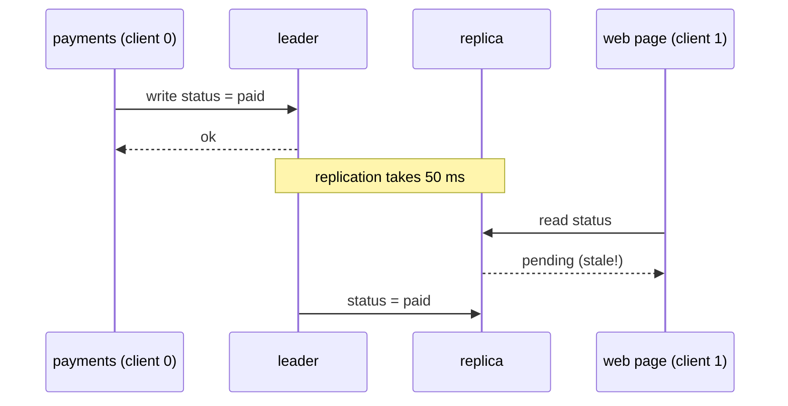
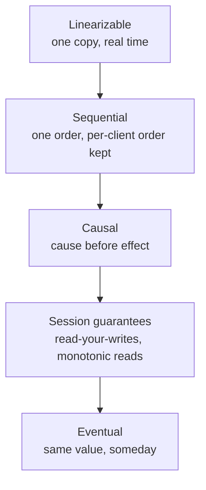
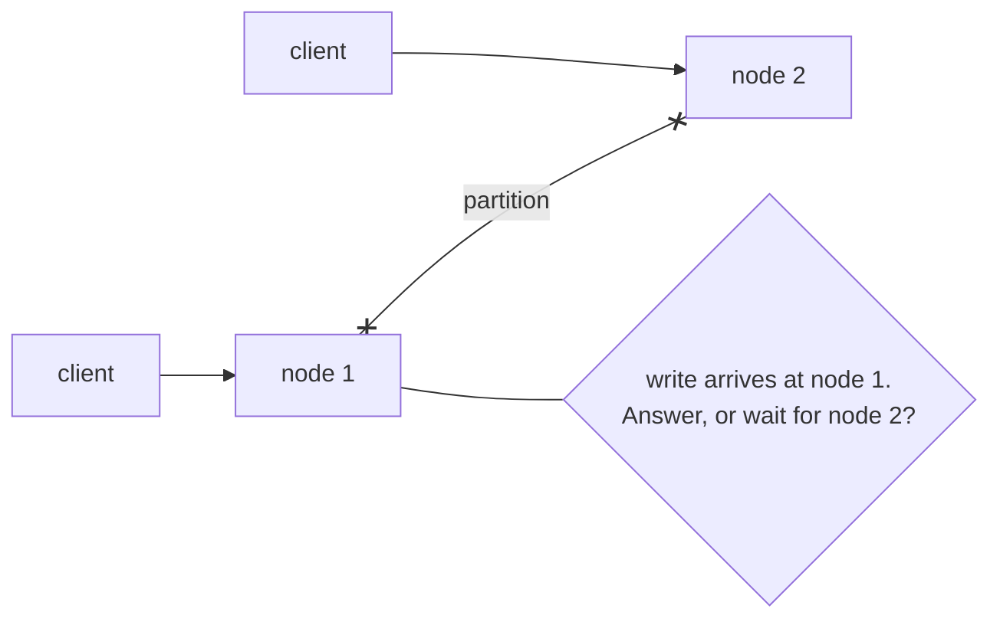

# Consistency models

## Why care?

Four tickets from the `orders` system, all after "we added a read replica to take load off the database":

- "The customer paid, the confirmation page loaded, and it said **pending**. They paid again."
- "Shipping saw the order as **paid**, then a second later as **pending**, and cancelled the parcel."
- "Support sees a reply to a comment, but not the comment it replies to."
- "The vendor says the store is **strongly consistent**. Under a network partition it still accepted writes on both sides."

Nothing crashed. Each component did exactly what its documentation promised. The problem is that nobody wrote down **what a read is allowed to return**. That promise is called a **consistency model**. This page names the common ones, from strongest to weakest, shows you how to test a real history against them, and puts CAP and PACELC in their place.

## The idea: one whiteboard, or many photos of it

Picture an office with one whiteboard that holds the status of order `ord-1001`.

- **Linearizable**: everyone looks at **the same whiteboard**. The moment someone writes "paid" and steps back, anyone who looks after that moment sees "paid". There is one copy, and time is real time.
- **Sequential**: everyone sees the changes **in the same order**, but some people get the news later. Nobody sees "paid" and then "pending", but you might still see "pending" after the payer has walked away.
- **Causal**: people pass around **photos** of the whiteboard. If you saw a photo of the question, you are guaranteed to also see the photo of it before the answer. Photos of unrelated changes may arrive in any order.
- **Eventual**: photos arrive **someday**, in any order. If people stop writing, all photos eventually show the same thing. Until then, anything goes.

Real systems are almost never one whiteboard. They are a leader and replicas, and replication takes time. The question is which of these illusions the system keeps up.



The write **finished** before the read **started**, and the read still returned the old value. On one whiteboard that's impossible. With an asynchronous replica, it is the normal case. [Replication and scaling](../databases/replication.md#replication-lag-and-read-your-writes) shows the same thing with a real PostgreSQL replica.

## Under the hood: the models, strongest to weakest

All models are statements about a **history**: the list of operations each client did, with the moment each one was **called** and the moment it **returned**. An operation is not a point in time, it is an **interval**. Two operations whose intervals overlap are **concurrent**: either may "happen first".

### Linearizable

A history is **linearizable** if you can put every operation at **one point inside its own interval** so that the result looks like one copy, operated on one step at a time.

The key rule: if operation A **returned** before operation B was **called**, A must come before B. That's real time, measured by an outside observer. Two consequences matter in practice:

- **No stale reads.** Once a write is acknowledged, every later read sees it (or something newer).
- **It composes.** If every key is linearizable on its own, the whole store is. You can reason one key at a time.

Linearizability is what you need for **locks, leader election, unique usernames, "only one shipment per order"**: anything where two clients must not both believe they won. etcd and ZooKeeper-style systems give it by sending every operation through a consensus log (next pages: [Consensus and Raft](consensus-and-raft.md)). Reads and writes that all go to one PostgreSQL primary behave this way for single rows: a committed write is visible to every query that starts afterwards.

The price: every operation must reach a **majority** or the **one leader**, so it pays a round trip, and it **stops** when it can't reach them.

### Sequential

**Sequential consistency** drops the real-time rule. There must still be **one order** of all operations that everyone agrees on, and it must keep **each client's own operations in the order that client did them**. But it may move one client's operation before another client's, even if in real time it happened after.

So in the diagram above, "the web page's read of `pending` comes before the payment write" is a valid sequential order: the two clients never talked to each other, so nothing inside the system can prove otherwise. The customer, who **can** see both screens, disagrees. That's exactly the gap between the two models.

### Causal

**Causal consistency** only orders operations that are **related**:

- Operations by the same client, in program order.
- A write, and any read that saw it, and anything that client did after that read ("happened before", from [Time and ordering](time-and-ordering.md)).

Concurrent writes that nobody saw together may show up in **different orders** on different replicas. The comment-and-reply ticket is a causal violation: the reply was written by someone who **read** the comment, so the reply depends on it. A causal store tracks those dependencies (often with vector clocks) and never shows the reply without the comment.

Causal is the strongest model that **stays available during a partition**: each side can keep accepting writes and still keep cause before effect. That makes it popular for geo-replicated and offline-first systems.

### Session guarantees

Four smaller promises, about what **one client** sees. They are cheap, and they fix most "the user saw something weird" tickets:

| Guarantee               | Promise                                                             | Ticket it fixes                        |
| ----------------------- | ------------------------------------------------------------------- | -------------------------------------- |
| **Read your writes**    | After I write, my reads see my write (or newer)                     | "I paid and it said pending"           |
| **Monotonic reads**     | Once I saw a value, I never see an older one                        | "Paid, then pending again"             |
| **Monotonic writes**    | My writes are applied in the order I made them                      | "Address change applied before create" |
| **Writes follow reads** | If I write after reading X, my write is ordered after X, everywhere | "Reply without its comment"            |

The usual tricks: send a user's reads to the primary for a few seconds after they wrote; remember the replication position of the last write (the LSN check in [Replication and scaling](../databases/replication.md#read-your-writes)) and only read from replicas that have reached it; or **stick** each user to one replica, which gives monotonic reads as long as that replica lives.

### Eventual

**Eventual consistency** promises only this: if writes stop, all replicas **eventually** return the same value. It says nothing about what you see **before** that, how long "eventually" is, or which of two concurrent writes wins. Replicas need a rule for conflicts, such as last-writer-wins by timestamp (which loses data when clocks are skewed, see [Time and ordering](time-and-ordering.md)) or data types that merge (counters, sets: CRDTs).

Eventual is perfect for a product catalog, a view counter, a search index. It is dangerous for anything a customer reads right after changing it, unless you add session guarantees on top.

### Summary



Each arrow means "is stronger than": every linearizable history is also sequential, every sequential one causal, and so on. Weaker models allow more histories, so they need less coordination, which means lower latency and more availability.

### Linearizable is not serializable

The two words sound alike and mean different things:

- **Serializable** is about **transactions** (groups of operations on many rows): the result equals **some** one-at-a-time order of the transactions. It says nothing about real time. A serializable database may legally run your read-only transaction "in the past". See [Transactions and isolation](../databases/transactions.md).
- **Linearizable** is about **single operations on single objects**, and it **does** respect real time.
- **Strict serializability** is both: transactions, in an order that respects real time. That's what Spanner-style databases advertise.

When a vendor says "strongly consistent", ask which of these they mean.

## Try it: record a history and check it

You can't argue about consistency from a diagram. You check it on **histories**. Testing tools like Jepsen do this for real databases: run many clients, record every call and return, then search for an order that explains everything. Here is the same idea in about 220 lines of Go.

The setup: a leader and one replica that applies writes **50 ms later**, three clients, and a recorder that stores each operation with its call and return times.

```go
type cluster struct {
	leader, replica *node
	lag             time.Duration
}

// write is acknowledged as soon as the leader has it.
// The replica gets it later: asynchronous replication.
func (c *cluster) write(v string) {
	c.leader.set(v)
	go func() { time.Sleep(c.lag); c.replica.set(v) }()
}

type op struct {
	client    int
	kind      string // "write" or "read"
	value     string // written value, or value the read returned
	call, ret int64  // microseconds since start
}

func (r *recorder) do(client int, kind string, f func() string) {
	call := r.now()
	v := f()
	ret := r.now()
	r.mu.Lock()
	r.ops = append(r.ops, op{client, kind, v, call, ret})
	r.mu.Unlock()
}
```

The scenario: at 0 ms payments writes `paid`; at 10 ms the web page reads; at 20 ms and 80 ms shipping reads. Reads go to the replica, unless `-read=leader`.

The checker is a brute-force search. It tries every order of the operations that respects a "must come before" rule, replays it on **one** plain register, and succeeds if every read in that order returns what it returned in the history. The only difference between the two models is the rule:

```go
// before reports whether a must come before b in every valid order.
// Linearizable: real time (a returned before b was called).
// Sequential: only the order of each client's own operations.
func before(a, b op, realTime bool) bool {
	if realTime {
		return a.ret < b.call
	}
	return a.client == b.client && a.ret < b.call
}

// check tries every order of ops that respects before(), and replays
// it on a single register. It returns the first order that works.
func check(ops []op, initial string, realTime bool) ([]op, bool) {
	used := make([]bool, len(ops))
	order := make([]op, 0, len(ops))
	var try func(value string) bool
	try = func(value string) bool {
		if len(order) == len(ops) {
			return true
		}
	next:
		for i, o := range ops {
			if used[i] {
				continue
			}
			for j, p := range ops { // everything that must come first is placed?
				if !used[j] && j != i && before(p, o, realTime) {
					continue next
				}
			}
			v := value
			if o.kind == "write" {
				v = o.value
			} else if o.value != value {
				continue // the read would have seen something else
			}
			used[i] = true
			order = append(order, o)
			if try(v) {
				return true
			}
			used[i] = false
			order = order[:len(order)-1]
		}
		return false
	}
	ok := try(initial)
	return order, ok
}
```

To point at the guilty operation, `culprit` checks growing prefixes of the history (sorted by call time) and reports the first operation that makes the check fail. As a second opinion, the program also feeds the same history to [Porcupine](https://github.com/anishathalye/porcupine) (`go get github.com/anishathalye/porcupine@v1.3.1`), a fast linearizability checker written in Go. Its model of a register is four lines:

```go
var registerModel = porcupine.Model{
	Init: func() any { return "pending" },
	Step: func(state, input, output any) (bool, any) {
		in := input.(op)
		if in.kind == "write" {
			return true, in.value
		}
		return output.(string) == state.(string), state
	},
}
```

### Run 1: reads from the replica

```console
$ go run . -read=replica
reads from replica, replication lag 50ms

client  op     value    call(µs)  return(µs)
0       write  paid           18          32
1       read   pending     10287       10287
2       read   pending     20602       20603
2       read   paid        80435       80436

linearizable: NO, first bad op: client 1 read -> "pending" at 10287µs
sequentially consistent: yes, order: c1:read(pending) c2:read(pending) c0:write(paid) c2:read(paid)
porcupine says linearizable: false
exit status 1
```

Read it like the checker does:

- The write returned at **32 µs**. The web page's read was called at **10,287 µs**, so in real time the write is definitely first. A single register would then answer `paid`. It answered `pending`: **not linearizable**, and client 1's read is the first operation that breaks it.
- The same history **is** sequentially consistent: put both `pending` reads before the write, and every client's own order is still kept (client 2 read `pending`, then `paid`). The system never contradicted itself; it only contradicted the clock on the wall.
- Porcupine agrees. On four operations brute force is instant; the number of orders grows like n!, so on a few hundred concurrent operations it would never finish. Porcupine prunes the search (its README: the "Testing for Linearizability" algorithm, sped up with "P-compositionality", which checks independent parts such as each key on their own), and `porcupine.VisualizePath` draws the history as an HTML page.

### Run 2: reads from the leader

```console
$ go run . -read=leader
reads from leader, replication lag 50ms

client  op     value    call(µs)  return(µs)
0       write  paid           16          25
1       read   paid        10252       10253
2       read   paid        20518       20519
2       read   paid        80040       80041

linearizable: yes, order: c0:write(paid) c1:read(paid) c2:read(paid) c2:read(paid)
sequentially consistent: yes, order: c0:write(paid) c1:read(paid) c2:read(paid) c2:read(paid)
porcupine says linearizable: true
```

Same cluster, same lag. Reads that go to the copy that took the write are linearizable. That's why "read from the primary" is the first fix for every read-your-writes ticket. The cost is all the read load on one node.

One honest warning: this only holds while the leader **really is** the leader. A leader that was cut off and replaced, but doesn't know it yet, will happily serve stale reads. Real systems close that gap with leases or by confirming leadership with a majority before answering ([Consensus and Raft](consensus-and-raft.md)).

### Run 3: payments reads its own write back

```console
$ go run . -read=replica -readback
reads from replica, replication lag 50ms

client  op     value    call(µs)  return(µs)
0       write  paid           17          32
0       read   pending      5280        5280
1       read   pending     10515       10515
2       read   pending     20838       20838
2       read   paid        80931       80932

linearizable: NO, first bad op: client 0 read -> "pending" at 5280µs
sequentially consistent: NO, first bad op: client 0 read -> "pending" at 5280µs
porcupine says linearizable: false
exit status 1
```

Now even sequential consistency fails. Client 0 wrote `paid` and then read `pending`. No single order can put client 0's read before client 0's own write, because sequential consistency keeps each client's program order. This is the **read-your-writes** violation from the first ticket, and the weakest model that forbids it is the session guarantee of the same name.

### Try it yourself

1. Run with `-lag=0`. Is the replica history linearizable now? Is the **system** linearizable now? (The replica is still updated by a goroutine that runs **after** `write` returned; a read in that gap would be stale. Only the timing hides it.)
2. Add a second writer that writes `refunded` at 15 ms. Which reads can now legally return `pending`?
3. Make the replica apply writes in the **wrong order** (two writes, the second one with a shorter lag). Which model breaks first?

## CAP without the myths

The CAP theorem is quoted more than it is read. Its real statement (Gilbert and Lynch, 2002) is narrow:

> In a system where the network can **partition** (lose messages between nodes), you can't have both **C** (linearizability) and **A** (every request to a non-failed node gets a non-error answer).



During a partition, a write reaches node 1, which can't reach node 2. Node 1 must choose:

- **Refuse or wait** (stay consistent, lose availability): the client gets an error or a timeout. etcd does this on the minority side.
- **Accept** (stay available, lose linearizability): node 2 keeps serving the old value, and the two sides diverge until the partition heals.

The myths, one by one:

- **"Pick two of three."** You can't pick "no partitions". Networks partition (see [Failure models](failure-models.md)). The only choice is **what to do while one happens**: C or A.
- **"We are a CP system."** CAP's C is **linearizability**, nothing else. A system with asynchronous replicas is not C even with a perfect network, as run 1 showed. And CAP's A is very strict (**every** live node answers); almost no real "CP" or "AP" system matches the theorem's definitions exactly. Use the labels as hints, not as facts.
- **"AP means no consistency at all."** An available system can still give causal consistency and all the session guarantees.
- **"CAP is about the whole system."** The choice is per **operation**. The same `orders` service can make "place order" refuse during a partition and "show catalog" answer from any replica.

### PACELC: the trade-off you pay every day

Partitions are rare. Latency is always there. **PACELC** (Daniel Abadi, 2010) says: if **P**artition, choose **A** or **C**; **E**lse (normal operation), choose **L**atency or **C**onsistency.

Even with a perfect network, a linearizable write must wait for a majority or a synchronous replica. A read from the nearest replica answers faster than one from the leader across the ocean. The every-day question is not "CP or AP", it's "how many milliseconds is this consistency worth here?"

| `orders` operation         | Needs                           | Why                                         | Where to read/write                                   |
| -------------------------- | ------------------------------- | ------------------------------------------- | ----------------------------------------------------- |
| Reserve the last item      | Linearizable (or a transaction) | Two buyers must not both win                | Primary, in one transaction with a constraint         |
| Show my order after paying | Read your writes                | The customer just changed it                | Primary for a few seconds, or replica past their LSN  |
| Shipping polls statuses    | Monotonic reads                 | Never go back from `paid` to `pending`      | Stick to one replica, or track the last seen position |
| Product catalog            | Eventual                        | A price a second late is fine; load is high | Any replica, a cache                                  |
| Leader of the outbox relay | Linearizable                    | Two relays would publish every event twice  | A lease in etcd or a database row lock                |

## Traps

- **"We read from replicas, but only for reads."** Every read after a write is a read-your-writes question. Decide per endpoint.
- **Round-robin over replicas.** Two requests from one user land on two replicas with different lag: time goes backwards (monotonic reads broken). Stick users to a replica, or carry a position.
- **Trusting "strongly consistent" in a data sheet.** Ask: linearizable, sequential, serializable or strict serializable? Per key or across keys? During a partition too?
- **Last-writer-wins with wall clocks.** A node whose clock is 2 seconds ahead wins every conflict and silently drops other writes.
- **Checking with a single client.** One client in a loop can never see a linearizability violation that needs two clients. Tests need concurrent clients and recorded histories.
- **A leader that doesn't know it was replaced.** Serving reads "from the leader" without a lease or a majority check is not linearizable during a failover.
- **Thinking a cache is outside the model.** A cache in front of a linearizable store makes the system as weak as the cache ([Caching](caching.md)).

## Check yourself

??? question "1. A write returns at 10 ms. A read by another client starts at 12 ms and returns the old value. Which models does this break?"

    Linearizability, because the write finished before the read started, so real time forces the
    write first. It does **not** break sequential consistency on its own: the read could be ordered
    before the write, since the two clients' operations have no program-order link. It would break
    read-your-writes only if it were the **same** client.

??? question "2. What is the one difference between the linearizability and sequential checks in the demo?"

    The "must come before" rule. Linearizable: A before B whenever A returned before B was called,
    for any two clients (real time). Sequential: only for operations of the **same** client
    (program order). Everything else, the search and the replay on one register, is the same.

??? question "3. A colleague says: \"Our database is CP, so the replica reads in our service are linearizable.\" What is wrong?"

    Two things. CAP's C is about the whole read path, and an asynchronous replica already serves
    stale reads with no partition at all (run 1). And "CP" describes what happens during a
    partition, not what your reads see every day. That's PACELC's "else" part: replica reads
    chose latency over consistency.

??? question "4. Users sometimes see their order go from `shipped` back to `paid` on refresh. Name the broken guarantee and two fixes."

    Monotonic reads. Fix it by sticking each user (or session) to one replica, or by remembering
    the newest replication position the user has seen and reading only from replicas at or past
    it, falling back to the primary.

??? question "5. Why is causal consistency popular for systems that must stay up during partitions?"

    It is the strongest model that can stay available while partitioned: each side keeps
    accepting writes, and only has to keep track of dependencies (what each write had seen). It
    still forbids the confusing anomalies, like a reply without its comment, that eventual
    consistency allows.

??? question "6. Is a serializable database also linearizable?"

    Not necessarily. Serializable only promises that transactions behave like **some** serial
    order, which may disagree with real time: a read-only transaction may see an older snapshot.
    You need **strict serializability** for both. A read-only transaction on a lagging replica is a
    good example: it can be perfectly serializable and still miss a write that was acknowledged
    before it started.

## Recap

- A **consistency model** is a promise about which values a read may return. Check it on **histories**: operations with call and return times.
- **Linearizable**: one copy, real time; no stale reads after a write returns. Needed for locks, leaders and uniqueness. Costs a round trip to a leader or majority, and stops during a partition.
- **Sequential**: one agreed order that keeps each client's own order, but not real time. **Causal**: only related operations are ordered; it can stay available during partitions.
- **Session guarantees** (read-your-writes, monotonic reads, monotonic writes, writes-follow-reads) are cheap and fix most user-visible weirdness. **Eventual** only promises convergence someday.
- A brute-force checker is short: try every order that respects "must come before", replay on one register. Real time for linearizable, per-client order for sequential. Porcupine does it fast.
- **Serializable** is about transactions and ignores real time; **strict serializable** adds it.
- **CAP**: during a partition, choose linearizability or availability, per operation. **PACELC**: the rest of the time, choose latency or consistency. Most of your bill is the "else".

Next: what to do when a call times out and you don't know whether it happened. [Retries and idempotency](retries-and-idempotency.md).
