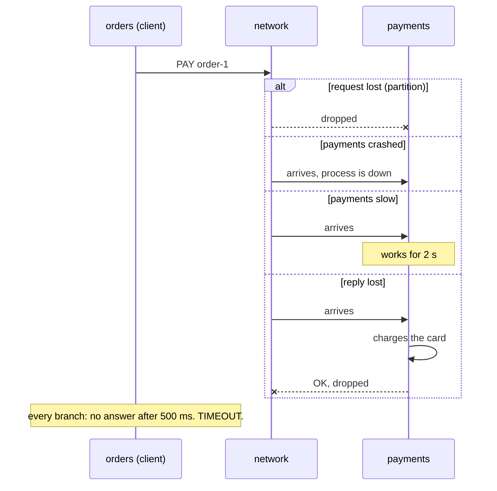
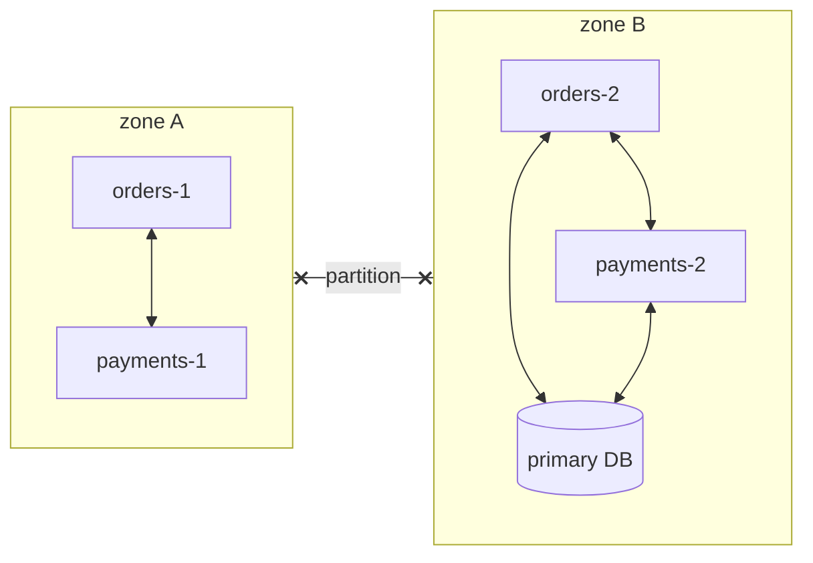
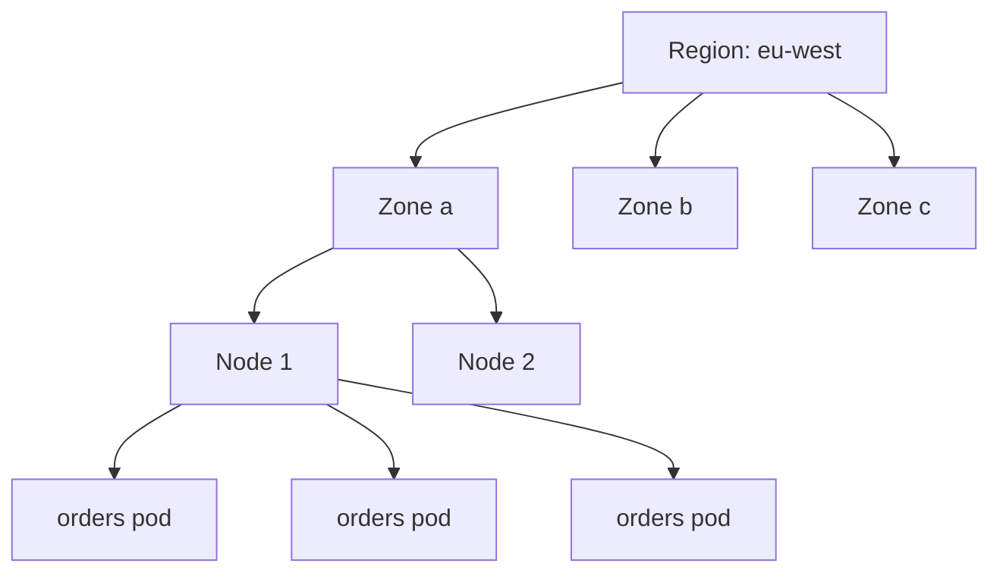
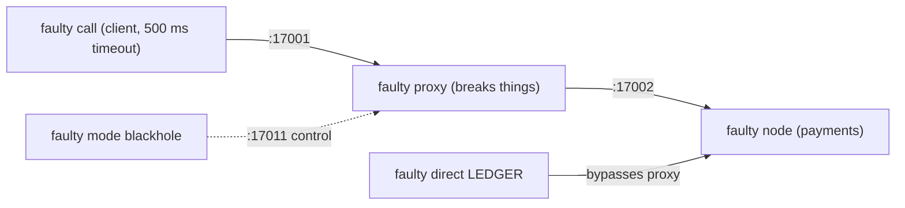

# Failure models

## Why care?

Five tickets from the `orders` system:

- "`orders` called `payments`, got a timeout after 500 ms, and retried. The customer was charged twice."
- "`payments` is green on the dashboard. Health checks pass. But 30% of real payments time out."
- "One `shipping` pod was very slow for an hour. Every `orders` pod ran out of goroutines waiting for it."
- "We run three replicas for safety. They were all on the same node. The node died."
- "It worked on my laptop. In production, between two data centres, every call is 40 ms slower and sometimes fails."

None of these is a bug in one line of code. Each one comes from a **wrong idea about how things fail**. On one machine, a function call either returns or the whole program crashes. Across a network, there is a third answer: **nothing**. No reply, no error, just silence. This page is about that silence: which kinds of failure exist, which ones your code must survive, and why a client **cannot tell** a slow server from a dead one.

## The idea: a request with no answer

`orders` sends `PAY order-1` to `payments` and waits. No answer comes. From the client's side, several different events produce exactly this result:

- The request was **lost** on the way. `payments` never received it.
- `payments` **crashed** before it read the request.
- `payments` is **slow**. It is still working on the request.
- `payments` did the work and charged the card, but the **reply** was lost. `payments` thinks the client knows.
- `payments` is **faulty** in a worse way: it reports success but did nothing, or sends wrong data. This is rare.

The client cannot tell these cases apart. It can wait longer, or it can send the request again. If it sends again, the card may be charged **twice**. That is the core problem, and the rest of this chapter is about solving it.



## Under the hood: the kinds of failure

Researchers sort failures into **failure models**: what a broken part is allowed to do. The weaker the model, the more your code must handle.

| Model                    | What the broken part does                                                       | Example                                                                |
| ------------------------ | ------------------------------------------------------------------------------- | ---------------------------------------------------------------------- |
| **Crash-stop**           | Stops, and never comes back                                                     | A VM is deleted                                                        |
| **Crash-recovery**       | Stops, then comes back later, maybe with lost memory but its disk intact        | A pod is OOM-killed and restarted; a node reboots                      |
| **Omission**             | Drops some messages it should send or receive, but works otherwise              | A full accept queue drops SYNs; a buggy proxy drops replies            |
| **Timing (performance)** | Answers correctly, but too late                                                 | GC pause, CPU throttling, a disk that takes 3 s for one `fsync`        |
| **Byzantine**            | Does anything at all: wrong answers, lies, different answers to different peers | Corrupted memory, a compromised host, a bad deploy with mixed versions |

Some notes on each, for enterprise systems:

- **Crash-recovery is the normal case**, not crash-stop. Kubernetes restarts your pod. When it comes back, anything that was only in memory is gone: the in-flight requests, the in-memory cache, the half-built batch. Code must assume "I can die between any two lines, and start again from the disk."
- **Omission and timing failures are the dangerous ones**, because the part still looks alive. It answers health checks. It holds connections. It just doesn't do the work, or does it late.
- **Byzantine** failures are mostly handled with checksums (TCP, TLS, database pages) and authentication, not with Byzantine consensus algorithms. Those are for blockchains and aircraft. Inside your own data centre you assume nodes are honest, but you still check checksums and versions.

### The network: partitions

A **network partition** means some nodes can't reach some other nodes, but each side keeps running. It isn't rare: a switch reboots, a firewall rule changes, a cloud zone has a bad hour, a DNS entry points to the wrong place.



During the partition, zone A can't reach the database. Its `orders-1` is **alive** (its process runs, its liveness probe passes) but **useless** for writes. Worse, the partition can be **asymmetric**: A can send to B, but B's replies don't come back. Then B processes A's requests and A sees only timeouts. That's the "reply lost" branch from the diagram, and the reason a timeout can never tell you whether the work happened.

The partition also splits **knowledge**. Each side sees the other as dead. If both sides then decide "the other is dead, so I'm in charge", you get **split brain**: two leaders, two writers, conflicting data. [Consensus and Raft](consensus-and-raft.md) shows how a majority (quorum) prevents that.

### Slow is worse than dead

A crashed process is the **easy** case. The kernel closes its sockets, and the next connection attempt gets a reset or `connection refused` in under a millisecond (see [RST](../networking/tcp.md#rst-connection-reset-by-peer)). Your code gets a clear error and can move on.

A **slow** process is the hard case. It accepts connections, holds them, and answers after 5 s, or 30 s, or never. Every caller waits. With 200 requests per second and a 30-second wait, 6,000 goroutines pile up in the caller, each holding memory, a connection and maybe a database transaction. The slow service makes its callers slow, and **their** callers slow. That's a **cascading failure**, and it started with one node that was not dead, only slow.

That is why **every network call needs a timeout**, and why the timeout is the most important number in a distributed system. [Retries and idempotency](retries-and-idempotency.md) shows how to choose it, and how `context` deadlines carry it across services ([Context](../go/context.md)).

### Gray failure

A **gray failure** is a part that is broken for some users, or some requests, but looks healthy to the thing that checks it. The ticket "health checks pass, but 30% of real payments time out" is one. Real examples:

- The health check is `GET /healthz`, which returns 200 from memory. Real requests need the database, which is unreachable from this pod.
- One disk in a RAID is slow. Every 10th request touches it.
- A node has a bad network card that drops 2% of large packets. Small health-check packets get through.
- A pod is CPU-throttled. The health check has a 1 s timeout and passes in 900 ms; real requests with a 500 ms client timeout fail.

The lesson: **the observer's view is not the user's view**. Check health the way users use the service (a readiness check that touches the dependencies that matter, see [Health checks: liveness vs readiness](../go/services.md#health-checks-liveness-vs-readiness)), and watch the **error rate and latency of real traffic** (passive health checks, [Load balancers](../networking/load-balancers.md#health-checks-active-and-passive)), not just a probe.

### Detecting failure: you can only guess

There is no way to **know** that a remote node is dead. There is only "I haven't heard from it for a while". Every failure detector is a timeout in disguise:

- **Timeout per request.** "No answer in 500 ms: treat it as failed."
- **Heartbeats.** Each node sends "I'm alive" every second. After 3 missed heartbeats, the others suspect it. Kubernetes does this: the kubelet renews a `Lease` object every few seconds, and the node controller marks the node `NotReady` when no renewal arrives within a grace period (tens of seconds by default).
- **Adaptive detectors.** Instead of a fixed limit, measure the normal gap between heartbeats and suspect a node when the current gap is very unlikely. (The "phi accrual" detector used by Cassandra and Akka works this way.)

Every detector makes a trade-off. A short timeout detects a dead node quickly, but it also declares **slow** nodes dead, and then you fail over, or retry, for nothing. A long timeout is safe from false alarms, but users wait. There is no value that is right for every case. This is a proven limit, not a lack of effort: in a system where messages can be delayed without a bound (an **asynchronous** system), no algorithm can always tell a crashed node from a slow one. (The best-known form of this is the **FLP result** from 1985: no deterministic consensus algorithm can be guaranteed to finish in an asynchronous system if even one node may crash.) Real systems get around it by assuming the network is **usually** timely ("partial synchrony"), and staying **safe** even when that assumption is wrong for a while.

## The eight fallacies of distributed computing

In the 1990s, engineers at Sun Microsystems wrote down the false assumptions that newcomers to networked systems make. (L. Peter Deutsch listed the first seven; James Gosling added the eighth.) Every one of them is still in production code today:

| #   | Fallacy                    | What is true                                                        | What it costs you in Go                                                                                |
| --- | -------------------------- | ------------------------------------------------------------------- | ------------------------------------------------------------------------------------------------------ |
| 1   | The network is reliable    | Packets and whole connections get lost                              | Every call needs a timeout, error handling, and a plan for "did it happen?"                            |
| 2   | Latency is zero            | A round trip in a data centre is ~0.5 ms; between regions 30–150 ms | A loop of 100 sequential calls is a 50 ms to 15 s page. Batch, or call in parallel                     |
| 3   | Bandwidth is infinite      | Links are shared, and cross-zone traffic costs money                | Don't send the whole order history on every event. Page and compress                                   |
| 4   | The network is secure      | Anyone on the path may read or change traffic                       | TLS between services, authenticate callers ([TLS](../networking/tls.md))                               |
| 5   | Topology doesn't change    | Pods move, IPs change, nodes join and leave                         | Don't cache DNS forever; use service names, not IPs                                                    |
| 6   | There is one administrator | Different teams, clouds and vendors own different parts             | You can't fix the firewall yourself. Make errors say **where** they came from                          |
| 7   | Transport cost is zero     | Serialization costs CPU, and every hop has a price                  | JSON encoding can be most of a handler's CPU. Measure ([Performance](../go/performance.md))            |
| 8   | The network is homogeneous | Different MTUs, proxies, HTTP versions, client libraries            | A proxy with a 60 s idle timeout and a client with 90 s gives you resets ([TCP](../networking/tcp.md)) |

The first fallacy is the one this page is about. The second is the one most often missed in code reviews: a call that looks like a function call (`client.GetOrder(ctx, id)`) is **a million times** slower than a function call, and can fail in ways a function cannot.

## Failure domains: what fails together

A **failure domain** is a set of things that fail **together** because they share something: a power supply, a switch, a kernel, a config file. Redundancy only helps if the copies are in **different** failure domains.



Three `orders` pods on node 1 are **one** failure domain: when the node dies, all three die. That's the fourth ticket. The usual layers, from small to big:

| Domain       | Shared thing that can break                        | How to spread across it                                        |
| ------------ | -------------------------------------------------- | -------------------------------------------------------------- |
| Process      | Memory, goroutines, one panic                      | More than one replica                                          |
| Node (host)  | Kernel, disk, NIC, power supply                    | Pod anti-affinity, topology spread on `kubernetes.io/hostname` |
| Rack / zone  | Switch, power, cooling; a cloud availability zone  | Topology spread on `topology.kubernetes.io/zone`               |
| Region       | A whole cloud region, its control plane            | Multi-region deployment (expensive, and latency between them)  |
| **Software** | One bad deploy, one config change, one certificate | Staged rollouts, canaries, different expiry dates              |

The last row matters most in practice. Hardware failures are mostly **independent**. Software failures are **correlated**: the same bug, the same expired certificate, the same leap-second handling, the same bad config hits **every** replica at the same moment. Three replicas protect you from a dead disk. They do nothing against a bad deploy rolled out to all three at once. See [Placing pods](../kubernetes/scheduling-and-resources.md#under-the-hood-placing-pods) for the Kubernetes side, and [Delivery](../delivery/index.md) for staged rollouts.

A related idea is the **blast radius**: when something fails, how much fails with it? Small, independent cells (one database per tenant group, one queue per service) keep a failure small. One shared "platform database" for everything makes every failure a big one.

## Try it: a proxy that breaks the network

You can't pull cables in your laptop, and `tc`/`iptables` need root. So we put a small Go **proxy** between a client and a "payments" node, and let the proxy break things on purpose. Tools like Toxiproxy work the same way.



Make a scratch module:

```sh
mkdir ~/ds-failure && cd ~/ds-failure
go mod init example.com/failure
```

The program has three roles. The **node** is a line-based payments service: `PAY <id>` records a payment (the side effect: money moves), `LEDGER` lists what it recorded, `PING` is the health check.

```go
// node answers PING, PAY <id> and LEDGER, one line per request.
func node(addr string) {
	var mu sync.Mutex
	var paid []string
	ln, err := net.Listen("tcp", addr)
	if err != nil {
		panic(err)
	}
	for {
		c, err := ln.Accept()
		if err != nil {
			return
		}
		go func() {
			defer c.Close()
			sc := bufio.NewScanner(c)
			for sc.Scan() {
				f := strings.Fields(sc.Text())
				switch f[0] {
				case "PING":
					fmt.Fprintln(c, "PONG")
				case "PAY":
					mu.Lock()
					paid = append(paid, f[1]) // the side effect: money moves
					mu.Unlock()
					fmt.Fprintln(c, "OK", f[1])
				case "LEDGER":
					mu.Lock()
					fmt.Fprintln(c, "PAID", strings.Join(paid, ","))
					mu.Unlock()
				}
			}
		}()
	}
}
```

The **proxy** copies lines in both directions. A control port sets the mode, one per failure from the diagram at the top:

```go
// proxy copies lines between client and node, and breaks things
// according to the current mode.
func proxy(listen, upstream string) {
	var mode atomic.Value
	mode.Store("pass")
	go func() { // control port: one line sets the mode
		ln, err := net.Listen("tcp", ctlAddr)
		if err != nil {
			panic(err)
		}
		for {
			c, _ := ln.Accept()
			if l, err := bufio.NewReader(c).ReadString('\n'); err == nil {
				mode.Store(strings.TrimSpace(l))
			}
			c.Close()
		}
	}()

	ln, err := net.Listen("tcp", listen)
	if err != nil {
		panic(err)
	}
	for {
		client, err := ln.Accept()
		if err != nil {
			return
		}
		go func() {
			defer client.Close()
			up, err := net.Dial("tcp", upstream)
			if err != nil {
				return // node is down: close the client's connection
			}
			defer up.Close()
			go func() { // node -> client
				sc := bufio.NewScanner(up)
				for sc.Scan() {
					if mode.Load() == "dropreplies" {
						continue // the node did the work; the answer is lost
					}
					fmt.Fprintln(client, sc.Text())
				}
			}()
			sc := bufio.NewScanner(client) // client -> node
			for sc.Scan() {
				line := sc.Text()
				switch mode.Load() {
				case "blackhole":
					continue // a partition: the request never arrives
				case "gray":
					if strings.HasPrefix(line, "PAY") {
						continue // health checks pass, real work vanishes
					}
				case "delay":
					time.Sleep(2 * time.Second) // a slow link or a slow node
				}
				fmt.Fprintln(up, line)
			}
		}()
	}
}
```

The **client** is what `orders` does: send one request, wait at most 500 ms, report what it saw:

```go
// call sends one request and waits at most 500 ms for the answer.
func call(addr, req string) {
	start := time.Now()
	c, err := net.DialTimeout("tcp", addr, 500*time.Millisecond)
	if err != nil {
		fmt.Printf("%-21s -> error after %v: %v\n", req, time.Since(start).Round(time.Millisecond), err)
		return
	}
	defer c.Close()
	c.SetDeadline(time.Now().Add(500 * time.Millisecond))
	fmt.Fprintln(c, req)
	reply, err := bufio.NewReader(c).ReadString('\n')
	took := time.Since(start).Round(time.Millisecond)
	switch {
	case errors.Is(err, os.ErrDeadlineExceeded):
		fmt.Printf("%-21s -> TIMEOUT after %v\n", req, took)
	case err != nil:
		fmt.Printf("%-21s -> error after %v: %v\n", req, took, err)
	default:
		fmt.Printf("%-21s -> %s after %v\n", req, strings.TrimSpace(reply), took)
	}
}
```

The `main` function dispatches on `os.Args[1]`: `node`, `proxy`, `mode <name>` (send the name to the control port `127.0.0.1:17011`), `call <request>` (through the proxy on `:17001`) and `direct <request>` (straight to the node on `:17002`). A script runs every mode, then asks the node directly what really happened, then kills the node:

```sh
#!/bin/sh
# Run with: ./run.sh
./faulty node 127.0.0.1:17002 & node=$!
./faulty proxy 127.0.0.1:17001 127.0.0.1:17002 & proxy=$!
sleep 0.3
for m in pass blackhole delay dropreplies gray; do
  echo "--- mode $m"
  ./faulty mode $m
  ./faulty call PING
  ./faulty call PAY order-$m
done
./faulty mode pass
sleep 2.5 # let the delayed request arrive
echo "--- what really happened, asked directly"
./faulty direct LEDGER
echo "--- node crashed"
kill $node; sleep 0.2
./faulty call PAY order-crash
./faulty direct PAY order-crash
kill $proxy
```

```console
$ go build -o faulty . && ./run.sh
--- mode pass
PING                  -> PONG after 2ms
PAY order-pass        -> OK order-pass after 2ms
--- mode blackhole
PING                  -> TIMEOUT after 501ms
PAY order-blackhole   -> TIMEOUT after 501ms
--- mode delay
PING                  -> TIMEOUT after 501ms
PAY order-delay       -> TIMEOUT after 501ms
--- mode dropreplies
PING                  -> TIMEOUT after 501ms
PAY order-dropreplies -> TIMEOUT after 501ms
--- mode gray
PING                  -> PONG after 3ms
PAY order-gray        -> TIMEOUT after 501ms
--- what really happened, asked directly
LEDGER                -> PAID order-pass,order-dropreplies,order-delay after 1ms
--- node crashed
PAY order-crash       -> error after 2ms: read tcp 127.0.0.1:45337->127.0.0.1:17001: read: connection reset by peer
PAY order-crash       -> error after 0s: dial tcp 127.0.0.1:17002: connect: connection refused
```

Read it slowly. These 20 lines show the main points of this page.

- **Three different failures, one identical result.** `blackhole`, `delay` and `dropreplies` all gave `TIMEOUT after 501ms`. The client has no way to tell them apart. Nothing in the error, the timing or the connection is different.
- **But the truth is different.** The ledger shows `order-dropreplies` and `order-delay` were **charged**; `order-blackhole` was **not**. If `orders` retries all three timeouts, two customers pay twice. If it retries none, one order is never paid. **Neither "always retry" nor "never retry" is correct.** The only fix is to make the retry safe: an idempotency key, so a second `PAY order-delay` is recognised and not charged again. That's [Retries and idempotency](retries-and-idempotency.md).
- **The slow request arrived after the client gave up.** `order-delay` reached the node 2 s later, when the client had long moved on. A timeout on the client **does not cancel anything** on the server. (In Go, a cancelled `context` closes the connection, and a well-written server notices and stops; but if the work was already done, it stays done.)
- **The order in the ledger is not the order of the calls.** `order-dropreplies` was sent after `order-delay` but recorded before it. The network reordered them. More about "before" and "after" on the next page.
- **`gray` passed the health check and failed real work.** `PING` got `PONG` in 3 ms. A load balancer probing `PING` would keep sending traffic to this node, and every payment would vanish. That's the second ticket.
- **A dead process is fast and clear.** With the node killed, a direct dial got `connection refused` in under a millisecond: the kernel answers for the dead process. Through the proxy, the client got `connection reset by peer`: the proxy accepted, couldn't reach the node, and closed the connection with our unread request in its buffer, which makes Linux send an RST ([RST](../networking/tcp.md#rst-connection-reset-by-peer)). Either way, a fast error. But note: if the whole **machine** dies (power, kernel panic), nobody sends an RST. Then a crash looks exactly like `blackhole`: silence and a timeout.

!!! tip "Keep the proxy for your own tests"

    This proxy is 100 lines and needs no root. Put a version of it in your integration tests between your service and
    its dependencies, and test `blackhole`, `delay` and `dropreplies` explicitly. Most services meet
    `dropreplies` for the first time in production.

Clean up: the script kills both processes. Check with `pgrep -a faulty`; it should print nothing.

## Traps

- **Treating a timeout as "it failed".** It means "I don't know". The work may have happened, may be happening, or may never happen. Design every remote write so that "I don't know, so I try again" is safe.
- **No timeout at all.** Go's `http.Client{}` has **no** timeout ("A Timeout of zero means no timeout"), and `net.Dialer` has none of its own either; only the kernel gives up on a connect, after minutes. A read on an open connection waits forever. One slow dependency then holds your goroutines forever. Set `http.Client.Timeout`, or better, a `context` deadline on every call.
- **Health checks that check nothing.** A `/healthz` that returns 200 from memory finds crashes, not gray failures. Readiness should touch what the service needs; and watch real traffic's error rate.
- **Liveness probes that check dependencies.** The opposite mistake: if liveness fails when the database is down, Kubernetes restarts every pod at once, and the outage gets worse. Liveness: "is this process stuck?". Readiness: "can I serve right now?".
- **"We have three replicas."** On one node, or rolled out with the same bad config at the same minute, they are one replica. Spread across nodes and zones, and roll out in stages.
- **Thinking a client-side timeout cancels the server's work.** The server keeps going unless it watches for cancellation, and even then, a write that committed stays committed.
- **"Crashed" means "gone".** In crash-recovery, the process comes back, maybe with an old view of the world, and acts on it. Fencing tokens and terms (see [Consensus and Raft](consensus-and-raft.md)) stop a returning node from doing damage.
- **Assuming the network is symmetric.** A can reach B does not mean B can reach A. Asymmetric partitions are why both sides of a split can think the other one is dead.

## Check yourself

??? question "1. `orders` calls `payments` and gets a timeout. List the things that may have happened on the `payments` side."

    The request never arrived (lost, partition). It arrived and `payments` crashed before or during the work. It arrived
    and `payments` is still working (slow). It arrived, the work was done, and the reply was lost. In the last two
    cases, the card is charged. The timeout looks the same in every case.

??? question "2. Why is a slow node often worse than a crashed node?"

    A crashed process gives fast, clear errors: the kernel answers with RST or `connection refused`, and callers move
    on. A slow node accepts connections and holds them. Callers wait until their timeout (or forever, without one),
    and their goroutines, connections and memory pile up. The slowness spreads to the callers and their callers: a
    cascading failure.

??? question "3. A pod passes its readiness probe, but 20% of real requests to it fail. What is this called, and how would you notice it?"

    A gray failure: healthy from the observer's view, broken from the user's view. You notice it by watching real
    traffic per pod (error rate, latency percentiles), with passive health checks in the load balancer, and by making
    the readiness check exercise the same dependencies real requests use.

??? question "4. Your team runs a 3-replica service. Name two ways all three can fail at the same moment."

    All three are on the same node, rack or zone (a shared hardware failure domain). Or a correlated software failure:
    the same bad deploy or config change rolled out to all three, the same expired certificate, the same bug triggered
    by the same input. Spread replicas with topology constraints, and roll out in stages.

??? question "5. In the demo, `order-delay` reached the node after the client had given up. Why didn't the client's timeout stop it, and what does that mean for retries?"

    The timeout only stops the **client** from waiting. The request was already in the network (in the proxy's
    goroutine, about to be forwarded), and nothing told the server to stop. So the payment happened. A retry would
    charge a second time, unless the request carries an idempotency key that the server checks.

??? question "6. Why can't you just pick a better timeout to tell slow nodes from dead ones?"

    Because in a network without an upper bound on delay, a message that hasn't arrived **yet** looks exactly like one
    that never will. Any timeout either declares some slow nodes dead (too short) or waits too long for truly dead
    ones (too long). Systems choose a value from measured latency (for example a bit above the p99) and make the
    actions after a timeout safe even when the guess is wrong.

## Recap

- Across a network, a call can succeed, fail, or **return nothing**. "Nothing" is the hard case.
- Failure models, from easy to hard: **crash-stop**, **crash-recovery** (the normal case in Kubernetes), **omission**, **timing**, **Byzantine**. Omission and timing failures look alive.
- A **partition** splits the network but not the nodes: each side keeps running and thinks the other is dead. It can be **asymmetric**.
- **Slow is worse than dead.** A slow node holds callers' resources and causes cascading failures. Every call needs a timeout.
- **Gray failures** pass health checks and fail real work. Watch real traffic, not only probes.
- Failure detection is always a **guess** with a timeout. Short timeouts give false alarms; long ones make users wait. You can't tell slow from dead, so make the actions after a timeout safe.
- The **eight fallacies**: the network is not reliable, fast, unlimited, secure, fixed, owned by one admin, free or uniform.
- Redundancy needs separate **failure domains**: node, zone, region, and above all software (staged rollouts).
- The demo: `blackhole`, `delay` and `dropreplies` gave the **same** timeout, but two of the three payments happened.

Next: the network is not reliable, and neither are clocks. [Time and ordering](time-and-ordering.md).
