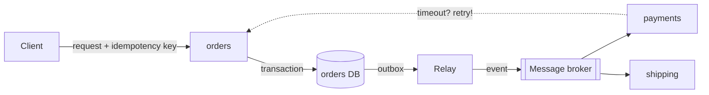

# Distributed systems

What changes when your program is many programs on many machines, connected by a network that can lie.

## Why go deeper?

The moment you have two services, a database and a queue, you have a distributed system. Then:

- A payment times out. Did it happen or not? The retry charges the customer twice.
- An event is published, but the database write it describes was rolled back.
- Two servers disagree about which order came first.
- One slow service makes every other service slow, then all of them fall over.
- The cache says the item is in stock. The database says it is not.

These are not bugs in one service. They are the normal behavior of networks and clocks. This chapter gives you the patterns that real systems use to stay correct anyway.

## The big picture

There are three hard truths:

1. **The network can drop, delay, duplicate or reorder any message.** A timeout tells you nothing about what happened.
2. **Clocks on different machines do not agree.** "Before" and "after" need more than timestamps.
3. **Parts fail on their own.** The system must keep working, or fail safely, while some parts are down.

## Reading order

Each page builds on the one before it. The examples ran on WSL2 (Ubuntu 24.04, kernel 5.15) with Docker 29.1 and Go 1.27.4; the brokers and database ran in containers (NATS 2.15.3 in `nats:2`, Kafka 4.3.0 in KRaft mode in `apache/kafka:4.3.0`, PostgreSQL 18.7 in `postgres:18`), with `nats.go` v1.56.0, `franz-go` v1.22.3, `pgx` v5.13.0 and `hashicorp/raft` v1.8.0.

| #   | Page                                                  | You will learn                                                                           |
| --- | ----------------------------------------------------- | ---------------------------------------------------------------------------------------- |
| 1   | [Failure models](failure-models.md)                   | Crashes, partitions, slow nodes, the fallacies of distributed computing, failure domains |
| 2   | [Time and ordering](time-and-ordering.md)             | Clock drift, monotonic clocks, Lamport clocks, vector clocks, hybrid logical clocks      |
| 3   | [Consistency models](consistency-models.md)           | Linearizable, sequential, causal, eventual; CAP and PACELC without the myths             |
| 4   | [Retries and idempotency](retries-and-idempotency.md) | Timeouts, backoff with jitter, idempotency keys, circuit breakers, load shedding         |
| 5   | [Messaging](messaging.md)                             | Queues vs logs, Kafka and NATS, at-least-once delivery, ordering, consumer groups        |
| 6   | [Outbox and sagas](outbox-and-sagas.md)               | The dual-write problem, transactional outbox, inbox dedupe, sagas and compensation       |
| 7   | [Consensus and Raft](consensus-and-raft.md)           | Leader election, log replication, quorums, and why etcd needs an odd number of nodes     |
| 8   | [Caching](caching.md)                                 | Cache-aside, write-through, TTLs, invalidation, thundering herds, `singleflight`         |

## How each page works

The same shape as the [Fundamentals](../fundamentals/index.md): **Why care?**, **The idea**, **Under the hood**, **Try it**, **Traps** and **Check yourself**. The examples break things on purpose: we kill processes, drop packets and skew clocks around the `orders` service, and watch what each pattern saves.
