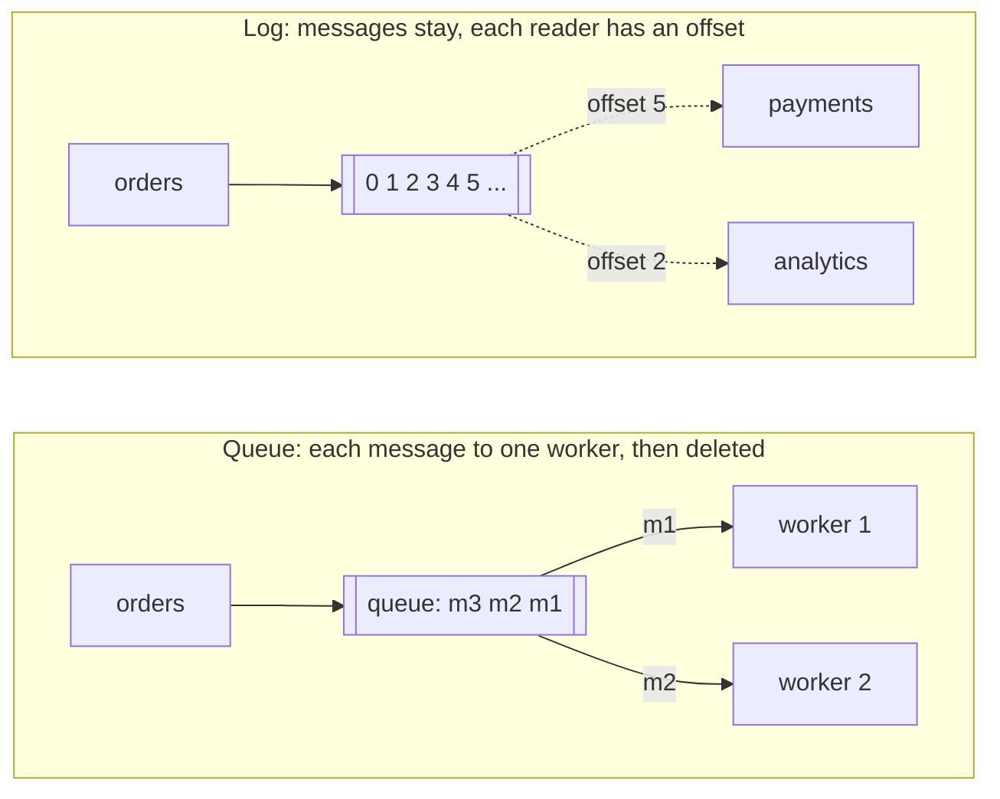
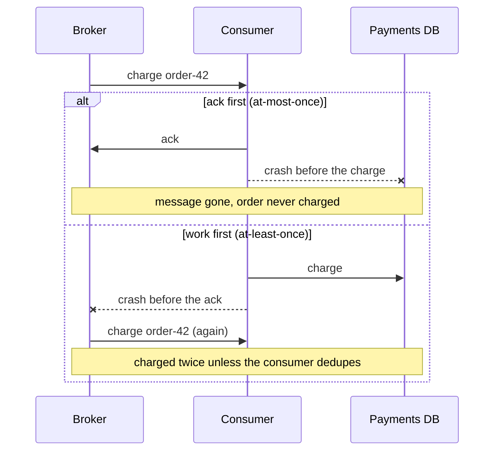
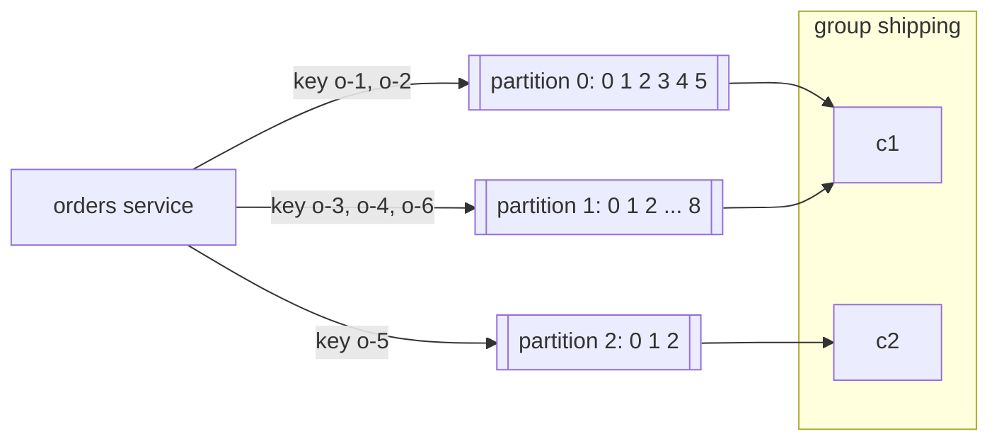

# Messaging

## Why care?

Four tickets from teams that "just put a queue in between":

- "We published `order.created` while the payments service was deploying. Payments never saw it."
- "Shipping got `order.shipped` before `order.paid` for the same order and rejected it."
- "We added 10 more consumers to clear the backlog. Nothing got faster. 7 of them do nothing."
- "A worker was OOM-killed. A minute later the same customer was charged twice."

A message broker is not a pipe. Each broker makes promises about **who gets a message**, **how long it is kept**, **in what order** it arrives, and **what happens when a consumer dies**. Those promises differ a lot between brokers and between modes of one broker. This page shows them with real runs against NATS (core and JetStream) and Kafka, so you can pick the right one and know what your code must still do itself.

## The idea: queues and logs

There are two basic ways to pass messages between services.

- A **queue**. A producer adds a message. One consumer takes it, does the work and acknowledges it. The broker then deletes the message. If two consumers share the queue, each message goes to only one of them.
- A **log**. A producer appends a message at the end. The broker does not delete messages when they are read. Every reader keeps its **own position** in the log (an **offset**) and reads at its own speed. A new reader can start at the beginning. A reader that processed messages wrongly can move its offset back and read them again.

Queues are about **work**: do this job once. Logs are about **facts**: this happened, and anyone who cares can read about it, now or next month.



Most real brokers can do a bit of both. What matters is which behavior you configure, and the three questions every broker must answer:

| Question                                       | Words you will see                                          |
| ---------------------------------------------- | ----------------------------------------------------------- |
| Is the message stored if nobody listens?       | fire-and-forget, durable, persistent                        |
| When is it gone?                               | on ack (queue), after a retention time or size (log)        |
| What if the consumer dies while working on it? | at-most-once, at-least-once, ack, redelivery, offset commit |

## Under the hood

### Delivery guarantees

There are three. The third one does not exist end to end:

- **At-most-once.** Send it and forget it. If anything fails, the message is lost. Never a duplicate.
- **At-least-once.** Keep it until the consumer says "done" (an **ack**, or an **offset commit**). If the consumer dies before that, deliver it again. Never lost, but **duplicates are normal**.
- **Exactly-once.** End to end, across a network, with side effects in other systems (a charge, an e-mail), this does not exist. A broker can be exactly-once **inside itself** (Kafka transactions, JetStream message-ID dedupe), but the moment your consumer calls a payment API, you are back to at-least-once. What you build instead is **at-least-once delivery + idempotent processing**: see [Retries and idempotency](retries-and-idempotency.md) and the inbox table in [Outbox and sagas](outbox-and-sagas.md).

The whole difference between at-most-once and at-least-once is **when you ack**:



### NATS: core and JetStream

NATS has two layers in one server.

- **Core NATS** is pure publish/subscribe in memory. A message goes to whoever is subscribed **right now**, then it is gone. At-most-once. Very fast, no disk. Good for requests/replies, live updates, heartbeats.
- **JetStream** adds **streams** (messages stored on disk, by subject) and **consumers** (a reader's position plus its ack state, kept on the server). At-least-once. A stream's **retention policy** decides whether it acts like a log or a queue.

Core NATS has **queue groups**: subscribers that use the same group name share the messages, each message to one of them. That spreads load, but there is still no storage and no ack.

### Kafka: partitions, groups, offsets

Kafka is a log, and only a log.

- A **topic** is split into **partitions**. Each partition is an append-only file. Each record in it has an **offset**: 0, 1, 2, ...
- A producer picks the partition. With a key, it is `hash(key) % partitions` (murmur2, the same in the Java client and in `franz-go`). **Same key, same partition, same order.** There is **no order between partitions**.
- Records are not deleted when read. They are deleted by **retention** (by default 7 days, `retention.ms=604800000`) or kept forever per key with **compaction**.
- A **consumer group** is a set of consumers that share the work. Each partition is given to **exactly one** member of the group. So a group can never have more busy members than there are partitions.
- Each group stores, per partition, its **committed offset**: "the next record I have not handled yet". It's kept in Kafka itself (the internal `__consumer_offsets` topic). A different group has its own offsets and reads the same records again.
- Since Kafka 4.0 there is no ZooKeeper. The brokers keep their metadata with their own Raft-based protocol, **KRaft** (more on Raft in [Consensus and Raft](consensus-and-raft.md)).



Kafka 4 also has **share groups** ([KIP-932](https://cwiki.apache.org/confluence/display/KAFKA/KIP-932%3A+Queues+for+Kafka), "queues for Kafka"): many consumers read one partition, and each record is acked on its own, like a work queue. `franz-go` supports them with `kgo.ShareGroup`. This page sticks to classic consumer groups, which is what almost all existing systems use.

## Try it

Three containers, each on its own host port:

```console
$ docker run -d --name tutor-nats -p 14222:4222 nats:2 -js
$ docker run -d --name tutor-kafka -p 19092:9092 \
    -e KAFKA_NODE_ID=1 -e KAFKA_PROCESS_ROLES=broker,controller \
    -e KAFKA_LISTENERS=PLAINTEXT://:9092,INTERNAL://:29092,CONTROLLER://:9093 \
    -e KAFKA_ADVERTISED_LISTENERS=PLAINTEXT://localhost:19092,INTERNAL://localhost:29092 \
    -e KAFKA_INTER_BROKER_LISTENER_NAME=INTERNAL \
    -e KAFKA_CONTROLLER_LISTENER_NAMES=CONTROLLER \
    -e KAFKA_LISTENER_SECURITY_PROTOCOL_MAP=CONTROLLER:PLAINTEXT,PLAINTEXT:PLAINTEXT,INTERNAL:PLAINTEXT \
    -e KAFKA_CONTROLLER_QUORUM_VOTERS=1@localhost:9093 \
    -e KAFKA_OFFSETS_TOPIC_REPLICATION_FACTOR=1 -e KAFKA_TRANSACTION_STATE_LOG_REPLICATION_FACTOR=1 \
    -e KAFKA_TRANSACTION_STATE_LOG_MIN_ISR=1 -e KAFKA_GROUP_INITIAL_REBALANCE_DELAY_MS=0 \
    apache/kafka:4.3.0
$ docker logs tutor-nats 2>&1 | grep -E 'Version|Starting JetStream'
[1] 2026/11/27 06:10:44.346053 [INF]   Version:  2.15.3
[1] 2026/11/27 06:10:44.346648 [INF] Starting JetStream
```

`-js` turns JetStream on. The Kafka container is one node that is both **broker** and **controller** (KRaft). It has two listeners: `localhost:19092` for programs on your machine, and `localhost:29092` for the Kafka tools inside the container. Kafka tells clients which address to use next (the **advertised** listener), so one address can't serve both sides.

The Go programs live in one scratch module:

```bash
mkdir ~/ds-messaging && cd ~/ds-messaging && go mod init example.com/messaging
go get github.com/nats-io/nats.go@v1.56.0 github.com/twmb/franz-go@v1.22.3
```

### Core NATS: no subscriber, no message

```go
// Command natscore shows core NATS: fire-and-forget and queue groups.
package main

import (
	"fmt"
	"log"
	"sync"
	"time"

	"github.com/nats-io/nats.go"
)

func main() {
	nc, err := nats.Connect("nats://localhost:14222")
	if err != nil {
		log.Fatal(err)
	}
	defer nc.Close()

	// 1. Nobody listens yet: the message is gone.
	nc.Publish("orders.created", []byte("order-1"))
	nc.Flush()
	late, _ := nc.SubscribeSync("orders.created")
	if _, err := late.NextMsg(500 * time.Millisecond); err != nil {
		fmt.Println("late subscriber:", err)
	}
	late.Unsubscribe()

	// 2. Two workers in queue group "payments", plus one plain subscriber.
	var mu sync.Mutex
	got := map[string][]string{}
	record := func(who string) nats.MsgHandler {
		return func(m *nats.Msg) {
			mu.Lock()
			got[who] = append(got[who], string(m.Data))
			mu.Unlock()
		}
	}
	nc.QueueSubscribe("orders.created", "payments", record("payments-1"))
	nc.QueueSubscribe("orders.created", "payments", record("payments-2"))
	nc.Subscribe("orders.created", record("audit"))
	nc.Flush()

	for i := 2; i <= 7; i++ {
		nc.Publish("orders.created", fmt.Appendf(nil, "order-%d", i))
	}
	nc.Flush()
	time.Sleep(200 * time.Millisecond)
	for _, who := range []string{"payments-1", "payments-2", "audit"} {
		fmt.Printf("%-10s got %v\n", who, got[who])
	}
}
```

```console
$ go run ./natscore
late subscriber: nats: timeout
payments-1 got [order-3 order-5 order-7]
payments-2 got [order-2 order-4 order-6]
audit      got [order-2 order-3 order-4 order-5 order-6 order-7]
```

Three lessons:

1. `order-1` was published with no subscriber. `Publish` returned no error, and the message is **gone**. That is ticket 1: a service that is deploying misses everything.
2. The queue group `payments` **split** the messages: each one went to one worker. The server picks a member at random, so your split will differ.
3. `audit` is not in the group, so it got **every** message. Each group (or lone subscriber) gets its own copy.

### JetStream: log or work queue

The same three messages, into two streams with different retention. Two consumers, `payments` and `shipping`, read each stream and ack what they get:

```go
// Command jsretain compares a JetStream log (limits) with a work queue.
package main

import (
	"context"
	"fmt"
	"log"
	"time"

	"github.com/nats-io/nats.go"
	"github.com/nats-io/nats.go/jetstream"
)

func main() {
	ctx := context.Background()
	nc, err := nats.Connect("nats://localhost:14222")
	if err != nil {
		log.Fatal(err)
	}
	defer nc.Close()
	js, _ := jetstream.New(nc)

	for _, cfg := range []jetstream.StreamConfig{
		{Name: "ORDERS", Subjects: []string{"orders.>"}, Retention: jetstream.LimitsPolicy},
		{Name: "JOBS", Subjects: []string{"jobs.>"}, Retention: jetstream.WorkQueuePolicy},
	} {
		s, err := js.CreateOrUpdateStream(ctx, cfg)
		if err != nil {
			log.Fatal(err)
		}
		subj := cfg.Subjects[0][:len(cfg.Subjects[0])-1] + "created"
		for i := 1; i <= 3; i++ {
			js.Publish(ctx, subj, fmt.Appendf(nil, "order-%d", i))
		}
		read(ctx, s, cfg.Name, "payments")
		read(ctx, s, cfg.Name, "shipping")
	}
}

// read creates a durable consumer, acks everything it gets, and prints
// how many messages the stream still stores afterwards.
func read(ctx context.Context, s jetstream.Stream, stream, name string) {
	c, err := s.CreateOrUpdateConsumer(ctx, jetstream.ConsumerConfig{
		Durable: name, AckPolicy: jetstream.AckExplicitPolicy,
	})
	if err != nil {
		fmt.Printf("%s/%s: %v\n", stream, name, err)
		return
	}
	batch, _ := c.Fetch(10, jetstream.FetchMaxWait(time.Second))
	var got []string
	for m := range batch.Messages() {
		got = append(got, string(m.Data()))
		m.DoubleAck(ctx)
	}
	info, _ := s.Info(ctx)
	fmt.Printf("%s/%s got %v, stream now stores %d\n", stream, name, got, info.State.Msgs)
}
```

```console
$ go run ./jsretain
ORDERS/payments got [order-1 order-2 order-3], stream now stores 3
ORDERS/shipping got [order-1 order-2 order-3], stream now stores 3
JOBS/payments got [order-1 order-2 order-3], stream now stores 0
JOBS/shipping: nats: API error: code=400 err_code=10099 description=multiple non-filtered consumers not allowed on workqueue stream
```

- `ORDERS` (**limits** retention, the default) is a **log**. Acks don't delete anything. Messages leave only when a limit is hit (`MaxAge`, `MaxMsgs`, `MaxBytes`). The second consumer read all three again.
- `JOBS` (**work-queue** retention) is a **queue**. A message is deleted as soon as it is acked. And the server refuses a second consumer that would read the same subjects: in a work queue, each message has **one** owner. (Many workers share **one** consumer to spread the load.)

`DoubleAck` waits for the server to confirm the ack. A plain `Ack` is fire-and-forget: if it gets lost, the message comes back later.

### JetStream: the worker dies, the message comes back

A durable consumer `charge` with `AckWait: 3s` (the server default is 30 s). Worker A takes the message and dies without acking. Worker B is waiting:

```go
// Command jsredeliver shows at-least-once delivery: a worker takes a
// message, dies before it acks, and the server gives it to another worker.
package main

import (
	"context"
	"fmt"
	"log"
	"time"

	"github.com/nats-io/nats.go"
	"github.com/nats-io/nats.go/jetstream"
)

var start = time.Now()

func logf(format string, args ...any) {
	fmt.Printf("%4.1fs  "+format+"\n", append([]any{time.Since(start).Seconds()}, args...)...)
}

func worker(name string) (*nats.Conn, jetstream.Consumer) {
	nc, err := nats.Connect("nats://localhost:14222", nats.Name(name))
	if err != nil {
		log.Fatal(err)
	}
	js, _ := jetstream.New(nc)
	c, err := js.Consumer(context.Background(), "PAYMENTS", "charge")
	if err != nil {
		log.Fatal(err)
	}
	return nc, c
}

func main() {
	ctx := context.Background()
	nc, _ := nats.Connect("nats://localhost:14222")
	js, _ := jetstream.New(nc)
	s, _ := js.CreateOrUpdateStream(ctx, jetstream.StreamConfig{
		Name: "PAYMENTS", Subjects: []string{"payments.>"},
	})
	s.CreateOrUpdateConsumer(ctx, jetstream.ConsumerConfig{
		Durable: "charge", AckPolicy: jetstream.AckExplicitPolicy,
		AckWait: 3 * time.Second, MaxDeliver: 5,
	})
	ack, _ := js.Publish(ctx, "payments.charge", []byte("charge order-42 1999 cents"))
	logf("published, stream seq %d", ack.Sequence)

	// Worker A takes the message and crashes before Ack.
	ncA, a := worker("worker-a")
	m, _ := a.Next()
	md, _ := m.Metadata()
	logf("worker-a got %q (delivery %d), crashes", m.Data(), md.NumDelivered)
	ncA.Close()

	// Worker B is waiting. It gets the same message after AckWait.
	ncB, b := worker("worker-b")
	defer ncB.Close()
	m, err := b.Next(jetstream.FetchMaxWait(10 * time.Second))
	if err != nil {
		log.Fatal(err)
	}
	md, _ = m.Metadata()
	logf("worker-b got %q (delivery %d, stream seq %d)", m.Data(), md.NumDelivered, md.Sequence.Stream)
	m.DoubleAck(ctx)
	logf("worker-b acked")

	info, _ := b.Info(ctx)
	logf("consumer: pending=%d ack_pending=%d redelivered=%d",
		info.NumPending, info.NumAckPending, info.NumRedelivered)
}
```

```console
$ go run ./jsredeliver
 0.0s  published, stream seq 1
 0.0s  worker-a got "charge order-42 1999 cents" (delivery 1), crashes
 3.0s  worker-b got "charge order-42 1999 cents" (delivery 2, stream seq 1)
 3.0s  worker-b acked
 3.0s  consumer: pending=0 ack_pending=0 redelivered=0
```

The same message (stream sequence 1) came back after exactly `AckWait`, with `NumDelivered` 2. Worker B can't know whether A charged the card before it died. That is ticket 4, and the reason every at-least-once consumer must be idempotent.

Things to know about JetStream acks:

- `AckWait` must be longer than your slowest handler, or the server redelivers a message that is **still being worked on**. For long jobs, call `m.InProgress()` from time to time: it resets the timer.
- `MaxDeliver` (default unlimited) stops a **poison message** (one that always crashes the handler) from looping forever. `BackOff` gives growing delays between redeliveries.
- `m.Nak()` says "give it back now". `m.Term()` says "never send this again".

### Kafka: keys, partitions and offsets

Create a topic with 3 partitions. A small shell function runs the Kafka tools inside the container:

```console
$ kafka() { tool=$1; shift; docker exec tutor-kafka /opt/kafka/bin/kafka-$tool.sh --bootstrap-server localhost:29092 "$@"; }
$ kafka topics --create --topic order-events --partitions 3 --replication-factor 1
Created topic order-events.
```

The producer writes three events for six orders, with the order ID as the key:

```go
// Command kproduce writes order events to Kafka, keyed by order ID.
package main

import (
	"context"
	"flag"
	"fmt"
	"log"
	"strings"

	"github.com/twmb/franz-go/pkg/kgo"
)

func main() {
	steps := flag.String("steps", "created,paid,shipped", "events per order")
	flag.Parse()
	ctx := context.Background()
	cl, err := kgo.NewClient(kgo.SeedBrokers("localhost:19092"))
	if err != nil {
		log.Fatal(err)
	}
	defer cl.Close()

	for _, step := range strings.Split(*steps, ",") {
		for _, id := range []string{"o-1", "o-2", "o-3", "o-4", "o-5", "o-6"} {
			r := &kgo.Record{Topic: "order-events", Key: []byte(id), Value: []byte(step)}
			if err := cl.ProduceSync(ctx, r).FirstErr(); err != nil {
				log.Fatal(err)
			}
			fmt.Printf("%s %-9s -> partition %d offset %d\n", id, step, r.Partition, r.Offset)
		}
	}
}
```

The consumer is one member of a group. It commits each record's offset **after** handling it (at-least-once). `-crash-after N` makes it exit after the Nth record, before that record's commit:

```go
// Command kconsume is one member of a Kafka consumer group. It commits the
// offset after it has handled each record.
package main

import (
	"context"
	"flag"
	"fmt"
	"log"
	"os"
	"time"

	"github.com/twmb/franz-go/pkg/kgo"
)

var start = time.Now()

func logf(format string, args ...any) {
	fmt.Printf("%4.1fs  "+format+"\n", append([]any{time.Since(start).Seconds()}, args...)...)
}

func main() {
	group := flag.String("group", "shipping", "consumer group")
	name := flag.String("name", "c1", "member name for the log")
	idle := flag.Duration("idle", 5*time.Second, "exit after this long without records")
	crashAfter := flag.Int("crash-after", 0, "exit without committing after N records")
	flag.Parse()

	cl, err := kgo.NewClient(
		kgo.SeedBrokers("localhost:19092"),
		kgo.ConsumerGroup(*group),
		kgo.ConsumeTopics("order-events"),
		kgo.ConsumeResetOffset(kgo.NewOffset().AtStart()), // new group: from the beginning
		kgo.DisableAutoCommit(),
		kgo.OnPartitionsAssigned(func(_ context.Context, _ *kgo.Client, m map[string][]int32) {
			if len(m["order-events"]) > 0 {
				logf("%s assigned %v", *name, m["order-events"])
			}
		}),
		kgo.OnPartitionsRevoked(func(_ context.Context, _ *kgo.Client, m map[string][]int32) {
			if len(m["order-events"]) > 0 {
				logf("%s revoked %v", *name, m["order-events"])
			}
		}),
	)
	if err != nil {
		log.Fatal(err)
	}
	defer cl.Close()

	handled := 0
	for {
		ctx, cancel := context.WithTimeout(context.Background(), *idle)
		fetches := cl.PollFetches(ctx)
		cancel()
		if fetches.NumRecords() == 0 {
			logf("%s idle, leaving the group", *name)
			return
		}
		for _, r := range fetches.Records() {
			logf("%s p%d@%d %s %s", *name, r.Partition, r.Offset, r.Key, r.Value)
			handled++
			if handled == *crashAfter {
				logf("%s crashes before commit", *name)
				os.Exit(1)
			}
			// Commit only after the work is done: at-least-once.
			if err := cl.CommitRecords(context.Background(), r); err != nil {
				log.Fatal(err)
			}
		}
	}
}
```

Build both, start two members of group `shipping`, one second apart, then produce:

```console
$ go build -o bin/ ./kproduce ./kconsume
$ ./bin/kconsume -name c1 -idle 8s > c1.log & sleep 1; ./bin/kconsume -name c2 -idle 8s > c2.log &
$ sleep 5; ./bin/kproduce
o-1 created   -> partition 0 offset 0
o-2 created   -> partition 0 offset 1
o-3 created   -> partition 1 offset 0
o-4 created   -> partition 1 offset 1
o-5 created   -> partition 2 offset 0
o-6 created   -> partition 1 offset 2
o-1 paid      -> partition 0 offset 2
o-2 paid      -> partition 0 offset 3
o-3 paid      -> partition 1 offset 3
o-4 paid      -> partition 1 offset 4
o-5 paid      -> partition 2 offset 1
o-6 paid      -> partition 1 offset 5
o-1 shipped   -> partition 0 offset 4
o-2 shipped   -> partition 0 offset 5
o-3 shipped   -> partition 1 offset 6
o-4 shipped   -> partition 1 offset 7
o-5 shipped   -> partition 2 offset 2
o-6 shipped   -> partition 1 offset 8
```

Every key always lands on the same partition. But the hash does not spread keys evenly: partition 1 got three orders, partition 2 only one. With few keys, or one huge customer, you get a **hot partition**. The two consumers (each log has its own clock, c2 started one second later):

```console
$ cat c1.log
 0.0s  c1 assigned [0 1 2]
 3.5s  c1 revoked [2]
 6.0s  c1 p0@0 o-1 created
 6.0s  c1 p0@1 o-2 created
 6.0s  c1 p1@0 o-3 created
 6.0s  c1 p1@1 o-4 created
 6.0s  c1 p1@2 o-6 created
 6.0s  c1 p0@2 o-1 paid
 6.0s  c1 p0@3 o-2 paid
 6.0s  c1 p1@3 o-3 paid
 6.0s  c1 p1@4 o-4 paid
 6.0s  c1 p1@5 o-6 paid
 6.0s  c1 p0@4 o-1 shipped
 6.0s  c1 p0@5 o-2 shipped
 6.0s  c1 p1@6 o-3 shipped
 6.0s  c1 p1@7 o-4 shipped
 6.0s  c1 p1@8 o-6 shipped
14.1s  c1 idle, leaving the group
14.1s  c1 revoked [0 1]
$ cat c2.log
 3.0s  c2 assigned [2]
 5.0s  c2 p2@0 o-5 created
 5.0s  c2 p2@1 o-5 paid
 5.0s  c2 p2@2 o-5 shipped
13.0s  c2 idle, leaving the group
13.0s  c2 revoked [2]
```

Read it slowly:

- c1 joined alone and got all 3 partitions. When c2 joined, the group **rebalanced**: c1 gave up partition 2 (`revoked [2]`) and c2 got it. `franz-go` uses the **cooperative-sticky** balancer by default: members keep what they have and only move what must move, so c1 kept working on 0 and 1.
- **Per key, the order holds**: o-1 is always created, paid, shipped. **Across partitions there is no order**: c1 handled `o-3 created` before `o-1 paid`, and c2 handled o-5 on its own schedule. If you need "paid before shipped" for one order, give both events the same key.
- The split is by **partition, not by record**: c1 did 15 records, c2 only 3.

Both consumers left. The group's committed offsets stay in Kafka:

```console
$ kafka consumer-groups --describe --group shipping

Consumer group 'shipping' has no active members.

GROUP           TOPIC           PARTITION  CURRENT-OFFSET  LOG-END-OFFSET  LAG             CONSUMER-ID     HOST            CLIENT-ID
shipping        order-events    0          6               6               0               -               -               -
shipping        order-events    1          9               9               0               -               -               -
shipping        order-events    2          3               3               0               -               -               -
```

`CURRENT-OFFSET` is the committed offset: the **next** record to read, not the last one read. `LOG-END-OFFSET` is where the next produced record will go. `LAG` is the difference: how far behind the group is. Lag is **the** metric to alert on for consumers.

### Kafka: a consumer dies before it commits

Six more events, then a consumer that handles two records and crashes before committing the second:

```console
$ ./bin/kproduce -steps delivered
o-1 delivered -> partition 0 offset 6
o-2 delivered -> partition 0 offset 7
o-3 delivered -> partition 1 offset 9
o-4 delivered -> partition 1 offset 10
o-5 delivered -> partition 2 offset 3
o-6 delivered -> partition 1 offset 11
$ ./bin/kconsume -name c3 -crash-after 2; echo "exit $?"
 0.0s  c3 assigned [0 1 2]
 0.0s  c3 p0@6 o-1 delivered
 0.0s  c3 p0@7 o-2 delivered
 0.0s  c3 crashes before commit
exit 1
$ kafka consumer-groups --describe --group shipping

GROUP           TOPIC           PARTITION  CURRENT-OFFSET  LOG-END-OFFSET  LAG             CONSUMER-ID                              HOST            CLIENT-ID
shipping        order-events    0          7               8               1               kgo-ff310908-6d61-49e3-964b-4ce4c10c0b68 /172.17.0.1     kgo
shipping        order-events    1          9               12              3               kgo-ff310908-6d61-49e3-964b-4ce4c10c0b68 /172.17.0.1     kgo
shipping        order-events    2          3               4               1               kgo-ff310908-6d61-49e3-964b-4ce4c10c0b68 /172.17.0.1     kgo
```

Offset 6 was committed (`CURRENT-OFFSET 7`); offset 7 was handled but not committed. And look at `CONSUMER-ID`: the dead process is **still a member** of the group, still owning all 3 partitions. The broker does not know it died. Start a replacement:

```console
$ ./bin/kconsume -name c4 -idle 60s
43.2s  c4 assigned [0 1 2]
43.2s  c4 p0@7 o-2 delivered
43.2s  c4 p1@9 o-3 delivered
43.2s  c4 p1@10 o-4 delivered
43.2s  c4 p1@11 o-6 delivered
43.2s  c4 p2@3 o-5 delivered
103.2s  c4 idle, leaving the group
103.2s  c4 revoked [0 1 2]
```

Two things happened:

1. **`o-2 delivered` was handled twice**, once by c3 and once by c4. This is at-least-once delivery in practice. If "delivered" sends the customer an e-mail, they get two.
2. c4 waited **43 seconds** before it got anything. The group waits for the dead member's **session timeout** (45 s by default in `franz-go`, `kgo.SessionTimeout`), minus the time since its last heartbeat. During that time, those partitions are not processed at all. A clean shutdown (`cl.Close()` leaves the group) avoids this wait. A `SIGKILL` or OOM kill does not.

### Kafka: a log can be read again

A new group `analytics` with **four** members, on the same topic. It starts at offset 0 (that's `ConsumeResetOffset(AtStart)`; the default is the end):

```console
$ for n in a1 a2 a3 a4; do ./bin/kconsume -group analytics -name $n -idle 10s > $n.log & done
$ for n in a1 a2 a3 a4; do grep assigned $n.log; echo "$n handled $(grep -c ' p[0-9]@' $n.log) records"; done
 0.0s  a1 assigned [1]
a1 handled 12 records
 0.0s  a2 assigned [2]
a2 handled 4 records
a3 handled 0 records
 0.0s  a4 assigned [0]
a4 handled 8 records
$ grep -h ' o-2 ' a*.log
 0.0s  a4 p0@1 o-2 created
 0.0s  a4 p0@3 o-2 paid
 0.0s  a4 p0@5 o-2 shipped
 0.0s  a4 p0@7 o-2 delivered
```

- The `shipping` group already read everything, and it did not matter: `analytics` has its own offsets and read all 24 records again. That is a log.
- **a3 got nothing.** 3 partitions, 4 members: one member is idle. That's ticket 3. The partition count is the upper limit of parallelism in a group, and you choose it when you create the topic. (You can add partitions later, but then `hash(key) % partitions` changes and new events for a key go to a different partition than old ones.)

You can move a group's offsets yourself. `--dry-run` shows what would happen; `--execute` does it (the group must have no active members):

```console
$ kafka consumer-groups --group shipping --reset-offsets --topic order-events --to-earliest --dry-run

GROUP           TOPIC           PARTITION  NEW-OFFSET
shipping        order-events    2          0
shipping        order-events    1          0
shipping        order-events    0          0
$ kafka consumer-groups --group shipping --reset-offsets --topic order-events --shift-by -1 --dry-run

GROUP           TOPIC           PARTITION  NEW-OFFSET
shipping        order-events    2          3
shipping        order-events    1          11
shipping        order-events    0          7
$ kafka configs --describe --topic order-events --all | grep -E '^ *(retention.ms|cleanup.policy)='
  cleanup.policy=delete sensitive=false synonyms={DEFAULT_CONFIG:log.cleanup.policy=delete}
  retention.ms=604800000 sensitive=false synonyms={}
```

Replaying is how you fix a consumer bug: deploy the fix, move the offsets back to before the bad deploy (`--to-datetime`), let it reprocess. That only works if your handler is idempotent, and only as far back as **retention** (here 7 days) allows.

Clean up when you are done:

```bash
docker rm -f tutor-nats tutor-kafka
```

(Keep them running if you continue with [Outbox and sagas](outbox-and-sagas.md); it uses `tutor-nats` again.)

## Choosing

| You need                                               | Use                                                              |
| ------------------------------------------------------ | ---------------------------------------------------------------- |
| Live notifications, request/reply, losing some is fine | Core NATS                                                        |
| Background jobs, each done once, deleted after         | JetStream work-queue stream, or a classic queue (RabbitMQ, SQS)  |
| Events that many services read, replay, audit trail    | Kafka topic, or JetStream limits stream                          |
| Strict order for one entity (one order, one account)   | One key per entity (Kafka) or one subject per entity (JetStream) |
| Strict global order for everything                     | One partition, and accept that one consumer does all the work    |

## Traps

- **Core NATS for things that must not be lost.** No subscriber, slow subscriber, or a reconnect: the message is gone, and `Publish` still returns `nil`.
- **Acking before the work.** That is at-most-once. Ack (or commit) **after** the side effect is done, and make the side effect idempotent.
- **Auto-commit with async work.** Kafka clients commit offsets on a timer (`franz-go`: every 5 s). If you hand records to goroutines, the timer can commit records that are not done yet. A crash then **loses** them. Commit what is finished, yourself.
- **More consumers than partitions.** The extra ones are idle. Plan partitions for the peak parallelism you will need.
- **Changing the partition count of a keyed topic.** Keys move to other partitions; per-key order breaks across the change.
- **No key, or a random key, for events about one entity.** Then `paid` and `shipped` can be in different partitions and arrive in any order.
- **A handler slower than the broker's timeout.** JetStream redelivers work that is still running after `AckWait`. Kafka's Java client leaves the group when you don't poll within `max.poll.interval.ms`; in `franz-go`, a member that doesn't finish and rejoin within the rebalance timeout (60 s default) is kicked out. Either way, another consumer redoes the work.
- **Poison messages with no limit.** One bad record crashes the consumer, it restarts, reads the same record, crashes. Set `MaxDeliver` (JetStream) or catch the error, park the record in a **dead-letter** topic, commit, and move on (Kafka).
- **No lag alert.** A stuck consumer group looks healthy: no errors, no CPU. Only lag grows.

## Check yourself

??? question "1. A JetStream stream has limits retention. Three consumers each read and ack all 100 messages. How many messages does the stream store? And with work-queue retention?"

    Limits: still 100. Acks only move each consumer's position; messages leave by age, count or
    size. Work queue: 0, each message is deleted on its first ack, and the server would not allow
    three consumers on the same subjects anyway.

??? question "2. Topic `payments` has 6 partitions. Group `ledger` has 8 members. How many are busy? What changes if you add group `fraud` with 2 members?"

    6 busy, 2 idle in `ledger`: one partition goes to exactly one member of a group. `fraud` is a
    separate group with its own offsets: each of its 2 members gets 3 partitions, and it reads every
    record again. `ledger` is not affected.

??? question "3. The group's committed offset for partition 4 is 1200. What exactly does that mean? The consumer crashes now; what is the first record the next consumer handles?"

    "Records 0 to 1199 are done; 1200 is the next to read." The next consumer starts at offset 1200.
    If the dead consumer had already handled 1200 and 1201 without committing, those two are
    handled again.

??? question "4. Events `order.paid` and `order.shipped` for order 7 arrive at shipping in the wrong order. They are in one Kafka topic. What is the most likely cause, and the fix?"

    They were written with different keys (or no key), so they landed in different partitions, and
    Kafka has no order between partitions. Use the order ID as the key for all events of an order.
    Check also that the producer does not retry with more than one request in flight without
    idempotence (`franz-go` turns the idempotent producer on by default).

??? question "5. A JetStream handler sometimes takes 45 s. The consumer uses the default `AckWait`. What do you see, and what are two fixes?"

    The default `AckWait` is 30 s, so the server redelivers the message while the first handler is
    still running: two workers do the same job. Fixes: raise `AckWait` above the slowest run, or
    call `m.InProgress()` periodically to reset the timer. Also make the handler idempotent.

??? question "6. After a pod was OOM-killed, its partitions were not processed for about 45 seconds. Why, and why does a normal rolling restart not show this?"

    The broker only learns a member is dead when its session timeout (45 s by default) passes
    without a heartbeat. Until then, the partitions still belong to it. A normal shutdown calls
    `Close`, which sends a leave-group request, so the group rebalances at once.

## Recap

- A **queue** deletes a message once it is handled; each message has one owner. A **log** keeps messages for a retention time; every reader (group) has its own **offset**.
- **Core NATS** is at-most-once, in memory: no subscriber, no message. **Queue groups** split messages between members. **JetStream** stores messages in **streams**; **limits** retention behaves like a log, **work-queue** retention like a queue.
- **At-least-once** = ack or commit **after** the work. Duplicates are normal. Exactly-once across your side effects does not exist; build idempotent consumers.
- JetStream redelivers after **`AckWait`** (default 30 s). Use `InProgress`, `MaxDeliver`, `BackOff`, `Nak`, `Term`.
- **Kafka**: a key always maps to the same partition, so per-key order holds. No order across partitions. A group gives each partition to one member: partitions limit parallelism.
- **Committed offset** = next record to read. **Lag** = log end minus committed. A crashed member keeps its partitions until the **session timeout** (45 s in `franz-go`).
- A new group, or an offset reset, **replays** the log, within retention.

Next: how to publish an event and change your database **together**, without losing one or the other. [Outbox and sagas](outbox-and-sagas.md).
