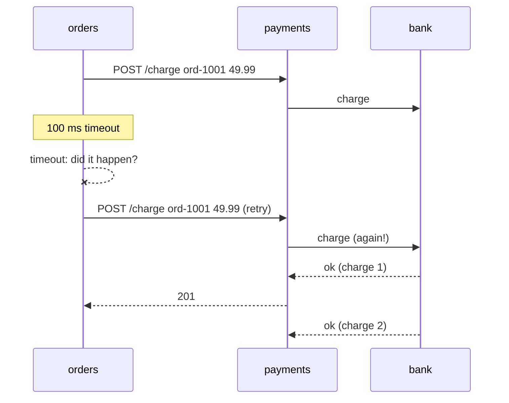
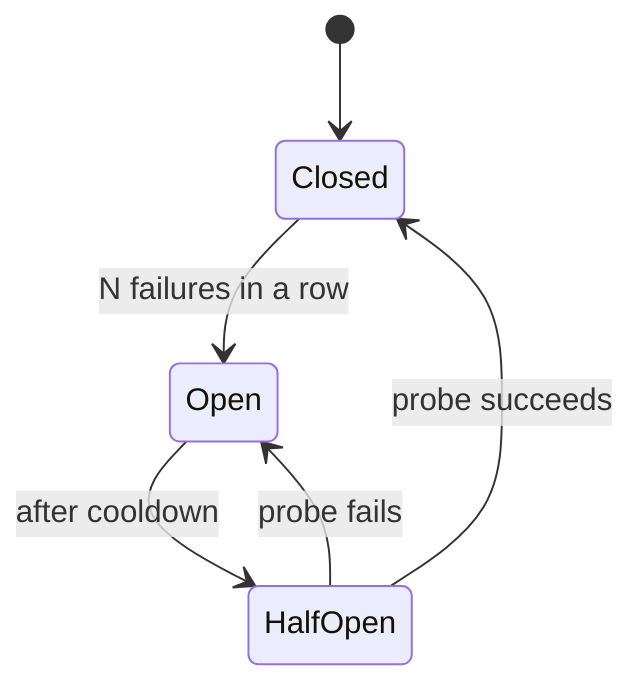
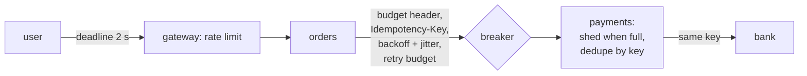

# Retries and idempotency

## Why care?

Five tickets, all from one bad Tuesday:

- "A customer was charged twice for order `ord-1001`. Our logs show one click and two `POST /charge` calls, 120 ms apart."
- "Payments was slow for 30 seconds. Then it was **down** for 20 minutes, although nothing changed."
- "The checkout page hangs for 30 seconds when payments is down, then fails anyway."
- "Payments recovered at 10:05. Its traffic went up 6×, at exactly 10:05:01, and it fell over again."
- "Under load, the server's CPU is at 100 % and it answers **nothing** in time."

Every network call can end in three ways: it worked, it failed, or **you don't know**. The third one is the hard one. This page is about living with it: timeouts and deadlines so you stop waiting, retries that don't make things worse, idempotency so retrying is safe, and circuit breakers and load shedding so an overloaded service can recover. Every demo below is a real Go program hitting a real HTTP server on this machine.

## The idea: phoning in a pizza order

You call the pizza place, give your order, and the line goes dead before they confirm.

- Did they get the order? **You can't know.** Maybe the line dropped before they heard you, maybe after they wrote it down.
- Call again and order the same pizza: maybe you get **two pizzas**.
- Unless you say: "This is order number **42**. If you already have 42, don't make it again." Now calling again is safe. That number is an **idempotency key**.
- If the pizza place is **swamped**, calling again every second makes it worse for everyone. Wait a bit longer each time, and at a random moment so not all hungry people call back together. That's **exponential backoff with jitter**.
- If the place didn't answer the last five calls, stop calling for a while and cook something at home. That's a **circuit breaker**.
- And a pizza place that is full should say "sorry, we're full, call back in an hour" **at once**, instead of taking orders it will deliver cold, two hours later. That's **load shedding**.



The timeout did not cancel the first charge. It only stopped **orders** from waiting for the answer.

## Timeouts and deadlines

### A timeout on every call

A call without a timeout can wait forever: a peer that stopped reading ([TCP](../networking/tcp.md)), a backend stuck on a lock, a load balancer that dropped the connection. Every waiting call holds a goroutine, a connection and memory, and the caller's caller waits too. **Set a timeout on every network call.** In Go:

- `http.Client.Timeout` "includes connection time, any redirects, and reading the response body" (from `go doc net/http.Client`). The default is zero: **no timeout**. Never use `http.DefaultClient` for service calls.
- Per request, use a context: `http.NewRequestWithContext(ctx, ...)` with `context.WithTimeout`. Whichever is shorter wins.
- On the server: `http.Server` `ReadHeaderTimeout`, `ReadTimeout`, `WriteTimeout`, `IdleTimeout`, and `r.Context()` in handlers. The context of an incoming request "is canceled when the client's connection closes" (`go doc net/http.Request.Context`), so a handler can stop working for a client that left. See [Context and cancellation](../go/context.md).

How long? Measure first. Take the backend's p99 or p99.9 latency, add a bit, and make sure the **sum along the path** fits inside what the user will wait.

### Deadlines: one budget for the whole request

A timeout per hop is not enough. The user gives the checkout 300 ms. `orders` spends 200 ms on the database, then calls `payments` with its own fresh 300 ms timeout: the user is long gone when the answer comes.

The fix is a **deadline**: one point in time, set at the edge, that travels with the request. In one process, `context.Context` carries it for you. **Between processes, plain HTTP carries nothing.** gRPC sends the remaining time in a `grpc-timeout` header and the Go gRPC library turns it back into a context deadline. With HTTP you do it yourself. This demo sends the remaining milliseconds in a `Request-Budget-Ms` header (a name made up for the demo; there is no standard one):

```go
// withBudget turns the caller's remaining budget (a header, in ms)
// into a deadline on this request's context.
func withBudget(next http.Handler) http.Handler {
	return http.HandlerFunc(func(w http.ResponseWriter, r *http.Request) {
		if ms, err := strconv.Atoi(r.Header.Get("Request-Budget-Ms")); err == nil {
			ctx, cancel := context.WithTimeout(r.Context(), time.Duration(ms)*time.Millisecond)
			defer cancel()
			r = r.WithContext(ctx)
		}
		next.ServeHTTP(w, r)
	})
}

// call sends the remaining budget along with the request.
func call(ctx context.Context, url string) (int, string, error) {
	req, _ := http.NewRequestWithContext(ctx, http.MethodGet, url, nil)
	if d, ok := ctx.Deadline(); ok {
		req.Header.Set("Request-Budget-Ms", strconv.FormatInt(time.Until(d).Milliseconds(), 10))
	}
	// ... Do, read body
}
```

The client gives 300 ms. `orders` spends some time "in the database", then calls `payments`, which needs about 120 ms and refuses up front if the budget is smaller:

```console
$ bin/deadline
== database takes 50ms
   0ms  orders:   budget left 299ms
  51ms  orders:   after the database, budget left 249ms; calling payments
  52ms  payments: budget left 248ms, I need about 120ms
 173ms  client:   200 "paid\n" err=<nil>

== database takes 200ms
   0ms  orders:   budget left 299ms
 200ms  orders:   after the database, budget left 98ms; calling payments
 201ms  payments: budget left 98ms, I need about 120ms
 201ms  payments: not enough time, refusing before doing any work
 202ms  client:   504 "deadline too short\n" err=<nil>
```

The budget **shrinks** at each hop, and `payments` knows exactly how much is left. In the second run it says no in 1 ms instead of starting a charge that nobody would wait for. Sending a relative duration, not an absolute time, avoids trusting the two machines' clocks ([Time and ordering](time-and-ordering.md)); the price is that network time isn't counted.

## Retries: which ones, and how

### Which failures to retry

A retry is only correct when **doing it twice is the same as doing it once** (the operation is **idempotent**), or when you **know** the first attempt did nothing.

| Outcome                                  | Did it happen?        | Retry?                          |
| ---------------------------------------- | --------------------- | ------------------------------- |
| `connection refused`, DNS failure        | No                    | Yes                             |
| `503`, `429` (with `Retry-After`)        | No (server said so)   | Yes, after the wait it asks for |
| Timeout, reset, `EOF` after sending      | **Unknown**           | Only if idempotent              |
| `500`, `502`, `504`                      | Unknown               | Only if idempotent              |
| `400`, `401`, `403`, `404`, `409`, `422` | No, and it never will | No: fix the request             |

`GET`, `PUT` of a whole resource and `DELETE` are idempotent by design. `POST /charge` is not, until you add an idempotency key (below). Go's own `http.Transport` follows the same rule: it retries once, only on a reused connection, and only for requests it knows are safe to replay; the details are in [Load balancers and proxies](../networking/load-balancers.md#retries-and-idempotency). Database transactions that fail with a serialization error are a separate retry loop: [Transactions and isolation](../databases/transactions.md#serialization-failures-and-retry-loops).

### Retry storms

Retries add load exactly when the backend has the least capacity. Three ways it goes wrong:

- **Retrying at every layer.** Browser, API gateway, `orders`, its HTTP library: 3 retries each turn one click into 4 × 4 × 4 = 64 requests to `payments`. Retry at **one** layer, usually the one closest to the user that still knows whether the call is safe.
- **Retrying immediately.** The backend is overloaded; the retry arrives while it still is.
- **Retrying in sync.** Many clients failed at the same moment (the backend hiccupped), so they all retry at the same moment. That's the 10:05:01 ticket.

### Try it: a burst, three ways

The server has **10 slots**, each request takes **10 ms**, so it can do 1,000 requests per second. When all slots are busy, it answers `503` at once. 500 clients connect, then all send one request **at the same moment**, and retry up to 6 times (7 attempts):

```go
const (
	base        = 10 * time.Millisecond
	maxBackoff  = 2 * time.Second
	maxAttempts = 7
)

// backoff returns how long to wait before retry number n (n = 1, 2, ...).
func backoff(strategy string, n int) time.Duration {
	exp := min(maxBackoff, base<<(n-1)) // 10, 20, 40, 80 ms ...
	switch strategy {
	case "none":
		return 0
	case "exponential":
		return exp
	case "full-jitter":
		return rand.N(exp + 1) // anywhere in [0, exp]
	}
	panic(strategy)
}
```

The server counts arrivals per 25 ms (one `#` = 20 requests):

```console
$ bin/storm
== none
succeeded 58/500 (12%), requests sent 3314 (6.6 per client), rejected 3256, took 66ms
     0 ms  1559 ##############################################################################
    25 ms  1615 #################################################################################
    50 ms   140 #######
== exponential
succeeded 120/500 (24%), requests sent 3190 (6.4 per client), rejected 3070, took 666ms
     0 ms   990 ##################################################
    25 ms   480 ########################
    50 ms     0
    75 ms   460 #######################
   100 ms     0
   125 ms     0
   150 ms   440 ######################
   175 ms     0
   200 ms     0
   225 ms     0
   250 ms     0
   275 ms     0
   300 ms    75 ####
   325 ms   345 ##################
   350 ms     0
   375 ms     0
   400 ms     0
   425 ms     0
   450 ms     0
   475 ms     0
   500 ms     0
   525 ms     0
   550 ms     0
   575 ms     0
   600 ms     0
   625 ms   234 ############
   650 ms   166 #########
== full-jitter
succeeded 415/500 (83%), requests sent 3015 (6.0 per client), rejected 2600, took 602ms
     0 ms  1190 ############################################################
    25 ms   547 ############################
    50 ms   344 ##################
    75 ms   170 #########
   100 ms   152 ########
   125 ms   103 ######
   150 ms    72 ####
   175 ms    81 #####
   200 ms    80 ####
   225 ms    51 ###
   250 ms    41 ###
   275 ms    30 ##
   300 ms    17 #
   325 ms    21 ##
   350 ms    21 ##
   375 ms    26 ##
   400 ms    16 #
   425 ms    20 #
   450 ms    15 #
   475 ms     7 #
   500 ms     3 #
   525 ms     5 #
   550 ms     2 #
   575 ms     1 #
```

- **No backoff:** all 7 attempts are spent in **66 ms**, 3,314 requests in a server that can do about 66 in that time. 12 % succeed. The retries are pure extra load.
- **Exponential backoff, no jitter:** the clients wait 10, 20, 40, 80, 160, 320 ms, **all the same**. Look at the histogram: the load arrives in **waves** (0, 25, 75, 150, 325, 650 ms) with nothing in between. Each wave is ~460 requests for 10 slots. The server is idle most of the time and swamped the rest. Only 24 % succeed.
- **Full jitter:** each client waits a **random** time between 0 and the exponential value. About the same number of requests (3,015) now arrive **spread out**, the server keeps its slots busy, and 83 % succeed in about the same time.

Two more lessons in the numbers. First, all three sent about **6 requests per client**: backoff doesn't reduce how many retries you make, it reduces how many arrive **at once**. Second, even full jitter can't make 500 × 10 ms of work fit into 600 ms on 10 slots: retries can't create capacity. When the backend is really overloaded, the answer is fewer requests (a retry **budget**, a circuit breaker, load shedding), not smarter ones.

The full-jitter formula is from the AWS Architecture Blog post "Exponential Backoff And Jitter": `sleep = random(0, min(cap, base × 2^attempt))`. Its comparison found full jitter needs the fewest calls and finishes soonest of the variants tried. If a server sends `Retry-After`, wait **at least** that long.

### Retry budgets

A **retry budget** caps retries as a share of normal traffic, for example "retries may add at most 10 % to the requests we send". In code: count requests and retries over a sliding window, and when retries go over the limit, return the error instead of retrying. During a short glitch the budget lets retries through; during a real outage, it stops a client from multiplying the load by 7. gRPC has this built in as retry throttling in its service config; for HTTP you write the counter yourself (it's ten lines around an `atomic.Int64` pair).

## Idempotency keys: make the retry safe

An operation is **idempotent** if doing it twice has the same effect as doing it once. "Set status to `paid`" is. "Charge 49.99" is not. An **idempotency key** turns the second kind into the first:

1. The **client** creates a unique key per **logical operation** (not per attempt!), for example a UUIDv7 stored with the order, and sends it in an `Idempotency-Key` header. Every retry of that operation sends **the same key**.
2. The **server** remembers each key with its result. A request with a known key gets the **stored answer** instead of being done again.

There is an IETF draft that standardises the header ("The Idempotency-Key HTTP Header Field"), and payment APIs such as Stripe's have worked this way for years.

### Try it: one charge, retried

`payments` calls a "bank" that takes **150 ms** the first time (a cold connection, say) and 20 ms after that. `orders` has a **100 ms** timeout and retries after 20, 40 and 80 ms. First without a key, then with one:

```console
$ bin/idem
== without a key
   0ms  server: charging ord-1001 4999 cents
 101ms  client: attempt 1: Post "http://127.0.0.1:17320/charge": context deadline exceeded (Client.Timeout exceeded while awaiting headers)
 123ms  server: charging ord-1001 4999 cents
 144ms  server: charge 1 done
 144ms  client: attempt 2: 201 {"charge_id":1} replayed=""
 151ms  server: charge 2 done
ledger: 2 charge(s) [ord-1001 4999] [ord-1001 4999]

== with Idempotency-Key
   1ms  server: charging ord-1001 4999 cents
 100ms  client: attempt 1: Post "http://127.0.0.1:17321/charge": context deadline exceeded (Client.Timeout exceeded while awaiting headers)
 122ms  server: key 8f14e45f-ord-1001-pay still in progress: 409
 123ms  client: attempt 2: 409 a request with this key is in progress replayed=""
 151ms  server: charge 1 done
 164ms  server: key 8f14e45f-ord-1001-pay seen before: replay stored response
 164ms  client: attempt 3: 201 {"charge_id":1} replayed="true"
 165ms  server: key 8f14e45f-ord-1001-pay reused with a different body: 422
 165ms  client: attempt 1: 422 idempotency key reused with a different request replayed=""
ledger: 1 charge(s) [ord-1001 4999]
```

Without a key, the customer pays twice. Look closely at the order: the **retry's** charge finished first (charge 1, at 144 ms) and the **original** finished later (charge 2, at 151 ms). The client's timeout did not stop the first request; it just stopped listening.

With a key, four things happen, and a correct server needs all four:

- **First request:** the key is new. The server **claims** it ("in progress") before charging.
- **Retry while still in progress (122 ms):** answer `409 Conflict`, and do **not** charge. The client retries later. (Waiting for the first one to finish is also fine; charging again is not.)
- **Retry after it finished (164 ms):** return the **stored** response, the same `charge_id 1`, with a header that says it's a replay.
- **Same key, different body:** a client bug (here: the amount changed). `422`, never "replay the old answer for a different request". The server compares a hash of the body, a **fingerprint**.

The core of the server:

```go
fp := sha256.Sum256(body)
p.mu.Lock()
entry = p.keys[key]
switch {
case entry == nil: // first time: claim the key
	entry = &stored{fingerprint: fp}
	p.keys[key] = entry
	p.mu.Unlock()
case entry.fingerprint != fp:
	p.mu.Unlock()
	http.Error(w, "idempotency key reused with a different request", http.StatusUnprocessableEntity)
	return
case !entry.done:
	p.mu.Unlock()
	http.Error(w, "a request with this key is in progress", http.StatusConflict)
	return
default: // done: replay the stored answer, do not charge again
	status, saved := entry.status, entry.body
	p.mu.Unlock()
	w.Header().Set("Idempotent-Replayed", "true")
	w.WriteHeader(status)
	w.Write(saved)
	return
}

// The charge must finish even if this client hangs up.
id := p.bank(context.WithoutCancel(r.Context()), c)
```

`context.WithoutCancel` is deliberate. A charge that is half done when the client hangs up is the worst outcome; the server finishes it and stores the result, so the retry can collect it.

### In production: the key lives in the database

The demo keeps keys in a map, which forgets everything on restart and doesn't work with two replicas. In `orders`, the key belongs in PostgreSQL:

- A table `idempotency_keys (key text PRIMARY KEY, fingerprint bytea, status int, response jsonb, created_at timestamptz)`. The **primary key** does the "claim": two concurrent requests with the same key can't both insert, and the second one gets a unique-violation error (or nothing, with `INSERT ... ON CONFLICT DO NOTHING`).
- Store the key **in the same transaction** as the business change (the order row, the payment row). Then "charged" and "key stored" happen together or not at all ([Transactions and isolation](../databases/transactions.md)).
- If the work calls an outside system (the bank), pass the key **on**, so the bank deduplicates too. Your table can't undo a charge at someone else's bank. That's the general problem of [Outbox and sagas](outbox-and-sagas.md).
- Keys **expire** after a while (24 hours is common). Retries after that are new operations.

Idempotency doesn't need a key if the operation can be made naturally idempotent: "set order 1001 to `paid`" instead of "toggle", `INSERT ... ON CONFLICT DO NOTHING` with the order ID, "ship parcel for order 1001" with a unique constraint on `order_id`. Prefer that when you can; it is less code. Consumers of a message queue need the same thing, because brokers deliver **at least once** ([Messaging](messaging.md)).

## Circuit breakers: stop calling a sick service

When `payments` hangs, every call from `orders` waits for its full timeout. With 20 concurrent callers, that's 20 goroutines and connections tied up, and a checkout page that takes the timeout every time before failing. A **circuit breaker** notices the failures and **fails fast** for a while:



- **Closed:** calls go through; count consecutive failures.
- **Open:** return an error at once, without calling the backend.
- **Half-open:** after a cooldown, let **one** call through as a probe. Success closes the circuit, failure opens it again.

The breaker, about 50 lines:

```go
// Do runs f, unless the circuit is open.
func (b *Breaker) Do(f func() error) error {
	b.mu.Lock()
	if b.state == open && time.Since(b.openedAt) >= b.Cooldown {
		b.set(halfOpen)
	}
	if b.state == open || (b.state == halfOpen && b.probing) {
		b.mu.Unlock()
		return ErrOpen // fail fast: the backend never sees this call
	}
	probe := b.state == halfOpen
	b.probing = probe // in half-open, let exactly one call through
	b.mu.Unlock()

	err := f()

	b.mu.Lock()
	defer b.mu.Unlock()
	switch {
	case probe && err == nil: // the backend is back
		b.probing, b.failures = false, 0
		b.set(closed)
	case probe: // still sick: wait another cooldown
		b.probing = false
		b.openedAt = time.Now()
		b.set(open)
	case b.state != closed: // a slow call from before the circuit opened
	case err == nil:
		b.failures = 0
	default:
		b.failures++
		if b.failures >= b.Threshold {
			b.openedAt = time.Now()
			b.set(open)
		}
	}
	return err
}
```

The line `case b.state != closed` is there because the first version of this demo didn't have it: the 20 calls that were already in flight when the circuit opened all failed a moment later, and each one opened the circuit **again**, restarting the cooldown 17 times. Concurrent code needs to ignore results that belong to an older state.

The scenario: 20 callers, each one call every 10 ms, a 50 ms client timeout, and a backend that **hangs** between 200 ms and 700 ms. Threshold 3, cooldown 150 ms:

```console
$ bin/breaker
== no breaker
ok 792, failed after timeout 180, failed fast 0; backend saw 972 calls (180 while sick); callers waited 10.084s in total

== with breaker
   253ms  closed -> open
   405ms  open -> half-open
   455ms  half-open -> open
   606ms  open -> half-open
   657ms  half-open -> open
   810ms  open -> half-open
   811ms  half-open -> closed
ok 693, failed after timeout 22, failed fast 1001; backend saw 715 calls (22 while sick); callers waited 1.949s in total
```

- The circuit opens at **253 ms**: the first calls after 200 ms timed out at about 250 ms.
- Probes at 405 and 606 ms hang (the backend is still sick) and open it again. The probe at 810 ms succeeds, and traffic flows again.
- The sick backend got **22** calls instead of **180**. A backend that is struggling gets room to recover, instead of 8× the hopeless requests.
- Callers spent **1.9 s** waiting in total, instead of **10.1 s**. Failing fast frees goroutines and gives the checkout page a quick, clear error, or a fallback ("we'll confirm your payment by email").
- The cost: from 700 ms (backend healthy) to 810 ms (the next probe), calls failed that would have worked. The cooldown is a trade-off between protecting the backend and noticing recovery.

In production use a maintained library (for example `github.com/sony/gobreaker/v2`) and count failures over a **time window** or as a **rate**, not only in a row. Keep **one breaker per backend** (per host, sometimes per endpoint), and export its state as a metric: an open breaker is an alert.

## Load shedding: say no early

A server that accepts every request and queues it looks friendly. Under overload it is the worst option. The queue grows, every request waits longer than its client's timeout, and the server spends all its CPU on answers **nobody is waiting for**. Work done, but **goodput** (useful answers per second) near zero.

**Load shedding** means: when the server is full, reject new work **at once and cheaply** (`503` with `Retry-After`), and drop queued work whose client has gone. Here: 4 workers, 10 ms per request (capacity 400 requests/s), **800 requests/s** for 3 seconds, clients with a 100 ms timeout. The shedding server allows at most 8 requests to wait:

```go
if s.shed {
	// Load shedding: if 8 requests already wait, say no at once.
	if s.waiting.Add(1) > 2*workers {
		s.waiting.Add(-1)
		w.Header().Set("Retry-After", "1")
		http.Error(w, "overloaded", http.StatusServiceUnavailable)
		return
	}
	select {
	case s.slots <- struct{}{}:
		s.waiting.Add(-1)
	case <-ctx.Done(): // the client gave up while we queued
		s.waiting.Add(-1)
		return
	}
} else {
	s.slots <- struct{}{} // wait as long as it takes
}
```

```console
$ bin/shed
== queue everything
sent 2294: ok 26, timed out 2268, 503 0
goodput 9 req/s, ok latency p50 27ms p99 80ms
server did 2294 units of work, 2260 of them for clients that had gone
server still busy 2.979s after the last client finished
== shed load
sent 2400: ok 1155, timed out 0, 503 1245
goodput 385 req/s, ok latency p50 31ms p99 33ms
server did 1155 units of work, 0 of them for clients that had gone
server still busy 0s after the last client finished
```

The server is the same speed in both runs. What changed is **which** work it did:

- **Queue everything:** it did 2,294 units of work, and **2,260** of them were for clients that had already timed out. Goodput: **9 requests/s** from a server that can do 400. And it kept working for **3 seconds** after the load stopped, emptying a queue of the dead. This is the "100 % CPU, answers nothing" ticket.
- **Shed load:** half the requests got a fast `503`, the other half got a real answer at **385 requests/s**, close to the capacity, with a p99 of 33 ms. No wasted work.

A `503` in 1 ms is a better answer than a `200` in 3 seconds that nobody reads. It also tells a well-behaved client to back off. Real servers shed by queue length (as here), by in-flight requests, by CPU, or by **priority**: drop the product-catalog request, keep the checkout. Rate limiting per client is the same idea at the door; it is covered with load balancers in [Load balancers and proxies](../networking/load-balancers.md).

## Putting it together in `orders`



- The **edge** sets one deadline. Each hop passes the rest on.
- **One layer** retries: `orders`, the only one that knows a charge carries a key. With backoff, full jitter and a budget.
- `orders` wraps each backend in a **circuit breaker**.
- `payments` **sheds** load when full, and **deduplicates** by key in its database.
- The key goes **all the way** to the bank.

## Traps

- **No timeout.** `http.DefaultClient` and `http.Client{}` wait forever. Every outbound call needs a timeout or a context deadline.
- **A new key per attempt.** Then every retry is a "new" operation and the key does nothing. Create it once per logical operation and store it with the order.
- **Retrying non-idempotent calls on timeout.** A timeout means "unknown", not "failed".
- **Retries at every layer.** Multiplied load in an outage. Pick one layer.
- **Backoff without jitter.** Synchronised waves, as in the histogram. Always add jitter.
- **Retrying `4xx`.** A `400` or `422` will fail again. Fix the request.
- **Keys in memory, or in a different transaction than the work.** A restart, a second replica, or a crash between the two writes, and you charge twice anyway.
- **A server that never checks `r.Context()`.** It keeps working for clients that left, and under load all of its work is wasted.
- **Unbounded queues.** They turn a short overload into a long outage. Bound them and shed.
- **A breaker that counts in-flight failures after it opened.** It keeps re-opening itself and never recovers on time.

## Check yourself

??? question "1. A `POST /charge` times out after 100 ms. What do you know about the charge?"

    Nothing. It may not have arrived, may be in progress, or may have succeeded with the answer
    lost. A timeout only means **you stopped waiting**. Retry only with an idempotency key that the
    server checks, or ask the server for the result.

??? question "2. In the storm demo, all three strategies sent about 6 requests per client. Why did full jitter still succeed more than three times as often as plain exponential backoff?"

    Because what kills the server is requests arriving **at the same time**, not their total.
    Without jitter, all 500 clients wait exactly 10, 20, 40 ms, so their retries arrive in waves of
    ~460 for 10 slots, with idle gaps between them. Jitter spreads the same requests over time, so
    the slots stay busy instead of overflowing.

??? question "3. A retry with the same `Idempotency-Key` arrives while the first request is still running. What should the server do, and what must it never do?"

    Answer `409 Conflict` (the client retries later), or wait for the first one and return its
    result. It must never start the work a second time. That's why the server claims the key
    **before** doing the work, not after.

??? question "4. Why does the idempotency key table belong in the same database transaction as the order update?"

    So that "the work happened" and "the key is stored with its result" are atomic. If they are
    separate, a crash between them leaves either work without a key (a retry does it again) or a
    key without the work (a retry gets an answer for something that never happened).

??? question "5. The queue-everything server did 2,294 units of work and returned 26 useful answers. Explain where the work went, and the two changes that fixed it."

    The queue grew past the clients' 100 ms timeout, so almost every request was processed after
    its client had left. The fixes: a bounded queue that answers `503` immediately when full, and
    checking `r.Context()` so requests whose client is gone are dropped before doing work.

??? question "6. What does a circuit breaker protect, and what does it cost?"

    It protects the **backend** (no more hopeless calls while it is sick, so it can recover) and
    the **caller** (no goroutines and users stuck waiting for timeouts). The cost: while open, it
    also rejects calls that would have worked, until the next probe succeeds.

## Recap

- Every call ends in success, failure or **unknown**. A timeout is "unknown".
- Put a **timeout** on every call, and pass one **deadline** through all hops (a context in-process, a header such as `grpc-timeout` between processes). Refuse work that can't finish in the remaining budget.
- **Retry** only idempotent operations or failures where the request clearly did nothing. Retry at **one** layer, with **exponential backoff and full jitter**, and a **retry budget**. Honour `Retry-After`.
- Backoff doesn't reduce retries, it spreads them. Retries never create capacity.
- **Idempotency keys**: one per logical operation, claimed before the work, stored with the result in the **same transaction**, replayed on retry, `409` while in progress, `422` on a different body. Pass them on downstream.
- A **circuit breaker** fails fast when a backend is sick and probes for recovery. **Load shedding** rejects early so that the work you do is work someone waits for.

Next: what changes when the call is a message on a queue instead of an HTTP request. [Messaging](messaging.md).
