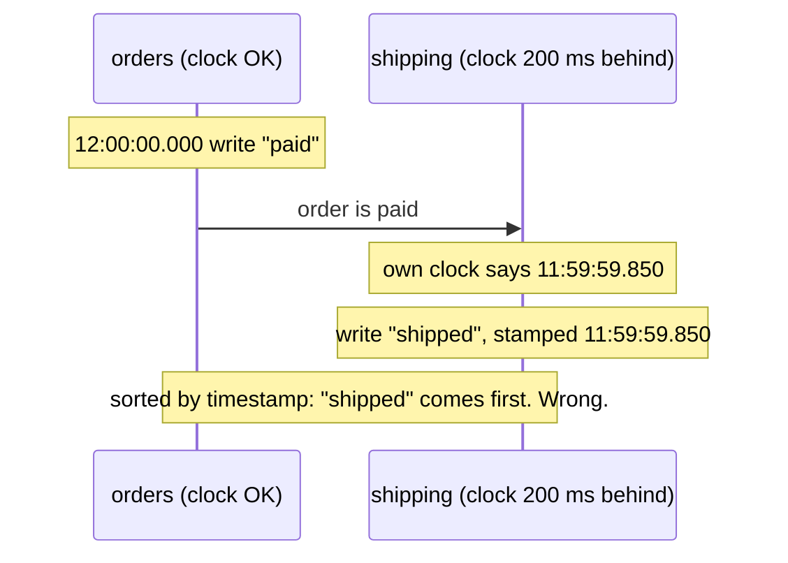
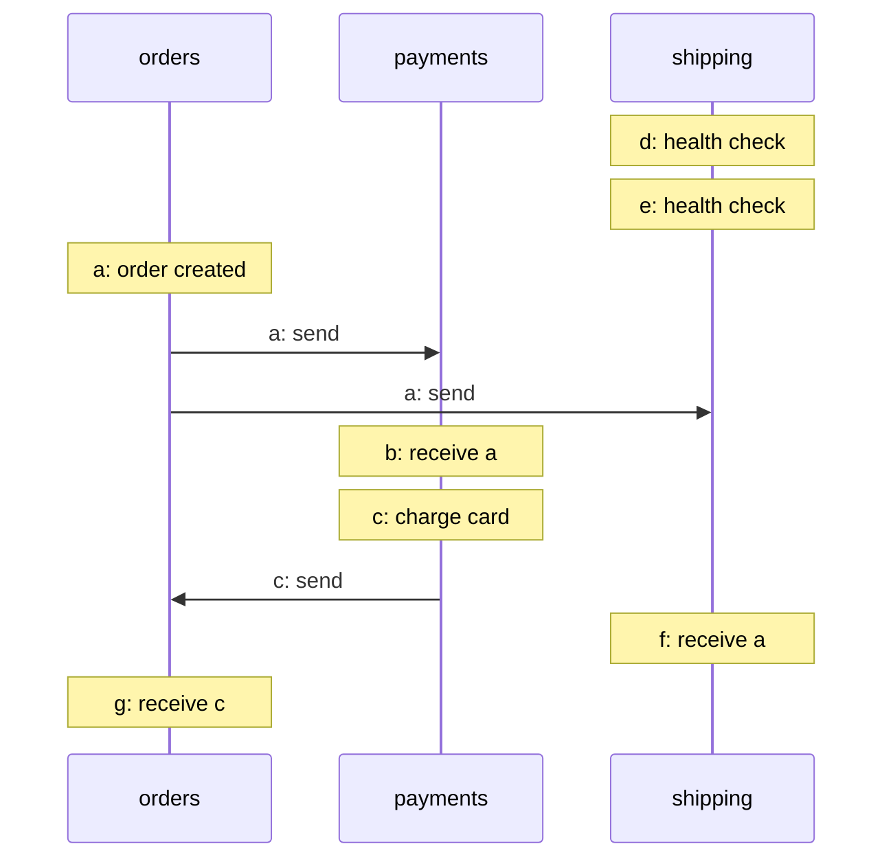

# Time and ordering

## Why care?

Five tickets:

- "An order shows status `paid`, but shipping already sent it. The `shipped` update is in the logs. It vanished."
- "Our request latency metric was negative for one minute last night."
- "The audit log says the refund happened **before** the payment."
- "Two support agents changed the delivery address of the same order at the same time. One change silently disappeared."
- "A lock with a 10-second TTL was held by two workers at once."

All five come from one wrong belief: **that timestamps from different machines can be compared**. Each machine has its own clock, and those clocks disagree, jump, and drift. On one machine, "what happened first?" is easy. Across machines, it needs a different tool. This page shows what clocks really do, how Go protects you on one machine, and the three **logical clocks** (Lamport, vector, hybrid) that distributed systems use instead of trusting wall time.

## The idea: clocks disagree, messages give an order

Every machine has its own clock, and each clock is corrected only from time to time, over the network.

- The clocks **disagree** at any moment: one may be 2 minutes ahead of another. This difference is **skew** (or offset).
- Each clock runs at a slightly different speed: one may gain 3 seconds a day. This is **drift**.
- When a clock is corrected, it can **jump**, also backwards.

Now machine A sends a message at 10:05 by its own clock, and machine B writes a reply at 10:03 by its own clock. Was the reply written before the message? No: **B cannot reply to a message it has not received**. That is the key idea behind logical clocks: **messages give an order that clocks cannot**. If B received A's message before it wrote the reply, the reply came after, whatever the clocks say.



## Under the hood: what a computer clock is

A computer has two kinds of clock, and Linux offers both:

| Clock                        | Linux name        | Meaning                                          | Can jump?                       | Comparable across machines?                  |
| ---------------------------- | ----------------- | ------------------------------------------------ | ------------------------------- | -------------------------------------------- |
| **Wall clock** (time of day) | `CLOCK_REALTIME`  | "It is 12:00:00 UTC". Seconds since 1970-01-01   | **Yes**, forwards and backwards | Roughly, if both are synced                  |
| **Monotonic clock**          | `CLOCK_MONOTONIC` | "N seconds since some point", usually since boot | **No**, only moves forwards     | **No**: each machine has its own start point |

The wall clock comes from a quartz crystal plus corrections. A crystal's speed depends on temperature and age, so the clock **drifts**: tens of parts per million (ppm) is normal for cheap hardware. **NTP** (Network Time Protocol, here via `systemd-timesyncd`) asks time servers over the network and corrects the clock: it **slews** small errors (runs the clock a bit faster or slower) and **steps** big ones (jumps). Here is the laptop that ran this page's examples:

```console
$ timedatectl timesync-status
       Server: 185.125.190.58 (ntp.ubuntu.com)
Poll interval: 32s (min: 32s; max 34min 8s)
         Leap: normal
      Version: 4
      Stratum: 2
    Reference: DA45F1D0
    Precision: 1us (-25)
Root distance: 800us (max: 5s)
       Offset: -280.927ms
        Delay: 14.048ms
       Jitter: 5.255ms
 Packet count: 2310
    Frequency: -56.730ppm
```

Two real numbers to look at:

- **`Offset: -280.927ms`**: at the last check, this clock was 281 ms away from the server's. (WSL2 is a bad case, because the VM's clock falls behind when Windows sleeps. But even well-run servers are often a few milliseconds apart, and after a bad hour, much more.)
- **`Frequency: -56.730ppm`**: the correction timesyncd applies to the crystal's speed. Without it, this clock would be off by about 57 µs every second: about 5 seconds a day.
- **`Delay: 14.048ms`**: the round trip to the time server. NTP can't know if the request or the reply was slower, so its accuracy is limited to about half of this: **±7 ms at best**, before any other error.

So: **two machines' wall clocks always differ**, usually by milliseconds, sometimes by seconds, and either one can jump at any moment. Leap seconds add another problem: some systems repeat a second, others "smear" it over hours. Cloud providers offer better clocks (for example, PTP-based time with known error bounds), and Google's Spanner database is built on clocks that report their own uncertainty, but no clock is exact.

### Go's `time.Time` carries both clocks

Go hides the two-clock problem inside one type. `time.Now()` reads **both** clocks and stores both readings. From `go doc time`:

> later time-telling operations use the wall clock reading, but later time-measuring operations, specifically comparisons and subtractions, use the monotonic clock reading.

See it, and see where the monotonic reading gets lost:

```go
// mono shows the two readings inside a time.Time, and where the
// monotonic one gets lost.
func mono() {
	start := time.Now()
	time.Sleep(20 * time.Millisecond)
	end := time.Now()
	fmt.Println("start:          ", start)
	fmt.Println("end:            ", end)
	fmt.Println("end.Sub(start): ", end.Sub(start).Round(time.Microsecond))

	wall := start.Round(0) // strips the monotonic reading
	fmt.Println("start.Round(0): ", wall)
	fmt.Println("start == wall:  ", start == wall, "  start.Equal(wall):", start.Equal(wall))

	b, _ := json.Marshal(start)
	var back time.Time
	json.Unmarshal(b, &back)
	fmt.Println("after JSON:     ", back)
}
```

```console
$ ./clocks mono
start:           2026-11-27 07:12:54.631287803 +0100 CET m=+0.000037061
end:             2026-11-27 07:12:54.651511908 +0100 CET m=+0.020261176
end.Sub(start):  20.224ms
start.Round(0):  2026-11-27 07:12:54.631287803 +0100 CET
start == wall:   false   start.Equal(wall): true
after JSON:      2026-11-27 07:12:54.631287803 +0100 CET
```

- **`m=+0.000037061`** is the monotonic reading, in seconds. Go counts it from the start of the **process**, so it means nothing to any other process, let alone another machine.
- **`end.Sub(start)`** used the monotonic readings. If NTP had stepped the wall clock back by a second during the sleep, this would still say ~20 ms. That's why `time.Since(start)` for latency metrics is safe: the "negative latency" ticket comes from code that subtracts **wall** times, for example two timestamps parsed from logs, or from two machines.
- **`Round(0)`** is the official way to strip the monotonic reading. `In`, `UTC`, `Local`, `Truncate`, `AddDate` strip it too.
- **`==` compares the struct**, including the monotonic part (and the location). The same instant gave `false`. Always compare times with `Equal`, `Before`, `After` or `Compare`.
- **JSON (and `MarshalText`, `MarshalBinary`, `Gob`) drop the monotonic reading.** A time that crossed a process boundary is wall time only. From then on, comparisons and subtractions use the wall clock, with all its jumps.

The rule from the Go docs: **the wall clock is for telling time, the monotonic clock is for measuring time.** Timeouts, deadlines, latency, rate limiters, TTLs inside one process: monotonic, which `time.Now()` + `Sub`/`Since`/`Until` already give you. "When did this order ship?", shown to a human or stored in a database: wall time. "Which of these two events on two machines came first?": **neither**. The rest of this page covers that case.

### Injecting a clock

You can't change the system clock without root, and you shouldn't in tests anyway. The usual Go answer is to **inject** the clock: a `func() time.Time` field, or a small interface. The `orders` example already does this: `order.Service` has a `now func() time.Time` field, `time.Now` in production, a fixed time in its tests. For the simulation on this page, each node gets a fake clock with its own **offset** (skew) and **drift**:

```go
// Clock is what every node reads. Production code passes a real one;
// the simulation passes a fake one with a skew and a drift rate.
type Clock interface{ Now() time.Time }

// trueTime is the "real" time of the simulation, advanced by hand.
var trueTime = time.Date(2026, 11, 27, 12, 0, 0, 0, time.UTC)

// fakeClock is trueTime plus a fixed offset, running drift parts per
// million too fast (or too slow, if negative).
type fakeClock struct {
	offset time.Duration
	drift  float64 // parts per million
	since  time.Time
}

func (f *fakeClock) Now() time.Time {
	elapsed := trueTime.Sub(f.since)
	extra := time.Duration(float64(elapsed) * f.drift / 1e6)
	return trueTime.Add(f.offset + extra)
}
```

(For tests of code that **sleeps** or uses timers, Go also has `testing/synctest`: inside its bubble, the `time` package itself uses a fake clock that jumps forward when all goroutines are blocked. That fakes time for one process; it can't give two "machines" different clocks, so we use our own here.)

## Try it: skew breaks "last write wins"

Make a scratch module (`mkdir ~/ds-time && cd ~/ds-time && go mod init example.com/clocks`). The program `clocks` has one subcommand per section of this page; all code is in this page.

**Last write wins (LWW)** is the simplest way to settle conflicting writes: keep the one with the bigger timestamp. Cassandra does it per column; many "sync" features and caches do it without saying so. Here `orders` writes `paid`, then `shipping` reads the order and 50 ms later writes `shipped`. `shipping`'s clock is 200 ms behind:

```go
// write is one versioned value, as a last-write-wins store keeps it.
type write struct {
	value string
	at    time.Time
	node  string
}

// lww keeps whichever write has the larger timestamp.
func lww(cur, w write) write {
	if w.at.After(cur.at) {
		return w
	}
	return cur
}

func skew() {
	orders := &fakeClock{since: trueTime}                                    // in sync
	shipping := &fakeClock{offset: -200 * time.Millisecond, since: trueTime} // 200 ms behind

	fmt.Println("--- last write wins with a skewed clock")
	stored := write{value: "paid", at: orders.Now(), node: "orders"}
	fmt.Printf("true %s  orders   writes %-10q stamp %s\n", trueTime.Format(ts), stored.value, stored.at.Format(ts))

	trueTime = trueTime.Add(50 * time.Millisecond) // shipping reads "paid", then ships
	w := write{value: "shipped", at: shipping.Now(), node: "shipping"}
	fmt.Printf("true %s  shipping writes %-10q stamp %s\n", trueTime.Format(ts), w.value, w.at.Format(ts))

	stored = lww(stored, w)
	fmt.Printf("store keeps %q from %s: the later write is lost\n", stored.value, stored.node)

	fmt.Println("--- drift: 50 ppm fast, never corrected")
	trueTime = time.Date(2026, 11, 27, 12, 0, 0, 0, time.UTC)
	fast := &fakeClock{drift: 50, since: trueTime}
	for _, d := range []time.Duration{time.Minute, time.Hour, 24 * time.Hour, 7 * 24 * time.Hour} {
		trueTime = fast.since.Add(d)
		fmt.Printf("after %-9v ahead by %v\n", d, fast.Now().Sub(trueTime))
	}
}
```

(`ts` is the layout `"15:04:05.000"`.)

```console
$ ./clocks skew
--- last write wins with a skewed clock
true 12:00:00.000  orders   writes "paid"     stamp 12:00:00.000
true 12:00:00.050  shipping writes "shipped"  stamp 11:59:59.850
store keeps "paid" from orders: the later write is lost
--- drift: 50 ppm fast, never corrected
after 1m0s      ahead by 3ms
after 1h0m0s    ahead by 180ms
after 24h0m0s   ahead by 4.32s
after 168h0m0s  ahead by 30.24s
```

That's the first ticket. `shipped` happened **after** `paid` in real time, and even **because of** it (shipping read `paid` first). But its timestamp is earlier, so LWW throws it away. No error, no log line: the update silently vanishes. Skew only has to be bigger than the time between two writes, and 200 ms is not unusual after a short NTP problem.

The drift lines show why clocks need constant correction: at 50 ppm, a machine that loses its NTP server is 4 seconds off after a day. Remember the laptop above needed a −57 ppm correction.

Note also what happens with a **TTL lock** (the fifth ticket): worker 1 takes a lock "until 12:00:10" by its clock. Worker 2's clock is 3 s ahead; at its 12:00:10 the lock looks expired, although worker 1 still has 3 seconds. Both hold it. Leases across machines must use durations measured by the **holder's monotonic clock**, with a safety margin, plus a fencing token the resource checks ([Consensus and Raft](consensus-and-raft.md)).

## Happened-before: the order that messages give

In 1978 Leslie Lamport defined the order you **can** know in a distributed system, the **happened-before** relation, written `a → b`:

1. If `a` and `b` are on the **same process**, and `a` came first there, then `a → b`.
2. If `a` is **sending** a message and `b` is **receiving** that message, then `a → b`.
3. If `a → b` and `b → c`, then `a → c`.

If neither `a → b` nor `b → a`, the events are **concurrent**, written `a ∥ b`. Concurrent doesn't mean "at the same moment". It means **neither could have known about the other**. Two support agents editing the same address, each without seeing the other's change, are concurrent, even if one edit was a second earlier by the wall clock. For correctness, that is the only order that matters: it's the order of **cause and effect**.



Here `a → b → c → g`: creating the order caused the charge, which caused the reply. `a → f` too. But `c` (charge) and `f` (shipping gets the order) are concurrent: neither process heard from the other. A logical clock is a way to put numbers on events so that these relations can be computed.

## Lamport clocks: one counter per process

The rules are short:

- Each process keeps a counter `L`.
- Before each local event or send: `L = L + 1`. A message carries the sender's `L`.
- On receive of a message with stamp `m`: `L = max(L, m) + 1`.

```go
// Lamport is a Lamport clock: one counter per process.
type Lamport struct{ t uint64 }

// Tick is a local event or a send: count up, return the stamp.
func (l *Lamport) Tick() uint64 { l.t++; return l.t }

// Recv merges the stamp from a message: max of both, plus one.
func (l *Lamport) Recv(m uint64) uint64 { l.t = max(l.t, m) + 1; return l.t }
```

The guarantee: **if `a → b`, then `L(a) < L(b)`**. A reply always gets a bigger number than the request it answers, whatever the wall clocks say. Break ties with the process name, `(L, process)`, and you get a **total order** that every process agrees on and that never contradicts cause and effect. That is good enough for many things: ordering log entries, deciding who wins a tie, a lock queue (Lamport's original use).

But the guarantee only goes one way. `L(a) < L(b)` does **not** mean `a → b`. Lamport numbers can't tell you that two events were concurrent.

## Vector clocks: a counter for every process

A **vector clock** keeps a counter for **every** process: "how many events of each process do I know about?"

- Before each local event or send: increase **your own** entry. A message carries the whole vector.
- On receive: take the element-wise **max** of your vector and the message's, then increase your own entry.
- Compare two vectors: `a` is before `b` if every entry of `a` is ≤ `b`'s and at least one is smaller. If some entries are bigger and some smaller, they are **concurrent**.

```go
// VC is a vector clock: one counter per process name.
type VC map[string]uint64

// Tick counts a local event or send of process p.
func (v VC) Tick(p string) VC { v[p]++; return maps.Clone(v) }

// Recv merges a received clock (element-wise max), then ticks.
func (v VC) Recv(p string, m VC) VC {
	for k, n := range m {
		v[k] = max(v[k], n)
	}
	return v.Tick(p)
}

// Compare returns "before", "after", "equal" or "concurrent".
func Compare(a, b VC) string {
	less, more := false, false
	for k := range merge(a, b) {
		if a[k] < b[k] {
			less = true
		}
		if a[k] > b[k] {
			more = true
		}
	}
	switch {
	case less && more:
		return "concurrent"
	case less:
		return "before"
	case more:
		return "after"
	}
	return "equal"
}
```

(`merge` is the element-wise max of two vectors; `String` prints the entries as `o:`, `p:`, `s:`.) The `logical` subcommand replays the diagram above with both clocks side by side, then compares some pairs:

```go
	a := at("a", "orders: order created, send", lo.Tick(), vo.Tick("orders"))
	b := at("b", "payments: receive a", lp.Recv(a.l), vp.Recv("payments", a.v))
	c := at("c", "payments: charge card, send", lp.Tick(), vp.Tick("payments"))
	at("d", "shipping: health check", ls.Tick(), vs.Tick("shipping"))
	e := at("e", "shipping: health check", ls.Tick(), vs.Tick("shipping"))
	f := at("f", "shipping: receive a", ls.Recv(a.l), vs.Recv("shipping", a.v))
	g := at("g", "orders: receive c", lo.Recv(c.l), vo.Recv("orders", c.v))

	fmt.Println("--- compare")
	for _, p := range [][2]event{{a, g}, {c, f}, {e, b}, {e, c}} {
		x, y := p[0], p[1]
		fmt.Printf("%s vs %s: Lamport %d < %d? %-5v  vector says: %s\n",
			x.name[:1], y.name[:1], x.l, y.l, x.l < y.l, Compare(x.v, y.v))
	}
```

```console
$ ./clocks logical
a orders: order created, send        L=1  V=[o:1 p:0 s:0]
b payments: receive a                L=2  V=[o:1 p:1 s:0]
c payments: charge card, send        L=3  V=[o:1 p:2 s:0]
d shipping: health check             L=1  V=[o:0 p:0 s:1]
e shipping: health check             L=2  V=[o:0 p:0 s:2]
f shipping: receive a                L=3  V=[o:1 p:0 s:3]
g orders: receive c                  L=4  V=[o:2 p:2 s:0]
--- compare
a vs g: Lamport 1 < 4? true   vector says: before
c vs f: Lamport 3 < 3? false  vector says: concurrent
e vs b: Lamport 2 < 2? false  vector says: concurrent
e vs c: Lamport 2 < 3? true   vector says: concurrent
```

- **`a vs g`**: the request and the reply it caused. Both clocks get it right.
- **`e vs c`**: Lamport says 2 < 3, which **looks** like "e came first". But shipping's health check and the card charge had nothing to do with each other. The vector `[o:0 p:0 s:2]` vs `[o:1 p:2 s:0]` has entries bigger on both sides: **concurrent**. Only the vector clock can tell.
- `f` has `o:1`: shipping knows about orders' first event, the order creation, because the message carried it. It has `p:0`: it knows nothing about payments. That is exactly what a vector clock is: a summary of **what this event could know**.

### What vector clocks are for: finding real conflicts

That "concurrent" answer is what a replicated store needs. Take the fourth ticket: two agents edit the delivery address on two replicas.

- If the new version's vector is **after** the stored one, the writer had seen the old value: replace it. No conflict.
- If they are **concurrent**, neither writer saw the other's change. Don't pick one by timestamp: keep **both** ("siblings") and let the application, or the user, merge them. Amazon's Dynamo paper made this widely known (the shopping cart that merges two concurrent versions), and Riak worked this way.

The cost: one entry per process (or per replica, in practice) that ever wrote. With thousands of short-lived clients, vectors grow without bounds, so real systems keep one entry per **replica**, not per client, and prune old entries. Variants such as **version vectors** and **dotted version vectors** fix details of this.

## Hybrid logical clocks: Lamport with a wall clock inside

Lamport numbers are causal but mean nothing to humans ("event 1,822,334"). Wall clocks mean something but aren't causal. A **hybrid logical clock** (HLC, Kulkarni and others, 2014) is both. Each stamp has two parts:

- **`L`**: the biggest **physical time** this process has seen: from its own clock, or from any message it received.
- **`C`**: a counter that orders events with the same `L`.

```go
// Now stamps a local event or a send.
func (h *HLC) Now() Stamp {
	pt := h.clock.Now().UnixMilli()
	if pt > h.l {
		h.l, h.c = pt, 0
	} else {
		h.c++
	}
	return Stamp{h.l, h.c}
}

// Recv stamps the receipt of a message stamped m.
func (h *HLC) Recv(m Stamp) Stamp {
	pt := h.clock.Now().UnixMilli()
	switch old := h.l; {
	case pt > old && pt > m.L:
		h.l, h.c = pt, 0
	case m.L > old:
		h.l, h.c = m.L, m.C+1
	case old > m.L:
		h.c++
	default: // old == m.L
		h.c = max(h.c, m.C) + 1
	}
	return Stamp{h.l, h.c}
}
```

`Stamp{L, C}` compares `L` first, then `C`, and prints as `time+counter`. The `hlc` subcommand replays the broken LWW story, with the same 200 ms skew, but with HLC stamps:

```go
func hlc() {
	trueTime = time.Date(2026, 11, 27, 12, 0, 0, 0, time.UTC)
	orders := &HLC{clock: &fakeClock{since: trueTime}}
	shipping := &HLC{clock: &fakeClock{offset: -200 * time.Millisecond, since: trueTime}}

	paid := orders.Now()
	fmt.Printf("true %s  orders   writes \"paid\"     HLC %v\n", trueTime.Format(ts), paid)

	trueTime = trueTime.Add(50 * time.Millisecond)
	shipping.Recv(paid) // shipping reads the order, and the stamp with it
	shipped := shipping.Now()
	fmt.Printf("true %s  shipping writes \"shipped\"  HLC %v\n", trueTime.Format(ts), shipped)
	fmt.Println("paid < shipped:", paid.Less(shipped))

	for range 3 {
		trueTime = trueTime.Add(100 * time.Millisecond)
		fmt.Printf("true %s  shipping local event     HLC %v  (its own clock: %s)\n",
			trueTime.Format(ts), shipping.Now(), shipping.clock.Now().Format(ts))
	}
}
```

```console
$ ./clocks hlc
true 12:00:00.000  orders   writes "paid"     HLC 12:00:00.000+0
true 12:00:00.050  shipping writes "shipped"  HLC 12:00:00.000+2
paid < shipped: true
true 12:00:00.150  shipping local event     HLC 12:00:00.000+3  (its own clock: 11:59:59.950)
true 12:00:00.250  shipping local event     HLC 12:00:00.050+0  (its own clock: 12:00:00.050)
true 12:00:00.350  shipping local event     HLC 12:00:00.150+0  (its own clock: 12:00:00.150)
```

- **The bug is gone.** When shipping read the order, it also received the stamp `12:00:00.000+0`. Its own clock said 11:59:59.850, smaller, so it kept orders' `L` and counted up: receive `+1`, write `+2`. `shipped` now sorts after `paid`, because it was **caused** by it. Last write wins with HLC stamps is safe for causally related writes.
- **The counter fills the gap.** While shipping's own clock is still behind `L`, it keeps `L` and counts (`+3`). At true 12:00:00.250, its clock passes `L`, and the stamp is plain physical time again (`+0`). HLC stays **close to wall time**: never behind the local clock, and ahead of it only by the skew of the clocks it has heard from.
- **Fits in 64 bits.** Real implementations pack `L` (milliseconds, or microseconds) and `C` (16 bits) into one integer, so it sorts like a timestamp and fits in a timestamp column.

CockroachDB and YugabyteDB use HLCs to order transactions; MongoDB's cluster time is a similar idea. HLC gives you the Lamport guarantee (`a → b` implies `stamp(a) < stamp(b)`), not the vector clock one: two **concurrent** writes still get some order, and LWW still picks one of them. If you must **detect** concurrent writes, you need version vectors, or a single leader that orders all writes ([Consensus and Raft](consensus-and-raft.md)).

## Which clock for what

| Question                                                    | Use                                                           |
| ----------------------------------------------------------- | ------------------------------------------------------------- |
| How long did this take? Has this timeout passed?            | Monotonic: `time.Now()` + `Since`, `context.WithTimeout`      |
| What time should I show the user, or store as "created at"? | Wall clock, in UTC, and don't use it to order across machines |
| Did event A cause event B? A total order that respects it?  | Lamport clock, or HLC if you want it to look like a time      |
| Were two writes concurrent (a real conflict)?               | Vector clock / version vector                                 |
| One order for all writes, no conflicts at all               | A single leader with a log (Raft), or a database transaction  |

## Traps

- **Ordering events from different machines by timestamp.** Clocks are milliseconds to seconds apart. Sort by a logical clock, a sequence number from one leader, or a database-generated version.
- **Last write wins with wall clocks.** Silently drops writes whenever skew is bigger than the gap between writes. Use version numbers (compare-and-set, see [Transactions](../databases/transactions.md)), HLCs, or keep siblings.
- **Measuring durations with wall time.** `time.Since(start)` is safe. `time.Now().Unix() - startUnix`, or subtracting two parsed timestamps, is not: NTP steps make it negative or huge.
- **Comparing `time.Time` with `==`.** It compares the monotonic reading and location too. Use `Equal`. And don't use `time.Time` as a map key for the same reason; use `t.UnixNano()` or a normalized `t.Round(0).UTC()`.
- **Expecting the monotonic reading to survive serialization.** JSON, database columns, gob and protobuf carry wall time only.
- **TTL locks across machines.** The holder and the checker have different clocks. Measure the lease on the holder's monotonic clock, keep a margin, and fence writes with a token.
- **Trusting `ORDER BY created_at` across services.** Each service filled `created_at` from its own clock. It is a hint for humans, not an order of events.
- **Unbounded vector clocks.** One entry per client grows forever. Keep entries per replica, and prune.

## Check yourself

??? question "1. A latency histogram shows a few negative values. What is the most likely cause in Go code?"

    The code subtracts wall-clock times without monotonic readings: for example times parsed from strings, read from
    a database, received in JSON, or `Unix()` integers. When NTP steps the clock back, the difference goes negative.
    Measure with `time.Since(start)` on a `start` from `time.Now()` in the same process.

??? question "2. Server A writes `x=1` at 10:00:00.300 by its clock. Server B, whose clock is 500 ms behind, reads `x=1` and writes `x=2` 100 ms later. Which value does a last-write-wins store keep, and why?"

    `x=1`. B's write gets the stamp 09:59:59.900 (true time 10:00:00.400 minus 500 ms skew), which is smaller than
    A's 10:00:00.300. LWW keeps the larger stamp, so B's later write, which was even based on A's value, is lost.

??? question "3. Event a has Lamport time 5 and event b has Lamport time 9. Did a happen before b?"

    You can't tell. Lamport clocks only guarantee "if a → b then L(a) < L(b)", not the reverse. a and b may be
    concurrent. With vector clocks you could decide it.

??? question "4. Compare the vector clocks `[o:2 p:1 s:0]` and `[o:1 p:1 s:3]`. And `[o:1 p:1 s:0]` with `[o:2 p:1 s:3]`."

    First pair: `o` is bigger on the left, `s` is bigger on the right: **concurrent**. Second pair: every entry on the
    left is ≤ the right and some are smaller: the first **happened before** the second.

??? question "5. In the HLC demo, why did shipping's stamp stay at `12:00:00.000` with a growing counter, instead of using its own clock?"

    Its own clock (11:59:59.850, then .950) was behind the biggest time it had seen, orders' 12:00:00.000. An HLC
    never goes backwards, so it keeps that `L` and counts events with `C`. As soon as its own clock passed `L`
    (at true 12:00:00.250), stamps became plain physical time again with `C=0`.

??? question "6. Two agents change the same order's address on two replicas, without seeing each other's change. HLC stamps are 10:00:01.000+0 and 10:00:01.002+0. Is it safe to keep the larger one?"

    Not if losing an edit matters. The writes are concurrent; HLC just gives them an order, and LWW silently drops one
    agent's change. To detect the conflict, the store needs version vectors (and then keeps both or asks), or a
    compare-and-set on a version number so the second writer is told the order changed.

## Recap

- Every machine has a **wall clock** (time of day: drifts, skews, jumps) and a **monotonic clock** (only forwards, but meaningless outside the machine).
- NTP keeps wall clocks **roughly** in sync: milliseconds apart on a good day, seconds on a bad one. The demo laptop was 281 ms off, correcting −57 ppm.
- Go's `time.Now()` carries **both** readings. `Sub`, `Since`, `Before`, `Equal` use monotonic when both sides have it. `Round(0)`, `UTC()` and every serialization strip it. Compare with `Equal`, not `==`.
- **Inject clocks** (`func() time.Time` or an interface) to test skew and drift.
- **Happened-before** (`→`) is the order messages give: same process, or send-before-receive. Otherwise events are **concurrent**.
- **Lamport clocks**: one counter; `a → b` implies `L(a) < L(b)`, not the reverse.
- **Vector clocks**: one counter per process; they tell "before" from "concurrent", which is what conflict detection needs.
- **Hybrid logical clocks**: physical time plus a counter; causal like Lamport, and close to wall time. They fixed the lost `shipped` update.

Next: with clocks and messages this unreliable, what can a replicated system promise about what you read? [Consistency models](consistency-models.md).
