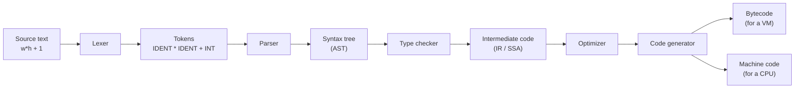
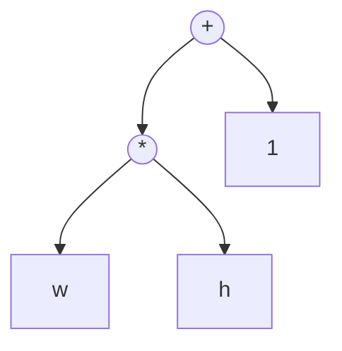
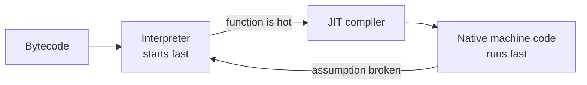

# From source code to bytecode

## Why care?

In the last page you saw that the CPU only understands tiny instructions like `ADDQ BX, AX`. But you write `return w*h + 1`. Something must translate one into the other.

There are a few different ways to do that translation, and the choice explains a lot:

- Why Go programs start in milliseconds, while a Java service needs time to "warm up".
- Why a Python loop is often 30–100× slower than the same loop in Go.
- Why one `.jar` file runs on Linux, macOS and Windows, but a Go binary must be built for each one.
- How tools like regular expressions, SQL databases and even the Linux kernel run "little programs" safely.

The key idea behind most of this is **bytecode**. On this page you will see it, read it, and build your own.

## The idea: a translator, and when it works

Imagine you have a recipe in Dutch, and a cook who only reads Japanese. You have three options:

1. **Interpreter:** a translator stands next to the cook and translates each line while the cook works. Easy to start, but slow, and the translator is needed every time.
2. **Compiler:** you translate the full recipe into Japanese once, before cooking. More work up front, but the cook then works at full speed, alone.
3. **Bytecode:** you translate the recipe into a simple, very strict "kitchen language" that is easy for any translator to read. A small, fast translator (a **virtual machine**) then runs that on any kitchen in the world.

In computer terms:

| Approach                     | Translated when?                                          | Runs on                             | Examples                                   |
| ---------------------------- | --------------------------------------------------------- | ----------------------------------- | ------------------------------------------ |
| Tree-walking interpreter     | While running, line by line                               | An interpreter program              | Early Ruby, shell scripts, `text/template` |
| Bytecode + virtual machine   | Source → bytecode first, then run                         | A **virtual machine** (VM)          | Python, Java, C#, Lua, Erlang              |
| Bytecode + JIT               | Source → bytecode, hot parts → machine code while running | VM with a **just-in-time** compiler | Java (HotSpot), C#, JavaScript (V8)        |
| Ahead-of-time (AOT) compiler | Before running, all the way to machine code               | The CPU directly                    | **Go**, C, C++, Rust                       |

!!! info "Where Go stands"

    Go is an **ahead-of-time** compiler. `go build` produces real machine code for one CPU and
    one operating system. There is **no bytecode and no VM** when a Go program runs. That's why a
    Go binary starts fast, needs nothing installed, and has to be built per platform
    (`GOOS=linux GOARCH=arm64 go build`).

    But you will still meet bytecode as a Go developer, and the Go compiler works in the same
    stages as every other compiler. So let's look at those stages first.

## The pipeline: from text to instructions

Every compiler, for every language, does roughly the same steps:



The great thing about Go: its standard library and toolchain let you **look at every step**. We will follow one tiny function all the way down:

```go
//go:noinline
func area(w, h int) int {
	return w*h + 1
}
```

### Step 1: lexing (text → tokens)

To the computer, your source code is just bytes (see [Encodings](encodings.md)). The **lexer** (or scanner) groups those bytes into **tokens**: the "words" of the language. It also throws away spaces and comments.

```go
src := []byte("w*h + 1")

var s scanner.Scanner
fset := token.NewFileSet()
s.Init(fset.AddFile("", fset.Base(), len(src)), src, nil, 0)
for {
	_, tok, lit := s.Scan()
	if tok == token.EOF {
		break
	}
	fmt.Printf("%-6s %q\n", tok, lit)
}
```

Output:

```text
IDENT  "w"
*      ""
IDENT  "h"
+      ""
INT    "1"
;      "\n"
```

Look at the last line. You never typed a `;`. Go's lexer **adds semicolons automatically** at the end of a line. That's why Go needs the `{` on the same line as `if`: otherwise the lexer would put a `;` after the `if` line.

### Step 2: parsing (tokens → tree)

The **parser** checks the grammar and builds an **abstract syntax tree (AST)**. The tree shape captures what the text only hints at, like "multiply before add".

```go
expr, err := parser.ParseExpr("w*h + 1")
if err != nil {
	panic(err)
}
ast.Print(nil, expr)
```

Output (shortened, positions removed):

```text
*ast.BinaryExpr {
.  X: *ast.BinaryExpr {
.  .  X: *ast.Ident { Name: "w" }
.  .  Op: *
.  .  Y: *ast.Ident { Name: "h" }
.  }
.  Op: +
.  Y: *ast.BasicLit { Kind: INT, Value: "1" }
}
```

As a picture:



The `*` is **deeper** in the tree than the `+`. So it must be computed first. The brackets and priority rules from the text are now just the **shape** of the tree.

!!! tip "You use the AST more than you think"

    `gofmt`, `go vet`, `golangci-lint`, `gopls` in your editor, `stringer`, `mockgen`, `sqlc`, `wire`:
    all of these read your code as an AST with the `go/ast` and `go/parser` packages. Once you
    know how the tree looks, writing your own linter or code generator is a small step.

### Step 3: type checking

Now the compiler knows the shape, but not the meaning. The **type checker** finds out what each name is (`w` is a parameter of type `int`), and if the types fit (`int * int` is fine, `int * string` is an error). Most of the compile errors you see come from this step. Go's own type checker is available as the `go/types` package.

### Step 4: intermediate code (SSA)

Next, the Go compiler turns the tree into a simpler, flat form called **SSA** (_static single assignment_). In SSA, every value gets a name and is set **exactly once**. That makes optimizations much easier for the compiler.

You can watch it. The environment variable `GOSSAFUNC` asks the compiler to show every step for one function:

```sh
GOSSAFUNC='area+' go build .   # the '+' prints text; without it you get ssa.html
```

Early in the process, the SSA for `area` looks like this (shortened):

```text
v7  = Arg <int> {w}
v8  = Arg <int> {h}
v10 = Mul64 <int> v7 v8
v11 = Const64 <int> [1]
v12 = Add64 <int> v10 v11
Ret v12
```

This is still independent of the CPU. `Mul64` means "multiply two 64-bit numbers", on any machine. Then the **lower** pass translates it to amd64-specific operations, and **register allocation** picks registers:

```text
v7  = ArgIntReg <int> {w+0} [0] : AX
v8  = ArgIntReg <int> {h+0} [1] : BX
v10 = MULQ <int> v7 v8 : AX
v12 = ADDQconst <int> [1] v10 : AX
```

Notice `ADDQconst [1]`: the constant `1` is now **part of the instruction**. There is no separate "load 1" step anymore.

!!! tip "Open ssa.html"

    Run `GOSSAFUNC=area go build .` (without `+`) and open the `ssa.html` file in a browser. It shows
    all ~50 passes side by side, with colors. Click a value to follow it through the passes. It is
    one of the best ways to understand what an optimizing compiler really does.

### Step 5: machine code

Finally the code generator writes real instructions. With `go build -gcflags=-S`:

```text
main.area STEXT nosplit size=8 args=0x10 locals=0x0
    IMULQ   BX, AX
    INCQ    AX
    RET
    0x0000 48 0f af c3 48 ff c0 c3
```

Three instructions, 8 bytes. The optimizer even saw that "add 1" can be the special, shorter `INCQ` (increment) instruction. These 8 bytes are what the CPU runs. The **linker** then puts all functions, the Go runtime and your data together into one executable file.

A **bytecode** compiler does the same steps 1 to 4. Only step 5 is different: instead of instructions for a real CPU, it writes instructions for an **imaginary** one.

## What is bytecode?

**Bytecode is machine code for a CPU that does not exist.** That CPU is a program: the **virtual machine** (VM).

The name comes from the format: each instruction starts with **one byte**, the **opcode**, that says what to do. After it can come a few bytes of **operands** (the "arguments" of the instruction).

```text
 opcode   operand
┌──────┬─────────┐
│  01  │   00    │   → CONST 0   "push constant #0"
└──────┴─────────┘
┌──────┐
│  04  │             → MUL       "multiply the top two values"
└──────┘
```

Why not just use real machine code?

- **Portable.** The same bytecode runs on any CPU that has the VM. "Write once, run anywhere" was Java's big promise.
- **Simple and compact.** A VM designer can pick a small, clean instruction set. No 40 years of x86 history.
- **Safe.** The VM can check every instruction before and while it runs. Code can't jump to random memory. That's why browsers (WebAssembly), databases and the Linux kernel (eBPF) use bytecode for code they don't fully trust.
- **Fast to produce.** Making bytecode is much quicker than full optimized machine code. Python compiles your script every time you run it; you don't even notice.

### Stack machines vs register machines

A real CPU works with **registers**. A VM can choose. There are two main styles:

**Stack machine:** instructions take their inputs from the top of a **stack** and push the result back. Operands are implicit, so instructions are tiny. Used by the JVM, Python, .NET, WebAssembly.

```text
LOAD w     stack: [w]
LOAD h     stack: [w, h]
MUL        stack: [w*h]
CONST 1    stack: [w*h, 1]
ADD        stack: [w*h+1]
```

**Register machine:** instructions name their inputs and output, like a real CPU. Fewer instructions, but each one is bigger. Used by Lua and Android's Dalvik/ART.

```text
MUL r2, r0, r1    ; r2 = w * h
ADDK r2, r2, 1    ; r2 = r2 + 1
```

Stack machines are the easiest to understand and to compile for. So let's build one.

## Build your own bytecode VM

We will write a complete compiler and VM for expressions like `w*h + 1`, in about 150 lines of Go. We cheat a little on steps 1 and 2: Go's own `go/parser` does the lexing and parsing for us. We write steps 5 (bytecode generation) and the VM.

### The instruction set

First, define our imaginary CPU. Each opcode is one byte:

```go
const (
	OpConst byte = iota // operand: 1 byte = index into the constant pool
	OpLoad              // operand: 1 byte = index into the variable names
	OpAdd
	OpSub
	OpMul
	OpDiv
	OpReturn
)

var opNames = []string{"CONST", "LOAD", "ADD", "SUB", "MUL", "DIV", "RETURN"}

// Program is the output of the compiler: bytecode plus its tables.
type Program struct {
	Code      []byte   // the bytecode
	Constants []int64  // the constant pool
	Names     []string // variable names used by LOAD
}
```

Notice the **constant pool**. The number `1` is not written inside the bytecode. The bytecode only says "constant number 0", and the value sits in a separate table. The JVM and Python do the same. It keeps instructions small and the same size, whatever the size of the value (a big number, a string, ...).

### The compiler

The compiler walks the AST. The rule for a stack machine is simple: **for `a op b`, first emit code for `a`, then for `b`, then the operator.** That's a **post-order** walk of the tree.

```go
func compile(src string) (*Program, error) {
	expr, err := parser.ParseExpr(src)
	if err != nil {
		return nil, err
	}
	p := &Program{}
	if err := p.emit(expr); err != nil {
		return nil, err
	}
	p.Code = append(p.Code, OpReturn)
	return p, nil
}

func (p *Program) emit(n ast.Expr) error {
	switch n := n.(type) {
	case *ast.BasicLit: // a number like 1
		v, err := strconv.ParseInt(n.Value, 0, 64)
		if err != nil {
			return err
		}
		p.Constants = append(p.Constants, v)
		p.Code = append(p.Code, OpConst, byte(len(p.Constants)-1))
	case *ast.Ident: // a variable like w
		p.Names = append(p.Names, n.Name)
		p.Code = append(p.Code, OpLoad, byte(len(p.Names)-1))
	case *ast.ParenExpr: // (a + b): the brackets are already in the tree shape
		return p.emit(n.X)
	case *ast.BinaryExpr: // a + b: first both sides, then the operator
		if err := p.emit(n.X); err != nil {
			return err
		}
		if err := p.emit(n.Y); err != nil {
			return err
		}
		ops := map[token.Token]byte{token.ADD: OpAdd, token.SUB: OpSub, token.MUL: OpMul, token.QUO: OpDiv}
		op, ok := ops[n.Op]
		if !ok {
			return fmt.Errorf("unsupported operator %s", n.Op)
		}
		p.Code = append(p.Code, op)
	default:
		return fmt.Errorf("unsupported expression %T", n)
	}
	return nil
}
```

### The virtual machine

The VM is the heart of every bytecode language. It is surprisingly small: **a loop, a `switch`, and a stack.** It is the fetch–decode–execute loop from [CPU and registers](cpu-and-registers.md), written in Go. The variable `pc` (program counter) plays the role of the CPU's instruction pointer.

```go
func (p *Program) Run(vars map[string]int64) (int64, error) {
	stack := make([]int64, 0, 16)
	pop := func() int64 {
		v := stack[len(stack)-1]
		stack = stack[:len(stack)-1]
		return v
	}
	for pc := 0; ; pc++ { // pc = program counter, like the CPU's instruction pointer
		switch op := p.Code[pc]; op { // fetch + decode
		case OpConst:
			pc++
			stack = append(stack, p.Constants[p.Code[pc]])
		case OpLoad:
			pc++
			stack = append(stack, vars[p.Names[p.Code[pc]]])
		case OpAdd, OpSub, OpMul, OpDiv:
			b, a := pop(), pop() // b was pushed last
			switch op {
			case OpAdd:
				stack = append(stack, a+b)
			case OpSub:
				stack = append(stack, a-b)
			case OpMul:
				stack = append(stack, a*b)
			case OpDiv:
				if b == 0 {
					return 0, fmt.Errorf("division by zero at pc %d", pc)
				}
				stack = append(stack, a/b)
			}
		case OpReturn:
			return pop(), nil
		default:
			return 0, fmt.Errorf("unknown opcode %d at pc %d", op, pc)
		}
	}
}
```

### A disassembler

Bytes are hard to read, so every bytecode system comes with a **disassembler**: a tool that prints bytecode as text. Ours:

```go
func (p *Program) Disassemble() {
	for pc := 0; pc < len(p.Code); pc++ {
		op := p.Code[pc]
		switch op {
		case OpConst:
			pc++
			fmt.Printf("%04d  %-6s %d    ; %d\n", pc-1, opNames[op], p.Code[pc], p.Constants[p.Code[pc]])
		case OpLoad:
			pc++
			fmt.Printf("%04d  %-6s %d    ; %s\n", pc-1, opNames[op], p.Code[pc], p.Names[p.Code[pc]])
		default:
			fmt.Printf("%04d  %s\n", pc, opNames[op])
		}
	}
}
```

### Run it

```go
func main() {
	prog, err := compile("w*h + 1")
	if err != nil {
		panic(err)
	}
	fmt.Printf("bytecode: % x\n\n", prog.Code)
	prog.Disassemble()

	result, err := prog.Run(map[string]int64{"w": 3, "h": 4})
	if err != nil {
		panic(err)
	}
	fmt.Println("\nresult:", result)
}
```

Output:

```text
bytecode: 01 00 01 01 04 00 00 02 06

0000  LOAD   0    ; w
0002  LOAD   1    ; h
0004  MUL
0005  CONST  0    ; 1
0007  ADD
0008  RETURN

result: 13
```

**That's real bytecode.** Nine bytes. Let's decode the first line by hand: `01 00` = opcode `01` (`LOAD`) with operand `00` (name #0 = `w`). Then `01 01` = `LOAD h`. Then `04` = `MUL`, no operand. And so on.

Here is what the VM does with it, step by step, with `w=3, h=4`:

| pc  | Instruction | Stack after |
| --- | ----------- | ----------- |
| 0   | `LOAD w`    | `[3]`       |
| 2   | `LOAD h`    | `[3, 4]`    |
| 4   | `MUL`       | `[12]`      |
| 5   | `CONST 1`   | `[12, 1]`   |
| 7   | `ADD`       | `[13]`      |
| 8   | `RETURN`    | `[]` → 13   |

!!! example "Make it yours"

    The full program is all the blocks above in one `main.go`, with these imports:
    `fmt`, `go/ast`, `go/parser`, `go/token`, `strconv`. Then try:

    1. Compile `(w + h) * 2` and look at the bytecode. Where did the brackets go?
    2. Add an `OpNeg` opcode for `-w` (hint: `*ast.UnaryExpr`).
    3. Add a `trace` flag to `Run` that prints `pc`, the instruction and the stack, like the table above.
    4. Compile once, then `Run` a million times with different variables. Compare the time with
       calling `parser.ParseExpr` every time. That's why languages compile to bytecode first.

## Real bytecode: Python

Python works exactly like our VM. When you run a script, CPython compiles it to bytecode (and caches it in `__pycache__/*.pyc`), then a big loop with a `switch` runs it. The `dis` module is its disassembler:

```python
def area(w, h):
    return w * h + 1

import dis
dis.dis(area)
print(area.__code__.co_code.hex(" "))
```

Output with Python 3.15:

```text
  1           RESUME                   0

  2           LOAD_FAST_BORROW_LOAD_FAST_BORROW 1 (w, h)
              BINARY_OP                5 (*)
              LOAD_SMALL_INT           1
              BINARY_OP                0 (+)
              RETURN_VALUE
80 00 00 00 56 01 2a 05 00 00 00 00 00 00 00 00 00 00 5d 01 2a 00 00 00 00 00 00 00 00 00 00 00 21 00
```

Compare it with ours. It is almost the same program! Load `w` and `h`, multiply, load `1`, add, return. Some differences:

- Python's optimizer **joined** two loads into one "superinstruction" (`LOAD_FAST_BORROW_LOAD_FAST_BORROW`), so the VM loop runs one time less.
- Every instruction is 2 bytes: opcode + operand (`56 01`, `2a 05`, ...).
- The many `00` bytes are **inline caches**: empty space after `BINARY_OP` where the VM stores what it learned while running (for example "these were both `int`s last time"). The next run can then take a fast path. This is called **specialization**.

!!! note "Bytecode is an internal detail"

    Python's bytecode changes in every release. Names, numbers and caches above will look
    different in your Python version. The JVM's bytecode, on the other hand, is a stable,
    documented standard: Java 8 `.class` files still run on a JVM of today.

## Same function, three forms

| Form                    | `w*h + 1` as …                                                                                | Size     |
| ----------------------- | --------------------------------------------------------------------------------------------- | -------- |
| Our VM                  | `LOAD w; LOAD h; MUL; CONST 1; ADD; RETURN`                                                   | 9 bytes  |
| Python 3.15 bytecode    | `LOAD_FAST_BORROW_LOAD_FAST_BORROW; BINARY_OP *; LOAD_SMALL_INT 1; BINARY_OP +; RETURN_VALUE` | 34 bytes |
| Go, x86-64 machine code | `IMULQ BX, AX; INCQ AX; RET`                                                                  | 8 bytes  |

They do the same job. The difference is **who executes them**: the CPU directly, or a Go/C program (the VM) that reads one instruction at a time.

## Why bytecode is slower, and how JIT fixes it

Look again at our `Run` loop. To do one `MUL`, the VM must:

1. Read the opcode from memory.
2. Jump through the `switch` (a branch the CPU must predict, see [CPU and registers](cpu-and-registers.md)).
3. Pop two values from a stack in memory, check the slice bounds.
4. Multiply.
5. Push the result back to memory.

The native Go code does only step 4: `IMULQ BX, AX`, all in registers. The extra work around each real operation is called **dispatch overhead**. In a dynamic language like Python it is much bigger, because `*` must also check types at runtime (is it an `int`? a `float`? a string?). That's where the 30–100× gap comes from.

A **just-in-time (JIT) compiler** closes the gap. The VM counts how often each function runs. When a function is "hot", the JIT compiles its bytecode to **real machine code** while the program runs, using what it observed (for example "`w` was always an `int`"). From then on, that function runs natively.



This is why Java services are slow for their first minutes ("warm-up"), and then fast. Go skips this whole dance: everything is native from the first instruction. The price: the Go compiler can't use runtime information. (Go's **profile-guided optimization**, `default.pgo`, brings some of that benefit back: you give the compiler a CPU profile from production, and it optimizes the hot paths at build time.)

## Bytecode you will meet as a Go developer

Go itself has no VM, but bytecode-style "small programs" are everywhere in Go systems:

**Regular expressions.** Go's `regexp` package compiles your pattern into a little program and runs it in a VM. You can see it:

```go
re, err := syntax.Parse(`go+d`, syntax.Perl) // package regexp/syntax
if err != nil {
	panic(err)
}
prog, err := syntax.Compile(re.Simplify())
if err != nil {
	panic(err)
}
fmt.Println(prog)
```

Output:

```text
  0	fail
  1*	rune1 "g" -> 2
  2	rune1 "o" -> 3
  3	alt -> 2, 4
  4	rune1 "d" -> 5
  5	match
```

Instruction 1 (marked `*`, the start) matches `g`. Instruction 3 is `alt`: "try both 2 and 4". Going back to 2 is the loop that makes `o+` match one or more `o`s. This is why you should **compile a regexp once** (`regexp.MustCompile` in a package-level variable) and not inside a loop or a request handler.

**Other places:**

- **WebAssembly (Wasm).** A portable, sandboxed bytecode. Go can produce it: `GOOS=wasip1 GOARCH=wasm go build`. Go can also _run_ Wasm with libraries like `wazero`, for safe plugins.
- **eBPF.** A bytecode that the Linux kernel runs, after checking it is safe. Tools like Cilium (Kubernetes networking) and many observability tools are written in Go and load eBPF programs into the kernel.
- **SQLite.** Every SQL statement is compiled to bytecode for SQLite's VM. Run `EXPLAIN SELECT ...` in `sqlite3` to see it.
- **Rule and policy engines.** `expr-lang/expr` and Google's CEL compile expressions (`user.age > 18 && user.country == "NL"`) to bytecode or a checked program, just like our VM. Open Policy Agent (OPA) and many feature-flag systems work this way.

## Traps

!!! warning "Trap: \"Go is compiled, so it is always faster\""

    A JIT can sometimes beat AOT code in long-running hot loops, because it optimizes with real
    runtime data. And most enterprise services wait on databases and networks, not on the CPU.
    Pick a language for its whole package (tooling, deployment, team), and measure the hot paths.

!!! warning "Trap: compiling in the hot path"

    `regexp.MustCompile`, `template.Parse`, or compiling an `expr`/CEL rule on every request
    repeats the whole lex-parse-compile pipeline each time. Compile once at start-up, store
    the result, and only _run_ it per request.

!!! warning "Trap: trusting bytecode from outside"

    Our VM does not check that operands are in range: `01 ff` would read constant #255 and panic.
    Real VMs **verify** bytecode before running it (the JVM verifier, the eBPF verifier, Wasm
    validation). If you ever run "programs" from users, verify, limit the number of steps, and
    limit memory.

## Check yourself

??? question "1. What are the main steps of a compiler, in order?"

    Lexing (text → tokens), parsing (tokens → AST), type checking, intermediate code (Go: SSA)
    and optimization, then code generation (bytecode or machine code). For native code, a linker
    combines everything into one executable.

??? question "2. What is bytecode, in one sentence?"

    Instructions for an imaginary CPU, which a program (the virtual machine) executes, usually
    one byte opcode plus small operands.

??? question "3. Our compiler turned `(w + h) * 2` into bytecode. Why is there no instruction for the brackets?"

    The brackets only change the shape of the AST (`+` becomes deeper than `*`). The post-order
    walk then emits `LOAD w; LOAD h; ADD; CONST 2; MUL`. The order of instructions now carries
    the meaning of the brackets.

??? question "4. Why does a Java service need warm-up, and a Go service not?"

    Java starts by interpreting bytecode and only JIT-compiles hot code after watching it run.
    Go compiled everything to machine code before the program started.

??? question "5. A teammate calls `regexp.MustCompile` inside an HTTP handler. What do you suggest?"

    Move it to a package-level variable. Compiling builds the regexp program every time; matching
    only runs it. Compiled regexps are safe to use from many goroutines.

## Recap

- Code can be interpreted, compiled to **bytecode** for a VM, JIT-compiled, or compiled ahead of time. Go compiles ahead of time to native machine code.
- All compilers share the same pipeline: lexer → parser → AST → type checker → IR → code generator.
- Go lets you see each step: `go/scanner`, `go/parser` + `go/ast`, `GOSSAFUNC`, `-gcflags=-S`.
- Bytecode = opcode bytes + operands for an imaginary CPU. A VM runs it with a loop, a `switch` and (often) a stack.
- Bytecode is portable, compact and checkable, but pays **dispatch overhead**. JITs remove that for hot code.
- As a Go developer you meet bytecode in regexps, Wasm, eBPF, SQLite and rule engines. Compile once, run many times.
